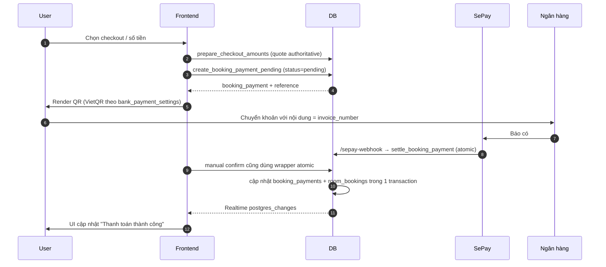

# Module: Payment (VietQR + SePay)

**Phụ thuộc**: Bookings · Subscription · Invoices · Notifications.

## Hai chiều dùng

1. **Khách trả phòng** → tạo `payment_transaction` cho `room_bookings`.
2. **Tenant gia hạn / mua thêm phòng** → tạo `payment_transaction` cho `subscription_plans`.

Cùng schema, khác `metadata.type`:

| `metadata.type` | Ý nghĩa |
|---|---|
| `extend` | Gia hạn subscription (KHÔNG dùng `renewal`) |
| `additional_rooms` | Mua thêm phòng |
| `booking_payment` | Khách trả phòng |
| `deposit` | Đặt cọc |

## Flow VietQR / tiền mặt



### Chi tiết match

- `normalizeString()` loại ký tự đặc biệt + lowercase.
- Tolerance `±payment_tolerance_vnd` (mặc định 1.000đ, configurable theo tenant)
  được dùng nhất quán khi tạo và settle payment.
- Nếu không match → `pending_group_links` chờ thủ công.

### Quote và settlement

- Checkout đơn gọi `prepare_checkout_amounts`; checkout nhóm gọi
  `prepare_group_checkout_amounts` trước khi mở dialog thu tiền.
- Các RPC chỉ nhận số tiền dương, JSON damage hợp lệ và booking/room cùng
  tenant-hotel; quote được khóa trước khi tạo payment.
- Tiền mặt và xác nhận QR đi qua cùng mô hình `pending -> settle`; settlement
  idempotent và phân bổ group payment trong một transaction.

## Bank settings hierarchy

- **Hotel-level**: `bank_payment_settings` per hotel cho khách.
- **Global / Super Admin**: cho subscription.
- Memory: `architecture/payment/vietqr-settings-hierarchy`.

## Realtime invalidation sau payment

```text
['tenant-subscription', 'pending-payments', 'pending-payments-count',
 'payment-transactions', 'invoices']
```

## Edge functions

```text
sepay-webhook            # public, no auth, match + update
sync-sepay-transactions  # backfill manual (manager trigger)
expire-pending-payments  # cron hủy QR quá hạn
```

## QR Public Access

- `/payment-qr/:paymentId` route public — khách scan QR có thể vào không cần login.
- Memory: `qr-payment-public-access-spec`.

## Group payment distribution

- Memory: `group-payment-distribution-fix-v1`.
- Khi pay tổng cho nhóm → tạo một parent payment, validate metadata rồi
  distribute theo các booking đang khóa (checked-out trước, sau đó số dư lớn
  nhất). Phân bổ và cập nhật `amount_paid` là một transaction atomic.
- Sau pay xong **KHÔNG auto checkout** — staff phải bấm checkout thủ công (Group Checkout Enforcement).

## Rủi ro còn lại

- F-PAY-01: Webhook là endpoint public; code đã fail-close, rate-limit và hỗ
  trợ IP allowlist, nhưng production vẫn phải cấu hình secret/IP thật.
- F-PAY-02: Match vẫn bắt đầu từ reference text; amount/tolerance và anomaly
  queue đã giảm false match, nhưng cần tiếp tục theo dõi giao dịch bất thường.
- F-PAY-03: Reference codes còn nhiều convention ở các luồng cũ; cần gom về một
  helper canonical khi dọn legacy subscription/invoice.
