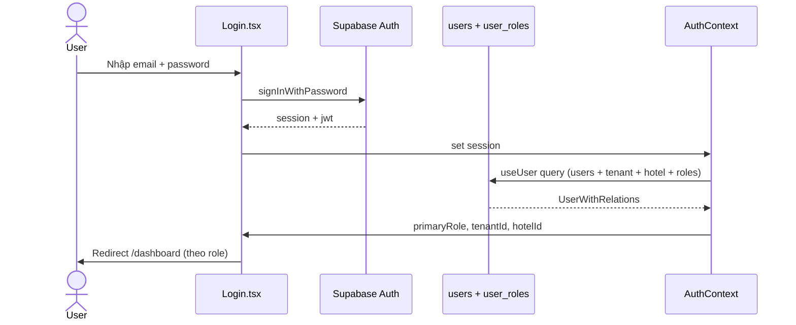
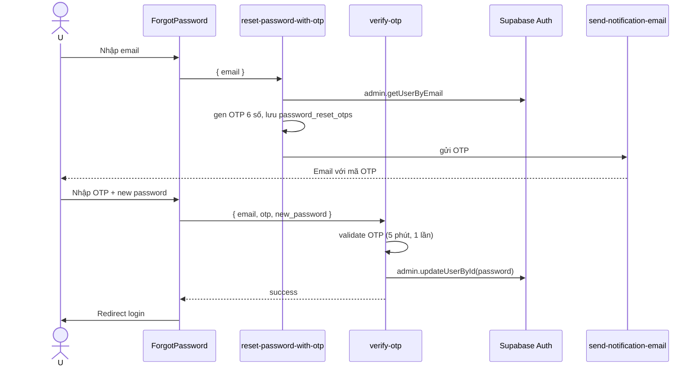

# Flow: Authentication & Onboarding

## Tổng quan
Email/password + Google OAuth. PWA cache credentials cho mobile staff. Password reset qua OTP edge function.

## Sequence: Đăng nhập email/password

## Sequence: Password reset qua OTP

Memory: `secure-otp-and-password-reset-v1`. Password validation high-strength (zod).

## PWA Credential caching
- `lib/credential-manager.ts` lưu credentials vào IndexedDB (encrypted)
- Khi mất mạng + PWA mode → fallback offline auth (read-only)
- Auto re-validate khi online lại
Memory: `pwa-credential-management-spec`.

## Onboarding flow (tenant mới)
1. Register → tạo `auth.users`; chưa có tenant/hotel nào.
2. Nếu cần xác thực email, liên kết email quay về `/auth/callback`. Nếu không cần,
   ứng dụng chuyển thẳng tới `/onboarding`.
3. `AuthCallback` và `OnboardingGuard` thấy hồ sơ chưa có tenant/hotel → chỉ cho
   đi tới `/onboarding`.
4. Chủ khách sạn nhập thông tin công ty và khách sạn đầu tiên.
5. RPC `complete_registration(...)` là điểm cấp phát duy nhất: trong một
   transaction tạo/retry-safe `tenants`, owner `users`, `user_roles=owner`,
   `user_hotels`, khách sạn đầu tiên, dữ liệu mặc định và trial 30 ngày.
6. Một lần bấm lại sau khi RPC thành công chỉ nhận về tenant/hotel đã có;
   không sinh tenant hay khách sạn trùng.

Wrapper khóa dòng `auth.users` để tuần tự hóa các yêu cầu đầu tiên cùng tài khoản
ngay cả khi chưa có `public.users`. Callback/guard dùng chung `getAccountSetupState`:
super admin và owner đã có tenant không phải tạo mới; nhân viên thiếu khách sạn
cần quản lý gán quyền. Lỗi tải profile có màn hình thử lại, không được hiểu là
profile chưa tồn tại. Xem [SaaS giai đoạn 1](../08-ops/managed-saas-phase-1.md).

Tài khoản nhân viên không đi theo luồng này: chủ khách sạn tạo/invite nhân viên
từ khu vực quản lý người dùng, rồi gán vị trí và quyền phù hợp.

## Permissions checkpoint
- `RoleGuard` ở route bao bọc page
- `usePermission(permission)` hook check ở component
- Server-side: RLS + RPC `has_role(uid, role)`
