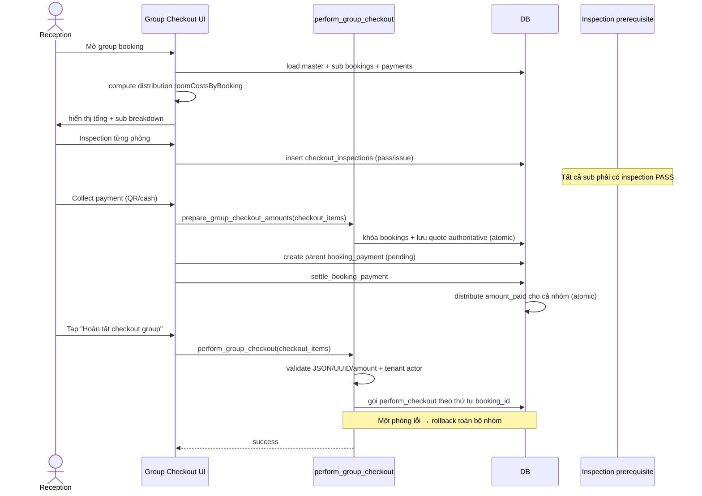

# Flow: Group Checkout

## Tổng quan
Checkout group booking sau khi payment đã đủ. **Manual enforcement** — không auto-checkout khi paid.

## Sequence

## Distribution payment

- `prepare_group_checkout_amounts` lưu tổng thực tế của từng phòng trước khi
  tạo payment; VAT/service fee không tính trên damage compensation.
- `create_booking_payment_pending` kiểm tra tổng dư nợ và scope
  tenant/hotel/group trước khi tạo parent row.
- `settle_booking_payment` khóa mọi booking theo thứ tự ổn định, áp tiền cho
  phòng đã checkout trước rồi theo số dư giảm dần. Retry là idempotent và phần
  vượt tolerance được giữ trong metadata để đối soát, không over-credit.

## Validation

- Payload tối đa 100 booking, không trùng `booking_id`; UUID, numeric amount,
  checkout date và damage JSON phải hợp lệ.
- Booking phải `checked_in`, đúng room/tenant/hotel và actor phải có quyền.
- UI chỉ cho chọn các phòng có inspection `completed` hoặc `not_requested`;
  luồng vẫn cho phép checkout còn nợ khi nhân viên xác nhận theo nghiệp vụ.
- `perform_checkout` là nguồn sự thật cho tenant/room/status validation và
  room/booking transition; wrapper group bổ sung transaction atomic.

## Memory
`unified-group-checkout-spec`, `group-checkout-manual-enforcement-v1`, `group-payment-realtime-v1`.
