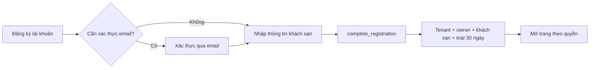

# RoomQC SaaS — Giai đoạn 1: đăng ký và tự thiết lập

Cập nhật: 2026-10-10. Phạm vi đã triển khai là môi trường local; chưa xác nhận
vận hành trên VPS thật.

## Luồng thực tế



Auth signup chỉ tạo `auth.users`. Sau khi chủ khách sạn nhập thông tin thật,
`complete_registration` là điểm cấp phát duy nhất. Các thao tác tenant, hotel,
owner, role, hotel assignment, usage và danh mục mặc định nằm trong transaction.

Tổng số phòng trong onboarding là thông tin quy mô khách sạn. Nó chưa tạo các
phòng có số cụ thể; chủ sở hữu cần thêm phòng thực tế trước khi nhận đặt phòng.
Giá và loại phòng mặc định cần kiểm tra theo khách sạn trước khi đưa vào vận hành.

## Các phần đã triển khai

- Signup có session chuyển tới onboarding; signup cần xác thực quay lại
  `/auth/callback` sau liên kết email.
- Callback chờ kết quả hồ sơ thật, không dùng timeout để suy đoán tài khoản mới.
- Lỗi đọc hồ sơ hiển thị tải lại/đăng xuất, thay vì gửi khách vào form tạo tenant.
- Owner đã thiết lập và super admin không bị gửi lại onboarding chỉ vì không có
  `hotel_id`. Nhân viên chưa được gán khách sạn có hướng dẫn liên hệ quản lý.
- Yêu cầu đổi mật khẩu được xử lý trước đường dẫn `next`.
- Form khóa khi gửi, chặn gửi lặp ngay trong cùng trang, kiểm tra số phòng nguyên,
  và kiểm tra phản hồi đủ tenant/hotel trước khi mở dashboard.
- Lỗi mạng không khẳng định dữ liệu chưa tạo: phản hồi có thể mất sau khi server
  đã commit. Thử lại dùng cơ chế idempotent để lấy thiết lập hiện có.
- Migration `20261010075312_serialize_registration_provisioning.sql` khóa dòng
  `auth.users` trước khi gọi implementation. Dòng này luôn có trước onboarding,
  nên sáu yêu cầu đầu tiên cùng lúc không tranh chấp tạo profile/tenant.
- Wrapper chỉ cho authenticated tự cấp phát hoặc service-role; anon không được
  gọi. Implementation không cho authenticated/anon gọi trực tiếp.

## Kiểm tra có thể chạy lại

Từ thư mục chứa `package.json`, với Supabase local đang chạy:

```powershell
npm run test:provisioning
npx vitest run src/pages/auth/AuthCallback.test.tsx src/pages/auth/Onboarding.test.tsx
npm run test
npm run test:integration
npx supabase db lint --local --schema public --level error --fail-on error
npx supabase db advisors --local --type security --level error --fail-on error
```

`test:provisioning` tự lấy cấu hình stack local qua Supabase CLI, chỉ chấp nhận
loopback, giữ service credential trong tiến trình Node, tạo tài khoản riêng cho
mỗi lần chạy và dọn đúng tài khoản/tenant đó trong `finally`.

Kiểm tra cấp phát bao gồm: anon và bypass wrapper bị chặn; giả user/email bị từ
chối; dữ liệu sai không tạo tenant; sáu yêu cầu đầu tiên đồng thời; retry không
đổi tên hoặc tạo bản ghi trùng; owner/assignment/trial/danh mục; RLS đọc chéo tenant;
nhân viên không được tạo tenant; owner không tự nâng thành super admin và không
đổi dữ liệu khách sạn của tenant khác. Đây là test API/database, không phải bằng chứng
toàn bộ module hoặc toàn bộ thao tác trên trình duyệt đều đã E2E.

Test callback chạy component thật với trạng thái auth/profile được mô phỏng:
onboarding, super admin, owner nhiều khách sạn, nhân viên thiếu assignment,
đổi mật khẩu, lỗi đọc và timeout khi đọc hồ sơ chậm.

Test form xác nhận gửi lặp chỉ gọi RPC một lần, lỗi mất phản hồi giữ lại dữ liệu
đã nhập để thử lại, và phản hồi thiếu hotel không được báo thành công.

## Đưa giai đoạn 1 lên VPS

1. Chọn VPS do RoomQC quản lý và domain ứng dụng/API. Với yêu cầu dữ liệu tự quản,
   dùng Supabase self-host cho backend; frontend là container Nginx hiện có.
2. Chuẩn bị secret riêng cho production, email SMTP, bucket/storage và URL public
   của các Edge Function. Không dùng khóa hoặc mật khẩu mặc định của Supabase local.
3. Áp dụng migration qua kết nối riêng của backend production; kiểm tra kế hoạch
   migration trên staging trước. Không reset database thật.
4. Build frontend bằng URL API HTTPS production và publishable/anon key tương ứng;
   đưa domain qua reverse proxy tới container cổng 8082.
5. Cấu hình Auth site URL và allowlist redirect bao gồm chính xác
   `https://<domain>/auth/callback`. Kiểm tra SMTP và liên kết xác thực trên domain.
6. Đăng ký khách sạn kiểm thử qua domain: xác thực email, onboarding, đọc/ghi một
   dữ liệu thật, tạo nhân viên và xác nhận quyền. Dọn tài khoản test đã định danh.
7. Chạy backup/restore và kiểm tra giám sát trước khi nhận khách trả phí.

Chưa có IP/domain/cấu hình production được xác nhận trong workspace để thực hiện
các bước này. Compose hiện tại chỉ đóng gói frontend; nó không tự cài Supabase
self-host trên VPS. `docs/deploy-vps.md` mô tả phương án frontend VPS + backend
Supabase managed, là phương án khác với triển khai toàn bộ backend trên VPS.

## Công việc tiếp theo

- Chuẩn bị bộ cài backend Supabase self-host phù hợp VPS và domain thật.
- Backup database cùng Auth, cấu hình, Storage objects; lưu riêng ngoài máy chủ.
- Hoàn thiện giám sát lỗi signup/provisioning và dung lượng; đo tải trước khi
  phân bổ khách mới vào nhiều cụm.
- Kiểm tra sâu toàn bộ luồng hết trial, quota và gia hạn trong giai đoạn quản lý gói.
