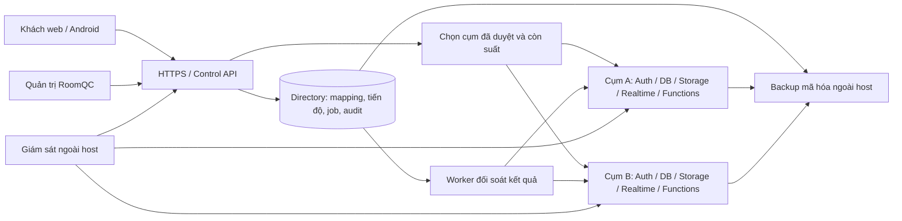

# RoomQC — thiết kế triển khai VPS và đăng ký mới để nhận việc

**Cập nhật nhận việc 29/10/2026 — bản RF06 đang sửa:** phạm vi toàn bộ VPS + signup; đầu ra plan + nghiệm thu. Xem [hồ sơ hiện hành, mục2/5.6/11–12](roomqc-vps-signup-execution-dossier-2026-10-29.md) và [snapshot kế hoạch](../../../artifacts/roomqc-vps-signup-plan-handover-2026-10-29.json). Các checkpoint ghi bên dưới là bằng chứng đúng nguồn riêng; chưa nhận source RF06 hoặc cấp gate từ lần lập kế hoạch này.

**Điểm nhận việc hiện tại — đã nối runtime, 29/10/2026:** phạm vi toàn bộ VPS + signup; đầu ra plan + nghiệm thu. Bản đang sửa334 tệp/hash 6d7d491550eb9258865a2fa26eeae0a0e0934f7a8a5a2e6e8455da0ce24a8dac,587 business/21 directory migrations. [Báo cáo runtime](roomqc-support-intents-runtime-local-2026-10-29.md) và [packet](../../../artifacts/roomqc-support-intents-runtime-b3e1f84b1812-local-2026-10-29.json): native113/113,34barriers/3SIGKILL,exit0 trên source243567; control529pass/201skip/0fail cùng nguồn. Directory r2 có168pass/1fail do expected callback; đã sửa ba assertion và focused r3 đạt1/1 trên source hiện hành. Không cộng thành full169/169 cùng nguồn. Runtime bốn nhóm mutator đã nối journal; native expired recovery mới chỉ chứng minh close_admission,8HTTP retries cùng một API process. Nhận tiếp RF06 legacy,all-family/two-process recovery,worker,populated upgrade/security; R11/BG02 vàBG03–BG11 còn mở. Giữ25task/70ca/124lượt/122mục unverified; actual/reviewer/signoff/gates không đổi.

Lịch sử checkpoint — chỉ áp dụng đúng nguồn của từng báo cáo

**Checkpoint nền journal334/d30e — lịch sử, 29/10/2026:** source334/hash `d30e5ee5908404ed2da8d64ddc955305e98c273086bfe119334fac39b623dcf7`, 587 business/21 directory migrations. [Báo cáo](roomqc-support-intents-foundation-local-2026-10-29.md) và [packet](../../../artifacts/roomqc-support-intents-foundation-207ce2e0ad48-local-2026-10-29.json): directory 169/169 (9 ca journal mới), control 527 pass/0 fail/201 skip; native 104/104 kiểm tương thích Auth/HTTP hiện có, exit0. Journal giữ identity/generation/predecessor bền vững, khóa trên một connection và chặn vòng cũ; đã sửa xử lý backend termination và fixture pool cleanup. **Chưa nối coordinator vào mutator runtime hoặc chứng minh expired recovery qua canonical Auth.** Nhận tiếp RF04/RF05/RF06 tại mục5.4 dossier; R11/BG02, worker, populated business upgrade/security và BG03–BG11 còn mở. Giữ 25 task/70 ca/124 lượt/122 mục unverified, actual/reviewer/signoff/gates không đổi.

**Checkpoint331 — lịch sử consumption, 29/10/2026:** source331/hash `a700ff658818a1f0b8b43420cf120d93768f0fedc34b8b3de32f56a7d7a5ef1f`,587 business/20 directory migrations. [Báo cáo](roomqc-support-consumption-local-2026-10-29.md) và [packet](../../../artifacts/roomqc-support-consumption-331212d94761-local-2026-10-29.json): native104/104,28 barriers/1API SIGKILL; directory160/160; control527pass/0fail/192skip,exit0. Có proof Auth→command→consumption thật, rollback/mất phản hồi/expiry và3 cửa sổ accept-before-revoke cho cluster command. Source/schema đầu–cuối khớp,role baseline phục hồi,cleanup độc lập0. **R11/BG02 còn mở:** expired-attempt recovery,legacy same-key replay,worker,đủ mutation families,populated upgrade và security review; chưa full-default/rebuild/staging/nghiệm thu sản phẩm. [Phiếu nhận tiếp](roomqc-vps-signup-execution-dossier-2026-10-29.md#53-thứ-tự-triển-khai-bản-tích-hợp-source330) và [nghiệm thu](roomqc-vps-signup-master-acceptance-2026-10-28.md#124-thực-thi-bản-tích-hợp-source330). Giữ toàn bộ VPS+signup,8đợt/11BG/25task/27package/70ca/124lượt; actual/reviewer/signoff/gates không đổi.

**Bản nháp source330 — lịch sử, 29/10/2026:** phạm vi **toàn bộ VPS + signup**, đầu ra **plan + nghiệm thu**. Source330, SHA256 `ca77f438a4db58ad9843a7beceaeddec39a4b04d70179fb4c81bfd4417d6bc70`; 587 migration nghiệp vụ/20 directory. Đã viết bước tiêu thụ biên nhận quyền trong giao dịch quản trị; **chưa kiểm tích hợp Auth/HTTP/SQL và nâng cấp dữ liệu cũ cho bản này**. Preflight unit 15/15, exit0 chỉ chứng minh phạm vi helper/gateway/support; native90/90 và control520pass của source327 là lịch sử riêng. Nhận [phiếu R11 bản tích hợp](roomqc-vps-signup-execution-dossier-2026-10-29.md#53-thứ-tự-triển-khai-bản-tích-hợp-source330) và [bài nghiệm thu bổ sung](roomqc-vps-signup-master-acceptance-2026-10-28.md#124-thực-thi-bản-tích-hợp-source330). Hết hạn biên nhận và phục hồi cùng mã lệnh còn cần xử lý; R11/BG02 và các mốc L/S/P/U/B chưa được nhận. [Hồ sơ toàn phạm vi](roomqc-vps-signup-execution-dossier-2026-10-29.md) giữ 8 đợt/11 gói bàn giao/25 task/27 package/70 ca/124 lượt; actual/reviewer/signoff/gates không đổi.

**Checkpoint source327 — lịch sử, 29/10/2026:** [Báo cáo](roomqc-support-acceptance-component-local-2026-10-29.md) và [packet](../../../artifacts/roomqc-support-acceptance-component-4661134f0654-local-2026-10-29.json):source327/hash `e45b9fb53499c81fc65e8fd9af426307cf8c312dd698d10ef68f0051a87aa189`,586 business/19 directory migrations;control520pass/0fail/192skip,native90/90 gồm20 acceptance checks/6 interleaving,23 barriers/1API SIGKILL toàn run;exit0,source/schema khớp,cleanup độc lập0. Đã sửa migration guard và kiểm rollback schema/ACL/history. **Command directory chưa tiêu thụ acceptance**; chưa populated585→586/full-default/rebuild hoặc nghiệm thu sản phẩm. Nhận [R11-04–08](roomqc-vps-signup-execution-dossier-2026-10-29.md#52-phiếu-triển-khai-r11-theo-nguồn327),giữ các giới hạn và [RA01–RA18](roomqc-vps-signup-master-acceptance-2026-10-28.md#12-nghiệm-thu-protocol-r11-và-thành-phần-acceptance-mới). [Plan toàn VPS/signup](roomqc-vps-signup-execution-dossier-2026-10-29.md),25task/27gói/70ca/124lượt,actual/reviewer/signoff/gates không đổi. Audit kế hoạch r2 và checkpoint324 giữ hash/phạm vi lịch sử riêng.

**Checkpoint đã kiểm theo source324 — lịch sử:** [Quyền sau chờ SQL và đọc kết quả local](roomqc-support-authority-boundaries-local-2026-10-29.md) đã kiểm source324/hash `155f197c07839ba0535ac68f94f37898c89ee61375892f1646139b013c796556`:control516pass/0fail/192skip,directory160/160,native Auth/HTTP63checks/14revoke scenarios; terminal0,source/schema khớp và cleanup đúng ownership0. [Packet](../../../artifacts/roomqc-support-authority-boundaries-2765aadfaabb-local-2026-10-29.json). Đã sửa3lỗi late read/final release observation. R11/BG02 vẫn mở protocol revoke xuyênDB và claim/RPC/settle;63checks không thay full-default/rebuild hoặc nghiệm thu VPS. [Plan toàn VPS/signup](roomqc-vps-signup-execution-dossier-2026-10-29.md) có11BG,25task,70ca/124lượt; actual/reviewer/signoff/gates giữ nguyên. Checkpoint323/319 giữ hash/phạm vi riêng.

**Checkpoint local hiện hành — hai daemon tranh chấp, 29/10/2026:** source319/SHA256 `44442d6d9e35e5dd845c30a2780cdb0b6664e8afd5efb2f74b1aea9aec7610f4`,585 business/19 directory migrations. [Run5c839bfe5602](../../../artifacts/roomqc-setup-rotation-contention-5c839bfe5602-local-2026-10-29.json) đạt17 kiểm native, gồm11 contention checks/22 barrier observations qua25 process UID10001/CapEff0/source read-only. Journal chung có hai prepare đang hoạt động, mất phản hồi sau commit và hai replay tranh archive; journal riêng có row wait trước commit và mất response sau commit. Một command/audit/credential mỗi vòng, CAS loser không effects, recovery giữ ID/iat/exp, RPC/overlap và restart lần2 idle. Exit0,source/schema đầu–cuối khớp,9 kiểm session/mutex/canary, role/private files và Docker cleanup0. Hồi quy46pass/0fail/1skip. [Phạm vi và giới hạn](roomqc-setup-rotation-contention-local-2026-10-29.md): ba interleaving local, chưa mọi race hoặc actor revoke xuyên Auth/directory/business. Nhận tiếp R11, rồi BG03–BG11 theo dependency; chưa nhận toàn BG02/sản phẩm. Giữ70ca/124lượt/122mục,reviewer/signoff/gates. Proof storage318/durability316/startup315/mount313 giữ hash riêng.

**Checkpoint local trước — journal corruption/IO, 29/10/2026:** source318/SHA256 `d1cb480efd7729006752894521109579585ea497a728eca88a1f950d6a5335a1`,585 business/19 directory migrations. [Run ceaeeeb36691](../../../artifacts/roomqc-setup-rotation-storage-ceaeeeb36691-local-2026-10-29.json) đạt28 kiểm native, gồm22 storage checks: 10 kiểu journal hỏng và8 điểm FUSE EIO qua syscall thật,62 process UID10001/CapEff0/source read-only. Fault đóng readiness; phục hồi giữ pending/receipt đúng quy tắc, ID/iat/exp và một effect/key; restart lần2 idle/native RPC. Exit0,source/schema đầu–cuối khớp,48 kiểm session/mutex/canary và cleanup Docker0. Hồi quy46pass/0fail/1skip; skip không được nhận. [Báo cáo và giới hạn](roomqc-setup-rotation-storage-local-2026-10-29.md): chưa mọi errno/biến thể filesystem, đĩa vật lý, contention shared/separate journal, actor revoke xuyên DB hoặc VPS UID1000. Nhận tiếp contention và R11; không nhận toàn BG02/sản phẩm. Giữ8đợt/25task/27gói/70ca/124lượt/122mục,reviewer/signoff/gates. Packet316/315/313 giữ hash và phạm vi riêng.

**Phạm vi đã xác nhận:** toàn bộ VPS + signup; đầu ra plan + nghiệm thu. Điểm nhận việc là [phiếu tổng hợp](roomqc-vps-signup-start-pack-2026-10-28.md#0-bản-nhận-việc-đã-chốt). Snapshot lập kế hoạch hash316/1b28aa30 trước khi nối harness giữ trong [audit kế hoạch](../../../artifacts/roomqc-vps-signup-scope-reply-handoff-2026-10-29.json); không là actual của318.

**Checkpoint local đã kiểm — daemon durability, 29/10/2026:** source316/SHA256 `003fd7d7a94f136aabdf06dd8e2dbbe9b4a73c14078dd10d0343378c414d6753`,585 business/19 directory migrations. [Run a4cb64dd5c4c](../../../artifacts/roomqc-setup-rotation-durability-a4cb64dd5c4c-local-2026-10-29.json) đạt25 kiểm native (19 durability),23 process UID10001/CapEff0/source read-only: command_synced SIGKILL; pending_synced SIGTERM/SIGKILL; daemon trước/sau publication rename/sau directory sync và trước/sau archive sync. Recovery giữ cùng pending/receipt/ID/iat/exp, đúng1 command/audit/credential; restart lần2 idle. Exit0,source/schema khớp,24role/private root và Docker objects sạch; hồi quy46pass/0fail/1skip. [Actual và giới hạn](roomqc-setup-rotation-durability-local-2026-10-29.md): chưa full corrupt/partial journal/native disk fault/contention, actor revoke xuyênDB hoặc profile VPS staging; chưa nhận toàn BG02/sản phẩm. Giữ8đợt/25task/27gói/70ca/124lượt/122mục,actual/reviewer/signoff/gates. Packet315/313 giữ nguồn và phạm vi riêng.

**Checkpoint local trước — startup SIGTERM/pending, 29/10/2026:** source315/SHA256 `861de21bb7bda63ba5ab0419d3fb548e4513a68ddb070d028af7e9aecaaeba96`,585 business/19 directory migrations. [Run db40d4b8c62b](../../../artifacts/roomqc-setup-rotation-startup-db40d4b8c62b-local-2026-10-29.json) đạt16 kiểm native (10 startup/pending),13 process UID10001/CapEff0; đã tái hiện baseline chết do SIGTERM khi initialize, sửa handler trước async startup và stop latch. Config/init/pending/durable prepare/once stop không dispatch mới; restart giữ key/body/context, đúng1command/1audit/nativeRPC, lần2 idle. Exit0,source/schema khớp,24role/private root và Docker objects dọn sạch; hồi quy53pass/0fail/1skip. [Periodic19d9702d9487 cùng315](../../../artifacts/roomqc-setup-rotation-periodic-19d9702d9487-local-2026-10-29.json) đạt17 kiểm/20 process, timer/backoff/kill/replay/cutoff/expiry/revoke và idle/postcommit SIGTERM, exit0/source/schema khớp/cleanup0. [Actual và giới hạn](roomqc-setup-rotation-startup-local-2026-10-29.md): còn publication/archive/corruption/disk/full contention, actor revoke xuyênDB và profile staging; chưa nhận toàn BG02 hoặc sản phẩm. Giữ8đợt/25task/27gói/70ca/124lượt/122mục,reviewer/signoff/gates. Packet310/313 dưới đây là lịch sử đúng nguồn riêng.

**Checkpoint local trước — worker container mount/reload, 29/10/2026:** nguồn313 tệp/backend SHA256 `d17734a0a3c1076f8ef2de2e8913494af85be9126863e898e642804119eb374a`,585 migration nghiệp vụ/19 directory. [Run57bad49c6aea](../../../artifacts/roomqc-setup-runtime-mount-57bad49c6aea-local-2026-10-29.json) đạt27 kiểm native (21 worker),9 CLI và1 worker container UID10001/CapEff0; input/output/source read-only, rename→reload không restart, missing/unreadable/malformed/wrong binding/RPC unavailable/expiry/revoke đóng readiness và giữ job/attempt trước batch. Native RPC cũ bị từ chối theo cutoff DB; phục hồi xử lý mỗi job đúng1lần. Exit0,source/schema không đổi,cleanup0; hồi quy48 pass/0 fail/1 skip. [Báo cáo và giới hạn](roomqc-setup-runtime-mount-local-2026-10-29.md): positive là closed-dispatch/waiting_owner, chưa signup E2E; UID1000/VPS staging, full fault windows và actor revoke xuyên DB còn mở. Giữ8đợt/25task/27gói/70ca/124lượt/122mục,reviewer/signoff/gates. Các checkpoint310 phía dưới là lịch sử đúng source riêng, không gán lại cho313.

**Checkpoint local trước — periodic daemon và SIGTERM, 29/10/2026:** nguồn integration 310 tệp/backend SHA256 `7e41e984c100e1db977d1da7bf232fe847ac5296d146beadd38a6f4f26401abd`, 585 migration nghiệp vụ/19 directory. [Run native 23f18d88c646](../../../artifacts/roomqc-setup-rotation-periodic-23f18d88c646-local-2026-10-29.json) đạt 17 kiểm (11 rotation) qua 20 process UID10001/CapEff0: timer/backoff thật, phục hồi sau mất response, SIGTERM khi idle và sau DB commit; exit0, source/schema không đổi, cleanup0. Control cùng nguồn: 511 pass/0 fail/184 skip. [Báo cáo và giới hạn](roomqc-setup-rotation-local-2026-10-29.md#periodic-daemon-và-sigterm-native--run-23f18d88c646). BG02 còn các cửa sổ SIGTERM/race/journal, container worker mount/reload và revoke Auth→directory; chưa nghiệm thu toàn BG02 hoặc sản phẩm. [Audit kế hoạch trước lượt native](../../../artifacts/roomqc-vps-signup-plan-review-2026-10-29.json) là snapshot tài liệu lúc lập plan. Giữ nguyên 8 đợt, 25 task, 27 gói, 70 ca/124 lượt, actual/reviewer/signoff và gate.

**Checkpoint local lịch sử — rotation 29/10/2026:** backend310 tệp, SHA256 `314c1ec4b68fec86b5cf49aedf6d328555e4545f7d934520989b362fca74cb4a`;585 business+19 directory. [Daemon/journal và DB ready-head fence](roomqc-setup-rotation-local-2026-10-29.md) có14 kiểm native (8 rotation),18 process UID10001/CapEff0, kill/replay/overlap/expiry/revoke; unit509 pass/184 skip/0 fail. Run1c06a184f980 exit0, source/schema không đổi, cleanup0. Phạm vi entrypoint `--once`; chưa periodic daemon lâu/SIGTERM, full race/fault matrix, runtime container read-only mount/reload hoặc actor revoke xuyên hai DB. [Runbook mới](roomqc-setup-credential-rotation-runbook.md). Tiếp BG02 phần còn thiếu; BG06 phải khóa candidate mới. Các checkpoint301 phía dưới giữ lịch sử, không phải nguồn hiện hành. Không đổi70ca/124lượt/122mục, reviewer/signoff/gates.

Ngày chốt kế hoạch: **28/10/2026**. Phạm vi: **toàn bộ VPS + signup**. Đầu ra: **kế hoạch triển khai và bộ nghiệm thu**. Đây là bản hướng dẫn nhận việc của [kế hoạch tổng thể](roomqc-vps-signup-master-plan-2026-10-28.md), dùng nguyên **8 đợt, 25 task, 27 gói, 70 ca và 124 lượt môi trường**. Các mã BG bên dưới là 11 lần bàn giao đã có trong [bảng triển khai](roomqc-vps-signup-implementation-board-2026-10-28.md); không tạo task hoặc gate thay thế.

## 1. Kết quả khách hàng và RoomQC phải dùng được

Khách vào website → đăng ký → xác minh email → tạo khách sạn → tạo phòng → mời nhân viên theo vị trí → sử dụng web/Android. Khách không phải thuê VPS hoặc cài Docker. RoomQC chịu trách nhiệm cấp tài nguyên, phân quyền, gói sử dụng, backup, cảnh báo và hỗ trợ.

RoomQC chuẩn bị các cụm trước, rồi đặt khách mới vào cụm còn khả năng tiếp nhận. Nhiều workspace dùng một cụm, được cách ly theo tenant và quyền. **Không tạo một VPS/full stack riêng cho mỗi lần đăng ký.** Mapping của khách cũ giữ ổn định; thêm cụm chỉ mở thêm chỗ cho khách mới. Chuyển khách đang dùng là quy trình di chuyển dữ liệu riêng.

Sơ đồ là thiết kế đích. Hai cụm cùng một VPS vẫn cùng rủi ro mất host. Không dùng số tài khoản hoặc 1.000 dòng metadata để cam kết sức chứa 1.000 khách sạn/100.000 người đồng thời.

## 2. Điểm xuất phát thực tế và việc nhận ngay

**Điểm nhận việc hiện tại:** đọc [master mục0.2–0.3](roomqc-vps-signup-master-plan-2026-10-28.md#02-việc-cần-làm-ngay-và-cách-biết-đã-làm-xong) và [bài worker/container](roomqc-vps-signup-master-acceptance-2026-10-28.md#102-bài-nghiệm-thu-worker-đọc-khóa-trong-container). Nguồn313/hashd177 ở đầu trang đã được kiểm ngày29/10. Scheduler/journal đã có và periodic/SIGTERM idle/post-commit có diagnostic proof; mount/reload đã có diagnostic local; phần còn thiếu là full fault windows, profile staging và revoke actor. Những checkpoint301/295/294 dưới đây giữ làm lịch sử theo source, không phải danh sách cần viết lại từ đầu.

**Checkpoint local trước — 29/10/2026:** backend301 tệp, SHA256 `2ec50f6dd1e473a45a54636594d6fd59451c452eb1f5d0f1a375bd1795b371d0`. [Runtime kiểm khóa live trước nhận việc](roomqc-setup-runtime-readiness-local-2026-10-29.md) đã sửa lỗi file còn hạn nhưng khóa đã revoke vẫn vượt readiness. Native run39f0f08155b0 đạt38 kiểm (22 worker,8 backfill,8 apply), source/schema không đổi và cleanup0; unit495 pass/184 skip/0 fail. Đây là diagnostic local; chưa daemon rotation, runtime UID/mount read-only hoặc thu hồi quyền nguyên tử xuyên hai database.

**Nhận tiếp BG02:** scheduler/journal, hai rotator và overlap/expiry khi daemon chết; container runtime chỉ mount output read-only; chốt điểm hiệu lực Auth→directory. R4 là [snapshot kế hoạch](../../../artifacts/roomqc-vps-signup-execution-plan-audit-r4-2026-10-29.json) của source301/ede96e trước sửa runtime, verifier r4 phải từ chối nguồn mới; giữ nguyên lịch sử, không nới pin. Các packet rebuild/filesystem/restore phía dưới có phạm vi nguồn riêng. Giữ8đợt/25task/27gói/70ca/124lượt,70ca not_run/122mục unverified, reviewer/signoff/gates chưa đổi.

Checkpoint lịch sử source295/bf2d đã có [actual nonroot](roomqc-setup-installer-nonroot-local-2026-10-29.md)170/170,49 ca IF14,147 cleanup và238 CLI witness; control674 pass/2 skip cùng source. Đây là diagnostic bộ cài, chưa full-default/rebuild. Bảng bên dưới giữ checkpoint source294 làm lịch sử; không cộng382 của source294 vào170 của checkpoint source295, cũng không gán hai kết quả đó cho source301.

| Đối tượng | Trạng thái dùng để nhận việc |
|---|---|
| Checkpoint source294 đã kiểm theo phạm vi | Backend **294 file**, SHA256 **a4ed41c998065f6c8ade71a4c010a5e9276d6113de3bbff7df2bf2e82fa6c960**. [Native382/382](../../../artifacts/roomqc-setup-installer-filesystem-native-3902198db24e-local-2026-10-28.json), gồm 120 installer; [control 676 tổng/674 pass/0 fail/2 skip](../../../artifacts/roomqc-workspace-recheck-037d01f02abe-local-2026-10-28.json). Terminal0, source/schema đầu–cuối và cleanup 0 đúng packet. Đây là diagnostic và hồi quy, chưa full-default/rebuild hoặc nghiệm thu sản phẩm |
| Tệp private | Đã sửa hardlink ở private operator access và sensitive reader; kiểm inode trước mở, sau mở và sau đọc. [Linux UID10001/capabilities0](../../../artifacts/roomqc-installer-nonroot-topology-83bc7694a807-local-2026-10-28.json) đạt3/3 ca, hardlink bị chặn, unlink rồi dùng lại được. Source mount read-only. Bài này chỉ là topology/component, **IF14/IF15 vẫn false** |
| IF12 lịch sử/source294 | Bốn CLI SIGSTOP được chứng kiến qua /proc rồi SIGKILL thật tại intent_synced,stage_synced,before_rename,after_rename. Cùng issue key/body/caller phục hồi đúng ID/iat/exp; một command/audit/credential;16 lần kiểm cleanup session/mutex. Fixture UID0/tmpfs; không dùng thay UID không đặc quyền hoặc lỗi volume thật |
| Lịch sử phải giữ | [IF11/source 291](roomqc-setup-installer-deadlines-local-2026-10-28.md), SHA256 bb21bef86c200d3d09c950b11c96417710bb9a9a47af7af0d3a0200caec2a367 và IF12 focused/source 293 có packet riêng. Nháp cde8 từng chưa có proof; câu đó là lịch sử, không phải trạng thái mới. [Run c8ff55ade9ba](../../../artifacts/roomqc-setup-installer-filesystem-interrupted-c8ff55ade9ba-local-2026-10-28.json) đã dọn đúng ownership, còn terminal gốc chưa biết. [Run26b321e3ca37](../../../artifacts/roomqc-setup-installer-filesystem-native-cancelled-26b321e3ca37-local-2026-10-28.json) đã chủ động hủy để sửa hardlink, terminal 1/cleanup 0; không được tính pass/fail sản phẩm |
| Harness đã sửa | Preload quan sát đúng khi PID limit32; limit16 bị chặn ở pids.current16/pids.events.max1, không phải OOM. Query IF12 đọc c.request->>'operation', phù hợp schema hiện hành; không đổi schema để vượt lỗi test |
| Database |584 migration nghiệp vụ +19 directory trong DB disposable của packet; không áp migration vào DB đang phục vụ trong lượt này |
| Nghiệm thu chính thức |25 task/27 gói/70 ca/124 lượt (54 local, 69 staging, 1 pilot);70ca not_run và122mục unverified. Chưa gán reviewer/signoff hoặc mở gate |

**Phiếu nhận hiện hành, BG01 → BG02/T01/T08/T12:**

| Bước | Làm cụ thể | Bằng chứng phải giao / lúc dừng |
|---|---|---|
|1. Đối chiếu source | Kiểm hash301/ede96e và manifest của filesystem f9b57c8fb3f6, rebuild afe3e00ebfa2 và control838f5f251a47 | Khớp phạm vi từng packet, terminal/schema/cleanup và giới hạn; không gán restore snapshot cho backend candidate |
|2. Review proof filesystem | Đọc actual4 mốc kill/49 ca quyền/11 ca volume,271 CLI process UID10001, source read-only và CapEff0 | Positive→fault→recovery, receipt/expiry/canary đúng. `fullFaultMatrixVerified=false` được giữ; reviewer nêu từng khoảng trống, không tự nhận toàn tuyến |
|3. Quyết định delta BG01 | Lập danh sách proof thiếu/defect/skip so với IF01–IF17; phân biệt FUSE/syscall với hỏng đĩa phần cứng | Chỉ bổ sung test hoặc sửa khi có khoảng trống, lỗi hoặc source drift. Không chạy lại181 kiểm chỉ để tăng số |
|4. Nhận BG02 | Chốt timeline TTL/overlap/revoke, hai rotator, runtime mount directory read-only và reload inode mới | Giao protocol và bài thử §9/BG02; worker vận hành chưa bật trước khi proof quyền/expiry/reload được review |
|5. Chuẩn bị độc lập | Lập inventory/budget/Q01–Q10, fixture signup/console và staging bundle | Tiếp tục phần không cần key/quyền; không ký BG03–BG06 trước dependency gốc |

Các verifier [deadline](../../../scripts/verify-vps-signup-installer-deadlines-checkpoint.mjs), [plan-handoff](../../../scripts/verify-vps-signup-plan-handoff.mjs) và [r4](../../../scripts/verify-vps-signup-plan-checkpoint-r4.mjs) giữ pin lịch sử riêng, phải từ chối source hiện hành; không dùng làm lệnh kiểm bản mới hoặc nới pin. [Audit hiện hành](../../../artifacts/roomqc-vps-signup-plan-review-2026-10-29.json) đối chiếu source, protected hashes, dependency, coverage và link; không thay kiểm sản phẩm hoặc release approval. [Audit r4](../../../artifacts/roomqc-vps-signup-execution-plan-audit-r4-2026-10-29.json) được giữ nguyên để truy xuất lịch sử.

## 3. Các quyết định cấu hình phải khóa trước đúng bước

| Mã | Quyết định / hồ sơ cần điền | Người chịu trách nhiệm | Cần trước |
|---|---|---|---|
| Q01 | Inventory từng VPS: nhà cung cấp/region/OS/vCPU/RAM/data disk/inode/mount/network/dịch vụ cùng host/chi phí/owner | OPS, RQ duyệt ngân sách | BG03 dự toán; BG07 target thật |
| Q02 | Tách control/directory và cụm nghiệp vụ ra sao; host/failure domain của A/B, backup và giám sát | OPS/BE | BG03/BG07/BG09 |
| Q03 | Tên miền đã biết: roomqc.com. Chốt hostname app/API/admin, wildcard hay path routing, TLS issuer/renewal, callback và Android deep link | RQ/OPS/FE | BG04 Internet/BG07 |
| Q04 | Auth model/issuer từng cụm; canonical actor authority; điểm nhận/revoke; cửa sổ handoff tối đa5giây; phục hồi durable khi Auth accepted nhưng directory chưa commit/hết hạn. Source331 đã có native proof phần consumption; expired/legacy recovery còn cần thiết kế và kiểm | BE/QA; RQ nhận tác động tới lệnh in-flight | BG02; [phiếu RF01–RF09](roomqc-vps-signup-execution-dossier-2026-10-29.md#54-phiếu-chi-tiết-để-khép-expired-attempt-recovery-và-legacy-replay) và [nghiệm thu RX](roomqc-vps-signup-master-acceptance-2026-10-28.md#125-nghiệm-thu-phục-hồi-cùng-mã-lệnh-và-legacy-replay). JWT còn hạn không thay quyền live; không tự renew hoặc đổi key |
| Q05 | Bảng gói có version: trial, khách sạn/phòng/nhân viên/storage/API/jobs; grace/suspend/resume/export/retention/delete | RQ/BE | BG03/BG04; giá trị chưa duyệt để TBD |
| Q06 | Consumer DB/role/replicas/pool/fixed connections/maintenance/rolling overlap, headroom và stop thresholds | OPS/BE/QA | BG03 |
| Q07 | Email provider/sender/domain/webhook/inbox thử; DNS SPF/DKIM/DMARC theo cấu hình provider | OPS/RQ | BG04 D15. Chưa coi Resend đã hoạt động chỉ vì từng mở dashboard |
| Q08 | Offsite store/failure domain/key custodian/retention/restore host; consistency và revoke checkpoint | OPS/BE/RQ | BG08 |
| Q09 | Người trực chính/phụ, kênh ngoài host, escalation, giờ hỗ trợ, người được đóng/mở/restore | OPS/RQ | BG08 và pilot |
| Q10 | Reviewer theo hạng mục, cohort pilot, workload, SLO, operating limit và người quyết định L/S/P/U/B | QA/RQ | Review từng BG; BG10/BG11 |

Không yêu cầu secret trong chat. Theo chỉ dẫn hiện có, phần thiếu khóa/quyền ghi chờ đầu vào; tiếp tục code/fixture/template không phụ thuộc. Không thay TBD bằng giá trị thương mại hoặc sizing tự đoán.

## 4. Mười một phiếu bàn giao có đầu ra cụ thể

Mỗi phiếu dùng dependency task gốc ở master plan và ledger. “Được chuẩn bị” không đồng nghĩa được ký hoàn tất task khi dependency chưa đạt. BE: backend; FE: web/Android; OPS: hạ tầng; QA: kiểm/review; RQ: người quyết định RoomQC. Đây là phân vai, chưa gán tên người.

| Phiếu / task gốc | Việc triển khai theo thứ tự và vị trí chính | Đầu ra kiểm được / điều kiện nhận |
|---|---|---|
| **BG01 — bộ cài an toàn**; T01,T02,T03,T04,T08,T12; BE/OPS, QA review | Đối soát run dở → sửa observer test → actualCLI filesystem kills → nonroot/path safety → lỗi volume thật → freeze/hồi quy. [Installer](../../../server/control/setup-credential-installer.mjs), [filesystem native](../../../server/control/testing/setup-installer-filesystem-native.mjs), [fault matrix](roomqc-setup-installer-fault-matrix-2026-10-28.md) | CLI check/bind/issue/publish/replay/revoke; 1 command/audit/credential mỗi key; mode/owner/link/canary đúng; crash không ready giả; replay giữ ID/iat/exp; IF01–IF17 và cleanup0 đúng source. Mock errno không đóng fault filesystem thật |
| **BG02 — thay/thu hồi khóa**; T03,T08,T12; BE/OPS, QA review | Thêm/làm rõ scheduler theo expiry DB → single writer/target → hai rotator → overlap/expiry khi daemon chết → worker UID/mount directory read-only/reload inode → protocol Auth→directory → writer/advisor review. [Runbook khóa](roomqc-setup-credential-installer-runbook.md), [setup runtime](../../../server/control/workers/setup-runtime.mjs) | TTL 120–3.600 giây, overlap 10–60 giây theo policy được duyệt; không credential thứ ba trái policy; khóa cũ vô hiệu đúng mốc; worker không claim nếu file thiếu/hết hạn/revoked; signer/DSN không trong mount runtime. 808 advisor findings phải disposition/review |
| **BG03 — cụm được nhận khách**; T05,T06,T07,T09,T10; BE/OPS, QA review | Inventory mọi vendor/consumer và budget → health/freshness/manual-close → admission atomic → quota/fairness/backpressure → incident/retry. [Budget](../../../deploy/control-resource-budget.example.json), [store](../../../server/control/store.mjs), [telemetry](../../../server/control/telemetry.mjs) | Consumer unresolved=0 trên profile nhận; 20 request tranh suất cuối không oversell; stale/full/untrusted/closed chặn nhận; tenant cũ giữ mapping; old+new rolling/backup fit budget; noisy tenant không làm tenant đối chứng starvation |
| **BG04 — khách tự đăng ký**; T11,T12,T13; BE/FE/OPS, QA review | Nối start/intent/reserve/Auth/verify/hotel/rooms/status → F5/resume → recovery worker → distributed limiter/directAuth gate → email/callback → quota/trial lifecycle. [API](../../../server/control/app.mjs), [Onboarding](../../../src/pages/auth/Onboarding.tsx), [Auth email](../../../src/components/auth/EmailAuthForm.tsx) | Một tenant/hotel/trial, owner đúng; lost response chỉ tra cùng request; hai tab không tạo trùng; signup-off vẫn login/reset/invite; quota enforce server; verify/reset/invite vào inbox kiểm soát Gmail/Outlook. Sink chỉ nhận local |
| **BG05 — hai console vận hành**; T14,T15,T16,T17; FE/BE, QA/RQ review | Inventory endpoint/UI → totals/filter/cursor → backup DTO → tenant-summary đúng cụm → config/lệnh/result → menu/Back/focus/mobile. [Infrastructure](../../../src/pages/admin/InfrastructurePage.tsx), [Registrations](../../../src/pages/admin/RegistrationsPage.tsx), [admin read](../../../server/control/admin-read.mjs) | 1.000 metadata có đáp án; tìm ca kẹt <30 giây; đủ đường click; metric stale/backup unavailable không là0/healthy; journal trước POST, F5 đọc lại result; keyboard/390px/zoom200%/Back đúng ngữ cảnh |
| **BG06 — bản tích hợp local**; T01–T17 theo dependency; BE/FE/OPS, QA review | Chốt source/image/schema/config/contract → full-default → dựng lại độc lập → kiểm security/secret/skip/failure → demo chung. [Sandbox](../../../scripts/test-control-backend-sandbox.mjs), [source binder](../../../scripts/control-backend-source-binding.mjs) | Cùng candidate, terminal thật, schema/source đầu–cuối khớp, cleanup0; các skip có impact và xử lý; full run có proof riêng. Scoped diagnostic không thay full integration. Đề nghị L sau review |
| **BG07 — VPS staging**; T18,T05–T10 phần staging; OPS/BE, QA review | Nhận Q01–Q04/Q06 → bundle/dry-run/preflight → secrets/UID/firewall/private network → cài/rerun/reboot → TLS/renewal/vendor smoke → nâng cấp/application rollback. [VPS runbook](../../deploy-vps.md), [control compose](../../../docker-compose.control.yml) | F01–F04/B01 trên Linux VPS thật; sai target/port/volume/budget dừng trước init; không public DB/Studio/metrics; không xóa volume populated; transcript cài và rollback có dữ liệu. Đề nghị S |
| **BG08 — backup và người trực**; T19,T20,T07 ngoài host; OPS, QA/RQ review | Consistency checkpoint → encrypt/upload/readback offsite → làm host gốc unavailable → restore host sạch → fence writer/revoke checkpoint → kiểm dữ liệu/routing → alert/on-call drill. [Restore harness](../../../scripts/test-roomqc-backup-restore-isolated.mjs) | F05–F09/B09; DB/Auth/directory/object bytes/jobs/receipts nhất quán, một writer, quyền revoke không sống lại; RPO/RTO đo thật; người trực nhận/ack/khôi phục. Backup log xanh chưa đủ |
| **BG09 — A/B và E2E thật**; T21,T22; QA/FE/BE/OPS | Hai cụm độc lập đồng thời → cross-token/data/storage/Realtime → web sạch → Android emulator/device → email/deep link/keyboard/Back/offline/background/resume → mất response/worker crash | UI+network+DB+receipt cùng run; không fallback sang cụm khác; owner và nhân viên đúng quyền; build/OS/device được ghi. jsdom/adapter mock/desktop resize không thay Android actual |
| **BG10 — sức chứa và RC**; T23,T24; QA/OPS, BE/FE/RQ review | Khóa profile/workload/SLO/stop thresholds → ramp → soak/noisy neighbor/backup overlap → lặp mức đề nghị → chi phí/limit → freeze/rebuild → cutover/application rollback | 123 lượt local/staging được review trước pilot; không Critical/High scope quyền/dữ liệu/cấp phát/restore; max_tested và operating_limit riêng, DR/on-call/killswitch có proof. Đề nghị P cho exact cohort; G08 còn chờ |
| **BG11 — pilot rồi mở rộng**; T25; OPS/RQ, QA review | 1 khách sạn nội bộ → ổn 24–48 giờ mới đề nghị 5–10 → quan sát ≥7 ngày → kiểm incident/backup/alert/support/cost → sửa tồn đọng → quyết định phạm vi mở | G08 có actual/reviewer; báo availability/latency/errors/capacity/cost/feedback và giới hạn. RQ quyết định U riêng. B chỉ mở khi thanh toán/thu phí được nghiệm thu riêng |

Không chạy toàn bộ bộ test sau mỗi sửa nhỏ. Từng delta chạy kiểm phù hợp; candidate cuối mới full-default/rebuild/E2E/tải theo môi trường. Mỗi bằng chứng chỉ áp cho đúng source/profile của nó.

## 5. Luồng đăng ký và hợp đồng API phải khép

Base path thực tế: `/api/control`. Trạng thái bên dưới lấy từ `x-implementation` của [OpenAPI](../../../server/control/contracts/control-v3.openapi.json) lúc lập plan; đây là inventory hợp đồng, chưa chứng minh toàn tuyến đã chạy.

| Bước / API hiện có | Trạng thái hợp đồng | Delta / ca nghiệm thu |
|---|---|---|
| POST `/signup-intents` | implemented-foundation | Intent có expiry/key/limiter, origin đúng; closed/full trả lý do, zero unwanted effect; không nhận target/gói/quyền tùy ý từ client. C05–C10,D01,D12–D14 |
| GET `/workspaces/{slug}/bootstrap` | Đối chiếu handler và contract khi nhận T04 | Chỉ route về endpoint được duyệt và mapping hiện có; không chuyển khách A→B vì A lỗi. A03,C09–C10,G01–G03 |
| Supabase Auth verify/reset/invite/callback | Ngoài base path control; kiểm cả gateway và direct Auth | Link đúng origin/workspace/Android; expiry/resend/replay; signup-off không phá login/reset/invite; xác minh quyền live. A08–A11,D02–D06,D12–D15 |
| POST `/workspaces/{slug}/provision` | Đối chiếu handler và contract khi nhận T04 | Owner confirmed/live, reservation đúng; dispatch trước network; không tin client plan/cluster/owner; cùng key chỉ một tenant/hotel/trial. D01–D11 |
| GET `/workspaces/{slug}/setup-status` | Đối chiếu handler và contract khi nhận T04 | Owner-only/no-store, chờ người/đang xử lý/cần hỗ trợ/active riêng; stale response sau logout/đổi actor bị bỏ; không trả secret. D04–D11 |
| GET `/admin/workspaces/{id}`; POST `.../recheck`; GET `.../recheck-result` | Recheck implemented-foundation | Dialog impact/reason/snapshot/version/key; journal trước POST;202 là pending,200 receipt chưa bảo đảm active; F5 lookup cùng key. A09–A11,D07–D11,E05,E08 |
| GET `/admin/workspaces/{id}/tenant-summary` | **planned** | Hẹp quyền service-to-service đúng bound cluster; timeout=unavailable, không impersonate owner hoặc fallback. T16/E02,E08 |
| GET `/admin/backups` | **implemented-local** | [API/UI metadata có proof local](roomqc-control-backups-local-2026-10-29.md):DTO/filter/cursor/totals/null vàread error riêng.Chưa proof backup/offsite/restore/VPS.T15/E03–E05,F05–F08 còn nghiệm thu môi trường |
| GET `/admin/clusters`; GET `.../{id}`; POST `.../register`; POST `.../{id}/commands`; GET `.../{id}/command-result` | Register implemented-local; inventory phần còn lại tại T04 | Register chọn approved endpoint/ref, admission đóng tới khi đủ proof; commands chỉ allowlist hiện hành, CAS/replay/result và quyền live; không arbitrary probe URL. C01–C04,E03–E05,E08 |

Việc thêm một endpoint planned phải đi cùng handler/DTO/OpenAPI/client/native allowlist/UI/loading-empty-error và proof HTTP+effects. Không hoàn tất chỉ bằng khai báo route hoặc thêm nút.

### 5.1. Dữ liệu tối thiểu và vòng đời gói

| Đối tượng | Dữ liệu/quan hệ cần kiểm | Quy tắc nghiệm thu |
|---|---|---|
| Owner | Auth identity, confirmed email, quyền hiện hành; liên kết workspace | Không dùng user_metadata để cấp quyền; revoke/logout và callback cũ không tạo ghi trái phép |
| Workspace | slug/ID, cụm cố định, reservation, phase/history, owner, dispatch/job/result | Retry không đổi identity/cụm; unknown không tự trả suất hoặc provision lại |
| Tenant/hotel/trial | Liên kết workspace, owner, policy version, thời điểm/hạn từ server | Atomic theo giao thức; một request không cấp thêm trial khi F5/replay |
| Nhân viên | Vị trí, hotel assignment, module/action permissions, invitation state | Người mời không cấp quá quyền; có quyền ngay khi tạo/nhận mời; nhân viên trái hotel bị chặn cả API |
| Gói/usage | Policy version và hotel/phòng/staff/storage/API/job limits, kỳ dùng, grace/suspend | Hai request tranh quota cuối không vượt; client sửa UI không đổi limit; expiry/suspend/resume có audit |
| Lệnh vận hành | actor/target/reason/version/key/canonical payload/result/audit | Một effect; khác body/caller/target conflict; mất response đọc cùng receipt, không key mới |
| Backup/cảnh báo | Snapshot consistency/revocation/object checksums; incident/delivery timeline | Restore và nhận cảnh báo được thử thật; stale/missing không chuyển thành an toàn |

Các tên trên là hợp đồng dữ liệu cần đối chiếu schema hiện hành, không phải yêu cầu tạo bảng trùng. Chính sách giá/grace/retention/delete chờ Q05; không tự thu phí hoặc xóa dữ liệu thật. Nếu cần API gói mới, inventory và review tại T04/T10/T11 trước triển khai.

## 6. Ngân sách tài nguyên và cách tăng cụm

Mỗi host và DB có một phiếu riêng: `configured / observed / reserved / usable / peak overlap / headroom / owner / reviewer`. Các consumer tối thiểu: control API, directory, setup/health/alert workers, Auth, REST, Storage, Realtime, Functions, pooler, exporter, backup và migrator.

`Tổng upstream thực = replica × pool + fixed/listener/replication + periodic/maintenance + old/new rolling overlap ≤ usable connections`.

Phân biệt client connections ở pooler và upstream thật, không cộng hai lần; Realtime sockets/phiên người dùng không tương đương connection DB. Cùng lúc kiểm RAM/CPU/IO/WAL/disk/inode/object size/queue age. Không tăng pool để che thiếu backpressure.

Trình tự hết chỗ: đóng admission có lý do → alert → chuẩn bị cụm mới → install/trust/backup/budget/smoke/approve → canary khách mới → mở dần trong operating_limit đã đo. Khách cũ giữ mapping. Host có nhiều cụm phải chia tổng budget và ghi rõ cùng failure domain.

Mục tiêu **đề xuất cần review trước run**, chưa là SLA/actual: status p95 ≤500 ms; reserve/admin list p95 ≤1 giây; provision p95 ≤10 giây ngoài chờ email/người; soak ≥60 phút, 5xx ngoài fault <1%; offsite RPO ≤24 giờ/RTO ≤4 giờ; host detected ≤180 giây/received ≤300 giây; pilot availability API quan trọng≥99,5% trong ≥7 ngày. Stop thresholds tài nguyên phải khóa theo profile trước khi tăng tải; không đổi giữa run để biến fail thành pass.

## 7. Hồ sơ và buổi nghiệm thu bắt buộc

Dùng [hồ sơ nghiệm thu](roomqc-vps-signup-master-acceptance-2026-10-28.md) và [124 lượt](../../../artifacts/roomqc-vps-signup-acceptance-execution-plan-2026-10-28.json). Mỗi lượt có exact candidate/target/dataset/command, runner/reviewer, expected gốc, actual, terminal, DB/file/network effects, evidence, defect và cleanup. Kết quả/runner/reviewer vẫn trống tới khi thực thi.

| Buổi | Tác vụ demo, positive → negative → recovery | Hồ sơ nhận |
|---|---|---|
|1. Bộ cài/quyền | Cấp credential usable → wrong target/revoke/expiry/crash/file fault → same-key recovery | A01–A11/B02/C01–C04 đúng môi trường; receipt và native RPC, zero effects ngoài scope, canary/cleanup |
|2. Cụm/tài nguyên | Healthy nhận một khách →20request tranh suất cuối/stale/full/manual-close → phục hồi có kiểm soát | B01–B09/C05–C10/G05–G06; budget và timeline actual |
|3. Khách mới/nhân viên | Signup/email/hotel/phòng/mời staff → callback sai/quota/offline/lost response → F5/đổi máy/đọc tiến độ | D01–D15/A03/A08–A11; web/Android và UI/API/DB/receipt cùng run |
|4. Hai console | Tìm ca kẹt và thao tác đúng quyền → stale/version conflict/remote timeout → F5 lấy result cũ | E01–E08,1.000metadata có đáp án; <30 giây tìm ca; Back/focus/390px/zoom200% |
|5. VPS/DR | Cài và reboot → mất host/cert/key/object lỗi → offsite restore host sạch | F01–F09/B01/B09; private ports/TLS/renewal, RPO/RTO/một writer/người trực |
|6. Isolation/tải/RC | A/B song song và E2E → cross-token/noisy neighbor/fault → phục hồi/rollback | G01–G07; workload/metrics/source freeze/rebuild/limits/review |
|7. Pilot | Cohort đã duyệt hoạt động thực ≥7 ngày; báo lỗi/support/backup/alert/cost | G08/pilot; RoomQC quyết định U riêng, billing B riêng |

Trước pilot phải có **123 lượt local/staging đã review**; lượt 124 là G08/pilot. Hai skip Windows/Linux của control suite lịch sử không tự đóng ca tương ứng. Harness fail/interrupted/skip/thiếu quyền giữ đúng loại; không đổi expected hoặc gán reviewer.

### 7.1. Điều kiện dừng và rollback

Dừng phần nhận mới/claim/ghi bị ảnh hưởng khi lộ dữ liệu chéo tenant, tạo trùng tenant/hotel/trial, receipt conflict, sai target, split-brain, secret leak, restore sai hoặc vượt stop threshold. Giữ mapping/receipt/job/history, đối soát request in-flight và gọi người trực. Rollback binary/config phải tương thích schema; không reset DB, down-migrate phá dữ liệu hoặc xóa audit để quay về trạng thái xanh. Mở lại cần proof khôi phục và người có trách nhiệm quyết định.

## 8. Cách lập lịch và đóng việc

Không gán ngày phát hành từ số unit test. Mỗi BG đi qua: nhận scope → khóa contract/expected → implement → kiểm phù hợp → sửa defect → hồi quy → reviewer nhận hoặc trả lại. Tạo phiếu với các trường sau trước khi bắt đầu:

| Trường | Giá trị phải điền |
|---|---|
| ID/scope | BGxx, task/gói/ca gốc, phần delta và ngoài scope |
| Nhân sự | Tên người làm, reviewer, người quyết định; hiện chưa phân công để TBD |
| Lịch | Ngày bắt đầu/dự kiến, công triển khai, công kiểm/review, thời gian chờ ngoài hệ thống; không cộng chờ vào năng suất code |
| Đầu vào | Source/image/schema/config/profile/target/dataset, Q cần có và ref an toàn |
| Thực hiện | File/API/UI sẽ đổi, migration/compatibility nếu có, positive/negative/recovery và stop/rollback |
| Bàn giao | Exact commands, packets cùng source, effect proof, cleanup, defects/skip và giới hạn |
| Đóng | Review thực tế/decisions và phần được nhận; chưa đạt giữ mở, không tự suy gate |

**Thứ tự nhận:** BG01 → BG02 → BG03 → BG04/BG05 theo dependency → BG06 → BG07/BG08 → BG09 → BG10 → BG11. Chuẩn bị template/fixture của bước sau được làm trước; không đóng task khi dependency gốc chưa đạt. Kế hoạch không tự tạo agent/worktree mới.

Sau BG01, dựa vào delta đã review để ước lượng lại từng BG và điền lịch có tên người. Chưa đủ Q thì ghi phần chờ cụ thể và tiếp tục phần độc lập. Pilot có ít nhất 7 ngày lịch; không rút bằng tăng người hoặc tăng test count. Mốc cho người điều hành:

- **L:** candidate local tích hợp đủ proof/review; diagnostic chưa đủ.
- **S:** Linux staging/TLS/private ports/upgrade/rollback được nhận.
- **P:** RC, 123 lượt trước pilot, backup ngoài host/on-call/limits/killswitch/cohort được duyệt.
- **U:** G08/pilot đạt và RoomQC quyết định mở đăng ký công khai riêng.
- **B:** thanh toán/thu phí thực có nghiệm thu và quyết định riêng.

**Hoàn thành lượt lập kế hoạch** khi scope/dependency/file/API/đầu vào/expected/rollback/ma trận môi trường và đường demo đã đối chiếu. **Hoàn thành triển khai** cần actual/review/gate tương ứng. Tài liệu này không bật signup/dispatch/worker, không thay signoff và không hoàn thành goal tổng thể.

## 9. Phiếu thực hiện BG01–BG11 từ bản 301

Phần này là hướng dẫn thực hiện kế hoạch gốc, cập nhật ngày 29/10/2026. BG là mốc bàn giao của 25 task, không phải 11 task thay thế. Ma trận gốc vẫn có 70 ca và 124 lượt môi trường. [Checklist r4 có thể nhập vào công cụ quản lý việc](../../../artifacts/roomqc-vps-signup-execution-checklist-r4-2026-10-29.json) lưu dependency gốc, expected của từng ca, vai trò, đầu vào chờ và trường actual/review chưa điền.

**Điểm kết thúc của lượt lập kế hoạch gốc:** kế hoạch và bộ phiếu nghiệm thu có thể nhận việc. Các lượt xác minh local sau đó được ghi riêng trong [báo cáo cập nhật](roomqc-vps-signup-repair-review-2026-10-29.md); chưa triển khai VPS hoặc nghiệm thu release. Trạng thái đầu mỗi mốc là planned_remaining_delta; phần code và bằng chứng đã có được giữ nguyên.

### BG01 — hoàn tất bộ cài theo đúng bản nguồn

Nhận BE/OPS, kiểm QA; liên kết T01,T02,T03,T04,T08,T12. Bộ bằng chứng installer 301 tệp bên dưới là đầu vào lịch sử cần review. Bản sau sửa rotation/shutdown ở đầu tài liệu là candidate mới, chưa được nhận toàn bộ.

1. Khóa source/hash, danh mục migration, lockfile và image; hiện có 585 migration nghiệp vụ/19 directory. Ghi snapshot DB và ownership của fixture. Packet installer cũ có 584 migration giữ đúng phạm vi lịch sử; không gán sang candidate mới. Giữ nguyên DB đang phục vụ.
2. Review kết quả CLI thực trong packet f9b57c8fb3f6: thành công có ok=true; lỗi có ok=false và code. Parser không được bỏ dòng kết quả hợp lệ hoặc coi process exit0 là đủ. Có271 CLI process thực trong diagnostic; không suy ra toàn bộ fault matrix từ số process.
3. Chạy positive → fault → recovery cho **11 ca IF15**: ENOSPC intent/stage; EACCES intent/stage/rename; EIO fsync intent/stage/directory trước output/directory sau rename; EIO rename; EROFS open rồi remount read-write cùng đường dẫn/inode backing. ENOSPC phải xảy ra đúng syscall dự kiến; EIO phải có sự kiện từ filesystem server, không thay hàm fs của Node để trả lỗi giả.
4. Diagnostic `node scripts/test-control-backend-sandbox.mjs --run --diagnostic setup-installer-filesystem` đã có actual local f9b57c8fb3f6:181 kiểm,49 ca IF14,11 ca IF15 và271 CLI process; exit0, source/schema không đổi và tài nguyên đã thu dọn. Review raw owned evidence/limits; chỉ chạy lại khi source thay đổi, có defect hoặc thiếu proof cần bổ sung. Nếu chạy lại, harness bounded35phút, wrapper có timeout/ownership cleanup; deadline CLI sản phẩm giữ nguyên.
5. Với từng lỗi, kiểm DB command/audit/credential, bytes/inode/mode/canary; cùng request key phục hồi giữ credential ID/iat/exp, không gia hạn và không ready giả kể cả lỗi sync sau rename. CLI UID/GID10001/CapEff0; quyền mount của coordinator chỉ tồn tại trong fixture riêng.
6. Hồi quy control trên cùng source; ghi terminal thật, schema/source đầu–cuối, image/C/binary/package hashes, private file removal và containers/volumes/networks còn 0. Source đổi thì chạy lại lát chịu ảnh hưởng. Đối chiếu IF01–IF17 rồi giao reviewer; số controls không tự đóng fault matrix hoặc BG01.

**Bàn giao:** review packet native/control cùng nguồn đã có, disposition IF01–IF17 và kết luận giới hạn; bổ sung packet mới cho delta nếu cần. `fullFaultMatrixVerified=false` chưa đổi; không tự ký BG01 bằng lượt kiểm tài liệu. **Dừng:** fault không chạm đúng điểm, mất witness, schema drift, ready giả, ngoài-scope effect hoặc cleanup không xác nhận được. Giữ run lỗi để điều tra, không hạ expected cho qua.

### BG02 — thay khóa và thu hồi quyền khi hệ thống đang chạy

Nhận BE/OPS, kiểm QA; T03,T08,T12. Đọc [runbook credential](roomqc-setup-credential-installer-runbook.md) và [setup runtime](../../../server/control/workers/setup-runtime.mjs).

1. Viết timeline issue → publish → worker nhận → rotate → hết overlap → hết hạn → revoke; chốt điểm hiệu lực quyền giữa Auth và directory, gồm tình huống JWT còn hạn.
2. Cho hai rotator tranh cùng target; chỉ một writer thắng theo version/receipt. Kill một process trước/sau publish; replay cùng key đọc kết quả cũ thay vì tạo credential mới.
3. Đo overlap/TTL theo policy đã duyệt, kiểm không sinh credential thứ ba ngoài policy. Daemon chết không làm khóa cũ tồn tại vô hạn; không lấy token refresh làm bằng chứng thu hồi quyền tức thời.
4. Chạy worker thật UID không đặc quyền, mount **directory** credential read-only để nhận inode mới khi rename; worker không thấy signer/DSN issuer/private operator input, nhưng có DSN directory hạn quyền riêng. Kiểm missing, unreadable, expired, revoked, wrong issuer/cluster, reload và job đang in-flight. Dùng [kịch bản container](roomqc-vps-signup-master-acceptance-2026-10-28.md#102-bài-nghiệm-thu-worker-đọc-khóa-trong-container); kiểm owner/group/mode của UID1000 trong compose, không suy từ UID10001 ở fixture.
5. Rà writer/advisor findings theo từng finding và impact; sửa hoặc có disposition được reviewer nhận. Không đổi grant hàng loạt để đạt điểm audit.

**Bàn giao:** timeline đo thật, hai-process proof, worker mount/reload packet, protocol revoke và disposition list. **Nhận khi:** khóa/quyền cũ mất hiệu lực đúng mốc đã chọn; không claim/ghi mới bằng quyền cũ; công việc đã gửi có kết quả và đối soát xác định. Thiếu chứng minh xuyên hệ thống thì giữ mốc này mở.

#### BG02.1. Phiếu việc kế tiếp có thể giao ngay

Các dòng dưới là phần việc của BG02/T03/T08/T12, không tạo task/gate mới. Checkpoint đã kiểm316 có [native durability](roomqc-setup-rotation-durability-local-2026-10-29.md) cho command_synced kill, pending_synced term/kill, daemon publication rename/directory sync và archive sync. Startup/periodic315 và worker mount313 giữ proof riêng theo nguồn, không tự gán toàn tuyến cho316. Storage318 đã kiểm10corruption/8EIO tại mục10.4; còn các biến thể filesystem khác, full contention tại barrier, actor revoke và profile staging; chưa nhận toàn BG02. Ưu tiên dòng7/8 của [phiếu startup/journal](roomqc-vps-signup-master-acceptance-2026-10-28.md#103-phiếu-startup-và-journal-cần-bổ-sung) và R11. Tên người thực hiện/reviewer: `TBD`; vai trò theo bảng. Giữ expected các dòng dưới, chỉ triển khai/kiểm delta thiếu.

| Thứ tự | Người làm / kiểm | File hoặc đầu ra dự kiến | Việc phải khép / phụ thuộc |
|---|---|---|---|
| BG02-01 | BE/OPS / QA | Protocol trong runbook credential; adapter ở `server/control/setup-credential-installer.mjs` | Chốt DB clock, TTL/overlap, mốc rotate, độ trễ tối đa, shutdown và điểm hiệu lực revoke. Đọc status qua cùng preflight/mutex/capability hiện có, lấy version/head/observedAt/expiry đã kiểm. Không đọc bảng quyền bằng role rộng hoặc dùng đồng hồ máy để cấp thời hạn |
| BG02-02 | BE / QA | `server/control/setup-rotation-journal.mjs` đã có | Sau 01: private journal bền vững lưu target/binding/release/caller/key/requestId/exact body/hash trước dispatch. Khóa quyền ghi journal; ghi và sync trước gọi DB. Restart khôi phục yêu cầu đang chờ; file hỏng/đoạn ghi dở phải giữ nguyên và dừng phát yêu cầu mới đến khi xác định trạng thái an toàn |
| BG02-03 | BE/OPS / QA | `server/control/setup-credential-rotation.mjs`, `workers/setup-rotation-runtime.mjs`; `scripts/control-setup-credential-rotation.mjs` đã có | Sau 02: giữ config strict, interval/backoff/jitter/deadline/pool/concurrency hữu hạn; mỗi target tối đa một tick. Startup SIGTERM đã tái hiện/sửa/kiểm trên315: handler trước async startup, stop latch, lỗi thật vẫn exit1 và dọn listener. Periodic19d9702d9487 cùng315 có proof timer/backoff và idle/postcommit SIGTERM. Review durability316 cho phase sync/publication/archive; nhận tiếp corrupt/partial journal, native IO/disk fault và full contention ở §10.3 hồ sơ nghiệm thu; không giao lại daemon/startup fix. Giữ pending khi outcome chưa rõ và phục hồi cùng yêu cầu qua installer/fence hiện có |
| BG02-04 | BE/QA / reviewer QA | Native harness và unit test tương ứng dưới `server/control/` | Sau 03: hai process cùng target, journal chung và riêng; barrier trước dispatch/sau DB commit/sau publish. Chứng minh một kết quả hợp lệ, CAS/overlap không cho khóa thứ ba ngoài policy; unknown replay cùng caller/key/body, không đổi key vì timeout |
| BG02-05 | OPS/BE / QA | `deploy/monitoring/setup-rotation.compose.yml`, `setup-rotation.example.json` đã có; nối `setup-worker.compose.yml` | Sau 03: issuer có private input riêng, runtime chỉ mount directory output read-only. UID/GID/quyền file phải phù hợp cả issuer lẫn consumer và được kiểm bằng process thật; runtime không thấy signer/private journal/issuer DSN. Chạy rename→reload trong container, không chỉ trong runner |
| BG02-06 | BE/OPS / QA | Protocol revoke, adapter/store và migration mới nếu thực sự cần | Thiết kế từ 01; kiểm sau 04/05. Tách quyền actor Auth khỏi credential service. Xác định điểm commit có hiệu lực, fence claim/settle và remote RPC; thử JWT còn hạn, pause/resume giữa kiểm quyền và ghi. Readiness trước batch chỉ là một quan sát; nếu chưa chứng minh được xuyên hai DB thì ghi rõ giới hạn và giữ BG02 mở |
| BG02-07 | OPS/BE / QA | Runbook rotation/revoke, sanitized status/events và resource budget | Sau 04–06: thao tác check/start/stop/resume/emergency revoke/reissue; lỗi có mã/lý do/next action, không raw DSN/JWT/key/provider body. Đếm kết nối rotation ở cả business và directory, cả hai process khi overlap; không mặc định budget consumer đã có là scheduler đã tồn tại |
| BG02-08 | BE/OPS / reviewer | Packet source-bound, defect/skip/disposition và đề nghị nhận BG02 | Khóa nguồn mới, thêm CLI/config mới vào source binder nếu chưa được bao phủ. Chạy tests chịu ảnh hưởng và 12 bài ở hồ sơ nghiệm thu; ghi process exit, clock timeline, DB/file trước–sau, secret scan và cleanup ownership. Không nới pin r4 hoặc dùng proof nguồn cũ thay candidate mới |

**Hợp đồng phục hồi bắt buộc:** một yêu cầu đã dispatch nhưng chưa rõ kết quả vẫn ở trạng thái cần đối soát. Đọc/replay cùng identity để lấy immutable receipt; `publish` chỉ công bố lại receipt đã có và không gia hạn ID/iat/exp. Lỗi transport/SQL tổng quát sau dispatch không chứng minh rollback. Chỉ kết quả đã phân loại chắc chắn, được lưu bền vững và kiểm lại live head mới cho phép lập yêu cầu kế tiếp. Hai daemon có journal khác nhau vẫn phải chịu version/head/mutex ở DB; khóa file cục bộ không thay các fence này.

**Ràng buộc cấu hình:** giữ TTL 120–3.600 giây và overlap 10–60 giây theo contract hiện tại, không tự coi đây là cấu hình production đã duyệt. Trước start phải kiểm mốc rotate đủ chỗ cho timeout/retry, khoảng overlap hợp lệ và không chồng vòng phát tiếp theo khi predecessor còn sống. Dùng `observedAt`/expiry từ DB để ra quyết định, đồng hồ monotonic cục bộ chỉ phục vụ deadline; lịch phải tính cả thời gian đã trôi sau quan sát. DB kiểm lần cuối ở issue/revoke/RPC. Không trả status có credential bytes ra cổng public.

**Ranh giới revoke:** không yêu cầu xóa một business commit hợp lệ đã xảy ra trước điểm hiệu lực. Phải liệt kê riêng request chưa gửi, đã gửi chưa rõ kết quả và đã commit; sau điểm hiệu lực không cho quyền cũ tạo tác động mới. Việc đọc receipt cũ để đối soát cần được nêu rõ trong allowlist. Nếu chỉ bảo đảm có độ trễ, phải đo và review độ trễ đó; không gọi là thu hồi tức thời/nguyên tử.

Các đường dẫn được đối chiếu trên implementation source315; mỗi packet cũ chỉ chứng minh nguồn của chính nó, việc có file không chứng minh toàn điều kiện đã đạt. BG02-05 đã có diagnostic local, còn nhận review và chạy profile staging; không giao lại từ đầu. Kiểm thử local không cần khóa production; cấu hình/key/ACL và trust của VPS thật được nhận tiếp tại BG07. Ngân sách BG02 ở board là 3–5 ngày công triển khai và 2–3 ngày công kiểm/review, cần ước lượng lại sau khi chốt protocol 01/06 và delta kiểm còn thiếu, không phải cam kết ngày hoàn thành.

### BG03 — cấp chỗ cho khách theo sức chứa thực tế

Nhận BE/OPS, kiểm QA; T05,T06,T07,T09,T10. Dùng [budget mẫu](../../../deploy/control-resource-budget.example.json) và [deployment mẫu](../../../deploy/control-resource-deployment.example.json), điền bằng inventory thật.

1. Lập danh sách từng host, disk/mount/inode, DB, pooler, Auth, REST, Storage, Realtime, Functions, API, worker, exporter, backup và migration. Phân biệt cụm self-hosted trên VPS với dịch vụ managed ngoài VPS; ghi failure domain và chi phí của từng bên.
2. Tính riêng từng DB và tổng host: replicas × pool + kết nối cố định/vendor + backup/migration + phần old/new khi rolling; không bỏ consumer chưa biết. Chốt giới hạn CPU/RAM/disk/IO/queue/upload/report và phần dự phòng theo profile; unresolved phải bằng 0 trước khi nhận profile.
3. Chỉ nhận khách khi cụm được duyệt, release/schema tương thích, health còn mới, không bị đóng thủ công và còn ngân sách. Số liệu thiếu/hết hạn hiển thị chưa xác định và chặn admission tương ứng, không coi là 0 hoặc healthy.
4. Cho 20 request tranh 1 suất: chỉ 1 reservation; 20 replay cùng key chỉ 1 intent. Kiểm reservation hết hạn lúc Auth/tenant đã tạo, close ngay lúc reserve và worker chết; đối soát trước khi trả suất.
5. Tạo khách đối chứng trên A, đóng nhận mới hoặc làm A unavailable; khách đó vẫn ánh xạ A. Chỉ khách mới được nhận B đã duyệt; không tự chuyển dữ liệu đang dùng sang B.
6. Tạo một tenant gây nhiều upload/report/jobs; kiểm tenant đối chứng, backpressure, timeout, fairness và cảnh báo. Đo lại khi backup/rolling chạy cùng lúc.

**Bàn giao:** inventory/budget có owner, admission/quota race proof, noisy-neighbor report và giới hạn tạm cho profile. **Nhận khi:** không oversell, không starvation ngoài giới hạn đã khóa, không sai affinity; số user thực được chốt lại ở BG10.

### BG04 — khách đăng ký và vào dùng được

Nhận BE/FE/OPS, kiểm QA; T11,T12,T13. Đối chiếu bảng API ở mục5 và [hành trình owner](../../../src/pages/auth/Onboarding.tsx).

1. Khóa hợp đồng request/response/error/nextAction cho intent, Auth, verify, setup-status và submit. Client chỉ lấy cluster từ registry/directory đã duyệt; không chọn endpoint/quyền/trial từ query hoặc metadata người dùng sửa được.
2. Nối trang đăng ký → xác minh email → nhập khách sạn → tạo phòng → mời nhân viên theo vị trí. Mỗi bước có 1 thao tác chính và thông báo đang chờ người hay đang xử lý; chưa active thì không báo hoàn tất.
3. Mỗi điểm chuyển bước phải thử F5, Back, hai tab, tab mới, mạng mất sau commit và mở lại phiên. Trước remote call phải có binding/job bền vững; recovery đọc receipt ở đúng cụm, không tạo tenant/hotel/trial lại hoặc reset ngày trial.
4. Bật worker đối soát trên fixture sau BG02; thử mất response, lease hết hạn, hai worker, owner chưa xác minh, remote unavailable, receipt missing/conflict. Các ca cần hỗ trợ phải có mã/lý do/hành động tiếp theo trên console.
5. Kiểm quota/trial và số hotel/phòng/nhân viên/upload ở server, cả hai request đồng thời. Chặn spam trên nhiều API replica, proxy/NAT và đường Auth trực tiếp. Đóng đăng ký mới vẫn cho khách cũ login/reset và nhân viên nhận lời mời hợp lệ.
6. Với email thật, kiểm roomqc.com/provider/sender, inbox kiểm soát, link expiry/replay, callback allowlist và Android deep link. Không có quyền/provider thì giữ D15 staging chờ; local sink chỉ nhận phần local.

**Bàn giao:** video/trace hành trình, network+DB+receipt cùng run, error/recovery matrix và email evidence theo môi trường. **Nhận khi:** một owner/tenant/hotel/trial đúng, bước tiếp tục chính xác, không quyền vượt gói hoặc tenant khác.

### BG05 — người vận hành quản lý được bằng giao diện

Nhận FE/BE, kiểm QA/RQ; T14–T17. Hai entry chính [Hạ tầng](../../../src/pages/admin/InfrastructurePage.tsx) và [Đăng ký mới](../../../src/pages/admin/RegistrationsPage.tsx); quyền admin không phụ thuộc khách sạn đang chọn.

1. Hạ tầng: hiển thị khả năng nhận mới, sức khỏe/freshness, dung lượng, tài nguyên, backup gần nhất và lỗi cần xử lý. Detail có endpoint/version đúng môi trường và lịch sử thay đổi; dữ liệu unavailable/stale có nhãn riêng.
2. Đăng ký mới: tìm theo mã/slug/thông tin được phép, lọc bước/lỗi/thời gian/cụm; server cursor/totals đúng trên dataset 1.000 metadata có đáp án. Detail có owner/setup timeline/job/receipt và tenant-summary ở đúng cụm.
3. Lệnh close/open/recheck phải hiển thị target, ảnh hưởng, lý do, expectedVersion và request key. Ghi journal trước POST; F5 dùng GET result để phục hồi; timeout/404 chưa xác định không tự phát lệnh key mới.
4. Phân quyền ở cả API và UI; logout/revoke/đổi actor phải hủy response cũ và không dùng chung cache. Nhân viên khách sạn không được vào console hoặc đọc chi tiết tenant khác.
5. Dùng một menu có đủ đường click. Kiểm Back về bộ lọc/danh sách trước đó, scroll/focus sau điều hướng, keyboard, zoom200%, màn hình390px; màu thông dụng, tương phản rõ, panel vuông theo hệ thống UI hiện có.
6. Giao một ca kẹt cho người thử chưa biết mã nguồn: tìm nguyên nhân và thao tác tiếp theo trong dưới30 giây; chỉ bấm lại khi hệ thống cho phép. Ghi lỗi UX thực tế và sửa trước review.

**Bàn giao:** route/action coverage, quyền, search/cursor proof và demo tìm ca kẹt. **Nhận khi:** mọi chức năng có chỗ click đúng quyền, không cần SQL thường ngày, không báo thành công khi outcome chưa biết.

### BG06 — chốt bản tích hợp local

Nhận BE/FE/OPS, kiểm QA; phạm vi T01–T17 theo dependency gốc.

1. Tạo candidate manifest duy nhất: code, lockfiles, images/vendor, schema/checksums, OpenAPI, config đã lọc và budget. Khép defect còn mở hoặc ghi impact/điều kiện chưa nhận; không cộng số test của các source khác nhau.
2. Dùng packet afe3e00ebfa2 làm bằng chứng **backend** full/rebuild sạch tại hash301/ede96e. Chạy kiểm phù hợp cho delta còn lại và frontend/journey/bundle của candidate cuối; rebuild phần thay đổi sau freeze. Không chạy lại backend chỉ vì cập nhật tài liệu. Diagnostic/unit hoặc kết quả checkout khác không thay full product integration.
3. Đối chiếu nguồn/config/schema đầu–cuối, artifact run IDs, terminal, skip OS và cleanup. Chạy demo signup→owner→staff cùng console/health/receipt; secret scan trên bundle/log công khai.
4. Reviewer kiểm dependency, quyền/dữ liệu/recovery và giới hạn môi trường rồi đề nghị L. Local thành công chưa mở VPS staging hoặc public signup.

**Bàn giao:** integrated+rebuild packet, manifest, defect/skip disposition và review record. **Dừng:** source drift, candidate không tái dựng được hoặc Critical/High về quyền/dữ liệu/cấp phát.

### BG07 — dựng VPS staging, nâng cấp và quay lui

Nhận OPS/BE, kiểm QA; T18 và phần staging T05–T10. Cần Q01–Q04/Q06 và quyền đúng target; đọc [runbook VPS](../../deploy-vps.md).

1. Nhận inventory target, đánh dấu staging, volume/path/network/port được phép; kiểm profile và budget bằng preflight/dry-run trước init. Sai host, populated volume ngoài scope, image không pin hoặc profile không fit phải dừng.
2. Dựng directory/control và full vendor stack đúng topology đã chọn; cấp secret ngoài image, runtime UID/quyền tối thiểu, private network. Chỉ public dịch vụ cần HTTPS; DB/Studio/metrics không public tự do.
3. Cấu hình DNS/origin/CSP/callback cho hostname đã chốt, TLS issuance/renewal và Android link. Test HTTP→HTTPS, websocket/Realtime/upload và đúng issuer/key, không lẫn local origin.
4. Cài lại cùng cấu hình không mất dữ liệu; reboot host xong đúng volumes/readiness. Test cert renewal và lỗi thiếu secret/budget/schema với positive đối chứng.
5. Ghi dữ liệu mẫu, nâng app/vendor/schema theo compatibility; smoke rồi application rollback có dữ liệu. Không down-migrate phá dữ liệu, không xóa volumes để sửa cài đặt.

**Bàn giao:** transcript cài/rerun/reboot/upgrade/rollback, target+image+schema manifest và network/TLS proof; đề nghị S. Thiếu SSH/DNS/secret chỉ chặn các bước phụ thuộc, bundle/preflight/runbook vẫn tiếp tục làm.

### BG08 — mất VPS vẫn phục hồi được và có người xử lý

Nhận OPS, kiểm QA/RQ; T19,T20 và B09. Cần offsite store/key custodian/người trực thật.

Đầu vào hỗ trợ đã có: local restore9f03b89d7f0f khớp203 bảng/385 policy/903 constraint/460 function, restore vào PostgreSQL mới mạng none,4,6giây rồi xóa container. Snapshot này độc lập với backend hash301; chưa object bytes/offsite/host Linux sạch/Auth provider. Không dùng4,6giây làm RTO production.

1. Chốt consistency point cho directory, Auth, business DB, jobs/receipts, Storage object bytes và cấu hình. Ghi scheduler/retention/last-success/checksum/size; tạo marker dữ liệu và quyền đã revoke để đối chiếu.
2. Backup mã hóa, upload ngoài failure domain host, readback và verify manifest. Giữ đường lấy khóa phục hồi khi VPS gốc mất; không lưu bản backup duy nhất hoặc khóa duy nhất cùng host.
3. Làm host gốc unavailable trong môi trường được phép, restore sang host sạch từ offsite; fence writer cũ và chỉ mở 1 writer mới. So DB+Auth+mapping+object bytes+job/receipt+revoke checkpoint, không chỉ đếm rows.
4. Đo thời gian và điểm dữ liệu cuối: RPO/RTO theo mục tiêu đã review, ví dụ đề xuất hiện tại ≤24h/≤4h chưa là SLA. Test một backup hỏng/thiếu object và lỗi lấy khóa để biết hệ thống dừng đúng chỗ.
5. Thử host/control/DB/disk/cert/credential/backup/stuck-signup faults; giám sát ở ngoài host. Ghi fault→detected→received→ack→recovery, người trực chính/phụ và escalation; quyền mở nhận mới sau khôi phục phải rõ.

**Bàn giao:** offsite restore report, measured RPO/RTO, alert receipt và on-call drill. **Nhận khi:** phục hồi đúng dữ liệu/quyền, không split-brain, người trực nhận và xử lý được; backup log xanh một mình không đủ.

### BG09 — hai cụm, web và Android thực tế

Nhận QA/FE/BE/OPS; T21,T22 theo dependency T17/T18/T12/T13.

1. Chạy A/B đồng thời, Auth/JWT/DB/Storage/Realtime/Functions/volumes độc lập. Tạo tenant đối chứng và cùng UUID có chủ ý trong fixture để lộ cache/routing sai.
2. Kiểm token A→B, tenantA→tenantB và hotelA→hotelB đều bị chặn với zero effects; positive đúng quyền vẫn chạy. Thử REST/RPC/Storage/object URL/Realtime/export, không chỉ route UI.
3. Trình duyệt sạch: signup→verify→hotel→rooms→invite→staff login→logout→revoke. Nhân viên mỗi vị trí thấy/thao tác đúng phần việc; reset/invite không tạo quyền mới ngoài server policy.
4. Android emulator hoặc thiết bị thật với APK/build/OS được ghi: keyboard/text, permission, deep link/email, Back, background/resume, offline rồi online, logout/revoke. Desktop resize và mock native không thay bằng chứng Android.
5. Chèn fault tại reserve/Auth/commit tenant/activate mapping/worker/result response; kiểm traceUI/network/DB/receipt cùng run, không duplicate hoặc fallback sang cụm khác.

**Bàn giao:** E2E run IDs, browser/device/build matrix, video/trace và effects. **Nhận khi:** toàn tuyến đúng quyền và recovery ở cả hai nền tảng; nhánh không chạy giữ not_run/blocked kèm lý do.

### BG10 — đo tải, chốt chi phí và chuẩn bị pilot

Nhận QA/OPS, kiểm BE/FE/RQ; T23,T24. Dùng hardware/images/data/profile đã khóa và SLO ở master plan, không sửa threshold giữa run.

1. Ghi workload: số phiên hoạt động, tỷ lệ đọc/ghi, số hotel/phòng/nhân viên, dữ liệu, uploads/reports/jobs, think time và burst signup; 1.000 metadata không là 1.000 khách sạn hoạt động.
2. Ramp có điều kiện 10→25→50→100 phiên, chỉ tăng khi mức trước ổn; đo p95/p99/5xx, CPU/RAM/IO/locks/DB pools/queue lag và lỗi nghiệp vụ. Soak ít nhất60phút tại mức đề nghị, lặp noisy tenant/backup/rolling overlap.
3. Dừng tăng ở threshold đã duyệt; ghi max_tested và operating_limit có headroom riêng. Kiểm giới hạn admission thật dùng operating_limit và cảnh báo đủ sớm để bổ sung cụm.
4. Tính chi phí host+DB+Storage+egress+backup+email+monitoring+đội trực theo số hotel/phiên/workload, không chia giá VPS đơn thuần. Đặt ngưỡng ngân sách và việc cần làm khi gần hết chỗ.
5. Chốt RC/rebuild/cutover/application rollback; đối chiếu **123 lượt local/staging** và review, không Critical/High về quyền/dữ liệu/cấp phát/restore; DR/on-call/killswitch/cohort đầy đủ. G08/pilot vẫn chưa thể pass.

**Bàn giao:** load/cost report, capacity profile được review, exact RC và hồ sơ đề nghị P. Mục tiêu 1.000 khách sạn/100.000 user đồng thời chỉ là mục tiêu mở rộng; không cam kết trước đo và kiến trúc tương ứng.

### BG11 — pilot có giới hạn rồi mới mở đăng ký công khai

Nhận OPS/RQ, kiểm QA; T25 sau T24 và quyết định P cho cohort cụ thể.

1. Bắt đầu 1 khách sạn nội bộ; kiểm người dùng thật, dữ liệu thực được phép và hỗ trợ có người trực. Theo dõi signup success, lỗi công việc, latency, dung lượng, backup/restore, alert và chi phí.
2. Sau24–48giờ ổn định mới đề nghị mở cohort5–10 khách sạn; tiếp tục quan sát ít nhất7ngày lịch. Sự cố Critical/High về quyền/dữ liệu/cấp phát/restore dừng mở rộng; khắc phục và chứng minh recovery trước quyết định tiếp.
3. Thu phản hồi owner/nhân viên, ca hỗ trợ, thời gian xử lý, giới hạn vận hành và công việc thủ công còn lại. Rà lại quota/gói và UX nơi người dùng bị mắc.
4. QA lập G08 actual; RoomQC quyết định U theo phạm vi/capacity thật và phương án rollback. Thu phí thật cần nghiệm thu/duyệt B riêng; trial hoặc checkout draft chưa là payment production.

**Bàn giao:** báo cáo ≥7ngày, incident/support/feedback/cost/capacity, actual/reviewer/signoff và quyết định rollout có owner. Chưa đạt thì giữ cohort hiện tại hoặc đóng nhận mới theo runbook; không ảnh hưởng mapping khách đang hoạt động.

## 10. Lịch nhận việc và đầu vào còn chờ

Mốc nhận việc có thứ tự BG01→BG02→BG03→BG04/BG05→BG06→BG07/BG08→BG09→BG10→BG11, luôn đối chiếu dependency Txx gốc. Có thể chuẩn bị fixture/UI/template độc lập trước; không coi đó là đã nhận task. Chưa phân tên người hoặc target thật thì không đưa ngày cam kết. Lịch không lấy 30–47 ngày công trong ledger lịch sử làm thời gian còn lại.

| Lượt | Đầu ra phải chốt | Điểm kết thúc kiểm được |
|---|---|---|
| Nhận việc đầu tiên | Review BG01 trên packet đã có, disposition còn thiếu và BG02 timeline/fixture | Có reviewer nhận đúng phạm vi hoặc trả defect; ước lượng lại BG02–BG06 theo delta, không lặp test đã đạt khi không có lý do |
| Chốt local | BG02–BG06 theo dependency | Có L được review cho exact candidate, không còn quyền/dữ liệu/recovery chưa giải quyết trong scope |
| Chuẩn bị staging | Bundle/preflight/inventory/config input và Q01–Q10 | Bước cần quyền/key ghi chờ rõ; tiếp tục phần không phụ thuộc |
| Thực hành staging | BG07–BG10, 123 lượt và hồ sơ P | Linux/TLS/restore/on-call/A-B/web/Android/tải/rollback có actual và review |
| Pilot | BG11 và G08 | Ít nhất7ngày lịch, cohort có quyết định, không rút bằng tăng số test |

Mỗi Q01–Q10 cần tên người chịu trách nhiệm, ref an toàn, ngày cần, trạng thái thiếu/đang kiểm/đã xác minh, bước xác minh và BG bị chặn. Cụ thể:

| Đầu vào | Cách xác minh khi được cấp | Phần có thể chuẩn bị ngay |
|---|---|---|
| VPS/OS/SSH/CI scope và failure domain | Inventory read-only, target labels, resource/mount/port/network và deploy-scope review | Bundle, preflight, profile mẫu, hướng dẫn cài/rerun/rollback |
| roomqc.com DNS/TLS/origins | DNS resolved/HTTPS/cert chain/renewal/callback/CSP tại hostname chốt | Hostname/allowlist/proxy template, local callback cases |
| Email provider/sender/webhook/inbox | Sender/domain verified, received message và callback ở inbox kiểm soát; webhook signature/replay | Outbox/sink/dedupe/retry/email templates |
| Offsite/key/retention/restore target | Upload/readback/decrypt/restore độc lập khi host gốc unavailable | Manifest/consistency/encryption và restore fixture |
| Giám sát ngoài host/người trực | Người nhận ack được alert lúc host chính down, lịch trực và escalation được thực hành | Alert lifecycle, local sink và runbook drill |
| Gói/quota/trial/grace/retention và ngân sách | Policy version được RoomQC duyệt; positive/negative/race theo server enforcement | Contract/fixture và giữ policy được duyệt hiện tại |
| Reviewer/cohort/rollout authority | Tên người, scope, actual review và decision record | Bộ biên bản, ma trận124lượt, report/rollback template |

Không thu secret vào chat/tài liệu/artifact. Theo chỉ dẫn của người dùng, phần cần key/quyền còn thiếu được tổng hợp làm sau; không dùng elapsed time làm chấp thuận và không ghi các phần đó đã đạt.
