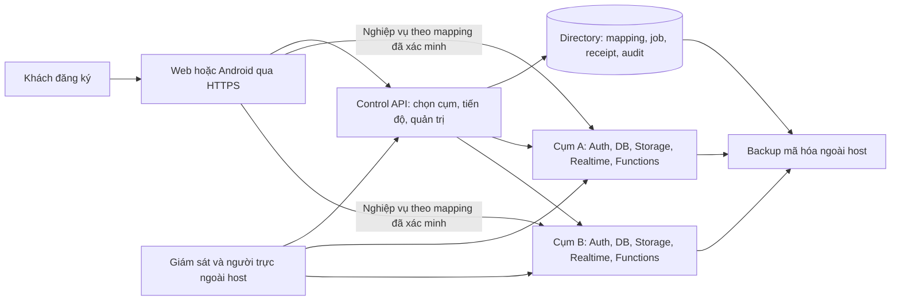

# RoomQC — phiếu triển khai và nghiệm thu chi tiết toàn bộ VPS + signup

**Phạm vi đã chốt ngày 27/10/2026: toàn bộ VPS + signup. Đầu ra: plan + nghiệm thu.**
Giữ 8 đợt, 25 task, 27 gói và 70 ca gốc. Khách chỉ đăng ký; RoomQC quản lý
cụm VPS, cấp không gian sử dụng, gói/quota, sao lưu và vận hành.

**Điểm nhận đã đối chiếu: có bản nháp sửa policy, chưa kiểm chứng.** Cây tích hợp
hiện có 1.022 file trong manifest có phạm vi, backend 198 file; 577 file migration
nghiệp vụ và 12 directory. Migration `20261027153807` cùng fixture/diagnostic mới
đã được viết; runner chưa nối hai chế độ kiểm mới. Chưa chạy native policy,
upgrade 576→577 hoặc hồi quy trên bản nháp; số file không phải tỷ lệ hoàn thành.

**Bằng chứng hoàn tất gần nhất của nhánh policy** vẫn là [baseline1019](roomqc-advice-policy-baseline-local-2026-10-27.md):
14 kiểm tra, 7 đạt/7 chưa đạt, exit 1. Giữ nguyên kết quả đỏ để đối chiếu sau sửa;
không chuyển thành pass từ việc đã viết code. Edge1018, UTC/upgrade1017 và các
proof khác chỉ có giá trị theo đúng source trong báo cáo gốc.

**Đọc và giao việc:** [bản điều hành](roomqc-vps-signup-delivery-brief-2026-10-22.md)
giữ tám đợt và đầu ra demo; [phiếu T01–T25](roomqc-vps-signup-detailed-delivery-2026-10-26.md)
giữ file, bước làm, dependency, kiểm nhận và rollback.
[Bộ 70 ca](roomqc-vps-signup-acceptance-worksheet-2026-10-22.md) giữ nguyên
`not_run`; 122 mục release vẫn `unverified`. Chưa thay reviewer, signoff hay gate.
Lịch sử checkpoint giữ tại [tiến độ](roomqc-vps-signup-progress.md) và báo cáo gốc.

**Việc nhận tiếp:** [phiếu 19.38 — kiểm bản nháp và chuyển sang VPS/signup](#1938-phiếu-bắt-đầu-và-bàn-giao-plan--nghiệm-thu).
Giữ [contract policy](roomqc-advice-policy-command-contract-2026-10-27.md), đối chiếu 7 finding baseline rồi client/UI/freshness/retention/abuse và thiết bị
→ mobile money → generic exports → writer Q02 → Q03 → Q04 → T07 → T09/T10
→ T11–T13 → T14–T17 → T18–T20 → T21–T24 → T25. Giữ dependency trong ledger;
T14/T18 được chuẩn bị khi đủ đầu vào. Chỉ mirror tài liệu/artifact đã lọc;
implementation ở integration. Chỉ ghi kết quả kiểm thử đúng phạm vi báo cáo.

## 1. Mô hình cuối cùng, giải thích theo cách vận hành

RoomQC chuẩn bị một hoặc nhiều cụm VPS do mình quản lý. Khách đăng ký trên
roomqc.com, xác minh email, nhập khách sạn và sử dụng; khách không cài Docker,
không thuê VPS và không nhận khóa quản trị hạ tầng. Một cụm có nhiều workspace;
workspace có thể chứa nhiều khách sạn theo gói. Không tạo VPS riêng theo mỗi signup.

Sơ đồ mô tả mục tiêu, không xác nhận đã có hai cụm production. Một workspace
chỉ dùng cụm đã gắn; khi cụm đó lỗi, không tự đưa khách sang DB khác. Thêm cụm
để nhận khách mới; chuyển khách đang hoạt động cần quy trình di chuyển riêng.

Control plane giữ thông tin điều phối và metadata vận hành. Dữ liệu đặt phòng,
khách lưu trú, kho và nhân sự nằm ở cụm nghiệp vụ. Backup và kênh giám sát phải
còn dùng được khi host chính mất. Một VPS vật lý duy nhất vẫn là điểm lỗi chung;
mô hình này chưa hứa HA hoặc sức chứa 100.000 người đồng thời.

## 2. Hiện trạng đã đối chiếu và việc phải làm trước

**Điểm nhận hiện hành là bản nháp policy 577, chưa kiểm chứng.** Inventory có
1.022 file/backend198, 577 file migration nghiệp vụ +12 directory. [Baseline1019](roomqc-advice-policy-baseline-local-2026-10-27.md)
có 14 test, 7 đạt/7 chưa đạt và là bằng chứng trước sửa. Nhận 19.38 để review,
nối runner và kiểm bản nháp; chưa có proof sau sửa. Edge1018, UTC/upgrade1017 và
closure1014 giữ đúng proof gốc, không gán sang cây đang sửa.

Rà contract/handler thấy 23 operation: 8 foundation, 8 implemented-local,
6 planned và 1 partial-local; chi tiết17.2. Hai child route quản trị mới chưa
nối trong App; limiter control hiện dùng memory theo socket IP. T11–T17 phải
khép các chỗ này. Advisors737 ở workload baseline1019 chưa disposition;
70 ca và 122 mục release chưa đổi trạng thái.

**Bảng dưới là lịch sử nền đã xây**, dùng để giữ hồi quy và truy vết, không
phải danh sách giao lại từ đầu hoặc bằng chứng nghiệm thu source1019.

| Hạng mục | Đã xác minh / quan sát | Cách dùng trong triển khai |
|---|---|---|
| Installer, quyền release và full backend | [Checkpoint790](roomqc-installer790-full-backend-local-2026-10-26.md) có default full backend exit0; control358/358 thuộc source cũ | Giữ hồi quy; không dùng làm proof cho source đang sửa |
| Command quyền nhân viên | Backend/editor/catalog/readback đã có; browser direct-write812 và terminal recovery813 có scoped proof | Giữ hồi quy; nhận privileged/indirect closure và full pipeline; không giao lại atomic save như chưa có |
| Editor/caller810 | Hai component và active save command đã có scoped client/hook/UI proof theo report810 | Giữ regression và kiểm delta; browser/Android, transport loss thật vẫn mở; không gán TS/lint/41frontend cũ thành run mới811 |
| Catalog/readback811 |550business+12directory; actual API67+4/metadata30+4; native advisors667findings | SYSTEM roles, owner, alias, additive và foreign/session denial đã có proof; full backend/rebuild811 và disposition chưa khép |
| Browser direct-write closure812 | Table/column DML của browser đã bị thu; API99+4, metadata30+4 và native invitation diagnostic đạt cùng source812 | Giữ hồi quy; source Edge đã thay817, deployment/consumer inventory vẫn chưa đủ |
| Terminal recovery813 | Cùng key lock cho save/cancel; API125+7, metadata30+4, frontend58/58, TS/lint đạt; schema/source/runtime khớp | Không hủy success, không ghi muộn sau cancel; chốt retention/abuse và browser/Android, không coi là full pipeline |
| Edge/full control817 |553business+12directory; API125+7, metadata30+4, actual Edge37+5expiry races, full control384/384 không fail/skip/cancel; source/schema/runtime khớp | Source adapter không dùng service-role; payload cũ409. Inventory ngoài, full backend/rebuild và toànT09/T10 chưa khép; giữ lịch sử811/813 |
| Checkpoint818 |554business+12directory; authority/metadata/Edge/hotel và full control384/384; default full16suite/33mốc/exit0; current22ACL | Giữ failed full817; chưa kế thừa proof sang823 |
| Candidate823 |555business+12directory; delivery65/65gồm5lock races; full control384/384; current24ACL; cleanup12checks0 | General engine/config/dispatcher/legacy reconciliation và indirect/monitor/advisors còn mở; chưa default full/rebuild823 |
| Checkpoint827 — nguồn phòng | 556 business + 12 directory; Auth/REST 52/52 gồm 3 lock races, full control 384/384, current25 ACL; cleanup 6 checks 0 | Main room RPC có proof riêng; writer graph và caller/engine/dispatcher chưa khép |
| Checkpoint843 — caller/cancellation local |557business+12directory; native77/77gồm6lock races/8application-client controls; frontend61/61, TS/lint đạt; full control384/384 | Writer graph, compound task durability, configured engine/dispatcher và default full/rebuild còn mở; nhận Q02–Q04 |
| API vận hành | Có signup-intents/bootstrap/provision, cluster commands/result, workspace reads; setup-status/recheck/alerts/backups còn thiếu handler tương ứng | Contract trong OpenAPI chưa chứng minh API chạy; bổ sung theo T07/T11/T12/T15/T16 |
| Màn quản trị mới | Chưa thấy hai child route infrastructure/registrations trong `src/App.tsx` | T14 phải nối route, menu, guard và client thật |
| Advisors | Native scan817 có668findings; scan813 cũng668 và811/812 có667, giữ lịch sử theo schema | Mỗi object có disposition/reviewer/regression; count không tương ứng số lỗi sản phẩm hoặc việc đã xử lý |
| Nghiệm thu | 122 release entries `unverified`,70 dòng worksheet `not_run` | Chưa ký sản phẩm; không quy đổi số unit/API test thành % hoàn thiện |

Các số793/790 là manifest có phạm vi trong báo cáo lịch sử, không phải số file
của candidate hiện hành. Biên bản kế hoạch ghi riêng file thiếu và source hiện
quan sát; không gán kết quả cũ cho bản mới. Không sửa migration lịch sử để giảm
count hoặc làm fixture xanh.

## 3. Quy tắc nhận và bàn giao công việc

Mỗi T bên dưới dùng đúng dependency, package và case của
[ledger](../../../artifacts/roomqc-vps-signup-delivery-ledger-2026-10-21.json).
Mapping đầy đủ ở [bảng T01–T25](roomqc-vps-signup-plan-current-2026-10-26.md#5-phiếu-giao-t01t25-và-đầu-ra-bắt-buộc).

Trước thực hiện ghi: người phụ trách, reviewer, source/dirty manifest, contract,
target cho phép, dữ liệu đầu vào, effects được phép, rollback và lệnh kiểm tra.
Sau thực hiện ghi: actual, exit, failed history, evidence, cleanup, giới hạn và
task nhận tiếp. Chưa có người được giao thì để tên/signoff trống; không tự điền.

Các ca đều đi qua positive → denial không effects → fault/race phù hợp → recovery.
Test trên fixture riêng có nhãn ownership. Không sửa DB đang phục vụ, CRM, VPS,
DNS hoặc provider thật trong bước chuẩn bị local. Phần cần khóa/quyền được gom
ở mục9, đúng chỉ dẫn làm sau; không trì hoãn phần local độc lập.

## 4. Đợt 1 — hoàn tất nền, quyền và số đo đáng tin

### T01 — khóa hiện trạng và fixture

**File đầu vào:** `scripts/control-backend-source-binding.mjs`,
`scripts/test-control-backend-sandbox.mjs`, lockfiles và migrations hai DB.

1. Lập inventory service, image digest, contract, migration checksums, port,
   volume, flags và source; chỉ lưu secret reference.
2. Kiểm mọi import bắt buộc và file đang sửa; không đóng băng khi còn component
   bị thiếu.810đã có đủ hai component; chụp candidate mới sau mọi thay đổi,
   giữ bằng chứng793/810 theo đúng source riêng.
3. Chuẩn bị owner A/B, staff từng vị trí, operator đủ/thiếu quyền, revoked session,
   data nghiệp vụ có hàng thật và danh sách target cleanup chính xác.
4. Bảo vệ index/ledger/serving targets; ghi trước–sau. Không stage, commit, reset,
   merge hoặc dùng cleanup diện rộng trong lượt giao việc này.

**Nhận khi:** A01–A03 đúng môi trường; source/schema/runtime khớp, target không
chồng hệ đang phục vụ, có before-state và cleanup kiểm độc lập. Bàn giao inventory
và danh sách phần chưa kiểm, không chỉ HEAD hash.

### T02 — directory bền vững và migration có lịch sử

**File đầu vào:** `server/control/migrate.mjs`, `server/control/migrations/`,
`server/control/server.mjs`, `server/control/store.mjs`.

1. Giữ history/checksum của0012 và trước đó; thay schema bằng migration tiến tới.
2. Tách migrator/runtime/installer; API không có DDL hay quyền tự cài approval.
3. Kiểm DB trống, DB đã có workspace/job/receipt, hai migrator đồng thời, checksum
   sai, rerun và restart. Readiness chỉ đạt khi schema/config đúng.
4. Shutdown ngừng nhận việc mới, xử lý request đang chạy trong deadline rồi đóng
   pool; restart không mất mapping/receipt hoặc giải phóng nhầm suất đã cấp.

**Nhận khi:** A04–A07, row/checksum trước–sau và runtime role proof đầy đủ;
schema mismatch dừng an toàn; không reinitialize volume có dữ liệu.

### T03 — quyền thực và command atomic

**File đầu vào:** `server/control/admin.mjs`, `command-results.mjs`,
`src/lib/employee-authority.ts`, `src/hooks/useEmployeeAuthority.ts`,
`src/components/permissions/`, `src/hooks/useUserPermissions.ts`, `useUserHotels.ts`.

1. Giữ Panel và HotelAssignmentSection đã chuyển ở810; dùng catalog server,
   hiển thị inherited/custom/effective rõ, custom false không xóa quyền role.
2. Một save grants hoặc hotels+cả5cờ dùng một command, base version và request key;
   giữ draft khi refetch; đổi actor/target/runtime phải bỏ response và draft cũ.
3. Lưu pending trước network. F5/relogin cùng actor phải lookup kết quả cũ trước;
   chưa biết outcome thì giữ payload/key, không tạo save mới. Kiểm away→back để
   trạng thái busy không kẹt và response cũ không gây toast/cache invalidation.
4. Chặn cấp quyền không được ủy quyền; primary hotel không bị bỏ, membership cũ
   thiếu/inactive vẫn hiện để xử lý, không âm thầm xóa. Giữ đủ5cờ khi sửa khách sạn.
5. Giữ detail/summary811 khớp enforcement và editor; đã có system-role/owner/
   alias/additive scoped proof. Inventory direct/privileged writers và deployment,
   gồm legacy Edge update-user; chứng minh signup/invite/profile còn chạy trước
   khi thu quyền tương thích. Thực hiện theo mục15.1.

**Nhận khi:** A08–A11 và phần E08 liên quan có actual API/UI proof; revoked,
cross-tenant, role-drop khi chờ lock bị chặn; audit/receipt fail rollback toàn bộ;
20replay chỉ1effect, key khác payload conflict, hai editor kiểm version. Tests
client/hook không thay browser/Android. Chi tiết ở [phiếu EC10–EC15](roomqc-ec10-ec15-execution-and-acceptance-2026-10-26.md).

### T04 — hợp đồng API và phục hồi kết quả lệnh

**File đầu vào:** `server/control/contracts/control-v3.openapi.json`,
`server/control/app.mjs`, `server/control/command-results.mjs`, `src/lib/native/`.

1. Đối chiếu từng operation với handler; đánh planned cho API chưa triển khai;
   chốt DTO, pagination, null/unknown, version, bounded response và error codes.
2. Typed client bắt actor/session/runtime tại lúc bắt đầu, có deadline/abort;
   query key chứa scope; không nhận response sau logout/chuyển workspace.
3. Cluster command-result dùng client key gốc và đọc primary; receipt lịch sử
   không phải trạng thái health hiện tại hoặc quyền mở lại cụm.
4. Kiểm native transport/routing tương ứng; chỉ sửa allowlist khi thực sự có
   allowlist ở đường dùng, không tạo cấu hình thừa theo giả định.

**Nhận khi:** A03,A08–A11 đúng contract, mất response/headers/F5 recover được;
401/403/409/429/503 có thông báo an toàn, không raw SQL/DSN/token.

### T05 — metrics và probe đúng tài nguyên

**File đầu vào:** `server/control/telemetry*.mjs`, `service-probes.mjs`,
`workers/health-probes.mjs`, `deploy/monitoring/`.

1. Gắn host/data mount/cluster/release identity vào metrics; đo CPU, RAM, disk,
   inode, IO, DB connections, queue và timestamp; đối chiếu OS/Postgres thật.
2. Auth/REST/Storage/Realtime/Functions có probe đúng target, credential và
   deadline; thành công phải có effect/readback cần thiết, không chỉ port mở.
3. Missing/stale/invalid là unknown có lý do; SSRF/redirect/private endpoint phải
   theo inventory đã cho phép, không nhận URL khách cung cấp tùy ý.

**Nhận khi:** B01–B03; local proof không ký B01 staging, metrics ports private và
fault một dịch vụ không được báo tất cả healthy. Bàn giao source-to-host map.

### T08 — trust release và đường quyền gián tiếp

**File đầu vào:** `server/control/release-*.mjs`, `registry.mjs`,
`probe-credentials.mjs`, `scripts/control-backend-access-*.mjs`, migrations.

1. Giữ hồi quy signed approval, installer/readiness và key-wide withdrawal đã có;
   tách signer, installer, runtime và resolver; không đưa private signer cho worker.
2. Hoàn tất caller→RPC/Edge/view/definer/trigger/FK→data inventory current22;
   chạy đường recipient/offboarding/workflow có positive và denial no-effects.
3. Mỗi finding advisor có object, đường dùng, rủi ro, sửa/giữ+giải thích,
   regression và reviewer; không xóa policy/index chỉ để giảm tổng findings.
4. Khi issuer/credential/target/release đổi, process cũ và response muộn phải bị
   chặn trước network và tại commit; revoked key không cài lại qua alias/restore.

**Nhận khi:** A06,B02,C01–C04 đúng scope; catalog và toàn bộ migrations của
candidate cuối được chạy và scan riêng; indirect coverage/unresolved được ghi đủ.
Issuer production/file permissions Linux nghiệm thu ở T18, không ký từ local.

### T06 — health atomic và timed runtime

**File đầu vào:** `server/control/health-evidence.mjs`, `health-policy.mjs`,
`workers/health-runtime.mjs`, `workers/health-worker.mjs`, backend harness.

1. Chỉ ghi snapshot nếu credential/approval/target/policy revision còn đúng tại
   commit; không giữ transaction DB trong suốt HTTP probe.
2. Kiểm warmup/window/valid-until/critical latch; restart đọc state bền vững;
   mẫu cũ/late/unknown không mở admission hoặc xóa manual close.
3. Freeze candidate sau T03/T08; chạy focused, full control có DB, default full
   vendor backend và rebuild độc lập cùng source/schema/runtime/render.
4. Giữ fault/restart/recovery đủ5dịch vụ và giải thích follow-up stability15eb;
   không biến một diagnostic thành full run hoặc giấu lần chạy fail.

**Nhận khi:** B04–B07, native exit/source-before-after/cleanup có proof; reviewer
phân biệt scoped/full và giới hạn môi trường. Sau đợt1 nhận T07; không lặp backend
793 đã đạt như việc mới nếu delta không tác động nó.

## 5. Đợt 2–3 — cảnh báo, suất nhận khách và ngân sách tải

### T07 — cảnh báo có người xử lý

**File đầu vào:** `server/control/health-policy.mjs`, `telemetry.mjs`, directory
migrations và app/admin-read. Alert dispatcher/outbox handler bổ sung là **planned**.

1. Tạo incident theo cụm+loại lỗi; transition và outbox cùng transaction.
2. Ack là đã nhận xử lý; resolve chỉ khi điều kiện phục hồi; reopen giữ lịch sử.
3. Dispatcher dùng stable delivery ID, bounded retries/backoff, lease và dead-letter;
   restart/timeout không mất event. Provider có thể nhận lại cùng delivery khi
   outcome chưa rõ; không hứa exactly-once Internet email nếu provider không hỗ trợ.
4. Nối list/ack vào contract; kiểm host-loss bằng kênh ngoài host ở staging.

**Nhận khi:** B08–B09 có timeline, audit, delivery attempts, dedupe và recovery;
sink local chỉ ký phần nội bộ. B09 chờ actual received/ack từ người trực.

### T09 — chọn cụm và giữ suất atomic

**File đầu vào:** `server/control/store.mjs`, `admin.mjs`, `registry.mjs`,
health evidence và reservation migrations hiện có.

1. Chốt decision reasons: trust, health, freshness, resource, backup, policy,
   manual gate; fail bất kỳ trục bắt buộc thì không giữ suất mới.
2. Trong transaction khóa đúng cluster/counter, kiểm limit và ghi reservation
   cùng intent; expired chưa dispatch được thu hồi theo contract.
3. Bind cụm từ đầu; close/drain ảnh hưởng nhận mới, giữ mapping khách cũ.
   Cửa sổ first-dispatch cần authority/fencing và receipt ở T11/T12.
4. Thử20request khác nhau tranh1suất,20replay cùng intent, close/expiry/dispatch
   races; không chọn lại cụm khi remote outcome chưa rõ.
5. Giữ proof fixture đã sửa:20connection được warm và20giao dịch thực chờ khóa;
   đúng1accepted/19NO_CAPACITY,20replay cùngID/cùngexpiry, deliberate hold3,3s
   vẫn đạt. Production pool/deadline không đổi. Timeout queue được tái hiện trong
   fixture cũ nhưng không suy đó là root cause trực tiếp của run810 thiếucodes.
   Nhận tiếp budget/overload, expiry/close/first-dispatch theo contract; T09chỉ
   nghiệm thu toàn phần khi đủT06/T07/T08 và môi trường ledger.

**Nhận khi:** C05–C10 có effects/counts/decision/receipt, không oversubscribe,
không giải phóng suất đã commit dữ liệu hoặc âm thầm chuyển khách.

### T10 — budget tổng cụm và giới hạn gói

**File đầu vào:** config/pool/worker/compose hiện có, metrics T05/T06; phiếu
budget theo host là đầu ra mới, chưa có giá trị capacity mặc định được nghiệm thu.

1. Lập bảng service/replicas/pool min–max/worker concurrency/queue/deadline;
   tính tổng tất cả API, probe, vendor, jobs, report, migration và backup.
2. Ràng buộc tổng max connections+headroom ≤ DB capacity; RAM còn OS/cache,
   IO/disk/inode/egress có dự phòng. User online không tương đương1DB connection.
3. Áp bounded upload/report/Realtime/job queues và backpressure; tenant A chạy
   báo cáo không chiếm toàn ngân sách làm tenant B mất phục vụ.
4. Trial/seat/room/storage/grace/retention có policy version; dùng tham số thử khi
   chưa duyệt chính sách thương mại, không tự áp limit mới vào khách thật.

**Nhận khi:** budget kiểm được từ config và có thử overload/recovery; G05–G06
chỉ khép sau workload T23. Bàn giao operating limit thử, chi phí và điểm cần tăng
cụm; chưa cam kết số khách sạn/user mỗi VPS.

**Delta T10 cần kiểm từ checkpoint1011:** fixture xóa khách sạn rồi phục hồi
đã cần làm mới tenant_usage để trigger quota đọc đúng số lượng. Đây chưa phải
bản sửa usage của sản phẩm. Inventory các đường tạo/xóa/chuyển/sửa hotel, room,
employee và storage; đối chiếu hook, RPC, trigger, counter và quota hiện thời.
Chạy xóa→tạo lại, hai lệnh tranh suất, rollback audit và thay gói trong lúc chờ
khóa; đếm dữ liệu thật trước/sau. Không dùng refresh fixture hoặc bỏ trigger
để ký chức năng quota. Mọi limit mới phải theo policy đã được duyệt.

## 6. Đợt 4 — đăng ký dùng ngay, có tiến độ và tự phục hồi

### T11 — signup, private setup-status và resume

**File đầu vào:** `server/control/app.mjs`, `store.mjs`, `cluster.mjs`,
`src/lib/workspace.ts`, `src/components/auth/EmailAuthForm.tsx`, onboarding.

1. Từ intent ổn định, giữ cluster/routing version; Auth verify/callback đúng
   cụm. Chỉ owner/session/email hợp lệ được submit thông tin khách sạn.
2. IDs, tenant, role, trial và quota do server quyết định; validate business
   fields và payload khác key cũ; không tin user_metadata cấp quyền.
3. Bổ sung private `setup-status` (**planned handler**) trả step, safe reason,
   nextAction, retryAfter và no-store; owner khác/staff không xem được.
4. UI mở lại cùng tiến độ sau F5/relogin; active thì vào đúng workspace;
   chưa verify hướng dẫn verify, waiting_owner hướng dẫn owner, unavailable chờ
   retry, conflict chuyển support. Không hiển thị SQL hoặc chi tiết khách khác.

**Nhận khi:** D01–D06,A03; đúng1binding/tenant/hotel/profile/trial/receipt;
unverified submit không tạo business data, retry không gia hạn trial.

### T12 — durable jobs, receipt reconciliation và backfill

**File đầu vào:** `server/control/store.mjs`, `support.mjs`, `cluster.mjs`,
directory provisioning_jobs và remote provisioning/receipt RPC hiện có.

1. Persist binding/job/dispatch ID trước network; lease có fencing token,
   bounded attempts/backoff/deadline. Worker đối soát receipt, không lưu owner
   JWT/password hoặc impersonate owner để tạo dữ liệu mới.
2. Khi chưa rõ commit, lookup receipt đúng workspace/cụm/dispatch; missing không
   đồng nghĩa được phát lệnh provisioning mới nếu cửa sổ dispatch chưa khép.
3. Kiểm kill tại: trước claim, sau claim, trước remote call, sau remote commit
   trước response, sau receipt trước directory activate, sau activate trước trả UI.
   Hai worker/stale lease/late response phải có barrier và count proof.
4. Backfill workspace cũ `provisioning`; phân loại waiting_owner/retry/needs_review,
   dry-run có row counts. Giữ recovery cũ tới khi migration/backfill/fault proof
   mới đạt; không xóa job/receipt để thử lại.
5. Thêm admin recheck (**planned**) chỉ enqueue idempotent và trả accepted/job ID;
   completion đọc riêng. Không cho support bấm tạo lại tenant.

**Nhận khi:** D07–D11,A07; một durable result qua mọi kill window, final mapping,
trial/objects/audit khớp, no duplicate provision; unknown commit có recovery thật.

### T13 — chống abuse, proxy và email

**File đầu vào:** `server/control/app.mjs`, config/proxy, Auth callback và
`supabase/functions/_shared/email/`, email dispatcher/provider webhook hiện có.

**Quan sát tại1011:** app control đếm bucket trong memory theo socket IP cho
các request đi qua middleware. Restart/nhiều instance không có cùng bộ đếm;
proxy có thể làm nhiều khách cùng mang một địa chỉ. Đây là đầu vào thiết kế
T13, chưa kết luận direct Auth bypass đã được xử lý.

1. Thay reliance vào bucket memory bằng limiter dùng chung có TTL/atomic counter;
   chốt trusted proxy hops, tránh mọi khách sau proxy thành1IP hoặc giả XFF.
2. Hạn mức theo IP/identity/intent, resend và pending reservations; challenge
   server verify trước resource allocation, không lộ tài khoản tồn tại.
3. Signup off chặn cả entry control và direct Auth signup; giữ login/reset/invite
   của khách cũ theo policy. Nhiều instance/restart không reset toàn bộ limit.
4. Verify/reset/invite link bind exact origin/cụm, token một lần/hết hạn; webhook
   kiểm chữ ký/replay. Outbox lưu event/receipt an toàn, không raw token trong log.
5. Local dùng internal sink; email Internet dùng sender roomqc.com đã xác minh,
   DNS/SPF/DKIM/DMARC và inbox thử ở staging khi có quyền provider.

**Nhận khi:** D12–D15; direct bypass/forged proxy/spam/restart negatives và
restored positives đạt. D15 chưa ký nếu mới nhận Mailpit hoặc provider accepted.

## 7. Đợt 5 — hai màn quản trị thao tác được

### T14 — route, menu, client và cache theo quyền platform

**File đầu vào:** `src/App.tsx`, `src/components/layout/Sidebar.tsx`,
`src/components/super-admin/`, auth/runtime/workspace context.

1. Thêm hai entry **planned** `/super-admin/infrastructure` và
   `/super-admin/registrations`, có menu chính và guard phía client/server.
2. Quản trị platform không phụ thuộc khách sạn đang được chọn; staff/owner
   khách sạn không được tự gọi API quản trị bằng cách nhập URL.
3. Scope query/pending theo actor/session/runtime/target/authority; logout/revoke
   hoặc đổi cụm hủy request và loại data cũ, kể cả away→back và response muộn.

**Nhận khi:** A03,E08 có real API+component/browser proof, deep link/refresh không
vượt quyền và mọi thao tác có đường click; không dùng mock để ký màn vận hành.

### T15 — Hạ tầng

**File đầu vào:** `server/control/admin-read.mjs`, `admin.mjs`, contract,
cluster/health/backup/alerts DTO; page/client mới là **planned**.

1. List ưu tiên cụm đang chặn/lỗi; cột tên, đang nhận hay chặn, lý do, thời điểm
   đo, CPU/RAM/data disk/inode/DB/queue, allocated/limit và backup/restore.
2. Detail mở phần kỹ thuật khi cần; unknown/stale có chữ và timestamp, không
   hiển thị0% hoặc xanh chỉ vì query lỗi.
3. Close/drain/open/đổi limit theo capability; dialog ghi impact, reason,
   expected version và stable key trước submit; recover result sau reload.
4. Alerts/backups list và acknowledge handlers còn planned: thực hiện theo
   contract+quyền+cursor, uploaded khác restore-verified, ack khác resolve.

**Nhận khi:** E03–E05; thao tác có DB/audit/receipt proof và refresh trạng thái
hiện tại sau receipt; không tự reopen sau health phục hồi hoặc install approval.

### T16 — Đăng ký mới và hỗ trợ

**File đầu vào:** `server/control/admin-read.mjs`, `support.mjs`, contract;
page/client, tenant-summary và durable recheck hoàn chỉnh còn **planned**.

1. Search/filter theo URL, cluster/status/updated, server totals+cursor;
   1.000 metadata đủ state có đáp án cố định, không lọc chỉ trang hiện tại.
2. Detail trả lời: khách ở bước nào, đã có dữ liệu chưa, ai cần làm gì, lần
   đối soát gần nhất và job/receipt/timeline. Không hiện credential/PII dư thừa.
3. tenant-summary đọc đúng cụm với bounded timeout; unavailable không giả là
   tenant chưa tồn tại. Recheck lookup/enqueue/completion có quyền và key.
4. Hết hạn/gói/suspend hiển thị theo policy version; support không sửa receipt,
   impersonate, kéo dài trial bằng retry hoặc chuyển cluster trực tiếp.

**Nhận khi:** E01,E02,E05,E08; tìm đúng đăng ký kẹt dưới30giây trong bài thử,
cursor/totals khớp source và recheck không tạo business data mới.

### T17 — UX, bàn phím, mobile và quay lại đúng chỗ

**File đầu vào:** hai màn T15/T16, layout/Sidebar và navigation helpers hiện có.

1. Một menu chính, tên việc dễ hiểu, màu thông dụng tương phản và chữ trạng thái;
   không tạo menu phụ lặp hoặc bỏ mất đường đến chức năng.
2. Back khôi phục đúng list/filter/scroll; link trực tiếp dùng fallback nội bộ;
   đi trang mới đưa nội dung lên đầu, không để màn bên phải trắng do scroll cũ.
3. 390px/zoom200%/keyboard có focus rõ, label, error và loading/empty/stale;
   dialog giữ focus và báo outcome chưa rõ, không nhấp lại tạo command mới.

**Nhận khi:** E01–E08 có keyboard/focus/contrast/timing/Back evidence;
Android keyboard/deep-link kiểm trên môi trường T22, không suy từ desktop resize.

## 8. Đợt 6–8 — Linux, phục hồi, E2E, tải và pilot

### T18 — bộ cài Linux và nâng cấp an toàn

**File đầu vào:** `deploy/`, `server/control/Dockerfile`, installer CLI,
compose/runtime templates; production deployment bundle hoàn chỉnh cần khép.

1. Preflight exact host/OS/mount/network/ports/clock/origins/volumes/secret refs;
   dry-run chỉ ra thay đổi. Sai host/port/volume có data thì dừng trước init.
2. Pin image digest/full vendor bundle đã review; migrator và runtime tách;
   DB/metrics/Studio private, chỉ edge public theo inventory.
3. TLS/certificate renewal/Auth callback/REST/Storage upload/Realtime WebSocket/
   Functions qua proxy; private credential files có POSIX permissions thực.
4. Install→rerun→reboot→upgrade→compatible rollback trên host staging;
   dữ liệu, mapping, receipt, khách legacy và manual admission không mất.

**Nhận khi:** F01–F04,B01 staging có inventory và before/after data proof.
Docker Desktop hoặc file compose hợp lệ không thay Linux acceptance.

### T19 — backup ngoài host, restore host sạch

**File đầu vào:** deployment/backup scripts hiện có; consistent manifest và
offsite restore workflow hoàn chỉnh là đầu ra phải bổ sung nếu inventory thiếu.

1. Chốt checkpoint nhất quán directory+mapping/job/audit/receipt, từng cụm
   DB/Auth/queue và object bytes; mô tả pause/sequence hoặc phương án WAL/PITR.
2. Encrypt/checksum/upload/readback; retention và key custody ngoài failure
   domain. Secrets cần phục hồi dùng refs/kho riêng, không nhúng vào artifact.
3. Cắt source host trong diễn tập, restore sang host/volume sạch cách ly;
   chống hai bản cùng ghi. Kiểm login/rooms/staff/files/trial/jobs/receipt.
4. Đối chiếu revocation checkpoint ngoài host để không phục hồi quyền đã thu
   hồi. Sai key/checksum/version/missing object phải fail trước mở routing.
5. Đo RPO từ điểm nhất quán cuối đến fault; RTO từ fault đến service/data verified.

**Nhận khi:** F05–F08 staging, có offsite bytes+key và clean-host restore thật.
RPO≤24h/RTO≤4h chỉ là mục tiêu đề xuất cần duyệt; daily backup không hứa RPO phút.

### T20 — người trực, cảnh báo và runbook

**File đầu vào:** runbooks ops, T07 delivery, deploy/backup proof; đích alert và
phân công người trực là đầu vào external chưa được xác nhận.

1. Điền người chính/phụ, giờ support/escalation, quyền kill-switch và reopen.
2. Runbook cho host/control/DB/disk/inode/cert/key/backup trễ/signup kẹt;
   lệnh read-only chẩn đoán, hành động chặn mới, recovery và escalation rõ.
3. Diễn tập từ ngoài host: fault→detected→received→ack→recovery có timestamp.
   Người trực phải nhận thật; không dùng chính host lỗi làm kênh duy nhất.

**Nhận khi:** B09,F09 staging, reviewer đối chiếu thời gian thực và người nhận;
detected≤180s/received≤300s là ngưỡng đề xuất, chưa phải SLA đã áp.

### T21 — hai backend độc lập chạy đồng thời

**File đầu vào:** backend harness và bundle T18; hai target có Auth/JWT/DB/object/
Realtime/Functions/queue/network/volume tách biệt, có ownership riêng.

1. Chạy A/B cùng lúc, seed same-UUID đối chứng nhưng dữ liệu khác; login A/B và
   kiểm đúng routing/cache. Token A gọi B phải bị từ chối, mỗi bên có positive.
2. Làm A full/drain/down; signup mới chỉ vào cụm hợp lệ theo policy, khách A
   không tự fallback B và không đọc data B.
3. Revoke/logout/switch runtime khi request đang giữ; response muộn không lọt
   cache, receipt hoặc native session của cụm khác.

**Nhận khi:** G01–G03 có actual service và API/DB proof đồng thời. Hai rebuild
tuần tự chỉ là repeatability, không thay case này.

### T22 — browser và Android E2E nghiệp vụ

**File đầu vào:** route/menu/client đã tích hợp, app Android và transport,
fixtures T21; công cụ E2E/test scripts bổ sung theo inventory thực.

1. Browser sạch: signup→verify email→hotel→rooms→invite→staff accept/login→
   nghiệp vụ đúng vai trò. Kiểm khách cũ, reset, forced password và offboarding.
2. Android emulator/device ghi OS/app build: bàn phím, deep-link, Back, network
   offline/online, background/resume, session storage và cùng hành trình trên.
3. F5/hai tab/mất response trước headers/sau commit/worker restart; assert
   UI+HTTP+DB+receipt, không chỉ toast hoặc HTTP200.
4. Giữ đầy đủ A/D/E/G linked cases trong worksheet; test component/API cũ chỉ
   là hỗ trợ. Mobile release/store publishing không được tự coi đã nghiệm thu.

**Nhận khi:** từng case T22 có đúng requiredEnvironments, video/screenshot khi
cần và data effects; legacy routing/login tiếp tục sau cutover.

### T23 — đo tải, soak, chi phí và giới hạn vận hành

**File đầu vào:** budget T10, target T21, journey T22, metrics và dataset tổng hợp.

1. Ghi hardware/image/config/data/workload tỉ lệ đọc–ghi, think-time, active
   sessions/requests/RPS riêng. Đặt stop thresholds trước run.
2. Ramp10→25→50→100phiên khi mức trước đạt; đây là các mức thử, chưa là capacity.
   Soak≥60phút, kèm upload/report/signup burst/backup/noisy tenant.
3. Đo p50/p95/p99/errors, pool wait/timeouts, CPU/RAM/IO/inode/locks/queue/WAL,
   event lag và recovery sau quá tải; không bỏ provider errors khỏi mẫu số.
4. Ghi max-tested, operating limit thấp hơn có headroom, bottleneck, cost/tenant,
   dung lượng dự báo và khi nào thêm cụm; không tuyến tính nhân lên100.000user.

**Nhận khi:** G04–G06 staging có kết quả reproducible và ngưỡng được review.
Nếu chạm stop condition thì dừng ramp, giữ fail và hạ limit, không tăng VPS limit
để làm dashboard xanh.

### T24 — release candidate, cutover và quyết định cho pilot

**File đầu vào:** source/image/schema/config/contract freeze; evidence T19/T20/
T22/T23, ledger, worksheet và [protocol](roomqc-vps-signup-acceptance-protocol-2026-10-21.md).

1. Audit đủ70ca và môi trường; mapping27gói/25T không thiếu. Case pre-pilot đủ
   proof/review; G08 có kế hoạch nhưng giữ pending tới sau pilot.
2. Không còn Critical/High về quyền, dữ liệu, cấp phát, receipt, restore trong
   phạm vi; unresolved khác phải ghi ảnh hưởng, owner và quyết định rủi ro.
3. Dry-run cutover/rollback với khách legacy; backup trước chuyển, reconcile
   commit chưa rõ, không down-migrate phá dữ liệu hoặc reset trial.
4. Gate packet ghi exact target/release/limits/flags, người quyết định, giờ mở,
   kill-switch/rollback owner. Không mở pilot/public từ một suite xanh.

**Nhận khi:** G07 đúng môi trường và đủ hồ sơ; đề nghị gate P riêng sau L/S và
điều kiện pilot. Billing B là backlog riêng, không bật trong kế hoạch V1 này.

### T25 — pilot ít nhất7ngày rồi quyết định mở rộng

**File đầu vào:** RC được duyệt, offsite restore/on-call/operating limit, cohort
và consent/support window do RoomQC chốt.

1. Một khách sạn nội bộ trước; ổn định24–48h mới đề nghị cohort5–10được duyệt.
2. Theo dõi≥7ngày với availability/error/latency/backup/restore/cost/support,
   incident và phản hồi người dùng; có drill, không chỉ chờ đủ ngày.
3. Có lỗi quyền/mất data/duplicate/restore fail thì ngừng mở rộng, đóng nhận mới
   phù hợp và giữ route/data khách cũ; xử lý/review rồi mới đề nghị tiếp.
4. Báo cáo G08: actual vs targets, defects, capacity, cost, support load và
   go/no-go; public signup U cần quyết định riêng. Không tự chuyển sang thu tiền.

**Nhận khi:** G08 pilot đầy đủ bằng chứng và reviewer; ngày lịch đủ7 nhưng
thiếu số đo hoặc chưa drill không phải nghiệm thu.

## 9. Danh sách cần khóa/quyền hoặc quyết định, làm sau đúng thời điểm

| Đầu vào | Bên cung cấp | Cần trước | Vẫn chuẩn bị được local |
|---|---|---|---|
| VPS Linux staging: exact host, cấu hình, mount, ports, quyền deploy | RoomQC/OPS | T05/T18/T23 external proof | Bundle, preflight, fixture, budget tham số |
| DNS roomqc.com, app/API/admin origins, TLS/callback/deep-link | Quản DNS/OPS | T13/T18/T22 | Templates và callback allowlist thử |
| Email provider, sender verified, webhook, inbox thử | Quản email | T13/D15 | Outbox/sink/retry/dedupe; không gửi Internet khi chưa có input |
| Offsite store/retention/cost, người giữ key độc lập | OPS/RoomQC | T19/F05–F08 | Manifest/checksum/clean restore disposable |
| Đích heartbeat/alert ngoài host, người trực chính/phụ | OPS/RoomQC | T07/T20/B09/F09/P | Lifecycle/dispatcher/sink/runbook |
| Trial/quota/grace/retention/export/delete/capabilities | RoomQC | Enforcement T10/T11/T13 | Contract/fixtures theo tham số, giữ policy đã duyệt |
| RPO/RTO, SLO, headroom và stop thresholds | RoomQC+OPS+QA | T19/T23/P | Đề xuất và instrument cách đo |
| Người phụ trách/reviewer/release owner, cohort và giờ hỗ trợ | RoomQC | Nhận ticket/ký gate liên quan | Chuẩn bị packet, để signoff trống |

Không gửi mật khẩu/API key/SSH key trong chat; dùng secret reference và kho cấu
hình vận hành. Thiếu input chỉ hoãn ca/gate phụ thuộc, ghi `deferred_external`
khi phân loại có review; không đổi ca đó thành pass. Mở trang Resend hoặc nêu
tên miền không chứng minh sender/DNS/TLS đã được xác minh.

## 10. Phiếu nghiệm thu và báo cáo sau từng đợt

Giữ nguyên [worksheet70ca](roomqc-vps-signup-acceptance-worksheet-2026-10-22.md)
và [protocol](roomqc-vps-signup-acceptance-protocol-2026-10-21.md). Local, staging,
pilot có evidence riêng; mỗi ca đủ requiredEnvironments mới được đề nghị ký.

| Nhóm | Số ca gốc | Nội dung kiểm |
|---|---|---|
| A | 11 | Baseline, migration, quyền, compatibility và command recovery |
| B | 9 | Metrics, health, alert lifecycle và host-loss delivery |
| C | 10 | Registry/trust, admission, reservation và affinity |
| D | 15 | Signup, status/resume, durable recovery, abuse và email |
| E | 8 | Hai console, UX, Back/scroll, mobile và quyền |
| F | 9 | Linux/TLS, upgrade, offsite restore và on-call |
| G | 8 | A/B, E2E, tải/soak/capacity/cost, RC và pilot |

Mẫu bàn giao mỗi đợt:

1. **Đầu ra:** task/package/case, source/image/schema/config/contract, môi trường.
2. **Đã chạy:** command/time/native exit, expected/actual, positives/denials,
   fault/race/recovery, API/DB/audit/receipt và số effects.
3. **Chưa đạt:** fail/partial/not_run/deferred, defect ảnh hưởng và external thiếu;
   giữ failed runs, không tổng hợp subset pass thành full acceptance.
4. **An toàn dữ liệu:** cleanup exact-owned và kiểm độc lập; rollback/backfill,
   mapping/trial/receipt/data khách cũ được giữ; public artifact không secret/PII.
5. **Quyết định:** người chạy/reviewer/gate owner, timestamp, phạm vi ký, limits,
   điều kiện dừng và việc nhận tiếp. Để trống khi chưa được review/ký.

Gates giữ nguyên **L: local tích hợp; S: staging; P: pilot; U: public signup;
B: billing riêng**. Ký kế hoạch không ký các gate.70case và122release entries
giữ trạng thái hiện có trong lượt chuẩn bị này.

## 11. Thứ tự bắt đầu và cách cập nhật tiến độ

**Điểm nhận theo 19.38:** giữ 7 finding baseline, kiểm bản nháp live
command/read/lookup/cancel, clock và populated upgrade 576→577. Sau đó client/UI,
freshness/retention/abuse và browser/Android; tiếp mobile money
→ generic exportF3 → graph writerQ02 còn lại → Q03 → Q04. Upgrade566→572,
target transport và clock upgrade573→574 đã có scoped proof; chỉ chạy lại khi
delta/failure/concern yêu cầu. Migration mới phải có populated upgrade từ576
và giữ guard lịch sử, không coi fresh replay là populated upgrade.

Sau packet nền: T07 → T09/T10 → T11–T13 → T14–T17 → T18–T20 → T21–T24 → T25,
theo dependency ledger. T14/T18 có thể chuẩn bị khi đủ input; không ký vượt
dependency hoặc dùng mock thay nghiệm thu API/UI/host. Mỗi lần nhận việc ghi
người phụ trách/reviewer thực, expected/actual, failed history, source/cleanup
và next action của toàn VPS/signup. Vai trò trong plan chưa là phân công có tên.

Không dùng30–47ngày công/36–57có dự phòng lịch sử làm thời gian còn lại. Ước
lượng delta từng T khi nhận và cập nhật actual khi bàn giao; tách external wait
và ít nhất7ngày pilot. Chưa có dữ liệu để cam kết launch date hoặc user/VPS.

Hoàn tất plan cần đủ mapping/dependency/file/input/output/test/rollback/role;
hoàn tất sản phẩm còn implementation, actual/review/staging/restore/pilot và
gate. Lượt này không chạy test sản phẩm hay đổi70worksheet rows/122entries.

## 12. Hợp đồng vận hành cần chốt trước khi viết phần còn thiếu

Các bảng sau là **thiết kế cần triển khai/đối chiếu** trong T hiện có. Tên trạng
thái dùng để giải thích nghiệp vụ; trước coding phải map sang enum/DTO thực tế,
không tự thêm trạng thái DB hoặc endpoint chỉ vì xuất hiện trong bảng.

### 12.1. Thêm VPS và quyết định nhận khách — T05–T10/T18

| Bước người vận hành | Server phải kiểm/ghi | Kết quả trên màn Hạ tầng | Điều kiện dừng/nghiệm thu |
|---|---|---|---|
| Khai báo cụm đã chuẩn bị | cluster ID, exact origin, host/mount, secret refs, image/release/schema và người thao tác | Mới khai báo, chưa nhận khách; không hiện secret | Trùng ID/origin hoặc target mơ hồ bị từ chối; C01–C04 |
| Cài và xác minh | Installer role riêng; signed manifest; Auth/REST/Storage/Realtime/Functions đúng target; private ports/TLS | Kết quả từng dịch vụ và thời điểm kiểm | Port mở không thay protocol proof; B01–B03/F01–F04 |
| Bật nhận mới bằng lệnh riêng | Live capability, expected version, reason, request key; trust/health/freshness/backup/budget hợp lệ | Đang nhận mới hoặc lý do chặn có chữ | Health unknown/stale/critical hoặc thiếu policy bắt buộc từ chối; B04–B07/C05–C10 |
| Hết headroom/lỗi số đo | Ghi incident/decision; đóng allocation mới khi chính sách yêu cầu | Chặn nhận mới, hiển thị ngưỡng/lý do | Mapping khách cũ giữ nguyên; không tự chuyển sang DB khác |
| Chủ động drain/bảo trì | Audit+receipt cùng transaction; giới hạn hiệu lực cho cấp phát chưa dispatch | Đang ngừng nhận mới, tác động được giải thích | Không giải phóng reservation đã tạo dữ liệu; C09–C10 |
| Phục hồi rồi mở lại | Health mới hợp lệ, incident đã xử lý, lệnh mở có quyền và version hiện tại | Có thể đề nghị mở lại | Cài approval/health xanh/receipt cũ không tự reopen |
| Thêm cụm B khi A đầy | Kiểm độc lập toàn bộ inventory/trust; budget B; routing/signup binding | Khách mới dùng B theo quyết định hợp lệ | Khách A giữ A; G01–G03 xác minh A/B đồng thời |

Không tự điều khiển provider mua VPS hoặc chuyển dữ liệu khách giữa cụm trong
V1. Mọi command có kết quả không rõ phải tra receipt trước retry; người vận hành
thấy thông báo “Đang xác minh kết quả” cùng next action, tránh bấm gửi lệnh mới.

### 12.2. Đăng ký từ lúc bắt đầu đến dùng được — T11–T13/T16/T22

| Bước nghiệp vụ | Dữ liệu/hiệu ứng được phép | Người dùng thấy gì | Recovery và kiểm nhận |
|---|---|---|---|
| Tạo intent | Directory reservation+affinity+expiry theo key; chưa tạo tenant nghiệp vụ | Đang chuẩn bị đăng ký; thiếu suất thì thông báo chờ | Retry cùng intent giữ cụm/expiry; C05–C10/D01 |
| Tạo Auth/xác minh email | Native Auth tại cụm đã bind; callback đúng origin; chưa cấp role bằng user_metadata | Xác minh email, gửi lại có hạn mức | F5/relogin/callback replay vẫn đúng cụm; D02/D12–D15 |
| Owner nhập khách sạn | Validate fields và live verified session; server chọn IDs/trial/quota | Một form ngắn, lỗi gắn đúng trường | Unverified/wrong owner/wrong runtime không tạo data; D03–D06 |
| Tiếp nhận cấp phát | Persist job/dispatch/fencing trước network | Đang tạo không gian; progress và retryAfter | HTTP202 là đã nhận việc; completion phải đọc trạng thái bền vững |
| Chưa biết remote commit | Lookup receipt trên cụm đã bind; giữ suất/job và request identity | Đang kiểm tra kết quả, không yêu cầu đăng ký lại | Kill/response loss/stale worker qua từng cửa sổ T12; D07–D11 |
| Cấp phát hoàn tất | Đúng1tenant/hotel/profile/owner role/trial, remote receipt và directory mapping nhất quán | Vào workspace, hướng dẫn thêm phòng/mời nhân viên | Retry không kéo dài trial; đối chiếu API+DB+receipt, không chỉ toast |
| Cần owner tiếp tục | Lưu lý do an toàn và nextAction; worker không impersonate owner | Nút tiếp tục cấu hình/đăng nhập đúng tài khoản | Owner khác/staff không đọc setup-status hoặc chạy provision |
| Lỗi cần hỗ trợ | needs-review nghiệp vụ; giữ lịch sử/job/receipt, enqueue recheck có key | Mã hỗ trợ và hướng dẫn rõ | Support xem timeline; không bấm tạo tenant mới hoặc sửa mapping trực tiếp |

Hết reservation chưa dispatch có thể thu hồi theo contract; đã dispatch hoặc
outcome chưa rõ phải reconcile trước. Thử lại không xóa audit/job hoặc đổi cụm.

### 12.3. Nơi lưu và quyền sở hữu dữ liệu — T02/T03/T08/T11/T12/T19

| Nơi lưu | Nội dung | Quyền ghi/đọc bắt buộc | Đối soát khi backup/restore |
|---|---|---|---|
| Directory | cluster registry, mapping, intent/reservation/affinity, jobs, command receipts, alerts/outbox, audit | Private runtime/operator capabilities; owner chỉ đọc trạng thái của mình qua API scoped | Mapping+dispatch+receipt+revocation checkpoint cùng manifest nhất quán |
| Cụm nghiệp vụ | Native Auth/session, tenant/hotel/profile/roles/quota/trial, booking/rooms/inventory | RLS/live actor/hotel scope; service privilege riêng từng nhiệm vụ | Tenant/owner/trial/receipt và nghiệp vụ giữ liên kết |
| Storage từng cụm | Tệp khách sạn và manifest liên quan | Bucket/object policies đúng tenant; bounded upload | Kiểm bytes/checksum, object thiếu làm restore fail |
| Secret store | DB credentials, provider keys, signing/restore key references | Signer/installer/runtime tách quyền; client không có secret role | Key custody ngoài host; không nhúng vào artifact public |
| Evidence đã lọc | Source/image/schema/contract hashes, expected/actual/counts, exit, reviewer | Loại raw token/password/DSN/PII; chỉ người được giao đọc raw evidence private | Run có thể truy xuất; hash không chứng minh test nào chưa chạy |

Không gom dữ liệu đặt phòng/khách lưu trú vào control directory để tiện quản trị.
Nếu cần tenant-summary, dùng endpoint có scope/deadline tại cụm đã bind và chỉ
trả số liệu cần cho hỗ trợ; lỗi kết nối hiển thị unavailable, không coi tenant đã mất.

### 12.4. Ngân sách và ngưỡng phải điền bằng số đo — T10/T19/T20/T23

| Biến phải có trong cấu hình/phiếu | Cách xác định | Hành động khi vượt | Điều kiện xác nhận |
|---|---|---|---|
| DB connections | Tổng replicas×pool-max của API/jobs/probes/vendor/report/migration/backup + dự phòng quản trị | Queue có giới hạn/deadline, từ chối có mã rõ; giữ chỗ cho vận hành | T10 bảng tổng kiểm được từ config; T23 đo pool wait/timeout |
| CPU/RAM/disk/inode/IO | Đúng host/data mount; mẫu mới và workload có backup/report | Đóng nhận mới theo policy; tạo alert, ngừng ramp trước mất dịch vụ | T05/T06 đối chiếu OS; G04–G06 review limit |
| Concurrent jobs/queue/requests | Upper bound cho claim, retry, upload, report, signup và Realtime | Backpressure/429 hoặc503 có retryAfter phù hợp; không hàng đợi vô hạn | Burst/overload rồi recovery; dữ liệu/receipt không trùng |
| Tenant/seat/room/storage/trial | Policy có version được RoomQC quyết định | Thông báo giới hạn/gói rõ; retry không reset trial | D01–D15/G05/G06; thông số thử không áp vào khách thật |
| Backup tuổi và restore proof | Manifest upload/readback và clean-host restore gần nhất | Cảnh báo hoặc chặn mới theo policy đã duyệt | F05–F08; RPO≤24h/RTO≤4h là đề xuất chờ chốt |
| Detect/receive/ack | Người trực và kênh ngoài host; fault timestamps thật | Escalation theo giờ support và khả năng xử lý | B09/F09;180s/300s chỉ là detect/receive đề xuất |

Phiếu budget cho **mỗi loại VPS/cụm** gồm hardware, release/config, dataset,
max-tested, operating-limit có headroom, cost và ngày đo. Mục tiêu1.000khách sạn
được giải bằng thêm cụm dựa trên limit đã đo; không chia đều user theo số core
hoặc suy số user đồng thời từ số nhân sự đã đăng ký.

### 12.5. Phiếu nhận đầu tiên: đóng yêu cầu tư vấn chưa rõ kết quả

**Thuộc T03/T04/T08/T13; kiểm thiết bị ở T22.** Đã triển khai và có
[bằng chứng local1014](roomqc-advice-closure-local-2026-10-27.md), gồm migration575,
RPC/action close, receipt closed_unknown và UI xác nhận. Giữ bảng bước làm
bên dưới để truy vết/kiểm hồi quy; không giao lại toàn phiếu. Dialog/browser,
Android và compatibility binary thực còn chờ; chưa ký cả task hoặc gate.

**Thiết kế đã thực hiện:** giữ trạng thái lưu trữ unknown và
dispatch fence của lệnh cũ; bổ sung metadata đóng bền vững, rồi ánh xạ thành
receipt terminal riêng cho client mới. Không chuyển unknown thành cancelled
hoặc xóa journal vì sẽ làm sai nghĩa quota và tạo cửa gửi lại. Metadata là
closed_at/closed_by; server trả can_close theo clock DB và terminal closed_unknown.
Đã kiểm quota sau closure không được hoàn lượt/ngân sách. Không mở rộng phiếu
này sang toàn bộ policy UI; báo cáo giữ bảng compatibility và giới hạn proof.

| Bước / vai trò | File và thao tác phải thực hiện | Đầu ra để chuyển bước |
|---|---|---|
| 1. Chốt contract / BE+FE | Đọc journal/receipt SQL hiện tại, `supabase/functions/_shared/advice/contracts.ts`, `handler.ts`, `runtime.ts`; ghi schema diff, action đóng, terminal receipt, lỗi trước deadline và hành vi caller cũ | Không đổi nghĩa unknown/cancel; có bảng old/new client × old/new Edge × schema. Bundle không tương thích phải chặn rollout riêng lẻ |
| 2. Ghi đóng atomic / BE | Migration mới bằng CLI đã pin; cùng khóa actor/command, kiểm lại quyền, session đang dùng, tenant/hotel/gói sau chờ khóa và deadline theo clock DB; mutation+audit+receipt cùng transaction | Chỉ actor sở hữu và còn quyền hợp lệ được đóng. Hai lần đóng trả cùng kết quả, một audit; audit/receipt fault rollback hoàn toàn |
| 3. Khóa mọi replay / BE | Lookup/prepare/dispatch/finish và completed replay nhận biết metadata đóng. Cũ cùng command không bao giờ tạo provider call mới; late finish không ghi advice vào yêu cầu đã đóng | Old key là terminal vĩnh viễn trong cửa sổ replay; quota/dispatch token/context không bị xóa, đổi hoặc hoàn. Finish machine observation không tự cấp quyền dùng lại |
| 4. Nối Edge / BE | Thêm action vào allowlist nghiêm ngặt, dùng live bearer actor; kết quả đóng không chạy provider, không tạo request key thay thế; response no-store và parser đủ chặt | Foreign/anonymous/body thừa/quá sớm bị chặn không effects. Mất response đóng rồi lookup khôi phục đúng receipt |
| 5. Nối client và UI / FE | `src/lib/operations-advice-client.ts`, `src/hooks/useOperationsAdvice.ts`, `src/pages/reports/components/OperationsInsightsTab.tsx`; thêm xác nhận dễ hiểu. Giữ Web Locks, pending theo actor/runtime/tenant/scope, epoch/cancellation | Chỉ xóa pending sau terminal receipt hợp lệ đúng lệnh; timeout/403/503 không xóa. Đóng xong mới hiện nút tạo mới; không tự tạo, resume hoặc gửi lại |
| 6. Test delta local / BE+FE+QA | Mở fixture hiện có và các test client/hook/contract/handler; native SQL+Auth/REST, actual Edge và internal sink; trước/sau deadline, hai closers, lost response, restart, revoke trong lúc chờ và late finish | Đếm business/journal/audit/quota/provider trước/sau; closure không gọi sink, old key không gọi lại, new command chỉ phát sau hành động rõ. Có positive phục hồi sau denial |
| 7. Upgrade và bàn giao / BE+OPS→QA | Populated574→migration mới trên fixture riêng: seed unknown/dispatched/completed/cancelled, receipt/quota và tiền; fault rollback sau body/history trước commit, rồi forward; giữ guards573→574 và566→572 | Schema/history/data rollback đúng, quota/tiền/receipt cũ giữ; recovery có kết quả đúng source. Bàn giao diff, command/exit, expected/actual, failed history, cleanup và giới hạn thiết bị |

Các tình huống con bắt buộc trong bước6, không thêm case release mới:

- Deadline chưa qua, đang reserved, completed hoặc cancelled: không biến thành
  đóng unknown; receipt completed giữ advice gốc theo đúng quyền hiện thời.
- Unknown đã qua deadline: đúng một terminal closure; hai tab/process và
  hai lần bấm không tạo audit hoặc provider call thứ hai.
- Close đã commit nhưng mất response: restart/relogin cùng actor, lookup cùng
  command nhận kết quả đóng; UI không kẹt và không phải xóa localStorage bằng tay.
- Đổi actor/tenant/hotel/runtime khi đang chờ, kể cả A→B→A: không nhận success,
  dữ liệu hoặc pending của scope cũ. Actor khác không đọc/đóng journal này.
- Thu hồi session/quyền/gói khi chờ khóa và trước release: 403, giữ quota,
  journal/fence; đăng nhập lại còn quyền mới được tiếp tục theo contract.
- Provider trả muộn hoặc Edge cũ replay sau đóng: không đổi kết quả terminal,
  không xuất advice trái quyền, không hoàn quota và không mở lại dispatch.
- Yêu cầu mới dùng command mới chỉ sau hành động người dùng; vẫn kiểm toàn bộ
  quota/ngân sách và scope, không được dùng closure để né hạn mức ngày.

Thông báo xác nhận cần nêu rõ: “Kết quả cũ chưa được xác nhận. Hạn mức đã dùng
vẫn giữ. Đóng yêu cầu để có thể tạo yêu cầu mới.” Thao tác đóng và tạo mới là
hai hành động riêng. Deadline do server quyết định, UI không cho sửa.

**Dừng phiếu này khi** contract/server/Edge/client và proof local cùng source đã
đủ; ghi browser/Android còn chờ ởT22 nếu chưa chạy. Không kéo thêm provider
Internet, secret hay toàn bộ console vào phiếu này. Sau bàn giao chuyển phần
UTC/full Edge authority/policy còn lại ở19.34, rồi mobile money/F3/Q02/Q03/Q04.
Không ký toàn T03/T04/T08/T13 hoặc gate chỉ vì phiếu con đạt.

### 12.6. Phiếu cấu hình bắt buộc trước khi một cụm nhận khách

Các trường dưới là nội dung hồ sơ cần điền, không phải env/DTO mới đã có.
Không đoán CPU/RAM, số khách sạn mỗi VPS hay limit production từ fixture.

| Nhóm đầu vào | Phải ghi cụ thể | Kiểm nhận trước mở admission |
|---|---|---|
| Đích và release / T01,T08,T18 | Host/OS, cluster ID, origins công khai/nội bộ, allowlist, image digest, schema/contract và config revision | Đích/release đúng inventory đã duyệt; sai fingerprint hoặc trust hết hạn phải chặn |
| Disk và network / T05,T18 | Data mount/volume, dung lượng/inode, private/public ports, TLS renewal, proxy hops và WebSocket/upload limits | Đối chiếu Linux; không public DB/Studio/metrics; Auth/callback/REST/Storage/Realtime/Functions hoạt động qua proxy |
| Capacity và health / T06,T09,T10 | Allocated/reserved/limit, CPU/RAM/disk/IO thresholds, freshness/window/hysteresis, manual gate và backup requirement | Một suất tranh20lệnh không vượt; unknown/stale đóng nhận mới theo policy; mapping khách cũ giữ nguyên |
| Pool và hàng đợi / T10,T23 | Replica×pool từng API/worker/vendor/probe/report/backup, connection dự phòng, max concurrency, retry/deadline và queue limit | Tổng nằm trong ngân sách DB; quá tải có backpressure, không vòng retry vô hạn; operator còn kết nối xử lý |
| Gói và usage / T03,T10,T11,T13 | Policy version, trial start/end, hotel/room/seat/storage/quota, grace/suspend/read/export/retention | Server enforce khi concurrent create/delete/update và expiry; không reset trial hoặc xóa dữ liệu khi retry/hạ gói |
| Backup/restore / T19 | Offsite/key references, consistency checkpoint, checksum/bytes, retention, lần restore được kiểm và RPO/RTO đo được | Upload/readback/restore phân biệt; clean-host restore và revocation checkpoint đạt trước pilot |
| Alert và hỗ trợ / T07,T20 | Receiver ngoài host, người trực chính/phụ, giờ hỗ trợ, escalation, quyền đóng/mở admission | Drill mất host có fault/detect/receive/ack/recovery timestamps và người nhận thực |
| Tải và giới hạn mở / T23,T24 | Hardware/dataset/workload, max-tested, operating limit có dự phòng, stop thresholds, chi phí/khách và ngày đo | Reviewer xác nhận số đo; vượt stop threshold dừng tăng tải; public signup chỉ mở trong limit được duyệt |

Thiếu khóa/quyền hoặc quyết định ở mục9: đánh dấu đầu vào còn thiếu, làm tiếp
phần local không phụ thuộc; không thay bằng giá trị tùy ý rồi ký admission.
Trước nhận từng T ghi owner/reviewer, effort cho delta và thời gian chờ ngoài;
khi bàn giao cập nhật actual và estimate T kế. Không dùng dự toán lịch sử của
toàn backlog làm ngày launch. T25 luôn có ít nhất7ngày quan sát sau gateP.

## 13. Hàng việc đầu tiên có thể giao ngay và điều kiện bàn giao

Đây là bảng giao việc lịch sử từ candidate823, không thay25T, dependency hay70case.
Điểm nhận hiện hành là candidate1011 tại mục19.34 và phiếu12.5; bảng dưới giữ lịch sử823, giữ hồi quy phần đã có proof,
không chẩn đoán lại race hoặc sửa lại legacy detail đã đạt. Ước lượng còn lại
chốt theo từng T sau inventory, không dùng30–47ngày công lịch sử làm cam kết.

| Thứ tự | Việc con / vai trò thực hiện → review | Artifact phải bàn giao | Dừng/nhận khi nào |
|---|---|---|---|
| 1 | T01/T03/T04: inventory/deployment/candidate / BE+OPS→QA | Manifest818 và delta sau đó; allowed/denied/unresolved paths; giữ proof signup/invite/profile theo source | Target riêng, không đụng serving DB/CRM; không có writer bỏ sót hoặc revoke theo phỏng đoán |
| 2 | T03/T04: Edge deployment và writer khác / BE+FE→QA | Source adapter đã thay ở817 và actual Edge37+5 hồi quy đạt818; còn inventory deployed consumers/cutover và disposition writer khác | Payload cũ409 không effects; không tự gán đã retirement hoặc mọi bản đã deploy; signup/invite/profile giữ hồi quy |
| 3 | T03/T04: terminal outcomes / BE+FE→QA — scoped local đã đạt813 | API125+7, metadata30+4, frontend58/58; giữ hồi quy, chốt retention/abuse và browser/Android tạiT22 | Không bỏ pending unknown; không ghi muộn sau cancel. Không giao lại logic đã đạt như chưa làm |
| 4 | T08: current24indirect/workflow/recipient/offboarding, monitor vàadvisors / BE→QA | Mỗi object có đường gọi/risk/sửa hoặc lý do giữ/reviewer/regression; scan646/668 có role/workload riêng | Không còn Critical/High trong phần bàn giao; direct ACL/count INFO không thay runtime closure |
| 5 | T01/T06: freeze candidate sau sửa / BE+OPS→QA | TS/lint/scoped tests/full control/default full backend/independent rebuild cùng source | Native exits, source/schema/runtime và cleanup đủ; full-control810fail vẫn giữ |
| 6 | T07: incidents/outbox/dispatch+ack/reopen / BE+OPS→QA | Contract+handler+durable events+local sink fault/restart proof | Local B08; B09 external chờ input được ghi riêng |
| 7 | T09/T10: hoàn thiện decision/budget/overload / BE+OPS→QA | Reservation race/replay/expiry/close/dispatch matrix, config budget | C05–C10 đúng effects; G05/G06 chưa ký cho tới T23 |
| 8 | T11–T13: setup-status/resume/jobs/abuse / BE+FE+OPS→QA | Hành trình local nhìn thấy được và D01–D15 evidence matrix | Web không mất tiến độ sau reload; email Internet/DNS chờ input riêng |

Sau đó giao hai consoleT14–T17, Linux/restore/on-callT18–T20, A/B/E2E/tải/RC
T21–T24 và pilotT25theo mục4–8. Mỗi lần bàn giao ghi phần local đã khép, input
ngoài còn thiếu và **việc tiếp theo của toàn VPS+signup**, để phần frontend
quyền không chiếm hết kế hoạch vận hành và đăng ký mới.

## 14. Cấu trúc hồ sơ nghiệm thu có thể ký

Mỗi run tạo một hồ sơ riêng có các trường: `taskIds`, `packageIds`, `caseId`,
`environment`, `sourceManifest`, `releaseImages`, `schemaChecksums`,
`contractVersion`, `targetOwnership`, `actorMatrix`, `preparedData`, `expected`,
`actual`, `effectsBeforeAfter`, `httpDbAuditReceiptEvidence`, `faultWindow`,
`nativeExit`, `failedHistory`, `cleanupVerified`, `limitations`, `defectRefs`,
`executedBy`, `reviewedBy`, `reviewedAt`, `gateRequested`, `gateDecision`.
Đây là mẫu hồ sơ, không phải khai báo các kết quả đã chạy.

**Trình tự nghiệm thu một ca:** khóa source/target và expected → đếm effects
ban đầu → chạy positive → chạy sai quyền/sai scope → giữ barrier để fault/race
xảy ra đúng cửa sổ → restart/reload/lookup → đếm effects/đối chiếu API, DB,
audit và receipt → kiểm cleanup → reviewer đọc actual rồi mới ghi quyết định.
Từng run ghi thời gian và native exit; failed run giữ nguyên. API planned phải
có handler/client/đường click và proof thật trước khi đề nghị ký case liên quan.

Các mốc không được gộp: HTTP202 không phải provisioning hoàn thành; provider
accepted không phải email đến inbox; upload backup không phải restore verified;
unit/hook pass không phải browser/Android E2E; cài trên Docker Desktop không phải
nghiệm thu Linux; load test không phải bằng chứng tự động cho100.000user.

Các ca nhiều môi trường phải có hồ sơ riêng: ledger hiện yêu cầu54ca cólocal,
69ca cóstaging và1ca cópilot; chúng cùng thuộc70case gốc, không phải124case mới.
Pass local thiếu staging vẫn chưa đủ ký toàn case. Reviewer đối chiếu effects
và recovery, người quyết định gate chốt phạm vi; chỉ ghi hash/suite count hoặc
tick checkbox không đủ nghiệm thu.

| Mốc | Hồ sơ cần có trước quyết định | Quyết định cho phép |
|---|---|---|
| L | Candidate tích hợp cùng source; full control/backend/rebuild, quyền/receipt/recovery và cleanup | Chuẩn bị đưa lên môi trường thử, chưa cho khách thật |
| S | Linux/TLS/private ports, target/release duyệt, backup/rollback, inputs external và cases tương ứng | Cho chạy nghiệm thu staging |
| P | Cases pre-pilot đủ proof/review, restore ngoài host, on-call/killswitch/operating limit, cohort được duyệt | Pilot giới hạn theo cohort |
| U | Pilot≥7ngày đủ số đo, load/abuse/cost/support review và quyết định mở rộng | Mở đăng ký public theo limit được duyệt |
| B | Plan/provider/payment/security/business acceptance riêng | Thu tiền thật; nằm ngoài V1 này |

Mọi gate hiện giữ `not_authorized_by_this_ledger`; người chạy kế hoạch không
tự ký thay RoomQC. Kế hoạch này hoàn tất ở mức tài liệu khi mapping, trình tự,
inputs, outputs, kiểm nhận, rollback và vai trò đã rõ; phát hành vẫn phụ thuộc
kết quả chạy và quyết định đúng từng gate.

## 15. Các gói đợt 1 và tình trạng tại candidate823

Các gói dưới đây là việc con của T01/T03/T04/T06/T08 trong đợt1. Direct browser
writes có proof812, terminal outcomes có proof813, Edge replacement có proof817; phần còn lại ghi riêng,
không gọi tất cả là chưa triển khai hoặc đã nghiệm thu. Vai trò BE/FE/OPS/QA là
trách nhiệm cần giao; tên người review và chữ ký vẫn để trống.

### 15.1. Khép đường ghi quyền và tương thích — T01/T03/T04

**Trạng thái:** browser table/column DML đã khép ở812, actual signup/profile và
invitation compatibility đạt đúng source812; API817 giữ regression signup/profile.
[Source Edge đã thay và kiểm local817](roomqc-employee-update-edge-local-2026-10-27.md):
caller-JWT/public key, một RPC atomic, old payload409, actual Edge37+5expiry races
và full control384/384. Nhận inventory deployed consumers/cutover và writer khác;
không gọi source-only proof là mọi bản production đã được sửa.

**Đầu vào:** `src/hooks/useUserPermissions.ts`, `useUserHotels.ts`,
`src/lib/employee-authority.ts`, `supabase/functions/update-user/index.ts`,
các hàm registration/invitation/profile và các migration guard hiện hành.

| Bước | Thao tác phải làm | Bằng chứng và điều kiện nhận |
|---|---|---|
| Lập inventory | Tìm INSERT/UPDATE/DELETE/RPC/Edge/dynamic SQL cho user_permissions, user_hotels, user_roles và các cờ quyền; ghi actor, target, session, tenant/hotel, transaction, caller/deployment | Matrix allowed/denied/unresolved có file và đường gọi; không dùng “không tìm thấy frontend caller” làm bằng chứng endpoint không được deploy |
| Kiểm update-user | Source hiện là versioned metadata adapter, native bundle chỉ có hai biến public; đã có actual Edge HTTP proof817. Đối chiếu build/deploy/config/consumer còn thiếu | Không có frontend caller không chứng minh endpoint ngoài đã nghỉ; không gọi serving endpoint để thử mutation. Ghi deployment/cutover owner và thời điểm xác minh |
| Xử lý writer khác/consumer cũ | Writer còn dùng phải có atomic command/live authority; consumer cũ chuyển sang protocol1 với request key và expected version gốc; role/status/phone/departments dùng luồng quản trị riêng | Không tự tạo key/version hoặc bỏ qua field unsupported. Old payload trả409 CLIENT_UPDATE_REQUIRED không effects; không tuyên bố410 retirement khi inventory chưa đủ |
| Thu quyền có kiểm soát | Forward migration thu DML/EXECUTE đúng role/object đã xác minh; giữ quyền tối thiểu cho các hàm tin cậy còn dùng | Không revoke service-role diện rộng; kiểm privilege thực và trigger/definer paths; migration history không sửa |
| Hồi quy dương | Verified owner signup→hotel/trial; mời→nhận lời→login; profile edit; grants/membership5cờ; owner/system role self-read | Chạy actual Auth/HTTP/DB có data, audit/receipt/version và đúng tenant; không chỉ kiểm compile |
| Denial/race/recovery | Ghi trực tiếp trái quyền, đổi target/tenant, self-elevation, session/role bị thu hồi khi chờ khóa; lỗi audit/receipt | Không đổi business rows/authority/version/receipt ngoài effects được phép; valid retry còn chạy; không mất primary hotel |

**Bàn giao:** caller+deployment matrix, disposition từng writer, migration hoặc
retirement/replacement, native exit, before/after counts, compatibility API proof
và failed history. Rollback dùng bản ứng dụng tương thích/forward fix; không tự
grant lại quyền rộng để chữa lỗi. Chưa đủ evidence thì ghi unresolved rõ object.

### 15.2. Phục hồi yêu cầu pending khi lỗi dứt điểm — T03/T04

**Trạng thái:** [đã triển khai và kiểm local813](roomqc-authority-terminal-outcomes-local-2026-10-27.md),
API125+7, metadata30+4, client/hook/panel58/58, TS/lint đạt. Các bước dưới đây
là contract và hồi quy phải giữ; browser/Android/transport-loss thật nhận tạiT22.
Tombstone không TTL/GC; retention/kích thước/abuse cần disposition T08/T10/T19
trước release. Không gọi scoped proof này là nghiệm thu toànT03/T04.

**Vấn đề đã quan sát:** client chỉ bỏ pending ở stale_version; một số400
invalid_request giữ pending vô hạn. Đồng thời,400/timeout từ một đường transport
không chứng minh request cùng key ở tab/process khác chưa commit.

1. Chốt outcome contract cùng actor+tenant+target+kind+key+canonical payload.
   Kết quả hoàn tất và từ chối dứt điểm phải đọc được từ nguồn bền vững. Trạng
   thái chưa tìm thấy không đồng nghĩa đã bị hủy hoặc chắc chắn chưa ghi.
2. Thiết kế terminal rejection dưới cùng key lock/version rules với save:
   kiểm completed receipt trước; terminal rejection chỉ ghi khi có thể bảo đảm
   không còn lệnh cùng key được commit sau đó. Thành công, từ chối dứt điểm và
   chưa rõ kết quả phải phân biệt được. Không coi mọi401/403/409 là terminal.
3. Cập nhật lookup/DTO và narrow ACL; không lộ receipt của actor/target khác.
   Nếu cần bảng/outcome mới thì forward migration tạo theo công cụ; schema/API
   đổi phải cập nhật source binding và fixture.
4. Client giữ payload/key trước network, lookup trước resend. Chỉ mở khóa draft
   mới sau completed hoặc terminal outcome đã kiểm identity; unknown vẫn cho
   “Kiểm tra kết quả”. Terminal reject giải thích trường cần sửa và cho sửa lại,
   tạo key mới sau khi request cũ đã kết thúc an toàn.
5. Kiểm F5, hai tab cùng key, relogin cùng actor, đổi actor/runtime/target,
   away→back, corrupted/expired local record,400trướcDB, lỗi saucommit và mất
   response. Một tab nhận lỗi không được xóa pending của tab còn đang commit.
6. Kiểm UI dùng `AuthoritySaveNotice.tsx` và hook thật: không kẹt busy,
   không toast thành công từ response cũ, không invalidation/cache của scope cũ.
   Component tests hỗ trợ, browser/Android/transport-loss thật ghi riêng ởT22.

**Nhận khi:** definite reject có lối tiếp tục, unknown không bị mất request,
hai tab chỉ có một kết quả hợp lệ và không có save muộn sau terminal. Bàn giao
state/outcome table, API+DB proof, client recovery tests, UI behavior và rollback
compatibility. Không chỉ thêm nút xóa localStorage để bỏ qua pending.

### 15.3. Quyền gián tiếp và advisor disposition — T08

**Delta đã có evidence:** [delivery823](roomqc-workflow-delivery-source-local-2026-10-27.md) đạt65/65gồm5lock races, full control384/384 và direct ACL24bảng. Source actor spoof và ba lỗi quyền delivery bị chặn. General event/configured engine, dispatcher/caller, legacy reconciliation và action/config/schema vẫn mở; nhận mục15.5. Monitor162tables không có direct read/write chưa thay function/view/definer/stats closure. Full818 đã hoàn tất; final candidate cần full/rebuild đúng source.

1. Chốt caller→RPC/Edge/view/definer/trigger/FK→data graph của current24;
   include recipient lookup, execute-workflow, notify-chargeable/dynamic SQL,
   invitation/offboarding và đường dùng quyền đặc quyền. Ghi coverage còn thiếu.
2. Với từng edge chạy owner/staff đủ quyền, staff thiếu quyền, foreign tenant/
   hotel, inactive/locked và revoked session; kiểm side effects và dữ liệu trả.
   Với revoke trong khi chờ khóa, dùng barrier thực thay sleep đoán thời điểm.
3. Mỗi finding trong các scan818 (native646/scoped668) gắn object và quyết định: sửa hoặc giữ có giải thích/workload,
   risk, regression và reviewer. Tổng INFO/WARN không thay mức độ rủi ro thực;
   không xóa index/policy chỉ để hạ count.
4. Nếu sửa schema, chạy native advisors đúng candidate mới và đối chiếu delta;
   giữ findings lịch sử. Scan818 có554migrations; không gán scan817/553migrations sang schema mới.
   Phân tích16WARN liên quan monitor ở scan native; chưa có effective privilege/runtime closure thì không ký.
5. Bàn giao graph+coverage matrix, per-object disposition, queries/API expected/
   actual, counts trước–sau, no-effects negatives và recovery positives.

**Nhận khi:** không còn Critical/High chưa xử lý trong phạm vi bàn giao; phần
ngoài phạm vi có owner/ảnh hưởng/điều kiện chốt rõ. Số finding giảm không tự đủ
nghiệm thuT08; reviewer phải đối chiếu từng đường gọi cần bảo vệ.

### 15.4. Đóng băng và bàn giao nền tích hợp — T01/T06/T08

| Thứ tự | Kiểm bắt buộc | Không được thay thế bằng |
|---|---|---|
| 1 | Chụp final source/image/schema/config/contract/runtime manifest sau các sửa ở15.1–15.3; import/build/TS/lint và focused tests liên quan | Dùng hash811 cho source đã đổi hoặc gọi41frontend810 là run mới |
| 2 | Full control có DB disposable; kiểm tests/pass/fail/skip/cancel, native exit và source/runtime trước–sau | Focused pass, quá trình còn chạy hoặc log chưa có terminal |
| 3 | Default full vendor backend: Auth/REST/Storage/Realtime/Functions, health/fence/restart/recovery, authority/registration/invite tương ứng | Diagnostic lựa chọn một vài suite hoặc port/service liveness |
| 4 | Rebuild độc lập từ cùng candidate, volume/test data riêng; đối chiếu source/schema/runtime/render và final fingerprints | Reuse fixture còn data hoặc hai lần run được gọi là hai cụm cùng chạy |
| 5 | Cleanup chỉ exact-owned targets và kiểm độc lập containers/volumes/networks còn0; giữ failed runs | Dọn tất cả Docker hoặc coi cleanup exit0 đủ nếu chưa kiểm remaining |
| 6 | Packet có changes, tests, expected/actual/effects, failed history, limits, external thiếu và việc nhận tiếpT07 | Tự ký toàn70ca hoặc mở gate chỉ từ suite xanh |

**Điểm chuyển việc:** khi packet được review đủ phần local, nhận lifecycle/
outbox/dispatcherT07 và phần còn lạiT09/T10; chuẩn bịT14/bundle theo dependency.
Nếu có source delta sau freeze, ghi candidate mới và kiểm phần bị tác động.
Sau đó quay lại chuỗiT11–T25 của mục4–8; không giữ công việc quanh một nhánh
phân quyền sau khi điều kiện nhận của nhánh đã đạt.

### 15.5. Phần workflow nhận tiếp sau delivery823 — T01/T03/T04/T08

**Điểm xuất phát:** [proof823](roomqc-workflow-delivery-source-local-2026-10-27.md)
đã kiểm guarded source RPC, witness, atomic task/receipt, replay và native Edge.
65controls đã gồm5lock races; không cộng thành70test. Baseline818 vẫn giữ nguyên.
Configured workflow hiện trả409; chưa được coi là chức năng hoàn tất. Các bước
dưới đây là việc con của T đã có, không thêm wave/task/case hoặc ký gate mới.

**File đầu vào thực:** `supabase/functions/execute-workflow/index.ts`,
`src/lib/triggerWorkflow.ts`, `src/hooks/useRouteBatch.ts`, `src/hooks/useRooms.ts`,
`src/hooks/useWorkflows.ts`, `src/components/settings/workflows/steps/WorkflowActions.tsx`,
`actions/UpdateRecordAction.tsx`, `actions/CreateHousekeepingTaskAction.tsx`,
`actions/CallWebhookAction.tsx`, `scripts/control-backend-workflow-delivery-checks.mjs`,
`scripts/test-control-backend-sandbox.mjs` và migration555 đã có. Các file trong
`actions/` cùng thuộc thư mục `src/components/settings/workflows/`.
Migration/RPC/dispatcher mới bên dưới là **planned**, chưa có bằng chứng chạy.

| Thứ tự / thực hiện → review | Việc cụ thể | Đầu ra và điều kiện nhận |
|---|---|---|
| W1 / BE+FE→QA | Chốt contract cho20constant/18UIevents/18hooksites,6UIactions/5handlercases; từng event có source table/command, identity, tenant/hotel, quyền và fields; từng action có schema/version/target/allowed fields. Phân loại cấu hình đang lưu: tương thích, chuyển đổi được, cần review | Bảng mapping đủ các caller đã inventory,0dynamic chưa resolve; không sửa filter trước khi W2/W3 đủ; không giấu action thiếu handler/schema |
| W2 / BE→QA | Mint event cùng business mutation trong một giao dịch; identity ổn định và witness không do browser viết. Kiểm cả source command: tenant/hotel, actor/session hiện tại, status, assignment, role/capability. `useUpdateRoom` chỉ phát event khi status thật sự đổi; low-stock phải có stable record/event ID | Foreign actor/tenant/hotel, inactive/locked/logout và source giả bị từ chối không effect; fault ghi witness rollback nguồn. Giữ65delivery controls; event không được suy từ nhãn hoặc dữ liệu client |
| W3 / BE→QA | Configured engine giải quyết target từ nguồn đã xác minh. Một event+workflow+config version có một kết quả bền vững; effect/audit/receipt atomic. Field allowlist có kiểu dữ liệu và không cho đổi tenant/role/owner. Quyết định rõ khi config bị sửa hoặc tắt trong lúc đang chờ | Owner/staff đủ quyền có positive; thiếu quyền có no-effects denial.20retry/hai worker/unknown commit chỉ1effect. Receipt fault rollback; khác payload/version conflict, không chạy lại action đã hoàn tất |
| W4 / BE+FE→QA | Đồng bộ `target_mode/related_entity/specific_record_id/field_updates` với handler; hỗ trợ hoặc chuyển đổi6action đang hiển thị bằng migration tiến tới. `create_housekeeping_task`, `call_webhook`, `send_email` và tên `webhook` phải được disposition rõ | Mỗi action xuất hiện trên UI có đường thực thi/validation và runtime proof. Cấu hình không tương thích được chỉ rõ trường cần sửa; giữ nguyên dữ liệu gốc, không báo success/executed0 để che lỗi |
| W5 / BE+OPS→QA | Ghi pending dispatch cùng source witness; dispatcher có lease/fencing, retry/dead-letter và recovery sau mất response. Tách quyền worker với quyền browser; worker chỉ xử lý event đã commit bằng capability có giới hạn, không nhận actor/tenant tùy ý. Chốt config version và điều kiện tenant/hotel còn hợp lệ | Đóng trình duyệt ngay sau commit vẫn tạo đúng1task; kill trước/sau claim/effect/receipt/ack và worker cũ sau hết lease không gây effect trùng. Hết phiên chặn lệnh browser mới; không dùng JWT browser đã hết hạn để chạy job bền vững hoặc mở RPC đặc quyền chung |
| W6 / BE+FE→QA | Hook delivery không phụ thuộc `roomInfo` để đảm bảo dispatch. UI đọc kết quả/source cũ khi unknown, phân biệt đã giao hàng với tác vụ xác nhận còn chờ/review. Đối soát legacy row/task theo audit có nguồn đáng tin, quyền riêng và receipt; không tự mint witness từ raw row | Reload/hai tab/mất mạng/không roomInfo có kết quả nhất quán. Legacy0/1/nhiều task, sai scope hoặc thiếu bằng chứng có expected/actual rõ; retry reconciliation không tạo trùng hoặc sửa tồn kho lần hai |
| W7 / BE+OPS→QA | Recipient lookup/offboarding kiểm quyền và tenant/hotel ở server. Email/webhook/cron dùng outbox bền vững, đích được allowlist và có deadline/retry/dedupe; không fetch URL tùy ý hoặc gửi provider từ request DB chưa commit | Local sink: recipient khác tenant/đã thu hồi bị chặn; restart/lost ack/rate limit không mất hoặc gửi trùng sai chính sách; provider thật để đúng phần external. Không dùng user_metadata làm authority |
| W8 / BE+QA→QA+OPS | Nối configured engine/source/dispatcher suites vào default backend và điều kiện nhận rebuild; mở rộng current24 graph/snapshot nếu có bảng mới. Chạy advisors theo object và role/workload; giữ scan657/620/646/668 nguyên nguồn | Đủ source/positive/denial/recovery cho các đường nhạy cảm; temporary instrumentation gỡ và schema khớp; không đóng indirect/monitor chỉ từ direct24ACL. Không xóa index/policy chỉ để hạ count |
| W9 / BE+OPS→QA | Freeze sau các sửa trên; focused checks rồi full control/default full/independent rebuild bản cuối; cập nhật report/plan/worksheet evidence đúng phạm vi | Native exits/source/runtime/schema/render/cleanup rõ; không kế thừa full818 sang delta. Bàn giao T07 rồi tiếp các đợt2–8, giữ70case và122release entries chưa ký khi thiếu môi trường/reviewer |

**Phục hồi và rollback:** chưa deploy vào hệ đang phục vụ trong lượt chuẩn bị.
Khi đến cutover, giữ config gốc và receipt/source đã commit; chỉ forward migration
và dừng dispatcher bằng quy trình vận hành có quyền. Không xóa witness/receipt
để làm lại, không đảo tồn kho khi chỉ tác vụ hậu xử lý đang chờ. Bản phát hành
không được chấp nhận nếu configured workflow vẫn bị409 hoặc browser đóng làm
mất tác vụ mà chưa có cơ chế recovery đã kiểm.

**Gói bàn giao kế tiếp:** BE/FE/OPS thực hiện, QA review bằng chứng theo bảng;
chưa tự gán người ký. Packet phải ghi từng W đã đạt/chưa đạt, file/schema/source,
ma trận expected/actual/effects, failed history, cleanup và external input còn
thiếu. Proof local không thay browser/Android, Linux/offsite, tải hoặc pilot.

## 16. Lệnh giao việc cụ thể sau baseline nguồn phòng — W2, T01/T03/T04/T08

Đây là phần chi tiết của W2, không thêm task, wave hoặc case release. Kết quả
trước sửa: [8 kiểm tra/5 không đạt](roomqc-room-source-red-local-2026-10-27.md).
Source827 đã có [52/52proof và full control384/384](roomqc-room-source-commands-local-2026-10-27.md) cho main RPC: R2/R3/R4 và nền suite/ACL của R6 đã triển khai. R1 còn writer graph, R5 chưa chuyển caller, R7 còn engine/dispatcher; không giao lại backend nguồn như chưa sửa. Không cần
chạy lại cùng baseline để xác nhận một lỗi đã có bằng chứng; lần chạy tiếp theo
phải gắn với bản sửa, contract hoặc đường gọi chưa kiểm.

### 16.1. Nguồn vào, phạm vi và điều kiện bắt đầu

| Nguồn thực tế | Việc phải đọc/đối chiếu |
|---|---|
| Migration `20260430143857_62528c02-4d9e-4f68-acd3-b5d85f39efea.sql` | RPC `transition_room_status`, state machine, force/DND/OOS và trigger audit phòng |
| Migration `20260430143344_8d69a26d-c991-4798-8b24-0c57ff02a2ae.sql` | `fn_write_audit_log`; tránh vừa trigger vừa INSERT audit thủ công cho cùng chuyển trạng thái |
| Migration `20261026193705_workflow_delivery_source_and_atomic_result.sql` | Chuẩn live actor/session và nguồn delivery đã kiểm; không mở quyền service/browser rộng để tái sử dụng |
| Migration `20261026200830_room_workflow_source_commands.sql` | Đã có command/source/result, quyền/expiry/replay/atomicity và native52/52 trên556migrations. Trạng thái0byte thuộc baseline trước sửa; giữ hồi quy, không ghi đè migration đã có proof |
| `src/hooks/useRoomTransition.ts`, `src/hooks/useRooms.ts` | Caller RPC, `useMarkRoomReady`, lỗi phát event theo `data.status` dù chưa đổi trạng thái thật |
| `src/integrations/supabase/types.ts`, `src/lib/triggerWorkflow.ts` | Signature sáu tham số hiện tại, kết quả lệnh, event identity và khả năng tương thích caller |
| `supabase/functions/execute-workflow/index.ts` | Giữ delivery branch đã kiểm; không bật general engine từ payload trạng thái browser |
| `scripts/test-control-backend-sandbox.mjs`, ACL/parent-boundary suites | Nối kiểm nguồn phòng vào diagnostic/default/rebuild, inventory bảng/function mới và nguồn fixture |

BE thực hiện contract/migration/nguồn; FE chuyển caller; QA review ma trận và
fault proof; OPS nhận dispatcher/release sau đó. Chưa có tên người nhận hoặc
chữ ký thì giữ trường trống. Làm trong cây integration, fixture có ownership
riêng; không chạm serving DB/CRM. Chỉ chuyển tài liệu và artifact đã lọc sang
cây chính trong bước chuẩn bị này.

### 16.2. Thứ tự sửa và đầu ra từng bước

| Bước / thực hiện → review | Thao tác và đầu ra cụ thể | Điều kiện nhận, phục hồi và giới hạn |
|---|---|---|
| R1 / BE+FE → QA | Map mọi caller/RPC/trigger ghi `rooms.status`: đổi phòng trực tiếp, mark-ready, check-in/out, room checks và timer. Ghi actor, role, tenant/hotel, field được đổi, cách sinh event và caller cũ cần giữ. Chốt request/result/error schema và no-op trước SQL | Không writer nhạy cảm nào chỉ ghi “đã có RLS” khi chạy SECURITY DEFINER. Unresolved có owner và disposition; không gọi một RPC đã sửa là closure toàn graph |
| R2 / BE → QA | Thiết kế lệnh nguồn có request identity ổn định; đề xuất `_command_id` tùy chọn sau sáu args cũ, phải kiểm overload/default bằng REST thật. Lưu actor+command, digest, scope, old/new và durable result; event ID chỉ do server cấp khi nguồn hợp lệ | Cùng key/cùng payload đọc lại cùng result; khác payload 409. No-op không giả tạo event. Không cho browser/service ghi trực tiếp bảng lệnh/nguồn; tên bảng và signature mới là planned đến khi có migration/proof |
| R3 / BE → QA | Kiểm actor/session/profile/role và membership sống, khóa theo thứ tự thống nhất, rồi command → room → hotel; kiểm tenant/hotel active/assignment/capability và state transition. Kiểm expiry bằng thời gian thực sau chờ khóa và tại điểm ghi kết quả | Staff đúng khách sạn đạt; sai khách sạn/tenant, locked/inactive/logout/expiry/revoke bị từ chối không effect. Force không bỏ qua quyền scope hoặc role. Replay cũng phải kiểm quyền hiện tại |
| R4 / BE → QA | Một transaction cho room mutation, audit, canonical source và command result. Bỏ audit thủ công trùng nếu trigger đã đáp ứng; giữ reason/context đúng contract. Có no-op và thay thời hạn DND/OOS hợp lệ; không xóa audit cũ | 20 retry cùng command chỉ một transition/audit/event/result; nhiều command cùng đích không sinh audit đổi trạng thái giả. Fault audit/source/receipt rollback toàn giao dịch; retry hợp lệ phục hồi đúng một lần |
| R5 / FE+BE → QA | Caller gửi key ổn định cho một ý định, giữ key khi request mất response; đọc durable result trước gửi lại. Cập nhật type/error mapping; `useUpdateRoom` và mark-ready lấy old/new/event từ server, bỏ giả định trạng thái/nhãn | Reload/hai tab/timeout không tạo thêm effect; business conflict/denial khác pending/unknown. DND extension/force/mark-ready/task liên quan giữ chức năng. Không lộ raw SQL; không xác nhận UI E2E từ test hook đơn lẻ |
| R6 / BE+QA → OPS | Tạo suite nguồn phòng có thể chạy lại, nối diagnostic/default và rebuild requirement. Nâng inventory ACL/snapshot theo bảng mới; kiểm private function EXECUTE, REST, Edge và service entry. Native advisors có disposition theo object | Giữ 8 baseline controls để so trước/sau; thêm ma trận dưới đây. Inventory đếm từ schema thực; không giữ số24 nếu đã thêm bảng. Advisors exit0 hoặc ít findings hơn không thay kiểm quyền/atomicity |
| R7 / BE+FE+OPS → QA | Bàn giao source phòng cùng graph còn mở cho W3–W8: configured engine/version/config save, action/schema, durable dispatcher/caller/legacy reconciliation, recipients/outbox. Sau khép mới freeze W9 | Source witness pending không có nghĩa đã dispatch. Đóng trình duyệt sau commit vẫn phải xử lý đúng một lần qua worker có quyền giới hạn. Không dùng JWT đã hết hạn để thực thi job bền vững |

Lệnh không có `_command_id` từ caller cũ phải có hành vi tương thích được định
nghĩa và kiểm riêng; không được hứa chống retry xuyên mạng bằng một UUID mới
mỗi lần. Việc chỉ cập nhật deadline/reason khi trạng thái không đổi cần contract
riêng để không làm mất tính năng hoặc phát nhầm `room_status_change`.

### 16.3. Ma trận nhận bản sửa — expected/actual bắt buộc

Các dòng sau là kiểm tra con của A08–A11/E08 và W2; không tự thêm ca release
hoặc chuyển trạng thái worksheet. Số control cuối chốt theo suite đã chạy.

| Nhóm kiểm | Cách thực hiện | Expected cần lưu bằng chứng |
|---|---|---|
| Hồi quy 8 baseline controls | Lặp cùng logic trên Auth/REST thật sau sửa | Các lỗi cũ được đối chiếu từng dòng, positives giữ nguyên; HTTP safe không che lỗi effects |
| Role/scope/state machine | Owner, manager, staff được giao/chưa giao; tenant khác; transition/force hợp lệ và không hợp lệ | Quyền hiện thời quyết định kết quả; không đổi tenant/hotel/owner qua payload; business validation còn hoạt động |
| Lock và thu hồi | Quan sát `pg_stat_activity` chờ khóa thật; thay session expiry, membership hoặc role trong đúng cửa sổ có thể tranh chấp | Denial sau quyền/hạn phiên không còn hiệu lực tại điểm kiểm ghi; room/audit/event/receipt không đổi. Khóa phải dùng cùng lock order, có deadline để phát hiện deadlock |
| Replay/conflict/concurrency | 20 request cùng key; cùng key khác payload; hai key cùng room; hai caller đọc version cũ | Một durable result cho một command; conflict không effect; state_change audit chỉ cho thay đổi thực. Ghi cả HTTP và row counts |
| Atomic rollback | Fault riêng audit, source và receipt; gỡ fault rồi retry cùng ý định | Thất bại không giữ partial mutation; recovery ghi đúng một lần. Temporary instrumentation được gỡ và schema fingerprint khớp |
| No-op và deadline | Trạng thái đích đã bằng hiện tại; gia hạn DND/OOS hợp lệ; force theo role; mark-ready có housekeeping task | Không event đổi trạng thái giả; deadline/reason được giữ đúng; liên kết task không mất; không áp cứng “mọi same-state đều bỏ qua” |
| Authority của nguồn | Browser gửi event ID/old/new/tenant/hotel giả; gọi private RPC/table trực tiếp bằng anon/authenticated/service | Không mint hoặc sửa canonical source từ payload. Service credential không tự cấp quyền actor; denials không effect |
| UI recovery | Unit/contract trước; browser/Android tại T22 với timeout trước/sau commit, F5, hai tab, logout/switch workspace | Có next action; giữ identity khi unknown; cache scoped/cancel; không nhận response cũ sang actor/workspace khác |
| Source→action và worker | W3–W8: commit nguồn rồi đóng browser, kill tại claim/effect/receipt/ack, worker stale, config thay đổi | Đúng một effect theo event/workflow/config version; recovery bền vững, không báo thành công khi configured action chưa chạy |

### 16.4. Gói bàn giao và bước tiếp của toàn VPS + signup

Packet nguồn phòng gồm: contract đã chốt; caller/writer graph; forward migration;
typed caller; ma trận trước/sau; runtime/build/schema/source refs; native exits;
fault/lock/replay effects; cleanup độc lập; các đường chưa kiểm; người review.
Giữ baseline đỏ và lịch sử failed runs. File migration có nội dung nhưng chưa
qua native fixture vẫn là implementation chưa được kiểm, không là “đã sửa xong”.

Sau R7/W3–W8, W9 đóng băng **manifest mới bao gồm file thêm mới** và toàn delta
cần phát hành; scoped hash823 không thể phát hiện file nằm ngoài manifest cũ.
Chạy focused checks phù hợp, full control, default full và independent rebuild
trên cùng candidate. Chỉ sửa hoặc chạy lại khi có delta/failure/concern chưa khép;
không lặp vô hạn một lát cắt đã đạt và bỏ signup/console/VPS.

Thứ tự bàn giao tiếp theo vẫn là **T07 → T09/T10 → T11–T13 → T14–T17 →
T18–T20 → T21–T24 → T25**, theo dependency ledger. Mỗi lần báo cáo phải ghi
task đã khép, tác động người dùng, external input còn chờ và task tiếp theo.
Thiếu VPS/DNS/email/offsite/on-call chỉ hoãn evidence phụ thuộc; tiếp tục phần
local độc lập. Không hứa ngày public signup trước khi có số đo T23, restore và
pilot T25; không đổi 70 ca/122 release entries/signoff từ việc hoàn thiện plan.

## 17. Bảng giao việc và bài nghiệm thu có thể thực hiện

Mục này cụ thể hóa 25 T theo phạm vi người dùng đã xác nhận. Q01–Q12 là thứ tự
lát bàn giao, không thêm task/package/gate. Dependency trong ledger vẫn có
hiệu lực: được chuẩn bị phần độc lập sớm, chỉ đề nghị nhận khi đủ đầu vào.
Đầu ra mỗi lát là thay đổi sử dụng được, bằng chứng theo đúng source và danh
sách phần chưa khép; không chỉ thêm một tài liệu hoặc một số lượng test xanh.

### 17.1. Hàng giao việc từ bản đang sửa đến dịch vụ dùng được

| Lát / T gốc, thực hiện → review | Công việc và đầu ra cụ thể | Kiểm nhận trước khi bàn giao | Chuyển tiếp |
|---|---|---|---|
| Q01 / T01,T03,T04,T08; BE+FE → QA | Đã có scoped proof843: key/pending/result, hủy có hàng rào server, mark-ready/task và bulk theo kết quả đã xác nhận. Follow-up còn tách transaction | Native77/77gồm6lock races/8client controls; frontend61/61, TS/lint/full control384/384 đạt. Cancel trước/sau commit, late request và insert rollback đã kiểm; chưa browser/Android hoặc full backend/rebuild843 | Nhận Q02; giữ hồi quy Q01 khi delta tác động, browser/Android ở T22 |
| Q02 / T01,T03,T08; BE → QA | Inventory từng writer: check-in/out, quick check, change-booking-room, timer, safe-update và đường Edge/service. Mỗi đường có active caller, quyền, transaction/source/result hoặc disposition ngừng dùng | Positive đúng vai trò; denial sai tenant/hotel/phiên không effects; kiểm alias/force và quyền sau chờ khóa. Không suy main RPC 52/52 là toàn graph đạt | Q03; deployed inventory thiếu quyền ghi external |
| Q03 / T03,T04,T08; BE+FE → QA | Thực hiện W3–W8: event/config version, action/schema/handler, lưu config atomic, dispatcher bền vững, legacy reconciliation, recipient/offboarding/outbox | Đủ event/action được UI cho chọn; configured action chạy sau khi đóng browser; fault tại claim/effect/receipt/ack không lặp effect nội bộ. Email/webhook có contract retry riêng; job không giữ quyền đã thu hồi | Q04; source pending chưa phải đã dispatch |
| Q04 / T01,T06,T08; BE+OPS → QA | Freeze toàn delta và file mới, so source/schema/runtime; focused checks, full control, default full và independent rebuild cùng candidate; disposition advisors theo object | Native exit và failed history đủ; không còn Critical/High trong scope bàn giao; cleanup độc lập. Không đổi 70 case chỉ vì các suite này đạt | Nền local cho Q05–Q09; đầu vào ký L theo protocol |
| Q05 / T07; BE+OPS → QA | Incident và outbox chung transaction; ack/resolve/reopen, dispatcher/backoff/dead-letter, API alert và sink local | B08 local: duplicate/restart/lost-response; B09 cần host-loss và người nhận thật. Ack không tự resolve, health hồi phục không tự reopen admission | Q06; kênh ngoài host theo mục 9 |
| Q06 / T09,T10; BE+OPS → QA | Admission theo health/trust/backup/budget; giữ suất và binding; phiếu budget tổng pool/worker/queue/disk và policy gói có version | C05–C10: tranh 1 suất, replay, expiry/close/first-dispatch và overload/recovery. Budget tính cả backup/report/probes; chưa chốt user/VPS từ thử nhỏ | Q07; capacity cuối cần T23 |
| Q07 / T11; BE+FE → QA | Owner signup, validate fields, native email verification; private setup-status/nextAction và resume đúng intent/cụm | D01–D06: đúng 1 owner/workspace/tenant/hotel/trial; F5/hai tab/thiết bị mới không tạo trial mới; owner khác/unverified/sai cụm không vượt quyền | Q08; chưa mở signup public |
| Q08 / T12,T13; BE+FE+OPS → QA | Durable job/lease/fencing/receipt reconciliation; recheck chỉ enqueue; backfill dry-run; shared limiter/proxy/challenge/signup-off và callback/email | D07–D14 qua fault/restart/nhiều instance; giữ login/reset/invite khách cũ. D15 đợi email Internet/inbox thật; worker không giữ JWT chủ để cấp dữ liệu mới | Q09; email/DNS thiếu ghi riêng |
| Q09 / T14–T17; FE+BE → QA+RQ | Hai menu Hạ tầng/Đăng ký mới, client thật; list/detail/search/cursor/timeline/commands; UX/Back/scroll/mobile và cache theo scope | E01–E08: 1.000 metadata, tìm đăng ký kẹt dưới 30 giây; direct URL/API sai quyền bị chặn; stale khác 0; refresh/mất response không sinh lệnh mới. Component không thay browser/Android | Q10; T22 khi môi trường đủ |
| Q10 / T18–T20; OPS+BE → QA+RQ | Bundle Linux pin digest, dry-run/install/rerun/reboot/upgrade; offsite backup/clean restore; runbook/người trực/killswitch | F01–F09 và B09 staging: TLS/private ports, dữ liệu cũ còn, file bytes/receipt/revocation khớp, người trực nhận thật; đo RPO/RTO | Q11; local không ký thay Linux/offsite |
| Q11 / T21–T24; QA+FE+BE+OPS → RQ | A/B độc lập đồng thời; web/Android E2E; ramp/soak/noisy-neighbor/backup; freeze RC, audit 70 ca, cutover/rollback | G01–G07: cô lập cụm/token/cache; journey có API+DB+receipt; operating limit/cost có số đo; pre-pilot cases đủ môi trường/reviewer. G08 giữ chờ pilot | Đề nghị P theo protocol, rồi Q12 |
| Q12 / T25; OPS+RQ → QA | Pilot 1 KS nội bộ; sau 24–48h ổn định đề nghị cohort 5–10 KS đã duyệt; quan sát ≥7 ngày và báo cáo mở rộng | G08 có sự cố/drill, latency/errors/cost/support/backup và quyết định go/no-go. Lỗi quyền/mất dữ liệu/duplicate/restore fail thì dừng mở rộng | Đề nghị U riêng theo giới hạn; billing B ngoài V1 |

Không ước lượng thời gian bằng số file/test đã có. Cuối Q04 lập lại effort từng
T còn thiếu từ delta thực tế; sau nhận cấu hình VPS cập nhật Q10/Q11, tách thời
gian làm việc khỏi chờ external và tối thiểu 7 ngày pilot. RQ quyết định policy
và phát hành; tên người thực hiện/reviewer được ghi lúc giao, không ký sẵn.

### 17.2. Inventory API cần triển khai và nối giao diện

Đối chiếu `server/control/contracts/control-v3.openapi.json` và handler tại lúc
rà soát: **23 operations, trong đó 6 `planned`, 1 `partial-local`**. Đây là nhãn
inventory của contract, không phải 23 API đã nghiệm thu. Các đường dưới dùng
base `/api/control`; giữ version/DTO thống nhất trước khi thay caller.

| API / nhãn quan sát | T nhận | Hợp đồng cần hoàn thiện | Kiểm bắt buộc |
|---|---|---|---|
| `GET /workspaces/{slug}/setup-status` / planned | T11 | Chủ đã xác thực đọc bước, safe reason, nextAction, retryAfter và trạng thái đã cấp; no-store. Không trả job/audit/receipt riêng tư qua bootstrap công khai | D04/D06: slug đoán được vẫn không lộ data; owner khác/staff/anonymous/sai cụm; reload đọc cùng binding |
| `GET /admin/alerts` / planned | T07,T15 | Capability platform; filter/cursor/totals theo nguồn bền vững; timestamps/lifecycle/severity rõ | B08/E03/E08: duplicate, empty, stale, forbidden; không cache giữa actor/runtime |
| `GET /admin/backups` / planned | T15,T19 | Chỉ metadata cần quản trị; uploaded/readback/restore-verified khác nhau; checkpoint/release/age/verification refs | E03/F05–F08: upload thành công nhưng thiếu object/restore proof không hiện đã phục hồi được; không trả key/DSN |
| `GET /admin/workspaces/{id}/tenant-summary` / planned | T16 | Đọc đúng cluster+routing version; timeout có giới hạn; safe summary và unavailable riêng với missing | E02/E08: cụm lỗi/sai receipt/sai quyền; không tự đổi cụm hoặc kết luận tenant mất |
| `POST /admin/workspaces/{id}/recheck` / planned | T12,T16 | Live capability, reason, key, expected routing version; enqueue idempotent, trả accepted/job ID; đọc completion riêng | D09–D11/E05: 20 replay một job, payload khác conflict, sai quyền deny, retry không tạo tenant hoặc reset trial |
| `POST /admin/alerts/{id}/acknowledge` / planned | T07,T15 | Live capability, key, expected version và reason; mutation+audit+receipt atomic; replay/result recovery | B08/E05/E08: hai người xử lý, audit/receipt fault, lost response; ack giữ lịch sử và không giả resolve |
| `POST /admin/clusters/{id}/commands` / partial-local | T09,T15 | Đối chiếu từng verb thực có; capability, reason, key, expected version, decision/impact; result lookup đúng command/actor | C09–C10/E04–E05: close/drain/open/limit, stale version, late response; receipt cũ không tự mở cụm |

Mỗi API mới phải có một đường click trong menu chính hoặc detail: loading,
empty, stale, error, denied và outcome chưa rõ; không dựng số liệu giả để khớp
DTO. T14/T17 kiểm keyboard, 390px và Back; API 403 không được chỉ ẩn nút ở UI.
Inventory lấy từ contract/handler, không tự thêm endpoint vì xuất hiện trong
plan. `GET /admin/audit` hiện mang nhãn implemented-local, giữ hồi quy riêng.

Foundation signup-intents/bootstrap/provision và support lookup/reconcile đã có
handler: giữ hồi quy và sửa theo T11/T12, không xây đường tạo tenant song song.
Support reconcile hiện không thay durable recheck. Admin read có source không
có nghĩa hai route console đã hoạt động; T14 vẫn phải nối menu/guard/client.

### 17.3. Phân quyền và trạng thái khi khách đăng ký

Các mô tả dưới là điều kiện nghiệp vụ; map sang enum và DTO đang có trước
migration. Không tự đổi schema theo tên trạng thái trong văn bản.

| Vai trò/trạng thái | Được làm | Server phải chặn | Hành vi trên giao diện |
|---|---|---|---|
| Người chưa đăng nhập | Bắt đầu signup có giới hạn; nhận runtime công khai cần cho Auth; login/reset theo policy | Đọc private setup-status, admin, receipt hoặc cấp tenant/role/trial | Form ngắn; thiếu suất thì thông báo chờ và hướng dẫn tiếp |
| Owner chưa xác minh email | Xác minh/gửi lại theo rate limit; tiếp tục đúng intent | Cấp dữ liệu từ JWT chưa verified hoặc từ user_metadata | Một bước xác minh, không báo đã tạo khách sạn |
| Owner verified đúng binding | Gửi fields được phép, đọc status và tiếp tục đăng ký của mình | Supplied tenant/role/cluster/subscription; sửa intent người khác | Form khách sạn → tiến độ → sử dụng; giữ dữ liệu khi outcome chưa rõ |
| Owner/session mới sau reload hoặc thiết bị khác | Khôi phục tiến độ từ server đúng owner/intent/cụm | Dựa duy nhất vào tab storage hoặc tạo intent/trial mới để tiếp tục | Login lại rồi đọc status; không suy recovery xuyên thiết bị từ sessionStorage |
| Nhân viên khách sạn | Dùng module theo quyền/hotel assignment hiện thời; accept invite đúng người | Admin platform, owner provision, đổi mapping hoặc tự nâng gói | Đúng chức năng được giao; lỗi quyền có hướng dẫn an toàn |
| Support/operator RoomQC | Đọc metadata theo capability; enqueue recheck; close/drain/open/ack đúng quyền | Impersonate owner, tạo tenant thay owner, sửa receipt hoặc chuyển cụm bằng tay | Timeline và next action rõ; chi tiết kỹ thuật mở thêm khi cần |
| Worker nền | Claim/fence; đọc receipt đã xác minh; hoàn tất directory khi binding đúng | Giữ mật khẩu/JWT chủ để chạy lại provision; missing receipt không cho tự tạo dữ liệu mới | waiting_owner/retry/needs_review tách rõ; worker muộn không ghi đè |

HTTP 202 chỉ là tiếp nhận. Timeout/503 hoặc lookup chưa thấy kết quả không chứng
minh lệnh chưa commit. Giữ intent/dispatch/key và cụm đã bind; chỉ tạo ý định
mới sau trạng thái terminal hoặc hàng rào server đã xác nhận. Cancellation của
lệnh phòng chỉ có hiệu lực với chính command đó; không dùng để hủy provisioning.

### 17.4. Ba bài kiểm phải chạy với dữ liệu và effects thật

Đây là hướng dẫn chạy con trong C/D/F hiện có, không tự chuyển case sang pass.
Mỗi môi trường bắt buộc có run riêng theo worksheet và packet mục 14.

**Tranh suất và bảo trì — C05–C10, T09/T10.** Chuẩn bị cụm fixture đủ trust,
health, backup, capacity còn 1, 20 intent khác nhau và 20 connection đã warm.
Giữ khóa đúng cửa sổ để các giao dịch cùng chờ; thả khóa rồi kiểm 1 accepted/
19 NO_CAPACITY, counter/reservation/affinity không vượt limit. Retry 20 lần
intent thắng phải giữ ID, cụm và expiry. Lặp close/drain trước first-dispatch,
expiry trước dispatch và remote outcome unknown: không cấp mới khi đóng,
không thu hồi suất đã commit hoặc unknown, không đổi cụm. Gỡ lỗi và kiểm
positive phục hồi; lưu wait barrier, HTTP codes, counter, audit/receipt, cleanup.

**Mất response sau cấp dữ liệu — D07–D11, T12/T22.** Chuẩn bị owner verified,
workspace provisioning, cluster binding và job/dispatch hợp lệ. Đếm trước tenant,
hotel, owner role, trial, remote receipt và directory activation. Cho actual
remote provision commit rồi chặn response trước directory activate; kill worker,
khởi động worker mới và mở lại UI. Lookup phải tìm đúng receipt, cùng binding
và activate đúng một lần; các count vẫn 1, trial start/end không đổi. Cho worker
cũ trả muộn để kiểm fence; thử active result và routing version lệch. Chạy riêng
receipt missing/unavailable/conflict với kỳ vọng waiting_owner/retry/needs_review;
không gộp ba nhánh thành success hoặc cấp tenant mới. Ghi kill window, lease
epoch, HTTP/DB/receipt/audit và UI; mock fault không ký thay transport fault thật.

**Mất host và phục hồi — F05–F08, T19.** Seed dữ liệu tổng hợp có Auth/session,
roles, booking, room, object bytes và job/receipt. Tạo backup nhất quán, encrypt,
offsite upload/readback cùng manifest; sau đó cắt source host trong diễn tập.
Restore vào host/volume sạch cách ly, dùng key custody ngoài host và reconcile
revocation checkpoint. So checksums, object count/bytes, mapping/owner/trial/
receipt, login và nghiệp vụ; không cho hai bản cùng ghi. Chạy negative sai key,
checksum, version hoặc thiếu object: phải dừng trước mở routing. Ghi fault,
checkpoint, service-verified timestamps để tính RPO/RTO; chỉ mở target sau review.
File backup hoặc restore container cùng máy nguồn không đủ proof ngoài host.

### 17.5. Rollback và điều kiện dừng theo phần tác động

| Phần thay đổi | Dừng ngay khi | Khôi phục được phép | Kiểm lại trước tiếp tục |
|---|---|---|---|
| Quyền/workflow | Sai tenant/hotel/session; effect trùng hoặc audit/result thiếu | Dừng writer/dispatcher tác động; giữ receipt và evidence; forward fix giữ lịch sử | Positives/denials/fault/replay và late response cùng candidate mới |
| Admission/signup | Oversubscribe, sai binding, unknown commit không đối soát được | Đóng nhận mới theo quyền; giữ mapping khách cũ, reservation đã dispatch và job/receipt; reconcile | Existing login/nghiệp vụ vẫn đúng; không duplicate/reset trial |
| App/API deploy | Health/readiness sai, contract/schema incompatibility | Dùng image trước chỉ khi tương thích schema; không down-migration phá data | Native probes, legacy journey, commands/result và scoped cache |
| Migration/backfill | Target không khớp, checksum diff, row count ngoài dry-run | Dừng trước mutation hoặc rollback transaction; forward repair có review | DB before/after, history, roles và receipt; không xóa dữ liệu để test xanh |
| Restore/cutover | Thiếu object/revocation/key/checkpoint hoặc hai bản sắp ghi | Giữ target restore cách ly; không switch DNS/routing; giữ source theo runbook | Consistency/security/login/business proof, RPO/RTO và người quyết định |

Trước phát hành ghi người trực, killswitch, exact release/target, operating limit,
backup/rollback proof và tình trạng từng ca. Plan đủ chi tiết xác nhận giao được
việc; L/S/P/U vẫn cần evidence và người ký đúng quyền. VPS/DNS/email/offsite/
on-call còn thiếu được gom mục 9, không tự điền là đã cấp quyền.

## 18. Phiếu điều phối chốt 27/10/2026

**Cập nhật nhận việc867:** [caller có scoped proof219/219native và137/137frontend](roomqc-room-operation-callers-local-2026-10-27.md),
nguồn phòng77/77, full control384/384 và TS app đạt trên560business+12directory;
lint0lỗi/50cảnh báo. Đủ10caller/6file, giữ188controls853 và20lock races.
Tiếp follow-up bền vững/quote/payment/legacy và RW5–RW8, không giao làm lại
caller hoặc hủy backend như chưa có proof. Q02, browser/Android và default
full/rebuild867 chưa khép; không suy đã deploy vào runtime đang phục vụ.

**Checkpoint852 trước hủy:** [RW3/RW4 backend119/119native](roomqc-booking-room-commands-local-2026-10-27.md);
nguồn phòng77/77, full control384/384 và TS đạt cùng source559business+12directory.
Năm red851 đã đạt; quote checkout và thay phụ phí check-in có proof. Quick/undo
39controls được giữ hồi quy. Nhận caller quick/undo/booking stable key/result
recovery, staged quote/legacy inventory rồi khép RW5–RW8; không gọi Q02 hoàn tất.
Baselines và các failed/interim runs giữ trong báo cáo; proof852 chưa là default
full hoặc independent rebuild. Phần dưới là phiếu giao ban đầu từ843; dùng delta
này để không làm lại backend đã có bằng chứng.

Đây là hướng dẫn thực hiện của plan hiện hành, giữ **8 đợt/27 gói/T01–T25/70 ca**.
Q01–Q12, RW1–RW8 và N1–N7 chỉ phân rã việc đã có, không tạo thêm task hoặc ca
nghiệm thu. **Điểm nhận: source843**, scoped proof77native/61frontend/384control;
chưa full backend/rebuild843, chưa VPS staging hoặc public signup. Đọc mục17
cho toàn chuỗi; mục này chốt hành động tiếp theo và cách quản lý bàn giao.

### 18.1. Nhận Q02 — đóng các đường ghi phòng còn lại

**Đầu vào:** toàn bộ557business+12directory migrations tại checkpoint843,
source manifest, caller inventory và [báo cáo843](roomqc-room-caller-recovery-local-2026-10-27.md).
BE thực hiện; FE đối chiếu caller và thông báo; QA review cả positive, denial,
fault và effects. Chưa gán tên người hoặc chữ ký thay người phụ trách.

Mỗi writer phải có một dòng: function/overload/trigger đang có trong catalog,
ACL/owner/security mode, active caller, vai trò/tenant/hotel hợp lệ, tables được
ghi, lock order, command/result/replay, audit/event và quyết định giữ/sửa/ngừng.
Đọc migration cũ chỉ tạo giả thuyết; schema cuối và Auth/REST thật mới xác nhận.

| Nhóm | Đường cần kiểm và source caller | Đầu ra / bài kiểm bắt buộc |
|---|---|---|
| RW1 | Quick check: `perform_quick_room_check`, `src/hooks/useQuickRoomCheck.ts` | Kiểm legacy `available`/v2 `vacant_dirty`, cấu hình ảnh/rate limit; check+room+audit/event hoặc cùng commit hoặc rollback. Không toast đã sạch nếu room chưa chuyển |
| RW2 | Undo quick check: `undo_quick_room_check`, `src/hooks/useUndoQuickRoomCheck.ts` | Đúng người/quyền/hotel/phiên; cửa sổ undo và newer-check được kiểm lại sau lock. Hai undo hoặc undo/check mới không ghi kết quả lệch |
| RW3 | Chuyển phòng: `transfer_booking_room`, `src/components/bookings/RoomTransferDialog.tsx` | Lễ tân hợp lệ chuyển được booking; không nới owner-only force của main RPC. Booking/phòng cũ/phòng mới/audit/event atomic; target OOS, overlap và hai người tranh phòng bị xử lý đúng |
| RW4 | Check-in/out: `perform_checkin`, `perform_checkout`, `src/components/rooms/RoomBookingDialog.tsx` | Vai trò đúng vẫn nhận/trả phòng được; sai hotel/phiên hoặc booking state không effects. Booking, room và các dòng tài chính do RPC tác động phải rollback cùng nhau khi fault |
| RW5 | Booking flags/sync: `transition_booking_status`, `src/hooks/useBookingFlagTransition.ts` và trigger rooms liên quan | Khóa booking/phòng có thứ tự; không ghi room ngoài source contract, tạo event trùng hoặc nhận state cũ sau race |
| RW6 | Timer DND/OOS và đường cron/service gọi rooms | Chỉ trusted worker đã xác định được chạy; kiểm thời hạn bằng clock hiện tại, cancellation/extend/race với thao tác người dùng. Không dùng owner JWT giả để vượt quyền |
| RW7 | Safe update/unchecked/Edge/service: `update_room_status_safe` và các wrapper thực có | Catalog xác định public/private overload nào còn được gọi. Đóng bypass đã chứng minh; nếu retirement phải có caller thay thế và positive compatibility, không revoke theo tên file |
| RW8 | Kiểm phòng đầy đủ/reopen: `submit_room_check_lean`, `reopen_room_check`, `src/hooks/useRoomCheckLean.ts` | Check/items/tasks/room do mỗi flow tác động được kiểm compound. Đóng browser sau source commit không được báo mọi follow-up đã xong; phần chưa atomic phải có recovery bền vững hoặc ghi rõ chưa khép |

**Nghi ngờ từ source, chưa phải kết quả native Q02:** quick-check còn dùng alias
`available` và bắt exception; transfer còn `force=true`; một số timer/booking
writer ghi rooms trực tiếp. Không công bố số lỗi hoặc severity đã xác nhận từ
inventory này. Phải tái hiện với schema cuối và positive control trước sửa.

### 18.2. Bảy bước thực hiện Q02 và điều kiện chuyển Q03

| Bước | Việc làm cụ thể | Hồ sơ nhận / kết quả bắt buộc |
|---|---|---|
| N1 | Đóng dấu source/runtime/schema; dựng fixture Docker riêng, schema đầy đủ, ownership và cleanup target chính xác | Manifest trước run; catalog functions/ACL/triggers; bảng8nhóm RW có caller và đường ghi, không đụng DB đang phục vụ/CRM |
| N2 | Seed2tenant,2hotel cùng tenant, owner, lễ tân, buồng phòng, nhân viên chưa được gán hotel; booking/room/check theo từng trạng thái | Đáp án fixture, counts trước và test positives. Config ảnh/rate/timer được ghi rõ để tránh fail do dữ liệu chuẩn bị sai |
| N3 | Chạy baseline trước sửa qua actual Auth/REST, giữ exit/fail/readbacks | Mỗi nghi ngờ có expected/actual/HTTP/DB/audit/event. Cả test bị từ chối và đúng vai trò đều được kiểm; lỗi chưa tái hiện giữ unresolved |
| N4 | Sửa bằng forward migration tạo qua CLI; đồng bộ DTO/caller và thông báo khi cần | Lock order actor→command→booking/room IDs theo thứ tự xác định→hotel phù hợp graph thực; kiểm quyền/expiry sau chờ khóa. Không gọi mạng trong DB transaction; không nuốt lỗi audit/source |
| N5 | Chèn fault/race thật: chờ row lock rồi revoke/expire, insert/audit/event fail, hai người tranh phòng, response mất rồi retry | Fault không để check/booking/room nửa chừng; denial không effects; stable request/result hoặc lý do không áp dụng được review. Late request không ghi đè command mới |
| N6 | Chạy hồi quy Q01/caller chịu tác động; kiểm TS/lint và full control phù hợp delta | Positive nghiệp vụ còn hoạt động, native terminal exits; không gán77/61/384 cũ cho source mới. Direct ACL không thay graph/indirect proof |
| N7 | Gỡ faults, cleanup exact-owned; kiểm độc lập container/volume/network; publish báo cáo đã lọc | Từng RW có disposition, defect/limitation/reviewer; source/schema/runtime trước-sau khớp. Bàn giao Q03/W3–W8; final full/rebuild ở Q04 sau toàn delta |

Q02 nhận khi không còn đường ghi trong graph nội bộ chưa có disposition; luồng
đúng vai trò hoạt động và đường sai quyền không effects; compound faults/races
đủ proof; compatibility/caller và cleanup đạt. Deployed consumer chưa truy cập
được ghi rõ external chưa xác minh; không gọi đó là retirement production đã
xong. Không mở rộng Q02 sang mọi module hoặc lặp diagnostic đã đạt để tăng số
test. Lỗi ngoài scope ghi task gốc/ảnh hưởng và xếp vào đúng Q kế tiếp.

### 18.3. Đầu ra phải nhìn thấy sau từng cụm công việc

| Thứ tự sau Q02 | Demo phải thực hiện được | Điều kiện bàn giao / bước kế |
|---|---|---|
| Q03→Q04 | Cấu hình workflow rồi đóng browser; event được xử lý nền đúng quyền, restart không làm mất việc | W3–W9 có effects/recovery, advisor disposition; full pipeline và independent rebuild cùng candidate. Sau đó nhận T07 |
| Q05→Q06 | Operator thấy sự cố/ack; cụm đủ điều kiện mới nhận khách; đóng nhận mới có tác động rõ | B08 local, C05–C10 và budget trước signup; host-loss ngoài host giữ ở staging |
| Q07→Q08 | Khách đăng ký/xác minh/nhập khách sạn; F5/đăng nhập lại tiếp tục đúng tiến độ; support đối soát đăng ký kẹt | D01–D14 có Auth/REST/jobs/receipt; D15 email Internet riêng. Mất response không tạo tenant/trial lần2 |
| Q09 | Vào menu Hạ tầng/Đăng ký mới; xem lý do chặn, tìm khách, xem timeline và recheck | E01–E08 theo môi trường; mọi chức năng có đường click, server guard; dưới30giây tìm ca mẫu trên1.000metadata |
| Q10 | Cài lại/reboot Linux giữ dữ liệu; mất host vẫn lấy backup ngoài host và khôi phục | F01–F09/B09 đủ proof staging, đo RPO/RTO; có người trực, rollback và killswitch |
| Q11 | Hai cụm A/B cùng chạy; web/Android signup→mời nhân viên→nghiệp vụ→logout; tải và tenant nặng được đo | G01–G07/cases pre-pilot đủ môi trường, limits/cost được review; đề nghị P, chưa mở public |
| Q12 | Pilot1KS nội bộ; sau24–48h ổn định đề nghị cohort5–10KS; theo dõi ít nhất7ngày | G08 và báo cáo go/no-go; chỉ đề nghị U khi có quyết định theo protocol |

Đây là bảng demo bắt buộc, không thay dependency hoặc tiêu chí chi tiết từng T.
Hai route console/API có nhãn planned tại mục17.2 chỉ được gọi hoàn tất sau khi
handler, quyền, client, UI và kiểm môi trường tương ứng đã chạy.

### 18.4. Lập lịch và tránh kéo dài công việc nền

Mỗi đầu việc ghi `task/Q`, phần đã có proof, phần delta còn thiếu, đầu vào,
owner/reviewer, effort thực hiện thấp–cao, thời gian chờ, đầu ra demo, test và
điều kiện chuyển bước. Ngày bắt đầu/kết thúc và tên người để trống đến lúc giao;
không tự cộng lại30–47ngày công lịch sử hoặc hứa ngày ra mắt từ số test.

Chốt effort theo3mốc: sau inventory/baselineQ02; sau freezeQ04 cho phần local
Q05–Q09; sau nhận cấu hình/quyền VPS choQ10–Q11. Mỗi bàn giao báo effort thực tế
và cập nhật dự báo phần còn lại. Thời gian chờ VPS/DNS/provider và≥7ngày pilot
được ghi riêng. Có thể chuẩn bị DTO, layout console, bundle Linux và test data
sớm khi dependency đủ; chưa nhận/ký phần chưa đủ bằng chứng.

Báo cáo sau mỗi lát chỉ cần: đầu ra demo được gì; source/test/effects nào chứng
minh; lỗi chưa đóng và tác động; input external thiếu; việc nhận kế tiếp. Không
báo “hoàn tất hệ thống” khi mới đóng một RPC hoặc một suite. Chỉ thêm báo cáo
khi có delta hoặc bằng chứng mới; không tạo roadmap song song.

### 18.5. Chốt hồ sơ nghiệm thu và đầu vào bên ngoài

Giữ nguyên70ca,122release entries và gates hiện có; **phiếu này là plan và tiêu
chí nhận, chưa là nghiệm thu sản phẩm**. Mỗi case/environment có record riêng
theo mục14; không đánh pass từ unit test hoặc proof source cũ. Required mapping
là54local/69staging/1pilot trong70ca gốc. G08 chờ pilot hợp lệ; không yêu cầu
passG08 trước khi xin bắt đầu pilot.

Danh sách chờ external tại mục9 và mục12 bản hiện hành là đầu vào vận hành:
exact VPS/OS/mount, quyền deploy; DNS/origins/TLS; sender/email provider/inbox;
offsite/key custody; kênh cảnh báo/người trực; policy gói/trial/quota; cohort và
người quyết định. Chỉ nhận secret reference qua cấu hình an toàn, không ghi khóa
trong chat hoặc plan. Thiếu mục nào hoãn đúng ca/gate đó, tiếp tục local còn lại.

Trước khi mở public phải có: candidate cụ thể; quyền/cấp phát không lỗi nghiêm
trọng; capacity có số đo và limit cấu hình; offsite restore đã diễn tập; người
trực/backup/killswitch; cases đủ môi trường; pilot≥7ngày và quyết định U. Thu
tiền thật/B, tự mua VPS và chuyển dữ liệu khách giữa cụm vẫn ngoàiV1.

### 18.6. Hợp đồng bàn giao caller và kết quả chưa rõ — Q02

**Rà source852, chưa chạy sản phẩm lại:** có **10 điểm gọi trực tiếp trong 6 file**
chưa truyền `_command_id`/`p_command_id`. Backend quick/undo và booking đã có
success receipt/result lookup; hai migration tương ứng chưa cung cấp hợp đồng
hủy terminal cho các họ lệnh này. Hủy của `transition_room_status` chỉ bảo vệ
họ lệnh đó. Vì vậy không giao FE đơn thuần lưu UUID rồi xóa khi HTTP400 hoặc
lookup trảnull; request trước có thể còn chờ và thực hiện muộn.

**Delta thực hiện853:** hai RPC hủy cho check và booking đã có trong migration
`20261026224150_room_operation_terminal_cancellation.sql`, types và native proof
188/188 ở [báo cáo](roomqc-room-operation-cancellation-local-2026-10-27.md).
Nhận phần client/caller còn thiếu; các mục dưới vẫn là điều kiện nhận đầy đủ.
Quan sát852 được giữ làm baseline source, không phải current backend chưa có
hủy.

**Delta invoice875:** [phiếu thu server atomic](roomqc-checkout-invoice-local-2026-10-27.md)
đã bỏ invoice client ở cả3màn, bảo vệ snapshot/số tiền và giữ ID trong receipt.
Group UI không tự hoàn tất inspection; màn in không sửa quote. Native242/242,
frontend152/152, TS/full control đạt; lịch sử230/234được giữ. Notes và notification
vẫn cần bền vững tại checkpoint875, invoice legacy/correction/retention và quote/payment chưa khép.

**Delta notes876:** [ghi chú cùng transaction](roomqc-booking-adjustments-local-2026-10-27.md)
đã nối7điểm checkin/checkout/group, bỏ client UPDATE notes sau core. Native288/288,
frontend164/164, TS/full control đạt; giữ failed history242/245 và244/245.
Request/receipt giữ text, replay không nối lại; current locked notes không bị
snapshot cũ ghi đè. Notification còn best effort tại checkpoint876, chưa phải delivery receipt.

**Delta notification879:** [nguồn bền vững và kênh trong ứng dụng](roomqc-booking-notifications-inapp-local-2026-10-27.md)
đã bỏ browser gửi thông báo nhận/trả phòng ở3màn. Nguồn/outbox commit cùng core;
group giữ event từng child; replay/cancel không enqueue lại. In_app có restricted
worker, live recipient checks, atomic batch receipts, backoff và restart/race
proof. Native340/340 gồm52controls mới, frontend171/171, TS/full control đạt.
Push/Telegram chỉ pending, chưa adapter/target receipts/unknown-outcome recovery.
Không gọi toàn bộ notification hoặc Q02 hoàn tất; nhận tiếp mục5 báo cáo879.

**Checkpoint caller867 đã có bằng chứng local:**
`src/lib/room-operation-command.ts`, `src/lib/room-operation-client.ts`,
`src/hooks/useRoomOperationExecutor.ts` và
`src/components/rooms/RoomOperationRecovery.tsx` đã nối đủ10điểm/6file bên dưới.
Bốn nhánh checkout truyền mảng JSON; subtotal dùng kết quả server. Native
219/219 gồm31controls pure client, frontend137/137, nguồn phòng77/77, full
control384/384 và TS app đạt, lint0lỗi/50cảnh báo cùng scoped source867.
[Báo cáo](roomqc-room-operation-callers-local-2026-10-27.md) giữ lần fail215/218,
giới hạn mocks/native và cleanup. Chưa browser/Android; follow-up chỉ best
effort, chưa durable. Inventory bên dưới giữ hợp đồng cần nhận trên UI thật,
không phải tuyên bố cả10chưa sửa hoặc Q02 đã hoàn tất.

Đây là phần việc con của Q02/T03/T04/T08, giữ T22 cho browser/Android; không
thêm roadmap hoặc case ID. BE chốt transaction/terminal contract; FE nối đủ
caller và màn phục hồi; QA đối chiếu source, native fault/race và kết quả UI.

**a. Giao đủ caller, tránh sót đường thao tác**

| File / số điểm gọi | Thao tác phải nối | Đầu ra cần kiểm |
|---|---|---|
| `src/hooks/useQuickRoomCheck.ts` /1 | `perform_quick_room_check` | Key lưu trước gửi; recovery đọc đúng check/room/result. Chỉ daily/periodic được backend hiện tại nhận; kiểm UI không mời dùng quick cho loại khác. Toast theo old/new status đã xác nhận, không luôn nói phòng sạch |
| `src/hooks/useUndoQuickRoomCheck.ts` /1 | `undo_quick_room_check` | Giữ checkId/reason/key qua mất mạng. Kết quả `undone` không đồng nghĩa hoàn nguyên trạng thái phòng; kiểm quyền hiện thời, cửa sổ và newer-check bằng server |
| `src/components/bookings/RoomTransferDialog.tsx` /1 | `transfer_booking_room` | Giữ booking/target/reason/key; đổi target khi lệnh cũ chưa rõ phải bị chặn. Chỉ toast/đóng dialog từ result đúng lệnh, không dựa tên target trong draft mới |
| `src/components/rooms/RoomBookingDialog.tsx` /3 | Một check-in, hai checkout | Hai nhánh checkout cùng dùng client và contract kết quả; lưu đúng quote/charge/date đã gửi, không tính lại payload khi replay. Ghi chú điều chỉnh là phần riêng phải đối soát |
| `src/pages/bookings/BookingsPage.tsx` /3 | Một check-in, hai checkout | Áp dụng cùng cơ chế với dialog phòng; không chỉ sửa một màn. Mất response, đổi actor/workspace hoặc đóng dialog không gây toast/cache cũ |
| `src/components/bookings/GroupCheckoutDialog.tsx` /1 | `perform_group_checkout` | Giữ tập booking và payload gốc; đọc parent receipt, đối chiếu đầy đủ thành viên. Không gửi lại từng checkout riêng để phục hồi nhóm; follow-up có trạng thái riêng |

Inventory trên chỉ là caller UI đang thấy trong source. Test/schema-guard và
harness có lời gọi riêng; không tính chúng là đường thao tác người dùng. Phải
đối chiếu catalog/Edge/service/deployed consumers trước quyết định retire;
thiếu quyền production thì giữ external chưa xác minh.

**b. Chốt hợp đồng trước khi thay giao diện**

1. Chuẩn hóa payload và tạo key một lần; lưu bản đầy đủ, có giới hạn, trước
   network. Không gửi nếu không ghi/đọc lại được recovery storage. Double-click
   cùng ý định dùng một key; payload khác cùng key phải conflict. Lookup chỉ
   nhận receipt khớp actor, tenant/runtime, operation, key và booking/room/check
   được yêu cầu; không dùng cast TypeScript làm validation runtime.
2. Phân biệt `chưa gửi`, `đang gửi`, `chưa rõ kết quả`, `đang kiểm tra`, `đã xác
   nhận` và `đã hủy an toàn`. Timeout/abort/mất mạng/lookupnull không xác nhận
   thất bại. Khi chưa rõ: giữ payload/key và đường click kiểm tra lại; chặn ý
   định khác tác động cùng đối tượng. Không xóa pending chỉ vì unmount hoặc
   HTTP400/401/403/409; cancellation chưa xác nhận vẫn là kết quả chưa rõ.
3. BE thiết kế terminal contract cho từng họ lệnh, rồi mới cho FE sửa thông
   tin/gửi ý định thay thế. Hủy và writer phải dùng cùng phạm vi actor+key và
   thứ tự khóa: hủy thắng thì lưu terminal fence và writer muộn không effects;
   writer thắng thì hủy trả receipt đã commit, không giả đã hủy. Kiểm payload
   khác không được hủy lệnh hợp lệ. Fault khi lưu receipt/fence phải rollback;
   kiểm quyền/scope/clock sau chờ khóa. Tên endpoint/DTO mới chốt từ catalog,
   contract và forward migration tạo qua CLI, không coi mô tả này là API đã có.
4. Bắt actor/session/tenant/runtime tại lúc gửi, deadline hữu hạn và abort khi
   đổi identity. Trước áp result phải kiểm epoch hiện tại; away→back không cho
   response cũ làm toast/đóng dialog hoặc ghi cache mới. Mất quyền thì giữ
   pending theo scope và thông báo cần đối soát; không dùng service key hoặc
   giả owner để đọc receipt. Quy trình hỗ trợ phải có capability/audit riêng.
5. Nếu chọn sessionStorage: chỉ hứa reload/remount trong tab còn giữ dữ liệu;
   đóng tab không phải hủy. Không suy recovery xuyên tab/thiết bị từ storage
   này. Hạn số lệnh, kích thước và schema version; không lưu JWT/password,
   ảnh nhị phân hoặc signed URL dài hạn. Notes/reason/photo references cũng
   là dữ liệu riêng tư: giới hạn, xử lý corruption và retention rõ; không
   log payload. Quy định retention/abuse server trước phát hành.
6. Core check-in/out/group result chỉ chứng minh transaction của RPC. Notes,
   inspection completion, notifications và invoice phải có quyết định atomic
   hoặc durable follow-up với ID/result/retry riêng. Sau phục hồi core không
   tự chạy lại toàn bộ follow-up; lỗi phụ không được biến core đã commit thành
   nút checkout mới. Source867 tách best-effort side effects, không chạy lại
   trên core replay; bỏ timeout800ms, có scope/deadline10giây. Đóng browser vẫn
   có thể mất follow-up; invoice helper có thể nuốt lỗi. Chưa có durable receipt
   hoặc bằng chứng hóa đơn đã sẵn sàng tại867. Delta875 chuyển invoice sang
   core transaction, giữ hóa đơn/command cùng commit hoặc rollback; notes và
   notification vẫn cần bền vững. Inspection không được giả hoàn tất từ
   checkout. Giữ staged quote/
   prepare-payment trong inventory; receipt checkout không nghiệm thu thu tiền.

**c. Bài kiểm nhận phần caller — giữ expected và evidence riêng**

| Chuẩn bị / tác động | Kết quả phải quan sát được |
|---|---|
| Vai trò được gán đúng hotel; thực hiện từng1/1/1/3/3/1điểm gọi | Đúng RPC/payload/key và DTO; check/booking/room/financial/audit/event/result tương ứng, không chỉ HTTP200 |
| Double-click và20replay cùng payload/key; thử cùng key khác payload | Một core effect/receipt; result replay khớp; payload khác conflict và không effects |
| Core commit rồi cắt response; remount/reload tab | Lookup trước resend; dùng payload/key cũ; không thêm check/charge/booking/event; UI đọc kết quả đã commit |
| Request đang chờ lock, lookupnull hoặc timeout; người dùng đổi target/charge | Giữ pending và chặn ý định mới; null không cho bỏ key hoặc coi lệnh thất bại |
| Hủy thắng, rồi thả writer cũ; writer thắng, rồi gọi hủy | Hai thứ tự có barrier thật: terminal cancellation không bị ghi muộn; committed receipt không bị báo đã hủy |
| Validation400 rồi sửa input; cancellation timeout/fault | Chỉ cho ý định mới sau terminal xác nhận; mất response/fault không xóa pending hoặc mất dấu core |
| Logout, tenant/runtime đổi, away→back trong khi response bị giữ | Server giữ guard hiện thời; client không toast, đóng dialog hay invalidation vào scope mới; pending cũ không hiện cho actor khác |
| Storage lỗi/corrupt/vượt giới hạn; response sai key/operation/member | Chưa gửi khi không lưu được; giữ dữ liệu chưa rõ và hướng dẫn đối soát an toàn; receipt sai không thành công |
| Group core commit rồi đóng browser trước invoice/notification/inspection | Core không bị lặp; phần chưa xong thấy được và có cách tiếp tục; không báo toàn bộ hoàn tất từ parent receipt |
| Quick trên phòng occupied/không chuyển status; undo lần kiểm | Thông báo đúng status thực; undo không tự nói phòng đã quay về trạng thái trước; loại quick không hợp lệ có hướng dẫn kiểm chuẩn |

Unit/client/hook/component kiểm key, parsing, storage, epoch và UI states. Native
fixture đầy đủ schema, Auth/REST và actual client kiểm commit/lookup/fence/lock
race; test mock không thay hai thứ tự tranh khóa. Browser/Android kiểm đường
click, reload, Back và màn phục hồi ở T22 khi đủ môi trường. Các bài bổ sung
nghiệp vụ phòng **không ký thay các scenario admin** của A08–A11/E08, không đổi
70case/122release entries hoặc ghi pass từ tổng số test.

**d. Đầu ra bàn giao và điều kiện dừng**

Gói nhận gồm contract/DTO và migration nếu cần; client recovery dùng chung;
10caller đã nối; đường click xem pending/kết quả/hủy và trạng thái follow-up;
inventory legacy/quote còn mở; proof đúng candidate trước-sau, failed history
và cleanup exact-owned. Giữ hồi quy Q01 và writer/source hiện có theo phần
bị tác động; số119/77/384 của852 là bằng chứng lịch sử cho đến khi chạy lại
candidate mới. Full backend/rebuild bản cuối vẫn ởQ04.

Không nhận phần caller nếu có cách bỏ pending rồi tạo key mới khi lệnh cũ có
thể ghi muộn, response cũ làm thay đổi UI scope mới hoặc replay phát sinh hóa
đơn/charge lặp. Hoàn thành phần này mới chuyển staged quote/legacy và RW5–RW8;
Q02 chỉ khép khi toàn writer graph có disposition theo18.2. Các đợt VPS/signup
tiếp theo vẫn theo17.1/18.3; khóa/quyền bên ngoài giữ danh sách18.5.

## 19. Phiếu chốt triển khai toàn bộ VPS và signup

Đây là bản giao để thực hiện theo phạm vi người dùng đã xác nhận: **toàn bộ
VPS + signup / plan + nghiệm thu**. Không thêm task, package hoặc ca release.
Các chi tiết dưới là việc con của T01–T25; phụ thuộc, case ID và môi trường
vẫn theo ledger. Mục17 là hàng giao việc; mục4–8 là25phiếu kỹ thuật; mục19
chốt cách dùng chúng để đưa khách từ đăng ký đến vận hành thật.

### 19.1. Topology phải bàn giao được — T02/T05/T08/T18/T19/T21

| Thành phần | Chức năng và nơi lưu dữ liệu | Điều kiện bàn giao |
|---|---|---|
| Web/Android | Form đăng ký, trạng thái cài đặt, app khách sạn và console có guard | Chỉ cấu hình public được đưa vào bundle; chọn runtime theo binding; không nhận DB/password/service-role/signer |
| Control API + directory DB | Cụm, mapping workspace→cụm, intent/reservation, jobs, audit/receipt và metadata vận hành | DB private; migrator/runtime khác quyền; API chỉ đọc/ghi qua contract có scope, version và deadline |
| Worker cấp phát/đối soát | Nhận job bền vững, gọi cụm đã chọn, tra receipt, cập nhật tiến độ | Lease/fencing/restart rõ; không giữ transaction DB suốt HTTP; unknown outcome không chuyển cụm hoặc tạo lại |
| Cụm nghiệp vụ A/B | Supabase Auth, Postgres, REST, Storage, Realtime, Functions và dữ liệu khách sạn | Key/DB/object/queue/network/volume riêng từng cụm; RLS và RPC kiểm tenant/hotel/quyền hiện thời; token A không được dùng B |
| Metrics và health worker | Đo host/data mount và kiểm đủ năm dịch vụ | Có target/release/time/trust; stale/unknown không thành healthy; endpoint đo private |
| Reverse proxy/TLS | Chuyển HTTP/WebSocket đến đúng origin và runtime | Chỉ edge public theo inventory; DB/Studio/metrics private; callback/deep-link/TLS renewal kiểm staging |
| Backup ngoài host + cảnh báo ngoài host | Giữ bản sao và phát hiện sự cố khi host ứng dụng mất | Object bytes/key/manifest nằm ngoài failure domain; restore máy sạch; có người nhận alert thật |

Một VPS có thể đặt nhiều service trong giai đoạn đầu, nhưng phải ghi rõ điểm
lỗi chung. Tách control/data bằng role, volume và network không tự tạo HA.
V1 chuẩn bị cụm trước; signup không gọi provider để mua hoặc khởi tạo VPS mới.
Thêm cụm B để nhận khách mới; di chuyển khách đang ở A là quy trình khác, chưa
được thay bằng sửa mapping trực tiếp.

### 19.2. Định nghĩa một khách đăng ký thành công — T09–T13/T16/T22

Chỉ hiển thị “Sẵn sàng sử dụng” khi đồng thời đối chiếu được:

1. Intent/request có định danh ổn định; payload đã validate và chọn đúng cụm.
2. Email chủ đã xác minh bằng Auth thực tại cụm đã bind; phiên còn hợp lệ.
3. Chỉ một workspace/tenant/hotel và chủ có đúng role/membership; không nhận
   tenant/role/trial từ user_metadata hoặc giá trị client tự gán.
4. Remote transaction có receipt; directory mapping và routing version khớp
   với kết quả đã commit. HTTP202 hoặc job claimed chưa đủ điều kiện này.
5. Trial bắt đầu từ mốc server theo policy version; replay/relogin/recheck
   không đổi start/end hoặc tạo trial thứ hai.
6. Private setup-status trả đúng owner, step, safe reason và nextAction;
   reload giữ tiến độ. Link slug đoán được không lộ thông tin chủ khác.
7. Owner đăng nhập vào đúng cụm, thêm phòng, mời một nhân viên, nhân viên chấp
   nhận và thực hiện được nghiệp vụ theo quyền hiện thời.
8. Audit/job/receipt liên kết đủ để hỗ trợ tìm ca; lỗi cụm không bị báo nhầm
   thành tenant mất hoặc tự cấp tenant ở cụm khác.
9. Không còn bước phụ bắt buộc bị mất khi browser đóng. Email welcome/thông
   báo không phải lý do tạo lại core; phần chưa hoàn tất có trạng thái riêng.

Ca chưa sẵn sàng phải chỉ rõ một việc tiếp theo: xác minh email, owner tiếp
tục, chờ hệ thống thử lại, hoặc liên hệ hỗ trợ với mã tham chiếu an toàn.
Chốt tên enum/DTO từ source khi coding; các tên nghiệp vụ này không tự thêm
state hoặc endpoint mới. Giữ luồng đăng nhập/reset/invite của khách cũ khi
tắt đăng ký mới.

### 19.3. Hợp đồng gói và vòng đời khách hàng — T03/T10–T13/T16/T19

| Hạng mục cần RoomQC chốt | Hành vi phải triển khai và kiểm |
|---|---|
| Trial | Số ngày và mốc bắt đầu theo policy version; một trial cho ý định đăng ký được nhận; replay không gia hạn |
| Giới hạn khách sạn/phòng/nhân sự | Kiểm server tại thao tác tạo/mời/kích hoạt, kể cả request đồng thời; UI hiển thị dùng/giới hạn, không chỉ ẩn nút |
| Dung lượng/upload | Tính từ nguồn dữ liệu có thẩm quyền; giới hạn file/request/queue; vượt quota không làm hỏng file hoặc dữ liệu đã lưu |
| Hết hạn/grace/suspend | Nêu thao tác nào còn đọc/ghi/export; giữ dữ liệu theo retention; không vô hiệu quyền hỗ trợ ngoài phạm vi hoặc reset trial |
| Thay gói/giới hạn | Capability, reason, expected version, audit và receipt; không tự xóa phòng/nhân viên khi hạ gói |
| Đóng workspace/export/xóa | Có chính sách, thời gian lưu và bằng chứng xóa; chưa chốt thì chưa tự chạy xóa thật; offboarding nhân viên chặn thao tác tiếp theo |
| Thu tiền | V1 quản lý quyền sử dụng; thanh toán nhà cung cấp, webhook, hoàn tiền và đối soát cần nghiệm thu billing B riêng |

Chưa có quyết định thương mại thì dùng tham số fixture được ghi rõ. Không tự
chọn số ngày/gói/giá hoặc áp thông số thử vào khách thật. Ghi phần chưa chốt ở
mục9; có thể làm validator, policy version và tests với dữ liệu tổng hợp trước.

### 19.4. Thứ tự nhận việc còn lại và điều kiện chuyển — Q02–Q12

| Bàn giao kế tiếp | Việc phải kết thúc trước khi báo nhận | Đầu ra nhìn thấy được |
|---|---|---|
| Q02 — khép các đường ghi còn lại | Đã nối10caller/6file, sửa4payload, invoice/notes/notification có scoped proof và upgrade563→564 đã kiểm; giữ hồi quy theo delta. Nhận lỗi RW5 theo19.12, rồi RW6–RW8, staged quote/payment/legacy và correction/retention; browser/Android theoT22 | Người dùng xem và tiếp tục lệnh chưa rõ; không checkout/check trùng; booking/phòng/phiếu thu/nguồn sự kiện nhất quán, no-show đúng quyền và tiền cọc; không giả hoàn tất kiểm phòng |
| Q03 workflow/quyền gián tiếp | W3–W8 có action/config/schema contract, dispatcher và receipt; recipient/offboarding/legacy có disposition và positive/denial | Cấu hình workflow, đóng browser, worker vẫn hoàn thành đúng quyền và chống lặp effect nội bộ |
| Q04 nền tích hợp | Đóng toàn delta; disposition advisor theo object; freeze cả file mới; scoped/full control/default full/independent rebuild đúng candidate | Một packet nền local có thể review, kèm phần chưa nghiệm thu ở staging; kết thúc vòng sửa nền để chuyển alerts/signup |
| Q05–Q06 cảnh báo/admission/budget | T07 rồi T09/T10; tranh suất/close/expiry/dispatch; giới hạn tổng pool/queue/resource và gói | Quản trị biết vì sao cụm nhận/chặn khách mới; khách cũ giữ cụm; cảnh báo có người xử lý |
| Q07–Q08 signup/jobs/abuse | T11–T13; setup-status/resume; worker lease/fencing/recheck; limiter nhiều instance và callback/email | Đăng ký local đi tới dùng được, F5/mất response/restart không tạo lại; email thật giữ chờ input riêng |
| Q09 hai console | T14–T17; API thật, guard/menu/typed client/cursor/timeline/command-result và UX | Hạ tầng và Đăng ký mới có đường click đầy đủ; tìm ca kẹt <30giây trên1000metadata |
| Q10 Linux/restore/on-call | T18–T20 đúng host/release/quyền; TLS/upgrade; offsite restore; external alert drill | Cài lại/reboot/nâng cấp không mất dữ liệu; host mất vẫn khôi phục và nhận cảnh báo được |
| Q11 A/B/E2E/tải/RC | T21–T24; đủ môi trường trước pilot, giới hạn vận hành/cost/rollback được review | Một RC có sức chứa đã đo, journey web/Android và phạm vi lỗi còn lại rõ |
| Q12 pilot | T25 tối thiểu7ngày; 1KS nội bộ trước, mở cohort sau khi đủ điều kiện | Báo cáo G08 và đề nghị mở signup public theo giới hạn đã duyệt |

Đợt và Q chỉ nhóm công việc, không bỏ dependency trong ledger. Có thể chuẩn bị
T14 hoặc bundle khi đầu vào độc lập đã đủ; không ký UI bằng mock hoặc bỏ qua
điều kiện API. Nếu một vòng kiểm không tạo thêm bằng chứng cho delta, failure
hoặc concern còn mở, chuyển việc kế; không lặp cùng suite chỉ để tăng count.

### 19.5. Bộ dữ liệu thử phải chuẩn bị — T01/T09/T16/T21–T23

Đây là đặc tả fixture để chạy sau, chưa phải dữ liệu đã seed trong lượt lập plan.

| Fixture | Thành phần cần có | Dùng để kiểm |
|---|---|---|
| Hai cụm A/B | Chạy đồng thời, credential và volumes riêng; một số UUID đối chứng giống nhau nhưng dữ liệu khác | Không lọt data/cache/token/receipt qua routing sai; A full/down không chuyển khách cũ sang B |
| Khách và nhân viên | Owner A/B; manager, lễ tân, buồng phòng, bảo trì, kho, kế toán; staff inactive/revoked và operator đủ/thiếu quyền | Chỉ thao tác module/hotel được giao; quyền hiện thời khác claim cũ; không giả owner |
| Quy mô khách sạn | Tham số10và50nhân sự/KS; nhiều hotel trong một workspace; dữ liệu phòng/booking/khách/kho/file liên kết | Quota, cross-hotel, noisy tenant và hành trình thực tế; không suy50staff là50phiên hoạt động liên tục |
| Đăng ký | 1000metadata tổng hợp đủ state: chờ verify/owner, queued/running/retry, completed, conflict/needs-review | Search/cursor/totals đúng source; tìm ca kẹt có đáp án chuẩn; không tải toàn bảng về client để lọc |
| Tranh suất/replay | Cụm chỉ còn1suất;20intent khác và20replay của cùng intent | Đúng1accepted/19no-capacity; replay cùng kết quả/expiry và không giữ thêm suất |
| Giao dịch core/phụ | Booking/check có receipt, charges/items và follow-up chưa xong; job mất response trước/sau commit | Phân biệt core thành công, pending và follow-up; không tạo hóa đơn/charge/check trùng |
| Backup | DB/Auth/session/role/trial/mapping/job/receipt + file bytes/checksum + revocation checkpoint | Restore thực thể có liên kết; file thiếu hoặc quyền đã thu hồi không quay lại sau restore |

Email fixture dùng sink/inbox thử có kiểm soát; không gửi cho người thật khi
chưa có đầu vào. Ghi labels/target/row ownership trước run, cleanup đúng phạm
vi và xác minh độc lập; không seed hoặc reset DB đang phục vụ để chạy các ca này.

### 19.6. Trình tự đưa lên VPS staging — T18–T24

1. Nhận exact host Linux, cấu hình/mount/network, quyền deploy, origin/DNS,
   người vận hành và kho secret refs; chụp inventory/backup trước thay đổi.
2. Chốt source/schema/contract/config và image digest. Đối chiếu bundle với
   candidate đã kiểm; không build từ cây đang sửa dở rồi dùng proof853.
3. Chạy preflight/dry-run: host, ports, volumes có dữ liệu, disk/inode, clock,
   DNS/origins/callback và secret-file permissions. Sai target thì dừng trước init.
4. Cài directory bằng migrator và business migrations đúng lịch sử/checksum;
   runtime chỉ có quyền đã cấp. Không xóa volume khi migration lỗi.
5. Khởi động control/API/worker và cụm nghiệp vụ; kiểm readiness thật, đủ
   Auth/REST/Storage upload-readback/Realtime/Functions qua proxy.
6. Kiểm TLS/renewal, DB/Studio/metrics private, CORS/callback/deep-link; client
   bundle không chứa secret. Cài trust/approval không tự mở admission.
7. Đối chiếu metrics đúng host/mount, warmup/freshness/critical latch, backup
   và budget. Dùng lệnh riêng để mở nhận test theo capability/version/reason.
8. Chạy signup synthetic: verify→hotel→rooms→invite→staff login; kiểm API+DB+
   receipt. Chạy cả reload/mất response/restart và lookup trước retry.
9. Chạy A/B đồng thời và các ca sai quyền/routing; full/down một cụm phải
   giữ data/mapping khách cũ, không fallback sang tenant/cụm khác.
10. Diễn tập reboot/upgrade/rollback tương thích; tạo backup ngoài host rồi
    cắt source trong drill, restore máy sạch cách ly, kiểm revocation và file bytes.
11. Chạy ramp/soak/noisy-neighbor/backup với ngưỡng dừng đã chốt; làm alert drill
    từ ngoài host có người nhận/ack; ghi operating limit, cost và RPO/RTO thực.
12. Tổng hợp các ca theo môi trường, defects/giới hạn và rollback/killswitch;
    review RC, đề nghị pilot. Chưa mở public chỉ vì cài xong hoặc login thành công.

Đây là run order; quyền/provider còn thiếu ở mục9 được để chờ, không biến
thành pass. Chuẩn bị code/bundle/fixture/runbook local vẫn tiếp tục độc lập.
Rollback ưu tiên đóng nhận mới, giữ mapping và reconcile receipt; chỉ restore
theo runbook được kiểm, không down-migrate hoặc reset DB đang có khách.

### 19.7. Ngưỡng nghiệm thu và cách tính sức chứa — T10/T19/T20/T23

| Số đo | Đề xuất để review trước staging | Cách chứng minh |
|---|---|---|
| API đọc tiến độ | p95≤500ms | Request từ client/proxy thật; ghi cả lỗi/timeouts và dataset/config |
| Danh sách quản trị/reserve | p95≤1giây | API thật có cursor/filter; reserve tính cả lock/pool wait |
| Provision tự động | p95≤10giây không tính người dùng/email | Đo accepted→receipt+mapping sẵn sàng; queue wait ghi riêng, không bỏ ca fail khỏi thống kê |
| Tải bền | Soak≥60phút; ramp10→25→50→100phiên chỉ khi mức trước đạt | Read/write/signup/upload/report/Realtime/backup và noisy-neighbor; p95/p99/errors/CPU/RAM/IO/pool/locks/queue cùng timeline |
| Phục hồi | RPO≤24giờ, RTO≤4giờ đang đề xuất | Cắt host và restore sạch có dữ liệu thật trong fixture; daily backup không tự chứng minh đạt |
| Cảnh báo | Detect≤180s, received≤300s đang đề xuất | Fault/detected/received/ack/recovery timestamp và người nhận ngoài host |

Các con số trên là **đề xuất kỹ thuật, chưa là SLA hoặc kết quả đã đạt**.
Ngưỡng error rate, headroom CPU/RAM/disk/connections, queue age, stop condition
và chi phí phải được điền trước run theo host/workload; chưa điền thì chưa ký
capacity. Reserve API nhanh không có nghĩa provisioning đã xong.

Phiếu mỗi loại VPS phải ghi max-tested và operating limit thấp hơn có dự
phòng; không dùng giới hạn pool làm số user. Với mục tiêu1000KS, số cụm cần
thiết chỉ tính sau đo: làm tròn lên1000/chỉ tiêu KS an toàn mỗi cụm, rồi cộng
headroom/bảo trì theo thiết kế. Còn phụ thuộc số phiên hoạt động, workload,
dữ liệu/file và backup; không tuyến tính suy ra100000user đồng thời.

### 19.8. Hồ sơ bàn giao và quyết định hoàn tất

Mỗi T ghi người thực hiện/reviewer khi nhận việc, không ký sẵn. Giao đủ:

1. Contract và thay đổi người dùng nhìn thấy; file/migration/config liên quan.
2. Candidate/source/image/schema/runtime refs; exact target và dữ liệu fixture.
3. Case+environment; expected/actual, HTTP/DB/audit/receipt/effects trước-sau;
   lỗi/race/fault/recovery, command/exit và lịch sử lần fail.
4. Cleanup độc lập; rollback/backfill và các đầu vào bên ngoài còn thiếu.
5. Defect/ảnh hưởng/owner/bước kế; người review và quyết định trong đúng phạm vi.

Nghiệm thu70ca giữ **54local/69staging/1pilot** theo môi trường của từng ca.
70hàng `not_run`,122mục `unverified` và signoff/gates hiện tại giữ nguyên cho
đến khi có evidence/review phù hợp. Scoped proof867 bổ sung native/pure-client,
unit/hook/component và TypeScript; proof875 bổ sung phiếu thu checkout atomic,
152frontend/242native/77nguồn phòng/384control trên cùng candidate; proof876
bổ sung notes với164frontend/288native/77nguồn phòng/384control cùng source.
Các proof này không tự ký browser/Android E2E hoặc toàn sản phẩm. Mỗi bằng chứng giữ đúng
candidate và phạm vi ghi trong báo cáo.

Plan hoàn tất khi đủ phạm vi/dependency/file/input/output/test/rollback và
vai trò để giao. Sản phẩm hoàn tất theo cổngL/S/P/U riêng; G08sau pilot, billingB
ngoàiV1. Chỉ lập lịch còn lại sau inventoryQ02, freezeQ04 và cấu hình VPS; ghi
ngày công, thời gian chờ external và tối thiểu7ngày pilot riêng. Không lấy dự
toán30–47ngày công lịch sử làm lời hứa còn lại hoặc hứa ngày mở public khi chưa
đo tải, restore và pilot.

### 19.9. Đối chiếu cây đang làm và khóa điểm nhận việc

Rà soát27/10/2026, **toàn bộ VPS + signup / plan + nghiệm thu**. Đây là phiếu
nhận việc tiếp theo trong Q02/T01/T03/T04/T08, không phải roadmap hay gate mới.
[Artifact rà soát](../../../artifacts/roomqc-vps-signup-planning-current-tree-2026-10-27.json)
ghi kết quả kiểm tài liệu và kiểm thử bổ sung có phạm vi; không ký70ca.

| Phần quan sát | Trạng thái được phép báo | Ảnh hưởng và việc phải giao |
|---|---|---|
| Source879: notification source và in_app | Proof local đã công bố:340native,25races,171frontend,389control | Giữ hồi quy trên candidate mới; các kết quả này không áp tự động sang delta |
| Migration `20261027013052_booking_external_notification_targets.sql` | Replay564business+12directory và441native đạt tại source900 | Upgrade563→564 có dữ liệu riêng chưa kiểm; chưa migrate serving DB |
| `server/control/booking-notification-providers.mjs` và test tương ứng | Adapter, restricted worker/DB và process thật kiểm với sink nội bộ;101controls mới giữ340controls879 | Không chứng minh provider thật, thiết bị nhận hoặc người đọc |
| `server/control/workers/booking-external-worker.mjs` | Durable journal trước I/O, hai connection,29lock races tổng và3process SIGKILL đạt | Tác động giữ lock/tải thật, production UID1000/mounts và deployment còn mở |
| Harness room-writers | File `scripts/control-backend-booking-external-checks.mjs` đã bổ sung; source/runtime179 giữ nguyên trước-sau |441/441native exit0; run900đỏ trước đó do runtime Telegram fixture chưa dùng loopback, giữ lịch sử và đã sửa |
| Vận hành external notifications | CLI channels/list/receipt/configure/resolve; daemon/readiness/shutdown kiểm bằng process thật | [Runbook](roomqc-booking-notifications-operations-2026-10-27.md) sẵn có; console tổng thể/T14–T17 và staging/device/provider chưa nghiệm thu |
| Cây ứng dụng đang phục vụ | Chưa đối chiếu với delta | Không kết luận localhost/VPS đã chạy mã mới hoặc thông báo ngoài đã bật |

**Điều kiện nhận riêng Push/Telegram — BE thực hiện, QA review:**

1. Snapshot target phải cùng transaction booking/room/invoice/notes/audit/receipt.
   Fault ở target đầu hoặc sau phải hoàn tác toàn bộ; replay một key giữ nguyên
   event/target, group không tạo thêm nguồn ở parent. Nguồn cũ version0 không
   tự backfill hoặc gửi lại; có danh sách reconciliation/dry-run riêng.
2. Worker dùng login chỉ kế thừa role chuyên dụng, không DML trực tiếp bảng
   nghiệp vụ/private. Operator dùng login khác. Chứng minh browser, service
   role, worker vượt quyền và operator không đủ quyền đều bị từ chối, không
   đổi dữ liệu. Positive controls phải dùng đúng vai trò thật.
3. Trước HTTP phải có attempt journal **đã commit và nhìn thấy từ connection
   độc lập**. Chứng minh connectionB ghi journal không deadlock khi connectionA
   giữ target `FOR NO KEY UPDATE` và khóa scope/config. Marker chỉ tồn tại sau
   HTTP hoặc sau COMMIT cuối không đáp ứng yêu cầu này.
4. Sink HTTP nội bộ độc lập trả success/reject/429/drop/malformed/wrong-target/
   timeout. Push201 chỉ chứng minh push service accepted; Telegram phải đối
   chiếu200/ok/message ID dương/chat đúng. Không gọi cả hai là thiết bị đã nhận
   hoặc người dùng đã đọc; không suy từ HTTP200 đơn thuần.
5. Negative429 có backoff và Retry-After giới hạn; thử đủ5attempts rồi dừng.
   DNS/preparation retry trước I/O có bộ đếm riêng và chặn lặp vô hạn. Push410
   chỉ vô hiệu subscription còn khớp fingerprint, không vô hiệu đích vừa đổi.
6. Drop/timeout/5xx/malformed-success được đối soát `unknown`, không tự gửi
   lại. Kill worker trước journal thì được reclaim sau lease; kill sau journal,
   sau HTTP hoặc trước COMMIT cuối phải thành unknown khi lease hết. Chạy lại
   và restart không tăng số request ra sink đối với unknown.
7. Chạy hai worker và quan sát chờ khóa thật, không chỉ Promise.all. Cùng
   target chỉ có một send/attempt; nhiều target có outcome riêng, channel
   không báo hoàn tất toàn bộ khi còn target pending/unknown/blocked.
8. Thu hồi membership/khóa người dùng/khách sạn inactive/đổi đích/config trong
   lúc chờ khóa: revalidate trước I/O, không gửi tới đích mới ngoài snapshot.
   Đo thêm tác động giữ lock trong bounded HTTP; không bỏ qua lock timeout và
   ảnh hưởng đến nghiệp vụ chỉ vì test correctness đạt.
9. Operator configure/retry/suppress có command key, reason, audit/receipt và
   replay/conflict. Retry unknown cần xác nhận nguy cơ gửi trùng rõ ràng;
   suppress chỉ là xử lý thủ công, không đổi thành accepted/delivered. Disable
   chặn gửi mới; enable không tự hồi sinh mọi nguồn cũ đang blocked.
10. Status/console/log chỉ có mã và metadata cần thiết; không lộ endpoint,
    subscription keys, bot token, chat ID, raw provider response hoặc DSN.
    Dùng secret references; Web Push kiểm mã hóa/VAPID; HTTPS/DNS/redirect/SSRF
    controls giữ hồi quy. Không có fallback gửi bằng provider/credential khác.
11. Fault/recovery phải giữ schema fingerprint, quyền, audit và receipt. Thu
    hồi trigger/role/sink/pool tạm; query độc lập xác nhận fixture không còn.
    Giữ mọi lần fail cùng source của nó, không giảm assertion để đạt count.
12. Trước bàn giao phải có đường vận hành: cấu hình/kiểm readiness, xem target
    pending/blocked/unknown, disable, retry có kiểm soát, suppress và graceful
    stop. CLI là `server/control/booking-notification-operator.mjs`, launcher
    là `server/control/workers/booking-external-runtime.mjs`; source900 đã
    có scoped proof. UI quản trị tổng thể vẫn thuộcT14–T17.
    Provider thật và browser/Android nhận push cần staging/device evidence riêng.

**Giới hạn đóng Q02:** đóng phần external chỉ là một lát của writer graph.
Vẫn phải disposition staged quote/payment, legacy/manual receipts,
correction/retention và RW5–RW8 ở18.1–18.2. Mỗi đường ghi phải có kết luận:
đã kiểm có bằng chứng, đã chặn/loại bỏ có kiểm tương thích, hoặc defect còn mở
có owner/ảnh hưởng/cổng cần xử lý. Lỗi quyền/dữ liệu/cấp phát không được bỏ
qua để chuyển gate. Cải tiến không ảnh hưởng cổng tiếp theo phải ghi backlog
có lý do, không liên tục mở rộng việc nền khiến signup không được bàn giao.

### 19.10. Phiếu nhận việc đầu tiên và báo cáo để chuyển đợt

| Thứ tự | Người thực hiện → người nhận | Việc và file đầu vào | Đầu ra / điều kiện nhận | Nếu chưa đạt |
|---|---|---|---|---|
| 1 | BE → QA | Source900 đã bổ sung native checks, migration564 và source-binding/harness |441/441native; frozen900file/runtime179; không còn lỗi thiếu file | Giữ driver879 làm lịch sử; không áp proof900 sau source đổi |
| 2 | BE → QA |12nhóm kiểm19.9 có scoped local proof; nhận upgrade có dữ liệu và legacy reconciliation | Native exit0, journal/races/process thật; ACL catalog34bảng,14bảng populate trong native fixture; cleanup độc lập0 | Không suy ACL trực tiếp đã khép mọi đường gián tiếp hoặc34bảng đều populate; chưa chạm serving DB |
| 3 | BE/FE/OPS → QA | CLI/runtime/Compose và runbook đã có; UI và production còn planned | Process thật xem ca, disable, resolve/retry/replay/receipt, shutdown đạt;3Compose render hợp lệ | UID1000/mount thật, provider/device, email và VPS còn cần evidence đúng môi trường |
| 4 | BE/FE → QA | Các đường ghi Q02 còn lại theo18.1–18.2; Q03 workflow/config/dispatcher/recipient/offboarding; advisor disposition | Mỗi writer có kết luận và test đúng quyền; configured actions chạy khi browser đóng; defect chặn được xử lý | Báo chính xác writer/ca/ảnh hưởng còn mở; không ký Q02/Q03 hoặc suy count thành hoàn tất |
| 5 | BE/OPS → QA | Q04 freeze + scoped/full-control/default-full + independent rebuild cùng candidate | Một packet nền nhất quán, failed history và cleanup; điều kiện đề nghị gateL theo protocol | Source đổi thì đánh giá delta và làm lại phần cần thiết; chưa chuyển release từ proof cũ |
| 6 | Theo ownerRole từng T → reviewerRole | Tiếp Q05–Q12/T07,T09–T25 theo bảng19.4 và dependencies trong ledger | Mỗi đợt demo đầu ra người dùng nhìn thấy, ca đúng môi trường và bàn giao bước tiếp | Input cần khóa/quyền gom mục9; làm tiếp phần độc lập, không tính phần bị chặn là pass |

**Trước mỗi lần chạy:** kiểm workdir integration, source/config/schema và file
bắt buộc; nhận exact target/ownership; lưu guard index/ledger/70hàng; bảo đảm
không trùng serving ports/volumes. Lệnh syntax dùng `node --check` trên từng
module, không thay native SQL hoặc browser E2E. Lệnh room-writers hiện có là
`node scripts/test-control-backend-sandbox.mjs --run --diagnostic room-writers`,
**file checks đã hoàn tất ở900; vẫn kiểm preflight trước mỗi candidate mới**.
Driver freeze/publish cho delta564 phải cập nhật manifest/migration guard;
driver879 giữ làm lịch sử, không sửa nó để viết lại proof cũ.

**Mẫu báo cáo cuối mỗi bàn giao:** phần/T/Q đã làm; candidate/config/schema;
expected/actual và effects; tests/fault/race/exit; giới hạn và defect còn mở;
cleanup/rollback; khóa/quyền đang chờ; bước tiếp/người nhận; đề nghị gate trong
đúng phạm vi. Plan được review không tự cấp quyền deploy/mở signup/thu tiền.
Chỉ đặt ngày còn lại sau inventory và cấu hình VPS; lịch phải tách ngày công,
thời gian chờ bên ngoài và pilot tối thiểu7ngày.

### 19.11. Điểm bàn giao sau Push/Telegram900

Đây là phần tiếp theo của Q02–Q12 đã có, không thêm task/gói/ca. Bằng chứng
và source cụ thể ở [report900](roomqc-booking-notifications-external-local-2026-10-27.md).
File thiếu được phát hiện trong artifact plan890 đã xử lý; artifact đó giữ
nguyên như lịch sử, không viết lại thành đã kiểm.

| Ưu tiên | Việc thực hiện và phạm vi | Điều kiện bàn giao / không được bỏ qua |
|---|---|---|
| Nhận ngay — Q02/T01,T03,T04,T08 | Inventory staged quote/payment, legacy/manual receipts, correction/retention và RW5–RW8; với mỗi caller ghi endpoint, vai trò, table/effect, source/result và trạng thái ngừng dùng | Baseline có dữ liệu và negative đúng quyền; từng đường có kết luận đã kiểm/đã chặn tương thích/defect cụ thể. Không lặp lại toàn bộ phần external đã đạt nếu delta không tác động |
| Upgrade local đã kiểm901 — cùng Q02/T18 | Fixture563 có4booking/invoice/event/receipt; fault toàn migration rollback rồi apply564;27/27 đạt;441native/440control hồi quy cùng901 |8job external cũ không tự gửi,20replays giữ source/invoice,2target mới gửi một lần. Chưa productionT18/T19/tải nâng cấp hoặc disposition backlog có người nhận; không kiểm lại fixture này chỉ để tăng count |
| Q03/T03,T04,T08 | General workflow event/action/config/handler, lưu version atomic, dispatcher có receipt, recipient/offboarding và legacy consumers; kết luận advisors từng đối tượng | Mọi action UI cho chọn có handler chạy khi browser đóng; fault claim/effect/receipt/ack và thu hồi quyền không sai/trùng effect nội bộ; external unknown giữ contract riêng |
| Q04/T01,T06,T08 | Freeze candidate cuối, test delta/full-control/default-full/independent rebuild, source/schema/runtime trước-sau và cleanup | Không kế thừa proof900 cho mã mới; không còn lỗi chặn quyền/dữ liệu trong scope; reviewer nhận packet nền. Không tự ký70ca |
| Q05–Q09/T07,T09–T17 | Cảnh báo → admission/budget → signup/status/resume/jobs/anti-abuse → hai console |20yêu cầu tranh1suất chỉ1được cấp; mất response không tạo thêm workspace/hotel/trial; mọi tác vụ có chỗ click và đúng quyền server |
| Q10–Q12/T18–T25 | Linux/TLS/UID1000/mounts, offsite restore/on-call, hai cụm đồng thời, web/Android, tải/soak/RC và pilot | Ca theo54local/69staging/1pilot; đo giới hạn/RPO/RTO; pilot≥7ngày. Provider/VPS/DNS/quyền còn thiếu gom mục9, tiếp tục phần độc lập |

Không hứa ngày mở public hoặc số user/VPS từ441native/440control. Effort cập
nhật sau inventoryQ02 và freezeQ04; tách ngày công, chờ external và pilot.

### 19.12. RW5 — kế hoạch sửa sau baseline API thật

Đây là việc con của **Q02/T01,T03,T04,T08**, không thêm task hoặc ca release.
[Báo cáo baseline](roomqc-booking-flags-baseline-local-2026-10-27.md) đối chiếu
quyền, booking/phòng, audit và no-show trên backend dùng một lần. Những lỗi
quyền và đường trả phòng bỏ qua core là điều kiện chặn chuyển Q04, không được
để đến pilot mới xử lý. Các kết quả Push/Telegram/upgrade trước đó giữ đúng
phạm vi; không làm lại chỉ để tăng số kiểm tra.

**Người thực hiện dự kiến:** BE phụ trách RPC/transaction/migration; FE phụ
trách caller và phục hồi; QA kiểm độc lập quyền/effects/fault/race; OPS nhận
compatibility, migration và rollback. Đây là vai trò giao việc, chưa phải tên
người đã nhận hoặc chữ ký nghiệm thu.

| Bước con, theo thứ tự | File/đầu vào và việc phải làm | Đầu ra và điều kiện nhận |
|---|---|---|
| RW5.1 — khóa contract và mọi caller | Đối chiếu `transition_booking_status`, `fn_sync_room_status_on_booking_flag`, `mark_booking_no_show`, các caller và catalog cuối564migrations. Lập bảng từng trạng thái/actor/hotel/effect; dùng `useMarkBookingNoShow.ts` và `MarkNoShowDialog.tsx` làm caller đang dùng. Hook `useBookingFlagTransition.ts` chưa thấy import khác trong source không đủ chứng minh consumer triển khai đã ngừng dùng | Inventory có phiên bản và kết luận cho legacy: chuyển tiếp có guard hoặc ngừng dùng có kiểm tương thích. Không thu hồi tất cả endpoint rồi gọi là đã hoàn thành nghiệp vụ |
| RW5.2 — quyền hiện thời trước mọi trạng thái | Dùng các helper actor/session/scope đã có trong `20261026220605_booking_room_live_commands.sql` và phiên bản hiện hành. Khóa actor→command→booking IDs→room IDs→hotels; giữ thứ tự tương thích toàn graph. Kiểm capability bookings, tenant, hotel assignment, hotel active, profile/roles/membership và session sau chờ khóa | Owner và nhân viên đúng quyền vẫn thao tác được; staff thiếu quyền, sai hotel/tenant, locked/inactive/expired/revoked bị chặn trước effects. Trả phòng/hủy/no-show không được bỏ kiểm quyền chỉ vì không phải sleep_out/skipper |
| RW5.3 — đồng bộ cờ với nguồn phòng | Thay đường trigger ghi trực tiếp bằng đường chuyển trạng thái phòng canonical có nguồn/audit/receipt cùng transaction. Giữ trạng thái trước cờ để xử lý bỏ sleep_out đúng chính sách vệ sinh; không tự kết luận phòng sạch khi thiếu chứng cứ. Chốt DND/OOO/OOS theo state machine; không để booking đổi còn room giữ trạng thái cũ | Cờ vào/ra có đúng một nguồn sự kiện; audit giữ old/new thật. Fault bất kỳ ở booking, room, audit hoặc source hoàn tác toàn bộ. Hành vi DND/OOO/OOS có positive/negative rõ, không chỉ kiểm HTTP200 |
| RW5.4 — trả phòng và các writer liên quan | Mở rộng checkout core để xử lý các booking còn chiếm phòng gồm checked_in/sleep_out/skipper theo contract; giữ invoice/notes/notification/command đã có. Rà checkin/transfer/overlap queries đang chỉ xét checked_in. Legacy `_to_status=checked_out` phải vào cùng core hoặc bị chặn an toàn có đường thay thế | Trả phòng từ ba trạng thái đều tạo đúng một invoice, phòng vacant_dirty và source/result nhất quán. Không có lối đổi status thành checked_out mà bỏ phiếu thu; không cấp hai booking đang chiếm cùng phòng. Không ép status về checked_in bằng một request client riêng để lách core |
| RW5.5 — no-show và tiền cọc | Đối chiếu `mark_booking_no_show` với CHECK `booking_payments_payment_method_check` và luồng nhận cọc/hoàn cọc/cancel đang dùng. Chốt lưu giữ cọc là chuyển mục đích khoản đã có, phí mới hay công nợ; không chỉ thêm giá trị deposit vào CHECK để che sai nghĩa. Kiểm overdue tại server, kể cả legacy gọi trực tiếp transition | Owner đúng quyền xử lý được no-show cả giữ cọc và không ghi phí. Tiền và số ledger entries khớp; không ghi thu tiền hai lần từ cùng khoản cọc. Tùy chọn không giữ cọc không được báo đã hoàn tiền nếu chưa có giao dịch hoàn. Booking chưa quá giờ bị chặn qua mọi đường gọi |
| RW5.6 — command/result và caller | Mở rộng có chủ đích `private.booking_room_commands`, constraint operation, normalizer, prefix, result/lookup/replay/cancel và scope revalidation. Kiểm `room-operation-command.ts`, `room-operation-client.ts`, `useRoomOperationExecutor.ts`, recovery UI, Supabase types và hai hook ởRW5.1; không chỉ thêm tên RPC vào map | Cùng key/payload trả cùng outcome; khác payload conflict; timeout/null lookup không tạo ý định mới. No-show thành công rồi retry không báo sai trạng thái hoặc thêm phí. Terminal cancel chặn writer muộn; UI chỉ toast sau receipt đúng actor/runtime/booking |
| RW5.7 — dữ liệu cũ, migration và phục hồi | Tạo forward migration bằng CLI đã pin; kiểm có dữ liệu checked_in/sleep_out/skipper/no_show, cọc/phiếu thu/nguồn cũ và trigger cũ. Không sửa migration đã chạy. Backfill nếu cần phải có dry-run, phạm vi, audit và quyết định riêng | Cũ không tự checkout, thu tiền hoặc gửi notification khi migrate. Fault migration hoàn tác cả body và history; apply thành công bảo toàn dữ liệu/receipt cũ. Nêu giới hạn rollback sau ghi dữ liệu mới; không dùng down migration phá dữ liệu để gọi là rollback |

**Gói kiểm phải bàn giao trước khi đóng RW5:**

1. Chạy lại từng expected/actual của baseline bằng Auth/REST thật. Giữ các
   positive controls, 441controls cũ và failed history; không giảm điều kiện
   hoặc đổi staff thành owner để đạt số lượng.
2. Ma trận quyền áp dụng cho vào cờ, bỏ cờ, trả phòng, hủy và no-show; có
   nhân viên đủ quyền/thiếu quyền và hotel được/không được giao. Với lỗi no-show
   tiền cọc, phải kiểm thêm nhánh không ghi phí để lỗi CHECK không giả làm
   bằng chứng chặn tài khoản locked.
3. Chờ khóa booking/room thực rồi expire session, thu hồi assignment/capability
   và đổi trạng thái khách sạn; kiểm không effects sau khi thả khóa. Hai request
   phải thực sự vào cửa sổ tranh khóa trước khi gọi là race proof.
4. Sau khi no-show giữ cọc chạy được, kiểm hai request cùng key, hai key cho
   cùng booking và hai actor; số khoản thu/phí phải đúng một theo contract.
   Nếu cả hai dừng ở CHECK trước khóa thì đây là prerequisite bị chặn, chưa
   chứng minh chống ghi trùng. Kiểm riêng no-show không ghi phí để chứng minh
   hành vi khóa của nhánh đó.
5. Chèn fault room-source/audit/payment/invoice/notification/result và lỗi sau
   commit. Đối chiếu toàn bộ booking, phòng, tiền, phiếu thu, event/outbox,
   audit và command; không suy rollback chỉ từ HTTP lỗi. Fault transport thật
   và browser/Android vẫn cần evidence T22, khác fault injection trong code.
6. Client tests dùng normalizer/executor thật: reload, relogin, hai tab, đổi
   actor/runtime, payload conflict, kiểm tra kết quả và hủy terminal. TS app,
   lint và các suite backend bị ảnh hưởng phải đạt; native advisors có delta
   disposition khi đổi schema. Không xóa findings chỉ để giảm count.
7. Gỡ mọi fault, đối chiếu source/runtime/schema trước-sau và cleanup bằng
   query độc lập theo exact run. Báo cáo ghi cả ca fail/blocked, source và
   giới hạn; không tự đổi70hàng worksheet hoặc ký gate từ diagnostic.

**Ba lần bàn giao của RW5:** BE→QA nhận RW5.1–RW5.4 với lỗi quyền/đồng bộ đã
sửa; BE+FE→QA nhận RW5.5–RW5.6 với tiền cọc và recovery hoạt động; BE+OPS→QA
nhận RW5.7 cùng toàn gói hồi quy. Sau đó nhận RW6–RW8 và các writer Q02 còn
lại, rồi Q03/Q04 theo19.11. Không chuyển cả dự án sang làm thêm notification
khi điểm chặn quyền/booking này chưa có disposition.

**Điều kiện nghiệm thu toàn phạm vi giữ nguyên:** sau nền Q04, đi tiếp cảnh
báo → admission/budget → signup/jobs/abuse → hai console → Linux/offsite
restore/on-call → hai cụm/E2E/tải/RC → pilot ít nhất7ngày. Sức chứa, RPO/RTO,
email/DNS/TLS và dữ liệu khách thật phải có bằng chứng đúng môi trường; không
suy từ baseline local. Mục19.1–19.8 và25phiếu T vẫn là bản giao toàn bộ VPS +
signup, không chỉ RW5.

### 19.13. Điểm nhận sau bàn giao backend RW5 đầu tiên

[Báo cáo 903B](roomqc-booking-flags-core-local-2026-10-27.md) và artifact gắn
SHA `afd1413c…` là bằng chứng mới; giữ nguyên baseline 902 và các run 903A.
497/500 kiểm tra native là controls chi tiết của một phần Q02, không thay
nghiệm thu các ca release. Trong 27 kiểm tra command/guard có 6 REST trực tiếp
và 2 SQL actor assumption. Full control 440/440 và room-source 77/77 cùng
candidate đạt; default full backend, rebuild, caller UI và nâng cấp 564→565
có dữ liệu chưa thực hiện.

| Bước tại 19.12 | Đã có ở 903B | Đầu ra kế tiếp cần nhận |
|---|---|---|
| RW5.1 | Contract RPC cờ và forwarding legacy có guard, types cập nhật | Đối chiếu mọi deployed/service consumer; không coi hook chưa import là endpoint đã nghỉ |
| RW5.2 | Quyền hiện thời, capability/hotel và các negative controls baseline đạt; REST status bypass bị chặn | Ma trận toàn privileged graph, offboarding và thu hồi quyền trong từng cửa sổ lock chưa phủ |
| RW5.3 | Room/source/audit/result cùng transaction; fault rollback; cleanliness và REST metadata guard | Caller dùng command thật, browser/reload và migration dữ liệu cờ cũ |
| RW5.4 | Checkout checked_in/sleep_out/skipper; chặn legacy checked_out; conflict tính cả flags | Chốt chuyển phòng khi đang bật cờ và mọi overlap query còn lại; cancel refund chưa khép |
| RW5.5 — nhận ngay | No-fee positive và quyền qua khóa đạt; giữ cọc vẫn lỗi 23514 | Inventory tiền hiện có → contract ledger → migration → positive/rollback/race đủ actor/key; không thu cọc hai lần |
| RW5.6 — sau contract tiền | Command/result/replay/cancel của booking_flag đã kiểm backend | No-show stable command và normalizer/client/executor/recovery/hook/UI; no-fee retry hiện 200→409 còn lỗi |
| RW5.7 | Migration 565 apply được trên fixture mới | Nâng cấp 564→565 có dữ liệu, fault rollback cả history, bảo toàn cọc/invoice/nguồn/receipts; nêu rollback sau ghi mới |

**Bàn giao tiếp theo có thể demo được:**

1. BE đối chiếu `booking_payments`, `deposit_amount/amount_paid`, settlement,
   pending_refund, report/history và legacy cancel. Chốt giữ cọc là chuyển mục
   đích khoản đã có hay công nợ theo contract; ghi invariant tổng tiền, không
   sửa CHECK đơn thuần. Tùy chọn không giữ cọc phải hiện chính xác khoản cần hoàn.
2. BE giao stable no-show request/result/lookup/cancel và legacyforwarding có
   guard. Hai ý định cho cùng booking không tạo hai phí; 20 replay giữ outcome,
   khác payload phải conflict. Hai key/hai actor phải vào khóa thật và có một
   kết quả tài chính theo contract; fault ledger/result hoàn tác mọi effect.
3. FE nối hook/dialog và bộ executor/recovery hiện có; lưu key/payload trước
   network, lookup trước resend, không bỏ pending khi outcome unknown. Không
   toast thành công/hủy/hoàn tiền từ HTTP đơn thuần; bỏ toast trùng ở dialog.
4. QA giữ 441 hồi quy, 32 baseline và 27 command controls; thêm expected ledger rõ
   ràng thay assertion cũ chỉ khi contract chứng minh mạnh hơn. Giữ lịch sử
   fail; không đổi branch staff thành owner để đạt. TS/lint/client/native phù hợp
   delta phải đạt, sau đó OPS/QA kiểm upgrade có dữ liệu và source/schema/cleanup.

Run full 903B đầu tiên 439/440 không đạt phép so sánh RAM khi chạy cùng hai
native fixtures; rerun tuần tự 440/440 cùng source/threshold đạt. Chưa kết luận
nguyên nhân; giữ lịch sử và đưa vào T05/T23 nếu lặp. Advisors 727 còn cần kết
luận theo đối tượng; direct ACL 34 bảng chưa chứng minh các đường gọi gián tiếp.
Không mở Q04 chỉ vì rerun đã xanh.

Sau bàn giao RW5.5–RW5.7 còn RW6–RW8/quote/payment/legacy/correction/retention,
Q03 workflow/dispatcher/indirect/advisors, Q04 freeze/full/rebuild, rồi Q05–Q12
theo 19.11 và 25 phiếu. Toàn bộ VPS/signup, 70 hàng `not_run`, 122 entries
`unverified` và gates/reviewers/signoff giữ nguyên; chưa deploy hoặc mở signup public.

### 19.14. Điểm nhận sau no-show, tiền cọc và caller 912B

[Báo cáo và artifact 912B](roomqc-no-show-finance-local-2026-10-27.md) gắn SHA
`bfaf2b8e…`, 912 file phạm vi/566 business + 12 directory migrations/runtime 181.
536/536 native gồm 441 hồi quy, 32 baseline, 27 command cờ và 36 no-show; 37
race có khóa thật. Frontend 122/122 là unit/hook/component, có mocks; native
client no-show dùng REST thật và chủ động bỏ response sau commit, chưa là lỗi
proxy thật hoặc browser E2E. Giữ baseline 902/903 và candidate trung gian 912A;
không viết lại lịch sử không đạt thành pass.

**Contract tiền đã chốt trong bản sửa:** `deposit_amount` là khoản đã trả.
Giữ cọc ghi một phân loại trong private ledger, không cộng thêm completed
payment; giữ nguyên `deposit_amount`, `amount_paid` và trạng thái vật lý phòng.
Chọn không giữ cọc ghi `refund_due`, chưa chứng minh đã hoàn tiền. Status,
quyết định tiền, audit và receipt cùng transaction. Legacy no-show chưa có
resolution không tự backfill; API yêu cầu đối soát. Đọc resolution cần quyền
bookings update/manage hiện thời và scope khớp booking. Vai trò chỉ đọc tài
chính chưa được mở bằng bản sửa này.

| Phần trong 19.13 | Bằng chứng mới | Phần còn phải bàn giao |
|---|---|---|
| RW5.5 — contract tiền | Một resolution/booking, cash movement 0; giữ phiếu thu cũ; hai actor/hai key và 20 replay không thu lần hai; fault receipt rollback | Kết luận tiền trả trước khác cọc, legacy đối soát, tổng hợp doanh thu và hoàn tiền thực tế |
| RW5.6 — command/caller | Stable key/result/lookup/cancel; hook/dialog dùng executor; bỏ toast trùng; history hiển thị giữ cọc/cần hoàn ngay cả khi không có payment | Browser/reload/Android, proxy fault thật; native client cho booking flag; inventory deployed/service consumer |
| Guard bổ sung | Không đổi tiền/trạng thái/tenant/hotel/room sau resolution; chặn thu thêm vào no-show; scope lệch không lộ ledger | Đồ thị group pending payments, cancel/refund, transfer khi bật cờ và mọi privileged writer còn lại |
| RW5.7 — nhận ngay | Fresh 566 apply thành công, không phải proof upgrade | Fixture 564 có dữ liệu → 565 → 566, fault rollback và compatibility sau ghi mới theo bảng dưới |

**Phiếu thực hiện RW5.7 — nằm trong T01/T03/T04/T08/T18, không thêm task:**

1. QA/BE khóa checksum migration 564, 565, 566 và manifest runtime. Tạo fixture
   Docker riêng bằng harness hiện có; seed dưới phiên bản 564 bằng API thật khi
   hợp lệ. Dùng SQL chỉ cho trạng thái legacy không còn tái tạo được, gắn nhãn
   rõ; không seed/reset DB đang phục vụ hoặc CRM.
2. Có ít nhất: confirmed quá hạn có cọc và completed receipt; confirmed chưa
   đến ngày; no-show legacy có/không cọc; checked-in/sleep-out/skipper hợp lệ;
   canceled; pending cash/group payment; receipt/notes/invoice/notification và
   command cũ. Snapshot tiền, scope, room/source/audit, receipts và outbox trước
   upgrade. Ghi row counts/checksum theo tập fixture, không xuất dữ liệu cá nhân.
3. Apply 565 rồi 566 bằng đường migration thật. Fault giữa DDL/function/grant
   trong transaction phải rollback toàn migration; migration history cũng không
   được đánh dấu thành công. Sửa fault ở fixture rồi retry; giữ file migration
   phát hành và bằng chứng fail trước đó, không sửa migration 565 để đạt.
4. Sau upgrade kiểm old receipts/source/invoices/payments nguyên vẹn, không tự
   tạo resolution cho legacy, không phát notification cũ và không gia hạn trial.
   Guard/quyền private ledger, public wrappers và service denial phải giữ đúng.
5. Chạy retained/refund-due/zero-deposit và retry bằng API sau upgrade. Cùng
   command/payload trả cùng quyết định; khác payload conflict; hai key không tạo
   hai khoản. Booking cũ chưa phân loại yêu cầu review, không silently classify.
6. Diễn tập code rollback sau khi đã có resolution mới. Không down-migrate/xóa
   ledger hoặc restore mù trên DB có khách. Nếu client cũ không tương thích thì
   rollback bằng đóng thao tác mới và giữ backend/schema tương thích; kiểm core
   read/login/lookup của khách cũ và thu thập pending intents để đối soát.
7. QA/OPS nhận terminal, source/schema/runtime trước-sau, hiệu ứng dữ liệu,
   fault/retry, exact-label cleanup và xác minh độc lập. Chỉ rerun phần liên
   quan khi delta/failure yêu cầu; full control chạy sau native fixtures để
   tránh nhiễu phép đo RAM. Không đổi threshold để thông qua.

| Bài nhận | Expected bắt buộc | Bằng chứng cần giao |
|---|---|---|
| Upgrade có dữ liệu | Old receipts/tiền/scope/source giữ nguyên, không auto-backfill/send | Before/after cùng fixture và exact migration history |
| Fault migration | Không nửa schema/grant/trigger/history; retry an toàn | Fault checkpoint, terminal lỗi rồi retry đạt, checksum không đổi |
| Legacy read/write | Không lộ scope, không báo null là thành công, cần đối soát rõ | Positive/denial Auth/REST và snapshot effects |
| No-show sau upgrade | Một resolution, không dòng tiền mới; refund-due không báo đã hoàn | Booking/payment/ledger/audit/command trước-sau; race/replay |
| Rollback sau ghi mới | Không mất ledger hoặc mở bypass; mapping/receipt giữ nguyên | Chạy phiên bản client/backend tương thích hoặc chứng minh rollback bị chặn an toàn |
| Dọn fixture | Chỉ tài nguyên có label của run được dọn, còn lại 0 | Ba truy vấn container/volume/network độc lập sau terminal |

**Sau RW5.7:** xử lý doanh thu no-show/đối soát và phạm vi đọc tài chính;
cancel/refund, tiền trả trước và group payment phải có kết luận riêng. Tiếp
RW6 timer/cron → RW7 safe/unchecked/service → RW8 check/reopen và staged
quote/payment/correction/retention theo 18.1–18.2. Một positive test không thay
inventory toàn bộ caller. Sau Q02 mới khép Q03 configured workflow/dispatcher/
recipient/offboarding/indirect/advisors; Q04 freeze/default-full/independent
rebuild trên candidate cuối, rồi tám đợt T07→T09–T25 theo dependency đã có.

Full control 440/440, exit 0, không fail/skip/cancel. Advisors 728 gồm 35 RLS
no-policy INFO, 7 unindexed-FK INFO, 503 unused-index INFO và 183 permissive-policy
WARN; direct ACL 35 bảng không thay proof quyền gián tiếp hoặc kết luận từng
advisor. 70 hàng `not_run`, 122 entries `unverified`, reviewers và signoff giữ
nguyên. Chưa triển khai, mở public hoặc xác nhận sức chứa production.

### 19.15. Điểm nhận sau upgrade có dữ liệu 913

[Báo cáo upgrade 913](roomqc-booking-finance-upgrade-local-2026-10-27.md)
gắn SHA `7f7aae56…`, 913 file phạm vi/566 business + 12 directory/runtime 182.
Thay đổi so với 912B chỉ ở harness và fixture mới; migration chain giữ nguyên.
48/48 controls native đã kiểm 564→565→566 có dữ liệu. Hai fault được chèn sau
toàn thân migration và history insert nhưng trước COMMIT; SQLSTATE 22012,
schema/function/grant/trigger/history và dữ liệu đều rollback, sau đó apply lại
đạt. Đây không phải fresh replay 566 và không dùng proof 563→564 thay thế.

| Đầu ra RW5.7 | Đã kiểm local 913 | Giới hạn còn giữ |
|---|---|---|
| Dữ liệu 564 | Confirmed có/không cọc, trả trước khác cọc, no-show legacy, cancelled, checked-in, sleep-out/skipper; pending cash/group qua API | Fixture tổng hợp; chưa kiểm toàn bộ bản sao dữ liệu khách thật |
| Tiền/phiếu thu/lịch sử | Hash booking/room/payment/invoice/notes/command/source/outbox/receipt/audit/trial giữ nguyên qua upgrade và fault | Không chứng minh restore ngoài host hoặc mọi lịch sử production |
| Receipt cũ | 20 replay checkout cũ giữ invoice/source, không đổi snapshot; flag command tạo tại 565 còn replay/lookup được sau 566 | Chưa retirement inventory mọi deployed/service caller |
| No-show sau upgrade | 20 request tranh khóa thật chỉ một resolution, không thu hai lần; refund_due giữ cả khoản trả trước khác cọc, zero không tạo payment | Refund_due chưa là hoàn tiền thực tế; khoản trả trước khác cọc chưa tự phân loại |
| Legacy và pending | Legacy không auto-backfill, yêu cầu đối soát; pending cash/group không áp tiền vào no-show, cả transaction giữ nguyên khi lỗi | Chưa khép đồ thị tạo group pending, quotes, cancellation và mọi settlement path |
| Tương thích sau ghi mới | API row/transition cũ gọi lại được, không xóa ledger mới; bypass checkout/sửa tiền bị chặn | Chỉ API compatibility, không chạy old app/server binary hoặc destructive down-migration |

Hồi quy cùng candidate đạt writer 536/536, nguồn phòng 77/77 và full control
440/440, exit 0, không fail/skip/cancel. Advisors 723 của fixture
upgrade có 35 RLS no-policy INFO, 7 unindexed FK INFO, 498 unused-index INFO,
183 multiple-permissive-policy WARN. So với 728 ở 912B, năm unused-index INFO
giảm do workload, không có migration/index fix; disposition vẫn mở. Direct ACL
35 bảng đạt với 10 bảng có dữ liệu trong upgrade fixture; không suy quyền gián tiếp.

**Việc nhận ngay tiếp theo — vẫn trong Q02/T01/T03/T04/T08:**

1. **Báo cáo doanh thu và lịch sử cần đối soát:** `useRevenueReport` đang chỉ
   lấy checked_out. Bổ sung nguồn giữ cọc đã phân loại từ ledger bằng server API
   đúng tenant/hotel/quyền và thời điểm `recorded_at`. Phân biệt doanh thu phòng,
   phí no-show, khoản cần hoàn và tiền thực thu; không cộng retained thành một
   receipt mới hoặc tự coi refund_due đã hoàn. Đối chiếu KPI/trends/export và
   cache sau thao tác; kỳ không có no-show giữ kết quả cũ. Legacy thiếu resolution
   phải hiện cần đối soát, không suy số tiền từ cột booking để làm doanh thu.
2. **Quyền đọc tài chính:** inventory capability hiện có của owner/manager/kế
   toán/nhân viên; chọn contract đọc đúng module đã có. Chỉ trả DTO cần hiển thị,
   không expose private ledger hoặc yêu cầu quyền sửa booking cho người chỉ đọc
   tài chính. Native positive/negative, thay scope và thu hồi quyền phải có proof.
3. **Hoàn tiền/cancel:** chốt tiền cọc và tiền trả trước, stable command/result/
   lookup/cancel, audit và trạng thái thực hiện; không chỉ đổi nhãn UI. Giữ nguyên
   resolution đã ghi, bổ sung adjustment/settlement có lịch sử thay vì sửa sổ cũ.
   Chưa có provider thì kiểm thủ công/sink có kiểm soát, ghi external pending riêng.
4. **Khép writer inventory:** transfer khi có cờ, staged quote/payment/group,
   correction/retention rồi RW6 timer/cron → RW7 safe/unchecked/service → RW8
   full-check/reopen theo 18.1–18.2. Mỗi đường có caller, quyền hiện thời, nguồn,
   effects, fault/race/replay/recovery và trạng thái compatibility rõ.
5. Sau Q02: Q03 general configured workflow/dispatcher/recipient/offboarding/
   indirect/advisors; Q04 freeze/full-control/default-full/independent rebuild
   trên candidate cuối. Sau đó T07 cảnh báo → T09/T10 admission/budget → T11–T13
   signup/jobs/abuse → T14–T17 console → T18–T20 Linux/restore/on-call →
   T21–T24 A/B/E2E/tải/RC → T25 pilot ít nhất 7 ngày.

RW5.7 có bằng chứng local; T18/T19 và toàn VPS/signup vẫn chưa nghiệm thu.
Không lặp lại cùng upgrade chỉ để tăng số ca nếu không có delta/failure/concern
mới. 70 hàng `not_run`, 122 entries `unverified`, reviewers/gates/signoff giữ
nguyên. Các khóa/quyền ngoài local tiếp tục gom mục 9 để xử lý sau.

### 19.16. Điểm nhận sau báo cáo và quyền đọc tài chính 929

[Báo cáo929](roomqc-revenue-no-show-local-2026-10-27.md) và
[artifact](../../../artifacts/roomqc-revenue-no-show-local-2026-10-27.json)
ghi SHA`c57281e3…`,929file/567business+12directory/runtime183file. RPC tổng hợp
server thay query capped10.000dòng và fetch sáu tháng; số liệu theo ngày trả
phòng được tách khỏi no-show theo recorded_at/múi giờ. Kế toán có reports.view
đọc đúng hotel được giao, không cần bookings.update/manage; ledger không được
expose. Finance Hub/doanh thu desktop-mobile/export có phần phí giữ cọc, khoản
cần hoàn và lịch sử cần đối soát; room-only fields giữ riêng cho ADR/RevPAR.

| Đầu ra | Bằng chứng929 | Giới hạn tiếp tục giữ |
|---|---|---|
| Tổng hợp/ghi nhận |34/34Auth/REST;10.021lượt trả phòng; ranh giới microsecond/UTC/Asia/Ho_Chi_Minh, ngày phòng America/New_York, năm trước và custom | Dữ liệu tổng hợp/fixture; không là capacity/load hoặc nguyên tắc thuế mới |
| Quyền đọc | Owner/staff read-only/foreign/unassigned/inactive/locked/revoked đều có positive/denial;2race thực | Chưa inventory mọi indirect/read/export/report consumer |
| Tiền và phòng | Không thêm payment/invoice/command/audit khi đọc; giữ phí ngoài room counts/ADR/RevPAR; refund_due không là đã hoàn | Chưa thực hiện hoàn tiền, phân loại legacy hoặc khoản trả trước khác cọc |
| UI và cache |157/157unit/hook/component; session/runtime/actor/hotel/period cache, stale response/recovery invalidation; catalog và export UI capability | Chưa browser/Android hoặc server-gated download; cached permission không là thu hồi tức thời dữ liệu đã tải |
| Hồi quy |536/536writer,77/77room-source,440/440full control; TypeScript đạt; lint0lỗi/33cảnh báo/30file | Chưa default-full/rebuild929, populated upgrade567 hoặc deployment |

**Nhận tiếp trong Q02/T01/T03/T04/T08:**

1. Inventory các màn financial cost/profit, overview, owner dashboard, operations
   insights và các đường report/export độc lập. Chốt màn nào nói doanh thu
   phòng, màn nào là doanh thu ghi nhận gồm no-show; không trộn phí vào ADR/
   RevPAR hoặc gắn nhãn dòng tiền cho tiền thanh toán của lượt trả phòng. Nối
   đúng kỳ/múi giờ/quyền/server scope; cache actor/session/runtime/hotel và error
   state phải nhất quán. reports.view và reports.export tách biệt; kiểm quyền
   mới tại server cho đường export được triển khai, không suy từ nút bị ẩn.
2. Nâng cấp566→567có dữ liệu: giữ tiền/ledger/receipt/trial/caller cũ, fault
   transaction và interface compatibility sau ghi mới. Proof913không thay
   upgrade này. Không rerun lại564→566nếu không có delta/concern mới.
3. Hoàn tiền/cancel và các khoản trả trước: stable command/result/lookup/cancel,
   effect tiền/audit và reconciliation có lịch sử. Giữ nguyên resolution cũ;
   chỉ thêm settlement/adjustment. Không đổi nhãn refund_due thành đã hoàn hoặc
   dùng provider accepted làm proof tiền đến khách. Chưa provider thì diễn tập
   manual/sink có kiểm soát và giữ giới hạn external.
4. Tiếp transfer có cờ, staged quote/payment/group, correction/retention và
   RW6timer/cron→RW7safe/unchecked/service→RW8check/reopen. Mỗi caller có scope,
   quyền hiện thời, source/effects, fault/race/replay/recovery và kết luận legacy.
5. Khép Q03configured workflow/dispatcher/recipient/offboarding/indirect/advisors;
   Q04freeze/default-full/independent rebuild trên candidate cuối. Sau đó theo
   dependency T07cảnh báo→T09/T10admission/budget→T11–T13signup/jobs/abuse→
   T14–T17console→T18–T20Linux/restore/on-call→T21–T24A/B/E2E/tải/RC→
   T25pilot tối thiểu7ngày. Không bỏ các đợt sau vì đã có nhiều proof nền.

Advisors726(35no-policyINFO,7FKINFO,501unused-indexINFO,183permissiveWARN)
chưa disposition.35bảng directACL không ký thay indirect rights; ba failed runs
của fixture/harness giữ lịch sử trong report.21truy vấn cleanup chính xác theo
label cho4runDBcuối và3runfailed phải còn0trước bàn giao.70hàngnot_run,
122releaseentriesunverified,reviewers/gates/signoff giữ nguyên. Khóa/quyền ngoài
local tiếp tục gom mục9; chưa deploy,mởpublic hoặc hoàn thành toàn mục tiêu.

### 19.17. Điểm nhận sau financial scope và export server930

**Checkpoint lịch sử930:** [quyền đọc tài chính và nguồn xuất tại server](roomqc-financial-scope-export-local-2026-10-27.md)
đạt75/75 Auth/REST gồm5race khóa thật; đã chặn hai bypass tenant/hotel của
get_financial_report cũ. Hồi quy cùng SHA64aef734…: writer536/536,
nguồn phòng77/77, full control440/440 exit0 không fail/skip/cancel.
568business+12directory/runtime183file. API xuất đã có proof; frontend còn
nối nguồn mới, cache và số liệu. Nhận mục19.17 rồi Q02/Q03/Q04 và tám đợt.
Chưa populated upgrade567/568, browser/Android/default-full/rebuild/deploy;
70ca/122entries/gates giữ nguyên.

Backend đã có scoped proof cho get_financial_report legacy/scoped và export_revenue_report; không còn giao lại việc chặn hai bypass này như chưa làm. Nhận ngay frontend consumers/export và upgrade566→567→568 có dữ liệu theo báo cáo, rồi cancel/refund và graph writer Q02. Giữ ADR/RevPAR room-only, refund_due chưa là đã hoàn; API xuất không thay download/browser. Sau Q02 tiếp Q03/Q04 và toàn tám đợt; không kết thúc mục tiêu ở bản sửa backend này.

### 19.18. Điểm nhận sau financial frontend/export944

**Điểm nhận hiện hành944:** [giao diện tài chính và xuất báo cáo](roomqc-financial-consumers-local-2026-10-27.md)
đã nối scoped RPC, cache theo phiên/khách sạn/kỳ và nguồn xuất mới có kiểm quyền
server trước dựng file và trước lưu. Desktop/mobile dùng recognized revenue,
lợi nhuận và fixed-cost allocation từ cùng DTO. 195/195 frontend mocks,
TypeScript đạt; lint0lỗi/14cảnh báo. SHA38602811…/944file; backend183file và
568business+12directory migrations giữ nguyên930, không chạy lại native/full.
Nhận mục19.18 cho insights/consumer tài chính còn lại và upgrade566→567→568,
rồi Q02/Q03/Q04 cùng tám đợt. Chưa browser/Android/render file/deploy;
70ca/122entries/gates giữ nguyên, chưa nghiệm thu toàn sản phẩm.

Typed financial client/cache/desktop/mobile và financial/revenue source export đã nối trong944, không giao lại như chưa làm. Nhận F2–F5 ở báo cáo944 theo dependency: inventory insights/consumer còn lại, export generic khác và populated upgrade566→567→568; sau đó graph writer Q02→Q03→Q04 và toàn tám đợt. Kiểm browser/download/render file riêng; mocks195/195 không ký thay các gate sản phẩm.

### 19.19. Phiếu nhận sau monthly/labor scope952 và chốt bộ plan + nghiệm thu

Phạm vi người dùng xác nhận: **toàn bộ VPS + signup; đầu ra plan + nghiệm thu**.
Giữ 8 đợt, 27 gói, T01–T25 và 70 ca hiện hữu. Bộ phiếu T01–T25 ở mục 4–8
quy định file, bước làm, dependency, đầu ra, rollback và vai trò thực hiện/review;
bảng 19.4 giữ thứ tự toàn mục tiêu. Phần này cập nhật điểm nhận, không thêm
roadmap hoặc thay yêu cầu môi trường để báo hoàn tất sớm.

[Backend monthly/labor952](roomqc-monthly-labor-scope-local-2026-10-27.md)
có 109/109 native Auth/REST, gồm 7 race khóa thật, exit 0 và cleanup độc lập
còn 0. SHA `139a23d3…`, 569 business + 12 directory migrations/runtime 183 file.
Baseline 951 có 76/79, ba bypass monthly HTTP 200 đã có red→green. Labor legacy
và scoped đã có kiểm quyền đọc aggregate; không cấp browser quyền xem lương
từng người. Giữ proof frontend 944 và backend 930 đúng source lịch sử.

| Việc nhận / task hiện hữu | Bước triển khai cụ thể | Điều kiện bàn giao |
|---|---|---|
| F2 consumers / T03,T04,T08 | `useMonthlyExpenses`, `useLaborCost`: scoped source, calendar date/timezone, identity/epoch cache; FinancialOverview/MobileOwnerDashboard lấy đúng ngày chọn; OwnerProfitOverview/OverviewKpiStrip/FinanceKpiStrip thống nhất kỳ hiện tại và trước | Native API đã có proof; thêm hook/component kiểm đổi actor/hotel/kỳ, A→B→A, response muộn, lỗi/denial khác 0. Recognized revenue cho tổng, ADR/RevPAR room-only, labor ghi ước tính |
| F2 insights / T03,T04,T08 | Inventory `useOperationsInsights` và overview raw aggregate; thay cap 5.000/10.000 bằng aggregate server; sửa checked_out/YoY/period, xử lý lỗi nguồn | Dataset vượt cap vẫn đủ tổng; quyền khách sạn/tenant và thu hồi khi chờ lock; UI không giấu lỗi thành 0. Không đóng F2 từ API monthly/labor hoặc headline riêng |
| F3 export / T04,T08,T22 | Liệt kê caller generic còn lại; server trả source đúng quyền và recheck trước lưu; khóa nhấn lặp và hủy khi identity đổi | File và UI cùng kỳ/nguồn; permission revoke không xuất; browser download/font/render kiểm riêng. Không coi mọi caller đã được bảo vệ chỉ vì shared hook hỗ trợ beforeSave |
| Upgrade / T02,T04,T18 | Fixture có dữ liệu 566→567→568→569, fault rollback riêng từng migration; giữ tiền/receipts/source/trial/pending cũ; kiểm client cũ và API legacy | Before/after, exit, no partial writes và cleanup; phân biệt fresh replay đã đạt với populated upgrade còn thiếu; binary/Linux vẫn cần môi trường riêng |
| Graph writer Q02 / T03,T04,T08 | Cancel/refund, prepayment khác cọc, group/staged quote/payment/transfer có cờ, correction/retention và RW6–RW8 | Mỗi active writer có caller, contract quyền/giao dịch/source/result, positive/denial/fault/race/replay/recovery; refund_due không báo đã hoàn |
| Q03→Q04 / T01,T03,T04,T06,T08 | Workflow config/event/action/dispatcher/recipient/offboarding/legacy, indirect paths và disposition advisors; rồi freeze/focused/full-control/default-full/rebuild cùng candidate cuối | Không còn lỗi chặn trong scope; packet source/schema/runtime/failed history/cleanup/review. Sau đó chuyển T07, không rà lặp nền khi không có delta/failure mới |

Sau nền nhận lần lượt T07 cảnh báo → T09/T10 admission/budget → T11–T13
signup/jobs/abuse → T14–T17 hai console → T18–T20 Linux/offsite/on-call →
T21–T24 A/B/E2E/tải/RC → T25 pilot ít nhất 7 ngày, theo dependency của từng T.
API setup-status, alerts/ack, backups, tenant-summary và durable recheck vẫn
planned; cluster commands còn partial. Không giao các endpoint này như đã đủ
chỉ vì có OpenAPI. Đường click/API và demo bắt buộc theo mục 17.2 và brief 4.2.

**Kiểm bộ kế hoạch:** đối chiếu ledger có 25 T, 27 gói và 70 ca, tham chiếu
hợp lệ và DAG không vòng. Yêu cầu môi trường giữ 54 local / 69 staging / 1 pilot
trong cùng 70 ca; đây không phải 124 ca độc lập. Tên người phụ trách/reviewer,
signoff và kết quả thực tế phải điền khi có người nhận và evidence.

**Nghiệm thu sản phẩm:** chạy prepare→positive→denial không effects→fault/race→
recovery đúng môi trường; lưu expected/actual, API+DB+audit+receipt, source/image,
exit, cleanup và reviewer. Các bài tranh một suất, commit mất response và
restore mất host ở 17.4/19.6 là bắt buộc. Capacity phải có profile VPS và workload
thực; chưa suy ra 1.000 khách sạn hoặc 100.000 concurrent users từ test count.

VPS/DNS/email/offsite/alert receiver/policy/reviewer thiếu được gom mục 9 để
làm sau; code/local thiếu vẫn là công việc triển khai. Chưa sửa serving DB/CRM,
deploy primary/VPS, gửi email thật, ký gate hoặc mở signup. 70 hàng not_run và
122 release entries unverified giữ nguyên; toàn mục tiêu còn mở.

### 19.20. Phiếu nhận sau dashboard consumers960

[Báo cáo960](roomqc-dashboard-cost-consumers-local-2026-10-27.md) khép nguồn
monthly/labor trong hai hook, chi phí desktop/mobile theo đúng ngày, owner
recognized headline/growth/chart và Finance Hub cùng hai kỳ chọn. Insight chờ
labor/targets, lỗi nguồn/YoY không giả 0; cache và kết quả muộn đã có scoped
frontend proof. Giữ 247/247/18 file, UTC subset41/41, TS0, lint0/14 theo đúng
SHA `e22d9a45…`. Backend native109/109 thuộc952; không có native/full mới960.
Các hàng F2 consumers ở19.19 là inventory tại952, nhận phần còn lại theo đây.

| Nhận tiếp | File/đầu ra | Điều kiện bàn giao |
|---|---|---|
| F2 server aggregate / T03,T04,T08 | Thêm RPC có live report reader và assigned-hotel scope; dùng cho useOverviewKpiStrip/useOverviewChart/useOperationsInsights. Bỏ cap 5.000/10.000 và implicit row limit; thống nhất nights/checked_out/non-refunded, lịch ngày/timezone và revenue/cost recognition | Native dataset >10.000, current/previous/YoY/daily totals đúng; all-hotels chỉ được giao, hotel khác/revoked session/capability bị chặn, reads/denials không effects và lock race |
| F2 nối consumers / T04,T22 | Overview headline/profit dùng recognized, ADR/RevPAR room-only; chart daily có purchase và no-show; insights YoY dùng net thay gross và tổng hợp đúng trạng thái/kỳ. Inventory targets/cache/mutation, advice server và mobile tiền/công nợ/dự kiến | Hook/component đối chiếu DTO; nguồn lỗi không 0, actor/hotel/kỳ A→B→A không nhận kết quả cũ; native/API và browser/Android đúng scope, không dùng mocks thay E2E |
| F3 + upgrade / T02,T04,T08,T18,T22 | Inventory generic exports và beforeSave/nguồn mới cho từng caller; populated upgrade566→567→568→569 và delta mới có dữ liệu, fault rollback riêng | Quyền xuất server, file cùng kỳ/nguồn; giữ legacy tiền/receipt/source/trial/pending; browser/download/render và binary/Linux kiểm riêng |
| Q02→Q03→Q04 | Graph writer cancel/refund/prepayment/group/staged quote/payment/transfer/correction/retention/RW6–RW8; workflow/config/dispatcher/recipient/offboarding/indirect/advisors; freeze/full/rebuild candidate cuối | Không mở lại lát đã đạt như chưa làm; source-bound proof/failed history/cleanup/review, rồi chuyển T07 và đủ tám đợt theo dependency |

Không đóng F2 từ các mock tests hoặc scope/cache client: caps và YoY vẫn là
defect tính toán còn phải sửa, target/advice server còn cần kiểm quyền riêng.
Không chạy lại test đã đạt khi không có delta/failure; native cần chạy khi thêm
aggregate/schema. Source/runtime/migration/index/ledger/70hàng/primary implementation
giữ đúng proof960, mirror docs/artifact thôi. 70ca not_run/122entries unverified,
reviewer/signoff/gates vẫn chưa ký; toàn VPS/signup và mục tiêu vẫn mở.

### 19.21. Phiếu nhận sau server aggregate961

[Báo cáo961](roomqc-operations-aggregate-local-2026-10-27.md) có153/153 native
Auth/REST,9race khóa thật, giữ đủ109ca backend trước và thêm44ca. Fresh chain570
+12directory/runtime183; SHA `974514cb…`. Server có current/explicit previous/
calendar YoY/daily đủ ngày, cùng financial recognition; >10.000 booking/cost
không bị cắt. ADR cohort nights tách unique occupied room-days, flags và day-use;
capacity/occupancy ước tính, ngày legacy sai báo đối soát. Caller cũ chưa nối,
không được coi lỗi ở màn hình đã sửa chỉ vì API mới đã qua native proof.

| Thứ tự nhận / task | Triển khai cụ thể | Nghiệm thu có phạm vi |
|---|---|---|
| F2 query/DTO / T03,T04,T08 | Thêm types/validator và query `get_operations_report_scoped`; gửi calendar days/timezone, explicit previous; không gửi tenant. Cache theo session/actor/runtime/hotel/kỳ, abort và epoch | DTO thiếu/sai version/kỳ/timezone/finite numbers bị từ chối; denial không0, không nhận late/unmount/A→B→A. Kiểm native backend mới khi có delta server; không chạy lại nguyên nền khi chỉ đổi client |
| F2 overview / T04,T22 | `useOverviewKpiStrip`, `OverviewKpiStrip`, `OverviewHubPage`: một DTO cho current/previous, headline recognized, profit trực tiếp, debt đúng kỳ; RevPAR room net, occupancy occupied days/(rooms×days từng kỳ). Tránh gọi nguồn KPI hai lần | Kỳ tháng trước/calendar previous khác độ dài vẫn đúng; source errors hiển thị, không vẽ0. Công suất/capacity có nhãn ước tính; profit ghi chưa labor/fixed; target tháng không áp sang kỳ khác |
| F2 daily chart / T04,T22 | `useOverviewChart`, `RevenueVsCostChart`: cùng kỳ đang chọn, dùng daily server đã zero-fill, purchase/laundry/maintenance/no-show đầy đủ; không fill lại quanh ngày hôm nay | Tổng chart=DTO current; đổi kỳ không còn tiêu đề30ngày cố định; lỗi/denial không thành chart rỗng thành công. Browser render và Android là bằng chứng riêng |
| F2 insights / T04,T22 | `useOperationsInsights`, `operationsAdvisor`, `OperationsInsightsTab`: bỏ raw10.000 và gross YoY; current/previous/year_ago cùng DTO. ADR dùng cohort nights, occupancy dùng occupied days; denominator theo ngày từng kỳ; no-show có dòng P&L riêng | Fixtures gross≠net, refunded/ongoing/confirmed/flags/day-use/cross-period/duplicate cùng phòng, leap YoY; không dùng recognized tổng làm room-only ADR/RevPAR; hiện estimate/invalid dates và source errors |
| F2 consumers còn lại / T03,T04,T08 | Target reader/cache/mutation/server authority, advice server/privacy/provider và mobile cash/receivable/projected paths | Inventory caller hiện hữu; positive/denial/revoke/replay theo từng contract; không tuyên bố mọi consumer đã đúng từ các headline đã sửa |
| F3 + upgrade / T02,T04,T08,T18,T22 | Generic export caller từng màn dùng source đúng quyền và beforeSave; populated566→567→568→569→570 rồi delta mới, fault rollback mỗi migration | File/UI cùng kỳ/nguồn, revoke chặn xuất; browser download/font/render; giữ tiền/receipts/source/trial/pending; binary/Linux kiểm riêng |
| Q02→Q03→Q04 | Cancel/refund/prepayment/group/staged quote/payment/transfer có cờ/correction/retention/RW6–RW8; configured workflow/dispatcher/recipient/offboarding/indirect/advisors; freeze/full/default-full/rebuild candidate cuối | Contract/caller/transaction/source/result, fault/race/replay/recovery và reviewer packet. Kết thúc lát đúng điều kiện rồi chuyển T07, không mở thêm vòng rà nền nếu không có delta/failure |

Giữ nguyên tám đợt và25T: T07 alerts → T09/T10 admission/budget → T11–T13
signup/status/jobs/abuse → T14–T17 hai console → T18–T20 Linux/TLS/offsite/on-call
→ T21–T24 đồng thời A/B/web/Android E2E/tải/RC → T25 pilot≥7ngày. API setup-status,
alerts/ack/backups/tenant-summary/durable recheck còn planned; cluster commands
partial. Native aggregate không chứng minh khả năng cấp phát hoặc sức tải VPS.

Giữ proof frontend960 (247/247, UTC subset41/41) ở đúng nguồn; không có
frontend/writer/room-source/full/default-full/rebuild ở961. Chỉ mirror docs và
artifact, không primary implementation/serving DB/CRM/VPS.70ca not_run và
122entries unverified/reviewer/signoff/gates giữ nguyên; toàn mục tiêu active.

### 19.22. Phiếu nhận sau frontend operations979

Phạm vi người dùng chốt vẫn là **toàn bộ VPS + signup; plan + nghiệm thu**.
[Báo cáo979](roomqc-operations-consumers-local-2026-10-27.md) đã nối overview/
chart/insights vào server aggregate961 qua DTO có validation và query scope.
330/330 frontend, UTC subset76/76, TS0 và lint0lỗi/44cảnh báo trên24file.
SHA `3ff92cd3…`; runtime183 và570+12migrations giữ nguyên961. Native153/153
thuộc961, chưa rerun native/full979. Không giao lại các hàng query/overview/
chart/insights ở19.21 như chưa làm; browser/Android vẫn phải kiểm riêng.

| Thứ tự / task hiện hữu | Việc triển khai tiếp, file và hợp đồng | Tiêu chí nhận bàn giao |
|---|---|---|
| F2 target / T03,T04,T08 | Inventory `useFinancialTargets`, `useFixedExpenses` và `SetTargetsDialog`; xác định quyền đọc/ghi hiện thời, assigned hotel và all-hotels/null scope; khóa uniqueness khi null, validation/range, atomic audit/result và client mutation/cache | Native positive/foreign/unassigned/inactive/revoked session/grant/role; race quyền và upsert/replay không duplicate; hook đổi actor/hotel/kỳ không hiển thị stale success. Reader cache979 không ký thay quyền server |
| F2 advice / T03,T04,T08,T13 | Inventory `operations-advisor` và caller; server kiểm report/AI capability, session, tenant/hotel và gói/usage trước provider; không tin totals từ browser làm nguồn có thẩm quyền; tối thiểu hóa payload, timeout/unknown/retry/dedupe/cost | Internal sink chứng minh chỉ dữ liệu được phép ra ngoài, denial không gọi provider, thu hồi khi chờ, replay không tính phí hai lần; output schema/error được kiểm. Provider thật/secret để mục9, không cản phần local |
| F2 mobile cash/debt / T04,T22 | Liệt kê cash/receivable/projected hooks/cards trên web và mobile; tách earned revenue, cash movement, refund due, outstanding và dự kiến. Dùng nguồn server đúng quyền/kỳ/timezone, không raw cap hoặc tự ghép gross | Fixture cọc/checkout/no-show/refund/transfer/group cho expected tiền rõ; hook/source error không0, identity/cache; browser và Android ởT22 trước đóng nghiệm thu |
| F3 export / T04,T08,T22 | Inventory từng caller còn dùng generic PDF/Excel/CSV; source có quyền export live, recheck trước dựng và trước lưu; cancellation/epoch và single-flight; label/đơn vị trùng UI | Revoke/foreign scope không tạo/tải file, late result sau đổi khách sạn không lưu; nội dung/kỳ/totals/font thực qua browser/download/render. Không tuyên bố generic export đã đủ từ financial export944 |
| Upgrade / T02,T04,T18 | Disposable fixture có dữ liệu566→567→568→569→570 và delta tiếp; fault rollback từng migration, giữ tiền/receipt/source/trial/pending/ACL, compatibility legacy/binary | Before/after/effects/transaction/exit và cleanup theo exact label; fresh replay570 khác populated upgrade. Linux/binary rollback và dữ liệu production thuộc môi trường riêng |
| Q02 writer / T03,T04,T08 | Cancel/refund, prepayment, group/staged quote/payment/transfer có cờ, correction/retention, RW6timer/cron→RW7safe/unchecked/service→RW8check/reopen | Mỗi active writer có caller, live authority, transaction/source/result/lookup/cancel, fault/race/replay/recovery; không coi refund_due là tiền đã hoàn. Contract và effects phải có native proof |
| Q03→Q04 / T01,T03,T04,T06,T08 | Configured workflow/event/action/dispatcher/recipient/offboarding/legacy và indirect paths; disposition advisors; freeze candidate cuối, focused/full-control/default-full/independent rebuild | Không còn lỗi chặn chưa xử lý; source/schema/runtime/terminal/failed history/cleanup/reviewer packet. Sau đó chuyểnT07, không kéo dài bằng rà nền lặp khi không có delta/failure |

**Toàn phần còn lại, không thu hẹp ở báo cáo tài chính:** T07 alert lifecycle/
receiver → T09/T10 admission một suất/budget/quota → T11–T13 signup/setup-status/
resume/jobs/abuse/email → T14–T17 route/menu/hai console và mọi đường click →
T18–T20 Linux/TLS/offsite restore/on-call → T21–T24 hai backend A/B/web+Android
E2E/tải/RC → T25 pilot ít nhất7ngày. Chi tiết file/bước/đầu vào/rollback/
owner-role/reviewer-role ở25phiếu mục4–8, API ở17.2/brief4.2, topology và
trình tự staging ở19.1/19.6; không tạo roadmap hoặc task mới.

**Ba bài nghiệm thu xuyên suốt:**20intent tranh1suất chỉ1được nhận; remote commit
mất response/restart/hai worker vẫn chỉ1tenant/hotel/trial/receipt; mất host
restore từ offsite giữ DB/Auth/objects/mapping/receipt cùng checkpoint.
70ca giữ prepare→positive→denial/no effects→fault/race→recovery, expected/actual,
source/image/migrations, HTTP+DB+audit+receipt, exit, cleanup và reviewer.
54local/69staging/1pilot là các tập chồng nhau trong70ca. Sức chứa chỉ ký sau
T23 trên profile VPS/workload thực, ghi max-tested và operating limit riêng.

Đầu vào khóa/quyền/VPS/DNS/email/offsite/receiver/policy/reviewer gom mục9;
chỉ hoãn ca phụ thuộc, tiếp phần local độc lập.70hàngnot_run/122entriesunverified,
reviewer/signoff/gates giữ nguyên; không deployment/primary implementation/
serving DB/CRM và không hoàn thành toàn mục tiêu từ lát979.

### 19.23. Phiếu nhận sau backend report targets980

[Báo cáo980](roomqc-report-targets-core-local-2026-10-27.md) chặn6lỗi đã tái
hiện; có scoped reader/batch command/revision/audit/result/lookup.214/214native
gồm14race thật,440/440full control exit0không skip, ACL37vàdrill riêng4/4đạt.
571business+12directory/backend source binding183file; SHA `4e9fc77f…`.
**Target caller chưa nối; không áp571riêng lẻ.** Primary implementation/serving
DB chưa thay đổi; chưa đóng F2 hoặc ký release từ proof backend.

Phiếu nhận đầu tiên có trình tự file/client → reader → batch form → pending/
lookup → legacy review → kiểm/bàn giao ở
[mục4.4 bản điều hành](roomqc-vps-signup-delivery-brief-2026-10-22.md#44-phiếu-nhận-đầu-tiên--chuyển-giao-diện-mục-tiêu-sang-api-đã-kiểm).
Đặc biệt, lookup `not_found` không chứng minh request cũ không thể commit;
giữ pending cùng key/payload thay vì tự mở lần lưu mới. Unit/mocks và thử lookup
sau commit đã biết không thay bằng chứng mất response TCP hoặc browser thật.

| Thứ tự / task | Triển khai tiếp và file | Điều kiện nhận |
|---|---|---|
| F2 target DTO/query / T03,T04,T08 | Thêm typed client cho3RPC571, kiểm kind/month/hotel/revision/values/review_required/can_manage/result. Chuyển `useFinancialTargets` và `useMonthlyTarget` khỏi table reads; cache actor/session/runtime/tenant/hotel/kỳ, abort/epoch và mask cached denial | DTO thiếu/sai nguồn/scope bị chặn; lỗi/denial/review khác mục tiêu rỗng. Financial hotelNULL chỉ owner; monthly thiếu hotel không gửi. Giữ native214đúng source, không rerun nền khi chỉ đổi client |
| F2 target command/recovery / T04,T22 | `SetTargetsDialog` và target section `FixedCostsSettingsPage`: revision/can_manage từ server, controlled draft theo scope, một batch thay từng metric. Persist command/payload trước network; lookup sau reload/relogin/hai tab, retry cùng key/revision | Không partial success;123.45không thành12345; zero/xóa có nghĩa rõ, lỗi giữ draft. Actor/hotel/kỳ/runtime A→B→A hoặc unmount không nhận response/toast cũ. Đóng modal/timeout không xóa pending unknown |
| F2 legacy review / T03,T04,T22 | Hiện review_required, owner nhập bộ giá trị và explicit resolve. Không tự chọn một hàng trùng, tự tick xác nhận hoặc dùng draft rỗng ghi đè. Server giữ notes hợp lệ và previous_rows | Reader không giả review thành0; staff/manager không resolve tenant-wide. Stale revision yêu cầu tải lại; không lộ key/JWT qua log/artifact |
| F2 advice/mobile / T03,T04,T08,T13,T22 | Inventory `operations-advisor`: quyền/nguồn/usage/provider/privacy/unknown; web/mobile cash/receivable/projected tách earned revenue/refund due | Sink local và positive/denial/revoke/replay; fixtures cọc/no-show/refund/group/transfer đối chiếu tiền; errors không0. Browser/Android/provider thật là proof riêng |
| F3 + upgrade / T02,T04,T08,T18,T22 | Generic export từng caller/source/recheck trước lưu; populated566→567→568→569→570→571vàdelta mới. Fixture legacyNULLduplicate/invalid/notes trước571, fault rollback/index/quyền | Không mất tiền/receipts/trial/pending; duplicate group giữ giá trị và báo review, canonical duplicate bị chặn. Fresh571khác populated upgrade; binary/Linux/download/render kiểm riêng |
| Q02→Q03→Q04 | Cancel/refund/prepayment/group/staged quote/payment/transfer có cờ/correction/retention/RW6–RW8; configured workflow/dispatcher/recipient/offboarding/indirect/advisors; freeze/default-full/rebuild candidate cuối | Contract/caller/authority/transaction/source/result và fault/race/replay/recovery cho từng writer; packet source/exit/cleanup/review. Full440ở980không thay default-full hoặc indirect closure |

Sau nền vẫn đủ tám đợt: T07 alerts → T09/T10 admission/budget → T11–T13
signup/setup-status/resume/jobs/abuse → T14–T17 hai console/UX → T18–T20
Linux/TLS/offsite restore/on-call → T21–T24 A/B/web+Android E2E/tải/RC →
T25pilot≥7ngày. API planned và cluster commands partial theo brief4.2 phải
thực sự triển khai, không coi các RPC báo cáo là đã cấp phát VPS.

Ba bài xuyên suốt:20intent tranh1suất; remote commit mất response/restart/
hai worker không cấp trùng; mất host restoreoffsite đủDB/Auth/objects/mapping/
receipt.70ca54local/69staging/1pilot là tập chồng nhau, cần expected/actual,
source/image/schema/runtime, HTTP+DB+audit+receipt, exit/fault/cleanup/reviewer.
Mục9gomkeys/quyền/VPS/DNS/email/offsite/receiver/policy/reviewer để làm sau;
tiếp code/local độc lập.70hàngnot_run/122entriesunverified/signoff/gates giữ
nguyên; chỉ mirror docs/artifact, goal toànVPS/signup vẫn active.

### 19.24. Phiếu nhận sau target callers990

[Báo cáo990](roomqc-report-target-callers-local-2026-10-27.md) có424/424frontend/
28file, UTC170/170, TS0, lint0lỗi/2cảnhbáo. SHA `edc7ea21…`,990file;
backend183file/571+12migrations giữ nguyên980, không chạy lại native/full.
Reader financial/monthly và hai form đã bỏ table API, có scoped3RPC, controlled
batch draft, giá trị0/decimal/delete, legacy review và pending/key/lookup qua
reload/relogin/hai tab. Không giao lại bước1–5 ởbrief4.4như chưa làm.

| Nhận tiếp / task | Triển khai cụ thể | Điều kiện bàn giao |
|---|---|---|
| F2 terminal outcome / T03,T04,T08 | Forward migration và cancellation RPC dùng cùng actor/key/scope mutex; persist cancelled tombstone hoặc trả completed receipt đã có. Không thay target values/revision khi cancel chưa áp dụng; authority/session/hotel kiểm hiện thời | Cancel-first chặn writer muộn; save-first trả completed gốc; payload khác conflict. Audit/result fault rollback, same-key replay, current ACL và live revocation/expiry qua lock thật |
| F2 caller/UI / T04,T22 | Mở contract client/DTO cho cancelled; nút hủy an toàn giữ nguyên payload/key, không xóa pending khi unknown. Sau terminal không-applied mới cho sửa mới. Receipt lịch sử không thay cấu hình hiện tại | Stale revision/400/409 không kẹt vĩnh viễn; F5/relogin/hai tab/cancel-response-loss đều recover. `not_found` không đủ bỏ key; trusted notes đổi rồi trả lại không làm request cũ sống lại |
| F2 verify + upgrade / T02,T04,T08,T18,T22 | Native checks và focused frontend cho delta mới; populated566→571→delta tiếp giữ notes/NULLduplicate/receipt/pending; compatibility/client bundle | Expected/actual/effects/audit/result, failed history, exit, source/schema/runtime và cleanup. TCP-loss/browser/Android khác mocks, fresh chain khác upgrade có dữ liệu |
| F2 advice/mobile→F3 | Quyền/nguồn/usage/privacy/provider advice, cash/receivable/projected; generic exports có fresh source và recheck trước save | Sink local positive/denial/revoke/replay, fixtures tiền đối chiếu; export/cancel/scope; provider/download/render/Android kiểm môi trường tương ứng |
| Q02→Q03→Q04 | Hoàn tiền/cancel/prepayment/group/staged quote/payment/transfer/correction/retention/RW6–RW8; configured workflow/dispatcher/recipient/offboarding/indirect/advisors; freeze/full/default-full/rebuild candidate cuối | Khép scope cụ thể rồi chuyểnT07; không rà nền lặp khi không có delta/failure/concern. Full440ở980không phải proof terminal RPC mới |

Lý do chưa tự xóa pending409: revision chứa fingerprint hàng/notes bên cạnh
counter. Trusted notes có thể đổi rồi quay lại; bản client chưa có bằng chứng
server đã cấm request cũ. Giữ pending hiện tại bảo vệ effect nhưng chưa là UX
hoàn chỉnh; đây là việc code/local nhận ngay, không đổ sang thiếuexternal.

Sau nền tiếp đủ tám đợt: T07 →T09/T10 →T11–T13 →T14–T17 →T18–T20 →T21–T24
→T25pilot≥7ngày. Toàn phạm vi25T/27gói/70ca và APIplanned/partial giữ nguyên.
Giữ70ca not_run/122entries unverified/reviewer/signoff/gates; chưa triển khai
primary/VPS, thử tải, browser/Android hoặc nghiệm thu sản phẩm990. Chỉ mirror
sanitized docs/artifact; mục tiêu toànVPS/signup vẫnactive.

### 19.25. Phiếu nhận sau terminal recovery991

[Báo cáo 991](roomqc-report-target-terminal-local-2026-10-27.md) khép phần
code/local của cancellation và UI tại 19.24: cùng actor/key mutex, audit/result
atomic, cancellation chặn request muộn và commit thắng giữ completed receipt.
Client chỉ bỏ pending khi terminal khớp; draft và cấu hình hiện thời được giữ
đúng nghĩa. Không giao lại hai hàng server/caller của 19.24 như chưa làm.

Source `4a84d794…`, 991 file, backend binding 183 file, 572 business + 12 directory
migrations. Native 248/248 gồm 18 race thật; frontend 454/454, UTC 200/200,
full control 440/440 không skip; TS đạt, lint 0 lỗi/2 cảnh báo. Giữ toàn bộ
214 native và 424 frontend identities trước đó. Direct ACL 37 bảng đạt;
advisors 722 finding chưa disposition, indirect paths chưa chứng minh đầy đủ.

| Thứ tự / task hiện hữu | File, bước và đầu ra phải nhận tiếp | Điều kiện nhận và phục hồi |
|---|---|---|
| 1. Target transport / T04,T22 | Dùng caller `src/lib/report-targets.ts`, hook và hai form hiện có trên backend Docker sở hữu riêng; proxy cắt response sau remote commit và sau cancellation, restart caller, lookup/replay cùng key, hai tab/worker | HTTP + DB + audit + receipt chứng minh mỗi key chỉ một terminal effect; phân biệt before-dispatch/after-commit/unknown. Denial hoặc mất phản hồi giữ pending; cleanup exact label, không tác động DB đang phục vụ |
| 2. Populated upgrade / T02,T04,T18 | Mở fixture upgrade có dữ liệu 566→567→568→569→570→571→572. Chuẩn bị NULL-scope duplicates, invalid values, notes, completed/cancelled receipts, financial records và pending từ binary cũ. Chèn fault từng migration, thử lại forward migration trong transaction | Không mất tiền/trial/notes/receipt; ambiguous legacy báo review, không chọn hàng hoặc giả 0; quyền/schema/index đúng expected; rollback fault không để nửa migration. Giữ evidence before/after và failed history. Fresh replay 572 không thay bài này |
| 3. Advice / T03,T04,T08,T13 | `supabase/functions/operations-advisor/index.ts`, `src/hooks/useOperationsInsights.ts`, `src/lib/operationsAdvisor.ts`: inventory payload/caller; server xác nhận session/tenant/assigned hotel/report và AI capability; lấy aggregate có thẩm quyền; usage/budget/dedupe trước provider; giới hạn body/output/deadline và log an toàn | Internal sink nhận tối thiểu dữ liệu được phép; denial/revoke không gọi provider; không tin totals/findings browser là dữ liệu có thẩm quyền; unknown không tính phí/gửi lại tùy tiện. Provider/key thật hoãn theo mục 9, phần contract/local vẫn làm |
| 4. Mobile money / T04,T22 | Inventory web/mobile cash, receivable và projected hooks/cards; nối nguồn server theo quyền, kỳ, timezone; tách earned revenue, cash movement, refund due và forecast | Fixture cọc/no-show/refund/group/transfer có expected tiền rõ; lỗi khác 0, đổi actor/hotel che dữ liệu cũ; Android/browser proof tách khỏi hook mocks |
| 5. F3 generic export / T04,T08,T22 | Inventory từng caller PDF/Excel/CSV; live export authority, fresh scoped source, epoch/cancel/single-flight; recheck trước dựng và trước lưu | Revoke/foreign/late response không download; đối chiếu kỳ/totals/đơn vị/font bằng file và render thực. Không gán financial export proof cho tất cả generic exports |
| 6. Q02 writers / T03,T04,T08 | Cancel/refund, prepayment, group/staged quote/payment/transfer flags, correction/retention và RW6–RW8: từng writer có caller, authority, transaction/source, command/result/lookup/cancel | Native positive/denial/fault/race/replay/unknown recovery theo effects thực. Refund due không coi là tiền đã hoàn. Giữ audit/receipt để đối soát; không reset hoặc xóa dữ liệu để làm xanh kiểm thử |
| 7. Q03→Q04 / T01,T03,T04,T06,T08 | Configured workflow/event/action/dispatcher/recipient/offboarding/indirect và disposition advisors; freeze candidate cuối, focused/full-control/default-full/independent rebuild | Packet có source/image/schema/runtime, terminal/exit, failed history, exact cleanup và reviewer. Full control 440 ở 991 không thay default full backend hoặc independent rebuild |

Sau nền chuyển T07 alerts → T09/T10 admission/budget → T11–T13 signup/status/
resume/jobs/abuse → T14–T17 hai console/menu → T18–T20 Linux/TLS/offsite/on-call
→ T21–T24 A/B/web+Android E2E/tải/RC → T25 pilot ít nhất 7 ngày. Giữ 25 T,
27 gói và 70 ca của kế hoạch đã chốt; các phiếu mục 4–8 và API planned/partial
trong brief 4.2 vẫn phải được triển khai và nghiệm thu ở môi trường tương ứng.

Ba bài xuyên suốt: 20 intent tranh một suất chỉ nhận một; remote commit mất
response/restart/hai worker không cấp trùng; mất host restore từ offsite giữ
DB/Auth/objects/mapping/receipt cùng checkpoint. Từng bài cần expected/actual,
effects, source/target, exit, recovery, cleanup và reviewer; không ký capacity
từ số tài khoản hoặc test counts. Phần khóa/quyền/VPS/DNS/email/offsite/receiver/
policy/reviewer thiếu gom mục 9; chỉ hoãn ca phụ thuộc, tiếp việc local độc lập.

70 ca vẫn not_run, 122 release entries vẫn unverified; reviewer/signoff/gates
giữ nguyên. Chỉ mirror tài liệu/artifact đã lọc, chưa mirror implementation
hoặc triển khai VPS. Toàn mục tiêu VPS + signup tiếp tục active.

### 19.26. Phiếu nhận sau target transport992

[Báo cáo 992](roomqc-report-target-transport-local-2026-10-27.md) hoàn tất lát
target transport ở hàng 1 của 19.25: client ứng dụng thật, TCP bị cắt sau
durable save/cancel, tiến trình mới đọc lại command record và hai tiến trình
tranh thứ tự. 31/31 ca, 6 TCP barriers trên financial-hotel/financial-tenant/
monthly; Auth/REST 248/248 và 18 race database vẫn đạt. Không giao lại bài
target TCP-loss như chưa làm; provisioning/booking response loss là scope riêng.

SHA `6ed74544…`, 992 file, backend binding 184 file, 572 + 12 migrations.
Chỉ thêm harness transport và nối runner; đảo delta trong bộ nhớ tái tạo đúng
SHA 991, chứng minh src và migrations giữ nguyên. Binding lần đầu 12 pass/
1 skip; lần bật actual Compose renderer 13/13, không tạo resource. Frontend
454/454, UTC 200/200 và full control 440/440 thuộc 991, không gán thành rerun 992.

**Nhận trước tiên: populated upgrade 566→572 (T02/T04/T18).** Thêm fixture và
diagnostic có phạm vi riêng; không nới hard guard 564→566 của bài upgrade cũ
hoặc đổi lịch sử migration để làm test qua. Dùng exact-owned Docker, không
reset DB đang phục vụ; không cần VPS/key external cho bài local này.

| Bước | Triển khai cụ thể | Điều kiện nhận |
|---|---|---|
| U1. Khóa chain | Bind sáu migration 567 finance read, 568 financial scope/export, 569 monthly/labor, 570 operations, 571 targets, 572 cancellation bằng tên/hash; replay đến đúng 566 rồi dừng seed | History count và schema fingerprint đúng; source/version CLI hiện có, không sửa migration cũ; dataset đã tồn tại trước migration cần kiểm |
| U2. Seed 566 | Tạo owner/foreign actor qua Auth và provisioning thật; booking/cash/deposit/no-show/checkout invoice/receipt bằng API hiện có. Thêm costs/wages/targets, NULL-hotel duplicates, invalid target, notes và trial fields theo legacy schema | Lưu snapshot/hash tài chính, tiền, trial, notes, nguồn và receipt; expected totals cụ thể; giữ duplicate/invalid values để đánh giá migration, không dọn trước khi chạy |
| U3. Fault từng migration | Cho migration chạy hết body + history insert trong transaction rồi inject lỗi; kiểm rollback; sau đó áp bản gốc. Lặp riêng 567–572 | Fault thật được chạm tới, schema/history/grants/index/data khớp trước. Không skip migration gây lỗi hoặc đổi seed chỉ để tránh constraint; giữ failed history và forward fix nếu có lỗi thực |
| U4. Checkpoint 571 | Xác nhận legacy duplicates vẫn đủ giá trị/notes và có review flag, canonical uniqueness; direct table ACL đóng. Tạo completed receipt và pending command bằng caller thật sau lỗi transport, lưu record qua tiến trình riêng trước 572 | Review khác rỗng/0; không chọn tùy tiện một duplicate. Receipt/audit đúng effect; pending giữ key/payload/revision, không có token trong record; dùng bundle có contract tương thích |
| U5. Post 572 | Đọc và replay receipt cũ; phục hồi/cancel pending cùng key; writer đến muộn không commit sau cancelled. Đối soát financial/monthly/labor/operations và export authority hiện thời ở đúng scope; foreign/denied không có effects | Money/trial/source/notes/receipt giữ đúng snapshot hoặc delta đã định nghĩa; review resolution giữ previous_rows; không tạo cash từ refund due. Record before/after/exit/recovery/cleanup theo label |
| U6. Bàn giao | Đóng native upgrade evidence cùng source, API/client/schema compatibility và fault ledger; kiểm browser/Android/binary/Linux riêng ở môi trường tương ứng | Fresh chain, API compatibility, old binary rollback và production upgrade là các kết luận khác nhau. Chỉ ký phần thực có evidence; không deploy 571/572 riêng trước caller/bundle readiness |

Sau U1–U6: nhận hàng advice/mobile → F3 export → writers Q02 → configured
workflow/indirect/advisors Q03 → freeze/full/default-full/rebuild Q04 ở 19.25.
Default full đã có stage transport mới nhưng chưa có run terminal trên source
992; independent reference phải có stage và bundle tương ứng. Không lấy việc
nối runner làm bằng chứng full build đã đạt.

Giữ đầy đủ tám đợt tiếp theo: T07 → T09/T10 → T11–T13 → T14–T17 → T18–T20
→ T21–T24 → T25 pilot ít nhất 7 ngày. 25 T/27 gói/70 ca không đổi; 70 worksheet
rows vẫn not_run, 122 release entries unverified; reviewer/signoff/gates giữ
nguyên. Keys/quyền/VPS/DNS/email/offsite/receiver/policy còn thiếu gom mục 9;
chỉ hoãn phần phụ thuộc và tiếp việc local độc lập. Mục tiêu toàn VPS + signup
vẫn active; chỉ mirror docs/artifact, chưa sửa primary implementation/VPS.

### 19.27. Phiếu nhận sau populated upgrade993

[Báo cáo 993](roomqc-report-upgrade-local-2026-10-27.md) hoàn tất bài local
566→572 theo U1–U6 của19.26:47/47 native, sáu fault rollback sau toàn body
và history INSERT,13/13 binding/actual Compose renderer. Money/trial/source/
invoice/notes giữ nguyên; duplicate/invalid targets được giữ để review; journal
completed và hai pending từ571 phục hồi/cancel đúng key ở572. Có attempt đầu
thất bại do harness dùng sai tên tham số revenue, đã sửa contract và chạy lại;
giữ lịch sử cả hai. Exact-label container/volume/network đều còn0.

SHA `2280e040…`,993file/backend185;572business+12directory migrations giữ nguyên
992, src không đổi. Native248/transport31/18database races/6TCP barriers thuộc
992; frontend454/UTC200/full-control440 thuộc991, không rerun ở993. Advisors726
finding chưa disposition, indirect paths chưa khép. Forward/API compatibility
đã kiểm khác với rollback binary cũ hoặc down migration; chưa làm hai bài đó.

**Nhận tiếp advice server/caller trước.** Đây là công việc local không cần key
provider thật: dùng sink nội bộ sở hữu riêng và giữ provider ngoài tắt. Không
giao lại upgrade566→572 hoặc target transport như chưa triển khai; migration
mới sau572 phải bổ sung upgrade delta riêng khi có thay đổi.

| Bước / task hiện hữu | File và thao tác cụ thể | Điều kiện nhận / phục hồi |
|---|---|---|
| A1. Inventory advice / T03,T04,T08,T13 | Đọc `supabase/functions/operations-advisor/index.ts`, `src/hooks/useOperationsInsights.ts`, `src/lib/operationsAdvisor.ts`, caller `AdviceCard` và shared authorization/rate-limit/entitlement. Lập mapping request→scope→permission→report→provider→receipt; ghi cả caller mobile và service/anonymous path | Danh sách route/caller/permission/effects cụ thể; ghi rõ gateway JWT không thay live authorization. Xác định nguồn/chính sách AI thực có, không tự nhận đã có quota/dedupe |
| A2. Server source/authority | Thiết kế request chỉ có hotel/kỳ/timezone/command key. Session/actor hiện thời, reports.view, assigned hotel và entitlement AI được kiểm server; thiếu/unknown entitlement hoặc giới hạn thì deny. Tạo report/target/labor snapshot bằng nguồn scoped đã kiểm; không nhận browser totals/findings làm nguồn có thẩm quyền | Foreign/revoked/session-expired/disabled AI không gọi sink. Không lộ guest/contact/raw wage/JWT/service key. Source errors/legacy review không bị giả thành0 hoặc lời khuyên chắc chắn; lock/fence/recheck theo từng cửa phát dữ liệu |
| A3. Usage/budget và outcome | Triển khai reservation/journal bền vững cho command key/payload fingerprint, lease/deadline và trạng thái dispatched/unknown/completed/cancelled phù hợp. Reserve quota trước provider, commit kết quả/usage/receipt có contract. Retry cùng key không tạo lần charge/reserve thứ hai; unknown không tự gọi lại provider chưa rõ kết quả | Native fault trước dispatch/sau remote response/trước receipt, hai worker/caller và cancellation có expected counters. Không hứa exactly-once ở provider khi provider chưa có contract; giữ unknown để lookup/reconcile. Không trừ ngân sách hoặc báo gửi xong chỉ từ browser state |
| A4. Adapter/output và caller | Tách handler/config/provider để kiểm độc lập; giới hạn method/body/period/output/deadline, parse schema advice và lỗi công khai an toàn; không log raw provider body. Hook gửi scope/key, quản lý pending/recovery và identity epoch, tắt retry mù của tác vụ có chi phí, validate DTO trước render | Scoped source + bounded internal sink chứng minh đúng payload tối thiểu. Revoke/đổi actor/hotel/abort/response muộn không render advice cũ; malformed/oversized/provider error không biến thành thành công rỗng. Pending không chứa credential |
| A5. Native + frontend + upgrade | Fixture exact-owned: positive/denial/revocation/session-expiry, fake browser totals, wrong scope, quota exhausted/unknown, race/replay/TCP-loss, process restart. Unit/hook test để kiểm cache/cancellation/output; nếu có migration mới, seed dữ liệu572 và fault từng migration mới | Có source/schema/provider-counter/journal/usage/expected-actual/exit/cleanup và failed history. Chỉ chạy checks liên quan; không lấy mocks thay API hoặc Android/browser. Không nới hard guard upgrade lịch sử để thêm schema chưa review |
| A6. Bàn giao hữu hạn | Báo cáo scope đã khép và phần thiếu provider key/policy/reviewer; cập nhật phiếu kế tiếp trong cùng T, không mở roadmap mới. Khóa source cụ thể, chỉ mirror sanitized docs/artifact | Provider thật hoãn mục9; phần code/contract/sink không coi là chờ key. Sau khi advice local đạt thì chuyển mobile money, không rà nền lặp khi không có delta/failure/concern |

**Thứ tự sau A1–A6 vẫn đầy đủ:**

| Lát nhận | Triển khai / bằng chứng bắt buộc |
|---|---|
| Mobile money / T04,T22 | Inventory `src/hooks/useCashFlowReport.ts` và cash/receivable/projected consumers web/mobile; tách earned revenue, cash, refund due và forecast; actor/hotel/kỳ/timezone/error/late response. Fixture cọc/no-show/refund/group/transfer có expected tiền; browser/Android proof riêng |
| F3 / T04,T08,T22 | Inventory `src/hooks/useReportExport.ts`, hai nhóm export utils và từng caller PDF/Excel/CSV; fresh scoped source, live export authority, single-flight/epoch/recheck trước dựng và lưu. Render file thực kiểm font/kỳ/totals/đơn vị; generic export không được thừa hưởng proof từ financial export |
| Q02 / T03,T04,T08 | Cancel/refund, trả trước, group/staged quote/payment/transfer có cờ, correction/retention và RW6–RW8. Mỗi writer có contract/caller/live authority/transaction/source/result/lookup/cancel; native fault/race/replay/recovery. Refund due chưa phải tiền đã hoàn |
| Q03 / T01,T03,T04,T08 | Map workflow config/event/action/dispatcher/recipient/offboarding/legacy và indirect paths; disposition từng advisor object/workload thay vì chỉ đếm finding |
| Q04 / T02,T06,T08 | Freeze candidate cuối; focused/full-control/default-full/independent rebuild cùng source/schema/runtime, upgrade delta mới và compatibility/rollback policy. Packet có failed history/cleanup/reviewer; default-full993 chưa chạy, nối runner không thay kết quả chạy |

Sau nền vẫn đủ tám đợt: T07 alerts → T09/T10 admission/budget → T11–T13
signup/status/resume/jobs/abuse → T14–T17 hai console/menu → T18–T20 Linux/
TLS/offsite/on-call → T21–T24 A/B/web+Android E2E/load/RC → T25 pilot ít nhất
7ngày. Giữ25T/27gói/70ca;70worksheet not_run,122release entries unverified và
reviewer/signoff/gates không đổi. Keys/quyền/VPS/DNS/email/offsite/receiver/
policy thiếu gom mục9; chỉ hoãn ca phụ thuộc, tiếp việc local độc lập. Chưa
deploy hoặc mirror implementation; mục tiêu toànVPS/signup vẫn active.

#### Lịch sử bản nháp advice sau993 — đã có coreproof1000, phần còn lại ở19.28

Đã có file migration20261027104602_operations_advice_authoritative_journal.sql
và hai module _shared/advice/contracts.ts, handler.ts. Đây là draft chưa chạy
native/TypeScript/unit. Edge index/frontend caller/runner và no-policy inventory
chưa chuyển; thiếu adapter/provider sink, ACL/native/fault/upgrade proof. Không
áp riêng573 hoặc gán SHA993 cho ba file mới. Nhận A1–A6 theo bảng trên, giữ
provider thật tắt; chỉ công bố checkpoint mới sau kiểm chứng phù hợp.

### 19.28. Phiếu nhận sau advice core1000

[Core1000](roomqc-operations-advice-core-local-2026-10-27.md) đạt39/39native Auth/REST,
một race quota có khóa DB thật,13/13binding/render và ACL39bảng. Adapter999
đạt79/79,TypeScript/lint/esbuild; đã đối chiếu TS/SQL/index không đổi sang1000.
Fresh chain573+12; SHA3369e212…/1000file/backend186. Lần native đầu đạt18ca rồi
fail do harness so thứ tự key JSON; sửa structural equality và fresh rerun39 đạt.
Giữ failed history, source/schema ổn định và cleanup0. Chưa khép A1–A6.

| Việc nhận trong T03/T04/T08/T13 | File và thao tác | Điều kiện nhận |
|---|---|---|
| E1. Thực thi Edge và nguồn | prepareFunctions trong runner: copy/bundle index +4shared advice +cors; instance Deno chỉ trên network nội bộ, sink cố định api-gw:9083 có owner label. Seed room revenue, retained fee, refund due, labor và target có expected khác0 | HTTP thật → Auth → RPC → dispatch → sink → finish → lookup. Payload đúng tiền, chỉ aggregates, không PII/IDs/key. Mặc định disabled không gửi. Build không thay execution |
| E2. Vai trò, lỗi và race | Mở harness advice: staff đủ/thiếu quyền, assigned/foreign/offboard; revoke/policy/expiry tại lúc chờ lock, trước I/O và finish; quota UTC rollover; audit/receipt faults; malformed/oversize/lost response; kill/restart hai Edge | Source/schema/provider counter/charge/journal/expected-actual đầy đủ; denial không effects, samekey khác payload409; unknown không tự resend. Giữ durable claim, không hứa exactly-once provider |
| E3. Caller và UI | Client pending bền vững +validator; useOperationsAdvice chỉ gửi scope/key, manual generate/lookup/cancel, single-flight/epoch, cùng actor relogin/hai tab. OperationsInsightsTab hiển thị unknown/denied/unavailable | Query refetch không tự charge; mất response giữ key. Đổi hotel/kỳ/actor hoặc revoke chặn render/toast cũ; lỗi/unknown không báo vận hành ổn định. Unit/hook/form +TS/lint |
| E4. Upgrade và bàn giao | Fixture572 có money/target/receipt; fault573 sau toàn body +history trước COMMIT rồi forward. Kiểm pending/cancel/replay và compatibility policy | Rollback data/history/schema thật; API/client mới chạy được. Không áp573/Edge khi caller cũ còn gửi snapshot. Báo cáo cùng source, failed history/cleanup; browser/Android chưa chạy ghi riêng |

Provider thật/secret/policy production hoãn mục9; không hoãn E1–E4 chỉ vì thiếu
key. Sau đó mobile money → F3 → writerQ02 → Q03 (indirect/workflow/advisors732
cần disposition) → Q04 freeze/full/default-full/rebuild → T07 → T09/T10 →
T11–T13 → T14–T17 → T18–T20 → T21–T24 → T25≥7ngày, theo dependency ledger.
Giữ25T/27gói/70ca;70not_run/122unverified/reviewer/signoff/gates không đổi.
Chỉ mirror sanitized docs/artifact; chưa deploy hoặc mở signup.

### 19.29. Phiếu nhận sau advice Edge1001

[Edge1001](roomqc-operations-advice-edge-local-2026-10-27.md) đạt59/59ca Deno HTTP
với sink nội bộ,6/6 sau restart thật,39/39native,13/13binding/render,ACL39bảng.
Source a0796dac…/1001file,backend187,573business+12directory. Có nguồn tiền khác0,
staff reports.view/assignment,hai Edge cùng key,mất response,live revoke và
audit rollback3state. E1 đạt local,E2 mới một phần; không khép toàn bộ advice.
730advisors chưa disposition. Adapter79 và ACLdrill4 là proof lịch sử999/1000,
TS/SQL/index không đổi; không kế thừa chúng thành full/frontend1001.

| Thứ tự | Đầu vào và file cần sửa | Việc phải làm | Nghiệm thu và phục hồi |
|---|---|---|---|
| 1. E3a client | shared advice contracts; client pattern trong src/lib/report-targets.ts; tạo src/lib/operations-advice-client.ts | Chỉ gửi action/scope/command; lưu pending trước I/O theo runtime/actor/tenant/scope; timeout/unknown giữ key. Lookup/cancel cùng key, không tự generate khi mount/refetch. Validate receipt/scope/output. Không lưu JWT, snapshot hay PII | Unit cho storage fail/tamper,timeout/malformed/denied,completed/unknown/cancelled/not_found,late request,cùng actor relogin,hai tab và single-flight. Unknown không tự gửi lại; cancel chưa xác nhận không xóa pending |
| 2. E3b hook/UI | src/hooks/useOperationsInsights.ts; src/pages/reports/components/OperationsInsightsTab.tsx | Tách khỏi auto useQuery cũ; manual generate/lookup/cancel; identity epoch cho actor/session/hotel/kỳ/runtime/quyền; clear render cũ khi đổi context. Unknown/unavailable/denied có hướng xử lý. Rule findings được ghi rõ là gợi ý cơ bản | Hook/form kiểm không charge khi mount/F5/refetch,không toast/render cũ sau đổi context,query invalidate không gửi AI. TS/focused lint và kiểm exports. Không tuyên bố ổn định từ danh sách rỗng hoặc lỗi |
| 3. E4 upgrade | Thêm diagnostic độc lập vào scripts/test-control-backend-sandbox.mjs và harness upgrade mới | Seed572 có money,target,receipt; giữ authority/history trước upgrade. Fault573 sau toàn body và migration history trước COMMIT; forward fresh; chạy caller/API mới và pending/cancel/replay | Fingerprint/data/history rollback thật,source binding và cleanup0. Không nới hardguard populated report566→572. Caller/API/database phải phát hành cùng compatibility policy |
| 4. E2 còn thiếu | Harness Edge/runner và migration573 nếu proof lộ lỗi | Kill Edge khi sink đang chờ rồi restart/lookup; quota UTC rollover sau lock; policy/session hết hạn theo đồng hồ thực; offboard/delete/tenant lifecycle/role đủ matrix; quyết định snapshot freshness/retention/abuse và tích hợp service policy | Barrier và expected/actual từ IO/DB thật; không thay đồng hồ bằng claim từ unit. Thay đổi schema phải có migration do CLI tạo và retest phù hợp; failure giữ journal/charge đúng,không resend tự động |
| 5. Bàn giao advice | Source freeze,report/artifact và bốn tài liệu điều phối | Review riêng E1–E4/A1–A6 theo môi trường; giữ failed history; nối vào default-full rồi full/rebuild theo Q04 | Chưa browser/Android/VPS ghi rõ chưa chạy. Chỉ mirror docs/artifact,không tự ký70ca hoặc122release entries |

Hai Edge cùng command đã chứng minh một sink call, không bảo đảm exactly-once
của provider thật. Restart sau terminal state đã đạt; kill trong I/O chưa đạt.
Lỗi deadline đã kiểm bằng DB fault; chờ timeout thực và UTCmidnight chưa đạt.
Không áp573/Edge riêng khi caller cũ còn gửisnapshot. Secret/provider thật giữ
ở mục9,không chặn local proof. Sau advice giữ thứ tự mobilemoney/F3/Q02/Q03/Q04
và T07→T09/T10→T11–T13→T14–T17→T18–T20→T21–T24→T25≥7ngày theo ledger.
70not_run/122unverified/reviewer/signoff/gates không đổi.

### 19.30. Phiếu nhận sau advice caller1006

[Caller1006](roomqc-operations-advice-caller-local-2026-10-27.md) thay auto query/retry
bằng generate thủ công, journal trước I/O, lookup/explicit resume/cancel cùng mã,
scope/identity epoch và Web Locks. Đạt182/182test,TypeScript,lint0lỗi/14cảnh báo;
16/16production client qua HTTP thật và2/2journal rehydrate sau restart/relogin.
Hồi quy39native,59Edge+6restart,13binding/render,ACL39bảng đạt;advisors730 chưa
disposition. Source19eed90b…/1006file,backend187,573business+12directory,cleanup0.

E3a/E3b đạt local unit/hook/HTTP; **storage Map/lock in-process không chứng minh
localStorage/Web Locks/browser/Android thật**. E1 có proof;E2 một phần;E4 chưa
chạy. Không dùng16+2 ca client làm số user đồng thời hoặc ký nghiệm thu70ca.

| Thứ tự / phụ trách | Đầu vào và file | Việc phải làm cụ thể | Tiêu chí đạt / khi chưa đạt |
|---|---|---|---|
| 1. E4 / BE+QA | Report caller1006, migration573, runner sandbox, report-upgrade572 làm pattern; tạo harness advice upgrade độc lập | Dựng fresh572, seed owner/staff/hai tenant với money khác0,target và receipt; chụp data/history/authority/trial/schema. Apply573 trong transaction; chèn fault sau toàn body và migration history trước COMMIT; kiểm rollback rồi apply forward | Rollback khớp fingerprints/data/history,không reset trial hoặc đổi receipt/money. Forward giữ scope/quyền;caller mới generate/lookup/cancel/replay đúng. Không nới hardguard populated report566→572;không sửa fixture đang phục vụ |
| 2. E2 I/O / BE+QA | Harness Edge1006, runner; ba container exact-owned và sink nội bộ | Barrier tại sink khi provider đã nhận nhưng chưa trả;kill đúng Edge đang xử lý,restart cùng image;dùng journal cũ lookup/resume. Phân biệt kill khi dispatch đã claim với restart sau terminal | Unknown/completed theo journal,không resend provider khi chưa rõ;quota giữ đúng. Quan sát process/container và call count thật. Mất receipt không được tạo mã mới hoặc xóa pending |
| 3. E2 clock/authority / BE+QA | Policy/command SQL573,native harness và Edge | Đo expiry bằng đồng hồ thực;quota UTC rollover sau khi chờ DB lock;offboard/session/profile/role/assignment/hotel/tenant lifecycle đủ matrix trước claim,trong I/O và trước release | Mỗi ca có expected/actual và dữ liệu trước/sau;hết quyền không nhận advice. Unit hoặc chỉnh deadline DB không được ghi là proof đồng hồ thực;không để test dựa múi giờ máy |
| 4. E2 policy / BE+RQ | configure_operations_advice_policy và danh sách phần hoãn mục9 | Chốt owner quyền bật/tắt,version/quota/budget/freshness/retention,unknown lâu ngày và abuse;nối cấu hình service control với audit/live authority. Chuẩn bị validation local trước khi cần key thật | Mặc định disabled;browser không tự nâng quota hoặc bật tenant. Quyết định retention không xóa tombstone làm resend;expired reservation/unknown được xử lý có đối soát. Provider/key production giữ làm sau |
| 5. E3 browser/Android / FE+QA | src/lib/operations-advice-client.ts,useOperationsAdvice.ts,OperationsInsightsTab.tsx; thiết bị/build có phiên hợp lệ | Hai tab thật cùng scope,đóng/mở trang,F5,mất mạng trước/sau commit,cùng actor relogin,đổi hotel/kỳ/runtime/quyền và A→B→A. Kiểm navigator.locks trên browser/Android WebView;thiếu API phải hiện hướng dẫn và chưa gửi I/O | Không tự charge khi mount/refetch;pending không mất;chỉ1dispatch;cũ không render. Storage fail/tamper/quota và timeout có thông báo đúng. Nếu cần fallback lock phải thiết kế/kiểm riêng,không bỏ khóa âm thầm. iOS ghi chưa chạy nếu thiếu môi trường |
| 6. Đóng advice / BE+FE+QA | E1–E4 cùng source,artifact đã lọc,failed history | Chốt compatibility caller/API/database cùng đợt;nối diagnostic vào default-full theo Q04;full/rebuild và browser/Android đúng môi trường trước phát hành | Không áp573/Edge đơn lẻ với caller cũ gửi snapshot;không gọi E3 hoàn tất trên mọi thiết bị từ Node. Source/schema ổn định,cleanup0;full packet ghi rõ môi trường và limitations |
| 7. Tiếp phần toàn hệ thống / BE+FE+OPS+QA | Ledger25T/27gói/70ca,phiếu19 và các dependency | Sau advice:mobile money → F3 exports → writerQ02 còn lại → Q03 indirect/workflow/advisors → Q04 freeze/full/default-full/rebuild;tiếpT07,T09/T10,T11–T13,T14–T17,T18–T20,T21–T24,T25≥7ngày | Không bỏ chức năng vì đã có unit,không suy sức chứa100.000user từ testcount. Chỉ ký đúngcase/môi trường/reviewer;thiếuVPS/DNS/email/offsite/provider/on-call ghi ở mục9 và không ký thay |

Trước thay đổi source tiếp theo, lấy manifest1006 và giữ report/artifact1001
lịch sử. Không cần chạy lại baseline đã đạt khi source liên quan giữ nguyên;
new source phải có đúng bộ kiểm phù hợp và giữ failed history. Source1006 chưa
full-control/default-full/rebuild/web build/browser/Android/deploy.70worksheet
not_run,122release entries unverified,reviewer/signoff/gates không đổi. Chỉ
mirror sanitized docs/artifact;implementation giữ ở integration.

### 19.31. Phiếu nhận sau advice upgrade1007

[Upgrade1007](roomqc-advice-upgrade-local-2026-10-27.md) đạt29native,6Edge,16client
HTTP và13binding/render;fault sau body/history573 trước COMMIT rollback thật,
forward giữ dữ liệu572,money/trial/quyền/receipt và target pending. ACL39bảng,
advisors724 chưa disposition;chênh so730 do workload,không coi là sửa6finding.
Sourceb671e760…/1007file,backend188,573business+12directory,cleanup0. Product
TS/SQL/Edge giữ nguyên1006;182test/TS/lint14warnings là proof1006,không rerun.

E4 đạt local transaction/forward compatibility có phạm vi;chưa rollback binary
cũ sau khi573 phục vụ. E1 có proof,E3unit/hook/HTTP có proof,E2 còn mở.

1. **E2 kill trong I/O:** nối marker/điều phối exact-owned runner với barrier sink;
   xác nhận provider đã nhận rồi kill đúng Edge,khởi động cùng image,lookup bằng
   journal cũ. Không gửi lại command unknown/không tự thay key;quota giữ đúng.
   Record container/process thực và call count;restart sau terminal1006 chưa đủ.
2. **E2 real clock/UTC:** provider timeout45giây thực,policy/session hết hạn khi
   đang chờ,UTCrollover sau khóa DB. Ghi elapsed/DBclock/expected;không thay bằng
   unit hoặc chỉnh deadline quá khứ. Thu hồi actor/role/hotel/tenant đủ matrix.
3. **E2 policy:** chốt freshness/retention/abuse/unknown lâu ngày và quyền cấu
   hìnhservice,version/quota/budget/audit. Disabled mặc định;browser không tự bật
   hoặc nânghạnmức;retention không xóa fence gây resend. Key/provider thật hoãn.
4. **E3 browser/Android:** hai tab/Web Locks/localStorage,F5/đóng mở/relogin,
   mất request/response,đổiquyền/phạmvi và A→B→A. Kiểm WebView;thiếu lock phải
   failclosed trướcI/O,có thông báo. Không dùngMap/lockinprocess làm proofthiếtbị.
5. **Đóng advice và tiếp cả plan:** nối default-full,full/rebuild theoQ04;
   caller/API/database cùng compatibility policy,không áp573/Edge riêng với
   caller cũ. Tiếp mobilemoney→F3→writerQ02→Q03→Q04→T07→T09/T10→T11–T13→
   T14–T17→T18–T20→T21–T24→T25≥7ngày,giữ dependency ledger và mục9 phầnhoãn.

Giữ failedhistory d838 (fixture nhầmDTOpath) và b4f (freshpass);không đổi
product/expected để qua test. Source1007 chưa webbuild/browser/Android/full/
defaultfull/rebuild/deploy;70not_run/122unverified/reviewer/signoff/gates giữ
nguyên. Chỉ mirror sanitized docs/artifact;implementation giữ ở integration.

### 19.32. Phiếu nhận sau advice interruption1008

[Interruption1008](roomqc-advice-interruption-local-2026-10-27.md) đạt13ca kill/
provider timeout/policy/session expiry thực;SIGKILL exit137,start lại cùngimage,
timeout45,474giây,policy3,571giây,session3,936giây. Journal/units5 giữ,không có
resend;permission mất không trả advice. Hồi quy39native/59Edge/16client,
6Edge+2clientrestart/13binding-render vàACL39bảng đạt;cleanup0. Sourced2684ec8…/
1008file,backend189,573business+12directory. Advisors730 chưa disposition;
chênh724 ở1007 do workload. Productsource không đổi;E4proof29+6+16 giữ ở1007,
frontend182/TS/lint14warnings ở1006,không rerun tại1008.

| Nhận việc / vai trò | File và thao tác phải làm | Điều kiện nghiệm thu / giới hạn |
|---|---|---|
| E2 UTC / BE+QA | request_operations_advice/dispatch_operations_advice;harness native và coordinator fixture. Kiểm ngày tính sau policy/command lock và quota chuyển ngày,kể cả ngày cũ đã dùng hết và ngày mới đã có charge | DBtransaction thật quan sát waiter/clock;ngày mới không vượt count/budget,ngày cũ không bị charge sai;giữ replay. Nếu phải inject clock thì ghi rõ clock injection,không ký là UTCmidnight thực hoặc chỉnh đồng hồ host |
| E2 authority / BE+QA | Hoàn tất matrix auth softdelete/ban/email/session/profile/role/reportpermission/assignment/hotelstatus/delete/tenant lifecycle;trước reserve,trong provider và trước release | Đối soát advice/charge/journal/audit trước/sau;offboard không nhận advice. Có positive hồi phục nhưng không resend command đãdispatch. Chỉ dùng fixture thuộc run;thaySQL cần migrationCLI và retest/upgrade phù hợp |
| E2 policy và unknown / BE+FE+RQ | Nối service policy vào control/audit,defaultdisabled,quota/budget/version/freshness/retention/abuse. Thiết kế và triển khai đối soát/đóng unknown lâu ngày | Unknown hiện chặn generate cùng scope;phải có đường xử lý trước phát hành. Không tự xóa tombstone/refund/reset key rồi resend. Nếu mở yêu cầu mới cần thao tác rõ,mãmới và budget/audit có thể đốisoát;giữ lịch sử provider chưa rõ kết quả |
| E3 thiết bị / FE+QA | Hai tabthật/localStorage/WebLocks,F5/đóngmở/relogin/mất request-response/đổi scope-quyền và A→B→A trênbrowser/AndroidWebView | Không autocharge/mấtpending/rendercũ/hai dispatch;thiếu lockfailclosed cóhướngdẫn. Map/lockinprocess là giới hạncủaNodeproof,không thayE2Ethiếtbị |
| Đóng advice và cảplan / BE+FE+OPS+QA | Defaultfull/full/rebuild theoQ04 và compatibility cùngcaller/API/database;rồimobilemoney→F3→writerQ02→Q03→Q04→T07→T09/T10→T11–T13→T14–T17→T18–T20→T21–T24→T25≥7ngày | Không deploy573/Edge riêng khi caller cũ gửisnapshot. VPS/DNS/email/provider/offsite/oncall cần quyền giữmục9,localwork tiếp tục. Chỉ ký đúngcase/môitrường/reviewer;không suy100.000user từtestcount |

Giữsource1008/report/artifact vàfailedhistoryE4;không rerun baseline khôngđổi
hoặc gán proof của source cũ thành lần chạy mới. Chưa webbuild/browser/Android/
full/defaultfull/rebuild/deploy;70not_run/122unverified/reviewer/signoff/gates
khôngđổi. Chỉmirror sanitized docs/artifact;implementation ởintegration.

### 19.33. Phiếu nhận sau baseline authority1009

Phiếu lịch sử đã có bản sửa và proof local1011; nhận phần còn lại tại19.34.

Đầu vào: [baseline lỗi thật](roomqc-advice-authority-baseline-local-2026-10-27.md),
source 1009 file / `a17e5505…`, 573 business + 12 directory migrations.
Trial hết hạn sau khi request bắt đầu nhưng trước khi khóa policy được nhả;
lookup vẫn trả HTTP 200 sau 3.614 ms. Đây là lỗi còn mở, không phải kết quả
nghiệm thu xanh. Các proof 1006–1008 giữ theo phạm vi/source ban đầu.

**Mục tiêu phiếu:** hết quyền gói phải chặn đọc advice hoặc ghi nhận thao tác
mới dù quyền hết hạn trong lúc chờ. Giữ receipt, quota, audit và fence chống
gửi lại. Owner thực hiện: BE; phối hợp FE khi thay contract; reviewer: QA.
Tên người nhận/reviewer và chữ ký chưa được chỉ định.

| Bước / phụ thuộc | File hoặc đầu vào | Thao tác cụ thể | Điều kiện bàn giao |
|---|---|---|---|
| 1. Giữ lỗi đỏ / đã có | `scripts/control-backend-advice-authority-checks.mjs`, diagnostic `advice-authority`, report1009 | Giữ quan sát waiter, clock hết hạn, HTTP 200 và native exit 1; không đổi expected thành 200 | Baseline đỏ có source/run/cleanup; không dùng tổng số kiểm thử làm tiêu chí ổn định |
| 2. Sửa ranh giới quyền / sau bước1 | Migration573: entitlement, request, dispatch, finish; CLI pin2.121.0 | Tạo migration mới bằng CLI. Rà mọi nhánh early return/replay và các điểm chờ policy/command/hotel/audit; kiểm lại tenant/session/policy theo clock ngay trước release/ghi. Không sửa migration lịch sử | Trial/subscription/session/policy hết hạn trong cửa sổ chờ phải deny; transaction không giữ reservation/result/audit chưa được phép. Không trả advice qua nhánh machine unknown |
| 3. Kiểm native và I/O / sau bước2 | Harness authority, native/Edge/client hiện có | Chạy ba race trial policy/command/audit và đủ17 trường hợp ×4đường; hard-delete hotel và positive hồi phục. Thêm revoke trong I/O và trước release; tạo dispatch mới cho từng ca để không nhầm deadline test với lỗi quyền | Có expected/actual trước/sau journal/advice/quota/audit. Khôi phục quyền đọc đúng receipt gốc; command đã dispatch không resend/refund. Session/policy replay không bỏ sót thời hạn |
| 4. Upgrade có dữ liệu / sau bước2,3 | Fixture573, migration mới, history/schema/data snapshots | Seed owner/staff/hai tenant, money/trial/receipt và pending. Fault sau toàn body + history trước COMMIT; kiểm rollback rồi apply forward. Giữ hardguard cũ572→573 và566→572 | Dữ liệu/history/fence/quota/authority giữ đúng; rollback transaction thực và forward API/client đạt. Chưa coi là rollback binary cũ hoặc upgrade production |
| 5. Khép advice còn lại / sau bước3,4 | Phiếu19.32; policy service, client/UI và thiết bị | UTC rollover sau lock; quyền cấu hình và policy version; freshness/retention/abuse; đường đối soát/đóng unknown lâu ngày; browser localStorage/Web Locks và Android thật | Không xóa tombstone để resend hoặc mở mã mới âm thầm. Hai tab/reload/relogin không autocharge/mất pending; thiếu lock fail closed có hướng dẫn. Clock injection không ký là midnight thật |
| 6. Bàn giao về toàn VPS/signup / sau bước5 | Ledger25T/27gói/70ca, source cuối, failed history | Mobile money → F3 exports → writerQ02 còn lại → Q03 indirect/workflow/advisors → Q04 freeze/full/default-full/rebuild; rồi T07 → T09/T10 → T11–T13 → T14–T17 → T18–T20 → T21–T24 → T25≥7ngày | Chỉ chuyển bước khi có evidence đúng source/môi trường/dependency; giữ mọi chức năng có đường click. Không để baseline chưa sửa biến thành checkpoint đạt |

**Phục hồi:** dùng fixture đúng nhãn sở hữu; không thử trên database đang phục
vụ. Không reset database, xóa command/receipt/trial hoặc sửa history để qua test.
Nếu migration/API/caller không tương thích, giữ tính năng AI disabled và sửa
tiến tới; quyết định phát hành vẫn phải qua các gate của ledger. Không dùng
việc tắt tính năng để tự ký hoàn tất phạm vi toàn bộ đã chốt.

**Hồ sơ nhận:** manifest source/schema/image/config; lệnh và native exit;
expected/actual từng ca; thời điểm fault và waiter/clock; số effect/audit/receipt;
failed history; cleanup0; giới hạn; người thực hiện/reviewer/quyết định. Ghi
snapshot/schema/advisors chưa chạy tới là `not_measured`, không suy ra sai lệch
từ giá trị `false` mặc định trong collector.

Mã khóa/quyền VPS/DNS/email/provider/offsite/on-call vẫn ở mục9, chỉ hoãn phần
phụ thuộc. Có thể chuẩn bị T14/T18 khi đủ dependency; không tự deploy, gửi email
thật hoặc ký thay reviewer. **70 ca not_run, 122 mục unverified** vẫn giữ;
chưa full/rebuild/browser/Android/tải/pilot hoặc nghiệm thu toàn sản phẩm1009.

### 19.34. Phiếu nhận sau clock fix1011

**Phiếu lịch sử sau1011:** closure của12.5 đã có proof local1014; nhận việc
hiện hành ở [19.35](#1935-phiếu-nhận-sau-closure1014). Các yêu cầu bên dưới giữ
để truy vết, không giao lại phần đã có bằng chứng. Không mở task release mới.

[Clock fix1011](roomqc-advice-clock-fix-local-2026-10-27.md) đạt119 authority,
11 clock race,35 native upgrade573→574 và6 Edge trên seed có tiền/receipt;
hồi quy39 native/59 Edge/16 client, restart6+2, interruption13, binding13 đạt.
Sourcef9d933bc…/1011 file,backend191,574 business+12 directory;schema/source
giữ,cleanup0. Advisors703/725/730 khác nhau theo workload,chưa disposition.
Frontend182/TS/lint14warnings là proof1006,không rerun tại1011.

| Nhận việc / vai trò | Thao tác phải làm | Tiêu chí bàn giao |
|---|---|---|
| 1. UTC quota / BE+QA | Kiểm ngày sau policy/command/source/audit wait, reservation ngày cũ, ngày mới đã dùng quota/budget và concurrent claim. Không chỉnh clock host | Quan sát barrier/waiter và day bucket; không vượt quota hoặc charge sai ngày. Clock injection phải ghi riêng, không ký là UTC midnight thực. Replay giữ fence/quota |
| 2. Authority trong Edge / BE+QA | Mở rộng17 trường hợp auth/profile/role/session/permission/assignment/hotel/tenant vào cửa sổ provider I/O và trước release; giữ positive hồi phục. Native17×4 và11 clock đã đạt, không giao lại nếu không có delta | Không release advice khi mất quyền; unknown/charge/journal/audit đúng, không resend. Mỗi fault có barrier và đối soát trước/sau; không suy từ native hoặc vài loại revoke đã kiểm |
| 3. Policy và unknown / BE+FE+RQ | Nối service control/audit/defaultdisabled;version/quota/budget/freshness/retention/abuse. Làm đường đối soát/đóng unknown lâu ngày có thao tác rõ và receipt | Unknown hiện chặn generate cùng scope. Không xóa fence/tombstone, tự hoàn quota hoặc đổi mã rồi resend. Yêu cầu mới phải là hành động rõ, có budget/audit; giữ kết quả provider cũ chưa rõ |
| 4. Browser/Android / FE+QA | Hai tab thật/localStorage/WebLocks,F5/đóng mở/relogin,mất request/response,đổi scope/quyền vàA→B→A; kiểmWebView/fallback thiếu lock | Không autocharge/mấtpending/rendercũ/hai dispatch. Thiếu API fail closed có hướng dẫn. Map/in-process không thay proof thiết bị; iOS chưa chạy phải ghi rõ |
| 5. Toàn VPS/signup / BE+FE+OPS+QA | Mobile money→F3 exports→writerQ02 còn lại→Q03 indirect/workflow/advisors→Q04 freeze/full/default-full/rebuild;tiếpT07→T09/T10→T11–T13→T14–T17→T18–T20→T21–T24→T25≥7ngày | Giữ25T/27gói/70ca/dependency. T10 phải auditusage/quota xóa/cập nhật/concurrency; không coi refreshfixture là sửaquota sản phẩm. Đủ environment/evidence/reviewer/gate mới ký |

Giữ baseline1009 đỏ và lần sửa1010 dừng khi restorehotel/quota fixture; không
đổi expected hoặc giấu fail. Migration574/API/caller cần compatibility cùng
candidate; không deploy riêng từ proof này. Khóa/quyền VPS/DNS/email/provider/
offsite/on-call giữ mục9; tiếp việc local độc lập và chuẩn bịT14/T18 khi đủdep.

Chưa default-full/full/rebuild/browser/Android/VPS/TLS/offsite/tải/pilot hoặc
nghiệm thu toàn sản phẩm1011. **70ca not_run,122mục unverified**,reviewer/signoff/
gates giữ nguyên. Chỉ mirror sanitized docs/artifact;implementation ởintegration.

### 19.35. Phiếu nhận sau closure1014

Phiếu lịch sử: bước1–2 đã có proof UTCmôphỏng1017; nhận hiện hành ở19.36.
Midnight thực và các phần còn lại không được ký thay từ kết quả môphỏng.

**Điểm nguồn:** [closure1014](roomqc-advice-closure-local-2026-10-27.md),
SHA3e8fba30…,1.014 file,backend192,575 business +12 directory. Phiếu12.5 có
76 native,59 Edge,28 client HTTP,upgrade41+8,restart8+2,interruption13,binding13;
unit166/TS/lint cho code liên quan đạt. Mỗi suite chỉ chứng minh phạm vi đã
ghi;119authority/11clock của1011 không được gán lại cho bản mới.

| Bước / vai trò | Input và thao tác cụ thể | Expected/actual bắt buộc để bàn giao |
|---|---|---|
| 1. UTC quota / BE+QA, nhận ngay | Đọc request/dispatch SQL ở573–575 và fixture quota. Lập bảng thời điểm lấy ngày, policy/command/source/audit lock, reservation ngày cũ và dispatch ngày mới. Tạo delta diagnostic trước khi sửa; không sửa clock host hoặc cho browser chọn ngày | Khóa thật/waiter được quan sát; ngày quota và units trước/sau ghi rõ. Kiểm riêng count/budget đã hết ở ngày mới, replay ngày cũ và concurrent claim. Clock seam/injection chỉ ký mô phỏng, không ghi là midnight thực. Giữ closure/fence và policy expiry |
| 2. Sửa khi có red / BE→QA | Chỉ thêm migration bằng CLI pin2.121.0 nếu phát hiện lỗi; request/dispatch/finish giữ cùng policy lock và audit. Không sửa575 hoặc nới guards upgrade lịch sử | Red giữ expected/actual; mới replay không doublecharge/refund/resend. Nếu có576, seed575 có money/trial/reserved/unknown/closed/completed/cancelled, fault sau body/history trướcCOMMIT rồi forward; kiểm schema/history/data và cleanup |
| 3. Full Edge offboarding / BE+QA | Mở17 trường hợp ở matrix authority vào actual Edge, có barrier sau provider nhận và trước release. Kiểm auth/session/profile/role/permission/assignment/hotel/tenant; positive hồi phục đúng mã gốc | Không advice khi mất quyền; journal/quota/fence/audit đúng và provider không gửi lại. Mỗi case có counters và snapshot riêng. Không dùng17×4native hoặc3race closure để ký thay full Edge matrix |
| 4. Policy control / BE+FE+RQ | Nối service policy vào control/live capability/audit; giữ defaultdisabled. Chốt freshness,retention,abuse và version với giới hạn ngân sách. Bảo tồn metadata đóng và tombstone trong cửa sổ replay | Browser không tự bật tenant/tăng quota. Policy changes/expiry có kiểm sau wait; retention không tạo cửa resend. Mọi quyết định sản phẩm chưa có được ghi thiếu, không tự ký. Key provider thật giữ mục9 |
| 5. Browser/Android + compatibility / FE+QA→OPS | Hai tab thật,localStorage/WebLocks,reload/relogin,A→B→A,loss trước/sau close commit,confirm/cancel dialog và new request riêng. Android WebView/thiếu API có hướng dẫn. Dùng bảng old/newclient×Edge×schema trong báo cáo để rehearsal candidate | Không pending mất hoặc success/render cũ/autocharge/hai dispatch; unknown/denied vẫn hiểu được. Chạy oldbinary thật hoặc ghi chưa chạy; deploy matching bundle. iOS chưa kiểm ghi riêng. Không ký từ Map/in-process |
| 6. Nhận phần tiếp / BE+FE+OPS+QA | Mobilemoney→F3→writerQ02→Q03workflow/indirect/advisors→Q04freeze/full/default-full/rebuild. Sau nền tiếpT07→T09/T10→T11–T13→T14–T17→T18–T20→T21–T24→T25≥7ngày | Giữ25T/27gói/70ca/dependency; cùngsource/schema/runtime/render và reviewer thực trước gate. T10 còn auditusage/quota xóa/cập nhật/concurrency; proof fixture không thay nghiệm thu VPS/tải |

Mỗi bước ghi file diff, command/exit, expected/actual, source/schema, counter,
failed history, rollback/cleanup và phần còn thiếu. Không gom test các nguồn
thành một lần full. Bước1 không cần key bên ngoài; phần cần VPS/DNS/email/TLS/
offsite/on-call vẫn tập trung ở mục9. Chuẩn bị T14/T18 khi đủ dependency.

**70ca not_run,122mục unverified**,reviewer/signoff/gates giữ nguyên. Không ký
phát hành chỉ vì closure local đạt; không mirror implementation hoặc private log.

### 19.36. Phiếu nhận sau UTC quota1017

Phiếu lịch sử: ma trận Edge bên dưới đã có proof local1018 (54 quan sát).
Nhận hiện hành ở19.37; không giao lại khi không có delta hoặc concern mới.

**Nguồn:** [UTCquota1017](roomqc-advice-utc-quota-local-2026-10-27.md),
SHA17c4c152…,1.017file/backend194,576business+12directory.27native/9barrier
môphỏng đổi ngày,upgrade575→57650native+8Edge,hồi quy76/59/28,restart8+2,
interruption13,binding13 đạt. Không có midnight thực hoặc frontend/device mới.

**Nhận đầu tiên: full Edge offboarding / BE+QA.** Dùng17case trong
`scripts/control-backend-advice-authority-checks.mjs` làm inventory, mở actual
Edge/sink barrier ở `scripts/control-backend-operations-advice-edge-checks.mjs`.
Không sửa migration khi chưa có red hoặc nới directACL/expiry để test qua.

| Cửa sổ / bước | Thao tác và đầu vào | Tiêu chí phải có evidence |
|---|---|---|
| 1. Provider đang chờ | Mỗi case dùng command riêng, staff chỉ có reports.view và hotel được gán; quan sát sink đã nhận, thu hồi rồi thả provider.17case: auth softdelete/emailunconfirmed/banned,profile inactive/softdelete/locked/superadmin,role missing/levelmismatch,session expired/deleted,reportsview revoked,assignment removed,hotel inactive,tenant readonly/trialexpired/activeexpired | Không advice hoặc result mới sau mất quyền; HTTP401/403 đúng lớp, charge/fence giữ, một sink call. Snapshot/audit trước/sau và source hash; phục hồi từng case cùng command không tự gửi lại |
| 2. Trước release | Chặn response trên relay ở cửa final user receipt hoặc barrier database phù hợp, xác nhận đã tới barrier trước thu hồi. Phân biệt đã commit result với chưa release; không gọi effect sau khi mất quyền | Không trả advice trái quyền dù result đã commit. Revoke xong query/render không lộ; sau restore đọc đúng receipt cũ mà không charge lại. Ghi rõ actualEdge và nơi chặn, không suy từ unit/native |
| 3. Harddelete và recovery | Giữ hotelharddelete ngoài17case; chụp FK/assignment/quotausage để khôi phục đúng fixture, không bypass quota trigger. Nếu destructive semantics không cho phục hồi cùng identity phải ghi riêng | Không tenant/hotel leak; denial không đổi money/journal. Refreshusage fixture không được coi là sửa T10 sản phẩm |
| 4. Bàn giao delta | Native/Edge/client hồi quy liên quan theo delta; source/schema/provider counters/command/exit/cleanup; migration mới nếu có theo CLIpin2.121.0 và populated576→next có faultrollback | Failedhistory không giấu; allterminal, exact-ownedcleanup0. Browser/Android/full/rebuild/advisors còn thiếu ghi rõ, không gộp nguồn để ký |

Tiếp policycontrol/livecapability/audit/defaultdisabled/freshness/retention/
abuse, browserlocalStorage/WebLocks/Android, compatibilitybinary. UTCmidnight
thực ghi riêng; môphỏng1017 giữ làm hồi quy. Sau đó mobilemoney→F3→Q02→Q03→
Q04 và đủT07→T09/T10→T11–T13→T14–T17→T18–T20→T21–T24→T25≥7ngày theo ledger.
Khóa/quyền ngoài hệ thống vẫn ở mục9; làm local độc lập và chuẩn bịT14/T18 khi đủdep.

Giữ25T/27gói/70ca; **70not_run,122unverified**,reviewer/signoff/gates không đổi.
Chỉ mirror docs/artifact đã lọc; implementation ởintegration, không gọi provider thật.

### 19.37. Phiếu nhận sau Edge authority1018

**Cập nhật bản nháp 577:** đầu vào mới và lệnh nhận việc ở [19.38](#1938-phiếu-bắt-đầu-và-bàn-giao-plan--nghiệm-thu).
Bốn RPC, journal và fixture đã được viết nhưng chưa replay/test; các bước dưới
giữ contract và tiêu chí, không có nghĩa implementation đã đạt.

**Mốc1019 trước sửa:** P1/P2 đã có [inventory/contract](roomqc-advice-policy-command-contract-2026-10-27.md)
và [baseline API14test](roomqc-advice-policy-baseline-local-2026-10-27.md),7đạt/
7chưađạt. Nhận P3/P4/P8, giữ kết quả đỏ. Contract cần cả cancel tombstone cho
pending recovery; chưa có bốn RPC hoặc migration policy mới, chưa reviewer ký.

**Điểm nhận:** [báo cáo Edge1018](roomqc-advice-edge-authority-local-2026-10-27.md),
source c41b0e96…/1.018 file/backend195,576 business+12 directory. Ma trận54
quan sát/274 assertions, native119 gồm11 race clock thực và hồi quy76/59/28,
restart8+2,interruption13,binding13 đạt. Chỉ bổ sung diagnostic; không có
migration hoặc code sản phẩm mới. Không giao lại19.36 nếu không có delta.

**Đầu việc nhận ngay: policy control cho tư vấn vận hành.** Thuộc
T03/T04/T08/T10/T13; thiết bị ởT22. Không thêm task hoặc case release. Trang
`src/pages/settings/AISettingsPage.tsx` hiện cấu hình OCR đọc giấy tờ, chưa
phải editor policy advice. Không nối quota/bật advice vào upsert OCR hiện có.

| Bước / vai trò / phụ thuộc | File, input và thao tác cụ thể | Đầu ra và tiêu chí bàn giao |
|---|---|---|
| P1 inventory / BE+FE→QA / nhận ngay | Đọc migration573–576, shared advice contracts/handler/runtime, operations-advice-client, useOperationsAdvice, OperationsInsightsTab; inventory control capability/service flags và mọi caller sửa policy. Ghi rõ đường chưa tồn tại | Bảng caller→API→live capability→DB→audit→receipt→UI; không gọi endpoint planned như đã có. Giữ command/receipt/charge hiện hữu và compatibility matrix |
| P2 contract / BE+FE+RQ→QA / sauP1 | Đặc tả read/update policy riêng: tenant scope, expected version, stable command key, canonical digest, reason, enabled/expiry, quota count/units và cost ceiling. Đề xuất tên/file mới phải đánh planned tới khi triển khai. Quyền đọc/sửa do server quyết định | Tenant owner/staff không tự nâng quyền, quota hoặc bật dịch vụ platform chưa cho phép. UI phân biệt khả dụng, được phép và đã bật; chưa chốt thông số giữ disabled, fixture dùng tham số |
| P3 mutation / BE→QA / sauP2 | Nếu cần schema mới, tạo migration bằng CLI2.121.0; giữ history và khóa actor/tenant/policy theo thứ tự có tài liệu. Recheck live session/capability/tenant sau wait và ngay trước commit. Update+version+audit+receipt cùng transaction; không đưa service key vào browser | Positive đúng scope; wrong actor/tenant/revoked/expired/version conflict không effects. Hai editor một thắng;20 replay cùng key một effect, khác payload409; audit/receipt fault rollback. Lost response lookup cùng key |
| P4 enforcement / BE→QA / sauP3 | Nối policy version vào prepare/dispatch/finish/read theo contract, kể cả replay/early return. Kiểm thay đổi enabled/expiry/limits khi chờ policy/command/source/audit và provider I/O. Không chạy provider trong transaction | Tắt policy chặn effect mới theo ranh giới đã chốt; command đã dispatch giữ charge/fence. Replay không dùng policy cũ để bypass. Với completed bị chặn vẫn giữ receipt, có recovery hợp lệ và không resend |
| P5 freshness / BE+FE+RQ→QA / song songP2, enforce sauP3 | Chốt snapshot_as_of, khoảng dữ liệu, source revision/hash, max age và ảnh hưởng khi nguồn đổi trong provider I/O. Tách độ mới dữ liệu với độ mới quyền. Thiếu nguồn hiển thị unavailable; không dựng doanh thu0 | Case nguồn đổi/già/thiếu, đổi scope và response muộn có expected rõ. Advice không hiển thị như báo cáo tiền chính thức; muốn dữ liệu mới phải hành động tạo yêu cầu mới có quota/audit |
| P6 retention và abuse / BE+OPS+RQ→QA / sauP2 | Chốt thời hạn raw output/snapshot, journal/receipt/audit và replay fence theo từng loại. Thiết kế cleanup bounded theo tenant/version, không xóa tombstone để mở cửa resend. Giới hạn request/body/output, pending theo actor/tenant, retry/lookup/close và concurrent dispatch | Cleanup chạy lại/restart không xóa pending/unknown hoặc reset quota. Key cũ sau compact không gửi provider lần nữa. Burst/malformed/lookup spam có429 hoặc lỗi bounded; thiếu quyết định thì giữ dữ liệu/disabled, chưa bật cleanup phá hủy |
| P7 client/UI / FE→QA / sauP2/P3 | Typed scoped read/command/result; pending trước I/O, lookup khi unknown, giữ draft khi conflict. Epoch actor/session/runtime/tenant; không render response cũ. Route/menu/guard thật nếu thêm editor; giữ OCR riêng | Có đường click rõ, loading/empty/disabled/denied/stale/error/unknown. Revoke/logout/A→B→A không toast/cache/render cũ. Refresh không tự bật dịch vụ, tạo command hay gửi provider |
| P8 upgrade và bàn giao / BE+OPS→QA / sauP3–P7 | Seed576 có tiền/owner/staff/trial/policy và reserved/unknown/closed/completed/cancelled; fault sau body/history trướcCOMMIT, kiểm rollback rồi forward. Giữ guards lịch sử566→572 và573–576. Freeze lại source sau delta | Snapshot schema/history/data/charge/closure/fence đúng; caller/API mới chạy trên populated fixture. Có command/exit, before–after, counters, failed history, advisors và cleanup0. Fresh replay không thay populated upgrade; chưa ký binary rollback |

**Các quyết định cần ghi trước khi bật thật:** ai được bật và phạm vi sửa,
quota theo gói/ngày UTC và đơn vị ngân sách; expiry/grace; tuổi snapshot;
retention từng loại; giới hạn abuse và quyền xem audit. Đưa vào mục9 cùng
người quyết định/version/ngày duyệt. Không tự chọn giá, TTL hoặc quyền cho
khách thật; vẫn làm contract/test tham số và giữ default-disabled được.

**Thiết bị và compatibility sau P7, trước đề nghị khép advice:**

| Bài thử / vai trò | Thao tác trên runtime thật | Expected và evidence |
|---|---|---|
| Browser / FE+QA | Hai tab cùng actor/scope; localStorage/Web Locks thật; reload/đóng mở/relogin; mất request/response trước/sau close commit; đổi quyền/hotel/A→B→A | Không autocharge, hai dispatch hoặc mất pending; command gốc phục hồi. Screenshot/DOM+network+DB counters đúng source; Map/in-process không thay bài này |
| Android / FE+QA | Emulator hoặc máy Android; nhập bàn phím, background/kill/reopen, mạng mất/phục hồi, confirm/cancel và cùng scope. Kiểm WebView thiếu storage/lock API | Giữ journal và hướng dẫn fail-closed hiểu được; không âm thầm bỏ khóa hay tạo key mới. Ghi OS/WebView/build và storage thực; iOS chưa chạy ghi riêng |
| Compatibility / BE+FE+OPS→QA | Liệt kê đủ8 tổ hợp old/new client×Edge×schema; chạy binary cũ thực cho các tổ hợp dự định phục vụ. Tổ hợp không hỗ trợ phải có preflight/block rõ | Giữ replay/unknown/closed receipt và quota; không deploy migration/API/caller riêng khi contract không tương thích. Không lấy transaction rollback làm proof old-binary rollback |
| UTC midnight / BE+QA | Chạy qua00:00UTC thật trên fixture riêng, quan sát quota/source/audit lock và ngày trước–sau; không sửa clock host | Ngày quota đúng, không vượt giới hạn/tính hai lần; command đã dispatch giữ fence. Mô phỏng1017 giữ làm hồi quy, không ký thay midnight thật |

**Nhận tiếp toàn VPS/signup:** mobile money → F3 exports → Q02 writers còn
lại → Q03 configured workflows/indirect/advisors → Q04 freeze/full control/
default-full/independent rebuild cùng candidate. Sau đó T07 alerts/outbox →
T09/T10 admission và resource budgets → T11–T13 signup/status/jobs/abuse →
T14–T17 hai console → T18–T20 Linux/TLS/offsite/on-call → T21–T24 A/B/E2E/
load/RC → T25 pilot ít nhất7ngày. T14/T18 được chuẩn bị khi đủ dependency;
không chờ khóa ngoài hệ thống để làm phần local độc lập.

Mỗi lần bàn giao phải có source/schema/runtime/config, expected/actual,
native exit, effect/audit/receipt/provider counters, failed history, cleanup,
giới hạn và người review. Phần cần VPS/DNS/email/provider/offsite vẫn ở mục9.
**70 ca not_run,122 mục unverified**; không tự điền reviewer/signoff hoặc ký
gate. Chưa full/rebuild/browser/Android/VPS/tải/pilot của1018; không có claim
sức chứa100.000user. Chỉ mirror sanitized docs/artifact, không implementation.

### 19.38. Phiếu bắt đầu và bàn giao Plan + nghiệm thu

**Phạm vi nhận:** toàn bộ quản lý VPS và đăng ký tự động, theo câu trả lời của
người dùng; đầu ra là plan cùng bộ nghiệm thu. Mục này là điểm nhận mới nhất,
thay các câu “nhận ngay” theo checkpoint cũ. Giữ nguyên 8 đợt, 25 T, 27 gói và
70 ca trong ledger. Các mục 4–8 giữ chi tiết từng T; mục 17.2 giữ API còn thiếu.
Mục này bổ sung trạng thái thực tế, thứ tự bắt đầu và điều kiện kết thúc hữu hạn.

#### A. Bản đang nhận và giới hạn của bằng chứng

| Nội dung | Quan sát hiện tại | Kết luận được phép |
|---|---|---|
| Manifest có phạm vi | 1.022 file, SHA `ac4d293c0ac139814de57ceab5d707ee80d854c756ad3fc0dda62b8d82404fd4`; backend198 | Inventory source để giao việc, chưa là full release manifest hoặc kết quả chạy |
| Migration mới | `supabase/migrations/20261027153807_operations_advice_policy_live_commands.sql`; có 577 file nghiệp vụ +12 directory trên đĩa | Bản nháp chưa replay, không nói DB đang phục vụ đã chạy 577 |
| File mới hỗ trợ | `server/control/testing/advice-policy-fixture.mjs`, `scripts/control-backend-advice-policy-checks.mjs` | Có code fixture/diagnostic, chưa có terminal native hoặc populated-upgrade |
| Thay đổi đang dở | Bảy file cũ sửa helper advice, inventory ACL và guard runner; hai chế độ `advice-policy`/`advice-policy-upgrade` chưa nối | Chưa chạy hai lệnh diagnostic này; phải hoàn tất wiring rồi mới đưa vào packet |
| Bằng chứng trước sửa | Baseline1019: 14 kiểm tra, 7 đạt/7 chưa đạt, exit1; policy/lock/audit có quan sát | Giữ đỏ để kiểm từng finding; không gọi là regression đã pass trên bản nháp |
| Nghiệm thu phát hành | 70 dòng worksheet `not_run`; 122 release entries `unverified` | Owner/reviewer/signoff và gate chưa thay đổi; chưa có proof VPS production |

Trong lượt cập nhật kế hoạch chỉ kiểm inventory, cú pháp JavaScript và tính
nhất quán tài liệu. Cú pháp đạt không chứng minh SQL, quyền, race hoặc upgrade
chạy đúng. [Biên bản kiểm kế hoạch](../../../artifacts/roomqc-vps-signup-plan-readiness-1022-2026-10-27.json)
ghi kết quả thực tế của lượt này; báo cáo baseline gốc giữ nguyên.

#### B. Lần bàn giao đầu tiên — khép bản nháp policy, chưa bật dịch vụ thật

Đây là phần con còn lại của T01/T03/T04/T08/T10/T13; không tạo T hoặc ca release
mới. BE thực hiện, QA review; chưa có người được phân công thì để tên trống.

| Thứ tự | File và thao tác phải thực hiện | Nhận khi có bằng chứng |
|---|---|---|
| 1. Review phép thử | `control-backend-advice-policy-checks.mjs`: thay khóa cả bảng receipt bằng trigger fixture chờ advisory lock ngay tại INSERT receipt. Khóa cả bảng hiện chặn SELECT sớm nên không chứng minh kiểm expiry sau INSERT | Observer thấy waiter đúng cửa sổ, mutation/audit đã đi tới điểm cần thử; bỏ fault/trigger/function trong finally; fingerprint schema phục hồi. Không sửa clock host |
| 2. Bổ sung assertions còn thiếu | Thử EXECUTE RPC thực với `roomqc_control_probe`, cùng positive installer/operator. Seed upgrade có payment/checkout/invoice; so `recognized_revenue` và khoản tiền mong đợi trước/sau | Không suy RPC denial từ ACL bảng. Money snapshot có giá trị nghiệp vụ đã tính, không chỉ hash hàng; ghi rõ phạm vi Auth được phục hồi khi xóa session fixture |
| 3. Nối runner | `scripts/test-control-backend-sandbox.mjs`: help/allowlist/source hash, input riêng cho current và upgrade, secret chỉ truyền nội bộ. Current replay577; upgrade replay576 rồi seed576→fault577→rollback577→forward577→post577 | Dừng khi chain khác dự kiến; giữ guard566→572,573→574,574→575,575→576 và lịch sử baseline576. Fail có terminal và cleanup, không chuyển diagnostic thành full acceptance |
| 4. Review SQL và đóng đường cũ | Migration577: canonical live super-admin, Auth/profile/session hiện hành, quyền EXECUTE, RLS/revoke, thứ tự khóa; policy+audit+receipt cùng transaction; recheck clock sau chờ | Owner/staff/anon/service/probe bị chặn đúng đường; metadata tự sửa không cấp quyền; thiếu policy vẫn disabled. Không tạo/bật policy khách thật hoặc xóa charge/fence |
| 5. Freeze candidate | Ghi manifest mới sau sửa1–4, raw hashes, schema/config/image và fixture ownership; không dùng SHA ở bảng A nếu source đã đổi | Source trước/sau mọi run khớp; DB/CRM và primary implementation/index được bảo vệ; chỉ exact-owned Docker fixture được tạo/xóa |
| 6. Current native | Sau khi runner hỗ trợ: `node scripts/test-control-backend-sandbox.mjs --run --diagnostic advice-policy --advisors-cli <CLI pin 2.121.0>` | 20 replay cùng command chỉ1version/1audit; hai editor1success/1conflict; payload conflict, lookup/cancel, offboarding, audit/receipt faults và clock races có positive/denial/recovery |
| 7. Populated upgrade | Sau wiring: cùng runner với `--diagnostic advice-policy-upgrade`, cùng CLI pin. Giữ full body+history trong transaction fault trướcCOMMIT | Fault thật rollback schema/history/grants/data; forward giữ tenant/trial/tiền và các receipt reserved/unknown/closed/completed/cancelled. Existing policy không tự bật; legacy service không còn sửa được sau577 |
| 8. Hồi quy bị tác động | Chạy operations-advice native/Edge/client/restart/interruption; authority/UTC vì helper đã thay; binding và independent ACL drill40 bảng. Kiểm suite count thực tế, không ép số cũ | Native exit0, không fail/skip/cancel ngoài giới hạn đã ghi; snapshot/schema/source giữ, cleanup độc lập0. Mỗi suite có source và phạm vi; chưa là browser/Android/full pipeline |
| 9. Bàn giao | Bảng đối chiếu từng finding baseline; actual effects/audit/receipt, race/barrier, command/exit, failed history, advisors theo object và cleanup. Mirror tài liệu/artifact đã lọc | Reviewer đọc được điều đã chứng minh và chưa chứng minh. Chưa ký hết P3/P4/P8 nếu còn control mapping/UI/compatibility hoặc test thiếu; chuyển việc kế theo delta |

Sau packet backend này mới hoàn thiện control/remote integration, typed client,
pending recovery, editor/menu, freshness, retention và abuse theo 19.37 P4–P7.
Browser/Android, binary compatibility và midnight UTC thật vẫn cần proof riêng.
Chưa có quyết định quota/retention thì dùng fixture tham số và giữ disabled;
không chờ khóa provider để hoàn thành backend và UI local độc lập.

#### C. Đường chuyển tới sản phẩm dùng được

| Mốc bàn giao | Công việc tiếp, giữ dependency ledger | Bài demo để RoomQC nhận |
|---|---|---|
| Nền tích hợp | Advice còn lại → mobile money/F3 exports → Q02 writers → Q03 workflows/indirect/advisors → Q04 freeze/full/default-full/rebuild | Thao tác có quyền, bị thu quyền, lỗi và mất response đều cho kết quả đúng; packet cùng candidate, không giao lại nhánh đã đạt nếu delta không tác động |
| Cảnh báo | T07 sau T06 | Gây lỗi fixture, incident/outbox bền vững; restart không mất event, ack khác resolve; đích ngoài host chờ staging |
| Cấp suất và budget | T09 sau T06/T07/T08; T10 sau T09 | 20 intent tranh1suất chỉ1accepted; replay không giữ thêm suất; cụm full/stale/drain không nhận mới, khách cũ giữ mapping |
| Đăng ký và phục hồi | T11→T12→T13 với đầy đủ đầu vào | Đăng ký→verify→hotel→phòng→invite→staff login. F5/hai tab/kill worker/mất response sau commit không tạo tenant hoặc trial lần hai |
| Hai màn quản trị | T14 khi T03/T04 đủ; T15/T16 theo API; T17 sau tích hợp | Hạ tầng biết cụm nào nhận/chặn và lý do; Đăng ký mới tìm ca kẹt trên1000metadata dưới30s. Một menu, Back/scroll/quyền/cache đúng |
| Linux và khôi phục | T18 theo T06/T08; T19 theo T12/T18; T20 theo T07/T18/T19 | Preflight→install→rerun→reboot→upgrade; cắt host rồi restore sạch từ offsite với file bytes/quyền/receipt khớp; người trực nhận cảnh báo ngoài host |
| RC tích hợp | T21–T24 theo bảng5 kế hoạch hiện hành | Hai backend độc lập đồng thời; web/Android E2E; tải/soak/backup/noisy tenant; packet70ca, operating limit và cutover/rollback |
| Pilot và mở rộng | T25 sau T24; ≥7 ngày quan sát | Một KS nội bộ trước, sau24–48h ổn định mới đề nghị cohort5–10đã duyệt; báo cáo lỗi/cost/support/capacity để quyết định mở public riêng |

T14/T18 được chuẩn bị sớm khi đủ dependency, tránh kéo dài chuỗi nền không có
đầu ra. Không tạo thêm VPS theo mỗi signup: RoomQC chuẩn bị cụm trước, hệ thống
chọn cụm còn khả năng phục vụ. Mục tiêu1000KS phải có operating limit từng cụm
và phương án thêm cụm theo số đo; chưa suy được100.000người hoạt động đồng thời.

#### D. Quy tắc nhận từng ca và đề nghị phát hành

1. Lấy nguyên scenario/expected/task/requiredEnvironments từ worksheet/ledger;
   trước run ghi candidate, target, allowed effects, dữ liệu và cách cleanup.
2. Chạy positive, denial không effects, fault/race phù hợp và recovery; ghi
   UI+HTTP+DB/audit/receipt theo đường thực. Mock/component không ký thay E2E.
3. Mỗi run có thời gian/lệnh/exit, expected/actual, ảnh hưởng dữ liệu và giới hạn.
   Giữ failed history; chưa có terminal hoặc có skip/cancel thì không ghi full pass.
4. QA kiểm packet và người có quyền quyết định xem defect còn mở. Chỉ cập nhật
   ca khi đủ toàn bộ môi trường bắt buộc; không suy pass từ test count cũ.
5. L là nền local được review; S cần Linux/input thật; P cần T24, offsite restore,
   on-call/killswitch và pre-pilot cases đạt. G08 giữ chờ; U chỉ đề nghị sau T25.
   Thu tiền thật B nằm ngoài V1 và cần nghiệm thu riêng.

RPO24h/RTO4h, status p95≤500ms, list/reserve p95≤1s, provision p95≤10s,
soak≥60phút và ngưỡng alert trong kế hoạch hiện hành là **đề xuất để review**.
RPO24h có thể mất đến một ngày dữ liệu; nếu không chấp nhận phải thiết kế
WAL/PITR và tính nhất quán objects trước rollout. Không đổi ngưỡng sau khi run
để trình bày một kết quả fail thành pass.

Sai quyền/tenant/cụm, nhân hoặc mất dữ liệu, duplicate provisioning, không đối
soát unknown commit, checksum drift hoặc restore sai là điều kiện dừng mở rộng.
Giữ dữ liệu/receipt/mapping khách cũ; đóng nhận mới đúng quyền, lookup/reconcile
và forward fix. Không xóa tenant/job/fence hoặc reset DB để thử lại.

#### E. Đầu vào ngoài hệ thống và cách lập lịch

Danh sách mục9 là nguồn chuẩn: exact VPS staging, DNS/origins roomqc.com,
sender/email/webhook/inbox thử, offsite+key custody, alert/on-call và policy
trial/quota/retention. Ghi người cung cấp, secret reference, task bị ảnh hưởng
và ngày cần; không đưa key/mật khẩu vào tài liệu. Theo chỉ dẫn đã có, phần thiếu
khóa/quyền được tổng hợp làm sau; chỉ hoãn bài thử phụ thuộc, tiếp local độc lập.

Lập lịch theo từng packet: trước nhận việc ghi khối lượng delta/người làm/người
review/ước lượng và external wait; cuối packet cập nhật actual, defect và task
tiếp. Dự toán30–47ngày công lịch sử không phải thời gian còn lại. Sau Q04 và khi
có cấu hình VPS mới đủ dữ liệu ước lượng lại các T còn thiếu. Pilot có tối thiểu
7ngày lịch riêng; chưa chốt ngày launch hay capacity khi chưa có số đo.

**Điều kiện bàn giao plan:** 25T/27gói/70ca phủ đủ, dependency không vòng,
case/environment và đường click không thiếu, file/API/đầu vào/output/rollback
rõ, mọi link kiểm được và trạng thái source trung thực. **Điều kiện nghiệm thu
sản phẩm:** actual đúng môi trường, reviewer và quyết định gate thực tế; lượt
cập nhật tài liệu này không thay bất kỳ kết quả/signoff/gate nào.
