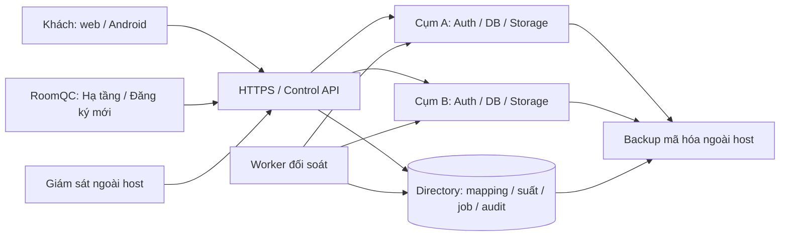

# RoomQC — hồ sơ triển khai và nghiệm thu toàn bộ VPS + signup

**Checkpoint quyền thật cấu hình/release — 30/10/2026:** nguồn 423 tệp, SHA256 `6a6b45b1b2e5f00a9c1396f95c935cb63d0d317a7c4ce613757e257423019e90`. Control 647 đạt/0 lỗi/226 bỏ qua; Linux tập trung 29 đạt/0 lỗi/1 bỏ qua. [Cấu hình](roomqc-managed-configuration-authority-local-2026-10-30.md) run cee2904fa769 và [release](roomqc-managed-release-authority-local-2026-10-30.md) run 6c66c7b2d0be đều exit 0 trên 590 migration, nguồn/schema được đối chiếu và cleanup độc lập 0. Sửa bài kiểm thiếu canonical Auth/acceptance, kiểm thiếu/thu hồi phiên không có tác dụng, replay không thêm receipt, mẫu cũ bị chặn; restart từ cấu hình/catalog chỉ đọc phục hồi đủ năm dịch vụ. Full-default mới đang chạy với native advisors, chưa có biên nhận kết thúc hoặc independent rebuild. Chỉ kiểm local thành phần, không đổi BG02–BG11/release acceptance/reviewer/signoff.


**Checkpoint TLS Realtime — 30/10/2026:** nguồn 423 tệp, SHA256 dc9200efda1e0a44e81c0a379b06b6f5010a2e66b8f549b5045d0f2475ac3060. Control 647 đạt / 0 lỗi / 226 bỏ qua; Windows và Linux mỗi môi trường 167 đạt / 3 bỏ qua. Native TLS 60/60, tiếp nhận cấu hình 89/89, cài mới 106/106; đều exit 0 trên cùng nguồn và 590 migration. [Bằng chứng](roomqc-realtime-tls-local-2026-10-30.md). Tenant, metadata/discovery và dashboard pgdelta xác minh CA và tên máy đích; công cụ thật từ chối sai CA, sai tên, hết hạn và máy chủ không tin cậy, rồi phục hồi. Bộ thử xác nhận fingerprint chứng chỉ qua handshake trước từng ca lỗi. Ba lần dựng image, gồm hai lần không cache, cho cùng image ID. Kiểm độc lập không còn tài nguyên fixture. Đây là kiểm thành phần; inventory, runtime và sức chứa toàn cụm còn mở. BG02–BG11, full-default, VPS, E2E, tải, pilot và 122 mục release/signoff chưa được nhận.

**Checkpoint image Realtime dựng lại độc lập —30/10/2026:** nguồn419/e956d6a3d48a74c5406d770fa03f6c4a0339925f950c91182c34c3dd0a5654af; Control645pass/0fail/226skip; Windows/Linux165/165pass; native adoption89/89,fresh106/106,590migration,exit0 cùng nguồn. [Bằng chứng](roomqc-realtime-managed-image-local-2026-10-30.md). Managed PLAN dùng actual Compose/inspect+no-cache rebuild, từ chối image giữ label nguồn nhưng đổi config; mặc định không build. Sửa ExCk nondeterministic bằng compiler option, hai build không cache+một có cache khớpID. Mới nhận image riêng, PLAN tổng vẫn unresolved; còn full inventory/TLS/host capacity/BG02–BG11/full-default/VPS/E2E/tải/pilot. Source/schema/metadata khớp,cleanup độc lập0;122release entries/signoff giữ mở.


**Checkpoint Realtime bootstrap — 30/10/2026:** nguồn415/9bcca583f579b3b984af4b26cbb5c20ff2c37fc34d6bbb8eb8f18114e37846c0; Control640pass/0fail/226skip; Windows/Linux160/160pass; native adoption80/80, fresh97/97 trên590migration,exit0 cùng nguồn. [Bằng chứng](roomqc-realtime-bootstrap-local-2026-10-30.md). Giữ cấu hình khi restart/adopt, thống nhất SQL/API/cache, wrong-config denial, hai seed tranh khóa và postcommit SIGKILL→retry được kiểm. Đã có builder/overlay và nối image vào full-default harness; chưa chạy full-default/rebuild hoặc VPS. Business fingerprint và catalog guard metadata khớp đầu–cuối; cleanup độc lập0. Còn managed-image PLAN/full inventory/TLS/host capacity và BG02–BG11;122release entries/signoff giữ mở.

**Checkpoint Realtime — 30/10/2026:** nguồn407/be4ab72cc2692bd29be4a8c8528b95dbab90bd95f0a5a51a2a2a145bae7e788c; control640pass/0fail/226skip; Windows/Linux160pass/3skip mỗi môi trường; native50/50 trên590migration,exit0 cùng nguồn. [Bằng chứng](roomqc-resource-realtime-local-2026-10-30.md). Actual WebSocket/health/replication PID replacement, persisted pool mismatch→deny→recovery và restart reseed reset được kiểm. PLAN vẫn unresolved; metadata2 quan sát12sessions, không hard ceiling. Còn bootstrap bền vững, đồng nhất readiness keys, full inventory/TLS/host capacity vàBG02–BG11;122release entries giữ mở. Không đổi SQL/runtime đang phục vụ; cleanup độc lập0.

**Checkpoint Storage — 30/10/2026:** nguồn402/a95c99fb2d54cd5ecb39ff1b2ddfd6b356d297a1ba19a1eda91e2bf1ed65c067; control633pass/0fail/226skip; Windows/Linux153pass/3skip mỗi môi trường; native Storage27/27 trên590migration, exit0 cùng nguồn. [Bằng chứng](roomqc-resource-storage-local-2026-10-30.md). Recipe fixed-project Node/file Storage tính main pool +pubsub +startup reserve; actual HTTP/private file,12request saturation/header giả, listener PID replacement và restart persistence. Projection chưa toàn stack; session retirement/network-fault/rolling overlap chưa có hard ceiling. Không đổi SQL/runtime đang phục vụ; cleanup độc lập0. BG02–BG11 và122release entries giữ mở.

**Checkpoint pool khởi tạo/thông báo — 30/10/2026:** nguồn399/4cb8da68c8b8105f43534fefb85084d8eb31d8197a1bcf0b446b14f9475626c7; control630pass/0fail/226skip; Windows/Linux150pass/3skip mỗi môi trường; native setup 60/60 và room-writers 544/544, mỗi lượt590business migration, setup thêm21directory; exit0 cùng nguồn. [Bằng chứng](roomqc-resource-setup-booking-pools-local-2026-10-30.md). Hai runtime mượn pool thật max2, kiểm identity/profile, catalog denial/recovery và không bỏ qua credential/channel readiness. Grant catalog và budget là fixture scope; chưa live Compose/TLS/full inventory/host capacity/provider thật. Không đổi SQL hoặc runtime; cleanup độc lập0. BG02-BG11 và122release entries giữ mở.

**Checkpoint pool health/probe/alert — 30/10/2026:** nguồn399/bc2af45c1b3301c0e498a1ecc1589d5ae958ea6c516be41d48171601b284396c; control630pass/0fail/226skip; resource+source-binding Windows/Linux150pass/3skip mỗi môi trường; database/container thật26/26 gồm21 ca catalog cũ và5 ca worker trên21 directory migration, exit0 cùng nguồn. [Bằng chứng](roomqc-resource-worker-pools-local-2026-10-30.md). Ba pool dùng LOGIN riêng và pool thực; sai quyền/readiness, revoke/restore và DB stop/start được kiểm. Worker image241file đối chiếu nguồn; Dockerfile/schema.sql đã vào binding, image ID được lưu. Config Linux là named-volume fixture UID1000/0400; còn live Compose/TLS, setup/booking, vendor/maintenance/summary, host capacity và BG02–BG11;122release entries giữ mở. Cleanup độc lập0.

**Checkpoint pool đang chạy → database — 30/10/2026:** nguồn396/69486280b0d23c034f480d755d0597e718402ecc771df4dc5474d71f31b4f5bc; control630pass/0fail/221skip; Windows/Linux138pass/2skip mỗi môi trường; PostgreSQL+container thật21/21,exit0 cùng nguồn. [Bằng chứng](roomqc-resource-loaded-pool-local-2026-10-30.md). Listener opt-in loopback8098 mượn pool runtime hiện hành; Control image/CLI/Dockerexec thật phân biệt sai DB cùng tên và khôi phục, saturation/late-acquire/privilege recovery. Mới có native pool proof cho Control; worker khác còn native schema/role/TLS. Hai sample không phủ mọi session hoặc proxy/topology/provenance. Cleanup độc lập0; BG02–BG11 và122release entries giữ mở.

**Checkpoint credential cấu hình → database — 30/10/2026:** nguồn391/220d4f610155d9b3b8482ac93a066f97b8cd815515746a3b3f99d09c58e90b3e; control617pass/0fail/217skip; resource/setup Windows118pass/2skip, Linux118pass/2Compose skip; PostgreSQL thật17/17, hai instance, CLI+Compose thật, exit0 cùng nguồn. [Bằng chứng](roomqc-resource-consumer-targets-local-2026-10-30.md). Chặn nhầm server dù trùng tên DB/LOGIN, sai role/quyền, đổi credential/config và vượt ngân sách chung. Health/probe/setup/summary/booking recipe có observation doubles riêng. Chưa bind pool đang chạy/namespace/proxy hoặc nghiệm thu toànBG03; native worker56/590migration dưới đây thuộc nguồn387 riêng. Cleanup độc lập0; BG02–BG11 và122release entries giữ mở.

**Checkpoint provisioning resource — 30/10/2026:** nguồn387/30747b1f0c20a23c02fa1296eeefb1e1f1b9a43cda7305a13b050dfae227fba3; control601pass/0fail/211skip; resource/setup Windows102pass/2skip, Linux102pass/2Compose skip; native worker56/56 trên590migration, exit0 cùng nguồn. [Bằng chứng](roomqc-provisioning-resource-local-2026-10-30.md). Worker khởi tạo được inventory PLAN/runtime nhận diện, chặn sai pool/replica/instanceId/mount;8095 đọc projection startup. Sửa exact suffix harness, thêm denial/rollback summary maintenance. Inspector shape dùng doubles; native riêng không chứng minh live Compose bind deployment/DB binding. Cleanup độc lập0. BG02–BG11 và122release entries giữ mở.

**Checkpoint BG03/T10 snapshot runtime summary — 29/10/2026:** nguồn385/`717b863fd806c47b27aa8aa450be443f57a77cf760b116be44efda2488c821ff`; native76/76,590migration; control590pass/0fail/211skip; focused64/64; Linux62pass/2Compose skip; image/daemon9/9; exit0 cùng nguồn. [Bằng chứng](roomqc-summary-runtime-profile-local-2026-10-29.md): loopback8097 snapshot hai DB/hash config, inspector so cached profile; native ready200, policy drift→503/live200/no DB effect, restore→ready200, graceful shutdown. Image fixture named volumes/offline khác live Compose bind deployment; inspector shape doubles riêng. Source/schema khớp, cleanup độc lập0. Còn all-consumer inventory/DB binding/host capacity, BG02 vàBG04–BG11; không nhận toànBG03, VPS hoặc122release entries. Checkpoint PLAN382/1b958 và native380/76c8 dưới đây giữ phạm vi lịch sử.

**Checkpoint BG03/T10 resource summary — 29/10/2026:** nguồn382/`1b958ab2ea95b69b875d851f62524b63dad682bb2a6677a2d6e51dba39a4bfaa`; control586pass/0fail/211skip, focused Windows55/55, Linux53pass/2Compose skip; exit0 cùng nguồn. [Bằng chứng](roomqc-summary-resource-preflight-local-2026-10-29.md) nối một rotator vào cả directory/business và tổng native/vendor, kiểm replica/LOGIN/mount/budget. PLAN chỉ đọc metadata, không kết nối DB; runtime summary chưa có cached projection nên từ chối rõ. Delta7tệp không đổi SQL hoặc installer/daemon runtime. Chưa nhận BG03/toàn inventory/host capacity; native73 dưới đây vẫn thuộc nguồn380. BG02–BG11 và122release entries giữ mở.

**Checkpoint tranh chấp/mount summary — 29/10/2026:** nguồn380/`76c8badbdce241443a01e961a7a430bc51432c276929a8d12b91ed61308e3d45`; native73/73 trên590migration; control576pass/0fail/210skip, exit0 cùng nguồn. CLI/daemon/reader UID1000, reader output read-only, reload lỗi/khôi phục/revoke không restart; shared/separate caller contention và SIGKILL/pending replay. Compose config2/2, không chạy profile. Source/schema khớp, dữ liệu giữ nguyên, cleanup độc lập0. [Bằng chứng và giới hạn](roomqc-summary-contention-mount-local-2026-10-29.md). Chưa browser→Control→cụm, image/profile live, VPS hoặc signoff BG02–BG11;122release entries vẫn mở. Checkpoint62 và các đoạn dưới giữ nguồn/phạm vi lịch sử riêng.

**Checkpoint vòng đời khóa summary — 29/10/2026:** nguồn374/`311a518f60bc684cee7530770d7fb285cf5fa549d1488bc83688aac4b24425c3`; native62/62 trên590migration, control575pass/0fail/209skip, exit0. Actual CLI/daemon UID10001, signed/live directory bằng test authority, mất phản hồi sau commit và SIGKILL/pending replay; business data/schema phục hồi, cleanup độc lập0. [Bằng chứng](roomqc-summary-credential-lifecycle-local-2026-10-29.md). Còn hai-process/mount/config/E2E; không đóng BG05/BG02–BG11 hoặc122release entries. Các checkpoint dưới giữ nguồn/phạm vi lịch sử riêng.

**Checkpoint tenant-summary —29/10/2026:** API+UI implemented-local;fullschema589/19checks vàACL44 trênsource356/abb4,HTTP1/1,66frontend/typecheck/lint đạt.Bản cuối903f chỉ sửa1tệp fixture,drift4/4 vàruntime không đổi.[Nguồn vàgiới hạn](roomqc-tenant-summary-local-2026-10-29.md).Còn issuer/publish/rotation,config/E2E;không nhậnBG05 hoặc sản phẩm,122mục unverified.

**Checkpoint console backup —29/10/2026:** source352/431a2bd51f36c5f8967bbeba00e9e04cd7614b183e008575d3ba4cee25d90e33,GET /admin/backups +Hạ tầng→Sao lưu implemented-local;contract9/9,PostgreSQL/HTTP2/2,frontend59/59,control536pass/0fail/207skip,build/lint đạt.[Actual vàgiới hạn](roomqc-control-backups-local-2026-10-29.md).Tổng/filter/cursor có1.005metadata;visual1280/390 làcomponent fixture,không E2E hoặc backup/restore proof.Tenant-summary,BG02/BG03–BG11 và122release entries giữ mở.Các checkpoint dưới giữ nguồn riêng.

**Checkpoint nâng cấp19→20→21 và ACL42 —29/10/2026:** source352/d8ace9734e4d6f09a92d597a5488432f3b41e20e7e37a9a0f994e93f10b3212d,native22/22,ACLdrift4/4,control534pass/0fail/205skip,exit0.[Actual và giới hạn](roomqc-support-upgrade-chain-acl-local-2026-10-29.md) giữ dữ liệu/history/lease,rollback schema/ACL vàđúng quyền migrator;504+156 denial trực tiếp trên42 bảng.Schema/source khớp,cleanup độc lập0.Chưa review đủ indirect paths/app rollback/orchestration hoặc nhậnBG02/BG03–BG11.Các checkpoint dưới giữ nguồn lịch sử riêng.

**Checkpoint writer-first — 29/10/2026:** source352/a39f941709470000e5f77c15aea33a8595f965896467eea33628c5d9b990c9c6, native335/335, control534pass/0fail/205skip, exit0. [Actual và giới hạn](roomqc-support-writer-first-local-2026-10-29.md) bổ sung20 tình huống writer commit/rollback và initial intent/payload conflict. Writer là API hiện tại, closure contender là SQL API-role probe; chưa mọi old binary/rollout/upgrade/security. BG02 vàBG03–BG11 còn mở.


**Checkpoint legacy cutover — 29/10/2026:** source351/691b4c5e7e74e2b5fa42efa050caedbe7e46102a0fa063bc380f67225aab2af1,native15/15,control534pass/0fail/205skip,exit0. [Bằng chứng và giới hạn](roomqc-support-legacy-cutover-local-2026-10-29.md) chạy source331 thực: readyz503 không tự chặn writer còn sống. CLI mới ngừng LOGIN/membership/phiên cũ, audit private, kiểm sai target và COMMIT-response-loss recovery. Chưa tự động rollout/VPS hoặc đóng mọi old-writer/upgrade/security window; BG02 vàBG03–BG11 vẫn mở.


**Checkpoint publication — 29/10/2026:** source345/b633a994a0c9af930d69c0e7db697270c1cd577b52bb492038771dbc0a8c7a1c, native283/283; matrix mới20/20 ở 5 họ lệnh × closure/generation × commit/SIGKILL; control534pass/0fail/205skip, exit0. [Actual và giới hạn](roomqc-support-publication-runtime-local-2026-10-29.md) có hai API/poolMax1,10 SQL old-receipt contenders và10 publication SIGKILL. Còn old-writer-first/old-binary fencing,initial-intent creation,security/các đường upgrade/rollback thiếu vàBG03–BG11; chưa nhận BG02 hoặc sản phẩm.


**Checkpoint nâng cấp có dữ liệu — 29/10/2026:** source344/d250a814bf874ca9dea1a8d1e1e55982d430aa0bd586371cf73984e8370a3129,native16/16 quan sát nâng cấp business585→586→587 vàdirectory20→21;control534pass/0fail/205skip,exit0. [Actual và giới hạn](roomqc-support-populated-upgrade-local-2026-10-29.md) giữ dữ liệu17 bảng,biên nhận cũ,32 bảng directory/lease/lịch sử vàhai migrator. Còn explicit publication/old-writer,security review,các đường upgrade/old-binary rollback chưa được chứng minh vàBG03–BG11;chưa nhận toàn BG02 hoặc sản phẩm.


**Checkpoint worker — 29/10/2026:** source341/5e81ca30746fa9791bb78af6b384f899759e0f7ff55b11ff7fdcab2ed35284a8,native setup-worker56/56; matrix mới18 quan sát,7 witness/1SIGKILL;control534pass/0fail/205skip,exit0. [Actual và giới hạn](roomqc-worker-authority-runtime-local-2026-10-29.md) có proof scoped RA13/RA14: credential/owner revoke,release withdrawal,hai worker/natural lease/late result vàrestart. Delta chỉ3 tệp harness; hai API173/173 vàdirectory173/173 giữ nguồn trước. Còn explicit publication/old-writer,populated upgrade/security vàBG03–BG11; chưa nhận toàn BG02 hoặc mở vận hành.


**Checkpoint hai API — 29/10/2026:** source339/`6b0df534157d10b9c1720ee6d7a631659a2fe4176402f64af36debb339d881ad`,native173/173,71barriers/10SIGKILL;control534pass/0fail/205skip,exit0. [Báo cáo](roomqc-support-replicas-runtime-local-2026-10-29.md) và [packet](../../../artifacts/roomqc-support-replicas-runtime-421371f40655-local-2026-10-29.json) chứng minh5 nhóm lệnh với hai API/poolMax1 ở các cửa sổ đã nêu. Còn explicit generation-publication/old-writer windows,worker,populated upgrade/security; chưa nhận R11/BG02 hoặc BG03–BG11. Các checkpoint phía dưới giữ nguồn/phạm vi lịch sử riêng.

**Cập nhật thực thi 29/10/2026:** RF06 đã đồng bộ contract/caller và có native Linux/Auth/HTTP126/126, directory173/173, control534pass/0fail/205skip trên cùng source338/`64591454b3fe8f19936342890786dcb3c6ab31d482bec93520f6fd3eb3c93b0a`. [Báo cáo tiến độ dễ đọc](roomqc-vps-signup-status-2026-10-29.md) và [bằng chứng RF06](roomqc-support-legacy-runtime-local-2026-10-29.md). Chưa nhận R11/BG02: còn all-family/hai API process, worker claim→settle, populated upgrade/security; BG03–BG11 và122 release entries vẫn mở. Các đoạn chuẩn bị RF06 dưới đây giữ làm baseline lịch sử; lượt1–4 mục5.6 đã có bằng chứng local trong báo cáo mới, nhận tiếp lượt5–8. Actual/reviewer/signoff/gates không đổi.

**Điểm nhận việc — xác nhận toàn bộ VPS + signup, đầu ra plan + nghiệm thu, 29/10/2026:** đây là kế hoạch chuẩn bị triển khai, không phải biên bản nhận sản phẩm. Bản RF06 đang sửa đã có stable key, result lookup và private CLI intent; OpenAPI/caller compatibility và native mới chưa khép. [Snapshot đối chiếu](../../../artifacts/roomqc-vps-signup-plan-handover-2026-10-29.json) ghi nguồn hiện hành, giới hạn bằng chứng và kiểm cấu trúc kế hoạch. Bắt đầu tại mục5.6; toàn hành trình khách hàng và thao tác vận hành tại mục11–12. Giữ25 task/70 ca/124 lượt; actual/reviewer/signoff/gates chưa được cấp từ lần lập kế hoạch này.

<details>
<summary>Lịch sử checkpoint — chỉ áp dụng đúng nguồn của từng báo cáo</summary>

**Checkpoint runtime334 — lịch sử trước RF06:** bản334/hash `6d7d491550eb9258865a2fa26eeae0a0e0934f7a8a5a2e6e8455da0ce24a8dac`,587 business/21 directory migrations. [Báo cáo runtime](roomqc-support-intents-runtime-local-2026-10-29.md) và [packet](../../../artifacts/roomqc-support-intents-runtime-b3e1f84b1812-local-2026-10-29.json): native113/113,34barriers/3SIGKILL,exit0 trên source243567; control529pass/201skip/0fail cùng nguồn. Directory r2 có168pass/1fail do expected callback; ba assertion được sửa và focused r3 đạt1/1 trên6d7d. Không cộng thành full169/169. Native expired recovery chỉ chứng minh close_admission,8HTTP retries cùng một API process; không dùng bằng chứng này để nhận source RF06 mới.

**Checkpoint nền journal334/d30e — lịch sử, 29/10/2026:** source334/hash `d30e5ee5908404ed2da8d64ddc955305e98c273086bfe119334fac39b623dcf7`, 587 business/21 directory migrations. [Báo cáo](roomqc-support-intents-foundation-local-2026-10-29.md) và [packet](../../../artifacts/roomqc-support-intents-foundation-207ce2e0ad48-local-2026-10-29.json): directory 169/169 (9 ca journal mới), control 527 pass/0 fail/201 skip; native 104/104 kiểm tương thích Auth/HTTP hiện có, exit0. Journal giữ identity/generation/predecessor bền vững, khóa trên một connection và chặn vòng cũ; đã sửa xử lý backend termination và fixture pool cleanup. **Chưa nối coordinator vào mutator runtime hoặc chứng minh expired recovery qua canonical Auth.** Nhận tiếp RF04/RF05/RF06 tại mục5.4 dossier; R11/BG02, worker, populated business upgrade/security và BG03–BG11 còn mở. Giữ 25 task/70 ca/124 lượt/122 mục unverified, actual/reviewer/signoff/gates không đổi.

**Checkpoint331 — lịch sử consumption, 29/10/2026:** source331/hash `a700ff658818a1f0b8b43420cf120d93768f0fedc34b8b3de32f56a7d7a5ef1f`,587 business/20 directory migrations. [Báo cáo](roomqc-support-consumption-local-2026-10-29.md) và [packet](../../../artifacts/roomqc-support-consumption-331212d94761-local-2026-10-29.json): native104/104,28 barriers/1API SIGKILL; directory160/160; control527pass/0fail/192skip,exit0. Có proof Auth→command→consumption thật, rollback/mất phản hồi/expiry và3 cửa sổ accept-before-revoke cho cluster command. Source/schema đầu–cuối khớp,role baseline phục hồi,cleanup độc lập0. **R11/BG02 còn mở:** expired-attempt recovery,legacy same-key replay,worker,đủ mutation families,populated upgrade và security review; chưa full-default/rebuild/staging/nghiệm thu sản phẩm. [Phiếu nhận tiếp](roomqc-vps-signup-execution-dossier-2026-10-29.md#53-thứ-tự-triển-khai-bản-tích-hợp-source330) và [nghiệm thu](roomqc-vps-signup-master-acceptance-2026-10-28.md#124-thực-thi-bản-tích-hợp-source330). Giữ toàn bộ VPS+signup,8đợt/11BG/25task/27package/70ca/124lượt; actual/reviewer/signoff/gates không đổi.

**Bản nháp source330 — lịch sử, 29/10/2026:** phạm vi **toàn bộ VPS + signup**, đầu ra **plan + nghiệm thu**. Source330, SHA256 `ca77f438a4db58ad9843a7beceaeddec39a4b04d70179fb4c81bfd4417d6bc70`; 587 migration nghiệp vụ/20 directory. Đã viết bước tiêu thụ biên nhận quyền trong giao dịch quản trị; **chưa kiểm tích hợp Auth/HTTP/SQL và nâng cấp dữ liệu cũ cho bản này**. Preflight unit 15/15, exit0 chỉ chứng minh phạm vi helper/gateway/support; native90/90 và control520pass của source327 là lịch sử riêng. Nhận [phiếu R11 bản tích hợp](roomqc-vps-signup-execution-dossier-2026-10-29.md#53-thứ-tự-triển-khai-bản-tích-hợp-source330) và [bài nghiệm thu bổ sung](roomqc-vps-signup-master-acceptance-2026-10-28.md#124-thực-thi-bản-tích-hợp-source330). Hết hạn biên nhận và phục hồi cùng mã lệnh còn cần xử lý; R11/BG02 và các mốc L/S/P/U/B chưa được nhận. [Hồ sơ toàn phạm vi](roomqc-vps-signup-execution-dossier-2026-10-29.md) giữ 8 đợt/11 gói bàn giao/25 task/27 package/70 ca/124 lượt; actual/reviewer/signoff/gates không đổi.

**Checkpoint source327 — lịch sử, 29/10/2026:** phạm vi **toàn bộ VPS + signup**, đầu ra **plan + nghiệm thu**. Nguồn327/hash `e45b9fb53499c81fc65e8fd9af426307cf8c312dd698d10ef68f0051a87aa189`,586 business/19 directory migrations. [Thành phần acceptance local](roomqc-support-acceptance-component-local-2026-10-29.md) đạt control520pass/0fail/192skip,native90/90 gồm20 acceptance checks/6 interleaving;exit0,source/schema khớp,cleanup độc lập0. Đã sửa migration guard và kiểm rollback schema/ACL/history. **Chưa nối consumption vào directory**,chưa populated585→586/full-default/rebuild. Nhận [R11-04–08](#52-phiếu-triển-khai-r11-theo-nguồn327);R11/BG02 còn mở. [Packet source327](../../../artifacts/roomqc-support-acceptance-component-4661134f0654-local-2026-10-29.json). [Audit kế hoạch r2](../../../artifacts/roomqc-vps-signup-plan-readiness-r2-2026-10-29.json) giữ snapshot trước sửa harness,không dùng nhận source mới hoặc nghiệm thu sản phẩm.

**Checkpoint đã kiểm trước đó — source324:** [Báo cáo](roomqc-support-authority-boundaries-local-2026-10-29.md) và [packet](../../../artifacts/roomqc-support-authority-boundaries-2765aadfaabb-local-2026-10-29.json) có control/directory/native Auth proof đúng source324:516pass/192skip,160/160 và63checks/14scenarios,exit0. Đã sửa3lỗi kiểm quyền sau chờ SQL. [Checkpoint323](roomqc-support-authority-local-2026-10-29.md) giữ proof COMMIT lock timeout riêng. Không chuyển các kết quả này sang source327. R11 còn protocol xuyênDB và claim/RPC/settle; chưa ký nhận BG02.

</details>

Ngày đối chiếu: 29/10/2026. Phạm vi và đầu ra do người dùng xác nhận: **toàn bộ VPS + signup; plan + nghiệm thu**. Tài liệu này là điểm bắt đầu nhận việc hiện tại; định nghĩa 25 task, 27 gói, 70 ca và dependency vẫn lấy từ [master plan](roomqc-vps-signup-master-plan-2026-10-28.md), [ledger](../../../artifacts/roomqc-vps-signup-delivery-ledger-2026-10-21.json) và [ma trận thực thi](../../../artifacts/roomqc-vps-signup-acceptance-execution-plan-2026-10-28.json). Không thêm ca release hoặc ký đạt từ lượt lập kế hoạch này.

## 0. Cách dùng bộ kế hoạch

| Cần xem | Tài liệu và nội dung |
|---|---|
| Mục tiêu, thứ tự và điều kiện mở vận hành | Hồ sơ này: mục1–4 và8–9 |
| Công việc giao cho người triển khai | [25 phiếu task](roomqc-vps-signup-master-plan-2026-10-28.md#4-phiếu-triển-khai-25-task): dependency, vai trò, file/API, bàn giao và ca kiểm |
| Cấu hình hạ tầng, endpoint, quyết định còn thiếu | [Blueprint](roomqc-vps-signup-deployment-blueprint-2026-10-28.md#3-các-quyết-định-cấu-hình-phải-khóa-trước-đúng-bước): Q01–Q10 và các bước triển khai |
| Dự toán và người nhận | [Bảng công11BG](roomqc-vps-signup-implementation-board-2026-10-28.md#11-dự-toán-công-việc-còn-lại-và-cách-lập-lịch): công làm/kiểm riêng, tên người và ngày giao cần điền khi nhận |
| Cách chạy và bằng chứng phải thu | [Hồ sơ nghiệm thu](roomqc-vps-signup-master-acceptance-2026-10-28.md): fixture,70 ca, lỗi, phục hồi, biên bản và reviewer |
| Điền kết quả từng môi trường | [Ma trận124 lượt](../../../artifacts/roomqc-vps-signup-acceptance-execution-plan-2026-10-28.json), trường `executionRows`; tạo run mới từ định nghĩa này, giữ bản gốc |
| Mẫu nghiệm thu cho lần nhận việc này | [Mẫu run RF06](../../../artifacts/roomqc-vps-signup-acceptance-run-template-rf06-2026-10-29.json):124 lượt chưa chạy; ràng buộc lại candidate/target trước thực thi |
| Hành trình và công việc vận hành cụ thể | Mục11: từ đăng ký đến gia hạn/ngừng dùng; mục12: thêm cụm, xử lý kẹt, đổi gói, khôi phục |
| Việc có thể nhận đầu tiên | Mục5.3: phần còn thiếu sau checkpoint331; mục5.4: phiếu phục hồi hết hạn và legacy replay; mục5.2 giữ mapping R11-01→R11-08; bộ ca tại [mục12 nghiệm thu](roomqc-vps-signup-master-acceptance-2026-10-28.md#12-nghiệm-thu-protocol-r11-và-thành-phần-acceptance-mới) |

**Cách hiểu trạng thái:** có code → đã kiểm một thành phần → đã kiểm tích hợp → reviewer nhận đúng phạm vi → đủ điều kiện mở vận hành là các bước khác nhau. Kế hoạch này đã có nội dung để giao việc; chưa điền tên người duyệt hoặc actual chưa thực hiện. Chỗ cần VPS/key/quyết định thương mại được gom ở mục9, tiếp tục phần độc lập trước.

### 0.1. Đầu ra bàn giao và cách bắt đầu

Phạm vi đã chốt: **toàn bộ quản lý VPS và đăng ký mới**, gồm cả vận hành, phục hồi, hạn mức, email và web/Android. Bộ bàn giao gồm kế hoạch này, 25 phiếu kỹ thuật trong master plan, bộ nghiệm thu và bản ghi kết quả trống cho từng môi trường. Không cần tạo roadmap thay thế.

| Mốc bàn giao | Người dùng thấy được gì | Điều kiện chuyển tiếp |
|---|---|---|
| Tích hợp local — BG01–BG06 | Đăng ký, tạo khách sạn, mời nhân viên; hai màn hình Hạ tầng/Đăng ký mới; thử lỗi và phục hồi trên fixture | Khép R11/BG02, budget/admission, signup/console; candidate có full integration và dựng lại độc lập; reviewer đề nghị L |
| Vận hành staging — BG07–BG09 | Dùng qua HTTPS trên VPS RoomQC quản lý; đăng ký/email/Android thật; mất host vẫn phục hồi được | Linux install/upgrade/rollback, isolation A/B, offsite clean-host restore và on-call có actual; S theo phạm vi |
| Sẵn sàng mở có giới hạn — BG10–BG11 | Có giới hạn sức chứa/chi phí đã đo, cohort thử và người hỗ trợ | Load/soak/RC rồi pilot tối thiểu7 ngày; quyết định P/U riêng, billing thật thuộc B |

**Nhận việc đầu tiên:** BE thực hiện RF01→RF09 tại mục5.4; QA kiểm bộ RX tại mục12.5 của hồ sơ nghiệm thu; OPS kiểm giới hạn connection/role/rollback. Các mã RF/RX là phiếu con của R11/RA07–RA17, không tăng25 task/70 ca. Chuẩn bị inventory BG03 và route/API BG05 có thể làm trước trong phạm vi không phụ thuộc.

**Hồ sơ để chạy:** [mẫu124 lượt và audit lần cập nhật này](../../../artifacts/roomqc-vps-signup-plan-acceptance-refresh-source331-2026-10-29.json). Mẫu là bản sao định nghĩa với actual/runner/reviewer/signoff trống, không phải kết quả chạy. [Mẫu run](../../../artifacts/roomqc-vps-signup-acceptance-run-template-source331-2026-10-29.json) cần sao thành run mới, điền exact target/candidate/dataset trước thực thi. Tài liệu này chỉ chuẩn bị kế hoạch; không cấu hình hoặc triển khai lên VPS thật trong lượt cập nhật.

## 1. Kết quả cuối cùng phải đạt

Khách hàng vào RoomQC, đăng ký, xác minh email, tạo khách sạn và dùng ngay. RoomQC chọn cụm trên VPS mình quản lý, cấp chỗ, theo dõi sức chứa, xử lý đăng ký kẹt, quản lý gói và phục hồi dữ liệu. Khách không phải cài VPS, Docker hoặc Supabase.

- Cụm nghiệp vụ được RoomQC chuẩn bị trước; một cụm có thể chứa nhiều khách sạn với quyền và dữ liệu cách ly. Không khởi tạo một VPS hay một bộ Supabase mới cho mỗi tài khoản đăng ký.
- Directory giữ mapping workspace→cụm, reservation, job, command và lịch sử. Cụm nghiệp vụ giữ Auth, dữ liệu khách sạn, Storage, Realtime và Functions. Nhân viên được gán vị trí, khách sạn và quyền từ lúc mời/tạo.
- Khách cũ giữ cụm đã gán. Khi cụm đầy/lỗi/đang bảo trì, hệ thống chặn nhận mới tại cụm đó; không tự đưa khách cũ sang cụm khác. Di chuyển khách là quy trình riêng có kiểm chứng.
- Tăng quy mô bằng thêm cụm đã kiểm sức chứa. Mục tiêu 1.000 khách sạn là định hướng; chưa phải khả năng đã được đo hoặc cam kết 100.000 phiên đồng thời.



Sơ đồ là kiến trúc đích; không khẳng định đang có hai VPS vận hành thật.

## 2. Baseline thực tế và điểm đang chặn

Checkout nhận việc: `roomqc-worktrees/integration`; HEAD `5cb583729ce055db64df8b192f10476db1fa99b8`, có thay đổi chưa commit. HEAD không đại diện đủ nội dung đang sửa.

| Mục | Đối chiếu được | Cách sử dụng |
|---|---|---|
| Nguồn backend hiện tại | 352 tệp; SHA256 a39f941709470000e5f77c15aea33a8595f965896467eea33628c5d9b990c9c6; 587 business/21 directory migrations | Native support-authority 335/335, matrix mới20/20, control534pass/0fail/205skip cùng nguồn. Delta4 tệp harness; không sửa runtime/migration. Cutover15/15 giữ351; nâng cấp16/16 giữ344; worker56/56 giữ341; directory173/173 giữ338. Chưa full-default/rebuild/staging/signoff |
| Thành phần acceptance local — lịch sử327 |Migration586 và gateway/harness có native20 checks/6 interleaving trong run90/90; control520pass/192skip/0fail |Bằng chứng đúng source327. Checkpoint331 ở dòng trên đã kiểm migration587/directory0020 và consumption; phạm vi còn thiếu nằm trong báo cáo mới |
| Failure lịch sử đã xử lý |`c42898431345`:exit1,phase `sql_replay`,applied0 do migration guard;run thay thế `4661134f0654` exit0,applied586 |Giữ failure;sửa suffix chính xác và thêm full-body/history rollback rehearsal. Cả hai run có independent Docker label cleanup0 |
| Checkpoint local trước | [Contention run 5c839bfe5602](../../../artifacts/roomqc-setup-rotation-contention-5c839bfe5602-local-2026-10-29.json): nguồn319,17 native checks,46 regression pass/0 fail/1 skip | Bằng chứng rotation theo đúng source319; không chuyển kết quả sang322 |
| Thu hồi quyền R11 — checkpoint324 |[Native Auth/HTTP63checks/14scenarios](roomqc-support-authority-boundaries-local-2026-10-29.md),directory160/160 |Đã kiểm các mutator và delayed reads theo source324; chưa chuyển proof sang327 hoặc đóng protocol xuyênDB/worker |
| Lỗi/gap còn mở |RF06/hai API,worker RA13/14 và selected populated585/586→587+directory20→21 đã có scoped proof. Closure/generation publication đã có scoped native proof 5 họ lệnh; còn old-writer-first,initial-intent creation,old-binary orchestration (CLI fence đã có proof local),security disposition vàcác đường upgrade/rollback chưa được chứng minh |Không giao lại các cửa sổ đã chứng minh. Source344 giữ17 bảng business/Auth và32 bảng directory,hai migrator/rerun/checksum/fault; không suy sang populated19→20 hoặc binary rollback. R11/BG02 vàBG03–BG11 vẫn mở |
| API quản trị còn thiếu | OpenAPI đánh dấu GET `/admin/backups` và GET `/admin/workspaces/{id}/tenant-summary` là `planned` | Cần khép handler→DTO→client→native→UI→test; khai báo contract chưa là chức năng chạy được |
| Nghiệm thu chính thức | 70 ca;124 lượt môi trường;122 task/package/case release entries còn unverified | Giữ nguyên actual/reviewer/signoff/gates; diagnostic local không tự điền vào worksheet |

Log riêng nằm trong `.local/`, không phát hành kèm token/DSN. [Artifact hồ sơ](../../../artifacts/roomqc-vps-signup-execution-dossier-2026-10-29.json) giữ hash và thông tin đã lọc. Container fixture `roomqc-control-dbtest-48a616f84d9c` không còn trong kết quả kiểm Docker tại lượt đối chiếu; không suy từ đó rằng toàn bộ môi trường Docker sạch.

**Chặn ưu tiên:** R11 — writer cũ vào trước khi phục hồi, khởi tạo intent đồng thời, orchestration fence binary cũ (CLI local đã kiểm); security disposition và các đường upgrade/rollback thiếu. Worker source341 và closure/generation publication source345 đã có proof theo phạm vi trong các báo cáo, không giao lại nguyên bài đã đạt. Chưa đủ bằng chứng để nhận toàn BG02 hoặc đề nghị gate L. Các phần cần quyền VPS/DNS/provider được ghi chờ ở mục9; việc local độc lập tiếp tục theo dependency.

## 3. Quy tắc giao việc và lịch

BE: backend; FE: web/Android; OPS: hạ tầng; QA: kiểm thử; RQ: người quyết định RoomQC. Đây là vai trò, chưa phải tên người được giao hoặc chữ ký nghiệm thu. Trước khi chạy, mỗi BG phải có người làm, reviewer, candidate, target, dataset, bài kiểm, giới hạn dừng và estimate phần delta.

- Giữ **8 đợt theo task gốc**; BG01–BG11 là cách gom đầu ra để bàn giao, không thay dependency Txx. Có thể chuẩn bị tài liệu/fixture của bước sau; chưa ký nhận khi dependency chưa đủ.
- Bắt đầu bằng R11 trong BG02. Khi đã xác định và xử lý đúng defect, chạy bài kiểm chịu ảnh hưởng; chỉ chốt full suite/default/rebuild khi chuẩn bị candidate BG06 hoặc có lý do mới.
- Một đầu ra đang sửa tại một thời điểm; không tạo thêm worktree/agent từ tài liệu này. Công việc song song trong bảng là khả năng bố trí nhân sự sau này.
- Lịch còn lại phải ước lượng lại sau R11 và inventory BG03/BG05. Dự toán lịch sử không là ngày công còn lại. Tách giờ làm, ngày chờ đầu vào và thời gian quan sát; pilot tối thiểu7 ngày lịch.

**Dự toán để bố trí người:** [bảng công theo BG](roomqc-vps-signup-implementation-board-2026-10-28.md#11-dự-toán-công-việc-còn-lại-và-cách-lập-lịch) tách triển khai và kiểm/review, sơ bộ38,5–68 ngày công (8giờ/người/ngày), chưa gồm ngày chờ hạ tầng và tối thiểu7ngày pilot. Đây là dự toán có điều kiện, không phải ngày giao hàng; phải ước lượng lại delta sau khi nhận checkpoint hiện hành. Không giao lại công đã có proof cùng scope hoặc dùng số test để suy ra phần trăm hoàn thành. Mỗi BG nhận việc theo: người làm/reviewer, giờ công delta, ngày đầu vào sẵn sàng, source/target, đầu ra, bài demo và điều kiện dừng.

| Đợt gốc | Task | Kết quả cần nhận |
|---|---|---|
| 1 | T01–T06,T08 | Baseline, migration, quyền/API, metric/health và trust đủ để nối luồng |
| 2 | T07 | Incident/outbox; phần nhận ngoài host chờ môi trường thật |
| 3 | T09,T10 | Admission, quota, pool/queue và ngân sách tài nguyên |
| 4 | T11–T13 | Signup, tiếp tục đúng bước, recovery, chống lạm dụng/email |
| 5 | T14–T17 | Hai console và điều hướng/khả năng sử dụng |
| 6 | T18–T20 | Linux VPS, upgrade/rollback, offsite restore và người trực |
| 7 | T21–T24 | Hai cụm, web/Android, tải/chi phí và RC |
| 8 | T25 | Pilot≥7 ngày, báo cáo và quyết định phạm vi mở |

## 4. Phiếu triển khai toàn phạm vi

Các ca trong bảng là nhóm subchecks; mapping task/case/environment nguyên bản trong ledger là chuẩn. Nghiệm thu từng BG cần positive→negative→fault→recovery cùng candidate và bằng chứng effects; HTTP/toast thành công riêng không đủ.

### BG01 — nhận lại bộ cài đã có proof đúng phạm vi

**Task:** T01,T02,T03,T04,T08,T12. **Nhận:** BE/OPS; QA review. **Vào:** installer/rotation packets theo nguồn riêng và delta tới checkpoint331; không chuyển proof lịch sử sang nguồn mới.

1. Lập delta manifest từ checkpoint sang checkout hiện tại; giữ các packet source riêng. Đối soát [fault matrix](roomqc-setup-installer-fault-matrix-2026-10-28.md), ghi rõ phần có proof và phần chưa có.
2. So runtime/migrator/API/issuer/installer/rotator roles, target DB/cluster/system identity, contract/config/migration hashes; không lấy output quan sát làm approval tự cấp.
3. Giữ check→bind→issue→publish→replay→revoke, crash filesystem/receipt/overlap tests đã có; chạy lại phần chịu delta khi freeze.

**Ra:** source/delta+defect disposition+review scope. **Nhận khi:** đúng một effect/receipt mỗi key, target sai bị chặn, secret không tới runtime, cleanup theo ownership. Không làm lại mọi fault trước khi review được delta. [Chi tiết T01–T08](roomqc-vps-signup-master-plan-2026-10-28.md#4-phiếu-triển-khai-25-task).

### BG02 — khép thu hồi quyền và rotation đang làm

**Task:** T03,T08,T12. **Nhận:** BE/OPS; QA review. **Ưu tiên đầu tiên:** R11 ở mục5.

1. Giữ rotation journal, overlap/cutoff, shared/separate journal contention, restart/kill và runtime read-only reload proof đã có theo đúng hash; không giao lại từ đầu.
2. Khép R11 qua Auth thật→HTTP→directory/business và chốt điểm hiệu lực revoke xuyên database. Kiểm cả execute/register/alert ack/recheck/support reconcile, replay và result lookup.
3. Review writer/role/trigger/definer graph và disposition advisor hiện hành; số finding lịch sử chỉ là đầu vào, không thay review đúng object/source. Không cấp rộng quyền API để làm test xanh.

**Ra:** authority protocol, code/harness fix, native/scoped regression packet và giới hạn còn lại. **Nhận khi:** không ghi trái quyền tại các cửa sổ đã chọn, positive/replay vẫn đúng, không treo tài nguyên, không tuyên bố atomic xuyênDB chỉ từ RPC cuối. Profile UID/mount/ACL trên VPS vẫn phải kiểm tại BG07. [Runbook rotation](roomqc-setup-credential-rotation-runbook.md).

### BG03 — sức chứa, hạn mức và cấp chỗ

**Task:** T05–T10 theo dependency. **Nhận:** BE/OPS; QA review.

1. Inventory **mọi consumer trên từng PostgreSQL server**: API/Auth/REST/Storage/Realtime/Functions/pooler/Meta/exporter/health/alert/setup/email worker/migrator/backup/CLI. Mỗi dòng có role, actual DB target, pool/fixed connections, replica/overlap, queue/timeout và owner.
2. Cộng pool×replica + fixed + phiên nền/periodic + bản cũ/mới lúc rolling + reserve quản trị/migration + headroom. Consumer chưa rõ không được coi là0. Kiểm cả RAM, data disk/inode, WAL, IO và network; không chỉ max_connections.
3. Cấu hình quota hotel/phòng/nhân sự/storage/job/API bằng policy version; enforce server-side và transaction khi tranh suất cuối. Không tự định giá hoặc đổi chính sách thương mại chưa chốt.
4. Chạy20 request tranh suất cuối; retry/expiry/close khi in-flight; stale/full/offline/draining/untrusted đóng nhận mới. Reserved+active không vượt hạn; unknown remote commit không tự trả suất.
5. Giới hạn hàng đợi/backoff/concurrency; workload tenant nặng không làm tenant đối chứng hết cơ hội xử lý. Metric sai unit/mount/future/stale phải thành unknown/error, không xanh giả.

**Ra:** inventory/budget machine-readable, capacity-policy và last-slot/fairness evidence. **Nhận khi:** unresolved consumers=0 cho profile được nhận, các gate đóng/mở có lý do/version, affinity giữ đúng. Sức chứa thực được xác nhận sau tại BG10. [Budget](../../../server/control/resource-budget.mjs), [allocation](../../../server/control/store.mjs), [health](../../../server/control/health-policy.mjs).

### BG04 — signup đến khi dùng được

**Task:** T11–T13. **Nhận:** BE/FE/OPS; QA review.

1. Nối POST signup-intents→reserve→Auth→verify→hotel/phòng→provision→setup-status→vào workspace; client không tự chọn cluster/owner/quyền/gói. Mapping và reservation kiểm lại ở server.
2. Phân biệt workspace `reserved/provisioning/active` với job `waiting_owner/retry/needs_review/terminal`. Ánh xạ DTO đã duyệt ra lời hướng dẫn; không tạo enum hoặc bảng trùng chỉ vì tên trong plan.
3. F5/hai tab/đổi thiết bị/intent hết hạn/callback cũ phải tiếp tục đúng bước; mất response giữ key/body và tra receipt. Chỉ activate khi terminal proof đúng toàn bộ identity.
4. Worker lease/attempt/deadline hữu hạn; SIGKILL trước/sau remote commit và trước ack; hai worker/late reply không cấp lại tenant/hotel/trial. Support recheck không provision thay owner.
5. Shared limiter đa replica, proxy forwarding có trust, NAT/email/intent/challenge scopes, direct Auth bypass và signup-off. Khóa signup mới vẫn giữ login/reset/invitation đang có.
6. Mời nhân viên theo vị trí/hotel/quyền; người mời không cấp vượt quyền. Gói/trial/grace/suspend/resume/export/retention phải có policy version, audit và regression; việc thu tiền thật có gate B riêng.

**Ra:** walkthrough owner/staff, state/error matrix, native Auth+API+DB+receipt evidence, email delivery report khi có provider. **Nhận khi:** một tenant/hotel/trial đúng owner/cụm, không lặp khi retry; expiry/unknown có hướng xử lý; D15 cần inbox kiểm soát thật. [API](../../../server/control/app.mjs), [dispatch](../../../server/control/setup-dispatch.mjs), [status](../../../server/control/setup-status.mjs), [master acceptance D01–D15](roomqc-vps-signup-master-acceptance-2026-10-28.md#54-signup-và-email--d01d15).

### BG05 — hai console quản lý hằng ngày

**Task:** T14–T17. **Nhận:** FE/BE; QA/RQ review.

1. **Hạ tầng:** list/detail trạng thái nhận khách, lý do đóng, suất còn, số đo/thời gian đo, cảnh báo/backup. Commands có impact/reason/version/key; ghi journal trước POST, mất phản hồi thì GET result.
2. **Đăng ký mới:** tìm slug/request, filter/cursor/totals, bước đang kẹt, việc khách cần làm, timeline/job/receipt, recheck/result và tenant-summary đúng cụm.
3. Hoàn thiện hai endpoint planned: `/admin/backups`, `/admin/workspaces/{id}/tenant-summary`. Mỗi endpoint nhận đủ schema/authorization/handler/DTO/OpenAPI/client/native allowlist/UI loading-empty-error và HTTP+effects tests.
4. Backup chưa có, không đọc được, quá hạn, chưa thử restore là trạng thái khác nhau. Remote unavailable không hiển thị0 hoặc fallback default cluster; list totals dùng server total.
5. Demo1.000 metadata có đáp án; tìm đăng ký lỗi<30 giây. Một menu chính đủ route/nút; Back trả list/filter/tab/scroll cũ, trang mới lên đầu nội dung; keyboard/focus/390px/zoom200% và màu phổ biến tương phản.

**Ra:** route→tác vụ matrix, API proof, ảnh/walkthrough operator và kết quả timing. **Nhận khi:** vận hành được bằng giao diện, không mất chức năng sau bỏ menu phụ, không lẫn cache/receipt giữa actor/runtime/workspace. [Infrastructure](../../../src/pages/admin/InfrastructurePage.tsx), [Registrations](../../../src/pages/admin/RegistrationsPage.tsx), [admin read](../../../server/control/admin-read.mjs).

### BG06 — bản tích hợp local có thể dựng lại

**Task:** T01–T17 theo dependency. **Nhận:** BE/FE/OPS; QA review.

1. Freeze source/image/vendor/lockfile/schema/config/contract/trust và resource manifest; checkout dirty cần manifest đủ, không chỉ commit ID.
2. Chạy scoped regressions còn thiếu, frontend type/lint/build theo phạm vi, full control/default sandbox và independent fresh rebuild. Các skip/failure có impact/disposition, không cộng thành pass.
3. Demo chung signup→staff→console→response loss→recovery; so source/schema đầu–cuối, protected business invariants và cleanup độc lập.

**Ra:** candidate manifest+full-run/rebuild evidence+defect list+rollback compatibility. **Nhận khi:** reviewer dựng lại được kết luận cùng hash; đề nghị L. [Harness](../../../scripts/test-control-backend-sandbox.mjs). Không dùng verifier tài liệu hoặc scoped diagnostic thay full integration.

### BG07 — VPS staging thật và nâng cấp

**Task:** T18 và phần staging T05–T10. **Nhận:** OPS/BE; QA review.

1. Nhận đúng host/OS/hardware/mount/port/network/DNS/access scope; pin image digests, secret refs và service UID/GID. DB/Studio/metrics private, public ingress qua HTTPS.
2. Dry-run/preflight target/volume/port/ACL/budget; sai input dừng trước init. Cài→rerun→reboot trên Linux VPS, không reset populated volume.
3. Kiểm TLS chain/renewal/CSP/WebSocket/upload/Functions/verify/reset/invite/native callback; rotation/UID/mount/reload thật trên profile VPS.
4. Upgrade với dữ liệu cũ rồi application rollback tương thích schema. Không dùng down-migration/xóa volume để quay lui.

**Ra:** inventory, install/upgrade/rollback transcript, vendor smoke và security/network evidence. **Nhận khi:** F01–F04/B01 đạt trên VPS thật, đề nghị S theo scope được review. Docker Desktop không thay bước này. [VPS runbook](../../deploy-vps.md), [Compose control](../../../docker-compose.control.yml).

### BG08 — backup ngoài host và xử lý sự cố

**Task:** T19,T20,T07 phần ngoài host. **Nhận:** OPS; QA/RQ review.

1. Chốt consistency point cho directory/mapping/jobs/audit/receipts + business DB/Auth/queue + **object bytes**. Chọn pause/checkpoint protocol; không copy volume đang ghi rồi gọi nhất quán.
2. Encrypt/checksum/upload/readback offsite; key custody, retention và revocation checkpoint ở failure domain độc lập. Lịch backup và cảnh báo trễ có owner.
3. Làm host gốc unavailable; restore lên host/volume sạch cách ly; fence writer cũ. Kiểm room/staff/login/permissions/object checksum/trial/job/receipt/routing; revoked keys/session không sống lại.
4. Sai key/checksum/version/object/ref phải chặn route. Đo RPO từ consistency point cuối và RTO đến khi kiểm dữ liệu/dịch vụ xong.
5. Probe/alert ngoài host còn chạy khi mất control/VPS; người trực chính/phụ nhận/ack, thực hành runbook và reopen có điều kiện.

**Ra:** offsite restore manifest, consistency/fencing evidence, RPO/RTO actual và on-call drill timeline. **Nhận khi:** F05–F09/B09 có actual, một writer, restore không cần host gốc. RPO≤24h/RTO≤4h, detected≤180s/received≤300s là đề xuất chờ chốt, chưa là SLA. [Restore harness](../../../scripts/test-roomqc-backup-restore-isolated.mjs).

### BG09 — hai cụm và E2E web/Android

**Task:** T21,T22. **Nhận:** QA/FE/BE/OPS; QA review.

1. A/B đồng thời, Auth/JWT/DB/storage/network/volume riêng; UUID trùng có kiểm soát. Positive mỗi bên và cross-token/data/object/Realtime denial; A down/full không đưa khách A sang B.
2. Browser sạch và Android emulator/device có OS/app build: đăng ký→inbox→hotel/phòng→mời nhân viên theo vị trí/quyền→staff login→thao tác đúng quyền→revoke.
3. Offline/background/resume/Back/deep link/keyboard/logout/hai tab; proxy giữ response thật sau commit/kill process ở fault windows. Giữ UI+network+DB+receipt cùng run.

**Ra:** isolation/E2E report, ảnh/video và effect assertions. **Nhận khi:** đủ ca/môi trường gốc; jsdom/mock adapter/desktop resize không thay transport Android hoặc Auth thật.

### BG10 — tải, giá thành và RC

**Task:** T23,T24. **Nhận:** QA/OPS; BE/FE/RQ review.

1. Khóa hardware/image/dataset/workload/think time/SLO và stop thresholds trước run. Ramp10→25→50→100 phiên chỉ khi mức trước đạt; soak≥60 phút ở mức đề nghị vận hành.
2. Trộn booking/report/upload/Realtime/signup burst/backup; có tenant nặng và tenant đối chứng. Đo p50/p95/p99/error/RPS/active sessions/pool wait/locks/CPU/RAM/IO/WAL/disk/queue age và hồi phục.
3. Lặp mức đề nghị; bàn giao `max_tested` riêng `operating_limit` có headroom, bottleneck và trigger thêm cụm. Tính VPS+offsite+bandwidth+email+monitoring+support trên mỗi khách sạn; không ngoại suy100 phiên thành100.000.
4. Freeze RC; các lượt local/staging bắt buộc có actual và review; DR/on-call/killswitch/cutover/application rollback đã diễn tập, không Critical/High còn mở trong scope quyền/dữ liệu/cấp phát/restore.

**Ra:** capacity/cost report+RC packet+đề nghị P cho exact cohort/target/limit. **Nhận khi:** đủ123 lượt local/staging được review; G08 vẫn chờ pilot, không tự mở public hoặc thu tiền.

### BG11 — pilot và quyết định mở rộng

**Task:** T25. **Nhận:** OPS/RQ; QA review.

1. Một khách sạn nội bộ; ổn định24–48 giờ mới đề nghị cohort5–10; quan sát tối thiểu7 ngày lịch.
2. Theo dõi lỗi/quyền/tạo trùng/availability/tải/dung lượng/backup/chi phí/ticket; người trực thực hành alert/restore. Lỗi nghiêm trọng kích hoạt containment và sửa trước mở rộng.
3. Lập actual G08, defects/feedback/support cost và mức vận hành cho phép; RQ quyết định U riêng, billing thật vẫn thuộc B.

**Ra:** pilot report và quyết định phạm vi mở. **Nhận khi:** có actual/reviewer G08, không dùng thời gian chờ hoặc số test để thay7 ngày quan sát.

## 5. Phiếu việc ưu tiên: khép R11 theo từng bằng chứng

Baseline red nguồn322 ở bảng dưới là lịch sử, giữ để truy vết. Checkpoint323 đã sửa helper/comment, thêm `lock_timeout=5s`, có directory157/157 và Auth/HTTP14checks/3scenarios đúng nguồn; [báo cáo](roomqc-support-authority-local-2026-10-29.md). Không giao lại các bước đã có proof đó như công chưa làm. **R11 vẫn mở**: phải bổ sung coverage các đường còn lại và chốt điểm hiệu lực revoke xuyên hệ thống; fresh RPC riêng lẻ chưa đủ đóng việc. Checkpoint mới hơn, nếu có, được dẫn tại đầu hồ sơ và giữ hash riêng.

| Bước | Việc làm cụ thể | Bằng chứng/điểm kết thúc |
|---|---|---|
| R11.1 | Giữ baseline red và green thất bại; ghi source322, command/filter, exit1 và4pass/1fail. Kiểm cleanup chính xác fixture | Không process/transaction/lock fixture còn bị bỏ lại; không chạm serving DB |
| R11.2 | Sửa harness deadline: race quan sát hữu hạn; `finally` luôn nhả blocker rồi thu kết quả promise/transaction | Test không thể treo vô hạn. Harness tự nhả khóa không được ghi là product timeout pass |
| R11.3 | Thử `SET LOCAL lock_timeout` cho chờ khóa ở COMMIT bằng PostgreSQL thật; đối chiếu SQLSTATE/thời gian/rollback | Nếu hiệu lực chỉ với lock thì mô tả đúng phạm vi; không tuyên bố giới hạn mọi CPU/IO/deferred work hoặc whole transaction |
| R11.4 | Sửa helper/comment/error semantics và rà mọi caller: admin execute/register, alert ack, recheck, reconcile/store.activate | Authorizer bắt buộc, đúng actor+cluster, deny khi unavailable/đổi actor; replay/result scope đúng, không fixture helper trong runtime |
| R11.5 | Rà cửa sổ sau final remote authority check→directory COMMIT và business dispatch; chọn protocol hiệu lực revoke có thể thực thi | Review xác định thao tác nào đã nhận trước revoke được hoàn tất, thao tác nào bị chặn; nếu cần epoch/fence thì triển khai trước đóng R11. RPC lặp không phải distributed lock |
| R11.6 | Tạo diagnostic Auth thật+HTTP: khóa account, gỡ super_admin, xóa auth.sessions trong lúc chờ directory lock/audit barrier; JWT còn hạn | API từ chối đúng scope, policy/version/command/event không effects; fixture phục hồi được. Callback boolean chỉ là unit/DB proof |
| R11.7 | Positive cùng operator, replay cùng key, khác body/key/actor/cluster, restart và provider unavailable | Một effect/receipt, key/body giữ khi unknown, không lẫn caller; receipt lịch sử khác quyền cho hành động mới |
| R11.8 | Chạy scoped regressions admin/alerts/recheck/support và directory DB; capture source/schema đầu–cuối, roles/DB/Docker cleanup độc lập | Terminal thật và failed history còn; artifact mới cho source mới, không sửa hash319 hoặc nới assertion để xanh |
| R11.9 | Review protocol, proof và giới hạn; cập nhật BG02 disposition | Đạt đúng scope hoặc ghi defect cụ thể còn mở; chỉ sau đó nhận tiếp BG03. Full BG06 vẫn có hồ sơ riêng |

**Files nhận:** [authority helper](../../../server/control/support-authority.mjs), [DB cases](../../../server/control/support-authority-cases.mjs), [directory runner](../../../server/control/directory-db.test.mjs), [native API harness](../../../server/control/testing/setup-api-native.mjs), [API](../../../server/control/app.mjs), [admin](../../../server/control/admin.mjs), [alert commands](../../../server/control/alert-commands.mjs), [recheck](../../../server/control/setup-recheck.mjs), [support](../../../server/control/support.mjs), [store](../../../server/control/store.mjs).

**Bài tái kiểm đã có** — chỉ chạy trên DB/container fixture do runner sở hữu, không phải lệnh deploy:

```powershell
$env:ROOMQC_CONTROL_DB_TEST = 'true'
node --test --test-reporter=spec --test-name-pattern='support live authority:' server/control/directory-db.test.mjs
Remove-Item Env:ROOMQC_CONTROL_DB_TEST
```

Harness deadline/finally của R11.2 và native diagnostic đã được nối ở checkpoint323. Lệnh sau đã được đối chiếu `--help`; chỉ dùng sandbox sở hữu riêng, không phải lệnh deploy hoặc nghiệm thu toàn backend:

```powershell
node scripts/test-control-backend-sandbox.mjs --run --diagnostic support-authority
```

### 5.1. Phiếu chốt giao thức thu hồi quyền còn thiếu

**Đầu vào:** Q04/ma trận actor, callback hiện hành, journal/receipt và giới hạn5giây của observation. **Người làm:** BE; **review:** QA/OPS; RQ nhận tác động tới người vận hành. Các mục dưới là công cần thực hiện, chưa là quyết định kiến trúc đã triển khai.

1. Inventory từng đường: cluster execute/register, alert ack, recheck, legacy reconcile, result/list/lookup, setup claim, remote receipt/close và settle. Với mỗi đường ghi DB authoritative, actor/service identity, khóa đang giữ, lần quan sát quyền cuối, effect đầu và receipt cuối.
2. Viết rõ điểm nhận lệnh và điểm hiệu lực revoke. Phân biệt yêu cầu chưa được nhận, lệnh đã được nhận trước revoke, lệnh đã commit nhưng client chưa nhận phản hồi và recovery dịch vụ đang hoàn tất journal cũ. Phải mô tả hành vi khi Auth timeout/partition/restart và credential/release hết hạn. Không dùng thời điểm HTTP200 làm điểm nhận nội bộ nếu commit đã xảy ra trước đó.
3. Chọn và review cơ chế thực thi đủ cho cam kết đó: vị trí authority/epoch/fence hoặc receipt có scope, độ bền, hạn và luật sử dụng. Ghi phương án đã chọn, quyền DB tối thiểu, ngân sách connection/lock, crash recovery và tương thích. Không tự coi một vòng RPC kiểm lại là khóa chung giữa Auth và directory.
4. Dùng barrier quan sát thật, đảo thứ tự các sự kiện: revoke→nhận lệnh; nhận lệnh→revoke→commit; commit→mất response→revoke→lookup; claim→revoke→RPC; remote commit→revoke→settle; lease expiry→reply muộn; partition tại từng bước. Cùng key/body phải đối soát được, không tạo tenant/hotel/trial mới.
5. Đối soát effects theo protocol đã chốt. Yêu cầu bị từ chối không được thêm binding/job/mutation thành công; audit thất bại chỉ được phép khi đã ghi rõ từ đầu. Việc dịch vụ hoàn tất receipt đã nhận không bị nhầm thành owner được phép tạo mới, và không bắt khách đăng ký lại chỉ vì phiên cũ đã logout.
6. Chạy positive→negative→fault→recovery, kiểm thời hạn và cleanup, giữ failed runs. Bàn giao protocol/version + endpoint matrix + code delta + native evidence + giới hạn còn lại. Reviewer nhận đúng scope trước khi đóng R11/BG02; không tự cấp gate từ kết quả scoped.

**Điểm kết thúc:** cam kết revoke có cơ chế thực thi, mọi interleaving bắt buộc có expected/actual và effect counts theo cùng candidate, không treo tài nguyên hoặc hồi sinh quyền cũ sau restart/restore. Thiếu bất kỳ mục nào tiếp tục ghi R11 mở với khoảng trống cụ thể.

<a id="52-phiếu-triển-khai-r11-theo-nguồn327"></a>

### 5.2. Phiếu triển khai R11 từ thành phần327 đến bản tích hợp330

**Trạng thái để nhận việc:** source331 đã nối acceptance/consumption,qua native104/104 với20 Auth checks và9 nhóm consumption,28 barriers; directory160/160,control527pass/192skip/0fail,exit0. Native consumption có real API LOGIN,scope/ACL/unique,Auth response loss,SQL rollback,same-key retry trong hạn,accept-first profile/role/session và canonical expiry. R11-04 có proof local một phần; R11-02/05/06/07/08 và phần recovery/all-family còn thiếu. Không tăng25 task/70 ca hoặc đóng R11/BG02 từ diagnostic này.

**Phương án cần chốt:** canonical Auth ghi biên nhận nhận lệnh bền vững trong cùng transaction với kiểm quyền, giữ row locks để xếp thứ tự với thao tác thu hồi account/profile/role/session. Directory ghi việc sử dụng biên nhận cùng command/audit/result trong transaction của nó. Không có một transaction chung giữa hai database.

- Thu hồi hoàn tất **trước khi Auth nhận lệnh**: từ chối nhận; không ghi command thành công tại directory hoặc dispatch nghiệp vụ mới.
- Auth đã nhận **trước thu hồi**: chỉ lệnh có đúng scope đã nhận được phép hoàn tất theo protocol/version được review. Đây là điểm hiệu lực quyền cần giải thích rõ cho người vận hành; không hứa mọi ghi đều dừng tức thời tại thời điểm bấm khóa tài khoản.
- Auth không xác định kết quả hoặc mất phản hồi: giữ nguyên attempt/key/body, đối soát; không tự tạo attempt hoặc gia hạn. Biên nhận đơn lẻ không chứng minh directory đã commit.
- Directory đã commit nhưng mất phản hồi: kết quả lịch sử giữ nguyên; caller vẫn cần quyền hiện hành để đọc. Không báo một thao tác đã commit là “không có thay đổi” chỉ vì quyền vừa bị thu hồi.
- Service recovery chỉ hoàn tất dispatch/journal cũ đã được phép, đúng identity. Không đăng ký owner lại, tạo trial mới hoặc dùng receipt làm quyền cấp phát tùy ý.

Nếu yêu cầu nghiệp vụ bắt buộc **không có bất kỳ ghi nào sau thời điểm revoke**, phương án acceptance này không đáp ứng nguyên nghĩa đó. Cần thiết kế authority/fence chung có cơ chế thực thi trên mọi effect trước khi chọn; ghi quyết định vào Q04, không đổi lời cam kết để làm test đạt.

| Phiếu / thứ tự | Việc cần thực hiện và file nhận | Đầu ra / điều kiện kết thúc |
|---|---|---|
| R11-01 — khả năng kiểm | Source331 đã đi qua587 migrations; rollback SQLSTATE22012 toàn body/history của586 và587 giữ đúng schema/grants/function. Giữ failure f2452e57283f do kỳ vọng HTTP500 sai; sửa theo contract503,run thay thế331212d94761 exit0 | Guard chính xác,SQL/native thật vàcleanup0. Populated upgrade/application rollback vẫn là R11-07,không suy từ rollback rehearsal |
| R11-02 — chốt protocol/version | Inventory mọi mutator/read/replay/recovery ở mục5.1; chốt điểm nhận, điểm hết hạn, trường hợp accepted/revoked/unknown/orphaned/expired. Xác định audience là identity bền vững của directory do server cấu hình | Bảng endpoint→authority→effect→receipt→recovery; Q04 có quyết định và reviewer. Thời hạn tối đa5giây của receipt là cửa sổ bàn giao, không là timeout cho mọi COMMIT hoặc thời hạn toàn bộ job |
| R11-03 — kiểm thành phần Auth thật | [Migration mới](../../../supabase/migrations/20261029055817_platform_support_command_acceptance.sql), [helper](../../../server/control/support-acceptance.mjs), [gateway](../../../server/control/cluster.mjs), [native helper](../../../server/control/testing/setup-support-acceptance-native.mjs): xác minh grants/RLS/invoker/definer, Auth user/profile/role/session locks, ban/expiry và rollback | Actual Auth→REST→SQL cùng source. Cùng attempt trả một ID/hạn, không renew; scope sai và anon/service không tạo row. Giữ identities lịch sử khi revoke; không cấp quyền đọc private table rộng |
| R11-04 — directory tiêu thụ đúng một lần | Đã có native Auth→HTTP→original cluster command→consumption/audit cùng transaction,real API LOGIN vàscope/ACL/FK/unique/immutability negatives. Các mutation families khác có positive/deny regression nhưng còn cần đủ accept-first/recovery windows | Native104/104 vàdirectory160/160 là evidence local đúng source331. Chưa nhận toàn R11-04/protocol; receipt chỉ từ verified gateway,DB không xác thực chữ ký receipt độc lập |
| R11-05 — worker claim/RPC/settle | [Dispatch](../../../server/control/setup-dispatch.mjs), [worker](../../../server/control/workers/setup-runtime.mjs), [status](../../../server/control/setup-status.mjs): chỉ rõ owner authority và recovery service authority. Gắn lease/fence/attempt/deadline với dispatch cũ; phân biệt chưa gửi, remote unknown, đã commit và đã settle | Ma trận revoke trước claim, sau claim/trước RPC, khi RPC giữ khóa, sau remote commit/trước settle, lease hết hạn/reply muộn. Không dispatch mới trái phép, không duplicate tenant/hotel/trial; allowed recovery theo protocol giữ lịch sử, không cần owner đăng ký lại |
| R11-06 — lỗi và phục hồi toàn tuyến | Mất response ở Auth/directory/business, audit fail, hai caller/worker, SIGKILL/restart/partition/clock. Đặc biệt: Auth đã nhận nhưng directory rollback và receipt hết5giây; legacy reconcile thiếu client stable key | Same-key recovery phải có kết quả hoặc bước đối soát hữu hạn. Không tự đổi key/attempt, renew receipt hoặc coi orphan là success. Xác lập phục hồi có journal/fence/liên kết trước khi test; chi tiết mục5.3 |
| R11-07 — nâng cấp và tương thích | Dựng mới587/20; populated business585→586→587 và586→587; directory19→20; rerun/checksum sai/two migrators. Kiểm grants/trigger/RLS/advisors mới và rollback application tương thích | Dữ liệu/mapping/lease/history/trial/receipt cũ giữ đúng. Không sửa migration phát hành hoặc xóa volume. Native fresh không thay populated upgrade; SQL rollback rehearsal không thay application rollback |
| R11-08 — nhận bàn giao BG02 | Freeze source+business/directory migration hashes+contract/config; chạy scoped unit/control/directory/native liên quan, review từng skip/failure. Lưu failed history, before/after, terminal và cleanup độc lập; cập nhật protocol/runbook | Packet có expected/actual cho từng subcheck ở mục12 nghiệm thu; reviewer nhận đúng scope hoặc ghi gap. Chỉ đóng R11 khi protocol đã nối và chứng minh đủ; full-default/rebuild cuối candidate vẫn thuộc BG06 |

**Ngân sách công:** nằm trong BG02 của bảng dự toán, không cộng thêm vào38,5–68 ngày công. Trước nhận phần còn thiếu phải rà công delta theo checkpoint331 và quyết định protocol; không gán ngày giao cố định từ số test hoặc từ proof324.

**Quy tắc kết thúc một phiếu:** bàn giao được artifact cụ thể và terminal proof cho scope yêu cầu; nếu chỉ mới viết code/test thì trạng thái là đang làm. Test mới phải chứng minh invariant hoặc cửa sổ lỗi, không tiếp tục thêm biến thể vô hạn khi đã đủ bài của phiếu. Sau R11-08, review BG02 rồi nhận inventory BG03/BG05; phần chuẩn bị không phụ thuộc vẫn làm được trước.

<a id="53-thứ-tự-triển-khai-bản-tích-hợp-source330"></a>

### 5.3. Thứ tự triển khai sau checkpoint331

**Đã kiểm ở checkpoint331:** bước2/3/4/8 có native vàregression đúng phạm vi báo cáo; chưa nhận đầy đủ các bước hoặc R11. Nhận tiếp bước5 (expired/unknown vàlegacy replay),bước6 (worker),bước7 (populated upgrade/security),rồi bổ sung all-family vàreview8/9. Không chạy lại các bài đã đạt nếu không có delta hoặc lý do mới.

Đây là phần cần nhận ngay, không phải thêm một đợt phát hành. Mỗi dòng có artifact, người làm/review và điều kiện kết thúc; chỉ nhận dòng sau khi đầu vào bắt buộc của dòng trước đã đủ. BE chịu code, OPS chịu target/credential, QA chịu bằng chứng; tên người và ngày giao điền lúc nhận. Không ghi reviewer/signoff thay người chưa review.

| Bước | Thực hiện cụ thể | Đầu ra và điều kiện kết thúc | Phụ thuộc / nghiệm thu |
|---|---|---|---|
| 1. Khóa baseline và protocol | Nhận manifest331 đã kiểm, hash587 SQL/20 directory/OpenAPI/config; lập danh sách mọi mutation/read/replay/worker; chốt Q04 điểm nhận, revoke, expiry và allowed recovery | Bảng endpoint→actor→effect→receipt→recovery; phân biệt operator và owner/service. Đề xuất accepted-before-revoke chỉ được hoàn tất exact command đã nhận; chưa là quyết định đã được duyệt | R11-02; RA01/02/06/10/11 |
| 2. Kiểm migration thật | Dựng DB rỗng riêng, chạy587 business/20 directory bằng migrator đúng role; replay/rollback587, constraints/trigger/ACL0020 bằng API login thật | Transcript SQL/schema/ACL/history; negative insert chéo parent/audience/key, reuse receipt, UPDATE/DELETE; lỗi rollback toàn effect, identity tồn tại sau restart | Bước1; RA01/02/03/09/16 |
| 3. Hoàn thiện fixture tích hợp | Sửa positive authorizer ở support-authority-cases/setup-recheck-cases/admin-cases dùng fixture explicit; giữ negative missing-provider/revocation. Native gọi gateway canonical bằng JWT thật | Double chỉ thuộc suite directory; không import fixture vào runtime; không nới live check để làm test xanh. Một command→một Auth receipt→một consumption được join bằng scope thật | Bước2; RA01/02/03 |
| 4. Chứng minh thứ tự revoke | Pause trước nhận Auth, sau Auth commit/trước directory insert và trước COMMIT bằng barrier quan sát được; thử profile/role/session và read/replay | Có DB lock/HTTP witness, committed order và effects. Revoke-first bị từ chối; accept-first xử lý theo Q04; read hiện hành sau revoke bị chặn. Finally nhả barrier và chờ mọi promise | Bước1–3; RA04/05/06/10/11/17 |
| 5. Khép unknown và hết hạn | Mất response sau Auth commit; rollback directory rồi retry trong/sau5giây; mất response sau directory commit; giữ lock/restart. Hoàn thiện legacy reconcile với stable client key/journal/result lookup | State/error/recovery matrix và code có kết quả hữu hạn. Không tạo attempt/key mới tự động để né conflict/unknown; phân biệt effect đã commit, chưa commit và đang chưa biết | Bước3/4; RA07/08/09/12/15; bảng bên dưới |
| 6. Khép worker | Inventory owner authority và service recovery allowlist; pause trước claim/sau claim/trước RPC/sau remote commit/trước settle; revoke, lease expiry, hai worker và late response | Claim/dispatch/lease/attempt/receipt/settle cùng trace; đúng một tenant/hotel/trial, worker cũ bị fence. Recovery chỉ đối soát dispatch được phép, không provision mới khi chưa có quyền | R11-05; RA13/14/15/17 |
| 7. Kiểm upgrade populated | Tạo snapshot có account/session/revoked role, command/audit/lease/trial/mapping/object refs cũ; nâng cấp các đường ở R11-07; chạy lại và thử app cũ tương thích | Counts/IDs/checksums/history/ACL trước–sau, concurrency migrator và checksum rejection; advisor từng object được disposition. Không dùng schema rỗng thay dữ liệu cũ | Bước2–6; RA16 |
| 8. Freeze và test candidate | Đóng delta, ghi source/migration/config hashes rồi chạy focused→directory thật→scoped native→control phù hợp; không sửa source trong source-bound run | Expected/actual/effect counts/terminal/cleanup từng subcheck. Lưu failed run. Skip có lý do và ảnh hưởng; source đổi thì proof cũ giữ phạm vi cũ | R11-08; RA01–RA18 |
| 9. Review và chuyển việc | QA đối chiếu protocol/code/evidence/runbook; nhận phần đủ hoặc lập defect. Chỉ sau khi khép R11/BG02 mới nhận các dependency runtime BG03/BG04; inventory chuẩn bị vẫn được làm trước | Biên bản scope/reviewer thực tế; không tự mở L/S/P/U/B. Lập lại giờ công delta BG03/BG05 và chạy theo mục4 | BG02 review→BG03; full-default/rebuild cuối candidate thuộc BG06 |

**Thiết kế phục hồi phải bổ sung tại bước5:** biên nhận hiện giữ cùng attempt và không gia hạn. Nếu Auth đã nhận nhưng directory rollback/mất kết nối quá5giây, retry có thể bị từ chối mãi. Đây là gap chức năng còn mở, không phải ca đã đạt. Đề xuất để review Q04: journal phục hồi bền vững theo original actor/operation/target/exact key/payload hash; lấy khóa theo original command, tra kết quả và phân loại effect trước khi cấp một vòng ủy quyền phục hồi mới có số thứ tự/CAS và liên kết biên nhận cũ. Vòng mới chỉ khi đã chứng minh chưa có effect, người gọi còn quyền canonical và scope/body không đổi; không sửa biên nhận cũ hoặc đổi mã tác vụ. Nếu không chứng minh được thì giữ needs_review, có runbook/lookup rõ, không báo thành công hoặc cấp lại tài nguyên. Cơ chế này **chưa có trong code331**; phải thiết kế, review và kiểm native trước khi nhận recovery.

| Trạng thái quan sát được | Hành vi cần xây/kiểm | Điều cấm / bằng chứng |
|---|---|---|
| Directory đã commit, HTTP mất | Current-authority GET trả đúng original result, không xin receipt mới để ghi lại | Một command/effect/audit/consumption; revoke có thể chặn đọc nhưng không xóa kết quả |
| Auth đã commit, directory chưa commit, còn hạn | Retry cùng key/body/attempt qua khóa và scope check; một receipt ID/thời hạn | Không renew; một effect nếu thành công |
| Auth đã commit, directory không commit, hết hạn | Đối soát dưới khóa, journal closure và vòng phục hồi được review như trên; nếu actor bị revoke thì không cấp quyền mới | Không silent new attempt; giữ original key, receipts và audit liên kết |
| Chưa biết directory/business đã commit hay chưa | Chỉ receipt lookup/reconciliation được phép, bounded retry/escalation | Không release reservation/cấp tenant/trial lại vì timeout |
| Worker đã có business commit, owner bị revoke | Service recovery đối soát receipt đúng dispatch theo allowlist/fence đã chốt | Một tenant/hotel/trial, late worker không settle được |

**Khóa lịch:** chưa chốt ngày public. Bảng38,5–68 ngày công là dự toán lịch sử có điều kiện, cần tính lại phần delta sau bước1/5/7 và inventory BG03/BG05; không cộng lại công có proof cùng scope. Việc cần VPS/DNS/email/offsite được gom tại mục9, có thể tiếp tục chuẩn bị local trước; pilot vẫn cần ít nhất7ngày lịch thực tế.

### 5.4. Phiếu chi tiết để khép expired-attempt recovery và legacy replay

**Hiện trạng sau tích hợp runtime:** admin execute/register,alert ack vàsetup recheck đã dùng durable coordinator; consumption ghi final journal result. Gateway chỉ nhận exact canonical expiry để mở tối đa một vòng phục hồi mỗi HTTP request; decode session chỉ binding sau live authorization. Native đã chứng minh phục hồi close_admission qua expiry/SIGKILL/8retries vàpostcommit response loss. Legacy reconcile/store.activate vẫn ở đường cũ. PoolMax1 có scoped directory proof; hai API process vàmọi mutation-family recovery vẫn cần native proof. Xem báo cáo runtime ở đầu hồ sơ để phân biệt source/giới hạn.

**Thiết kế đã có code vàproof local theo phạm vi:** original intent tại directory,attempt generation/predecessor,closure no-effect dưới fence vàresult liên kết consumption. Receipt Auth cũ không renew/overwrite. RF01–RF03 không giao lại từ đầu; cần review delta,RF06 legacy,RF07 phạm vi chưa kiểm vàRF08 nâng cấp populated. Các expected trong bảng dưới vẫn giữ để nghiệm thu đủ toàn bộ.

| Phiếu | Công việc, phạm vi file và thứ tự | Đầu ra và điều kiện nhận |
|---|---|---|
| RF01 — khóa identity và inventory | BE rà `admin.mjs`, `alert-commands.mjs`, `setup-recheck.mjs`, `store.mjs`, `support.mjs`, `app.mjs`, client journal. Ghi unique/replay namespace hiện hành của từng họ lệnh, actual operation, authority cluster, target, key và canonical payload hash | Một bảng cho tất cả execute/register/alert/recheck/legacy/result paths. Cùng key khác body/target phải giữ hành vi conflict hiện có; không vô tình nới namespace vì RPC dùng operation tổng quát `cluster_command` |
| RF02 — khóa/connection/protocol | BE/OPS review thứ tự per-command fence→global727001 hoặc shared727001/per-key727005→workspace/job rows. Chuẩn bị durable intent trước mutation/Auth dispatch. Không mượn connection thứ hai từ cùng pool trong lúc đã giữ client | Sequence cho positive, rollback, crash, two callers và poolMax1. Phương án khả thi để thử: một client giữ session advisory fence qua transaction intent và transaction effect; phải unlock/reset trong finally, hủy client nếu cleanup thất bại. Nếu chọn cơ chế khác, phải chứng minh cùng invariant. Không dùng lease timeout thay chứng minh writer cũ đã bị fence |
| RF03 — journal và migration | Sau RF01/02, BE thiết kế intent immutable binding, generation/predecessor, acceptance references và terminal/result reference. Tách intent commit bền vững khỏi effect transaction; effect/audit/consumption/result vẫn commit cùng nhau | Migration mới, grants tối thiểu, unique/CAS/transition constraints và populated upgrade fixture. Tạo business migration qua CLI khi cần; không sửa586/587/0020. Rollback effect phải còn intent để đối soát; journal không chứa JWT hoặc secret |
| RF04 — vòng phục hồi canonical | `support-consumption.mjs`, `support-authority.mjs`, `cluster.mjs` và Auth RPC khi cần: tra result trước; cùng attempt khi còn hạn; expired phải reconcile/fence vòng cũ rồi ghi generation kế tiếp trước gọi Auth | Quyền còn hiệu lực mới được nhận vòng mới, bind session hiện hành đã verify và cùng original command. Generation đổi có predecessor bền vững; acceptance cũ không renew/overwrite. Timeout/404/503 riêng lẻ không chứng minh no-effect; unknown giữ cần đối soát |
| RF05 — nối tất cả mutator | Dùng một helper/protocol cho admin execute/register, alert ack/recheck và legacy; không để caller cũ bypass journal. Giữ original-key serialization và quyền hiện hành cho reads/replay | Endpoint→transaction→journal→receipt→effect matrix đủ; deny không có successful effect. Những writer/runtime cũ không hiểu journal phải được dừng/fence trước bật recovery mới; readiness phát hiện protocol không tương thích |
| RF06 — legacy và trải nghiệm retry | Nối stable client intent trước POST reconcile, exact key/body qua F5/restart; result lookup scope theo actor/cụm/workspace. Backend không thay client key bằng requestId mới; requestId chỉ làm trace | Một support action/result xuyên F5/hai tab/mất response. UI hiển thị đang đối soát/hết quyền/cần hỗ trợ và một bước tiếp theo; không hướng dẫn đăng ký lại hoặc tự gửi lệnh bằng key mới |
| RF07 — fault/native proof | QA/BE chạy RX01–RX12 ở [mục12.5](roomqc-vps-signup-master-acceptance-2026-10-28.md#125-nghiệm-thu-phục-hồi-cùng-mã-lệnh-và-legacy-replay). JWT/Auth/HTTP/SQL thật, barrier có witness; first fail giữ lại | Positive/negative/fault/recovery cho mọi mutation family; source/schema/terminal/cleanup đủ. Directory provider double chỉ chứng minh scoped DB behavior; không thay Auth expiry hoặc session-revoke proof |
| RF08 — nâng cấp và quay lui | OPS/BE dùng dữ liệu cũ có command đã commit, Auth orphan hết hạn, unknown/in-flight, revoked session, legacy action và lịch sử trial; nâng cấp rồi restart hai replica | Không backfill receipt giả; same-key vẫn tra được lịch sử. App rollback phải hiểu durable protocol hoặc chỉ được chạy read-only/đóng nhóm mutation liên quan; không cho app cũ bỏ fence thực thi lại intent |
| RF09 — kết thúc đúng phạm vi | Freeze source/migration/config/contract; chạy regressions chịu delta; review code, protocol, RX actual và runbook. Sau đó nối worker/populated/all-family còn thiếu ở mục5.3 | Đóng gap expired/legacy chỉ khi các điều kiện RF đạt. R11/BG02 vẫn cần worker/security/review tổng; full-default/rebuild thuộc BG06. Không kéo dài test theo biến thể không đổi invariant sau khi đã đủ bài |

**Khung trạng thái logic để triển khai:** intent đã ghi → đang xác minh quyền → đang chạy effect → committed/result; hoặc đang đối soát → chứng minh chưa áp dụng → vòng quyền mới; hoặc needs_review. Đây là ý nghĩa logic, không bắt buộc tạo enum trùng với schema hiện có. Mỗi chuyển trạng thái cần expected version, identity, quyền/fence và audit tương ứng. Unknown không tự giải phóng reservation hoặc tạo tenant/hotel/trial thay thế.

**Điểm phải dừng thiết kế trước khi code:** chưa có cách giữ no-effect proof qua rollback/crash; chưa giải quyết poolMax1/lock order; còn writer cũ bỏ journal; hoặc chưa định nghĩa quyền service recovery riêng với quyền owner/operator. Các phần này cần review kỹ thuật, không cần API key/VPS nên thực hiện local trước. Khi đã nhận thiết kế, lập lại estimate BG02 bằng giờ làm/kiểm riêng và chuyển sang triển khai, không lặp một vòng plan mới.

### 5.5. Phiếu nhận tiếp RF06: legacy reconcile có thể tra và thử lại đúng lệnh

**Vào:** runtime checkpoint ở đầu hồ sơ; BE làm, QA/OPS kiểm. Phạm vi này là phần còn lại của BG02/T03/T12, không thêm task hoặc gate. Caller thực tế: support-cli.mjs và các bài kiểm; chưa tìm thấy web caller legacy trong src. Không tạo thêm menu/nút khi chưa có nhu cầu nghiệp vụ.

| Bước | File/giao kèo phải xử lý | Bàn giao và bài nhận |
|---|---|---|
| 1. Khóa request | app.mjs,support.mjs,support-cli.mjs: tách Idempotency-Key bền vững khỏi requestId chỉ làm trace; canonical payload gồm workspace/routing version/reason và đúng actor/authority | Contract strict,namespace và error/replay matrix; key/body/target đổi phải conflict đúng quy tắc,không né bằng phiên mới |
| 2. Client giữ intent | support-cli.mjs và support-client-intent.mjs: exclusive create private file, kiểm ownership/mode/link và fsync trước dispatch; thử lại đọc intent cũ | CLI restart/lost response dùng lại key đã lưu; token không nằm trong file/args/output. File ghi dở chặn dispatch và không tự thay key. Chưa dùng atomic rename; không gọi là atomic publication hoặc Linux crash proof trước bài native |
| 3. Một transaction owner | support.mjs,store.mjs: dùng durableSupportTransaction; tách body activate nhận checked-out client,không mượn pool lần hai; giữ đường owner/service đúng scope | Một support action/effect/audit/consumption/result; fail audit/receipt rollback effect nhưng còn durable intent. Không làm adopted dispatch bypass job/lease/fence |
| 4. Lookup/replay | Chốt scoped result contract cho actor+authority+workspace+operation+original key; ưu tiên tái dùng lookup phù hợp,đừng giả định endpoint đang có | HTTP/OpenAPI/CLI vàDTO đã lọc; current authority trước/sau read,missing/pending/conflict/unavailable khác nhau; không trả receipt chéo actor |
| 5. Tương thích dữ liệu cũ | support_actions cũ thiếu context,committed command vàorphan/unknown trước migration | Không backfill receipt giả; lịch sử đọc được. Writer cũ không hiểu journal phải đóng mutation/read-only trước bật recovery |
| 6. Nghiệm thu thực tế | RX01/02/06/07/08/09/10/11/12 theo phần legacy: CLI+HTTP+Auth+DB thật,hai process/late reply/poolMax1 khi áp dụng | Một action xuyên restart/mất phản hồi/hết hạn; revoked caller không nhận vòng mới; observed fault/effects/terminal/cleanup vàfailed history đủ |
| 7. Bàn giao | Source/config/contract manifest,delta regressions vàrunbook; reviewer nhận scope RF06 | Không đóng R11/BG02 khi còn worker/all-family/populated/security. Final candidate full-default/rebuild vẫn ở BG06 |

Sau RF06 nhận all-family/two-process recovery vàworker claim→RPC→business commit→settle,đồng thời chuẩn bị populated upgrade/security. Inventory BG03 vàhai API planned của BG05 có thể chuẩn bị độc lập. Không lặp các bài native đã đạt khi không có delta hoặc khoảng trống mới.
### 5.6. Thứ tự nhận việc sau đối chiếu bản RF06 đang sửa

Các dòng dưới là phần việc con của RF06–RF09/R11, không tạo task hoặc ca release mới. BE làm, QA/OPS kiểm; tên người nhận và ngày giao chỉ điền khi thực sự giao việc. Lượt này chuẩn bị kế hoạch; chưa sửa runtime hoặc triển khai VPS.

| Lượt | Việc cụ thể và vị trí | Điều kiện kết thúc / bằng chứng cần thu |
|---|---|---|
| 1. Khép contract RF06 | Đồng bộ [OpenAPI](../../../server/control/contracts/control-v3.openapi.json) với POST reconcile và GET reconcile-result trong app.mjs: key bắt buộc, body strict, query workspaceId duy nhất, capability hiện hành, DTO snake_case đúng snapshot. Bổ sung assertions ở support.test.mjs/admin-contract.test.mjs | Missing key/extra fields bị từ chối trước action; result chỉ trả command/action/workspace đã lọc. Phân biệt 401/403,404 chưa thấy kết quả,409 conflict,503 unavailable theo handler. 404/timeout/503 không chứng minh chưa có effect |
| 2. Sửa caller cũ | Inventory caller bằng rg; sửa scripts/test-control-local.mjs còn thiếu original key/authorizer và grants journal. Replay thành công giữ cùng key; requestId chỉ làm trace. Dùng role runtime được hỗ trợ | Không caller runtime dùng requestId làm key hoặc bypass coordinator; fixture truyền key tường minh. Không cấp thêm quyền rộng để test qua; không chạy script này vào serving DB |
| 3. Khép native RF06 | testing/setup-support-legacy-native.mjs đã được viết, chưa chạy. Kiểm cột observer thật, CLI origin/actor, deadline; thêm result GET vào delayed-read barrier nếu thiếu. Kiểm private file, token và cleanup | Linux CLI thật: drop response sau directory commit→restart→result/replay; drop Auth response→canonical expiry→restart→cùng action; revoke trước recovery/result. Nếu chưa có web caller legacy thì nhận CLI, không ghi F5/browser proof. Thu SQL/API/CLI effects và exit cùng source |
| 4. Đóng bằng chứng RF06 | Freeze manifest sau mọi sửa nguồn; chạy unit/contract phù hợp, legacy directory thật, native Auth/HTTP và hồi quy directory/control chịu ảnh hưởng. Source đổi thì giữ run cũ ở phạm vi cũ | Một action/intent/result/consumption; receipt cũ bất biến; poolMax1 không mượn connection lồng; roles/locks/process/fixture về baseline. Không cộng 4/4 + 7/7 cũ thành full native hoặc full-directory mới |
| 5. Đủ họ lệnh và hai process | RF07: execute/register/alert/recheck/legacy mỗi họ có positive, deny, expired và commit-loss. Hai API process dùng chung directory; writer cũ đang chờ và late response sau generation mới | RX01–RX09/RX12: một recovery generation thắng, một effect; không vòng quyền thứ hai hoặc duplicate khi process khác retry. Một API với 8 HTTP request không thay hai process |
| 6. Worker claim→settle | RF08: chặn ở claim, trước/sau RPC, business commit, trước directory settle; kill/restart worker; revoke/expiry/lease loss ở từng cửa sổ. Thu state transition và business receipt trước retry settle | Lease/fence cũ không settle; unknown giữ dispatch/mapping/reservation để tra, không provision tenant/trial lần nữa. Review riêng hợp đồng revoke service/worker; không tự áp operator TTL cho worker |
| 7. Nâng cấp và review BG02 | RF09: populated business 585/586→587 và directory 20→21, rerun migration, old/new writer compatibility, app rollback; advisors/ACL/RLS/security review. Chỉ mở mutation sau khi fence writer cũ | RX11/RA liên quan có IDs/counts/history/ACL trước–sau, không receipt giả. Findings có mức độ, owner và disposition. Review nhận đúng scope BG02; BG06 còn full-default/rebuild |
| 8. Chuyển BG03/BG05 | Inventory consumer/DB/pool/role/replicas từ resource manifests và config thật; inventory route→handler→DTO→client→native→UI cho backup/tenant-summary | Bảng delta có file, đầu vào, case và estimate giờ còn lại; không tạo bảng/API trùng phần đã có. Khi BG02 được nhận, mở phần phụ thuộc theo Txx |

**Hồ sơ chốt mỗi lượt:** source trước–sau, command/filter/exit, fault được chứng kiến, effect counts, cleanup và defect còn mở. Log 4/4 directory và 7/7 unit RF06 có trước lần sửa native cuối; lượt lập kế hoạch này chỉ đọc lại log và đối chiếu mã nguồn, không chạy native hoặc phát hành candidate.

**Điểm bàn giao gần nhất:** lượt 1–4 tạo gói RF06 demo độc lập; lượt 5–7 mới đủ đề nghị nhận phần R11/BG02 còn lại. Thiếu VPS/key thì tiếp tục phần local và ghi đúng Qxx chặn bước ngoài Internet. Không đặt ngày phát hành từ số test.

## 6. Kịch bản nghiệm thu và dữ liệu có đáp án

Giữ70 ca/124 lượt: **54 local +69 staging +1 pilot**. Một ca có thể cần cả local và staging. Expected/requiredEnvironments từ [ma trận gốc](../../../artifacts/roomqc-vps-signup-acceptance-execution-plan-2026-10-28.json) và [hồ sơ nghiệm thu chi tiết](roomqc-vps-signup-master-acceptance-2026-10-28.md) không thay đổi.

| Bộ | Ca | Chuẩn bị và thao tác | Phải đối soát |
|---|---|---|---|
| Quyền/atomic | A01–A11 | anon, owner A/B, staff đủ/thiếu quyền, admin sống/locked/revoked; upgrade populated; replay20 lần; audit lỗi; COMMIT response loss | Candidate/schema, denial zero effects, một command/audit/receipt, preserved historical rows |
| Metric/cảnh báo | B01–B09 | Sai unit/mount/sample cũ, exporter/probe/DB down; restart worker; host chính mất | OS/DB thật, freshness/version, incident/delivery/ack/recovery timeline và receiver ngoài host |
| Cấp chỗ | C01–C10 | Cụm active/full/drain/offline/stale/manual closed/trust hết hạn;20 người tranh suất cuối | Reserved+active counts, quota/version, không oversell, giữ affinity khi A lỗi |
| Signup/recovery | D01–D15 | Auth+inbox đúng/sai chủ/hết hạn; F5/hai tab; kill worker/late reply; abuse/direct Auth/proxy | Một tenant/hotel/trial, receipt identity, lease/attempt/deadline, UI next action và email inbox thật |
| Console | E01–E08 | 1.000 metadata có expected IDs; tìm/lọc/cursor/totals/recheck/result/Back; đổi actor | Không duplicate/missing, server totals, đúng nguồn cụm, đầy đủ đường click,390px/keyboard/zoom200% |
| VPS/DR | F01–F09 | Linux cài/rerun/reboot/upgrade/rollback; TLS; backup offsite; host gốc unavailable; host sạch restore | DB/Auth/object bytes/jobs/revocation nhất quán, một writer, measured RPO/RTO và người trực |
| E2E/tải/pilot | G01–G08 | A/B đồng thời; web/Android; ramp/soak/noisy tenant/backup overlap; cutover; pilot≥7 ngày | Isolation, real transport, percentile/resource/backlog/cost, limits và reviewer |

Dataset có run ID, actor/cluster/workspace ownership, expected rows/object checksums và cleanup allowlist. Giữ before/after fingerprint phần ngoài scope. Email chỉ đến inbox thử được phép. Khách sạn demo, test phá lỗi và serving data phải phân biệt rõ; không reset dữ liệu thật để thuận tiện kiểm thử.

## 7. Mẫu biên bản cho mỗi case + environment

Điền vào bản kết quả run mới sau khi thực thi; không ghi đè worksheet/ledger gốc để tạo cảm giác đã nghiệm thu.

```text
Run / case / task / environment:
Người chạy / reviewer / thời gian UTC bắt đầu-kết thúc:
Source manifest / image digest / schema-config-contract hashes:
Target allowlist / dataset ref / ownership / before-state:
Expected nguyên bản / subchecks / effects được phép:
Exact command hoặc từng bước UI / fault barrier / deadline / stop threshold:
Actual UI + API + DB + receipt + resource timeline:
Terminal exit/signal / source-schema trước-sau / cleanup độc lập:
Evidence refs đã lọc / defects / severity / recovery result:
Status: pass | fail | blocked | skip | harness_failure
Reviewer nhận phạm vi nào / tồn đọng nào / signoff và gate đề nghị:
```

`Blocked` ghi đúng input cần bổ sung; `skip` không tính đạt; `harness_failure` cần sửa harness rồi chạy lại. Timeout/lost response là unknown tới khi đối soát; không retry bằng key mới. Một run source drift phải ghi drift và kiểm lại phạm vi bị ảnh hưởng.

## 8. Điều kiện dừng, quay lui và mở từng mốc

**Dừng nhận mới ngay trong phạm vi được giao** nếu lộ dữ liệu chéo/quyền vượt, cấp trùng tenant/trial, oversell, không đối soát được pending commit, trust/credential hết hiệu lực, thiếu consistency/restore proof hoặc chạm stop threshold tài nguyên đã chốt. Cô lập fixture khi test; trên staging/vận hành dùng kill switch và runbook đúng target.

Quay lui ứng dụng/config đã kiểm tương thích, giữ receipt/job/audit/mapping/trial; không down-migrate hay xóa volume. Writer cũ phải bị fence trước mở route restore. Chỉ mở lại sau positive recovery và reviewer xác nhận phạm vi; không tự mở admission vì CPU xanh.

| Mốc | Điều kiện đề nghị | Người quyết định/giới hạn |
|---|---|---|
| L — local integrated | BG02–BG06 cùng candidate, security/receipt/recovery/full-default/rebuild và cleanup đủ | Reviewer nhận exact source; chưa là VPS Internet proof |
| S — staging | BG07 Linux/TLS/network/UID/secrets/install/upgrade/rollback có actual | Scope target được xác nhận; chưa mở public |
| P — pilot | BG08–BG10,123 lượt local/staging được review, không Critical/High còn mở trong scope; cohort/limit/DR/on-call đã chốt | RQ quyết định cohort; G08 còn chờ |
| U — public signup | BG11/G08≥7 ngày đạt, capacity/abuse/cost/support limits được review | RQ quyết định phạm vi mở riêng |
| B — thu phí thật | Payment/provider/business/security acceptance riêng | Ngoài tự động thu tiền của plan V1 hiện tại |

Việc viết plan, kiểm link hay hash không cấp bất kỳ mốc nào ở trên. Các quyết định hiện tại giữ nguyên chưa được cấp bởi hồ sơ này.

## 9. Đầu vào cần key/quyền hoặc quyết định — tổng hợp làm sau

Không yêu cầu gửi secret trong chat. Chỉ nhận file/ref qua kênh cấu hình phù hợp; mỗi đầu vào cần owner, ngày cần, scope, cách xác minh và BG bị chặn.

| Đầu vào | Cách xác minh khi có | Chặn / việc làm trước |
|---|---|---|
| VPS staging, host restore sạch, OS/hardware/mount/network/access | Inventory target và read-only preflight; xác nhận scope trước ghi | BG07–BG10 actual / bundle, fixture và preflight làm trước |
| `roomqc.com` DNS/TLS/public+native origins | DNS/HTTPS/cert chain/renewal, callback/CSP tại hostname chốt | Internet email/TLS/deep link / allowlist và local negative cases |
| Resend sender/domain verified, secret ref, webhook và Gmail/Outlook thử | Provider state + message received + link thực + webhook signature/replay | D15 / outbox/sink/template/dedupe/bounce/retry |
| Offsite storage, encryption key custody, retention, RPO/RTO | Upload/readback/decrypt/restore khi host gốc unavailable | F05–F08 / consistency manifest và isolated restore |
| Kênh cảnh báo ngoài host, người trực chính/phụ/escalation | Người nhận thật ack khi host chính mất | B09/F09 / incident/outbox/runbook fixture |
| Trial/quota/grace/suspend/export/retention/delete policy và ngân sách | Policy version do RQ chốt, server enforcement positive/negative/race | Gói/pilot chính thức / parameterized contract và test local |
| Người review/cohort/operating limits/rollout authority | Tên người, target/scope và decision record | Gate/signoff / hồ sơ và mẫu biên bản làm trước |

Đã từng mở Resend không chứng minh hiện đã verified domain/sender hoặc app có key dùng được. Những đầu vào trên chưa được xác minh mới trong lượt lập plan. Thiếu key/quyền chỉ chặn đúng phần phụ thuộc, không chặn R11 hoặc các delta local độc lập.

## 10. Cách báo cáo mỗi lần bàn giao

Mỗi lần báo cáo chỉ cần: **phần dùng được và đường demo; source/môi trường; test/effects/terminal/cleanup; lỗi và giới hạn; rollback; input đang chờ; người review; việc nhận tiếp**. Đính artifact chi tiết thay vì chép mọi số đếm vào nhiều tài liệu.

Thứ tự nhận tiếp: **R11→review BG02→inventory BG03/BG05→BG03→BG04/BG05 theo dependency→BG06→BG07/BG08→BG09→BG10→BG11**. Không tự nhận sản phẩm hoàn thành khi vẫn thiếu staging, offsite DR, Android actual, measured capacity hoặc pilot.

Hồ sơ kết quả phải tách **plan đã đối chiếu** khỏi **sản phẩm đã được nghiệm thu**. [Artifact hồ sơ](../../../artifacts/roomqc-vps-signup-execution-dossier-2026-10-29.json) chỉ xác nhận snapshot/coverage/link/protected hashes của kế hoạch tại thời điểm ghi; không thực thi124 lượt hoặc thay signoff người review.

## 11. Hành trình một khách hàng và trách nhiệm ở từng bước

Đây là luồng nghiệp vụ đích cho T09–T17 và ca D/E/G; tên bước không mặc nhiên là enum hoặc bảng mới. Đối chiếu schema/route hiện hành trước sửa. Phiếu 25 task vẫn là nguồn giao việc; bảng này giúp quản lý biết khách đang ở đâu và RoomQC phải xử lý gì.

| Bước / khách thấy | Hệ thống làm và nguồn quyết định | Dữ liệu / ràng buộc | Ca và đầu ra nhận |
|---|---|---|---|
| 1. Chọn đăng ký | Kiểm global signup switch, origin, rate limit và plan policy từ server; trả bước tiếp theo rõ ràng | Không tin cluster/owner/role/trial do client gửi; không lộ tài nguyên nội bộ | C05–C10, D12–D14; signup-off vẫn cho khách cũ login/reset/invite |
| 2. Nhập thông tin | Tạo signup intent có TTL/stable key; chọn cụm đủ health/trust/capacity trong transaction, giữ reservation | Ghi intent/reservation trước dispatch; slug/key conflict có lý do; không oversell suất cuối | D01, C05–C08; 20 request tranh suất cuối chỉ một suất thắng |
| 3. Tạo tài khoản/xác minh | Auth đúng issuer/cụm; confirm/reset/invite dùng callback allowlist; outbox dedupe/resend/expiry | Password ở Auth, không vào directory/log/CLI journal. Không cấp owner từ user_metadata hoặc JWT decode | A08–A11, D02–D03, D12–D15; inbox thật ở staging, sink chỉ chứng minh local |
| 4. Quay lại sau | setup-status/bootstrap phân biệt cần xác minh, đang xử lý, cần hỗ trợ, active; F5/hai tab đọc đúng workspace | Không đổi cụm vì cụm đang lỗi; không tạo tài khoản/trial thứ hai khi mất response | A03, D04–D06; một next action; dừng polling khi logout/đổi actor |
| 5. Thiết lập khách sạn | Owner confirmed/live, reservation hợp lệ, routing version đúng; dispatch trước RPC; worker có lease/fence | Tenant/hotel/trial/effect receipt theo giao thức hiện hành. Timeout là unknown; tra original intent trước retry | D01, D07–D11; kill trước/sau commit vẫn một tenant/hotel/trial |
| 6. Bắt đầu dùng | Chỉ active sau receipt/binding đúng và directory settlement; bootstrap trả approved endpoint | Mapping cố định, không lấy endpoint tùy ý từ query/body. Cache scope theo actor/workspace | C09–C10, G01–G03; positive và cross-token/data/object/Realtime denial |
| 7. Mời nhân viên | Người mời chọn vị trí, khách sạn, module/action trong phạm vi được cấp; invitation đúng identity | Server/API/RLS thực thi quyền; ẩn menu không thay phân quyền. Nhận mời không tăng quyền ngoài payload đã duyệt | A08–A11, D15, G07; staff đúng/quá quyền, khác hotel, invite hết hạn/phát lại |
| 8. Theo dõi gói | Policy có version; server đếm hotel/phòng/staff/storage/API/jobs, hạn mức và expiry; UI hiện đã dùng/còn lại | Cấp tài nguyên atomic/reservation đúng scope; không xóa lịch sử để reset usage. Kiểm race tại hạn mức cuối | C05–C10, G05–G06; usage/limit/version và từ chối vượt gói có đáp án |
| 9. Nâng gói/gia hạn | OPS đủ quyền dùng command với reason/version/key, đối chiếu duyệt thương mại; entitlement có audit/result | V1 có thể cấp gói thủ công có kiểm soát. Thu phí tự động cần gate B riêng; trial/quota chưa là thanh toán | T04/T10/T11, T23; positive/conflict/replay/revoke theo ca A/C; chốt policy Q05 |
| 10. Hết hạn/tạm khóa | Policy Q05 quy định grace, read-only hoặc deny theo hành động; UI hiện lý do và việc cần làm | Chốt quyền xuất dữ liệu, phạm vi đọc, retention trước áp dụng; không tự xóa dữ liệu hoặc khóa trái policy | T10/T11/T17; expiry boundary/race/suspend/resume và audit vào ca gốc liên quan |
| 11. Hủy/xuất/khôi phục | Xác minh actor/workspace/phạm vi; export kiểm checksum; restore snapshot hợp lệ trên target được duyệt | Restore giữ isolation/mapping/revocation, một writer; deletion theo retention và duyệt riêng. Không lẫn fixture với dữ liệu thật | F05–F09, G07–G08; receipt, host-loss restore, quyền bị revoke không sống lại |

**Thông tin hỗ trợ cần tra được:** workspace/owner đã lọc, cụm gán, phase/nguyên nhân, next action, thời điểm cập nhật, plan/usage/trial, job/attempt/lease/fence, original command/result, backup gần nhất và restore drill gần nhất. DTO theo vai trò, không trả token/DSN/password. Tận dụng hai console hiện có trước khi đề xuất màn hình mới.

## 12. Công việc vận hành phải có quy trình rõ ràng

Hai route đã có trong src/App.tsx: /admin/infrastructure và /admin/registrations. Có route chưa chứng minh mọi API/nút đã hoạt động. Đây là backlog hành vi của BG03–BG05/BG07–BG10; inventory trước để tận dụng chức năng đã có. Thiếu đường click phải ghi defect trước nhận BG05.

| Tình huống | Người vận hành / hệ thống làm | Bằng chứng kết thúc và quay lui |
|---|---|---|
| Thêm VPS/cụm | OPS điền Q01/Q02, approved endpoint refs; preflight network/UID/volume/budget; install/trust/smoke/backup. Register với admission đóng; review rồi canary khách mới | F01–F04, C01–C04, E03–E05; approved manifest/capacity limit. Lỗi thì đóng nhận mới; không tự ready vì CPU xanh |
| Cụm gần đầy | Hạ tầng hiện used/reserved/usable/stale đúng đơn vị. Server đóng admission theo budget, phát alert; chuẩn bị cụm mới đã kiểm | C05–C10, G05–G06; khách cũ giữ mapping; unknown không bị trả suất sai. Mở lại có command/version/quyền và proof |
| CPU/RAM/DB/queue bất thường | Xem consumer, pool wait, lock, queue age, freshness; backpressure/concurrency theo policy; không tăng pool vô điều kiện | B01–B09, G04–G06; tenant đối chứng không starvation; soak/recovery đủ. Vượt threshold thì dừng tăng tải/nhận mới đúng scope |
| Đăng ký kẹt | Đăng ký mới: lọc phase/age/cụm, đọc detail/reason, tra dispatch/result. Kiểm tra lại có reason/version/key và impact; F5 tra cùng lệnh | D07–D11, E01–E02, E05, E08; không tenant/trial mới, không xóa attempt/audit. Chưa rõ effect thì giữ pending/escalate; không bảo khách đăng ký lại |
| Thu hồi quyền/khóa bị lộ | Đóng mutation nhạy cảm đúng scope; revoke session/role/credential; tra lệnh in-flight theo Q04; rotate bằng quy trình đã kiểm | A08–A11, C01–C04/R11; command/result mới bị deny. Lệnh đã accepted trước revoke chỉ hoàn thành theo cửa sổ đã chốt; không hứa dừng tức thời toàn hệ thống |
| Nâng cấp | Đóng nhận mới/drain writer cũ, checkpoint/backup, pinned release, compatible migration, canary/smoke; ghi source/config/schema manifests | F01–F04, G07; app rollback đã diễn tập trên populated data. Giữ audit/job/receipt; không down-migrate/xóa volume |
| Mất VPS | Receiver ngoài host báo lỗi, người trực ack; fence writer cũ, restore offsite vào host sạch; kiểm DB/Auth/object bytes/jobs/revocation rồi đổi route | F05–F09, B09; RPO/RTO đo thật, một writer, không cần host gốc. Sai checksum/key/ref thì chặn route; giữ đóng nhận mới |
| Mở rộng | Tổng hợp capacity/cost/support ticket/backup/pilot; đề nghị operating_limit/cohort có headroom; ghi người quyết định và phạm vi | G04–G08, gate P/U; không lấy 1.000 KS × 50 người làm năng lực đã đo. Billing chỉ mở theo B |

**Trước thao tác có effect:** target được phép; quyền live; phiên bản hiện hành; reason/impact; giữ original key/payload khi unknown; lookup result; đối soát effect/audit; rollback và người xử lý. Đây là ràng buộc triển khai, không yêu cầu thêm popup cho thao tác chỉ đọc.

**Nhận toàn bộ kế hoạch:** dùng [checklist bản chuẩn bị](roomqc-vps-signup-master-acceptance-2026-10-28.md#13-nhận-bản-kế-hoạch-và-chuẩn-bị-buổi-nghiệm-thu). Mục 11–12 giải thích hành vi và gắn vào 25 task/70 ca; không thay expected hoặc thêm gate ngầm.
