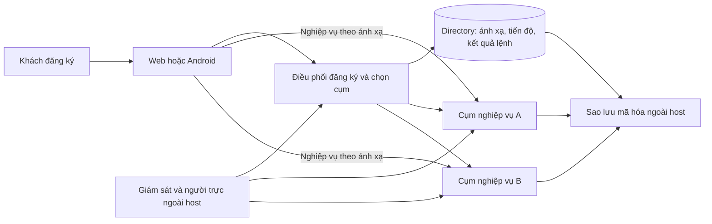

# RoomQC — kế hoạch bàn giao VPS và đăng ký mới

**Checkpoint triển khai hiện hành — rotation 29/10/2026:** backend310 tệp, SHA256 `314c1ec4b68fec86b5cf49aedf6d328555e4545f7d934520989b362fca74cb4a`;585 business+19 directory. [Daemon/journal và DB ready-head fence](roomqc-setup-rotation-local-2026-10-29.md) có14 kiểm native (8 rotation),18 process UID10001/CapEff0, kill/replay/overlap/expiry/revoke; unit509 pass/184 skip/0 fail. Run1c06a184f980 exit0, source/schema không đổi, cleanup0. Phạm vi entrypoint `--once`; chưa periodic daemon lâu/SIGTERM, full race/fault matrix, runtime container read-only mount/reload hoặc actor revoke xuyên hai DB. [Runbook mới](roomqc-setup-credential-rotation-runbook.md). Tiếp BG02 phần còn thiếu; BG06 phải khóa candidate mới. Các checkpoint301 phía dưới giữ lịch sử, không phải nguồn hiện hành. Không đổi70ca/124lượt/122mục, reviewer/signoff/gates.

**Checkpoint local trước — 29/10/2026:** backend301 tệp, SHA256 `2ec50f6dd1e473a45a54636594d6fd59451c452eb1f5d0f1a375bd1795b371d0`. [Runtime kiểm khóa live trước nhận việc](roomqc-setup-runtime-readiness-local-2026-10-29.md) đã sửa lỗi file còn hạn nhưng khóa đã revoke vẫn vượt readiness. Native run39f0f08155b0 đạt38 kiểm (22 worker,8 backfill,8 apply), source/schema không đổi và cleanup0; unit495 pass/184 skip/0 fail. Đây là diagnostic local; chưa daemon rotation, runtime UID/mount read-only hoặc thu hồi quyền nguyên tử xuyên hai database.

**Nhận tiếp BG02:** scheduler/journal, hai rotator và overlap/expiry khi daemon chết; container runtime chỉ mount output read-only; chốt điểm hiệu lực Auth→directory. R4 là [snapshot kế hoạch](../../../artifacts/roomqc-vps-signup-execution-plan-audit-r4-2026-10-29.json) của source301/ede96e trước sửa runtime, verifier r4 phải từ chối nguồn mới; giữ nguyên lịch sử, không nới pin. Các packet rebuild/filesystem/restore phía dưới có phạm vi nguồn riêng. Giữ8đợt/25task/27gói/70ca/124lượt,70ca not_run/122mục unverified, reviewer/signoff/gates chưa đổi.

**Checkpoint local lịch sử — timeout bộ cài:** [Báo cáo deadline](roomqc-setup-installer-deadlines-local-2026-10-28.md), [bảng triển khai](roomqc-vps-signup-implementation-board-2026-10-28.md). Backend291 files/hash `bb21bef86c200d3d09c950b11c96417710bb9a9a47af7af0d3a0200caec2a367`;584+19 migrations. Focused100/100, native362/362 và control673 tổng/671 pass/0 fail/2 skip; terminal0, cùng source/schema tương ứng, cleanup0. IF11 có SQLSTATE thật, witness rollback, deadline45giây và13 lần kiểm session/mutex. IF01–IF11,IF13,IF16,IF17 có local proof đúng scope; tiếp IF12/IF14/IF15 rồi rotation/mount/Auth→directory. Lần1/T08/T12,70ca/124lượt/122mục,reviewer và gates vẫn mở.

**Checkpoint đã kiểm trước nháp timeout:** [Báo cáo mới](roomqc-setup-installer-transactions-local-2026-10-28.md), [bảng triển khai](roomqc-vps-signup-implementation-board-2026-10-28.md). Backend289 files/hash `6802f300c3c4232e8e649f039aaf5be285da92f8b0a2116c0308318de3c16e14`;584+19 migrations. Focused75/75, native337/337 và control673 tổng/671 pass/0 fail/2 skip; terminal0, cùng source/schema tương ứng, cleanup0. IF10 đã có thu hồi khóa qua LOGIN API thật; IF16 có witness mutation→rollback và replay cùng key. Các nhóm IF01–IF10,IF13,IF16,IF17 có local proof đúng scope; còn IF11/IF12/IF14/IF15 rồi rotation/mount/revoke xuyên hệ thống. Lần1/T08/T12,70ca/124lượt/122mục,reviewer và gates vẫn mở.

**Checkpoint trước — preflight/quyền/fences local:** [Báo cáo fences](roomqc-setup-installer-fences-local-2026-10-28.md), [bảng triển khai](roomqc-vps-signup-implementation-board-2026-10-28.md). Backend288 files/hash `3ddefd9ddc068cbf097331f3f708fee790e7b5bfe27075148f450bd8681d7b22`;584+19 migrations. Focused66/66 và control673 tổng/671 pass/0 fail/2 skip, terminal0/cùng source/cleanup0. [Native328/328](../../../artifacts/roomqc-setup-installer-fences-native-51f2a15b16c2-local-2026-10-28.json) gồm66 installer controls, terminal0/source/schema/cleanup0. IF01–IF09,IF13,IF17 có proof local; IF10 còn key withdrawal, IF11/IF12/IF14/IF15/IF16 chưa khép, rồi rotation/mount/revoke xuyên hệ thống. Lần1/T08/T12,70ca/124lượt/122mục,reviewer và gates giữ mở.

**Checkpoint trước — IF01–IF05 có proof local:** [Báo cáo fault](roomqc-setup-installer-faults-local-2026-10-28.md), [bảng triển khai](roomqc-vps-signup-implementation-board-2026-10-28.md). Backend287 files/hash `1f576b109c6c5665a2dec4e4e0aa06e818a246a872c384b1b226d84eadc612dc`;584+19 migrations. Native289/289 gồm27 installer controls, control673 tổng/671 pass/0 fail/2 skip; terminal0, cùng source/end-source/schema/cleanup0. Đã kiểm bind/issue/revoke mất phản hồi, caller/key/body conflict, hai CLI và SIGKILL trước/sau commit. Còn IF06–IF17 rồi rotation/mount/revoke xuyên hệ thống; chưa đóng lần1/T08/T12, nghiệm thu70ca/124lượt/122mục và gates vẫn mở.

**Checkpoint đã kiểm trước đợt fault:** [Báo cáo và giới hạn](roomqc-setup-credential-installer-local-2026-10-28.md), [bảng triển khai 11 lần bàn giao](roomqc-vps-signup-implementation-board-2026-10-28.md). Backend287 files/hash `7b7fb7ddd8f126875160323e409e441d855646b61788abb7189ea7972a3f4224`,584+19 migrations; native278/278 gồm16 installer CLI mới, control672 tổng/670 pass/0 fail/2 skip; terminal0, cùng source, cleanup0. Lần1 chưa đóng: còn fault matrix toàn tuyến; lần2 rotation/mount reload/thu hồi Auth→directory chưa kiểm. Phạm vi toàn VPS+signup, đầu ra Plan+nghiệm thu;70ca/124lượt/122mục,reviewer,gates và goal tổng thể giữ mở.

**Checkpoint lịch sử — publisher trước installer:** [publisher local](roomqc-setup-publication-local-2026-10-28.md) đạt262/262 controls, gồm18 publication mới với4 publisher SIGKILL/resume; credential/status/attestation/publication tổng78. Control663 tổng/661 pass/0 fail/2 skip;583+18 migrations, source281 files/hash33d8482f5c9e784d8d54cfce29ebf33a0f0d47ab66e6df9f993c074a7afcf7d9, cleanup0. Receipt/status được đọc lại qua DB, private intent/stage/fsync/rename và native RPC đã kiểm; authority callback vẫn fixture. Chưa có operational installer/DB identity/target/budget/live directory authority/rotation hoặc mount reload thật. Nhận cấu hình/preflight và issue→publisher→rotation, rồi cross-system revoke/T10/signup/console/default-full/rebuild/VPS/DR/E2E/tải/RC/pilot.70ca/122mục/124lượt/reviewer/gates giữ nguyên.

**Checkpoint trước — fingerprint v3 và trạng thái khóa:** [catalog/readiness local](roomqc-setup-attestation-status-local-2026-10-28.md) đạt244/244 controls, gồm60 credential/status/attestation (25 mới), giữ184 API/worker/CLI;9 drift catalog thật đều bị verifier chặn,2 SQL-writer SIGKILL/2 barrier. Control658 tổng/656 pass/0 fail/2 skip;583+18 migrations,source277 files/hash894abdb63eaac8c45e2ec852773fd5c824f22908ceff1f35c40d159d601ac1f8,cleanup0. Upgrade582/583 rollback đạt; fingerprint v3 phủ2 schema phục hồi và capability graph, manifest v1/v2 bị từ chối. Status đọc hiện hành, không lấy receipt làm readiness; admin schema không expose REST. Advisor808/247WARN chưa disposition. Nhận installer/DB identity/target/budget/signer/file/refresh→cross-system revoke→T10/signup/console→default-full/rebuild→VPS/DR/E2E/tải/RC/pilot.70ca/122mục/124lượt/reviewer/gates giữ nguyên.

**Checkpoint trước — lệnh quản lý khóa phục hồi:** [giao thức và bằng chứng local](roomqc-setup-credential-command-local-2026-10-28.md) đạt219/219 controls, gồm35 mới với2 SQL-writer SIGKILL và2 barrier; giữ184 API/worker/CLI nền. Control656 tổng/654 pass/0 fail/2 skip;581+18 migrations, source277 files/hashafbb17c9eb867af6d77e58d73bcaaf5ffc3bdafd75963d3186d513806154edb9, cleanup0. Upgrade581 dùng phiên bảo trì riêng, rollback schema/role/history đạt. Advisor đo lại808 findings/247 WARN, chưa disposition. Đây là giao thức DB, chưa installer/file publication/lịch thay khóa. Fingerprint v2 tại checkpoint này chưa phủ roomqc_setup/roomqc_setup_admin; nhận attestation→installer/rotation và cross-system revoke→T10/signup/console→default-full/rebuild→VPS/DR/E2E/tải/RC/pilot.70ca/122mục/124lượt/reviewer/gates giữ nguyên.

**Checkpoint trước — CLI với biên nhận native:** [reader/writer, signed batch và phục hồi tiến trình](roomqc-setup-cli-native-local-2026-10-28.md) đạt184/184 controls, gồm16 CLI mới (3 barrier),45 API/process và123 nền; cùng source276 files/hash592e36737b8f89b8e7b905716f00210569c855b75b32534c68324518c60f4d39. Control656 tổng/654 pass/0 fail/2 skip;580+18 migrations,cleanup0. CLI có biên nhận PostgREST thật, lost-response sau commit và SIGKILL; Auth confirmed/health/release/batch-review vẫn fixtures. Nhận installer/rotation/maintenance và revoke semantics→T10/quotas→signup/email/console delta→default-full/rebuild→staging/DR/E2E/tải/RC/pilot.70ca/122mục/124lượt/reviewer/gates giữ nguyên.

**Checkpoint trước — tích hợp API/Auth/process local:** [đăng ký→recheck→worker với Auth thật](roomqc-setup-api-native-local-2026-10-28.md) đạt168/168 controls, gồm45 API/process và28 barrier mới,10 SIGKILL (7API/3worker), TCP lost-response sau commit và live session revoke khi chờ directory lock. Control656 tổng/654 pass/0 fail/2 skip; cùng source274 files/hash98387288f1cc901146c430c3b7728f4acc7c0a09ec0ed5dc85a9ca5bb341d844;580+18 migrations,cleanup0. Auth accounts confirmed/health/release vẫn fixtures; chưa public email signup, native CLI toàn tuyến, default-full/rebuild, browser/Android hoặc VPS. Nhận native CLI→installer/revoke/T10→candidate/default/rebuild→staging/DR/E2E/tải/RC/pilot.70ca/122mục/124lượt/reviewer/gates giữ nguyên.

**Checkpoint trước — recheck local:** [API/contract/UI/journal và proof](roomqc-workspace-recheck-local-2026-10-28.md) có migration18, replay trước CAS, detail snapshot nhất quán, một recovery cycle/dispatch (3 attempts/15 phút), giữ job history/lease và sửa late owner settle. Control656 tổng/654 pass/0 fail/2 skip; frontend66/66 + TS/lint; native nền580+18 migration/123 controls; backend272 files/cleanup0. Native chưa kiểm platform recheck/live Auth; client dùng jsdom/Capacitor mock. Nhận public API→worker→remote thật/process faults, native CLI toàn tuyến, installer/T10/full-default/rebuild/VPS/DR/E2E/tải/RC/pilot. Chưa bật runtime hoặc ký T12;70ca/122mục/124lượt/gates giữ nguyên.

**Checkpoint trước — CLI apply theo lô:** [writer/manifest/process recovery local](roomqc-setup-backfill-cli-local-2026-10-28.md) có signed batch đúng report/target/allowlist, writer budget/pool1, Windows ACL/POSIX files, output exclusive/fsync và actual CLI SIGKILL/post-commit response-loss/resume. Control640 tổng/638 pass/0 fail/2 skip; native580+17 migration/123 controls; Linux container14/14; source268 file/cleanup0. Nhận durable recheck4.4 rồi public API/worker fault/E2E, installer/T10/default-full/rebuild/VPS theo plan. Chưa apply dữ liệu vận hành hoặc bật worker/dispatch;70ca/122mục/gates giữ nguyên.

**Checkpoint trước — lõi apply backfill:** [ghi đối soát local](roomqc-setup-backfill-apply-local-2026-10-28.md) có directory 0017, role riêng, hai RPC, journal/CAS/audit/final expiry và terminal reconciliation. Control 634 tổng/632 pass/0 fail/2 skip; native 580+17 migration/123 controls, gồm 8 apply mới; source 261 file, cleanup0. Nhận config/CLI writer, approved batch manifest và process interruption/resume ở4.3, rồi durable recheck4.4. Chưa apply dữ liệu vận hành hoặc bật worker/dispatch;70 ca/122 mục/gates giữ nguyên.

**Checkpoint trước — upgrade và dry-run backfill:** [đọc đối soát local](roomqc-setup-backfill-local-2026-10-28.md) có reader0016/scanner/config/CLI; upgrade0014→0015 có dữ liệu, hai migrator và giữ lease/attempt/deadline/history. Control620 tổng/618 pass/0 fail/2 skip; native580+16/115 controls gồm8 backfill+17 worker, source257 file/cleanup0. Chưa apply hoặc durable recheck; nhận apply4.3 với migration tiếp theo0017 nếu cần, rồi4.4. Installer/T10/full-default/rebuild/VPS/E2E/pilot còn mở;70 ca/122 mục/gates giữ nguyên.

**Điểm giao việc theo phạm vi đã chốt:** [mục4.3–4.4 kế hoạch hành động](roomqc-vps-signup-next-delivery-2026-10-28.md) có file/batch/classification/upgrade fixture, contract/CAS/journal và fault/rollback cho backfill rồi recheck. Mục14 nối tới toàn VPS, Linux/restore, RC/pilot và [124 lượt môi trường nghiệm thu](../../../artifacts/roomqc-vps-signup-acceptance-execution-plan-2026-10-28.json) từ70 ca gốc; tất cả vẫn chưa chạy trong ma trận mới, không thay gates hoặc bằng chứng local lịch sử.

**Checkpoint trước — worker:** [worker đối soát đăng ký local](roomqc-setup-worker-local-2026-10-28.md): directory migration0015, role riêng, DB-clock lease/fencing/atomic settle, runtime/config/budget và Compose opt-in. Control609 tổng/607 pass/0 fail/2 skip; native580+15 migration/107 controls,17 worker với directory+remote roles thật cùng run; source250 file/cleanup0. Nhận backfill/upgrade14→15 → durable recheck → process-kill/live control E2E; installer/T10 còn mở. Example replicas0, chưa bật production;70 ca/122 mục/gates giữ nguyên.

**Checkpoint trước — credential:** [credential/adapter phục hồi riêng](roomqc-setup-recovery-scoped-local-2026-10-28.md): schema roomqc_setup chỉ2 RPC, DB kiểm expiry/rotation/revocation và rollback nếu hết hạn giữa lúc ghi. Native580 migration/90 controls/4 barrier protocol+2 credential/exit0; unit16/16, source240 file, cleanup0. Nhận worker DB-clock lease/fencing → backfill/recheck; installer/secret/T10/live full E2E còn mở. Chưa cấp credential vận hành/bật worker; 70 ca/122 mục/gates giữ nguyên.

**Checkpoint trước:** [closure proof và quyền recovery](roomqc-setup-recovery-boundary-local-2026-10-28.md): sửa setup-status; net recovery86→0 và quyền role khác giữ hash. Native579 migration/69 controls/4 barrier/exit0, directory closure riêng577 pass/0 fail/2 skip. Nhận review quyền nối tiếp và installer phiên owner extension → credential/worker → backfill/recheck. Chưa cấp credential/bật worker; 70 ca/122 mục/gates giữ nguyên. Các checkpoint API trước đây không là source hiện tại.

**Điểm đọc hiện hành:** [kế hoạch hành động và nghiệm thu sau API T12](roomqc-vps-signup-next-delivery-2026-10-28.md) tổng hợp phần còn lại, file/bước làm, fault proof, tài nguyên, Linux/restore, E2E/tải, cutover và đầu vào chờ quyền. Nhận mục4 quyền recovery → worker/status/backfill/recheck; mục5 T10 đủ trước bật thật. Giữ Q02/Q03 và full candidate/rebuild còn mở; 70 ca/122 mục release và gates không đổi. Các checkpoint dưới là bằng chứng lịch sử có phạm vi.

**Checkpoint trước — T12 API/directory local:** [Dispatch + job + API](roomqc-setup-dispatch-api-local-2026-10-28.md) đã nối lưu trước network, 202 khi gửi trùng, fenced RPC adapter và atomic activation/job/audit. Run 5de3cffd4d60: backend 25/25, PostgreSQL 13/13, frontend 43/43, TS/lint exit 0; hồi quy 578 tổng / 576 pass / 0 fail / 2 skip Windows. Source 237 + 18 file không đổi, cleanup độc lập 0. Auth/remote adapters là doubles; chưa thay tích hợp toàn tuyến thật. Flag mặc định false; [mục 5](roomqc-setup-dispatch-api-local-2026-10-28.md#5-đầu-việc-nhận-tiếp) nhận worker/quyền RPC → backfill/recheck → runtime/cutover → full/E2E. T12 và VPS chưa nghiệm thu; 70 ca/122 mục/gate giữ nguyên.

**Checkpoint trước — database T12:** [Giao thức dispatch/closure local](roomqc-setup-dispatch-local-2026-10-28.md) đạt 52/52 controls và 4 barrier bằng Auth/PostgREST/PostgreSQL thật riêng, replay đủ 578 migration. Source 232 file/schema không đổi, terminal exit 0, cleanup độc lập Docker 0. API/gateway chưa chuyển giao thức; directory dispatch + job, worker/recheck/backfill chưa nối. [Mục 5 báo cáo](roomqc-setup-dispatch-local-2026-10-28.md#5-đầu-việc-nhận-tiếp) ghi sáu bước nhận tiếp, file/đầu ra/điều kiện nhận. Trước credential worker phải rà toàn bộ PUBLIC RPC surface; trước cutover phải drain RPC cũ, giữ tombstone khi rollback. Chưa nghiệm thu T12/VPS; 70 ca/122 mục/gate giữ nguyên.

**Checkpoint trước — T11 local, tiến độ thiết lập:** [API/client/onboarding](roomqc-setup-status-local-2026-10-28.md) đã nối owner-only/no-store, kiểm kết quả trước POST và chặn phản hồi cũ khi đổi phiên/cụm. Run 93df1cd3bf1e: backend21/21, PostgreSQL2/2, frontend42/42, TS/lint exit0, source231 +16 file frontend không đổi, Docker0. Auth/receipt adapter giả lập; chưa thay live Auth/browser/Android hoặc T12 worker. Contract hiện24 operation:8 foundation/12 local/3 planned/1 partial. [Mục5 báo cáo](roomqc-setup-status-local-2026-10-28.md#5-đầu-việc-nhận-tiếp) là phiếu nhận tiếp; giữ T10.b unresolved và dependency. 70 ca/122 mục release, reviewer/signoff/gate giữ nguyên.

**Điểm nhận T10.b hiện hành — vendor plan:** [Auth/PostgREST local](roomqc-resource-vendor-local-2026-10-28.md) có 15/15 kiểm plan/CLI và 7/7 controls bằng Auth/PostgREST/PostgreSQL thật riêng; source 229 file ổn định, native exit 0, cleanup Docker 0. Auth pool hữu hạn và listener PostgREST đã được tính. [Runbook](roomqc-resource-vendor-runbook.md) giữ cách chạy. Realtime/Storage/Meta/Functions/Supavisor còn unresolved; consumer runtime/DSN binding, worker live, rolling overlap và T10.c–f chưa khép. Nhận delta theo mục5 báo cáo vendor; 70 ca/122 mục release, reviewer/signoff/gate giữ nguyên. Các checkpoint dưới chỉ áp dụng source của từng báo cáo.

**Checkpoint trước T10.b — đích PostgreSQL:** [checker chỉ đọc](roomqc-resource-database-local-2026-10-28.md) đã kiểm identity/settings của đích attestor và cộng ngân sách nhiều database trên cùng lineage PostgreSQL. Directory: 536 tổng / 534 pass / 0 fail / 2 skip; Linux: 62/62, source 225 file ổn định; có role denial, stop/restart/recovery thật và cleanup Docker 0. [Runbook](roomqc-resource-database-runbook.md) giữ schema/quyền/lệnh/giới hạn. Chưa bind DSN native/vendor tới các đích này; nhận tiếp vendor/pooler → consumer DSN binding → remaining worker live → T10.c–f. T10/VPS/capacity chưa nghiệm thu; 70 not_run / 122 unverified và reviewer/signoff/gate giữ nguyên. Các delta dưới là checkpoint đúng source của chúng.

Ngày chốt: 28/10/2026. Phạm vi: **toàn bộ VPS + signup**. Đầu ra: **kế hoạch triển khai và bộ nghiệm thu**.

**Checkpoint runtime trước:** [T10 inventory runtime native](roomqc-resource-deployment-runtime-local-2026-10-28.md) đã nối list/inspect/image/probe loopback, so image/process/env/mount/network và cached profile, kiểm lại snapshot sau probe. Live proof dùng hai API native trong hai project riêng; thiếu/thừa/dừng/one-off/orphan/drift/restart đều có kiểm và phục hồi. [Runbook runtime](roomqc-resource-deployment-runtime-runbook.md) ghi cách dùng và giới hạn. Nhận tiếp T10.b: vendor/pooler/process khác, remaining native workers và DB identity/settings, rồi T10.c–f. Chưa nghiệm thu tổng T10, VPS hoặc capacity.

**Checkpoint plan trước đó:** [preflight đã resolve](roomqc-resource-deployment-plan-local-2026-10-28.md) và [runbook](roomqc-resource-deployment-preflight-runbook.md) giữ proof đúng source của chúng; runtime đi qua validator plan trước khi inspect container.

**Checkpoint trước:** [T10 shared native startup](roomqc-control-shared-resource-runtime-local-2026-10-28.md) có directory479pass/0fail/2skip, Linux18/18, Compose5matrix/5missing-source rejection và HTTP17/17+13/13 trên source cũ. Giữ bằng chứng này cùng [queue/validator local](roomqc-control-resource-bounds-local-2026-10-28.md); không coi là proof của source mới hoặc giao lại phần đã đạt.

**Năm thao tác cụm trước đó:** [T09/T15 local](roomqc-control-cluster-commands-local-2026-10-28.md) đã nối close/open/drain/serving/limit vào typed client, journal và UI xác nhận tác động/lý do/version. 155/155 frontend, 17/17 HTTP+PostgreSQL riêng và 13/13 hồi quy HTTP cảnh báo đạt; TS/lint/build đạt trên source checkpoint đó. Mất socket sau commit vẫn tra lại được lệnh; đổi limit giữ thresholds và dữ liệu cũ. T09/T15 còn ordering races, cấu hình nâng cao, backup và live Auth/UI; chưa nghiệm thu trọn task.

**Packet cảnh báo trước đó:** [client/UI](roomqc-control-alert-ui-local-2026-10-28.md) và [T07 backend](roomqc-control-alerts-local-2026-10-28.md) đã có proof local. [Runbook](roomqc-control-alert-worker-runbook.md) giữ giới hạn kênh ngoài host; Linux/B09/live Auth/browser/Android vẫn mở. [Hai console](roomqc-control-admin-consoles-local-2026-10-28.md) có proof đọc 1.000 metadata/40 trang. Không giao lại các phần local đã đạt như chưa triển khai.

Tài liệu này là điểm bắt đầu để giao việc. [Bản hiện hành](roomqc-vps-signup-plan-current-2026-10-26.md) giải thích thiết kế; [25 phiếu kỹ thuật](roomqc-vps-signup-detailed-delivery-2026-10-26.md) giữ file, dependency, thao tác, kiểm thử và rollback. Trạng thái nghiệm thu lấy từ [ledger](../../../artifacts/roomqc-vps-signup-delivery-ledger-2026-10-21.json) và [worksheet 70 ca](roomqc-vps-signup-acceptance-worksheet-2026-10-22.md).

## 1. Kết quả cuối cùng

Khách vào roomqc.com, đăng ký, xác minh email, khai báo khách sạn, xem tiến độ rồi sử dụng trên web/Android. RoomQC quản lý VPS, cấp dữ liệu, gói sử dụng, sao lưu và hỗ trợ; khách không phải cài đặt hạ tầng.

RoomQC chuẩn bị các cụm trước. Một cụm phục vụ nhiều workspace; một workspace có một hoặc nhiều khách sạn theo gói. Đăng ký mới được phân vào cụm đủ điều kiện. Khách đang dùng giữ nguyên cụm; di chuyển dữ liệu sang cụm khác là quy trình riêng.

Đây là kiến trúc mục tiêu. Chưa có bằng chứng nghiệm thu hai cụm production hoặc sức chứa 100.000 người dùng đồng thời. Mở rộng tới 1.000 khách sạn phải dựa trên số đo tải và chi phí của từng cụm.

## 2. Điểm xuất phát đã kiểm tra

| Thành phần | Đã có bằng chứng | Phần cần khép |
|---|---|---|
| Nền điều phối, quyền, health và phát hành | Có mã nguồn và nhiều kiểm thử local có phạm vi | Candidate cuối phải chạy tích hợp đầy đủ, dựng lại độc lập và review |
| Policy nghiệp vụ | Packet 577: current 106/106; nâng cấp có dữ liệu và hồi quy local đã đạt | Client thực, mapping đa cụm, thiết bị và các đường gián tiếp còn trong backlog |
| Q02 / Q03 | Diagnostic writer 536/536; delivery 65/65 | Chưa nghiệm thu toàn bộ writer; engine workflow tổng quát/dispatcher còn thiếu |
| Kiểm thử backend đầy đủ | Full run `75b23132abab` đã lỗi; diagnostic sau sửa `0146874c679e` đạt exit 0, đủ 29 FK / 248 từ chối | Candidate cuối vẫn cần default full và independent rebuild; diagnostic riêng không thay full run |
| T10 ngân sách kết nối | Native plan/runtime và DB target có checkpoint; vendor Auth/PostgREST plan 15/15 và live 7/7 tại source229 | Còn vendor toàn stack, DSN consumer binding, worker live/rolling overlap, RAM/IO/fairness/usage/quota/load; chưa đủ chứng minh capacity |
| T12 dispatch/API | Protocol database có proof riêng; directory dispatch/job + POST/recovery đã nối local, 13/13 PG và hồi quy 576 pass | Worker/quyền RPC, backfill/recheck, runtime/cutover và tích hợp live Auth/control/remote còn mở |
| API quản trị | Contract có 24 operation: 8 nền, 12 local, 3 planned, 1 partial | Local là handler có proof; client/UI và môi trường được nghiệm thu riêng |
| Giao diện | Hai route/menu, guard, trang đọc; cảnh báo và năm lệnh cụm có journal/result recovery local | Còn cấu hình cụm nâng cao, backup, totals/tenant-summary/durable recheck và live Auth/browser/Android acceptance |
| Chống lạm dụng | Limiter hiện dùng bộ nhớ theo socket IP | Cần dùng chung nhiều instance, nhận diện proxy và kiểm đường Auth trực tiếp |
| Nghiệm thu sản phẩm | Bộ 70 ca và 122 mục release đã được định nghĩa | 70 ca vẫn `not_run`, 122 mục `unverified`; chưa có ký nghiệm thu |

Nguồn và giới hạn: [điểm nhận kỹ thuật 19.40](roomqc-vps-signup-detailed-delivery-2026-10-26.md#1940-điểm-nhận-và-nghiệm-thu-hiện-hành), [báo cáo full run lỗi](roomqc-q04-full-backend-failure-local-2026-10-28.md). Các số kiểm thử local không cộng thành số ca sản phẩm đã nghiệm thu.

**Lượt chẩn đoán kế thừa đã kết thúc:** `de660442ae5d` chưa đạt (`verified=false`), do thiếu fixture có dữ liệu cho `hotel_room_setup_confirmed_by_fkey` và `subscription_reconciliation_case_events_case_id_fkey`. Đã kiểm catalog 29 FK, 232 trường hợp từ chối, bốn kiểm toàn vẹn khóa ghép, hai kiểm deferred và snapshot 184 bảng; các kết quả này không bù cho hai fixture thiếu. Ownership ghi `failed=true`, `cleaned=true`, source cuối khớp; exit code của tiến trình kế thừa không được thu độc lập trong lượt bàn giao này. Xem [biên bản diagnostic](roomqc-parent-boundary-handoff-2026-10-28.md).

**Kết quả sau sửa:** run `0146874c679e` đã kết thúc exit 0, đủ 29 FK / 248 từ chối, bốn kiểm toàn vẹn khóa ghép, 32 parent denial khóa ghép, hai kiểm deferred và snapshot 184 bảng. Hai fixture được tạo bằng RPC thật; 11 bảng setup/nghiệp vụ khớp trước/sau rollback. Source/schema khớp, kiểm độc lập còn 0 container/volume/network của run. Xem [biên bản đạt local](roomqc-parent-boundary-local-2026-10-28.md). Lượt `2aa9e0fb66e0` exit 1 do chọn tuple không có sibling đã được giữ trong lịch sử và sửa cách chọn. Không giao lại hai fixture như phần chưa làm; full run và rebuild của candidate cuối vẫn còn mở.

## 3. Cách nhận và hoàn thành một đầu việc

Mỗi phiếu ghi rõ người làm, người review, source/config/schema, môi trường, đầu vào, file sửa, đầu ra, dependency, tác động dữ liệu được phép, demo, kiểm thử và rollback. BE/FE/OPS/QA/RQ trong kế hoạch là vai trò, chưa phải tên người đã nhận việc.

Một đầu việc được nhận khi đầu ra chạy được và đúng các ca/môi trường yêu cầu. Có file, có giao diện hoặc unit test xanh chưa đủ. Ca thiếu VPS/provider/thiết bị giữ trạng thái chờ đúng nguyên nhân; tiếp tục công việc độc lập.

Chi tiết từng T01–T25 nằm trong mục 4–8 của [phiếu kỹ thuật](roomqc-vps-signup-detailed-delivery-2026-10-26.md). Dependency trong ledger là nguồn chuẩn; thứ tự đợt dưới đây không thay dependency đó.

## 4. Tám đợt triển khai

| Đợt | Task | Sản phẩm bàn giao và demo | Điều kiện nhận |
|---|---|---|---|
| 1. Khép nền | T01–T06, T08 | Inventory/version thống nhất; directory bền vững; quyền và kết quả lệnh; metric/probe đúng cụm; release đáng tin; health worker. Demo restart, thu hồi quyền, mất response và dữ liệu đo cũ | A01–A11, B01–B07, C01–C04 đúng phạm vi/môi trường; candidate có full run và rebuild khi đã chốt source |
| 2. Cảnh báo | T07 | Incident → outbox → gửi → nhận xử lý → phục hồi; demo API/worker restart và mất host | B08–B09; không mất hoặc nhân sự kiện; phần mất host phải đo từ ngoài host |
| 3. Sức chứa | T09–T10 | Chọn cụm, giữ suất, đóng/drain/mở nhận; ngân sách connection/queue/worker. Demo 20 yêu cầu tranh một suất cuối | C05–C10; chỉ một suất được cấp, không vượt ngân sách; chốt operating limit sau đo T23 |
| 4. Khách đăng ký là dùng được | T11–T13 | Signup, email, khai báo khách sạn, tiến độ, tiếp tục, worker phục hồi và chống lạm dụng. Demo F5/hai tab/mất mạng/worker chết | D01–D15; đúng một tenant/hotel/trial; email thật tới inbox; không mở đường tạo trùng khi chưa rõ commit |
| 5. Quản trị RoomQC | T14–T17 | Hai màn Hạ tầng và Đăng ký mới, quyền platform, tìm kiếm/chi tiết/thao tác, mobile và Back/scroll | E01–E08; dữ liệu thật, mọi chức năng có đường click; tìm đăng ký kẹt dưới 30 giây trong bài thử 1.000 metadata |
| 6. VPS và khôi phục | T18–T20 | Bộ cài Linux, TLS, nâng cấp, backup ngoài host, restore host sạch, runbook và người trực | F01–F09 và B01/B09 liên quan; reboot/rerun giữ data, restore được khi host gốc mất |
| 7. Nghiệm thu release candidate | T21–T24 | Hai backend độc lập chạy đồng thời; web/Android E2E; tải/soak/chi phí; hồ sơ cutover/rollback | G01–G07; đủ môi trường bắt buộc, không còn lỗi Critical/High về quyền/dữ liệu/cấp phát/restore trong phạm vi |
| 8. Pilot | T25 | Một khách sạn nội bộ → quan sát 24–48 giờ → nhóm 5–10 đã duyệt; theo dõi ít nhất 7 ngày | G08; báo cáo availability, lỗi, hỗ trợ, tài nguyên, chi phí và quyết định mở rộng riêng |

T14 có thể chuẩn bị từ khi T03/T04 đủ đầu vào; T18 từ T06/T08. Việc chuẩn bị có thể đi trước, nghiệm thu tích hợp vẫn phải đủ dependency. Lập trình và QA có thể chia theo các đường độc lập, nhưng migration/contract/release cần một đầu mối tích hợp.

## 5. Lần bàn giao đầu tiên và cách tránh kiểm thử lặp vô hạn

**Điểm nhận T12 sau API:** giữ atomic directory dispatch/job và gateway/POST local đã đạt. Nhận worker receipt-only có DB-clock lease/fencing và rà toàn bộ RPC ACL → backfill/recheck/client → budget/secret/drain/cutover → tích hợp live Auth/remote và full/rebuild sau freeze. [Phiếu nhận tiếp](roomqc-setup-dispatch-api-local-2026-10-28.md#5-đầu-việc-nhận-tiếp) giữ file, đầu ra và điều kiện nhận. Dependency T10/T11 và các gate chưa được ký thay bằng packet local.

**Điểm nhận T10.b:** giữ Auth/PostgREST plan và live proof vừa đạt. Khép inventory những vendor còn unresolved → bind DSN process vào DB identity → live worker → ghép một candidate → host/fairness/usage/quota và tải. File, đầu ra và điều kiện nhận ở [mục5 báo cáo vendor](roomqc-resource-vendor-local-2026-10-28.md#5-gói-nhận-tiếp-đầu-vào-và-điều-kiện-nhận). Không chạy lại test đã đạt nếu không có thay đổi, lỗi hoặc nghi vấn cụ thể.

1. Giữ packet parent-boundary đã đạt: [bằng chứng local](roomqc-parent-boundary-local-2026-10-28.md), gồm terminal/source/schema/cleanup, hai fixture hợp lệ và chọn tuple có sibling. Chỉ chạy lại diagnostic khi source/catalog liên quan thay đổi hoặc có lỗi mới; không lặp vì bộ ca sản phẩm vẫn chưa ký.
2. Lập danh sách delta nền còn thiếu theo đường `caller → API/RPC → dữ liệu → quyền → receipt/recovery`, ghi đường đang dùng, tác động và dependency thực tế. Nhận một gói có đầu ra hữu hạn; giữ bằng chứng phần đã đạt và tách rõ phần chỉ cần ở release cuối.
3. Giữ T14, T07 và năm lệnh cụm T09/T15 đã có bằng chứng local. T10 đã có control queue/validator/owned-PG overload, shared native startup, preflight plan và inventory native có live proof API. Nhận [T10.b còn lại](roomqc-resource-deployment-runtime-local-2026-10-28.md#5-việc-nhận-tiếp), rồi [T10.c–f](roomqc-control-resource-bounds-local-2026-10-28.md#5-phần-t10-tiếp-theo-thứ-tự-và-điều-kiện-nhận): host/headroom → upload/report/Realtime/fairness → usage/quota → tải T23. Không tự cam kết sức chứa VPS. T09 còn expiry/close/first-dispatch và T07 còn kênh ngoài host theo dependency; T11/T12 tiếp signup/resume/worker sau khi đủ đầu vào. T18 chuẩn bị bundle khi đầu vào đủ.
4. Các nhánh Q02/Q03 chỉ chặn phát hành theo chức năng được cung cấp và dependency thực tế. Chức năng chưa có phải có quyết định triển khai hoặc hoãn, cùng hành vi UI/server tương ứng; không tự mở thêm module ngoài phạm vi VPS/signup.
5. Khi candidate cuối đã chốt, chạy full backend rồi independent rebuild đúng cùng source. Diagnostic riêng hoặc full run của source cũ không thay thế bước này.
6. Sau khi nền đủ dependency, nghiệm thu tích hợp T07 và tiếp T09/T10; giữ các packet local đã đạt. Chuẩn bị bundle T18 khi đầu vào đủ. Mỗi đợt kết thúc chỉ ra đầu việc tiếp theo; không tự sinh vòng kiểm thử rộng hơn khi không có thay đổi hoặc lỗi mới.

File của packet vừa đạt: `scripts/control-backend-parent-boundary-checks.mjs`, `scripts/control-backend-parent-boundary-review.mjs`, `scripts/test-control-backend-sandbox.mjs`, `server/control/backend-parent-boundary.test.mjs`. Điểm nhận tiếp: [19.40.B](roomqc-vps-signup-detailed-delivery-2026-10-26.md#1940-điểm-nhận-và-nghiệm-thu-hiện-hành); không dùng diagnostic này làm reference dựng lại độc lập.

## 6. Luồng đăng ký phải chạy xuyên suốt

| Bước | Kết quả cần có | Tình huống bắt buộc kiểm |
|---|---|---|
| Bắt đầu | Kiểm abuse, intent ổn định, chọn cụm và giữ suất có hạn | Cụm đầy/lỗi, hai tab, gửi lặp; không rải Auth sang cụm khác |
| Email | Tài khoản đúng cụm, link đúng origin và callback, xác minh chủ | Link hết hạn/dùng lại, resend có giới hạn; chưa verify chưa tạo data nghiệp vụ |
| Khai báo khách sạn | Validate server; role, ID, trial và quota do server quyết định | Thiếu quyền, dữ liệu sai, sửa request; giữ draft hợp lệ |
| Cấp phát | Lưu job/dispatch trước tác động từ xa; transaction idempotent trả receipt | Mất response trước/sau commit, kill worker, lease hết hạn, retry cùng yêu cầu |
| Tiến độ | Owner-only, no-store, bước hiện tại/nextAction/retryAfter | F5/relogin/hai thiết bị; owner khác không đọc được; lỗi cụm không thành mất dữ liệu |
| Hoàn tất | Directory đối soát receipt và activate đúng binding/version | Đúng một tenant/hotel/trial; không gia hạn trial hoặc tạo lại do timeout |
| Mời nhân viên | Gán vị trí/quyền từ lúc mời/tạo; accept đúng người | Login theo vai trò, giới hạn khách sạn, thu hồi/offboard có hiệu lực |
| Gói sử dụng | Usage và hạn mức được kiểm server-side theo policy version | Hết trial, chạm quota, đổi gói, grace/suspend, xuất dữ liệu theo policy đã duyệt |

Không lưu mật khẩu hoặc JWT owner vào job. Frontend không nhận khóa quản trị. Khi trạng thái commit chưa rõ, tra receipt trước khi gửi mutation tiếp theo. Việc đóng nhận khách mới giữ nguyên mapping và đường dùng của khách cũ theo chính sách vận hành.

## 7. Hai màn hình và API phải hoàn thiện cùng nhau

**Hạ tầng:** cụm đang nhận khách, lý do bị chặn, độ mới số đo, CPU/RAM/disk/inode, DB connection/queue, sức chứa, backup và restore proof. List → chi tiết → thao tác đóng/drain/mở/đổi hạn mức → kết quả tra lại được. Số chưa biết không hiển thị thành 0; thông tin kỹ thuật mở trong chi tiết.

**Đăng ký mới:** tìm/lọc theo khách, trạng thái, cụm và thời điểm; xem tiến độ, timeline, job/receipt, dữ liệu đã cấp và next action. Nút kiểm tra lại tạo yêu cầu đối soát có thể theo dõi; không tạo lại khách sạn hoặc giả danh owner.

| API chưa nghiệm thu đầy đủ, base `/api/control` | Task | Đường sử dụng |
|---|---|---|
| GET `/workspaces/{slug}/setup-status` — implemented-local | T11–T12 | API/client/onboarding local đã có; còn resume/live Auth/E2E và durable worker |
| GET `/admin/backups` | T15,T19 | Chi tiết cụm → sao lưu |
| GET `/admin/workspaces/{id}/tenant-summary` | T16 | Chi tiết đăng ký → dữ liệu đã cấp |
| POST `/admin/workspaces/{id}/recheck` | T12,T16 | Chi tiết đăng ký → kiểm tra lại |
| POST `/admin/clusters/{id}/commands` — partial | T09,T15 | Năm lệnh và result recovery có UI local; còn cấu hình nâng cao, race/overload và live E2E |

Trình tự mỗi API: contract/DTO/error → handler và quyền → client → kiểm tích hợp → UI. Hai route `/super-admin/infrastructure` và `/super-admin/registrations` đã nối local vào router, menu và platform guard. Tiếp tục kiểm browser/Android trạng thái loading/empty/error/stale/denied, màn 390px, bàn phím, tương phản, Back giữ filter/scroll và hủy dữ liệu cũ khi đổi phiên/workspace.

Ba API cảnh báo đã nối handler → typed client/journal → UI local: GET `/admin/alerts`, POST `/admin/alerts/{id}/acknowledge`, GET `/admin/alerts/{id}/acknowledgement-result`. Đường click là Hạ tầng → Cảnh báo → Nhận xử lý/Kiểm tra kết quả. Unknown/404 không sinh mã yêu cầu mới; nhận xử lý không tự resolve/mở admission. Phần live Auth/browser/Android vẫn mở.

## 8. Bộ nghiệm thu và hồ sơ bàn giao

| Nhóm | Số ca | Nội dung |
|---|---|---|
| A01–A11 | 11 | Baseline, migration, dữ liệu bền vững, quyền và kết quả lệnh |
| B01–B09 | 9 | Metric/probe, health, restart, cảnh báo và mất host |
| C01–C10 | 10 | Registry/release, sức chứa, giữ suất và affinity |
| D01–D15 | 15 | Signup, resume, worker, abuse, proxy và email |
| E01–E08 | 8 | Hai console, thao tác, UX và quyền |
| F01–F09 | 9 | Linux/TLS, backup, clean-host restore và người trực |
| G01–G08 | 8 | Hai backend, E2E, tải/soak, release candidate và pilot |

70 ca gồm các yêu cầu môi trường chồng nhau: 54 ca cần local, 69 ca cần staging, một ca cần pilot. Kết quả local không thay bằng chứng Linux/provider/thiết bị tương ứng. Dùng [worksheet](roomqc-vps-signup-acceptance-worksheet-2026-10-22.md) và [quy trình nghiệm thu](roomqc-vps-signup-acceptance-protocol-2026-10-21.md), giữ nguyên ID và expected.

Mỗi packet bàn giao phải có: task/case; candidate/source/image/schema/config; môi trường và dataset; thời gian/lệnh/exit; expected/actual; bằng chứng UI/API/DB/receipt phù hợp; positive/negative/recovery; lỗi và giới hạn; cleanup/rollback; người chạy, người review và quyết định. Chỉ đưa dữ liệu đã lọc vào báo cáo.

Các mục tiêu staging cần review trước khi áp dụng: setup-status p95 ≤500ms; admin list 1.000 metadata p95 ≤1s; reserve p95 ≤1s; cấp phát p95 ≤10s sau submit, tách thời gian chờ người/email. Ramp 10→25→50→100 phiên có think time khi mức trước đạt, soak ≥60 phút và đo tải backup/report đồng thời. Đây là mục tiêu kiểm thử, chưa phải sức chứa đã chứng minh hoặc SLA.

RPO ≤24h/RTO ≤4h là đề xuất đang chờ chấp nhận. Mất tối đa một ngày dữ liệu có thể không phù hợp nghiệp vụ; cần chốt yêu cầu trước T19 và chọn lịch backup/WAL/PITR/object consistency tương ứng. Restore phải dùng host/volume sạch, giữ được DB/Auth/objects/directory/job/receipt và khóa ngoài failure domain, rồi đo RPO/RTO thực tế.

## 9. Điều kiện chuyển môi trường và phát hành

| Gate | Chỉ đề nghị quyết định khi |
|---|---|
| L — local tích hợp | Candidate cuối có kiểm authority/health/provisioning/recovery/cleanup và review |
| S — staging Linux | Xác định host/release/network/TLS, quyền vận hành, backup và rollback |
| P — bắt đầu pilot | RC đủ ca trước pilot; không còn lỗi chặn; có offsite restore, người trực, kill switch và cohort được duyệt |
| U — mở đăng ký công khai | Pilot T25/G08 đạt, có operating limit/anti-abuse/chi phí/hỗ trợ và quyết định mở riêng |
| B — thu tiền thật | Nghiệm thu payment/provider/chính sách riêng; ngoài V1 này |

Các gate hiện chưa được ledger cho phép. T24 rà đủ 70 ca nhưng giữ G08 chờ pilot; không yêu cầu G08 đạt trước khi bắt đầu pilot. Quyền chéo, mất/nhân dữ liệu, cấp phát trùng, restore sai hoặc tài nguyên vượt ngưỡng phải dừng mở rộng và xử lý theo runbook, bảo toàn dữ liệu và lịch sử lệnh.

## 10. Đầu vào cần RoomQC cung cấp và công việc vẫn làm trước được

| Đầu vào | Cần chốt | Task phụ thuộc | Trong lúc chờ |
|---|---|---|---|
| VPS staging | Host/OS/vCPU/RAM/disk/mount/network/ports, vị trí control/directory/business, người quản | T05,T10,T18,T23 | Bundle, preflight, fixture và budget tham số |
| Domain roomqc.com | DNS, app/API/admin/callback/native origins, TLS renew | T13,T18,T22 | Template và callback local |
| Email | Provider, sender/domain verified, secret reference, webhook, inbox thử | T13/D15 | Outbox/sink/retry/dedupe local |
| Backup ngoài host | Đích lưu, retention, mã hóa, người giữ khóa và ngân sách | T19 | Manifest, backup nhất quán và restore disposable |
| Cảnh báo và trực | Kênh ngoài host, người chính/phụ, escalation và quyền xử lý | T07,T20 | Incident/outbox và drill sink local |
| Gói sử dụng | Trial, quota hotel/phòng/nhân sự/storage, grace, retention, export/delete | T03,T10–T13,T25 | Contract và fixture theo tham số |
| Pilot và phát hành | Người ký, cohort, giờ hỗ trợ, operating limit và điều kiện dừng | T24–T25 | RC/checklist và kế hoạch quan sát |

Theo chỉ dẫn đã có, phần cần khóa/quyền chưa được cung cấp được tổng hợp làm sau. Chỉ hoãn các ca phụ thuộc; không yêu cầu gửi secret trong chat và không tự đặt chính sách thương mại.

## 11. Tiến độ và báo cáo

Chưa chốt ngày mở public. Ước lượng 30–47 ngày công, hoặc 36–57 có dự phòng, là ước lượng lịch sử của toàn backlog; không phải thời gian còn lại. Gói parent-boundary đã có diagnostic đạt; không tính lại dự trù 1–3 ngày công của gói này như việc còn thiếu. Ước lượng phần còn lại theo inventory delta và đầu vào hạ tầng/provider thực tế.

Sau gói nền, chốt lại từng T với ba cột riêng: ngày công, thời gian chờ hạ tầng/provider và thời gian quan sát. Pilot cần ít nhất 7 ngày lịch. Nếu chia người làm song song, chỉ rút lịch theo dependency thực tế; không chia đều tổng ngày công rồi coi là lịch hoàn thành.

Cuối mỗi đợt gửi một báo cáo: đầu ra dùng được; ca đạt/chưa đạt/chưa chạy; lỗi và ảnh hưởng; số đo tài nguyên; việc cần quyền; người review; gate có thể đề nghị; đầu việc tiếp theo. Không báo phần trăm ổn định từ tổng số unit tests.

**Bộ kế hoạch được chuẩn bị xong khi:** 25 task, 27 gói, 70 ca và môi trường được ánh xạ đầy đủ; dependency không vòng; có đường thao tác cho mọi chức năng; các liên kết và trạng thái hiện hành nhất quán. **Sản phẩm được nghiệm thu khi:** có kết quả thực chạy và review đúng từng môi trường, sau đó có quyết định gate tương ứng.
