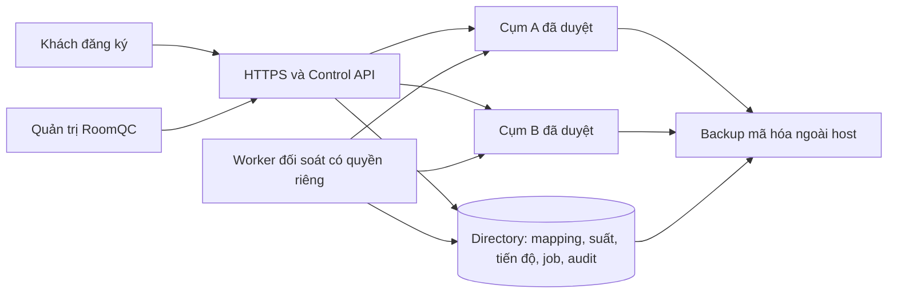

# RoomQC — bảng triển khai và nghiệm thu toàn bộ VPS + đăng ký mới

**Cập nhật nhận việc 29/10/2026 — bản RF06 đang sửa:** phạm vi toàn bộ VPS + signup; đầu ra plan + nghiệm thu. Xem [hồ sơ hiện hành, mục2/5.6/11–12](roomqc-vps-signup-execution-dossier-2026-10-29.md) và [snapshot kế hoạch](../../../artifacts/roomqc-vps-signup-plan-handover-2026-10-29.json). Các checkpoint ghi bên dưới là bằng chứng đúng nguồn riêng; chưa nhận source RF06 hoặc cấp gate từ lần lập kế hoạch này.

**Điểm nhận việc hiện tại — đã nối runtime, 29/10/2026:** phạm vi toàn bộ VPS + signup; đầu ra plan + nghiệm thu. Bản đang sửa334 tệp/hash 6d7d491550eb9258865a2fa26eeae0a0e0934f7a8a5a2e6e8455da0ce24a8dac,587 business/21 directory migrations. [Báo cáo runtime](roomqc-support-intents-runtime-local-2026-10-29.md) và [packet](../../../artifacts/roomqc-support-intents-runtime-b3e1f84b1812-local-2026-10-29.json): native113/113,34barriers/3SIGKILL,exit0 trên source243567; control529pass/201skip/0fail cùng nguồn. Directory r2 có168pass/1fail do expected callback; đã sửa ba assertion và focused r3 đạt1/1 trên source hiện hành. Không cộng thành full169/169 cùng nguồn. Runtime bốn nhóm mutator đã nối journal; native expired recovery mới chỉ chứng minh close_admission,8HTTP retries cùng một API process. Nhận tiếp RF06 legacy,all-family/two-process recovery,worker,populated upgrade/security; R11/BG02 vàBG03–BG11 còn mở. Giữ25task/70ca/124lượt/122mục unverified; actual/reviewer/signoff/gates không đổi.

Lịch sử checkpoint — chỉ áp dụng đúng nguồn của từng báo cáo

**Checkpoint nền journal334/d30e — lịch sử, 29/10/2026:** source334/hash `d30e5ee5908404ed2da8d64ddc955305e98c273086bfe119334fac39b623dcf7`, 587 business/21 directory migrations. [Báo cáo](roomqc-support-intents-foundation-local-2026-10-29.md) và [packet](../../../artifacts/roomqc-support-intents-foundation-207ce2e0ad48-local-2026-10-29.json): directory 169/169 (9 ca journal mới), control 527 pass/0 fail/201 skip; native 104/104 kiểm tương thích Auth/HTTP hiện có, exit0. Journal giữ identity/generation/predecessor bền vững, khóa trên một connection và chặn vòng cũ; đã sửa xử lý backend termination và fixture pool cleanup. **Chưa nối coordinator vào mutator runtime hoặc chứng minh expired recovery qua canonical Auth.** Nhận tiếp RF04/RF05/RF06 tại mục5.4 dossier; R11/BG02, worker, populated business upgrade/security và BG03–BG11 còn mở. Giữ 25 task/70 ca/124 lượt/122 mục unverified, actual/reviewer/signoff/gates không đổi.

**Checkpoint331 — lịch sử consumption, 29/10/2026:** source331/hash `a700ff658818a1f0b8b43420cf120d93768f0fedc34b8b3de32f56a7d7a5ef1f`,587 business/20 directory migrations. [Báo cáo](roomqc-support-consumption-local-2026-10-29.md) và [packet](../../../artifacts/roomqc-support-consumption-331212d94761-local-2026-10-29.json): native104/104,28 barriers/1API SIGKILL; directory160/160; control527pass/0fail/192skip,exit0. Có proof Auth→command→consumption thật, rollback/mất phản hồi/expiry và3 cửa sổ accept-before-revoke cho cluster command. Source/schema đầu–cuối khớp,role baseline phục hồi,cleanup độc lập0. **R11/BG02 còn mở:** expired-attempt recovery,legacy same-key replay,worker,đủ mutation families,populated upgrade và security review; chưa full-default/rebuild/staging/nghiệm thu sản phẩm. [Phiếu nhận tiếp](roomqc-vps-signup-execution-dossier-2026-10-29.md#53-thứ-tự-triển-khai-bản-tích-hợp-source330) và [nghiệm thu](roomqc-vps-signup-master-acceptance-2026-10-28.md#124-thực-thi-bản-tích-hợp-source330). Giữ toàn bộ VPS+signup,8đợt/11BG/25task/27package/70ca/124lượt; actual/reviewer/signoff/gates không đổi.

**Bản nháp source330 — lịch sử, 29/10/2026:** phạm vi **toàn bộ VPS + signup**, đầu ra **plan + nghiệm thu**. Source330, SHA256 `ca77f438a4db58ad9843a7beceaeddec39a4b04d70179fb4c81bfd4417d6bc70`; 587 migration nghiệp vụ/20 directory. Đã viết bước tiêu thụ biên nhận quyền trong giao dịch quản trị; **chưa kiểm tích hợp Auth/HTTP/SQL và nâng cấp dữ liệu cũ cho bản này**. Preflight unit 15/15, exit0 chỉ chứng minh phạm vi helper/gateway/support; native90/90 và control520pass của source327 là lịch sử riêng. Nhận [phiếu R11 bản tích hợp](roomqc-vps-signup-execution-dossier-2026-10-29.md#53-thứ-tự-triển-khai-bản-tích-hợp-source330) và [bài nghiệm thu bổ sung](roomqc-vps-signup-master-acceptance-2026-10-28.md#124-thực-thi-bản-tích-hợp-source330). Hết hạn biên nhận và phục hồi cùng mã lệnh còn cần xử lý; R11/BG02 và các mốc L/S/P/U/B chưa được nhận. [Hồ sơ toàn phạm vi](roomqc-vps-signup-execution-dossier-2026-10-29.md) giữ 8 đợt/11 gói bàn giao/25 task/27 package/70 ca/124 lượt; actual/reviewer/signoff/gates không đổi.

**Checkpoint source327 — lịch sử, 29/10/2026:** [Báo cáo](roomqc-support-acceptance-component-local-2026-10-29.md) và [packet](../../../artifacts/roomqc-support-acceptance-component-4661134f0654-local-2026-10-29.json):source327/hash `e45b9fb53499c81fc65e8fd9af426307cf8c312dd698d10ef68f0051a87aa189`,586 business/19 directory migrations;control520pass/0fail/192skip,native90/90 gồm20 acceptance checks/6 interleaving,23 barriers/1API SIGKILL toàn run;exit0,source/schema khớp,cleanup độc lập0. Đã sửa migration guard và kiểm rollback schema/ACL/history. **Command directory chưa tiêu thụ acceptance**; chưa populated585→586/full-default/rebuild hoặc nghiệm thu sản phẩm. Nhận [R11-04–08](roomqc-vps-signup-execution-dossier-2026-10-29.md#52-phiếu-triển-khai-r11-theo-nguồn327),giữ các giới hạn và [RA01–RA18](roomqc-vps-signup-master-acceptance-2026-10-28.md#12-nghiệm-thu-protocol-r11-và-thành-phần-acceptance-mới). [Plan toàn VPS/signup](roomqc-vps-signup-execution-dossier-2026-10-29.md),25task/27gói/70ca/124lượt,actual/reviewer/signoff/gates không đổi. Audit kế hoạch r2 và checkpoint324 giữ hash/phạm vi lịch sử riêng.

**Checkpoint đã kiểm theo source324 — lịch sử:** [Quyền sau chờ SQL và đọc kết quả local](roomqc-support-authority-boundaries-local-2026-10-29.md) đã kiểm source324/hash `155f197c07839ba0535ac68f94f37898c89ee61375892f1646139b013c796556`:control516pass/0fail/192skip,directory160/160,native Auth/HTTP63checks/14revoke scenarios; terminal0,source/schema khớp và cleanup đúng ownership0. [Packet](../../../artifacts/roomqc-support-authority-boundaries-2765aadfaabb-local-2026-10-29.json). Đã sửa3lỗi late read/final release observation. R11/BG02 vẫn mở protocol revoke xuyênDB và claim/RPC/settle;63checks không thay full-default/rebuild hoặc nghiệm thu VPS. [Plan toàn VPS/signup](roomqc-vps-signup-execution-dossier-2026-10-29.md) có11BG,25task,70ca/124lượt; actual/reviewer/signoff/gates giữ nguyên. Checkpoint323/319 giữ hash/phạm vi riêng.

**Checkpoint local hiện hành — hai daemon tranh chấp, 29/10/2026:** source319/SHA256 `44442d6d9e35e5dd845c30a2780cdb0b6664e8afd5efb2f74b1aea9aec7610f4`,585 business/19 directory migrations. [Run5c839bfe5602](../../../artifacts/roomqc-setup-rotation-contention-5c839bfe5602-local-2026-10-29.json) đạt17 kiểm native, gồm11 contention checks/22 barrier observations qua25 process UID10001/CapEff0/source read-only. Journal chung có hai prepare đang hoạt động, mất phản hồi sau commit và hai replay tranh archive; journal riêng có row wait trước commit và mất response sau commit. Một command/audit/credential mỗi vòng, CAS loser không effects, recovery giữ ID/iat/exp, RPC/overlap và restart lần2 idle. Exit0,source/schema đầu–cuối khớp,9 kiểm session/mutex/canary, role/private files và Docker cleanup0. Hồi quy46pass/0fail/1skip. [Phạm vi và giới hạn](roomqc-setup-rotation-contention-local-2026-10-29.md): ba interleaving local, chưa mọi race hoặc actor revoke xuyên Auth/directory/business. Nhận tiếp R11, rồi BG03–BG11 theo dependency; chưa nhận toàn BG02/sản phẩm. Giữ70ca/124lượt/122mục,reviewer/signoff/gates. Proof storage318/durability316/startup315/mount313 giữ hash riêng.

**Checkpoint local trước — journal corruption/IO, 29/10/2026:** source318/SHA256 `d1cb480efd7729006752894521109579585ea497a728eca88a1f950d6a5335a1`,585 business/19 directory migrations. [Run ceaeeeb36691](../../../artifacts/roomqc-setup-rotation-storage-ceaeeeb36691-local-2026-10-29.json) đạt28 kiểm native, gồm22 storage checks: 10 kiểu journal hỏng và8 điểm FUSE EIO qua syscall thật,62 process UID10001/CapEff0/source read-only. Fault đóng readiness; phục hồi giữ pending/receipt đúng quy tắc, ID/iat/exp và một effect/key; restart lần2 idle/native RPC. Exit0,source/schema đầu–cuối khớp,48 kiểm session/mutex/canary và cleanup Docker0. Hồi quy46pass/0fail/1skip; skip không được nhận. [Báo cáo và giới hạn](roomqc-setup-rotation-storage-local-2026-10-29.md): chưa mọi errno/biến thể filesystem, đĩa vật lý, contention shared/separate journal, actor revoke xuyên DB hoặc VPS UID1000. Nhận tiếp contention và R11; không nhận toàn BG02/sản phẩm. Giữ8đợt/25task/27gói/70ca/124lượt/122mục,reviewer/signoff/gates. Packet316/315/313 giữ hash và phạm vi riêng.

**Phạm vi đã xác nhận:** toàn bộ VPS + signup; đầu ra plan + nghiệm thu. Điểm nhận việc là [phiếu tổng hợp](roomqc-vps-signup-start-pack-2026-10-28.md#0-bản-nhận-việc-đã-chốt). Snapshot lập kế hoạch hash316/1b28aa30 trước khi nối harness giữ trong [audit kế hoạch](../../../artifacts/roomqc-vps-signup-scope-reply-handoff-2026-10-29.json); không là actual của318.

**Checkpoint local đã kiểm — daemon durability, 29/10/2026:** source316/SHA256 `003fd7d7a94f136aabdf06dd8e2dbbe9b4a73c14078dd10d0343378c414d6753`,585 business/19 directory migrations. [Run a4cb64dd5c4c](../../../artifacts/roomqc-setup-rotation-durability-a4cb64dd5c4c-local-2026-10-29.json) đạt25 kiểm native (19 durability),23 process UID10001/CapEff0/source read-only: command_synced SIGKILL; pending_synced SIGTERM/SIGKILL; daemon trước/sau publication rename/sau directory sync và trước/sau archive sync. Recovery giữ cùng pending/receipt/ID/iat/exp, đúng1 command/audit/credential; restart lần2 idle. Exit0,source/schema khớp,24role/private root và Docker objects sạch; hồi quy46pass/0fail/1skip. [Actual và giới hạn](roomqc-setup-rotation-durability-local-2026-10-29.md): chưa full corrupt/partial journal/native disk fault/contention, actor revoke xuyênDB hoặc profile VPS staging; chưa nhận toàn BG02/sản phẩm. Giữ8đợt/25task/27gói/70ca/124lượt/122mục,actual/reviewer/signoff/gates. Packet315/313 giữ nguồn và phạm vi riêng.

**Checkpoint local trước — startup SIGTERM/pending, 29/10/2026:** source315/SHA256 `861de21bb7bda63ba5ab0419d3fb548e4513a68ddb070d028af7e9aecaaeba96`,585 business/19 directory migrations. [Run db40d4b8c62b](../../../artifacts/roomqc-setup-rotation-startup-db40d4b8c62b-local-2026-10-29.json) đạt16 kiểm native (10 startup/pending),13 process UID10001/CapEff0; đã tái hiện baseline chết do SIGTERM khi initialize, sửa handler trước async startup và stop latch. Config/init/pending/durable prepare/once stop không dispatch mới; restart giữ key/body/context, đúng1command/1audit/nativeRPC, lần2 idle. Exit0,source/schema khớp,24role/private root và Docker objects dọn sạch; hồi quy53pass/0fail/1skip. [Periodic19d9702d9487 cùng315](../../../artifacts/roomqc-setup-rotation-periodic-19d9702d9487-local-2026-10-29.json) đạt17 kiểm/20 process, timer/backoff/kill/replay/cutoff/expiry/revoke và idle/postcommit SIGTERM, exit0/source/schema khớp/cleanup0. [Actual và giới hạn](roomqc-setup-rotation-startup-local-2026-10-29.md): còn publication/archive/corruption/disk/full contention, actor revoke xuyênDB và profile staging; chưa nhận toàn BG02 hoặc sản phẩm. Giữ8đợt/25task/27gói/70ca/124lượt/122mục,reviewer/signoff/gates. Packet310/313 dưới đây là lịch sử đúng nguồn riêng.

**Checkpoint local trước — worker container mount/reload, 29/10/2026:** nguồn313 tệp/backend SHA256 `d17734a0a3c1076f8ef2de2e8913494af85be9126863e898e642804119eb374a`,585 migration nghiệp vụ/19 directory. [Run57bad49c6aea](../../../artifacts/roomqc-setup-runtime-mount-57bad49c6aea-local-2026-10-29.json) đạt27 kiểm native (21 worker),9 CLI và1 worker container UID10001/CapEff0; input/output/source read-only, rename→reload không restart, missing/unreadable/malformed/wrong binding/RPC unavailable/expiry/revoke đóng readiness và giữ job/attempt trước batch. Native RPC cũ bị từ chối theo cutoff DB; phục hồi xử lý mỗi job đúng1lần. Exit0,source/schema không đổi,cleanup0; hồi quy48 pass/0 fail/1 skip. [Báo cáo và giới hạn](roomqc-setup-runtime-mount-local-2026-10-29.md): positive là closed-dispatch/waiting_owner, chưa signup E2E; UID1000/VPS staging, full fault windows và actor revoke xuyên DB còn mở. Giữ8đợt/25task/27gói/70ca/124lượt/122mục,reviewer/signoff/gates. Các checkpoint310 phía dưới là lịch sử đúng source riêng, không gán lại cho313.

**Checkpoint local trước — periodic daemon và SIGTERM, 29/10/2026:** nguồn integration 310 tệp/backend SHA256 `7e41e984c100e1db977d1da7bf232fe847ac5296d146beadd38a6f4f26401abd`, 585 migration nghiệp vụ/19 directory. [Run native 23f18d88c646](../../../artifacts/roomqc-setup-rotation-periodic-23f18d88c646-local-2026-10-29.json) đạt 17 kiểm (11 rotation) qua 20 process UID10001/CapEff0: timer/backoff thật, phục hồi sau mất response, SIGTERM khi idle và sau DB commit; exit0, source/schema không đổi, cleanup0. Control cùng nguồn: 511 pass/0 fail/184 skip. [Báo cáo và giới hạn](roomqc-setup-rotation-local-2026-10-29.md#periodic-daemon-và-sigterm-native--run-23f18d88c646). BG02 còn các cửa sổ SIGTERM/race/journal, container worker mount/reload và revoke Auth→directory; chưa nghiệm thu toàn BG02 hoặc sản phẩm. [Audit kế hoạch trước lượt native](../../../artifacts/roomqc-vps-signup-plan-review-2026-10-29.json) là snapshot tài liệu lúc lập plan. Giữ nguyên 8 đợt, 25 task, 27 gói, 70 ca/124 lượt, actual/reviewer/signoff và gate.

**Checkpoint local lịch sử — rotation 29/10/2026:** backend310 tệp, SHA256 `314c1ec4b68fec86b5cf49aedf6d328555e4545f7d934520989b362fca74cb4a`;585 business+19 directory. [Daemon/journal và DB ready-head fence](roomqc-setup-rotation-local-2026-10-29.md) có14 kiểm native (8 rotation),18 process UID10001/CapEff0, kill/replay/overlap/expiry/revoke; unit509 pass/184 skip/0 fail. Run1c06a184f980 exit0, source/schema không đổi, cleanup0. Phạm vi entrypoint `--once`; chưa periodic daemon lâu/SIGTERM, full race/fault matrix, runtime container read-only mount/reload hoặc actor revoke xuyên hai DB. [Runbook mới](roomqc-setup-credential-rotation-runbook.md). Tiếp BG02 phần còn thiếu; BG06 phải khóa candidate mới. Các checkpoint301 phía dưới giữ lịch sử, không phải nguồn hiện hành. Không đổi70ca/124lượt/122mục, reviewer/signoff/gates.

**Checkpoint local trước — 29/10/2026:** backend301 tệp, SHA256 `2ec50f6dd1e473a45a54636594d6fd59451c452eb1f5d0f1a375bd1795b371d0`. [Runtime kiểm khóa live trước nhận việc](roomqc-setup-runtime-readiness-local-2026-10-29.md) đã sửa lỗi file còn hạn nhưng khóa đã revoke vẫn vượt readiness. Native run39f0f08155b0 đạt38 kiểm (22 worker,8 backfill,8 apply), source/schema không đổi và cleanup0; unit495 pass/184 skip/0 fail. Đây là diagnostic local; chưa daemon rotation, runtime UID/mount read-only hoặc thu hồi quyền nguyên tử xuyên hai database.

**Nhận tiếp BG02:** scheduler/journal, hai rotator và overlap/expiry khi daemon chết; container runtime chỉ mount output read-only; chốt điểm hiệu lực Auth→directory. R4 là [snapshot kế hoạch](../../../artifacts/roomqc-vps-signup-execution-plan-audit-r4-2026-10-29.json) của source301/ede96e trước sửa runtime, verifier r4 phải từ chối nguồn mới; giữ nguyên lịch sử, không nới pin. Các packet rebuild/filesystem/restore phía dưới có phạm vi nguồn riêng. Giữ8đợt/25task/27gói/70ca/124lượt,70ca not_run/122mục unverified, reviewer/signoff/gates chưa đổi.

**Checkpoint local lịch sử — timeout bộ cài:** [Báo cáo deadline](roomqc-setup-installer-deadlines-local-2026-10-28.md), [bảng triển khai](roomqc-vps-signup-implementation-board-2026-10-28.md). Backend291 files/hash `bb21bef86c200d3d09c950b11c96417710bb9a9a47af7af0d3a0200caec2a367`;584+19 migrations. Focused100/100, native362/362 và control673 tổng/671 pass/0 fail/2 skip; terminal0, cùng source/schema tương ứng, cleanup0. IF11 có SQLSTATE thật, witness rollback, deadline45giây và13 lần kiểm session/mutex. IF01–IF11,IF13,IF16,IF17 có local proof đúng scope; tiếp IF12/IF14/IF15 rồi rotation/mount/Auth→directory. Lần1/T08/T12,70ca/124lượt/122mục,reviewer và gates vẫn mở.

Ngày 28/10/2026. Phạm vi do chủ sản phẩm xác nhận: **Toàn bộ VPS + signup; đầu ra Plan + nghiệm thu**. Bản này cụ thể hóa thứ tự làm việc của [kế hoạch tổng thể](roomqc-vps-signup-master-plan-2026-10-28.md); không tạo thêm task, gói release hoặc ca nghiệm thu. Đã bắt đầu triển khai lần1, có [proof installer/fault local](roomqc-setup-installer-faults-local-2026-10-28.md); chưa nghiệm thu toàn sản phẩm.

## 0. Cách nhận và thực hiện kế hoạch này

**Đường nhận việc hiện tại:** [master mục0.2](roomqc-vps-signup-master-plan-2026-10-28.md#02-việc-cần-làm-ngay-và-cách-biết-đã-làm-xong) có5 bước tiếp theo và mục0.3 có toàn bộ mốc đến pilot; [hồ sơ worker/container](roomqc-vps-signup-master-acceptance-2026-10-28.md#102-bài-nghiệm-thu-worker-đọc-khóa-trong-container) tách rõ producer/consumer, UID, reload, readiness và cleanup. Nguồn313 đã có diagnostic mount/reload local; periodic daemon có packet nguồn310 riêng. Nhận [phiên kế tiếp](#101-phiên-nhận-việc-kế-tiếp); không giao lại scheduler/journal/mount từ đầu hoặc coi BG02 đã được nhận.

Ba tài liệu có vai trò riêng: bảng này để nhận việc theo lần bàn giao; [master plan](roomqc-vps-signup-master-plan-2026-10-28.md#4-phiếu-triển-khai-25-task) giữ 25 phiếu kỹ thuật và dependency; [hồ sơ nghiệm thu](roomqc-vps-signup-master-acceptance-2026-10-28.md) giữ dữ liệu thử, cách demo, expected/actual và quy tắc review. Tám đợt trong master plan và 11 lần bàn giao ở §3 là hai cách nhóm cùng phạm vi, không phải 19 đợt phải làm riêng.

**Trình tự nhận việc hiện tại:** khép lỗi và fault bộ cài → thay khóa/thu hồi quyền → ngân sách cụm và gói → đăng ký/email → hai console → freeze và local tích hợp → VPS/khôi phục → E2E/tải → pilot. Việc chưa cần khóa/quyền bên ngoài được tiếp tục theo dependency; các mục chờ được quản lý riêng ở §9. Không triển khai lại từ đầu những phần local đã có bằng chứng.

Mỗi lần bàn giao phải có kết quả hữu hạn ở §3, người thực hiện, reviewer, phạm vi file/target, bằng chứng và danh sách chưa đạt. Chốt công triển khai, công kiểm/review và thời gian chờ riêng trước khi gán ngày lịch. Hiện các ngày giao và tên người còn `TBD`; chỉ pilot có thời gian quan sát tối thiểu ≥7 ngày đã được quy định. Kế hoạch đủ để giao việc; sản phẩm chỉ được nhận sau khi chạy đúng môi trường và review bằng chứng.

## 1. Kết quả cuối cùng phải sử dụng được

Khách mở RoomQC → đăng ký → xác minh email → khai báo khách sạn → được cấp workspace trên cụm còn sức chứa → tạo phòng → mời nhân viên theo vị trí và quyền → dùng trên web/Android. RoomQC chịu trách nhiệm VPS, Docker, database, cập nhật, sao lưu và hỗ trợ. Mỗi đăng ký có mã theo dõi; khách mất mạng hoặc tải lại trang vẫn tiếp tục được.

Người quản lý RoomQC có hai nơi thao tác: **Hạ tầng** để biết còn nhận thêm khách được không, và **Đăng ký mới** để biết khách đang ở bước nào, ai cần xử lý. Mọi chức năng phải có đường vào từ menu chính, có quyền server-side và kết quả đọc lại được sau mất mạng.

Mô hình chốt là **các cụm dùng chung được chuẩn bị trên VPS do RoomQC quản lý**, cách ly dữ liệu giữa workspace. Cụm có thể phục vụ nhiều khách sạn; số lượng cụ thể phải đo. Đăng ký mới không tự tạo VPS hoặc full Supabase stack riêng. Khi cụm đầy, chuẩn bị và duyệt thêm cụm rồi phân khách mới; giữ mapping của khách cũ. API tự mua VPS từ nhà cung cấp, di chuyển tenant tự động, iOS và thu tiền thật không nằm trong điều kiện mở pilot của bản này.

Một VPS chạy nhiều container vẫn là một điểm hỏng host. Đặt control, directory và business chung host chỉ được coi là cấu hình tiết kiệm ban đầu, phải công khai rủi ro và tổng ngân sách chung. Có backup không đồng nghĩa có failover hoặc high availability. Khi control/directory không truy cập được, dừng nhận đăng ký mới; hành vi phiên khách cũ phải được kiểm theo bootstrap/cache hiện có, không tự fallback sang cụm khác.

## 2. Điểm xuất phát thực tế và phần chưa được kiểm

| Loại | Trạng thái được phép báo cáo |
|---|---|
| Native lịch sử trước installer | [Packet publisher](../../../artifacts/roomqc-setup-publication-native-148610a4b66c-local-2026-10-28.json): 262/262 controls, gồm 18 kiểm publisher và 4 lần kill/resume tiến trình. Source 281 file, SHA256 `33d8482f5c9e784d8d54cfce29ebf33a0f0d47ab66e6df9f993c074a7afcf7d9`; 583 migration nghiệp vụ + 18 directory. Authority/release vẫn có fixture |
| Hồi quy lịch sử ở source đó | [Control packet](../../../artifacts/roomqc-workspace-recheck-b3bfc8f11661-local-2026-10-28.json): 663 tổng, 661 pass, 0 fail, 2 skip. Frontend có packet riêng 66/66 + TypeScript/lint, dùng jsdom/Capacitor mock |
| Checkpoint fault trước | Backend287 files/hash `1f576b109c6c5665a2dec4e4e0aa06e818a246a872c384b1b226d84eadc612dc`;584+19 migrations. [Native289/289](../../../artifacts/roomqc-setup-installer-faults-native-d32aa8428523-local-2026-10-28.json), [focused27/27](../../../artifacts/roomqc-setup-installer-faults-focused-native-4027dc8db932-local-2026-10-28.json), [control673 tổng/671 pass/0 fail/2 skip](../../../artifacts/roomqc-workspace-recheck-e2407c296c38-local-2026-10-28.json), cùng source/end-source/schema/cleanup0. IF01–IF05 actual local; IF06–IF17/full fault matrix/rotation/VPS vẫn mở |
| Candidate installer đã kiểm trước đợt fault | Backend287 files, SHA256 `7b7fb7ddd8f126875160323e409e441d855646b61788abb7189ea7972a3f4224`;584 business+19 directory migrations. [Native278/278](../../../artifacts/roomqc-setup-installer-native-1e8bf074990e-local-2026-10-28.json), [focused installer16/16](../../../artifacts/roomqc-setup-installer-focused-native-4f9f1916c66d-local-2026-10-28.json), [control672 tổng/670 pass/0 fail/2 skip](../../../artifacts/roomqc-workspace-recheck-d37e46ed33db-local-2026-10-28.json), cùng source/end-source/schema/cleanup0. Full fault matrix/rotation/VPS vẫn chưa kiểm |
| Nghiệm thu release | 25 task, 27 gói, 70 ca, 124 cặp ca–môi trường; 70 ca `not_run`, 122 mục `unverified`. Chưa có reviewer/signoff hoặc gate mới |

`node --check` hoặc CLI `--help` chỉ chứng minh cú pháp/help. Các packet lịch sử chỉ áp cho source ghi trong chúng; candidate287 có packet riêng ở trên. Không áp migration nháp vào database đang phục vụ để kiểm kế hoạch.

### 2.1. Phát hiện ở baseline lập kế hoạch, giữ làm lịch sử

Các phát hiện bên dưới đã được xử lý ở mức kiểm local trong [báo cáo installer](roomqc-setup-credential-installer-local-2026-10-28.md). Giữ mô tả cũ để truy vết baseline284; không đọc đó là lỗi hiện tại chưa sửa. Toàn fault matrix vẫn chưa hoàn tất.

| File/vị trí | Nhận xét tại baseline284, trước sửa | Việc đã giao và cách nhận |
|---|---|---|
| [Installer](../../../server/control/setup-credential-installer.mjs), `loadSetupCredentialInstaller.current` | Có cấu hình target và signed approval; cần ràng buộc rõ `target.expected` với expected nằm trong chữ ký | So canonical/fingerprint đúng version, thử hai expectation đều hợp lệ nhưng khác nhau; phải từ chối trước bind/issue/file write |
| Installer, nhánh lỗi `safe.recovery` | Đang gợi ý `publish` cho mọi command có key, kể cả bind/revoke | Tra cứu/replay đúng operation, caller và key; receipt lịch sử không được hiển thị thành readiness hiện tại |
| [Migration preflight](../../../supabase/migrations/20261028101638_setup_credential_target_preflight.sql) | Thêm hàm bảo trì đọc identity/catalog và đặc quyền owner; chưa chạy migration/permission proof | Kiểm cú pháp trên DB riêng; ordinary migrator/runtime bị từ chối; chỉ owner/capability đã duyệt có quyền cần thiết; rollback không để schema/role/history thừa |
| [Directory 0019](../../../server/control/migrations/0019-setup-credential-observer.sql) | Thêm observer metadata, chưa có chứng minh giới hạn quyền | Empty + populated 0018→0019, rerun/checksum/concurrency; observer không ghi, không đọc workspace/PII, API/worker không được thêm quyền |
| [Sandbox](../../../scripts/test-control-backend-sandbox.mjs) | Suffix/nhánh bảo trì và rollback đang khóa đến migration 583 | Cập nhật chain có review, chạy upgrade/rollback 584 bằng đúng maintenance session; không xóa assertion checksum hoặc nới role để test xanh |
| [Native API test](../../../server/control/testing/setup-api-native.mjs) | Có assertion 18 directory migrations | Nâng expectation lên 19 cùng migration proof; giữ các kiểm API/Auth/process nền |
| [Source binder](../../../scripts/control-backend-source-binding.mjs) và [CLI](../../../scripts/control-setup-credential.mjs) | CLI được thêm vào source allowlist; chưa có vận hành native cho toàn tuyến | Chạy CLI process thật trên snapshot read-only; private config/example/runbook, native receipt, fault và cleanup cùng source |

Không khẳng định SQL sai chỉ từ hình thức dollar-quote; parser PostgreSQL của đúng version và execution trên sandbox mới quyết định. Baseline lập kế hoạch chưa sửa mã; checkpoint mới có triển khai và kiểm thực tế ở báo cáo liên kết.

## 3. Bảng bàn giao theo điều kiện

BE: backend/database; FE: web/Android; OPS: hạ tầng; QA: kiểm thử/review; RQ: người quyết định RoomQC. Người cụ thể và ngày lịch còn để trống tới khi giao. Các lần bàn giao dưới đây là các lát thực hiện của 25 task gốc; dependency task trong ledger vẫn có hiệu lực. Có thể chuẩn bị fixture của phần sau, nhưng chưa nhận hoàn tất task khi dependency chưa đạt.

| Lần | Task được phục vụ | Công việc và đầu ra phải giao | Điều kiện chuyển bước | Vai trò |
|---|---|---|---|---|
| 1. Chốt nháp bộ cài | T01,T02,T03,T04,T08,T12 | Manifest source/target, review bảy dòng ở §2.1; config/command schema; observer/preflight; CLI check→bind→issue→publish/replay→revoke trên DB/REST thật; negative/fault packet | Cùng source có native + hồi quy chịu ảnh hưởng; zero effect ngoài scope; lỗi sau commit tra lại cùng key; chưa bật runtime vận hành | BE/OPS, QA review |
| 2. Thay khóa và khép quyền | T03,T08,T12 | Scheduler thay khóa một target/một người ghi; TTL/overlap/deadline/backoff; Linux mount/UID/reload thật; protocol revoke Auth→directory; review writer graph và advisor | Khóa cũ bị từ chối đúng mốc kể cả rotator chết; hai rotator không vượt số khóa live; có proof revoke xuyên hệ thống, không tăng quyền API | BE/OPS, QA review |
| 3. Cụm đủ điều kiện nhận mới | T05,T06,T07,T09,T10 | Inventory toàn consumer/DSN/role/pool/replica; budget old+new; metric/health/backup/trust; hạn mức theo gói; incident/retry; admission/reservation | Consumer unresolved=0 cho cấu hình được nhận; 20 request tranh suất cuối không oversell; stale/full/manual-close chặn nhận, affinity giữ đúng; kênh thật nghiệm thu sau khi có đầu vào | BE/OPS, QA review |
| 4. Khách tự đăng ký dùng được | T11,T12,T13 | Nối intent/Auth/email/callback/hotel/rooms/status/resume; limiter đa replica/challenge/direct Auth gate; outbox; quota/trial enforcement; UI lỗi có hướng xử lý | Một tenant/hotel/trial theo cùng request; owner đúng; F5/hai tab/lost response không tạo trùng; signup-off vẫn login/reset/invite; email local và inbox thật ghi riêng | BE/FE/OPS, QA review |
| 5. Hai console quản trị đầy đủ | T14,T15,T16,T17 | Totals/filter/cursor; backup DTO; tenant-summary đúng cụm; config được hỗ trợ; menu/Back/focus/mobile; request/result journal | 1.000 metadata có đáp án, tìm đăng ký kẹt <30s; mọi chức năng có route/nút; unknown/stale có nhãn đúng; quyền live kiểm server | FE/BE, QA/RQ review |
| 6. Bản local tích hợp | T01–T17 theo dependency | Freeze source/image/schema/config; full-default; dựng lại độc lập; đối chiếu security/skip/findings và các proof đang có | Cùng candidate, source cuối run khớp đầu, cleanup0 theo ownership; không lấy scoped diagnostic thay full run hoặc tự ký gate L | BE/FE/OPS, QA review |
| 7. VPS staging dùng được | T18, T05–T10 phần staging | Inventory Linux, private network/ports, volume/UID, secrets refs; cài/rerun/reboot/upgrade/rollback; TLS/renewal, vendor smoke | F01–F04/B01 chạy đúng VPS; sai target/budget/volume dừng trước init; không public DB/Studio/metrics; reviewer đề nghị S | OPS/BE, QA review |
| 8. Mất host vẫn phục hồi được | T19,T20, T07 phần ngoài host | Backup consistency + object bytes; encrypt/upload/readback offsite; restore host sạch; fence writer; người trực/kênh cảnh báo và drill | F05–F09/B09 có proof thật; login/room/staff/files/jobs/revoke đúng; đo RPO/RTO; một writer; người trực nhận và xử lý | OPS, QA/RQ review |
| 9. A/B và E2E người dùng | T21,T22 | Hai cụm độc lập đồng thời; token/data/storage/Realtime isolation; browser và Android thật; signup→phòng→mời nhân viên→thao tác đúng quyền và fault/resume | Không dữ liệu chéo/fallback; UI/network/DB/receipt cùng run; Android có build/OS/keyboard/Back/deep link; mock không thay actual | QA/FE/BE/OPS |
| 10. Tải và bản phát hành pilot | T23,T24 | Workload/SLO/stop thresholds khóa trước; ramp/soak/noisy neighbor; capacity/cost; RC freeze/rebuild; cutover/application rollback và reviewer | Không Critical/High về quyền/dữ liệu/cấp phát/restore; actual đủ lượt trước pilot; có operating limit, offsite restore và on-call; RQ quyết định P | QA/OPS, BE/FE/RQ review |
| 11. Pilot rồi mở rộng | T25 | 1 khách sạn nội bộ; sau 24–48h ổn mới đề nghị 5–10; quan sát ≥7 ngày, incident/backup/alert/support/cost | G08 actual/reviewer, chốt lỗi và giới hạn, RQ quyết định U riêng; thu tiền thật chờ B | OPS/RQ, QA review |

## 4. Phiếu giao việc đầu tiên có thể bắt đầu ngay

**Phạm vi:** bộ cài check/bind/issue/publish/revoke, hai migration nháp và harness liên quan. Không bao gồm daemon rotation, public email signup hoặc deploy phục vụ khách. Các phần đó có lần bàn giao riêng để tránh kéo dài một gói vô hạn.

**Vào:** candidate và packet cùng source hiện hành ở đầu tài liệu; DB/network/volumes disposable có ownership; release/health/Auth fixture phải được gắn nhãn; issuer và installer LOGIN riêng, observer directory riêng, connection limit/pool mỗi consumer=1. Các role hoặc hook test làm thay đổi fingerprint phải được tạo trước khi duyệt manifest fixture. Secrets nằm ngoài source snapshot và thư mục runtime nhìn thấy. Candidate287 là checkpoint lịch sử, không là giới hạn cố định của phiếu.

| Phiên làm việc | Đầu việc theo thứ tự | Đầu ra để review | Khi nào chưa được chuyển |
|---|---|---|---|
| A. Review và khóa hợp đồng | Chốt expected↔approval; recovery từng operation; bảng privilege trước/sau; command/result/errors; source manifest; review migration mới và chuỗi harness | Diff review, cấu hình mẫu không secret, bản đồ role/DB/file, fault matrix có expected | Còn target do client quyết, quyền rộng hơn cần thiết hoặc chưa xác định replay sau commit |
| B. Migration và preflight | Test DB trống + upgrade có dữ liệu; maintenance đúng role; rollback; identity/system ID/OID/name/role; budget/expiry/live authority | Native SQL/role/history packet; positive và denial đối chứng, hash schema trước/sau | Ordinary runtime ghi được maintenance; observer đọc PII; history/checksum không khớp |
| C. CLI thành công và lỗi xác định | Process CLI thật check/bind/issue/publish/replay/revoke; native REST dùng file; signer/claims/DB expiry; strict files/args | Receipt/effect counts; file hash/mode; logs đã lọc; private files cleanup | Lệnh check có mutation; bind/revoke gợi ý publish; same-key tạo thêm credential hoặc báo ready từ receipt cũ |
| D. Gián đoạn và tranh chấp | TCP drop sau commit; SIGKILL trước/sau commit, fsync/rename; 2 installer; đổi approval/file/role khi đợi lock; timeout/disk/permission/symlink | Barrier quan sát được + exit thật + restart outcome; state DB/file/authority trước/sau | Chỉ mock lỗi; không biết DB commit hay chưa; không có cách phục hồi bằng cùng key |
| E. Hồi quy và bàn giao | Freeze candidate; chạy native mới + control regression chịu ảnh hưởng; nâng migration counts có review; secret scan/source cuối/cleanup | Một packet cùng source, report actual/limits/defects, config/help/runbook và gói kế tiếp | Chưa terminal exit; source đổi; cleanup còn tài nguyên; lấy số test cũ gán source mới |

Đây là năm phiên theo đầu ra, chưa là cam kết năm ngày. Ước lượng lại sau phiên A với ba cột: công triển khai, công kiểm/review, thời gian chờ. Nếu thêm migration/schema ngoài scope, ghi delta và reason trước khi mở rộng; không làm lại các mảng nghiệp vụ đã có proof nếu không bị thay đổi tác động.

### 4.1. Bộ test native của lần đầu

1. Tạo database riêng và chạy migration chain bằng đúng maintenance role; chứng minh rollback không để function/schema/role/history ngoài expected. Directory 0018→0019 có dữ liệu, rerun và checksum/concurrency không sai.
2. Chạy CLI bằng issuer/installer/observer riêng; check read-only không tạo command/credential/file. API/worker/Auth/service role thường không được gọi maintenance.
3. Thử wrong DB system ID/OID/name/role, target/release/expected-signature mismatch, expired/withdrawn approval, legacy manifest, signer và budget thiếu; effect counts đều không đổi.
4. bind→issue→publish: một command/audit/result và credential đúng identity. JWT ký từ receipt DB đã commit, không lấy expiry mới từ đồng hồ client; native RPC thật dùng file mới.
5. Drop TCP sau commit rồi replay cùng caller/key/body; ID/expiry/effect không đổi. Bind/revoke mất response phải có recovery đúng operation; key khác payload/caller bị từ chối.
6. Kill CLI tại barrier trước/sau DB commit và file publication, giữ cả private intent/stage/target state. Restart không mint thêm, không ghi nửa file, không báo ready khi authority đã hết hiệu lực.
7. Hai process/maintenance lock/approval lock; sau denial/timeout/process chết không rò connection/lock. Authority thay đổi hoặc hết hạn ở từng fence không tạo trạng thái usable trái policy.
8. Mode/ACL/symlink/hardlink/path isolation; runtime-visible output directory không chứa DSN/signing/config hoặc journal vận hành private. Publication intent/stage phải được review riêng về nội dung, quyền đọc và cleanup; chưa có runtime mount proof. Linux UID/filesystem faults IF14–IF15 thuộc lần1, có thể dùng local Docker; mount/reload của worker thật thuộc lần2. Thiếu topology thì giữ hàng tương ứng chưa kiểm, không đóng lần1/T08 bằng proof thay thế.

### 4.2. Chia phần còn lại của lần1 thành các lượt có điểm kết thúc

Các lượt sau dùng nguyên nhãn IF trong [fault matrix](roomqc-setup-installer-fault-matrix-2026-10-28.md), là subcheck của task gốc. Lượt1a–1c có proof local gồm IF11/IF16;1d chưa khép. Lượt1e có focused100/native362/control671pass cùng candidate291. Đây là trạng thái local, chưa có reviewer hoặc nghiệm thu toàn sản phẩm; thiết kế fixture không được ghi thành đã chạy.

| Thứ tự | Scope và đầu vào | Việc thực hiện / expected | Bàn giao và điều kiện dừng |
|---|---|---|---|
| 1a | IF06–IF10; CLI/DB/proxy riêng, release ký bằng khóa fixture | Approval/authority hết hiệu lực tại startup và giữa fence; config/command/trust/signer thay bytes sau commit; wrong identity/LOGIN/role; manifest legacy/missing. Writer hợp lệ chờ lock được đo riêng với can thiệp privileged của fixture | Effect counts trước dispatch không đổi; sau commit giữ receipt/key/expiry nhưng không publish khi fence invalid. Báo cáo từng input, actual barrier và denial; không khôi phục authority hết hạn để ép replay thành công |
| 1b | IF13,IF17; budget hợp lệ về digest, LOGIN disposable tạo trước approved fingerprint | Missing consumer, pool/replica/fixed/rolling overflow, observed capacity thấp hơn budget; API/worker/service/anon/authenticated/migrator thử maintenance; observer thử đọc PII/ghi | Denial cùng positive đối chứng; authority/management/commands/audit/credentials ngoài effect được phép giữ nguyên. Không thêm quyền runtime để test qua |
| 1c | IF11,IF16; proxy transport thật và hook audit chỉ ở fixture đã nằm trong fingerprint | Connect/query/lock/overall deadline; issue đã dispatch nhưng chưa rõ kết quả; rollback khi audit lỗi. Quan sát server statement terminal, session và mutex sau timeout | Terminal hữu hạn, cùng key phục hồi thành đúng một effect khi authority còn hợp lệ; lỗi audit rollback toàn transaction. Client chết/timeout không tự chứng minh SQL rollback |
| 1d | IF12,IF14,IF15; CLI thật, Linux UID không đặc quyền, filesystem/volume disposable | Kill tại intent/stage/fsync/rename; mode/owner/symlink/hardlink; read-only/full volume. Đối chiếu canary ngoài owned root, file/hash/inode, DB receipt và native RPC | Không partial output/ready giả; replay giữ ID/iat/exp và không mint thêm. Mock/component proof ghi riêng; thiếu Linux topology giữ chưa kiểm, không đóng hàng bằng Windows proof |
| 1e | Candidate sau sửa đã freeze | Focused phần mới → native diagnostic và control regression chịu ảnh hưởng, source/schema đầu/cuối, secret scan, ownership cleanup; review mọi failure/skip | Packet terminal có actual và giới hạn; report và runbook khớp source. Nếu fail, giữ packet thất bại rồi sửa và chạy phần ảnh hưởng; không đổi expected hoặc lấy count cũ áp cho source mới |

Source có thể thay giữa các lượt phát triển, nhưng từng packet chỉ nhận đúng source của nó. Không khóa cứng số test mới trong kế hoạch. Lần1 chỉ được đề nghị nhận khi IF01–IF17 có bằng chứng phù hợp và reviewer xác nhận phạm vi; rotation/revoke/runtime mount của lần2 vẫn phải giao riêng. Nếu phát hiện rủi ro mới, ghi defect, impact và owner; chỉ mở rộng lượt hiện tại khi cần để đáp ứng expected đã chốt.

### 4.3. Lần2 phải khép điều gì trước khi bật worker

1. Chốt TTL/refresh margin/overlap và deadline/backoff hữu hạn; daemon dùng capability riêng, budget có cả replica cũ+mới và chỉ một writer cho mỗi target.
2. Chạy hai rotator đồng thời, kill/restart qua các mốc issue/publish/verify/revoke; chứng minh số credential live đúng policy và khóa cũ bị từ chối đúng hạn. Không kéo dài expiry để che lỗi refresh.
3. Review proof runtime UID10001/mount directory read-only đã có; bổ sung local theo delta, kiểm UID1000/quyền/mount VPS ở BG07. Runtime không thấy signer, DSN issuer hoặc config riêng của issuer; DSN directory hạn quyền của chính worker là đầu vào cần thiết. Runtime phải đọc thấy atomic rename; thiếu/hết hạn/revoked không vượt pre-batch để claim.
4. Kiểm thu hồi user/session từ Auth sang directory theo điểm hiệu lực đã công bố; giữ recovery-credential revoke là proof riêng, không thay cho user revocation.
5. Giao daemon/config/runbook, actual fault/reload/expiry và finding disposition. Nếu chưa đủ, worker phục vụ khách và public signup tiếp tục đóng; chuyển sang chuẩn bị T10 hoặc console độc lập theo dependency.

### 4.4. Deadline — IF11 đã có actual local

**Đã kiểm local:** [DL01–DL08](roomqc-setup-installer-deadlines-local-2026-10-28.md) có actual CLI/PG/REST, SQLSTATE55P03/57014, witness rollback, tổng deadline45s, timing từng query dưới4s và13 lần session/mutex cleanup. Handshake release đã sửa trong harness. Source291/100 focused controls có packet riêng và hồi quy cùng source; bảng dưới giữ expected, không thay nghiệm thu môi trường thật.

**Đầu vào:** candidate có IF10/IF16 được kiểm riêng; proxy PG chỉ giữ/chuyển các frame thật, không tạo response; timestamp từ clock thật; mỗi ca có output directory/command và resource ownership riêng. Giữ connect/query 4 giây, statement 3 giây, lock 1 giây và timer phiên CLI 45 giây như code hiện tại. Timer 45 giây hiện bắt đầu sau khi đọc/kiểm cấu hình; không gọi đây là giới hạn toàn bộ thời gian đọc file. Không nới timeout để làm ca đạt.

| Ca nhận việc | Cách gây lỗi và cửa sổ phải quan sát | Actual bắt buộc |
|---|---|---|
| DL01 — connect | Proxy nhận TCP nhưng chưa chuyển handshake PostgreSQL của directory; giữ quá connect timeout | CLI terminal hữu hạn; business chưa mở, command/audit/credential/file không đổi; socket và session hết. Phân biệt connect timeout với query timeout |
| DL02 — preflight | Cho Auth/identity ban đầu qua rồi giữ response thật của preflight quá query timeout | Chưa dispatch; không effect. CLI ra mã đã lọc, không DSN/SQL/raw error; dedicated session bị hủy và mutex được giải phóng |
| DL03 — lock | Phiên bảo trì giữ row management; quan sát statement issue thật chờ Lock, để lock_timeout tự hết | Quan sát backend terminal trước so sánh; cùng key được đối soát, không suy rollback chỉ từ mã timeout. Nhả blocker rồi replay chỉ một command/audit/credential |
| DL04 — statement | Hook chỉ ở fixture và đã nằm trong approved fingerprint: đợi trong transaction sau mutation quá statement_timeout | Chứng minh hook đã tới bằng witness; server hủy statement thật; authority/management/predecessor/credential/command/audit rollback cùng nhau; tắt flag dữ liệu rồi replay cùng key |
| DL05 — issue mất phản hồi | Proxy quan sát ReadyForQuery idle sau issue commit rồi giữ response quá query timeout | Có receipt đã commit; CLI không báo usable, giữ operation issue và key gốc. Replay cùng caller/body/key giữ credential ID/iat/exp và một effect |
| DL06 — publication | Giữ response thật lần lượt trước publication và tại fence sau rename | Ghi trạng thái DB và filesystem riêng: trước rename không output mới; sau rename có thể có file hoàn chỉnh nhưng CLI chưa được báo verified/ready. Phục hồi theo receipt cũ, không cấp thêm hoặc gia hạn |
| DL07 — overall | Sau khi quan sát issue commit, trì hoãn nhiều response tuần tự; từng query vẫn dưới 4 giây nhưng tổng vượt 45 giây | Quan sát timer thật, exit hữu hạn, hai session bị discard. Nếu còn báo thành công sau deadline hoặc tiếp tục publication trái policy thì sửa sản phẩm và chạy lại các ca bị ảnh hưởng; không chỉ đổi expected |
| DL08 — giải phóng tài nguyên | Sau từng ca dùng phiên độc lập kiểm pg_stat_activity và try-lock 727012/727001 | Không session của LOGIN thử còn sống; mutex business lấy được; writer directory lấy exclusive được. Không trả client giữ lock về pool; proxy timers/sockets và private files đều cleanup |

**Thứ tự:** DL01–DL04 để định vị lớp timeout → DL05–DL07 để xác nhận phục hồi sau commit → DL08 cho từng ca → focused mới → native/hồi quy chịu ảnh hưởng cùng candidate. Lưu elapsed, terminal signal, thời điểm dispatch/commit/barrier, effect counts trước/sau và recovery key; chỉ xuất refs/booleans đã lọc. Actual và timing nằm ở [báo cáo deadline](roomqc-setup-installer-deadlines-local-2026-10-28.md); bảng này giữ expected. Không điền diagnostic pass vào nghiệm thu gốc.

IF12 đã có actual CLI SIGKILL tại bốn mốc file trên source294. Tiếp IF14/IF15 bằng CLI UID không đặc quyền và volume Linux thật; giữ IF11/IF12 trong hồi quy chịu ảnh hưởng. Bốn component publisher kills cũ hoặc mock ENOSPC không thay các ca này. Khi đủ IF01–IF17 mới đề nghị reviewer nhận lần1; rotation/mount và Auth→directory vẫn là lần2 riêng.

### 4.5. Phiếu filesystem — IF12/IF14/IF15, chưa có actual

**Phiếu thiết kế lịch sử:** tiêu đề giữ nguyên cho các liên kết cũ. Điểm hiện hành đã có packet f9b57c8fb3f6 với181 kiểm,4mốc kill/49ca quyền/11ca volume và271 CLI process. Review phạm vi và phần chưa chứng minh trước khi quyết định bổ sung; không nhận toàn fault matrix hoặc runtime mount/reload bằng packet này. Xem §10 để nhận việc tiếp.

**Lịch sử trước packet f9b57c8fb3f6:** IF12/IF14 có actual CLI UID10001/CapEff0 trên source295/bf2d,49 ca quyền/path,147cleanup và238CLI witness trong [báo cáo nonroot](roomqc-setup-installer-nonroot-local-2026-10-29.md). Checkpoint component301 trước lượt native có9 kiểm filesystem và khi đó IF15 còn mở. Packet f9b57c8fb3f6 sau đó có actual installer CLI/DB/volume như đầu mục này; review phần thiếu theo [phiếu BG01](roomqc-vps-signup-deployment-blueprint-2026-10-28.md#bg01--hoàn-tất-bộ-cài-theo-đúng-bản-nguồn), không giao lại toàn filesystem từ đầu hoặc nhận toàn fault matrix.

**Chuẩn bị trước:** giữ positive CLI/REST bằng UID thử. Public source snapshot kiểm hash rồi gắn read-only với quyền đọc đủ cho UID đó; DSN/signer/config nằm ở leaf private riêng, không hạ mode để khắc phục lỗi chạy source. Runtime directory thuộc UID và tách input. Tạo canary ngoài owned output root, ghi hash/inode/mode trước run. Không mount repository `.local`, env hoặc dữ liệu khách vào client. Mọi volume/init helper phải có label ownership và chỉ được chown/chmod exact fixture allowlist trước khi chạy không đặc quyền.

| Ca | Điểm gây lỗi thực tế | Đối chứng và phục hồi bắt buộc |
|---|---|---|
| FS01 — intent | Actual CLI dừng sau intent file sync và directory sync, trước ghi stage | SIGSTOP quan sát qua `/proc`, rồi SIGKILL thật. Intent đúng command/receipt, output chưa mới; replay nguyên key/body dùng receipt cũ, một command/audit/credential |
| FS02 — stage | Sau stage write+fsync, trước bước rename | Stage hoàn chỉnh, private/nlink1; output cũ hoặc chưa có. Kill rồi replay sửa stage đúng intent, giữ credential ID/iat/exp |
| FS03 — trước rename | Trước syscall rename thật, sau kiểm lại output | Quan sát layout và inode, kill; không đè canary hoặc output khác receipt. Replay vẫn một effect, file cuối dùng native RPC được |
| FS04 — sau rename | Syscall rename thật đã trả về, trước directory fsync | Output có thể hoàn chỉnh nhưng CLI chưa xác nhận durable/ready. Kill rồi replay kiểm file/receipt/authority, fsync thư mục và native RPC; không cấp credential mới |
| FS05 — private inputs | UID không đặc quyền; thử từng symlink/hardlink, owner/mode sai, input trỏ trong output subtree | Denial đúng scope trước tác động không được phép. Canary ngoài root, dữ liệu/command counts giữ nguyên; không dùng chmod777 hoặc root làm positive thay thế |
| FS06 — output và runtime | UID không đặc quyền; output/stage/intent là symlink/hardlink, directory có thể bị ghi bởi UID khác, output đã thuộc credential không liên quan | Không truncate/unlink/replace file ngoài intent được sở hữu; giữ inode/hash canary. Không dùng “file JSON đọc được” thay chứng minh owner/nlink/path safety |
| FS07 — volume đầy | Owned bounded tmpfs/volume thực tế; lấp dung lượng trong đúng volume, ghi nhận ENOSPC thật tại intent và stage riêng | CLI không báo usable. Ghi DB outcome/intent/stage/output từng điểm; bỏ filler fixture rồi replay receipt cũ. Không mô phỏng ENOSPC rồi ghi là real-volume proof |
| FS08 — quyền/chỉ đọc/rename/fsync | Mount hoặc filesystem thực sự từ chối write/rename/fsync, mỗi syscall được quan sát; không trộn EACCES/EROFS thành ENOSPC | Chưa durable thì không báo success; file hoàn chỉnh sau rename vẫn cần đối soát. Gỡ fault, replay giữ ID/iat/exp. Nếu không có filesystem tạo lỗi fsync thật, giữ nhánh đó chưa kiểm, không thay bằng hook ném lỗi |

Với FS01–FS04 có thể dùng preload chỉ ở private harness: wrap syscall thật của builtin fs/promises, gọi nguyên syscall ở mốc “sau”, phát nhãn an toàn rồi tự SIGSTOP; mốc “trước” phải dừng trước syscall. Parent đo process state/file layout rồi SIGKILL. Chỉ dùng instrument để xác định barrier, không fabricate return values hoặc mở debug route/flag sản phẩm. Nếu không chứng minh được wrapper bắt đúng named ESM builtin export thì bài chưa hợp lệ; bốn kills của publisher component không thay actual CLI.

Mỗi ca có positive không fault trước, negative đúng syscall/window, same-key recovery, native REST, DB/file assertions và cleanup label/canary sau. Lưu mount type/size/UID/GID/kernel/image digest, observed errno đã lọc và terminal exit; ghi rõ Docker local chưa thay Linux VPS/TLS ở T18. Mount read-only cho worker thật và reload inode sau atomic rename vẫn thuộc lần2.

## 5. Hợp đồng tài nguyên và cách mở thêm cụm

Trước khi approve một cụm, điền một inventory cho **host** và từng **DB**; không chọn số VPS theo 10–50 tài khoản/khách sạn rồi coi là sức chứa đã chứng minh.

| Phiếu bắt buộc | Trường phải có | Điều kiện dùng để nhận khách |
|---|---|---|
| Host | ID/OS/vCPU/RAM/data disk/inode/mount/network, dịch vụ cùng host, owner | Metric khớp OS và mount thật; tổng resource limits + headroom fit host |
| DB/consumer | Identity, role, version, vendor, replicas cũ/mới, pool, direct/pooler, listener/replication, timeout | Consumer unresolved=0; tính upstream không trùng; không vượt usable budget khi rolling/backup |
| Quota theo gói | Hotel/phòng/nhân viên/storage/upload/export/API/job concurrency, trial/expiry/grace | Versioned server enforcement, chống race vượt quota; usage/reject reason có audit, không tin client |
| Sức chứa | Workload/dataset, max_tested, operating_limit, headroom, current reserved+active | Chỉ nhận trong limit đã đo và policy còn hiệu lực; chưa đo thì chưa cam kết capacity |
| Dữ liệu an toàn | Backup age/restore proof/revocation checkpoint, alert và người trực | Không dùng backup success riêng lẻ thay restore verification; stale/unknown không được tô healthy |

Ngân sách upstream: **replica×pool + fixed vendor/listener/replication + periodic/maintenance + old/new overlap ≤ usable connections**. Cộng thêm budget host CPU/RAM/IO/disk/WAL/storage; socket Realtime và phiên người dùng không tương đương connection DB. Kiểm noisy tenant và tenant đối chứng, không để một khách chiếm toàn queue.

Khi chạm ngưỡng: đóng nhận mới có lý do → cảnh báo → chuẩn bị cụm mới → install/approve/trust/backup/budget/smoke → mở admission từng cụm → canary đăng ký mới → quan sát. Khách hiện tại giữ mapping; không copy DB nóng hoặc đổi URL client để giả làm chuyển tenant. Không dùng kết quả 100 phiên để suy ra 100.000 người đồng thời hoặc 1.000 khách sạn đang hoạt động.

## 6. Trách nhiệm ở từng bước đăng ký

Các nhãn bên dưới mô tả UX đích; phải ánh xạ sang enum/API/DB hiện hành khi triển khai, không tự đổi schema theo tên trong tài liệu.

| Bước | Khách nhìn thấy | Server/DB phải bảo đảm | Nhánh lỗi hoặc tiếp tục |
|---|---|---|---|
| Bắt đầu | Form ngắn, điều khoản/chính sách được chốt, nút đăng ký rõ | Intent có hạn; limiter/challenge; không tin gói/owner/cluster từ body; email được chuẩn hóa theo contract | Thông báo không lộ tài khoản người khác; retry bounded; direct Auth không bỏ qua gate |
| Giữ suất/xác định cụm | Đang chuẩn bị, mã yêu cầu | Admission atomic, reservation/history và affinity; chọn cụm chuẩn bị sẵn | Hết chỗ thì chờ/liên hệ rõ; không chuyển lịch sử Auth sang cụm khác; unknown không trả suất sớm |
| Tạo Auth/xác minh | Hướng dẫn kiểm email/resend/đổi địa chỉ theo policy | Email link đúng HTTPS/origin/workspace; secret ở server; expiry/replay/ownership được kiểm | Callback cũ/hết hạn có cách xin lại; limiter áp cả đa replica và resend |
| Nhập khách sạn | Chỉ dữ liệu cần dùng, giới hạn theo gói | Owner live; cùng key cho lần tạo; tenant/hotel/trial và receipt atomic theo giao thức | Mất response đọc status/receipt; không bắt đăng ký lại hoặc tự đổi key |
| Đang cấp dữ liệu | Bước hiện tại, đang chờ khách/hệ thống, mã hỗ trợ | Dispatch trước network; lease/fencing/deadline; reconcile committed/closed/pending đúng identity | Lỗi kéo dài chuyển cần hỗ trợ; không provision lại chỉ vì timeout hoặc receipt unavailable |
| Sẵn sàng | Nút vào ứng dụng, tạo phòng/mời nhân viên | Active chỉ từ business proof đúng; role/quota/trial từ server; staff có hotel assignment và quyền | Permission thiếu báo rõ; không cấp admin mặc định cho mọi nhân viên |
| Đổi máy/F5/hai tab | Tiếp tục bước cũ | Scope actor+runtime+workspace, request/journal/result đúng key; response muộn bị loại | Logout/đổi actor xóa cache không còn quyền; không lẫn workspace |

Vòng đời sau signup: trial → active/expired/grace/suspended theo chính sách đã duyệt; tăng gói có CAS/audit/result; export/retention/delete có owner và deadline. Chưa có quyết định giá/grace/retention thì dùng fixture và giữ phần thương mại chờ, không tự thu phí hoặc xóa dữ liệu thật. Bài thử quota/expiry/suspend/resume phải có trong T10–T13 và T22.

## 7. Hai console phải giúp vận hành không cần SQL

| Màn hình | Nội dung ưu tiên | Thao tác cần có và bằng chứng nhận |
|---|---|---|
| Hạ tầng / danh sách | Trạng thái, nhận mới hay tạm đóng, còn suất, metric freshness và cảnh báo | Search/filter/totals toàn hệ thống; mở detail và mỗi tác vụ từ menu; dataset 1.000 metadata có đáp án |
| Hạ tầng / chi tiết | Lý do không nhận, CPU/RAM/data disk/DB, backup age + restore status, release/config | Các lệnh đang hỗ trợ và config được duyệt: impact/reason/version/key/result. Không đồng nhất backup missing với request failed hoặc never restored |
| Đăng ký mới / danh sách | Khách đang chờ ai, bước hiện tại, thời gian chờ và mã yêu cầu | Search slug/request, filter/cursor/totals đúng; tìm ca bị kẹt <30s |
| Đăng ký mới / chi tiết | Owner/workspace/cụm, timeline, dispatch/job/receipt, tenant-summary đúng cụm | Kiểm tra lại→xác nhận→pending→lookup; F5 không tạo lệnh khác. Timeout remote là unknown, không là “không có khách sạn” |
| UI chung | Chữ rõ/màu thông dụng/nhãn trạng thái, loading/empty/error/stale riêng | Back đúng list/filter/tab/scroll; trang mới lên đầu, sidebar cuộn riêng; keyboard/focus/390px/zoom200%; không lặp menu phụ hoặc giấu chức năng |

API, OpenAPI, typed client và đường click phải cùng trạng thái. Có tên endpoint trong [contract](../../../server/control/contracts/control-v3.openapi.json) chưa chứng minh handler/DTO/UI đã đầy đủ. Chốt inventory từng endpoint: implemented / delta needed / planned; bằng chứng HTTP và effects quyết định, không chỉ kiểm route tồn tại.

## 8. Nghiệm thu, mốc vận hành và rollback

Giữ nguyên [ma trận 124 lượt](../../../artifacts/roomqc-vps-signup-acceptance-execution-plan-2026-10-28.json) và [hồ sơ thực thi](roomqc-vps-signup-master-acceptance-2026-10-28.md). 54 local, 69 staging, 1 pilot. Mỗi lượt phải có expected nguyên gốc, candidate/target/dataset/command, actual/effects, lỗi/fault barrier, terminal exit/cleanup, runner/reviewer và quyết định. Không tự điền pass/reviewer từ số unit test.

Mục tiêu cần review và khóa trước run: status/bootstrap p95≤500ms, reserve/admin list p95≤1s, provision p95≤10s ngoài thời gian email/người; soak≥60 phút, 5xx ngoài fault<1%; offsite RPO≤24h/RTO≤4h; host detected≤180s/received≤300s; pilot≥7 ngày và availability API quan trọng≥99,5%. Đây là mục tiêu đề xuất ở master plan, chưa là SLA hoặc actual. Stop thresholds CPU/RAM/disk/pool/queue do policy/profile và reviewer chốt trước khi tăng tải.

L/S/P/U/B chỉ thay đổi bằng quyết định có hồ sơ theo ledger. Trước pilot cần 123 lượt local/staging; G08 là lượt pilot còn lại. RC không được ghi G08 pass trước khi quan sát đủ ngày. Billing thật có gate riêng. Một skip thiếu nền tảng/quyền/secret phải giữ là chưa kiểm hoặc chờ đầu vào.

Khi rò dữ liệu chéo tenant, tạo trùng, receipt conflict, sai target, split-brain, lộ secret, restore không nhất quán hoặc vượt stop threshold: dừng phần nhận mới/claim/ghi bị ảnh hưởng → giữ mapping/journal/receipt → đối soát in-flight → gọi người trực → rollback binary/config tương thích hoặc phục hồi theo runbook. Không reset DB, xóa audit hoặc down-migrate dữ liệu để quay về trạng thái xanh. Mở lại chỉ khi có proof khôi phục và người chịu trách nhiệm quyết định.

## 9. Đầu vào cần sau và cách điều phối

| Đầu vào | Dùng trước mốc nào | Làm độc lập trước được | Cách ghi khi nhận |
|---|---|---|---|
| VPS Linux + SSH/CI scope + host sạch thứ hai | Lần7–10 | Bundle/preflight/native local/fixture | Owner, target/profile, quyền/phạm vi, ref an toàn |
| DNS/TLS roomqc.com, app/API/admin/callback origins | Lần4 phần Internet, lần7/9 | Origin templates và callback local | Hostname/allowlist/cert renewal + smoke proof |
| Email provider/domain/sender verified, webhook và inbox kiểm soát | D15/lần4,9 | Outbox/sink/retry/dedupe | Ref secret private và actual inbox; không gửi key trong chat |
| Offsite object store, khóa/retention và người giữ khóa | Lần8 | Consistency/encrypt/restore disposable | Failure domain, access scope, custodian và restore proof |
| Kênh cảnh báo ngoài host/người trực chính-phụ | B09/F09/lần8 | Incident/dedupe/drill sink | Người nhận, escalation, giờ hỗ trợ, drill actual |
| Trial/quota/grace/suspend/export/retention/delete | Lần3–4,10–11 | Contract version và fixtures theo tham số | Quyết định RQ, giá trị/version/ngày hiệu lực |
| Người nhận/review/duyệt, cohort và ngân sách | Mỗi lần giao; P/U | Template/coverage/evidence | Tên/role/ngày nhận/đề nghị/kết quả review |

Theo chỉ dẫn hiện có, các mục thiếu khóa/quyền được gom chờ làm sau; không chặn phần độc lập, không ghi thay actual và không hỏi secret trong chat. Chưa cam kết ngày mở public. Lịch có ba cột công triển khai–công review–chờ ngoài hệ thống; pilot luôn ≥7 ngày lịch. Không quy đổi tổng số test thành phần trăm ổn định hoặc tái dùng ước lượng toàn backlog cũ làm thời gian còn lại.

Sau mỗi lần giao, báo: dùng được gì; source/target; ca đạt/chưa đạt/chưa chạy; lỗi và ảnh hưởng; số đo tài nguyên; phần chờ quyền; reviewer; mốc được đề nghị; việc kế tiếp. Giới hạn mỗi gói bằng output ở §3, không kéo thêm việc ngoài scope chỉ để tăng số test.

Hồ sơ hiện tại có [audit riêng](../../../artifacts/roomqc-vps-signup-plan-review-2026-10-29.json) đối chiếu source/protected hashes/dependency/coverage/link. `verify-vps-signup-plan-handoff.mjs`, `verify-vps-signup-plan-checkpoint-r4.mjs` và các verifier transactions/fences/faults/installer/preparation/publisher giữ pin lịch sử riêng, phải từ chối candidate hiện tại. Không nới pin, sửa packet cũ hoặc xem từ chối drift là lỗi sản phẩm. Kiểm hồ sơ không nối DB/Docker và không tự đóng nghiệm thu; hồi quy unit shutdown được ghi riêng đúng phạm vi.

**Tiếp tục triển khai:** review IF01–IF17 theo [phiếu fault](roomqc-setup-installer-fault-matrix-2026-10-28.md) và packet filesystem đã có. IF14/IF15 đã có proof local theo hash lịch sử, không còn là bài chưa từng chạy; xác định delta nào cần kiểm lại trước khi đề nghị nhận BG01. Nhận tiếp BG02: process định kỳ/SIGTERM, race/journal, mount read-only/reload và revoke Auth→directory. Sau đó tài nguyên/signup/console. Nghiệm thu sản phẩm vẫn mở.

## 10. Phiếu nhận việc hiện hành

Dùng [BG01–BG11 cập nhật 29/10](roomqc-vps-signup-deployment-blueprint-2026-10-28.md#9-phiếu-thực-hiện-bg01bg11-từ-bản-301), [biên bản nghiệm thu](roomqc-vps-signup-master-acceptance-2026-10-28.md#9-nhận-bản-301-và-ghi-biên-bản-theo-từng-lượt-môi-trường) và [checklist r4/124lượt](../../../artifacts/roomqc-vps-signup-execution-checklist-r4-2026-10-29.json). Việc nhận ngay là review BG01 trên native/control hiện có; sau đó BG02 rotation/mount/revoke, budget/admission/signup/console, tích hợp sản phẩm cuối, staging/DR/E2E/tải/RC/pilot. Rebuild backend afe3e00ebfa2 và restore DB local9f03b89d7f0f đã có proof hỗ trợ, chưa đóng BG06/BG08. Các dòng source cũ là lịch sử; thiếu actual của bản mới giữ mở. Không tạo task/gate thay thế hoặc tự gán người review.

### 10.1. Phiên nhận việc kế tiếp

1. Khóa đầu vào hiện hành: source319/hash ở đầu tài liệu có diagnostic contention; storage318 giữ proof riêng; source316/hash003fd7d7 có durability proof riêng,585 business/19 directory migrations; đối chiếu durability316 với startup/periodic315, mount313 và filesystem/control/rebuild theo hash riêng. Reviewer ghi đủ/thiếu proof, defect/skip và delta; không coi scoped diagnostic là full candidate.
2. [Durability a4cb64dd5c4c/source316](roomqc-setup-rotation-durability-local-2026-10-29.md) đã có command/pending sync, publication rename/directory sync và before/archive_synced qua8cửa sổ. Startup315 giữ red→fix riêng. [Storage ceaeeeb36691/source318](roomqc-setup-rotation-storage-local-2026-10-29.md) đã kiểm10corruption/8FUSE EIO; review proof này, chỉ bổ sung biến thể thiếu hoặc phần bị delta tác động. Nhận tiếp shared/separate-journal contention trong [phiếu startup/journal](roomqc-vps-signup-master-acceptance-2026-10-28.md#103-phiếu-startup-và-journal-cần-bổ-sung), rồi actor revoke; chưa ghi toàn R12 đã đạt. FUSE EIO không chứng minh độ bền trước mất điện hoặc lỗi phần cứng.
3. Review run57bad49c6aea: worker thật UID10001, mount directory read-only và rename/reload không restart đã có actual local. Chỉ chạy lại phần bị delta tác động; UID1000/quyền/mount của VPS để BG07. Không dùng closed-dispatch/waiting_owner thay owner signup E2E.
4. Chốt protocol actor revoke Auth→directory→business: điểm hiệu lực, request chưa gửi/đã gửi/đã commit, độ trễ tối đa và quyền đọc receipt cũ. Kiểm JWT còn hạn và race claim/RPC/settle; không suy từ readiness pre-batch thành atomic revoke.
5. Kết thúc gói BG02 bằng diff/runbook, timeline/DB/file/process/receipt, regression chịu ảnh hưởng, secret scan, source cuối và cleanup theo ownership; reviewer nhận phạm vi hoặc trả defect. BG03 chỉ được nhận theo dependency, không tự mở public signup.
6. Chuẩn bị độc lập inventory/budget, Q01–Q10, bundle staging và các fixture BG03–BG05. VPS/DNS/email/offsite/quyền còn thiếu được ghi chờ ở mục9; phần độc lập tiếp tục, không biến thời gian chờ thành kết quả đạt.

### 10.2. Các việc nhận tiếp sau checkpoint315

**Delta319:** [contention local](roomqc-setup-rotation-contention-local-2026-10-29.md) đã có journal chung đang prepare và archive race, journal riêng precommit/postcommit, unknown replay/CAS/overlap. Review đúng ba interleaving đã kiểm; nhận tiếp R11, chỉ bổ sung race theo case/defect/rủi ro cụ thể.

**Delta318:** [storage local](roomqc-setup-rotation-storage-local-2026-10-29.md) đã kiểm10corruption/8EIO; nhận review phạm vi này, tiếp shared/separate-journal contention và R11. Các chỉ dẫn corruption/IO dưới giữ expected cho biến thể khác hoặc delta, không giao lại18biến thể đã đạt.

**Cập nhật sau316:** [run a4cb64dd5c4c](roomqc-setup-rotation-durability-local-2026-10-29.md) có local proof cho command_synced SIGKILL, pending_synced SIGTERM/SIGKILL, ba publication windows và hai archive windows. Bảng dưới giữ expected; dòng1–3 không còn là việc chưa từng kiểm. Nhận tiếp dòng4/5/6 và review/disposition dòng7, chỉ bổ sung dòng1–3 khi có delta hoặc biến thể chưa phủ. BG03–BG11 giữ nguyên dependency.

Các dòng là phần còn lại của BG02-02/03/04/06/07/08, không tăng 25 task/70 ca hoặc tạo gate mới. BE/OPS thực hiện, QA review; điền tên người/target trước run. Checkpoint315 là đầu vào review, chưa phải toàn BG02 đã được nhận.

| Thứ tự | Delta phải khép | Đầu ra để kết thúc | Bài kiểm ở hồ sơ nghiệm thu mục10 |
|---|---|---|---|
| 1. Journal trước dispatch | Barrier `command_synced` trước pending rename và `pending_synced`; SIGTERM/SIGKILL riêng, rồi restart | Command/context/hash và DB effects được đối chiếu. Stage chưa dispatch không bị coi là remote outcome; pending durable giữ cùng caller/key/body đến khi rõ kết quả | R05/R12; mục10.3 dòng3/4 |
| 2. Công bố credential | Daemon thật ngắt trước rename, sau rename và sau directory sync; positive trước/sau | Cùng receipt/ID/iat/exp; bytes/mode/inode giải thích theo cửa sổ; RPC thật mới xác nhận ready; không phát credential mới để chữa publication | R07; mục10.3 dòng5 |
| 3. Archive journal | Ngắt trước archive và sau archive sync, restart hai lần | Đúng một command/credential/audit; pending/history đúng, không archive thiếu xác minh hoặc dispatch lại lần đã hoàn tất | R05/R06/R12; mục10.3 dòng6 |
| 4. Journal/đĩa lỗi | Partial/corrupt file và lỗi write/sync/rename thật trong fixture sở hữu | Dừng yêu cầu mới khi chưa rõ outcome; recovery không bỏ pending/đổi key. Mock errno chỉ là component, không thay native filesystem proof | R12; mục10.3 dòng7 |
| 5. Hai daemon | Chung journal và journal riêng tại barrier ghi/publish/archive, cùng target/version | DB CAS/mutex/head là thẩm quyền cuối; không torn record/khóa thứ ba trái policy; process thua hữu hạn, unknown không biến thành known failure | R03/R04; mục10.3 dòng8 |
| 6. Thu hồi actor | Review điểm hiệu lực hoặc bounded delay giữa Auth/directory/business; JWT còn hạn ở claim/RPC/settle | Phân biệt chưa gửi/đã gửi/đã commit; không tác động mới trái quyền sau mốc đã chọn; receipt-only recovery có allowlist. Chưa chứng minh nguyên tử phải ghi giới hạn | R11; A09–A11/D07–D11 theo ca gốc |
| 7. Nhận delta BG02 | Khóa candidate, regression phù hợp, source/schema, effects/cleanup và runbook | Reviewer nhận đúng phạm vi, defect/skip có disposition; packet cũ/diagnostic không thay full candidate; BG03 theo dependency | R01–R12; BG06 tích hợp riêng |

Chi tiết ở [hồ sơ nghiệm thu mục10](roomqc-vps-signup-master-acceptance-2026-10-28.md#10-bài-kiểm-chi-tiết-cho-bg02). Bảng là expected cần làm, không phải actual mới. Không sửa product source trong lúc native run còn chạy. Linux/VPS/DNS/email/offsite/quyền phải kiểm đúng BG/target.

Có thể chuẩn bị độc lập: inventory/consumer budget BG03, policy gói, fixture signup/console, template DNS/TLS, bundle/preflight/rollback và manifest backup. Không ký nhận BG03–BG11 khi dependency/đầu vào tương ứng chưa đạt.

## 11. Dự toán công việc còn lại và cách lập lịch

**Cần ước lượng lại theo checkpoint331:** bảng dưới giữ dự toán lịch sử để bố trí nguồn lực, không xác nhận38,5–68 ngày công vẫn là số công còn lại. Consumption đã có native proof đúng phạm vi; còn phục hồi receipt hết hạn, legacy replay, worker, populated upgrade/security và all-family. Nhận [RF01–RF09](roomqc-vps-signup-execution-dossier-2026-10-29.md#54-phiếu-chi-tiết-để-khép-expired-attempt-recovery-và-legacy-replay), review thiết kế connection/lock/identity rồi tính giờ delta; kiểm [RX01–RX12](roomqc-vps-signup-master-acceptance-2026-10-28.md#125-nghiệm-thu-phục-hồi-cùng-mã-lệnh-và-legacy-replay). Không cộng lại phần đã có proof đúng source/scope hoặc tiếp tục lập một roadmap mới trước khi thực hiện phiếu đã nhận.

Đây là **ước lượng sơ bộ để phân bổ người**, không phải công đã đo, ngày giao hàng hoặc cam kết năng lực. Một ngày công tương đương8giờ làm việc của một người; công kiểm/review tính riêng. Giả định tận dụng code/proof đã có, không đổi kiến trúc, scope không tăng, môi trường/fixture chạy được. Sau review BG01 và trước từng BG phải cập nhật dự toán theo defect/delta; nếu phải sửa sâu schema/quyền hoặc nhà cung cấp thì lập lại phần chịu ảnh hưởng. Ngày chờ VPS/DNS/email/reviewer chưa tính.

| Mốc | Triển khai/bổ sung (ngày công) | Kiểm và review (ngày công) | Phụ thuộc cần nhận trước | Đầu ra khóa để kết thúc |
|---|---:|---:|---|---|
| BG01 | 0,5–1 | 0,5–1 | Packet installer theo nguồn riêng; checkpoint315 để xác định delta | Disposition fault matrix và phạm vi reviewer nhận |
| BG02 | 3–5 | 2–3 | BG01; Q04 | Rotation/mount/reload/revoke timeline thực |
| BG03 | 3–5 | 2–3 | BG02; Q01/Q02/Q05/Q06 | Inventory/budget không unresolved, admission/quota/fairness |
| BG04 | 4–6 | 2–4 | BG02/BG03; Q03/Q04/Q05/Q07 | Signup→staff và recovery/anti-abuse/email theo môi trường |
| BG05 | 2–4 | 2–3 | BG03/BG04; Q04/Q10 | Hai console có đủ thao tác, search/cursor/totals và UX |
| BG06 | 1–2 | 1–2 | BG04/BG05; Q10 | Exact product candidate, frontend/journey/rebuild và hồ sơ L |
| BG07 | 2–3 | 1–2 | BG06; VPS/SSH/DNS/secret refs | Cài/rerun/reboot/TLS/upgrade/rollback staging |
| BG08 | 2–4 | 2–3 | BG07; offsite/key/on-call | Clean-host restore/object bytes và alert/on-call drill |
| BG09 | 1–3 | 3–5 | BG07/BG04/BG05; device/inbox | A/B và browser/Android E2E đúng quyền, có fault/recovery |
| BG10 | 1–2 | 2–4 | BG08/BG09; SLO/workload/budget | Load/cost/RC/capacity và hồ sơ đề nghị P |
| BG11 | 0,5–1 | 1–2 | BG10; quyết định P/cohort/người trực | G08/pilot ≥7 ngày lịch, đề nghị U; billing chờ B riêng |
| Tổng sơ bộ | **20–36** | **18,5–32** | Không cộng thời gian chờ vào công làm | **38,5–68 ngày công**, chưa phải số ngày lịch |

Không lấy tổng ngày công chia số người rồi cam kết ngày ra mắt: BG02→BG03→BG04/BG05→BG06→BG07→BG08/BG09→BG10 là đường phụ thuộc, pilot còn cần ít nhất7ngày lịch. Công BG11 bao gồm tổng hợp/kiểm, thời gian giám sát/người trực phải bố trí cho cả7ngày. Bảng không yêu cầu tạo agent hoặc chạy việc song song tự động.

**Phiếu nhận gần nhất đã tách cụ thể:** [BG02-01–08](roomqc-vps-signup-deployment-blueprint-2026-10-28.md#bg021-phiếu-việc-kế-tiếp-có-thể-giao-ngay), [12 bài kiểm BG02](roomqc-vps-signup-master-acceptance-2026-10-28.md#10-bài-kiểm-chi-tiết-cho-bg02). Các mã phụ giúp giao đúng phần config/status, journal, daemon, hai process, mount, revoke, runbook và evidence; giữ nguyên 25 task/27 gói/70 ca/124 lượt. Dự toán BG02 phải rà lại sau protocol revoke và độ bền journal, chưa gán ngày giao từ bảng này.

Khi giao việc, điền cho từng BG: người làm/reviewer; giờ công còn lại; ngày có đủ đầu vào; ngày bắt đầu/kết thúc dự kiến; target/dataset/source refs; bài demo và điều kiện dừng. Trạng thái đầu vào dùng thiếu/đang xác minh/đã xác minh kèm người chịu trách nhiệm. Chỉ báo tiến độ theo đầu ra đã được nhận; không dùng số test hoặc số trang tài liệu làm phần trăm hoàn thành.
