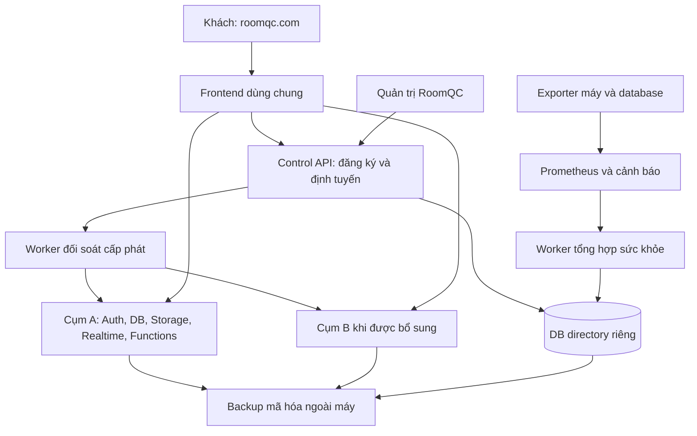

# RoomQC — kế hoạch quản lý VPS và đăng ký tự động

Ngày lập: 19/10/2026, Asia/Bangkok. Baseline tích hợp: `b95fc86`.
Trạng thái: **kế hoạch chuẩn bị triển khai; các phần bổ sung bên dưới chưa được thực hiện**.
Phạm vi: khách tự đăng ký trên RoomQC, được cấp không gian trong cụm do RoomQC vận hành;
đội vận hành biết tài nguyên còn lại, quản lý việc nhận khách và xử lý đăng ký kẹt.

Tài liệu này là kế hoạch hiện hành cho nhánh VPS/signup. Các kế hoạch ngày 10–17/10
vẫn là lịch sử và nguồn tham chiếu; không cộng lại toàn bộ công việc đã hoàn thành.
Đi cùng hai tài liệu bắt buộc:

- [Danh sách công việc, phụ thuộc và bàn giao](roomqc-vps-signup-work-packages-2026-10-19.md).
- [Ma trận nghiệm thu, triển khai, khôi phục và pilot](roomqc-vps-signup-acceptance-rollout-2026-10-19.md).

## 1. Kết quả sản phẩm cần đạt

### Đối với chủ khách sạn

1. Vào RoomQC → nhập tên doanh nghiệp, địa chỉ riêng và email.
2. Tạo tài khoản, xác thực email, nhập thông tin khách sạn đầu tiên.
3. Nhận không gian hoạt động và gói dùng thử theo chính sách hiện hành.
4. Thêm phòng, xác nhận giá, mời nhân viên, bắt đầu nghiệp vụ.
5. Khi mạng lỗi hoặc đóng tab, mở lại để tiếp tục cùng đăng ký; không phải đăng ký lại.

Khách không phải nhập IP, chọn VPS, biết Docker hoặc cấu hình database.
Một doanh nghiệp có thể có nhiều khách sạn; sức chứa được tính theo workspace/tenant
và tài nguyên thực tế, không đồng nhất số doanh nghiệp với số khách sạn.

### Đối với người vận hành RoomQC

1. Biết máy/cụm nào đang phục vụ khách, còn nhận thêm được hay đang bị chặn và vì sao.
2. Xem CPU, bộ nhớ khả dụng, ổ dữ liệu, kết nối DB, lỗi và độ trễ, kèm thời điểm đo.
3. Thêm cụm đã cài đặt, kiểm tra đủ điều kiện rồi mở nhận khách mới.
4. Tra đăng ký theo slug/workspace/request ID, biết đang chờ email, cấp phát hay cần hỗ trợ.
5. Đối soát receipt và tiếp tục một đăng ký an toàn; mọi lệnh có người thực hiện và lý do.
6. Nhận cảnh báo có hành động cụ thể; tìm được backup và bằng chứng restore gần nhất.

Mốc hoàn thành đầu tiên là **pilot một cụm có quản trị tài nguyên và signup xuyên suốt**.
Mở đăng ký công khai, thu phí, tự thuê VPS và tự chuyển tenant là các mốc riêng.

## 2. Hiện trạng đã đối chiếu với mã nguồn

| Nền hiện có | Bằng chứng | Việc tận dụng / còn thiếu |
|---|---|---|
| Registry, workspace, attempts, support audit | `server/control/schema.sql`, `store.mjs` | Tận dụng ID và bảng hiện tại; cần migration có phiên bản, trạng thái tài nguyên, API admin |
| Phân bổ cụm | `ControlStore.reserve()` | Khóa phân bổ ngắn, chọn tỷ lệ workspace/max; chưa biết CPU/RAM/disk/DB hoặc độ mới số liệu |
| Giữ chỗ và hạn mức | `reserve()`, `expireReservations()` | Có 24h giữ chỗ, hạn mức bền vững; phải rà đăng ký lại sau khi Auth đã tạo nhưng chưa provisioning |
| Cấp phát và đối soát | `ClusterGateway`, `/workspaces/:slug/provision`, `support.mjs` | Có receipt nguyên tử trong cụm, phục hồi mất phản hồi; chưa có worker đối soát nền thường trực |
| Cấu hình registry | `loadConfig()`, `migrate()` | Endpoint/key trong env; migrate có thể cập nhật max_workspaces; chưa có một nguồn cấu hình admin thống nhất |
| Frontend nhiều cụm | `src/main.tsx`, `src/lib/workspace.ts` | Bootstrap trước client, CSP/allowlist build-time; thêm cụm cần quy trình cập nhật frontend trước nhận khách |
| Đăng ký/thiết lập | `WorkspaceStart.tsx`, `Onboarding.tsx`, wizard phòng | Đã có UI và API; cần trạng thái chờ/tiếp tục rõ ràng và E2E domain thực tế |
| Docker control | `docker-compose.control.yml` | Có service 8091 nhưng chưa kèm DB directory bền vững/giám sát/bộ cài backend |
| Xác thực hỗ trợ | `ClusterGateway.supportActor()` | Có authority cluster cố định, kiểm tra role/khóa/session thật; tái sử dụng cho API quản trị |
| Health và giới hạn IP | `server/control/app.mjs` | Health chỉ SELECT 1; limiter theo socket IP có thể gom khách sau proxy vào một bucket |
| Kiểm thử hành trình | Báo cáo customer journey 17/10 | 81 kiểm tra dịch vụ local đã đạt; chưa phải browser E2E production hoặc hai backend thật |
| Backup/worker | Báo cáo restore và Edge HTTP 19/10 | Restore DB độc lập và worker thật đã đạt; thiếu directory+Storage+secret recovery ngoài máy |

Quan sát runtime ở lượt rà soát trước khi lập plan: RoomQC 8082 healthy;
control 8091 không kết nối, proxy `/api/control/healthz` trả 503. Không dùng kết quả
test service tạm để coi control đã được triển khai thường trực.

## 3. Kiến trúc và những quyết định dùng cho kế hoạch

### 3.1. Các thành phần



Control quyết định cấp phát và trả mapping; nghiệp vụ booking/phòng đi tới cụm
đã gán. Khách mới dùng cụm có sẵn, không tạo VPS hoặc database riêng cho từng đăng ký.

### 3.2. Quyết định kiến trúc đề xuất

| ID | Hướng triển khai | Hệ quả / điểm phải xác nhận |
|---|---|---|
| D01 | Với yêu cầu quản lý VPS và dữ liệu hiện tại, lấy Supabase self-host trên VPS RoomQC làm phương án pilot | Tài liệu 15/10 từng ưu tiên managed; phải ghi ADR ở P0 để thống nhất. Nếu chọn managed, không triển khai exporter host giả; dùng số đo provider hoặc đánh dấu không hỗ trợ |
| D02 | Giữ Node control hiện có, Postgres directory riêng, frontend dùng chung | Không viết lại Auth/tenant/RLS hoặc tạo một control plane thứ hai |
| D03 | Một data cluster trên một host trong bản đầu | Có thể cùng host với control ở pilot nhỏ, nhưng tính cả phần tài nguyên control/monitor; không tuyên bố HA. Mô hình lưu host riêng để tách máy sau này |
| D04 | Prometheus + node_exporter + postgres_exporter; Alertmanager, Grafana dành cho kỹ thuật | UI RoomQC đọc snapshot đã chuẩn hóa, không cho browser truy vấn Prometheus tùy ý |
| D05 | Worker dùng hàng đợi Postgres directory | Claim ngắn bằng SKIP LOCKED, lease/fencing; không cần Redis/Kubernetes cho phiên bản đầu |
| D06 | Mở rộng bằng thêm cụm đã chuẩn bị và phân bổ khách mới | Việc thuê VPS, cài máy và đổi mapping khách cũ có quy trình riêng, chưa tự động hóa chuyển tenant |
| D07 | Authority quản trị dùng cụm được cấu hình cố định hiện có | Khi authority lỗi, lệnh admin bị từ chối; runbook khôi phục hạ tầng dùng quyền vận hành riêng. Chưa có identity HA/SSO xuyên cụm |
| D08 | Điều kiện nhận khách tách khỏi trạng thái phục vụ khách | CPU cao/metric cũ chỉ chặn cấp phát mới; không tự đổi cluster thành offline hoặc đổi trạng thái thuê bao |

P0 phải ghi lại lựa chọn D01 và sơ đồ host thực tế trước khi dựng VPS. Công việc
local và hợp đồng dữ liệu có thể tiến hành với hai stack Docker độc lập.

### 3.3. Phạm vi phiên bản đầu và việc để sau

**Trong phạm vi:** control thường trực, registry và admin UI, số đo thật, gate
nhận khách, reservation an toàn, provisioning/reconcile, hướng dẫn khách tiếp tục,
chống lạm dụng signup, backup/restore, cảnh báo, staging hai backend và pilot một cụm.

**Để sau:** tự thuê VPS bằng API nhà cung cấp; chuyển tenant đang hoạt động; đổi
slug/alias; tài khoản chung nhiều cụm; autoscaling theo CPU; tính phí VPS theo tenant;
Kubernetes; cơ chế thanh toán thật và chính sách hủy/xóa dữ liệu. Giữ liên kết với
backlog billing hiện có, không coi hoàn tất signup là hoàn tất thu phí.

## 4. Nguồn dữ liệu chuẩn và trạng thái

### 4.1. Tách bốn loại trạng thái

| Đối tượng | Trạng thái / nguồn | Ai thay đổi |
|---|---|---|
| Vận hành cụm | `active`, `draining`, `offline` hiện có | Quản trị được phép, có lý do và audit |
| Sức khỏe quan sát | `healthy`, `degraded`, `unreachable`, `unknown` | Worker giám sát, kèm observed_at/valid_until |
| Nhận khách mới | `open`, `blocked`, `manual_closed`; reason codes | Chính sách server + quyết định quản trị; UI chỉ hiển thị |
| Hành trình đăng ký | `reserved`, `provisioning`, `active`, `expired` hiện có + job phụ | Control và receipt; không dùng trạng thái thuê bao thay thế |

Trial/active/grace/suspended của gói vẫn thuộc `public.tenants` tại cụm. `active`
trong directory nghĩa là đã có mapping hợp lệ, không nghĩa là thanh toán thành công.
Không mở rộng enum workspaces chỉ để hiển thị mọi bước UX; bước chờ email/hành động
cần làm được tính từ dữ liệu được phép xem và bằng chứng Auth phù hợp.

### 4.2. Bảng dữ liệu đề xuất, nằm trong database directory

Tên mới bên dưới là hợp đồng dự kiến; chưa có migration được áp dụng.

| Bảng / thay đổi | Trường chính | Ràng buộc, chỉ mục và cách dùng |
|---|---|---|
| `hosts` mới | id, name, region, provider_label, environment, status, version | ID ổn định; không chứa password/SSH key; tên tài nguyên không lấy từ input để chạy shell |
| `clusters` mở rộng | host_id, backend_kind, credential_ref, release_id, schema_manifest_hash, validation_state, validated_at, policy_version, row_version, maintenance_reason | Giữ cluster ID và endpoint cũ; một host/data cluster v1; version check khi cập nhật |
| `cluster_policies` mới | cluster_id, tenant_limit, thresholds JSON theo schema version, reopen_mode, row_version | tenant_limit thay nguồn max_workspaces bằng migration có đối chiếu; không để migrate khởi động ghi đè chỉnh sửa admin |
| `cluster_health_current` mới | cluster_id, observed_at, received_at, valid_until, metric_status, normalized_values, reason_codes, source_generation | Một dòng/cụm; reject dữ liệu cũ/NaN/sai đơn vị; thiếu số liệu là null + lý do |
| `cluster_admission_current` mới | cluster_id, decision, reason_codes, health_generation, policy_version, evaluated_at | Gate kiểm tra freshness khi phân bổ, không tin snapshot open đã quá hạn |
| `cluster_events` mới | id, cluster_id, type, before/after đã lọc, actor, source, request_id, created_at | Append-only ở runtime; index `(cluster_id,created_at,id)`; không lưu key/raw provider payload |
| `control_commands` mới | id, actor, operation, target_id, payload_hash, expected_version, status, result | Unique theo actor+operation+idempotency key; cùng key khác payload trả 409; audit và mutation cùng transaction |
| `provisioning_jobs` mới | id, workspace_id, kind, state, next_attempt_at, attempts, lease_token, lease_until, expected_routing_version, last_error_code | Một job chưa kết thúc cùng workspace/kind; partial index `(next_attempt_at,id)` cho queued/retry; worker cũ không ghi đè lease mới |
| `signup_affinities` mới | email_hash, cluster_id, created_at, policy_version | Ghi cùng transaction lần gán đầu; giữ cụm khi đăng ký lại sau expiry để tránh chuyển danh tính Auth chưa đối soát |
| `alerts` mới | fingerprint, resource_id, type, severity, opened_at, last_seen_at, acknowledged_by, resolved_at | Một cảnh báo mở mỗi fingerprint; acknowledge không làm số đo thành healthy |
| `backup_runs` mới | scope, backup_id, manifest_hash, completed_at, verification_state, restore_test_at | Chỉ metadata/vị trí tham chiếu được duyệt; không trả URL có chữ ký hoặc secret tới browser |
| `attempts`, `support_actions` hiện có | thêm liên kết command/job nếu cần | Tái sử dụng lịch sử; không gộp audit hỗ trợ với audit tài chính hoặc log nhân viên khách sạn |

Chi tiết migration:

1. Chuyển `schema.sql` chạy lại nguyên file sang migration directory có số thứ tự,
   checksum và bảng history. Baseline nhận biết schema cũ; schema không khớp dừng.
2. Khóa migration cấp DB; tài khoản migration tách runtime. Runtime không tự DDL.
3. Thêm cột nullable trước, backfill có kiểm chứng rồi mới NOT NULL/index bắt buộc.
4. Giữ quyền bằng grants của DB nội bộ; không expose schema control qua PostgREST.
5. Với thay đổi DB tenant, dùng quy trình migration Supabase hiện có và kiểm tra
   quyền/RLS; không chạy migration directory vào DB nghiệp vụ.
6. Cursor pagination theo `(created_at,id)` cho sự kiện/job; filter cố định và limit
   25 mặc định, tối đa 100. Dashboard tổng hợp phía server, không cộng từ một trang.
7. HMAC email là danh tính kỹ thuật đang dùng: giữ key ổn định, backup riêng; không
   đổi key để reset giới hạn. Rotation cần quy trình chuyển đổi hash có đối soát.

“Cluster draft” trong quy trình là nhãn từ `validation_state=pending` và admission
đóng, không tự bổ sung `draft` vào enum vận hành hiện có. `max_workspaces` cũ chỉ
được giữ làm compatibility trong giai đoạn chuyển; `tenant_limit` là nguồn đã chốt,
không để hai trường cùng có API ghi độc lập. Binary cũ không được chạy lẫn sau cutover.

### 4.3. Đồng nhất registry và secret

Hiện tại DB và `ROOMQC_CONTROL_CLUSTERS` cùng giữ cấu hình. Phiên bản mới cần:

- DB là nguồn metadata vận hành, limit, endpoint đã duyệt và phiên bản.
- Secret store/env-file trên server giữ credential theo `credential_ref`; browser
  không gửi/nhận service key. Có kiểm tra ref tồn tại trước khi đánh dấu cụm sẵn sàng.
- Pilot dùng file secret quyền hạn chế; chuẩn hóa interface để thay secret store sau.
- Tạo credential/backend bằng công cụ vận hành, UI chỉ chọn ref đã đăng ký và xem
  “đã cấu hình/chưa cấu hình”, không có ô dán root password/API secret.
- Đổi endpoint của cluster đang có workspace bị chặn ở API; dùng quy trình di chuyển
  riêng. Không sửa env rồi coi đó là cách đổi route an toàn.
- Cụm mới chỉ nhận khách sau release/schema manifest, Auth/Storage/Realtime/Functions,
  backup, số đo, credential, CSP/allowlist/frontend tương thích đều đạt.

## 5. Thu thập tài nguyên và quyết định nhận khách

### 5.1. Số đo, nguồn và chu kỳ

| Nhóm | Số đo tối thiểu | Cách lấy / ý nghĩa |
|---|---|---|
| Host | CPU busy trung bình 5 phút; MemAvailable/total; disk free bytes/%; inode free/% | node_exporter, chỉ filesystem chứa DB/Storage và host; bỏ pseudo filesystem |
| Database | Kết nối đang dùng/ngân sách; transaction latency; deadlocks; DB/WAL size; lock wait | postgres_exporter bằng role giám sát ít quyền, không dump query chứa thông tin khách |
| Dịch vụ | Auth/REST/Storage/Realtime/Functions probe, 5xx và p95 tại gateway | Probe phải phân biệt unauthorized hợp lệ với backend lỗi; không chỉ kiểm tra cổng mở |
| Cấp phát | reserved/provisioning/active; tuổi job lâu nhất; retry/failure | Query directory; count trong transaction khi phân bổ |
| An toàn vận hành | Backup thành công cuối, restore cuối, release/schema tương thích | Metadata từ pipeline được xác thực; UI không cho tự nhập “backup thành công” |

Scrape đề xuất 30 giây; worker chuẩn hóa mỗi 30 giây; snapshot hết hạn sau 120 giây.
Ghi `observed_at`, `received_at`, generation; không lấy thời gian UI để đánh giá mới/cũ.
Giữ time series ở Prometheus 15 ngày ban đầu; directory chỉ giữ current và sự kiện
chuyển trạng thái. Đề xuất log kỹ thuật 14 ngày, operational audit 180 ngày, cần
chốt retention P0; không áp chính sách này cho chứng từ/hồ sơ khách.

Exporter chỉ trên mạng riêng, TLS/mTLS hoặc tunnel đã duyệt; không publish công
khai, không mount Docker socket và không cần chức năng chạy lệnh tùy ý. Nếu có bind
host `/proc`/`sys`, chỉ đọc đúng mount cần thiết. Chốt cấu hình đúng với môi trường
Linux VPS; container Docker Desktop local chỉ chứng minh integration, không chứng
minh phép đo host Windows hoặc số liệu VPS production.

### 5.2. Ngưỡng khởi đầu để thử nghiệm

Đây là cấu hình thử staging, phải hiệu chỉnh theo load test; không phải cam kết
sức chứa. Cảnh báo và chặn nhận mới có thời gian duy trì để tránh đóng/mở liên tục.

| Điều kiện | Cảnh báo | Chặn nhận mới | Điều kiện khôi phục đề xuất |
|---|---|---|---|
| CPU busy | ≥70% trong 5 phút | ≥85% trong 5 phút | <65% liên tục 10 phút |
| Bộ nhớ khả dụng | <25% trong 5 phút | <15% trong 2 phút | >25% trong 10 phút |
| Ổ DB hoặc Storage | Còn <25% hoặc <20 GiB | Còn <15% hoặc <10 GiB | >25% và >20 GiB, đã xử lý nguyên nhân |
| Inode ổ dữ liệu | Còn <20% | Còn <10% | >20% |
| Kết nối DB | ≥70% ngân sách trong 5 phút | ≥85% trong 2 phút | <65% trong 10 phút |
| Metric | Một lần scrape lỗi | Mất dữ liệu hợp lệ >120 giây | Số liệu hợp lệ liên tục 5 phút |
| Backend quan trọng | Probe lỗi | 3 lần liên tiếp trong ≥60 giây | Probe hợp lệ liên tục 5 phút |
| Sức chứa cấu hình | Đã giữ/dùng ≥80% limit | Đã giữ/dùng đạt limit | Có suất hợp lệ hoặc tăng limit có audit |
| Backup | Gần tới hạn chính sách | Backup quá hạn chính sách hoặc chưa có backup được xác minh khi mở cụm | Backup xác minh đạt; không tính chỉ tạo file là hoàn thành |
| Phiên bản | Không khớp manifest được hỗ trợ | Chặn ngay cụm mới/phiên bản không hỗ trợ | Deploy và kiểm chứng manifest đúng |

Ngân sách kết nối DB tính từ cấu hình thật và phần dự phòng vận hành; cộng tất cả
pool Auth/REST/control/worker/exporter. Không tăng `max_connections` hoặc `work_mem`
theo số user một cách máy móc. Phải đo bộ nhớ, query và connection churn khi chọn pool.

Pilot dùng **mở lại có xác nhận quản trị** sau khi hết nguyên nhân chặn. Tự mở lại
sau hysteresis chỉ bật sau khi có bằng chứng ổn định và audit policy riêng. Admin
không được bỏ qua metric stale, disk critical, backend down hoặc version không khớp.

### 5.3. Thuật toán phân bổ và khóa

1. Kiểm tra global signup flag, Origin/proxy/rate limit, slug/email và request identity.
2. Tìm đăng ký còn hiệu lực trước: retry trả đúng workspace, không giữ thêm suất.
3. Trong transaction ngắn dùng khóa phân bổ hiện có: thu hồi chỉ reservation thật
   sự chưa bước vào provisioning; tìm affinity cùng email kể cả lịch sử expired.
4. Lọc cụm active, được phép nhận mới, credential/release hợp lệ, metric còn mới,
   backup đạt yêu cầu và còn suất. `draining` loại khỏi đăng ký mới.
5. Nếu có affinity, chỉ xét cụm đó. Nếu cụm thiếu sức chứa/không khả dụng, trả hướng
   dẫn chờ/hỗ trợ; không tự chuyển sang Auth của cụm khác.
6. Trong các cụm đủ điều kiện, ưu tiên tỷ lệ workspace/limit thấp nhất, rồi mức tài
   nguyên còn lại và cluster ID để ổn định. Lưu policy version và snapshot tham chiếu.
7. Ghi workspace, affinity và audit cùng transaction; commit trước khi gọi backend.
8. Trước lần provisioning đầu, recheck gate trong transaction chuyển trạng thái.
   Nếu đã bắt đầu/không rõ commit, ưu tiên đọc receipt và khôi phục; không cấp lại
   cụm khác vì tải hiện tại tăng. Trả trạng thái chờ nếu chưa được bắt đầu.

Thay đổi cấu hình/đóng nhận khách phải dùng cùng cơ chế khóa/version với phân bổ.
Request đã được chấp nhận trước thời điểm đóng được ghi nhận rõ; đóng không hủy
ngầm job đang commit. Gate phản ánh cửa sổ số đo có độ trễ, không bảo đảm tài nguyên
không thể tăng trong vài giây; vẫn cần giới hạn concurrency và timeout tại backend.

Giữ khóa toàn cục ngắn ở bản đầu vì signup ít hơn nghiệp vụ. Chỉ tách khóa theo
cụm khi đo thấy bottleneck; không giữ khóa trong HTTP, email hoặc thao tác filesystem.

## 6. Đăng ký, cấp phát, phục hồi và chống lạm dụng

### 6.1. Giữ luồng hiện có, làm rõ các nhánh lỗi

| Bước | Kết quả lưu bền vững | Người dùng thấy gì khi lỗi |
|---|---|---|
| Giữ địa chỉ | workspace ID + cluster + expiry + affinity + audit | Slug bận / tạm dừng đăng ký / tiếp tục đăng ký đã có |
| Tạo tài khoản | Auth user ở đúng cụm; không lưu password trong directory | Đăng nhập tiếp nếu đã tạo; không gửi lại sang cụm khác |
| Xác thực email | Server xác minh email/session | Gửi lại có cooldown; mở liên kết trên tab/thiết bị mới vẫn đúng workspace |
| Nhập thông tin | Form hợp lệ; dữ liệu cần cho lệnh cấp phát theo schema cho phép | Giữ form khi chưa rõ kết quả, không báo “chưa tạo” chỉ vì timeout |
| Bắt đầu cấp phát | owner gắn bền vững, provisioning, request/job identity | “Đang thiết lập”, có mã hỗ trợ; refresh đọc lại kết quả |
| Commit tại cụm | tenant/hotel/owner/trial/receipt cùng transaction | Mất phản hồi được khôi phục bằng receipt cũ |
| Kích hoạt mapping | workspace active với binding và routing version đã kiểm tra | Dashboard/checklist; không tự gia hạn trial khi retry |
| Phòng/nhân viên | Dùng wizard và invitation hiện có | Tiến độ theo khách sạn; từng bước có chỗ click rõ ràng |

Không thêm trang chọn VPS trong onboarding. Email đã có workspace ở v1 hướng về
đăng nhập hoặc thêm hotel trong doanh nghiệp, không tạo workspace mới theo suy đoán.

### 6.2. Worker phục hồi

Phiên bản đầu giữ HTTP provisioning hiện có và thêm **worker đối soát receipt**.
Không lưu access token/password hay chạy lại tùy ý form của khách trong job nền.

1. `beginProvision` ghi yêu cầu đối soát cùng transaction trước RPC ngoài cụm.
2. Worker claim job bằng SKIP LOCKED, ghi lease token rồi commit; HTTP ngoài transaction.
3. Đọc receipt theo workspace ID tại cụm đã gán: verified → activate mapping;
   unavailable → retry backoff; conflict → needs_review; missing → chờ chủ tiếp tục.
4. Một receipt verified phải khớp workspace/owner/tenant/hotel/routing version; bản
   ghi bị lệch không được sửa bằng cách lấy ID mới từ browser.
5. Retry mạng đề xuất 30s, 2m, 5m, 15m, 30m có jitter; sau 5 lần cần hỗ trợ.
   Thời gian này là tham số kỹ thuật, không phải thời hạn thương mại của trial.
6. Lease đề xuất 90s, HTTP timeout 20s. Worker phải kiểm tra fencing khi lưu kết quả;
   lease hết không chứng minh RPC cũ đã dừng. Tính chống trùng vẫn do receipt tại cụm.
7. Job không có receipt sau đối soát chuyển `waiting_owner`; hướng dẫn tiếp tục
   onboarding cũ. Không tự expire, xóa Auth hoặc tạo tenant khác.
8. Lệnh admin retry chỉ enqueue/reconcile đúng workspace đã tra; không có nút
   “tạo lại toàn bộ”. Replay command phải trả receipt cũ khi đã hoàn thành.

Chỉ chuyển sang provisioning bất đồng bộ hoàn toàn nếu số đo HTTP cho thấy cần;
đó là ADR bổ sung, vì khi đó phải giải quyết mã hóa payload form và TTL dữ liệu.

### 6.3. Chống lạm dụng và proxy

- Giữ hạn mức tổng/email bền vững; thêm limiter tại edge và Auth, không chỉ control.
- Chỉ tin forwarded IP từ proxy đã cấu hình. Proxy phải ghi đè header client gửi;
  test một khách sau NAT không thể làm toàn hệ thống rơi vào chung bucket vô hạn.
- Bot challenge trước public signup, kiểm tra ở server; local/staging dùng khóa test
  của provider đã chọn. Thiếu khóa production là gate mở public, không cản phát triển local.
- Challenge fail không giữ suất; request replay không tiêu thêm slot/đơn vị quota.
- Direct Auth signup chưa được coi là được cấp tenant: RPC server vẫn bảo vệ; thử
  đường gọi thẳng Auth để xác minh rate limit/captcha và nguy cơ tạo tài khoản rác.
- Đóng đăng ký ở directory phải có policy đồng bộ với Auth public signup; bảo đảm
  lời mời nhân viên, reset mật khẩu và login khách cũ vẫn hoạt động.
- Bootstrap công khai trả metadata tối thiểu; không thêm owner email, trạng thái
  xác minh email hoặc thông tin cá nhân vào endpoint công khai.
- Tài khoản Auth bỏ dở không tự xóa theo tuổi; retention/cleanup là quy trình riêng.

## 7. API và quyền quản trị

Giữ các endpoint hiện có; endpoint mới nằm dưới `/api/control`. Hợp đồng phải có
OpenAPI/schema kiểm tra request/response trước khi FE/BE triển khai song song.

| Endpoint dự kiến | Quyền | Kết quả và lưu ý |
|---|---|---|
| `GET /healthz` hiện có, thêm `/livez`, `/readyz` | Hạ tầng, public tối giản nếu cần | live = process; ready = DB/migration/config; không buộc mọi data cluster healthy |
| `POST /signup-intents` | Public + anti-abuse | Giữ response tương thích; thêm error code ổn định cho admission/affinity |
| `GET /workspaces/:slug/bootstrap` | Public metadata tối thiểu | Mapping an toàn; gate nhận mới không chặn bootstrap khách active |
| `POST /workspaces/:slug/provision` | Owner xác thực tại đúng cụm | Giữ whitelist business fields, thêm request identity và lịch đối soát |
| `GET /workspaces/:slug/setup-status` | Owner đúng email/session/tenant tùy giai đoạn | Tiến độ và hành động cần làm, không đọc được đăng ký người khác |
| `GET /admin/overview` | Admin authority | Counts server + data freshness; không lấy quyền từ user_metadata |
| `GET /admin/clusters`, `GET /admin/clusters/:id` | Admin authority | State, capacity, metrics, backup, release; không secret |
| `POST /admin/clusters/register` | Ops admin | Chỉ metadata/ref được duyệt; draft chưa nhận khách |
| `POST /admin/clusters/:id/commands` | Ops admin | close_admission, open_admission, set_draining, update_policy, validate; operation enum cố định |
| `GET /admin/workspaces`, `GET /admin/workspaces/:id` | Support/admin | Phân trang/filter có giới hạn, lịch sử và liên kết tenant/cụm |
| `GET /admin/workspaces/:id/tenant-summary` | Support/admin | Control đọc bản tóm tắt ở đúng cụm đã gán; cụm lỗi trả unavailable, không dùng dữ liệu cụm mặc định |
| `/support/lookup`, `/support/reconcile` hiện có | Support/admin | Tái sử dụng, bổ sung command identity/version; không mở lại quyền ghi trực tiếp |
| `POST /admin/workspaces/:id/recheck` | Support/admin | Tạo job đối soát, 202 + command/job ID; không khẳng định đã sửa khi mới enqueue |
| `GET /admin/alerts`, `POST /admin/alerts/:id/acknowledge` | Support/admin | Acknowledge có lý do, không tắt gate hoặc resolve số đo |
| `GET /admin/backups`, `GET /admin/audit` | Admin authority | Chỉ xem metadata và bằng chứng; không có nút restore vào DB đang phục vụ |

V1 có thể chỉ dùng super-admin hiện tại, nhưng server kiểm tra capability theo
operation để tách support-read/support-reconcile/infra-operate sau này. Không tạo
role mới chỉ ở frontend. Phiên bị thu hồi hoặc user bị khóa phải mất quyền ngay
qua kiểm tra authority hiện có. Lệnh nhạy cảm production cần session đủ mức MFA
theo cấu hình đã duyệt; không thay bằng nút xác nhận ở browser.

Mọi mutation admin yêu cầu command ID, expected version và lý do 5–1.000 ký tự.
Audit/receipt/mutation nguyên tử. Khi lỗi sau commit, client giữ cùng command ID
qua reload; không sinh ID mới rồi thực hiện lại. HTTP 409 yêu cầu đọc lại phiên bản;
429 có Retry-After; 503 không báo thành công; không đưa SQLERRM/secret vào thông báo.

Quy ước hợp đồng đề xuất: client gửi UUID ổn định bằng `Idempotency-Key`, server trả
`commandId` và một `requestId` riêng cho từng HTTP attempt. Ví dụ payload lệnh:

```json
{
  "operation": "close_admission",
  "expectedVersion": 7,
  "reason": "Tạm ngừng nhận khách mới để bổ sung ổ dữ liệu",
  "payload": {}
}
```

HTTP 200 chỉ khi lệnh đã commit; tác vụ nền trả 202 cùng job ID và URL theo dõi.
Không cho truy xuất receipt của actor khác chỉ vì biết command ID. Khi hạ tenant
limit xuống dưới số workspace đã giữ/dùng, giao diện phải báo rõ chỉ ngừng nhận mới;
không tự thu hồi reservation đã bắt đầu provisioning hoặc xóa/khóa tenant hiện có.

Console tenant hiện có chủ yếu đọc một backend. Khi mở workspace thuộc cụm khác,
chỉ dùng tenant-summary server-to-server đã kiểm tra quyền; không truyền tenant ID
vào hook của default cluster. Không tự đăng nhập/giả danh owner ở workspace khách.
Các thao tác billing cũ chỉ hiện khi backend của chúng đã hỗ trợ đúng cụm; quyền
quản trị hạ tầng không tự mở đường settlement xuyên cụm.

## 8. Giao diện quản trị dễ dùng

Dùng khu `/super-admin` hiện có, tách khỏi nhật ký thao tác của nhân viên khách sạn
ở `/settings/audit-log`. Chỉ bổ sung hai mục menu chính: **Hạ tầng** và **Đăng ký mới**.
Danh sách khách hàng hiện có giữ vai trò quản lý khách đã cấp phát; liên kết hai chiều.

Đề xuất entry đăng nhập quản trị riêng `/super-admin/login` ở root, dùng authority
cluster đã duyệt. Điều hướng từ workspace tới đây bằng URL root đầy đủ, không gắn
basename `/app/:slug`. Không để cờ directory chuyển admin sang form tạo doanh nghiệp.

| Màn hình | Nội dung ưu tiên | Hành động |
|---|---|---|
| `/super-admin/infrastructure` | Một dòng/cụm: tên, host, đang phục vụ bao nhiêu doanh nghiệp, nhận khách hay không, lý do, CPU/RAM/disk, độ mới dữ liệu | Xem cụm; tạm ngừng nhận; thêm cụm đã chuẩn bị |
| `/super-admin/infrastructure/:id` | Banner vấn đề + hành động cần làm, tài nguyên chính, doanh nghiệp trên cụm, lịch sử thay đổi, backup/release | Mở/đóng nhận mới; draining; sửa hạn mức; kiểm tra lại |
| `/super-admin/registrations` | slug, bước hiện tại, cụm, thời gian chờ, lỗi gần nhất, request ID; filter chờ/lỗi/hoàn tất | Mở đăng ký, sao chép mã hỗ trợ; không thêm menu phụ lặp |
| `/super-admin/registrations/:id` | Timeline đăng ký → email → provisioning → receipt → active; sự kiện có bằng chứng | Đối soát, yêu cầu kiểm tra lại, liên kết hồ sơ khách; phân biệt receipt missing và backend unreachable |
| Cảnh báo và backup | Section liên kết trong trang hạ tầng, deep link theo filter | Acknowledge, xem runbook/bằng chứng; không phải một dashboard trùng |

Quy tắc UX:

- Trắng/xám chữ đậm, xanh dương cho hành động, đỏ/cam cho lỗi/cảnh báo; không nền pastel
  làm giảm tương phản. Trạng thái luôn có chữ/icon, không dùng màu làm tín hiệu duy nhất.
- “RAM còn 3,2 GB” dễ hiểu hơn chỉ “RAM 80%”; đi kèm tổng và thời gian đo.
- Metric thiếu hiển thị “Chưa có số liệu”, không 0% hoặc xanh khỏe.
- Nút ngừng nhận ghi rõ ảnh hưởng đến khách mới. Thao tác làm ngừng phục vụ cụm
  tách riêng với quyền/lý do và số khách bị ảnh hưởng; không đưa vào quick action v1.
- Giữ filter/cursor trong URL; đổi filter về trang đầu; back quay đúng vị trí trước.
- Sau chuyển trang, nội dung bắt đầu ở đầu vùng nội dung; menu và vùng chính cuộn độc lập.
- Mobile 390px dùng thẻ cô đọng, vẫn xem đủ lý do và nút chính; thao tác admin bằng bàn phím.
- Không hiển thị nút thành công giả; dữ liệu cũ khi API lỗi phải đánh dấu stale và khóa mutation.

## 9. Triển khai, vận hành và giới hạn tài nguyên

### 9.1. Bộ đóng gói cần bổ sung

1. Compose local control có DB directory/volume riêng và tên cố định theo môi trường;
   khởi động lại giữ dữ liệu. Local dùng cổng 8091 đã dành riêng, không dùng 8090 của CRM.
2. Bundle VPS gồm frontend/proxy/control/worker/directory, manifest secret refs,
   migration job riêng, giới hạn resource, log rotation, restart/healthcheck.
3. Backend Supabase self-host theo compose chính thức đã pin phiên bản/digest;
   bao gồm Auth/DB/REST/Storage/Realtime/Functions và thành phần cần thiết. Compose
   frontend hiện tại không được gọi là bộ cài backend hoàn chỉnh.
4. Monitoring profile riêng: exporter, Prometheus, Alertmanager; Grafana chỉ mạng
   quản trị. Nếu chung host, dự trù cả RAM/CPU/disk của monitoring/backup.
5. Script preflight chỉ đọc: disk/mount, RAM, ports, DNS/TLS, clock, Docker version,
   host architecture, secret refs, manifest. Output không in credential.
6. Công cụ cài đặt idempotent, chạy lại không tạo volume trống thay dữ liệu cũ;
   phát hiện mismatch host/environment/volume và dừng. Restore là lệnh riêng.

Thông số khảo sát ban đầu cho data VPS: 4–8 vCPU, khoảng 16 GB RAM, NVMe ≥100 GB;
đây là cấu hình để đo pilot, không phải số khách cam kết hoặc yêu cầu mua máy ngay.
Sizing cuối cùng dựa trên RAM của toàn bộ service, dữ liệu/file, IOPS, egress và tải.
Budget theo tháng phải gồm VPS, backup, email, giám sát và công vận hành; lấy báo giá
thật sau P0, không suy ra chi phí/khách chỉ từ giá thuê VPS.

### 9.2. Backup và sự cố

Phải bảo vệ cùng lúc directory mapping, tenant DB/Auth, PGMQ, Storage objects,
deployment manifest và secret/Vault cần giải mã. Giữ secret tách kho backup dữ liệu,
nhưng có quy trình lấy lại khi phục hồi. Lần restore DB 19/10 là nền đã có, không
thay cho restore Storage, directory hoặc mất máy vật lý.

Mục tiêu pilot đề xuất RPO ≤24h, RTO ≤4h, chỉ công bố khi đo đạt; nếu cần RPO ngắn
hơn phải thiết kế WAL/PITR và versioning/replication objects tương ứng. Backup DB và
Storage cần manifest chung cùng cửa sổ nhất quán; pilot dùng maintenance window khi
snapshot, không ghép ngẫu nhiên DB ngày A với file ngày B.

Khi directory/control lỗi: ngừng signup, hiển thị lỗi mở workspace có thể thử lại;
phiên đã có client có thể tiếp tục nghiệp vụ trực tiếp tùy cụm. Không hứa đăng nhập
mới hoạt động khi bootstrap không truy cập được. Khi cụm lỗi: giữ mapping, xử lý
khôi phục đúng cụm; không trỏ sang database rỗng. Kiểm tra cảnh báo từ bên ngoài
host, vì monitoring cùng VPS không báo được khi cả máy chết.

## 10. Trình tự thực hiện và điều kiện đóng đợt

| Đợt | Kết quả bàn giao | Phụ thuộc | Ước lượng ngày công |
|---|---|---|---|
| P0 | ADR/nguồn trạng thái, baseline, API contracts và phạm vi rollout | Code hiện tại | 1–2 |
| P1 | Control + directory bền vững, migration/version/grants, authority admin | P0 | 3–4 |
| P2 | Số đo thật, health snapshots và cảnh báo local | P0; nối DB sau P1 | 3–4 |
| P3 | Registry admin, gate tài nguyên và phân bổ chống tranh suất | P1 + P2 | 3–4 |
| P4 | Signup tiếp tục được, affinity, receipt worker, anti-abuse | P1; gate P3 trước nghiệm thu | 3–5 |
| P5 | Hạ tầng/đăng ký trong super-admin, lỗi/retry/audit/UX đầy đủ | Contracts P0; API P3/P4 | 3–5 |
| P6 | Bộ cài VPS, backup ngoài máy, restore directory+cluster+objects | P1 + P2; quyền VPS cho bước thật | 3–5 |
| P7 | Hai backend thật, browser E2E, fault injection, đo tải | P3–P6 | 3–5 |
| P8 | Pilot một cụm, theo dõi, báo cáo quyết định mở rộng | P7 và quyền/cấu hình thật | 1–2 + 7 ngày quan sát |

Tổng sơ bộ **23–36 ngày công kỹ thuật còn lại** cho phạm vi này; chưa gồm thời gian
chờ hạ tầng/provider hoặc sửa lỗi phát sinh lớn. Nhiều việc có thể thực hiện song
song theo work package; không lấy tổng ngày công chia số agent làm lịch giao cam kết.
Chốt lại sau P0/P1. Không cộng chồng với các roadmap cũ có cùng phạm vi.

Mốc bàn giao sử dụng được:

- M1 sau P1: control sống qua restart, đăng ký local có điều phối thường trực, vẫn gated.
- M2 sau P3/P5 phần hạ tầng: biết vì sao cụm nhận/từ chối khách và thao tác có audit.
- M3 sau P4/P5/P7 local: khách mẫu đăng ký và nhân viên dùng được; phục hồi lỗi có bằng chứng.
- M4 sau P6/P7 staging: bộ cài và khôi phục được nghiệm thu trên VPS/domain.
- M5 sau P8: đủ dữ liệu để quyết định mở thêm khách/cụm; public/paid có gate riêng.

## 11. Quyết định và đầu vào cần chuẩn bị

| Nội dung | Đề xuất dùng để làm local | Cần chốt trước |
|---|---|---|
| Backend self-host hay managed | Thiết kế pilot self-host theo nhu cầu VPS; giữ backend_kind | P0 ADR và đóng gói VPS |
| VPS/IP/OS/tài nguyên/vị trí dữ liệu | Linux x86_64, Docker; mô phỏng bằng stack riêng | P6 triển khai thật |
| Domain ứng dụng/API, DNS/TLS | roomqc.com và API origin từng cụm; staging origin riêng | P7 email/browser domain |
| SMTP/Resend, chống bot, kênh cảnh báo | Mailpit + provider test fixtures | Mở pilot email thật/public signup |
| Kho backup + khóa mã hóa | Thử restore ở storage local riêng trước | P6 offsite/DR |
| Người vận hành/quyền/MFA | Một super-admin authority đã có, kiểm tra sống | Trước lệnh vận hành production |
| Trial/billing/hủy/read-only | Giữ chính sách hiện tại, không tự đổi | Trước mở trial rộng/thu tiền tương ứng |
| Hạn mức pilot và ngưỡng | Tenant limit bảo thủ; ngưỡng mục 5 dùng staging | Sau số đo P7, trước P8 |
| Khách legacy | Giữ route hiện có; lập inventory mapping | Trước bật directory_required trên cụm đang có khách |

Khi thiếu khóa/quyền, hoàn thiện code, compose, runbook và kiểm thử local; ghi rõ
phần external chưa chạy. Không đánh dấu task triển khai thật là done chỉ vì thiếu
quyền được đưa vào danh sách làm sau.

## 12. Nguồn tham chiếu

- [Runbook directory hiện có](workspace-directory-runbook.md).
- [Hành trình dịch vụ local đã kiểm chứng](customer-journey-local-validation-2026-10-17.md).
- [Restore và công cụ sandbox](roomqc-e2e-restore-local-2026-10-19.md).
- [Worker Edge HTTP thật](roomqc-edge-http-local-2026-10-19.md).
- [Khóa/quyền và quyết định còn thiếu](roomqc-deferred-access-and-decisions-2026-10-17.md).
- [Supabase self-host Docker](https://supabase.com/docs/guides/self-hosting/docker),
  [self-host Functions](https://supabase.com/docs/guides/self-hosting/self-hosted-functions).
- [Prometheus node_exporter](https://github.com/prometheus/node_exporter),
  [postgres_exporter](https://github.com/prometheus-community/postgres_exporter).

Trước implementation từng thành phần, xác minh changelog/docs đúng phiên bản được
pin. Thiết kế DB áp dụng hướng dẫn Supabase Postgres Best Practices: transaction
ngắn, queue SKIP LOCKED có fencing, budget connection và index/pagination theo truy vấn.
