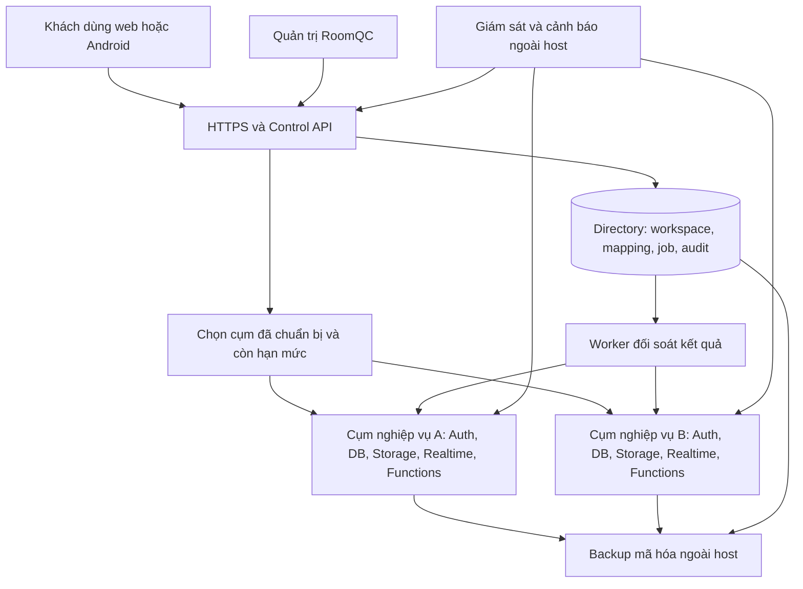

# RoomQC — kế hoạch tổng thể VPS và đăng ký mới, bản đối chiếu thực tế

**Cập nhật nhận việc 29/10/2026 — bản RF06 đang sửa:** phạm vi toàn bộ VPS + signup; đầu ra plan + nghiệm thu. Xem [hồ sơ hiện hành, mục2/5.6/11–12](roomqc-vps-signup-execution-dossier-2026-10-29.md) và [snapshot kế hoạch](../../../artifacts/roomqc-vps-signup-plan-handover-2026-10-29.json). Các checkpoint ghi bên dưới là bằng chứng đúng nguồn riêng; chưa nhận source RF06 hoặc cấp gate từ lần lập kế hoạch này.

**Điểm nhận việc hiện tại — đã nối runtime, 29/10/2026:** phạm vi toàn bộ VPS + signup; đầu ra plan + nghiệm thu. Bản đang sửa334 tệp/hash 6d7d491550eb9258865a2fa26eeae0a0e0934f7a8a5a2e6e8455da0ce24a8dac,587 business/21 directory migrations. [Báo cáo runtime](roomqc-support-intents-runtime-local-2026-10-29.md) và [packet](../../../artifacts/roomqc-support-intents-runtime-b3e1f84b1812-local-2026-10-29.json): native113/113,34barriers/3SIGKILL,exit0 trên source243567; control529pass/201skip/0fail cùng nguồn. Directory r2 có168pass/1fail do expected callback; đã sửa ba assertion và focused r3 đạt1/1 trên source hiện hành. Không cộng thành full169/169 cùng nguồn. Runtime bốn nhóm mutator đã nối journal; native expired recovery mới chỉ chứng minh close_admission,8HTTP retries cùng một API process. Nhận tiếp RF06 legacy,all-family/two-process recovery,worker,populated upgrade/security; R11/BG02 vàBG03–BG11 còn mở. Giữ25task/70ca/124lượt/122mục unverified; actual/reviewer/signoff/gates không đổi.

Lịch sử checkpoint — chỉ áp dụng đúng nguồn của từng báo cáo

**Checkpoint nền journal334/d30e — lịch sử, 29/10/2026:** source334/hash `d30e5ee5908404ed2da8d64ddc955305e98c273086bfe119334fac39b623dcf7`, 587 business/21 directory migrations. [Báo cáo](roomqc-support-intents-foundation-local-2026-10-29.md) và [packet](../../../artifacts/roomqc-support-intents-foundation-207ce2e0ad48-local-2026-10-29.json): directory 169/169 (9 ca journal mới), control 527 pass/0 fail/201 skip; native 104/104 kiểm tương thích Auth/HTTP hiện có, exit0. Journal giữ identity/generation/predecessor bền vững, khóa trên một connection và chặn vòng cũ; đã sửa xử lý backend termination và fixture pool cleanup. **Chưa nối coordinator vào mutator runtime hoặc chứng minh expired recovery qua canonical Auth.** Nhận tiếp RF04/RF05/RF06 tại mục5.4 dossier; R11/BG02, worker, populated business upgrade/security và BG03–BG11 còn mở. Giữ 25 task/70 ca/124 lượt/122 mục unverified, actual/reviewer/signoff/gates không đổi.

**Checkpoint331 — lịch sử consumption, 29/10/2026:** source331/hash `a700ff658818a1f0b8b43420cf120d93768f0fedc34b8b3de32f56a7d7a5ef1f`,587 business/20 directory migrations. [Báo cáo](roomqc-support-consumption-local-2026-10-29.md) và [packet](../../../artifacts/roomqc-support-consumption-331212d94761-local-2026-10-29.json): native104/104,28 barriers/1API SIGKILL; directory160/160; control527pass/0fail/192skip,exit0. Có proof Auth→command→consumption thật, rollback/mất phản hồi/expiry và3 cửa sổ accept-before-revoke cho cluster command. Source/schema đầu–cuối khớp,role baseline phục hồi,cleanup độc lập0. **R11/BG02 còn mở:** expired-attempt recovery,legacy same-key replay,worker,đủ mutation families,populated upgrade và security review; chưa full-default/rebuild/staging/nghiệm thu sản phẩm. [Phiếu nhận tiếp](roomqc-vps-signup-execution-dossier-2026-10-29.md#53-thứ-tự-triển-khai-bản-tích-hợp-source330) và [nghiệm thu](roomqc-vps-signup-master-acceptance-2026-10-28.md#124-thực-thi-bản-tích-hợp-source330). Giữ toàn bộ VPS+signup,8đợt/11BG/25task/27package/70ca/124lượt; actual/reviewer/signoff/gates không đổi.

**Bản nháp source330 — lịch sử, 29/10/2026:** phạm vi **toàn bộ VPS + signup**, đầu ra **plan + nghiệm thu**. Source330, SHA256 `ca77f438a4db58ad9843a7beceaeddec39a4b04d70179fb4c81bfd4417d6bc70`; 587 migration nghiệp vụ/20 directory. Đã viết bước tiêu thụ biên nhận quyền trong giao dịch quản trị; **chưa kiểm tích hợp Auth/HTTP/SQL và nâng cấp dữ liệu cũ cho bản này**. Preflight unit 15/15, exit0 chỉ chứng minh phạm vi helper/gateway/support; native90/90 và control520pass của source327 là lịch sử riêng. Nhận [phiếu R11 bản tích hợp](roomqc-vps-signup-execution-dossier-2026-10-29.md#53-thứ-tự-triển-khai-bản-tích-hợp-source330) và [bài nghiệm thu bổ sung](roomqc-vps-signup-master-acceptance-2026-10-28.md#124-thực-thi-bản-tích-hợp-source330). Hết hạn biên nhận và phục hồi cùng mã lệnh còn cần xử lý; R11/BG02 và các mốc L/S/P/U/B chưa được nhận. [Hồ sơ toàn phạm vi](roomqc-vps-signup-execution-dossier-2026-10-29.md) giữ 8 đợt/11 gói bàn giao/25 task/27 package/70 ca/124 lượt; actual/reviewer/signoff/gates không đổi.

**Checkpoint source327 — lịch sử, 29/10/2026:** [Báo cáo](roomqc-support-acceptance-component-local-2026-10-29.md) và [packet](../../../artifacts/roomqc-support-acceptance-component-4661134f0654-local-2026-10-29.json):source327/hash `e45b9fb53499c81fc65e8fd9af426307cf8c312dd698d10ef68f0051a87aa189`,586 business/19 directory migrations;control520pass/0fail/192skip,native90/90 gồm20 acceptance checks/6 interleaving,23 barriers/1API SIGKILL toàn run;exit0,source/schema khớp,cleanup độc lập0. Đã sửa migration guard và kiểm rollback schema/ACL/history. **Command directory chưa tiêu thụ acceptance**; chưa populated585→586/full-default/rebuild hoặc nghiệm thu sản phẩm. Nhận [R11-04–08](roomqc-vps-signup-execution-dossier-2026-10-29.md#52-phiếu-triển-khai-r11-theo-nguồn327),giữ các giới hạn và [RA01–RA18](roomqc-vps-signup-master-acceptance-2026-10-28.md#12-nghiệm-thu-protocol-r11-và-thành-phần-acceptance-mới). [Plan toàn VPS/signup](roomqc-vps-signup-execution-dossier-2026-10-29.md),25task/27gói/70ca/124lượt,actual/reviewer/signoff/gates không đổi. Audit kế hoạch r2 và checkpoint324 giữ hash/phạm vi lịch sử riêng.

**Checkpoint đã kiểm theo source324 — lịch sử:** [Quyền sau chờ SQL và đọc kết quả local](roomqc-support-authority-boundaries-local-2026-10-29.md) đã kiểm source324/hash `155f197c07839ba0535ac68f94f37898c89ee61375892f1646139b013c796556`:control516pass/0fail/192skip,directory160/160,native Auth/HTTP63checks/14revoke scenarios; terminal0,source/schema khớp và cleanup đúng ownership0. [Packet](../../../artifacts/roomqc-support-authority-boundaries-2765aadfaabb-local-2026-10-29.json). Đã sửa3lỗi late read/final release observation. R11/BG02 vẫn mở protocol revoke xuyênDB và claim/RPC/settle;63checks không thay full-default/rebuild hoặc nghiệm thu VPS. [Plan toàn VPS/signup](roomqc-vps-signup-execution-dossier-2026-10-29.md) có11BG,25task,70ca/124lượt; actual/reviewer/signoff/gates giữ nguyên. Checkpoint323/319 giữ hash/phạm vi riêng.

**Checkpoint local hiện hành — hai daemon tranh chấp, 29/10/2026:** source319/SHA256 `44442d6d9e35e5dd845c30a2780cdb0b6664e8afd5efb2f74b1aea9aec7610f4`,585 business/19 directory migrations. [Run5c839bfe5602](../../../artifacts/roomqc-setup-rotation-contention-5c839bfe5602-local-2026-10-29.json) đạt17 kiểm native, gồm11 contention checks/22 barrier observations qua25 process UID10001/CapEff0/source read-only. Journal chung có hai prepare đang hoạt động, mất phản hồi sau commit và hai replay tranh archive; journal riêng có row wait trước commit và mất response sau commit. Một command/audit/credential mỗi vòng, CAS loser không effects, recovery giữ ID/iat/exp, RPC/overlap và restart lần2 idle. Exit0,source/schema đầu–cuối khớp,9 kiểm session/mutex/canary, role/private files và Docker cleanup0. Hồi quy46pass/0fail/1skip. [Phạm vi và giới hạn](roomqc-setup-rotation-contention-local-2026-10-29.md): ba interleaving local, chưa mọi race hoặc actor revoke xuyên Auth/directory/business. Nhận tiếp R11, rồi BG03–BG11 theo dependency; chưa nhận toàn BG02/sản phẩm. Giữ70ca/124lượt/122mục,reviewer/signoff/gates. Proof storage318/durability316/startup315/mount313 giữ hash riêng.

**Checkpoint local trước — journal corruption/IO, 29/10/2026:** source318/SHA256 `d1cb480efd7729006752894521109579585ea497a728eca88a1f950d6a5335a1`,585 business/19 directory migrations. [Run ceaeeeb36691](../../../artifacts/roomqc-setup-rotation-storage-ceaeeeb36691-local-2026-10-29.json) đạt28 kiểm native, gồm22 storage checks: 10 kiểu journal hỏng và8 điểm FUSE EIO qua syscall thật,62 process UID10001/CapEff0/source read-only. Fault đóng readiness; phục hồi giữ pending/receipt đúng quy tắc, ID/iat/exp và một effect/key; restart lần2 idle/native RPC. Exit0,source/schema đầu–cuối khớp,48 kiểm session/mutex/canary và cleanup Docker0. Hồi quy46pass/0fail/1skip; skip không được nhận. [Báo cáo và giới hạn](roomqc-setup-rotation-storage-local-2026-10-29.md): chưa mọi errno/biến thể filesystem, đĩa vật lý, contention shared/separate journal, actor revoke xuyên DB hoặc VPS UID1000. Nhận tiếp contention và R11; không nhận toàn BG02/sản phẩm. Giữ8đợt/25task/27gói/70ca/124lượt/122mục,reviewer/signoff/gates. Packet316/315/313 giữ hash và phạm vi riêng.

**Phạm vi đã xác nhận:** toàn bộ VPS + signup; đầu ra plan + nghiệm thu. Điểm nhận việc là [phiếu tổng hợp](roomqc-vps-signup-start-pack-2026-10-28.md#0-bản-nhận-việc-đã-chốt). Snapshot lập kế hoạch hash316/1b28aa30 trước khi nối harness giữ trong [audit kế hoạch](../../../artifacts/roomqc-vps-signup-scope-reply-handoff-2026-10-29.json); không là actual của318.

**Checkpoint local đã kiểm — daemon durability, 29/10/2026:** source316/SHA256 `003fd7d7a94f136aabdf06dd8e2dbbe9b4a73c14078dd10d0343378c414d6753`,585 business/19 directory migrations. [Run a4cb64dd5c4c](../../../artifacts/roomqc-setup-rotation-durability-a4cb64dd5c4c-local-2026-10-29.json) đạt25 kiểm native (19 durability),23 process UID10001/CapEff0/source read-only: command_synced SIGKILL; pending_synced SIGTERM/SIGKILL; daemon trước/sau publication rename/sau directory sync và trước/sau archive sync. Recovery giữ cùng pending/receipt/ID/iat/exp, đúng1 command/audit/credential; restart lần2 idle. Exit0,source/schema khớp,24role/private root và Docker objects sạch; hồi quy46pass/0fail/1skip. [Actual và giới hạn](roomqc-setup-rotation-durability-local-2026-10-29.md): chưa full corrupt/partial journal/native disk fault/contention, actor revoke xuyênDB hoặc profile VPS staging; chưa nhận toàn BG02/sản phẩm. Giữ8đợt/25task/27gói/70ca/124lượt/122mục,actual/reviewer/signoff/gates. Packet315/313 giữ nguồn và phạm vi riêng.

**Bắt đầu đọc tại [mục 0.4 — phạm vi và bộ hồ sơ bàn giao](#04-phạm-vi-và-bộ-hồ-sơ-bàn-giao).** Phạm vi vừa xác nhận: **toàn bộ VPS + signup**; đầu ra: **plan + nghiệm thu**. Các checkpoint dưới đây phục vụ truy xuất bằng chứng; thứ tự triển khai nằm ở mục 0, phiếu kỹ thuật ở mục 4.

**Checkpoint local trước — startup SIGTERM/pending, 29/10/2026:** source315/SHA256 `861de21bb7bda63ba5ab0419d3fb548e4513a68ddb070d028af7e9aecaaeba96`,585 business/19 directory migrations. [Run db40d4b8c62b](../../../artifacts/roomqc-setup-rotation-startup-db40d4b8c62b-local-2026-10-29.json) đạt16 kiểm native (10 startup/pending),13 process UID10001/CapEff0; đã tái hiện baseline chết do SIGTERM khi initialize, sửa handler trước async startup và stop latch. Config/init/pending/durable prepare/once stop không dispatch mới; restart giữ key/body/context, đúng1command/1audit/nativeRPC, lần2 idle. Exit0,source/schema khớp,24role/private root và Docker objects dọn sạch; hồi quy53pass/0fail/1skip. [Periodic19d9702d9487 cùng315](../../../artifacts/roomqc-setup-rotation-periodic-19d9702d9487-local-2026-10-29.json) đạt17 kiểm/20 process, timer/backoff/kill/replay/cutoff/expiry/revoke và idle/postcommit SIGTERM, exit0/source/schema khớp/cleanup0. [Actual và giới hạn](roomqc-setup-rotation-startup-local-2026-10-29.md): còn publication/archive/corruption/disk/full contention, actor revoke xuyênDB và profile staging; chưa nhận toàn BG02 hoặc sản phẩm. Giữ8đợt/25task/27gói/70ca/124lượt/122mục,reviewer/signoff/gates. Packet310/313 dưới đây là lịch sử đúng nguồn riêng.

**Bản chốt để giao việc — 29/10/2026:** phạm vi **toàn bộ VPS + signup**, đầu ra **plan + nghiệm thu**. Bắt đầu ở [việc kế tiếp](#02-việc-cần-làm-ngay-và-cách-biết-đã-làm-xong), theo [toàn tuyến đến pilot](#03-đường-triển-khai-toàn-phạm-vi-sau-bg02), rồi dùng [phiếu chi tiết BG01–BG11](roomqc-vps-signup-deployment-blueprint-2026-10-28.md#9-phiếu-thực-hiện-bg01bg11-từ-bản-301). Các checkpoint bên dưới giữ lịch sử theo nguồn; không phải các việc đều phải làm lại. Hồ sơ nghiệm thu vẫn mở, chưa có quyết định đưa sản phẩm phục vụ công khai.

**Checkpoint local trước — worker container mount/reload, 29/10/2026:** nguồn313 tệp/backend SHA256 `d17734a0a3c1076f8ef2de2e8913494af85be9126863e898e642804119eb374a`,585 migration nghiệp vụ/19 directory. [Run57bad49c6aea](../../../artifacts/roomqc-setup-runtime-mount-57bad49c6aea-local-2026-10-29.json) đạt27 kiểm native (21 worker),9 CLI và1 worker container UID10001/CapEff0; input/output/source read-only, rename→reload không restart, missing/unreadable/malformed/wrong binding/RPC unavailable/expiry/revoke đóng readiness và giữ job/attempt trước batch. Native RPC cũ bị từ chối theo cutoff DB; phục hồi xử lý mỗi job đúng1lần. Exit0,source/schema không đổi,cleanup0; hồi quy48 pass/0 fail/1 skip. [Báo cáo và giới hạn](roomqc-setup-runtime-mount-local-2026-10-29.md): positive là closed-dispatch/waiting_owner, chưa signup E2E; UID1000/VPS staging, full fault windows và actor revoke xuyên DB còn mở. Giữ8đợt/25task/27gói/70ca/124lượt/122mục,reviewer/signoff/gates. Các checkpoint310 phía dưới là lịch sử đúng source riêng, không gán lại cho313.

**Checkpoint local trước — periodic daemon và SIGTERM, 29/10/2026:** nguồn integration 310 tệp/backend SHA256 `7e41e984c100e1db977d1da7bf232fe847ac5296d146beadd38a6f4f26401abd`, 585 migration nghiệp vụ/19 directory. [Run native 23f18d88c646](../../../artifacts/roomqc-setup-rotation-periodic-23f18d88c646-local-2026-10-29.json) đạt 17 kiểm (11 rotation) qua 20 process UID10001/CapEff0: timer/backoff thật, phục hồi sau mất response, SIGTERM khi idle và sau DB commit; exit0, source/schema không đổi, cleanup0. Control cùng nguồn: 511 pass/0 fail/184 skip. [Báo cáo và giới hạn](roomqc-setup-rotation-local-2026-10-29.md#periodic-daemon-và-sigterm-native--run-23f18d88c646). BG02 còn các cửa sổ SIGTERM/race/journal, container worker mount/reload và revoke Auth→directory; chưa nghiệm thu toàn BG02 hoặc sản phẩm. [Audit kế hoạch trước lượt native](../../../artifacts/roomqc-vps-signup-plan-review-2026-10-29.json) là snapshot tài liệu lúc lập plan. Giữ nguyên 8 đợt, 25 task, 27 gói, 70 ca/124 lượt, actual/reviewer/signoff và gate.

**Checkpoint local lịch sử — rotation 29/10/2026:** backend310 tệp, SHA256 `314c1ec4b68fec86b5cf49aedf6d328555e4545f7d934520989b362fca74cb4a`;585 business+19 directory. [Daemon/journal và DB ready-head fence](roomqc-setup-rotation-local-2026-10-29.md) có14 kiểm native (8 rotation),18 process UID10001/CapEff0, kill/replay/overlap/expiry/revoke; unit509 pass/184 skip/0 fail. Run1c06a184f980 exit0, source/schema không đổi, cleanup0. Phạm vi entrypoint `--once`; chưa periodic daemon lâu/SIGTERM, full race/fault matrix, runtime container read-only mount/reload hoặc actor revoke xuyên hai DB. [Runbook mới](roomqc-setup-credential-rotation-runbook.md). Tiếp BG02 phần còn thiếu; BG06 phải khóa candidate mới. Các checkpoint301 phía dưới giữ lịch sử, không phải nguồn hiện hành. Không đổi70ca/124lượt/122mục, reviewer/signoff/gates.

**Bản bàn giao kế hoạch ngày 29/10/2026 — toàn bộ VPS + signup, kèm nghiệm thu.** Khách chỉ đăng ký và sử dụng; RoomQC chuẩn bị cụm máy chủ, tự cấp workspace trên cụm còn chỗ, quản lý gói/quyền, giám sát và phục hồi dữ liệu. Nhiều khách dùng một cụm có cách ly dữ liệu; khách đang dùng giữ nguyên cụm. Đích 1.000 khách sạn phải được kiểm tải và mở theo từng cụm, chưa phải sức chứa đã chứng minh.

Đọc theo thứ tự: [11 phiếu thực hiện chi tiết](roomqc-vps-signup-deployment-blueprint-2026-10-28.md#9-phiếu-thực-hiện-bg01bg11-từ-bản-301) → [25 task và phụ thuộc ở mục 4](#4-phiếu-triển-khai-25-task) → [bảng giao việc và dự toán](roomqc-vps-signup-implementation-board-2026-10-28.md#11-dự-toán-công-việc-còn-lại-và-cách-lập-lịch) → [kịch bản và biên bản nghiệm thu](roomqc-vps-signup-master-acceptance-2026-10-28.md). Mỗi phiếu đã có đầu vào, vai trò, việc làm, đầu ra, điều kiện nhận và lúc phải dừng. Tên người, ngày giao và kết quả chưa chạy giữ trống.

**Ưu tiên kế tiếp:** review phạm vi BG01; thực hiện [8 việc BG02](roomqc-vps-signup-deployment-blueprint-2026-10-28.md#bg021-phiếu-việc-kế-tiếp-có-thể-giao-ngay) và [12 bài kiểm cụ thể](roomqc-vps-signup-master-acceptance-2026-10-28.md#10-bài-kiểm-chi-tiết-cho-bg02). Sau đó tài nguyên/gói → signup/email → hai console → tích hợp → VPS staging → khôi phục ngoài host → E2E web/Android → tải/chi phí → pilot ≥7 ngày. Không yêu cầu khách tự thuê VPS/cài Docker. Các đầu vào ngoài hệ thống được gom ở mục 7; phần không phụ thuộc vẫn tiếp tục.

**Checkpoint local trước — 29/10/2026:** backend301 tệp, SHA256 `2ec50f6dd1e473a45a54636594d6fd59451c452eb1f5d0f1a375bd1795b371d0`. [Runtime kiểm khóa live trước nhận việc](roomqc-setup-runtime-readiness-local-2026-10-29.md) đã sửa lỗi file còn hạn nhưng khóa đã revoke vẫn vượt readiness. Native run39f0f08155b0 đạt38 kiểm (22 worker,8 backfill,8 apply), source/schema không đổi và cleanup0; unit495 pass/184 skip/0 fail. Đây là diagnostic local; chưa daemon rotation, runtime UID/mount read-only hoặc thu hồi quyền nguyên tử xuyên hai database.

**Nhận tiếp BG02:** scheduler/journal, hai rotator và overlap/expiry khi daemon chết; container runtime chỉ mount output read-only; chốt điểm hiệu lực Auth→directory. R4 là [snapshot kế hoạch](../../../artifacts/roomqc-vps-signup-execution-plan-audit-r4-2026-10-29.json) của source301/ede96e trước sửa runtime, verifier r4 phải từ chối nguồn mới; giữ nguyên lịch sử, không nới pin. Các packet rebuild/filesystem/restore phía dưới có phạm vi nguồn riêng. Giữ8đợt/25task/27gói/70ca/124lượt,70ca not_run/122mục unverified, reviewer/signoff/gates chưa đổi.

**Checkpoint local lịch sử — timeout bộ cài:** [Báo cáo deadline](roomqc-setup-installer-deadlines-local-2026-10-28.md), [bảng triển khai](roomqc-vps-signup-implementation-board-2026-10-28.md). Backend291 files/hash `bb21bef86c200d3d09c950b11c96417710bb9a9a47af7af0d3a0200caec2a367`;584+19 migrations. Focused100/100, native362/362 và control673 tổng/671 pass/0 fail/2 skip; terminal0, cùng source/schema tương ứng, cleanup0. IF11 có SQLSTATE thật, witness rollback, deadline45giây và13 lần kiểm session/mutex. IF01–IF11,IF13,IF16,IF17 có local proof đúng scope; tiếp IF12/IF14/IF15 rồi rotation/mount/Auth→directory. Lần1/T08/T12,70ca/124lượt/122mục,reviewer và gates vẫn mở.

**Checkpoint trước — thu hồi khóa và rollback:** [thu hồi khóa và rollback local](roomqc-setup-installer-transactions-local-2026-10-28.md), backend289 files/hash `6802f300c3c4232e8e649f039aaf5be285da92f8b0a2116c0308318de3c16e14`;584+19 migrations. Focused75/75, native337/337 và control673 tổng/671 pass/0 fail/2 skip; terminal0, cleanup0. IF01–IF10,IF13,IF16,IF17 có local proof đúng phạm vi. Còn IF11/IF12/IF14/IF15, rotation/mount/revoke xuyên hệ thống và các bàn giao sau. Lần1/T08/T12,70ca/124lượt/122mục,reviewer và gates vẫn mở. Các checkpoint dưới đây là lịch sử theo từng source.

Lịch sử theo source riêng: [fences](roomqc-setup-installer-fences-local-2026-10-28.md), [faults](roomqc-setup-installer-faults-local-2026-10-28.md), [installer ban đầu](roomqc-setup-credential-installer-local-2026-10-28.md), [publisher](roomqc-setup-publication-local-2026-10-28.md). Các báo cáo này giữ bằng chứng cũ; kế hoạch nhận việc nằm ngay bên dưới.

Ngày cập nhật: **29/10/2026, Asia/Bangkok**. Phạm vi đã xác nhận: **Toàn bộ VPS + signup**. Đầu ra: **Plan + nghiệm thu**.

Tài liệu này là điểm đọc tổng hợp cho phần còn phải triển khai. Giữ nguyên 8 đợt, 25 task, 27 gói và 70 ca gốc; không tạo roadmap thay thế. Chi tiết giao thức và bằng chứng lịch sử nằm trong [kế hoạch kỹ thuật](roomqc-vps-signup-detailed-delivery-2026-10-26.md) và [kế hoạch hành động](roomqc-vps-signup-next-delivery-2026-10-28.md). Cách chạy và ghi nghiệm thu của bản này nằm trong [hồ sơ nghiệm thu](roomqc-vps-signup-master-acceptance-2026-10-28.md).

**Checkpoint trước — recheck local:** [API/contract/UI/journal](roomqc-workspace-recheck-local-2026-10-28.md) có migration18 và proof control656 tổng/654 pass/0 fail/2 skip, frontend66/66 + TS/lint, native nền123/123 sau580+18 migration. Backend272 files/hash `fd4a4e833863d46b7454d2550eadefc9fa62a4f51d580b72471d10e59e77a9df`; cleanup0. Native ở checkpoint này chưa kiểm platform recheck/live Auth; phần đó có packet mới ở đầu tài liệu. Frontend vẫn jsdom/Capacitor mock; T12/gates mở.

## 0. Cách dùng kế hoạch để bắt đầu triển khai

**Bản giao việc đã rà soát ngày 29/10:** phạm vi **toàn bộ VPS + signup**, đầu ra **plan + nghiệm thu**. Chỉ dẫn bên dưới dùng nguồn integration đã đọc lại; hash làm việc và hash đã kiểm được tách ở đầu tài liệu. Các checkpoint trước đó là lịch sử. Bắt đầu ở mục 0.2; không cần đọc lại toàn bộ lịch sử để nhận việc.

### 0.1. Thứ tự ra quyết định và nhận việc

Đích bàn giao là khách đăng ký trên RoomQC và dùng ngay trên hạ tầng RoomQC quản lý. Hệ thống cấp workspace vào **cụm đã chuẩn bị**, không mua/tạo một VPS cho mỗi lần đăng ký. Một cụm phục vụ nhiều khách với quyền và dữ liệu được cách ly; mở thêm cụm theo số đo. Bộ cài tự động chuẩn bị cụm mới là phần vận hành, tách khỏi giao dịch đăng ký.

| Nhận việc | Việc cụ thể phải khép | Bằng chứng để chuyển bước |
|---|---|---|
| BG01 → BG02 | Review bộ cài và proof daemon/SIGTERM/mount đã có; bổ sung sync, publication/archive, journal lỗi và tranh chấp còn thiếu; chốt revoke Auth→directory | Xem [phiếu BG02-01–08](roomqc-vps-signup-deployment-blueprint-2026-10-28.md#bg021-phiếu-việc-kế-tiếp-có-thể-giao-ngay) và [12 bài kiểm](roomqc-vps-signup-master-acceptance-2026-10-28.md#10-bài-kiểm-chi-tiết-cho-bg02). Mỗi proof giữ đúng source; chưa nhận trọn BG02 |
| BG03 | Chốt inventory/chi phí, pool và job budget, headroom, quota gói; chứng minh chọn cụm còn chỗ và đóng nhận mới khi đầy | Bảng configured/observed/reserved/usable/peak; race suất cuối; khách cũ vẫn hoạt động; không tự chuyển mapping |
| BG04 → BG05 | Nối signup → xác minh email → khách sạn/phòng → mời nhân viên; tiếp tục sau mất mạng; console tìm ca kẹt, đọc timeline và xử lý đúng quyền | Một workspace/trial cho cùng yêu cầu; F5/hai tab/lost reply không tạo trùng; staff chỉ thấy phần được cấp; mọi thao tác có đường click |
| BG06 | Khóa một bản sản phẩm gồm backend, frontend, migration, config và image; chạy kiểm tích hợp phù hợp với bản đó | Regression/frontend/build/journey và rebuild, source đầu–cuối khớp; lỗi/skip có disposition. Backend rebuild lịch sử không thay candidate mới |
| BG07 → BG08 | Cài trên Linux VPS staging, DNS/TLS, khởi động lại/nâng cấp/quay lui; backup ngoài host và phục hồi lên host sạch; cảnh báo có người nhận | Ports private; HTTPS/callback đúng; dữ liệu DB + object + mapping + secret nhất quán; RPO/RTO thực và diễn tập trực |
| BG09 → BG11 | A/B isolation, web/Android, tải/soak/chi phí, release candidate rồi pilot ít nhất 7 ngày | Đủ ca đúng môi trường, capacity report, defect được review và quyết định mở từng gate. Mục tiêu 1.000 khách sạn chưa là sức chứa được chứng minh |

Giữ nguyên dependency T01–T25 ở mục 4; bảng này chỉ là chỉ dẫn đọc và giao việc. Có thể chuẩn bị fixture, template và bundle không phụ thuộc đầu vào ngoài hệ thống. Việc cần VPS/DNS/email/offsite/quyền phải có ref và xác minh trước khi chạy; gom tại mục 7 để thực hiện sau theo chỉ dẫn của chủ sản phẩm.

**Cách nhận đầu ra:** mỗi BG bàn giao diff + runbook + positive/fault/recovery + actual + defect + reviewer. Nếu chưa có actual đúng môi trường thì ghi chưa kiểm; khi product source đổi, bằng chứng cũ chỉ còn giá trị trong phạm vi hash của nó. Bản kế hoạch đã sẵn sàng giao việc không có nghĩa sản phẩm đã sẵn sàng mở đăng ký công khai.

Bắt đầu từ [phiếu thiết kế triển khai](roomqc-vps-signup-deployment-blueprint-2026-10-28.md): kiến trúc và hiện trạng nháp/đã kiểm,10 quyết định Q01–Q10,11 phiếu BG01–BG11 có file/API/đầu ra/điều kiện nhận,luồng đăng ký/quyền/gói,ngân sách,7 buổi demo và cách lập lịch. Đây là chỉ dẫn thực thi của plan này; task/dependency/expected gốc giữ nguyên.

Đọc [bảng 11 lần bàn giao](roomqc-vps-signup-implementation-board-2026-10-28.md#3-bảng-bàn-giao-theo-điều-kiện) để nhận việc; dùng 25 phiếu T01–T25 ở mục4 làm yêu cầu kỹ thuật; dùng [hồ sơ nghiệm thu](roomqc-vps-signup-master-acceptance-2026-10-28.md) và ma trận124 lượt làm expected. Bảng11 lần chỉ chia cách giao việc, không thay8 đợt/25task/27gói hoặc giảm70ca gốc.

| Trình tự gần nhất | Việc phải làm | Kết quả để nhận bàn giao |
|---|---|---|
| 1 — đã kiểm local | Giữ hồi quy phần tách proxy PG; kiểm framing, thứ tự response, handshake release và teardown; giữ hồi quy75 kiểm installer cũ | Diff được review; focused packet mới đúng source. Chưa lấy run cũ làm proof của proxy mới |
| 2 — đã kiểm local | Giữ IF11 theo DL01–DL08: connect/query/lock/statement/publication/overall timeout và session/lock cleanup | Terminal thật, timing/barrier, DB/file trước–sau; cùng command/key phục hồi đúng một effect; deadline chưa khép thì chưa nhận |
| 3 — có diagnostic local | Review packet filesystem f9b57c8fb3f6: 4 mốc kill, 49 ca quyền, 11 ca volume; đối chiếu IF01–IF17 theo phạm vi | 181 kiểm đạt; chưa nhận toàn bộ fault matrix hoặc độ bền đĩa phần cứng. Reviewer liệt kê phần thiếu, chỉ chạy lại khi có thay đổi hoặc proof còn thiếu |
| 4 — chờ review BG01 | Đối chiếu source/schema/cleanup, runbook, control và các packet installer hiện có; lập disposition cho nhánh chưa chứng minh | Reviewer nhận đúng phạm vi hoặc ghi defect; không dùng số kiểm đạt để đóng T08/T12 hoặc release gate |
| 5 | Rotation hai process, overlap/expiry khi daemon chết; runtime UID + read-only directory mount/reload; thu hồi Auth→directory | Đủ lần2; quyền/khóa cũ mất hiệu lực đúng protocol, worker không claim bằng credential thiếu/hết hạn |
| 6 | T10 toàn stack, admission/quota; nối signup/email/anti-abuse; khép hai console | Lần3–5 có API/UI/DB/effects, budget không unresolved; email Internet và secret còn thiếu được ghi chờ riêng |
| 7 | BG06 dùng rebuild backend afe3e00ebfa2 đã có, bổ sung frontend và journey của candidate cuối; sau đó VPS/TLS→offsite restore/on-call→A/B/browser/Android→tải/RC→pilot | Không đồng nhất backend sandbox với release hoàn chỉnh. Lần6–11 đủ124 lượt theo môi trường và review; public signup chỉ mở khi quyết định U được ghi |

Mỗi phiếu khi nhận phải điền người làm, reviewer, công triển khai/kiểm, target và ngày dự kiến; chưa gán người thì để `TBD`. Kế hoạch có thể bắt đầu bằng phần local, nhưng không có ngày phát hành đáng tin trước khi khép lần1 và nhận đầu vào staging. Pilot luôn cần ít nhất7ngày lịch. Danh sách DNS/VPS/email/offsite/người trực còn chờ ở mục7; không chờ các mục đó để làm phần độc lập.

### 0.2. Việc cần làm ngay và cách biết đã làm xong

Scheduler, journal và entrypoint rotation **đã có**; run23f18d88c646 đã kiểm timer/backoff và SIGTERM idle/sau commit. Công việc tiếp theo là khép các cửa sổ chưa kiểm và cách chạy thực tế. Không giao lại việc “viết daemon từ đầu”.

| Thứ tự nhận | Đầu việc cụ thể | Bàn giao để người kiểm nhận |
|---|---|---|
| 1 — review phạm vi đã có | Đối chiếu BG01 và packet rotation với đúng source; ghi phần được nhận, phần còn thiếu, skip và advisor disposition. Người triển khai và reviewer chưa gán tên để TBD | Danh sách thiếu có ca/file/ảnh hưởng; giữ nguyên expected gốc. Review này không tự đóng T08/T12 hoặc gate |
| 2 — BG02-05, review local; staging còn chờ | Review run57bad49c6aea/source313 đã có: producer/consumer riêng, output **directory** read-only, worker có DSN riêng, không thấy signer/journal/DSN issuer, rename → reload không restart. Chỉ bổ sung local khi có delta hoặc thiếu proof; chuyển kiểm UID1000/quyền/mount thật sang BG07 đúng target | Đối chiếu UID/GID, mountinfo, write denial, container identity, RPC cutoff và job/attempt counts trong packet. [Kịch bản và giới hạn](roomqc-vps-signup-master-acceptance-2026-10-28.md#102-bài-nghiệm-thu-worker-đọc-khóa-trong-container). Không ghi lại local mount như việc chưa từng chạy |
| 3 — BG02-03/04/07, fault còn thiếu | [Durability316](roomqc-setup-rotation-durability-local-2026-10-29.md) đã kiểm các phase command/pending sync, daemon publication rename/directory sync và archive sync. Startup/periodic315 giữ scope riêng. Storage318 đã kiểm10corruption/8FUSE EIO; nhận tiếp full contention chung/riêng journal tại barrier và biến thể lỗi khác còn thiếu; giữ caller/key/body khi outcome chưa rõ | [Phiếu startup/journal](roomqc-vps-signup-master-acceptance-2026-10-28.md#103-phiếu-startup-và-journal-cần-bổ-sung) ghi rõ dòng3–6 đã có local proof theo phase; dòng7/8 còn mở. Không lặp các cửa sổ đã đạt nếu không có delta hoặc thiếu proof |
| 4 — BG02-06, revoke actor | Chốt riêng quyền của người dùng và credential của dịch vụ; định nghĩa mốc hiệu lực qua Auth/directory/business DB. Pause tại claim/RPC/settle rồi revoke trong lúc JWT còn hạn | Protocol được review, actual theo mốc commit, tác động trước/sau và độ trễ nếu có. Nếu chưa chứng minh nguyên tử xuyên DB thì ghi đúng giới hạn, giữ BG02 mở |
| 5 — nhận BG02 | Khóa candidate, cập nhật runbook/budget, kiểm phần chịu ảnh hưởng và 12 subchecks; trình reviewer phạm vi đủ proof | Packet cùng source, defects/disposition và đề nghị nhận. Sau đó nhận BG03 về tài nguyên; không mở signup công khai tại bước này |

UID10001 trong sandbox là cấu hình kiểm thử. Compose worker/rotator hiện khai báo UID1000; trước staging phải đối chiếu image user, owner/group/mode và mount thật của profile được chọn. Không suy proof UID10001 thành chứng nhận quyền file của UID1000. Worker có DSN directory riêng; yêu cầu cách ly áp cho **DSN issuer**, không phải cấm mọi kết nối database của worker.

### 0.3. Đường triển khai toàn phạm vi sau BG02

| Mốc | Phần cần khép | Nghiệm thu nhìn thấy được |
|---|---|---|
| BG03 — tài nguyên và gói | Inventory VPS/DB/consumer; pool và rolling overlap; health/freshness; admission/reservation; quota và version gói | 20 yêu cầu tranh suất cuối không vượt hạn mức; cụm đầy/stale/đóng không nhận mới; khách cũ tiếp tục đúng mapping; budget không unresolved |
| BG04 — khách tự đăng ký | Intent → Auth/verify → workspace → khách sạn/phòng → mời nhân viên; trial/quota; tiếp tục sau F5/mất mạng; anti-abuse và email | Một workspace/hotel/trial cho cùng yêu cầu; quyền đúng từ khi tạo/nhận mời; email/callback Internet phải thử staging riêng |
| BG05 — quản trị bằng giao diện | Trang Hạ tầng và Đăng ký mới;backup metadata API/UI đã có local proof,tenant-summary còn planned;totals/filter/cursor còn thiếu ởcác list khác,lệnh/result vàBack | Tìm ca kẹt dưới30giây trên1.000 metadata; có đường click mọi tác vụ; lỗi/stale không hiện thành0 hoặc healthy; F5 đọc lại đúng receipt |
| BG06 — tích hợp local | Khóa cả backend/frontend/migration/config/image; regression chịu ảnh hưởng, full-default, dựng lại và journey của cùng candidate | Nguồn/schema đầu–cuối khớp, terminal/cleanup, skip có disposition và review. Đây mới là hồ sơ đề nghị L |
| BG07 — VPS staging | Linux target, bundle/preflight, mạng/port private, secrets, cài/rerun/reboot, HTTPS/callback/renewal, nâng cấp/quay lui | Chạy trên VPS thật; dữ liệu không mất khi rerun/reboot/rollback; transcript và kiểm port/TLS; đề nghị S |
| BG08 — backup và vận hành | Backup DB/Auth/directory/object nhất quán, mã hóa ngoài host; phục hồi lên host sạch; một writer; cảnh báo ngoài host và người trực | Host gốc unavailable vẫn restore được; đối soát object bytes/quyền/job/receipt, đo RPO/RTO và người nhận/ack cảnh báo |
| BG09 — hai cụm và E2E | Hai cụm độc lập cùng hoạt động; web và Android thật; owner/staff, email/deep link, offline/resume và lỗi giữa luồng | Có UI/network/DB/receipt trong cùng run; chặn truy cập chéo cụm, không fallback; bàn phím/Back/background được thử trên Android |
| BG10 — tải và RC | Workload/SLO/stop thresholds khóa trước; ramp/soak/noisy neighbor/backup overlap; chi phí và giới hạn; RC/cutover/rollback | 123 lượt local/staging được review trước pilot; max_tested khác operating_limit; không Critical/High về quyền/dữ liệu/cấp phát/restore; đề nghị P |
| BG11 — pilot | Một khách sạn nội bộ; ổn24–48giờ mới đề nghị5–10; quan sát ít nhất7ngày; sửa lỗi/đo chi phí/hỗ trợ | Lượt G08/pilot và báo cáo thực tế được nhận; quyết định U riêng. Thu phí thật vẫn cần B |

Các dòng là cách đọc 11 lần bàn giao, không thay 8 đợt/25 task/27 gói hoặc dependency gốc ở mục4. Chỉ tiêu thời gian/hiệu năng trong mục6 cần khóa trước run; chưa là actual/SLA. Dự toán tại [board mục11](roomqc-vps-signup-implementation-board-2026-10-28.md#11-dự-toán-công-việc-còn-lại-và-cách-lập-lịch) là **38,5–68 ngày công sơ bộ**, cần ước lượng lại theo delta, chưa cộng chờ VPS/DNS/provider hoặc suy thành ngày ra mắt; pilot cần ≥7ngày lịch.

Các việc chờ quyền/key ở mục7 được gom theo bước cần dùng. Tiếp tục được ngay: fixture, protocol, API/UI, bundle/template và kiểm local độc lập. Chỉ thao tác VPS/DNS/provider/offsite khi có đúng target/ref và phạm vi truy cập đã xác minh; không yêu cầu gửi secret vào chat.

**Nhận hồ sơ plan:** link/ID/dependency/expected/môi trường đủ, đầu ra và stop/rollback rõ; [audit bàn giao](../../../artifacts/roomqc-vps-signup-plan-handoff-review-2026-10-29.json). **Nhận sản phẩm:** actual+review+gate đúng môi trường trong [hồ sơ nghiệm thu](roomqc-vps-signup-master-acceptance-2026-10-28.md). Lượt rà hồ sơ kế hoạch trước không có triển khai VPS hoặc nghiệm thu sản phẩm mới; diagnostic local316 bổ sung ở checkpoint đầu tài liệu và giữ nguyên release acceptance.

### 0.4. Phạm vi và bộ hồ sơ bàn giao

**Xác nhận yêu cầu:** toàn bộ quản lý VPS và đăng ký khách hàng mới; bàn giao kế hoạch triển khai cùng cách nghiệm thu. Cập nhật này rà tài liệu và đối chiếu bằng chứng đã có, không chạy nghiệm thu sản phẩm mới hoặc triển khai lên VPS.

**Mô hình vận hành:** RoomQC quản lý VPS/cụm đã cài sẵn. Khách đăng ký → gán cụm đủ điều kiện → xác minh email → tạo khách sạn/phòng → mời nhân viên → sử dụng. Một cụm phục vụ nhiều khách sạn với dữ liệu/quyền được cách ly. Khi gần hết sức chứa, RoomQC chuẩn bị cụm mới rồi mở nhận khách mới; khách cũ giữ cụm đã gán. Cài cụm là công việc vận hành, không nằm trong mỗi giao dịch đăng ký.

| Tài liệu | Chi tiết để triển khai | Cách dùng |
|---|---|---|
| [Master plan, mục 4](#4-phiếu-triển-khai-25-task) | 25 task, dependency, dữ liệu/quyền, hạ tầng, signup, console, vận hành và pilot | Đọc task trước khi sửa; không tạo lại bảng/API/chức năng đã có |
| [Blueprint, mục 9](roomqc-vps-signup-deployment-blueprint-2026-10-28.md#9-phiếu-thực-hiện-bg01bg11-từ-bản-301) | 11 lần bàn giao BG01–BG11, file/API, trình tự, đầu ra và điều kiện dừng | Giao việc theo BE/FE/OPS/QA; điền tên người và target khi nhận việc |
| [Bảng triển khai, mục 10–11](roomqc-vps-signup-implementation-board-2026-10-28.md#10-phiếu-nhận-việc-hiện-hành) | Việc kế tiếp theo khoảng trống thực tế, đầu vào và dự toán | Proof đã có thì review/delta, không giao lại từ đầu |
| [Hồ sơ nghiệm thu](roomqc-vps-signup-master-acceptance-2026-10-28.md) và [ma trận thực thi](../../../artifacts/roomqc-vps-signup-acceptance-execution-plan-2026-10-28.json) | 70 ca/124 lượt: 54 local, 69 staging, 1 pilot; dataset có đáp án, positive/fault/recovery và mẫu actual | Ghi từng case+environment; local không thay VPS staging; runner không tự ký reviewer độc lập |

Thứ tự giao chính: **BG01/BG02 an toàn và quyền → BG03 tài nguyên/gói → BG04 signup/email → BG05 console → BG06 tích hợp → BG07 VPS staging → BG08 backup/on-call → BG09 E2E web/Android → BG10 tải/chi phí/RC → BG11 pilot**. Đây là 11 điểm bàn giao trong 8 đợt gốc; dependency T01–T25 vẫn là chuẩn. Chuẩn bị phần độc lập được làm trước, điều kiện nhận cuối không đổi.

**Lịch sử điểm nhận sau diagnostic316 — xem checkpoint318 ở đầu tài liệu:** [durability](roomqc-setup-rotation-durability-local-2026-10-29.md) đã bổ sung command/pending sync và daemon publication/archive. Startup/periodic315, worker mount313 giữ nguồn riêng. Nhận tiếp [board mục10.2](roomqc-vps-signup-implementation-board-2026-10-28.md#102-các-việc-nhận-tiếp-sau-checkpoint315): corrupt/partial journal, native IO/disk fault, contention và revoke actor Auth/directory/business. API backup và tenant-summary vẫn `planned`; tích hợp sản phẩm, VPS/TLS, offsite restore, E2E, tải và pilot cần thực hiện/nhận riêng.

**Dự toán:** **38,5–68 ngày công**, gồm triển khai và kiểm/review, chưa cộng chờ đầu vào ngoài hệ thống. Ước lượng lại từng BG theo delta trước khi giao; đây chưa là số ngày lịch hoặc cam kết ra mắt. Pilot cần **ít nhất 7 ngày quan sát thực tế**. Mục tiêu 1.000 khách sạn/100.000 user chưa phải sức chứa đã chứng minh.

**Đầu vào gom làm sau:** VPS/SSH/inventory; DNS/TLS roomqc.com; email provider/sender/inbox; offsite và quyền lấy khóa khôi phục; người trực; phiên bản gói/quota/trial/grace/retention; reviewer/cohort pilot. [Q01–Q10](roomqc-vps-signup-deployment-blueprint-2026-10-28.md#3-các-quyết-định-cấu-hình-phải-khóa-trước-đúng-bước) quy định vai trò, bước cần dùng và cách xác minh. Chưa xác minh ghi chờ, không yêu cầu secret trong chat; tiếp tục phần local độc lập.

**Nghiệm thu:** nhận hồ sơ theo [checklist bộ kế hoạch](roomqc-vps-signup-master-acceptance-2026-10-28.md#11-checklist-nhận-bộ-kế-hoạch-và-chuyển-sang-thực-hiện). Sản phẩm chỉ được đề nghị chuyển L/S/P/U/B khi có actual, xử lý defect, review và quyết định đúng môi trường. 122 mục release vẫn `unverified`; không suy phần trăm hoàn thành từ số test.

## 1. Sản phẩm cần bàn giao

Khách truy cập RoomQC, đăng ký, xác minh email, nhập thông tin khách sạn, tạo phòng và mời nhân viên. Hệ thống tự chọn cụm còn sức chứa, cấp workspace, lưu tiến độ và đưa khách vào đúng dữ liệu của mình. Khách không phải thuê VPS, cài Docker hoặc quản lý database.

RoomQC có hai trang quản trị chính:

| Trang | Người vận hành phải trả lời được | Thao tác phải có đường click |
|---|---|---|
| Hạ tầng | Cụm nào đang chạy, còn chỗ không, dữ liệu có mới không, backup có phục hồi được không? | Xem cụm/metric/cảnh báo/backup, đóng hoặc mở nhận mới, điều chỉnh cấu hình được hỗ trợ, đọc kết quả lệnh |
| Đăng ký mới | Khách đã đến bước nào, đang chờ ai, lỗi gì, đã tạo dữ liệu chưa? | Tìm/lọc, mở timeline và dữ liệu tóm tắt đúng cụm, Kiểm tra lại, đọc kết quả sau F5 hoặc mất mạng |

Kết quả kinh doanh là nhiều khách sạn dùng được mà RoomQC kiểm soát được chi phí và rủi ro. **1.000 khách sạn là mục tiêu phát triển; chưa phải sức chứa đã chứng minh.** Nhân sự đăng ký, phiên hoạt động đồng thời, request/giây và kết nối DB phải được đo riêng.

### 1.1. Kiến trúc chốt để triển khai

Đây là kiến trúc đích, chưa phải sơ đồ VPS đã vận hành. Một cụm có thể phục vụ nhiều workspace được cách ly bằng quyền và dữ liệu; một workspace có nhiều khách sạn theo gói. Không tạo VPS hoặc full Supabase stack mới cho từng lần đăng ký. OPS chuẩn bị và kiểm cụm trước khi mở nhận khách.

Mapping workspace → cụm phải ổn định. Cụm đầy, bị drain hoặc offline chỉ ảnh hưởng nhận mới theo policy; khách cũ không được tự chuyển sang backend khác. Khi cần chuyển dữ liệu, dùng quy trình migration có backup, đối soát và chuyển writer riêng. Tự tạo VPS qua API nhà cung cấp có thể bổ sung sau khi đo tải; không là điều kiện hoàn thành luồng đăng ký hiện tại.

### 1.2. Ranh giới và nguyên tắc dữ liệu

1. Directory giữ routing, reservation, tiến độ, dispatch, job, kết quả lệnh và audit; dữ liệu vận hành khách sạn ở cụm nghiệp vụ.
2. Client không tự quyết tenant, cluster, gói hoặc quyền. Server kiểm quyền live và ownership; `user_metadata` không là nguồn phân quyền.
3. Mỗi thao tác ghi có key ổn định, payload, version/snapshot và kết quả đọc lại được. Mutation, audit và kết quả phải commit cùng nhau.
4. Timeout không chứng minh thất bại. Chưa rõ kết quả thì tra cứu/đối soát cùng yêu cầu; không tạo tenant, khách sạn hoặc trial lần nữa.
5. Dịch vụ đối soát dùng quyền riêng; không lưu JWT owner trong job hoặc dùng service-role làm fallback cho quyền thiếu.
6. Hết tài nguyên hoặc thiếu proof thì đóng nhận mới có lý do; giữ login và dữ liệu của khách đang dùng theo policy.
7. Luồng gói phải có trial/quota/expiry/grace/suspend/export được version và enforce server-side. Thu tiền thật cần nghiệm thu và quyết định gate B riêng; chưa triển khai provider thanh toán chỉ vì signup đã chạy.

## 2. Hiện trạng đã đối chiếu và khoảng trống

### 2.1. Bằng chứng dùng làm đầu vào

| Phần | Bằng chứng đã có | Phần vẫn phải làm |
|---|---|---|
| Directory, quyền và lệnh quản trị | Có migrator, role runtime, audit/receipt; nhiều lát kiểm quyền và race local | Khép quyền gián tiếp, writer graph, workflow, advisor disposition và tích hợp toàn candidate |
| Health, admission và tài nguyên | Có metric/probe/health, reservation atomic và các checker resource local | Toàn bộ vendor/consumer DSN, rolling overlap, Linux host, quota/fairness và capacity thật |
| Signup/status/dispatch | Có API/status/onboarding, dispatch trước network và protocol terminal | Intent/Auth/email/resume thực, direct Auth gate, limiter và journey xuyên toàn hệ thống |
| Worker/đối soát | [Worker local](roomqc-setup-worker-local-2026-10-28.md), [apply local](roomqc-setup-backfill-apply-local-2026-10-28.md) và [packet native](roomqc-setup-cli-native-local-2026-10-28.md) giữ45 controls API/process; rebuild backend mới ở đầu tài liệu | Còn daemon/rotation/runtime target, hiệu lực revoke và E2E của sản phẩm cuối |
| Backfill CLI | [CLI native hiện tại](roomqc-setup-cli-native-local-2026-10-28.md):16 controls mới với private files, role riêng,5 nhóm receipt thật, signed batch và process recovery; cùng packet184 controls. [CLI local cũ](roomqc-setup-backfill-cli-local-2026-10-28.md) giữ lịch sử source riêng | Installer/rotation/maintenance, lô vận hành được review, public email signup và VPS chưa được nghiệm thu |
| Hai console | List/detail, cảnh báo, năm lệnh cụm, recheck/journal local và recheck core live Auth | Browser/Android E2E, tenant-summary, backup, totals và cấu hình nâng cao |
| VPS/DR/phát hành | Có plan, runbook và harness có phạm vi | Linux/TLS thực, offsite restore, người trực, A/B đồng thời, tải/soak, RC và pilot |

Các số trên là **bằng chứng local theo source riêng**, không phải tỷ lệ hoàn thiện. Packet CLI đã kiểm 268 backend files, SHA256 `2ab1e4848ee4b40b5c77e9caafe227e0e5ad6fa40ae71498a1f96d3394779ac2`. Khi lập plan ban đầu, draft270 files có hash `761fb7b622a46b149e68f3602ae3289433b4961cc9f82fdd9018739a2b2eda92`, chưa có test; checkpoint recheck mới272 files ở đầu tài liệu thay điểm nhận đó. Không gán test cũ cho mã nguồn mới.

### 2.2. Recheck: kết quả triển khai và phần còn phải kiểm

Các khoảng trống dưới đây được ghi ở lần review draft đầu. Nay [setup-recheck.mjs](../../../server/control/setup-recheck.mjs), [directory migration 0018](../../../server/control/migrations/0018-workspace-recheck-commands.sql), handler, typed client, UI và journal đã có [proof local riêng](roomqc-workspace-recheck-local-2026-10-28.md). Bảng giữ phát hiện ban đầu để chỉ rõ cách xử lý và phần chưa khép:

| Khoảng trống | Ảnh hưởng nếu đưa vào dùng | Phải khép tại |
|---|---|---|
| Preflight snapshot có thể từ chối trước khóa cùng command key | Replay có thể bị báo stale sau commit | Đã serialize rồi kiểm replay; interleaving PostgreSQL test đạt |
| Detail/fingerprint đọc qua query riêng | UI có thể xác nhận trạng thái không nhất quán | Đã cùng transaction read-only; remote ngoài transaction, test đạt |
| OpenAPI planned/thiếu GET result | Handler/client/QA không cùng hợp đồng | Đã schema riêng, GET scoped/no-query, 200/202 và receipt; kiểm HTTP/client đạt |
| Native chưa allowlist; UI/journal chưa nối | Không có thao tác/phục hồi trên client | Đã UI/journal và transport mock; còn browser/Android thật tại T22 |
| Thiếu test role/CAS/replay/fault/upgrade | Chưa có bằng chứng atomicity/recovery | 16 ca PG/HTTP recheck đạt; thêm45 API/Auth/process controls. Còn protocol revoke atomic và môi trường runtime/default/E2E |
| Unique dispatch→job cũ chặn bounded cycle | Job lịch sử khiến lượt phục hồi mới không tạo được | Đã tái hiện run đỏ, sửa index mới18 và late owner settle; rollback binary phải tương thích nhiều job lịch sử |
| Chưa chốt ranh giới hiệu lực revoke giữa Auth và directory | RPC kiểm quyền cuối cùng chưa tự tạo cam kết atomic xuyên hai hệ thống | T03/T08: định nghĩa protocol/epoch hoặc cửa sổ hiệu lực có kiểm chứng |
| Fingerprint v2 thiếu2 schema phục hồi | Đã nâng v3, kiểm9 drift thật và metadata cũ bị từ chối | [Attestation/status local](roomqc-setup-attestation-status-local-2026-10-28.md); tiếp installer preflight, DSN/host/config exposure và full release approval, không đồng nghĩa audit quyền gián tiếp đã khép |

[Báo cáo kiểm plan CLI trước](../../../artifacts/roomqc-vps-signup-plan-readiness-cli-final-2026-10-28.json) giữ checkpoint cũ. Các verifier cũ giữ pin source lịch sử và phải từ chối nháp mới. Lượt chốt trước đã dùng node scripts/verify-vps-signup-plan-handoff.mjs theo pin lịch sử; lượt lập kế hoạch29/10 dùng [audit kế hoạch bản301](../../../artifacts/roomqc-vps-signup-execution-plan-audit-2026-10-29.json) để kiểm coverage/dependency/link và tách bằng chứng lịch sử; chỉ kiểm tài liệu, không thay nghiệm thu hoặc chạy lại product tests.

### 2.3. Trạng thái nghiệm thu giữ nguyên

[Ledger gốc](../../../artifacts/roomqc-vps-signup-delivery-ledger-2026-10-21.json) và [worksheet gốc](roomqc-vps-signup-acceptance-worksheet-2026-10-22.md) giữ nguyên: **70 ca not_run, 122 mục release unverified, chưa reviewer/signoff mới**. 70 ca yêu cầu **124 cặp ca–môi trường: 54 local, 69 staging, 1 pilot**. Kiểm plan không đóng ca hoặc mở gate.

## 3. Cách giao việc, phụ thuộc và lịch

BE phụ trách API/DB/protocol; FE phụ trách web/Android/UX; OPS phụ trách host/secret/deploy/backup; QA kiểm độc lập; RQ là người quyết định của RoomQC. Đây là phân vai, chưa giả định đã có tên người hoặc đủ người chạy song song.

Trước mỗi task: ghi người nhận/reviewer, nguồn đầu vào, target allowlist, dataset sở hữu, hành động được phép, expected/actual cần thu, điều kiện dừng và rollback. Các dependency dưới đây sao chép từ ledger, không đổi theo thứ tự viết tài liệu.

| Đợt | Task gốc | Mốc được bàn giao |
|---|---|---|
| 1 | T01,T02,T03,T04,T05,T06,T08 | Candidate local nhất quán, quyền/health/trust và regression đủ proof |
| 2 | T07 | Cảnh báo có lifecycle và người nhận ngoài host |
| 3 | T09,T10 | Nhận khách theo hạn mức, ngân sách tài nguyên toàn stack |
| 4 | T11,T12,T13 | Đăng ký/resume/recovery/anti-abuse/email đúng nghiệp vụ |
| 5 | T14,T15,T16,T17 | Hai console có đủ đường click, kết quả lệnh và UX dễ dùng |
| 6 | T18,T19,T20 | VPS Linux/TLS, backup phục hồi được và vận hành có người trực |
| 7 | T21,T22,T23,T24 | A/B, web/Android, tải/soak, RC và cutover/rollback |
| 8 | T25 | Pilot ≥7 ngày và quyết định mở rộng |

Đợt là nhóm giao kết quả, không bắt buộc hoàn tất mọi dòng ở đợt trước mới được chuẩn bị fixture cho đợt sau. Ví dụ có thể hoàn thiện recheck local trước khi có VPS, nhưng chưa ký journey phụ thuộc T10 hoặc bật worker thật.

**Thứ tự nhận ngay:** installer/điểm hiệu lực revoke → T10 toàn stack → console delta/signup security → freeze/full-default/rebuild → staging/DR → E2E/tải/RC → pilot. Recheck và API/worker/Auth/process core local đã bàn giao; public signup/email/browser và runtime target vẫn còn, chuẩn bị bộ cài/runbook theo đầu vào, chưa giao agent/worktree mới trong lượt này.

Không tái dùng dự toán lịch sử 30–47 ngày công như thời gian còn lại. Mỗi task phải tách công triển khai, công kiểm/review, thời gian chờ đầu vào và thời gian quan sát. Cuối lần bàn giao đầu, người nhận ước lượng lại từng delta, gắn tên và ngày bắt đầu/kết thúc. Chưa đủ input thì ghi `TBD`, không cam kết ngày mở public. Pilot có ít nhất 7 ngày lịch, không rút bằng tăng số test.

## 4. Phiếu triển khai 25 task

### T01 — khóa baseline và fixture

- **Phụ thuộc:** không. **Nhận:** BE/OPS; **review:** QA. **Ca:** A01–A03.
- Kiểm workspace/branch/dirty manifest; source, lockfiles, contracts, migration checksums, image digest, vendor version, config đã lọc. Phân biệt code checkout với image đang phục vụ.
- Lập inventory host/port/network/volume/flag đang chạy; chỉ rõ target test và dịch vụ ngoài phạm vi. Có positive local cho legacy/directory/global-admin/deep link.
- Tạo dataset có run ID, ownership và cleanup allowlist; trước/sau giữ fingerprint DB và tài nguyên ngoài phạm vi. Không reset serving DB để làm sạch test.
- **Bàn giao:** candidate manifest và fixture cookbook. **Nhận khi:** A01–A03 có evidence đúng môi trường; candidate chưa freeze phải ghi rõ các lát còn thiếu.
- **Nguồn:** [baseline](roomqc-vps-signup-baseline.md), [source binder](../../../scripts/control-backend-source-binding.mjs).

### T02 — migration và runtime bền vững

- **Phụ thuộc:** T01. **Nhận:** BE/OPS; **review:** QA. **Ca:** A04–A07.
- Giữ immutable các migration đã phát hành. Nguồn327 có586 migration nghiệp vụ và19 directory; migration acceptance mới cần fresh và populated585→586 proof theo phiếu R11. Populated upgrade0017→0018 thuộc checkpoint recheck,0018→0019 và business583→584 thuộc checkpoint installer lịch sử. Không gán proof nâng cấp cũ cho toàn bộ nguồn mới. Các proof này chỉ ở DB riêng, chưa áp serving DB. Directory dùng migrator tuần tự riêng, không chung lịch sử Supabase.
- Giữ hồi quy DB trống, populated upgrade, rerun, hai migrator, checksum lỗi, schema/config sai và restart tới đúng phiên bản candidate. Mỗi delta migration mới phải nêu rõ điểm xuất phát/đích; không chỉ chạy lại 0017→0018 rồi coi đã kiểm 0019. Lưu lease/attempt/deadline/history/trial/mapping trước–sau.
- Kiểm runtime không DDL/xóa audit; migrator riêng, API/worker readiness chỉ đạt khi schema/config tương thích; shutdown đóng request/pool có deadline.
- **Bàn giao:** migration/upgrade packet và đường application rollback tương thích schema. **Nhận khi:** dữ liệu cũ giữ đúng, sai schema dừng an toàn, restart không mất kết quả.
- **Nguồn:** [migrator](../../../server/control/migrate.mjs), [backfill runbook](roomqc-setup-backfill-runbook.md).

### T03 — quyền live và command atomic

- **Phụ thuộc:** T01,T02. **Nhận:** BE; **review:** QA/OPS. **Ca:** A08–A11.
- Kiểm toàn endpoint với anon/owner/staff/platform-admin; authority từ dữ liệu tin cậy. Lệnh nhạy cảm kiểm actor, authority cluster, tenant/workspace và quyền hiện hành.
- Ghi mutation+audit+receipt cùng transaction; replay 20 lần một effect; cùng key khác payload conflict; hai editor kiểm version. Fault audit/receipt phải rollback.
- Thử logout/khóa/thu hồi quyền trong dialog, chờ lock, trước và sau final check. Định nghĩa điểm hiệu lực revoke xuyên Auth/directory; bổ sung epoch/fencing nếu chỉ gọi RPC chưa đủ bảo đảm đã chọn.
- Khép direct/indirect writer và compatibility còn mở; không thu quyền legacy trước khi chứng minh signup/invite/profile còn chạy.
- **Bàn giao:** authority matrix, atomic command protocol và fault evidence. **Nhận khi:** positive giữ được, mọi denial có zero effects và không lẫn actor/target.
- **Nguồn:** [admin authority](../../../server/control/admin.mjs), [phiếu EC10–EC15](roomqc-ec10-ec15-execution-and-acceptance-2026-10-26.md).

### T04 — hợp đồng API và transport

- **Phụ thuộc:** T01. **Nhận:** BE/FE; **review:** QA. **Ca:** A03,A08–A11.
- Inventory operation `planned/partial/implemented`; đối chiếu OpenAPI→handler→DTO→client→native. Planned chưa có handler không hiển thị như chức năng dùng được.
- Với recheck, chốt expectedVersion+snapshot+reason+UUID key; receipt có target/key/outcome/job/time; GET result có scope và no-store. 202 là nhận việc, không phải khách sạn đã active; status cụ thể phải khớp handler.
- Lỗi validation/stale xác định khác timeout/unknown outcome; giữ key/payload khi chưa rõ. Native chỉ allowlist route/method chính xác, bearer/key bắt buộc, không wildcard.
- **Bàn giao:** contract delta, compatibility/error table và transport proof. **Nhận khi:** request thừa/query sai/DTO sai/cross-target bị chặn, client không báo thành công giả.
- **Nguồn:** [OpenAPI](../../../server/control/contracts/control-v3.openapi.json), [client](../../../src/lib/control-admin.ts), [native transport](../../../src/lib/workspace.ts).

### T05 — metric và probe đúng tài nguyên

- **Phụ thuộc:** T01,T04. **Nhận:** OPS/BE; **review:** QA. **Ca:** B01–B03.
- Gắn cluster/host/DB/mount/service identity; đọc đúng data filesystem, inode, CPU/RAM/DB pool; so với OS/DB Linux. Container overlay/tmpfs không thay data disk.
- Missing/stale/NaN/unit sai/future timestamp phải thành unknown/error đúng policy; Auth/REST/Storage/Realtime/Functions probe là thao tác có phạm vi và cleanup.
- Exporter/Prometheus/Grafana/DB không public. Kiểm thiếu quyền, DB down, TLS, input query và label isolation.
- **Bàn giao:** metric/probe catalog và mapping target. **Nhận khi:** B01 có số đo Linux thật, các negative không chuyển thành healthy/0.
- **Nguồn:** [telemetry](../../../server/control/telemetry.mjs), [monitoring bundle](../../../deploy/monitoring/compose.yml).

### T06 — health atomic và pipeline theo thời gian

- **Phụ thuộc:** T02,T05,T08. **Nhận:** BE/OPS; **review:** QA. **Ca:** B04–B07.
- Sample gắn revision/config/release; worker cũ không ghi đè proof mới. Quyết định admission lấy đủ tín hiệu còn hạn, manual close được giữ.
- Fault metric/probe/credential, stale >120s, restart collector, chạm ngưỡng và dao động. Dùng clock/timeline thực cho TTL, không chỉ gọi hàm với thời gian giả.
- Sau freeze candidate chạy full-default backend và dựng lại độc lập; giữ failed full-run cũ như lịch sử, không thay bằng diagnostic scoped.
- **Bàn giao:** health decision timeline, restart/recovery và current-source regression. **Nhận khi:** stale đóng nhận mới, sample cũ bị fence, pipeline không âm thầm skip.
- **Nguồn:** [health policy](../../../server/control/health-policy.mjs), [health runtime](../../../server/control/workers/health-runtime.mjs).

### T07 — cảnh báo có vòng đời và đường nhận

- **Phụ thuộc:** T06. **Nhận:** BE/OPS; **review:** QA. **Ca:** B08,B09.
- Kiểm incident/open/dedupe/ack/resolved/reopen, outbox retry/backoff/dead-letter có giới hạn. Ack không đồng nghĩa lỗi đã hết.
- Notification worker dùng secret/role/budget riêng; restart và mất response không gửi vô hạn hoặc làm mất sự kiện.
- Kênh heartbeat/alert phải còn hoạt động khi host control/monitor mất. Chốt người nhận thử và timestamp fault→detected→received→ack→recovery.
- **Bàn giao:** incident packet, vận hành outbox và diễn tập nhận ngoài host. **Nhận khi:** B09 có người nhận thật; local sink chỉ nhận phần local.
- **Nguồn:** [alerts](../../../server/control/alerts.mjs), [alert runtime](../../../server/control/workers/alert-runtime.mjs).

### T08 — trust, installer và quyền gián tiếp

- **Phụ thuộc:** T02,T03,T04. **Nhận:** BE/OPS; **review:** QA. **Ca:** A06,B02,C01–C04.
- Pin source/image/schema/config/contract, approved release và issuer trust. Runtime không tự ký/chấp thuận chính nó; sai host/URL/cluster/key/revision/expiry thì từ chối.
- Installer dùng đúng phiên bảo trì/extension owner khi cần; không nâng quyền API để vượt lỗi. Secret qua ref/file riêng, ACL/POSIX, rotate/revoke/restart và bỏ key cũ có proof.
- Khép indirect privileges, RLS/view/definer/trigger/role graph; đo và disposition theo object/source hiện hành, gồm schema/function/table acceptance mới. Packet lịch sử có808 findings,561 INFO/247 WARN; không dùng số này hoặc199 WARN cũ như kết quả advisor source327. Mỗi finding có impact,cách xử lý hoặc lý do chấp nhận và reviewer; `reviewedSafe=false` không tự đổi sau khi unit pass.
- **Bàn giao:** release/trust/credential matrix và finding disposition có người review. **Nhận khi:** PUBLIC/role kế thừa không mở đường khác; authority/release hết hạn rollback toàn effect.
- **Nguồn:** [installer](../../../server/control/release-installer.mjs), [scoped recovery proof](roomqc-setup-recovery-scoped-local-2026-10-28.md).

#### Phiếu nhận tiếp T08: cấp và thay khóa phục hồi đăng ký

Đã có CLI check/bind/issue/publish/replay/revoke, private config và preflight identity/budget/live directory authority. Native 382 trên source294 gồm120 kiểm installer; IF01–IF13,IF16,IF17 có proof local đúng scope. IF14/IF15 toàn tuyến, daemon thay khóa, worker mount/UID/reload và VPS còn thiếu; topology/private input UID10001 chỉ là component proof. Credential phục hồi có hạn tối đa một giờ. Cần khép rotation trước khi bật worker phục vụ khách; proof local không thay nghiệm thu vận hành.

| Thứ tự | Việc triển khai cụ thể | Bằng chứng nhận bàn giao |
|---|---|---|
| 1. Chốt target | Manifest có environment/cluster/host/endpoint/binding/release được duyệt; đối chiếu system identifier, database OID/name và login role. DSN và signing material chỉ qua private file/ref. Không lấy target từ request khách hàng hoặc lấy observed hash làm approval | Sai DB/host/role/release/expiry dừng trước mutation; báo cáo chỉ có refs/hash. Nếu thiếu quyền đọc identity, thiết kế RPC bảo trì hẹp được review; không cấp rộng quyền monitor hoặc superuser |
| 2. Preflight chỉ đọc | Kiểm fingerprint v3, owner/ACL/role graph, API surface, directory authority hiện hành và ACL thư mục đích. Khai báo riêng consumer issuer/installer/rotation, mỗi pool tối đa 1, tính overlap; không vay migration reserve. Tách LOGIN cấp khóa với LOGIN bind/revoke | Positive bằng đúng capability; runtime/service/owner credential bị từ chối. Budget hoặc authority không khớp thì không gọi lệnh ghi; catalog ngoài scope giữ nguyên |
| 3. Cấp credential | Gửi issue có key ổn định; sau commit đọc receipt bất biến rồi ký đúng claims trong bộ nhớ bằng algorithm/fingerprint được duyệt. Tạo file tạm exclusive trong thư mục private, không theo symlink; fsync, atomic rename và đồng bộ thư mục trên nền tảng hỗ trợ | Một command/result theo key; claims, credential ID và hạn theo đồng hồ DB khớp receipt. Không xuất bearer/private key ra stdout/argv/DB; native RPC chấp nhận file mới |
| 4. Hồi phục khi gián đoạn | Giữ journal riêng chứa command/target/ref và giai đoạn DB/file; mất response phải tra receipt cùng key. DB commit và file publish là hai bước, không gọi là một transaction. Receipt hết hạn không được ký lại với hạn mới; lần cấp mới phải theo protocol đã chốt | Kill trước/sau DB commit, fsync và rename; chạy lại không tăng command/credential ngoài policy. File và authority lệch thì không ready, không tự mint vô hạn |
| 5. Thay khóa có overlap | Refresh từ expiry thật; một instance mỗi target, có deadline và backoff hữu hạn. Overlap DB từ 10–60 giây, TTL từ 120–3.600 giây. Publish file mới, kiểm native RPC rồi retire/revoke khóa cũ bằng capability riêng | Chỉ số live credential không vượt policy; runtime đọc file mới ở lần gọi kế tiếp hoặc theo cơ chế reload đã kiểm. Nếu publish/verify chưa xong trước overlap thì dừng phục hồi và cảnh báo, không gia hạn hoặc hồi sinh khóa cũ |
| 6. Revoke và đổi binding | Revoke đơn điệu, có reason/key/audit/result; đổi host/URL/release làm credential cũ mất hiệu lực. Không phục hồi bằng cách xóa revoked_at hoặc nới quyền PUBLIC | JWT còn hạn nhưng đã revoke bị chặn; revoke khi RPC giữ khóa được serialize; đổi authority không tạo terminal proof từ binding cũ |
| 7. Runtime và vận hành | Runtime mount thư mục output riêng read-only để thấy inode mới sau rename; không mount một file cũ hoặc thư mục chứa signer/DSN/config. Thiếu/hết hạn/sai file thì ngừng claim có mã lỗi và cảnh báo, giữ job/deadline/history. Process rotation dùng quyền riêng, không nhận JWT owner | Permission/UID và reload qua mount thật được kiểm; restart/expiry/recovery, secret scan sạch; không bỏ qua readiness để bật worker |
| 8. Đóng gói và review | CLI/help/config example/runbook, fault packet và source binding; nếu cần schema mới thì dùng migration append-only của đúng hệ thống. Cấp phát, thay khóa và thu hồi phải tách quyền được review | Local native + hồi quy cùng source; full-default/rebuild và staging đúng target trước khi dùng khóa vận hành; reviewer ký theo ca gốc |

Giao thức lệnh database đã được triển khai riêng tại [quản lý credential local](roomqc-setup-credential-command-local-2026-10-28.md): quyền issuer/installer tách biệt, journal/audit theo key, rotation có hạn overlap và migration dùng phiên bảo trì riêng. Native35/35 cùng hồi quy đã có tại báo cáo; phần này vẫn chưa là installer, file publication hoặc lịch thay khóa hoàn tất.

[Attestation/status](roomqc-setup-attestation-status-local-2026-10-28.md) đã có v3 và live-status. [Publisher nội bộ](roomqc-setup-publication-local-2026-10-28.md) có ký receipt/private file/native RPC với18 kiểm và4 process kill ở checkpoint lịch sử. [Installer CLI](roomqc-setup-installer-faults-local-2026-10-28.md) đã nối identity/target/budget/live authority và publication trên DB/REST thật ở local; không dùng proof component thay các fault toàn tuyến hoặc daemon thay khóa. Trước chạy trên target mới phải có approved release v3, DB identity và budget đúng target đó.

Các bước trên là lát triển khai của T08/T12, không sinh task hay ca nghiệm thu mới. Hiệu lực revoke phiên **Auth → directory** ở T03 là vấn đề khác với revoke recovery credential trong cùng business DB; proof của hàng6 không thay cam kết atomic xuyên hai hệ thống. Chưa có proof đó thì tiếp tục ghi giới hạn, không ký T03 hoặc mở gate dựa vào kiểm credential local.

**Điều kiện nhận gói kế tiếp:** khép IF12/IF14/IF15 trong [phiếu fault](roomqc-setup-installer-fault-matrix-2026-10-28.md), cùng source có native/hồi quy và cleanup, rồi bàn giao daemon rotation, mount/UID/reload và revoke xuyên Auth→directory. IF10/IF11/IF16 giữ hồi quy của checkpoint đã đạt, không giao lại như phần chưa triển khai. Các cửa sổ lỗi nằm tại [bài thử bộ cài và thay khóa](roomqc-vps-signup-master-acceptance-2026-10-28.md#59-bộ-cài-cấp-và-thay-khóa--a06b02c01c04). Chưa đủ các điều kiện này thì chưa giao khóa vận hành/bật worker phục vụ khách.

### T09 — admission, reservation và affinity

- **Phụ thuộc:** T06,T07,T08. **Nhận:** BE; **review:** QA/OPS. **Ca:** C05–C10.
- Xét health/release/backup/manual state/resource budget và số suất reserved+active trong cùng quyết định atomic. Chọn cụm đã được approve, không chọn endpoint do client gửi.
- 20 request tranh suất cuối; 20 retry cùng client/slug/email; expiry giữa reserve/provision; admin close đang commit; health xấu khi RPC đã in-flight.
- Khách đã có Auth/history ở A không được tự chuyển B. Reservation expiry chỉ trả suất khi terminal an toàn, không biến unknown thành chưa tạo.
- **Bàn giao:** placement rules và capacity race packet. **Nhận khi:** không oversell, không tạo trùng hoặc mở lại manual-close sau restart.
- **Nguồn:** [store](../../../server/control/store.mjs), [concurrency local](roomqc-admission-concurrency-local-2026-10-26.md).

### T10 — ngân sách tài nguyên toàn stack

- **Phụ thuộc:** T09. **Nhận:** BE/OPS; **review:** QA. **Ca:** G05,G06.
- Inventory mọi consumer: control/worker/Auth/REST/Storage/Realtime/Functions/pooler/exporter/backup/migrator. Ghi role, DB identity, version, replicas, pool max, queue/concurrency và timeouts; không còn consumer unresolved.
- Bind DSN thật với DB/role đã đo. Tính upstream connection gồm instance cũ+mới lúc rolling upgrade, listener/replication, periodic job và maintenance reserve; tránh cộng hai lần connection qua pooler.
- Đo RAM/CPU/IO/WAL/disk growth/object size và queue age; áp bounded queue/backpressure/quota server-side. Không chữa chậm bằng tự tăng pool vô hạn.
- Tenant tải nặng phải có tenant đối chứng; backup/report/upload/signup burst cùng lúc. Dừng nhận mới có recovery, giữ phần headroom đã review.
- **Bàn giao:** resource worksheet, actual-consumer bindings, limits và stop thresholds. **Nhận khi:** toàn stack fit budget trên cấu hình thực; operating limit cuối do T23 đo.
- **Nguồn:** [resource plan](roomqc-resource-deployment-plan-local-2026-10-28.md), [vendor runbook](roomqc-resource-vendor-runbook.md), [budget example](../../../deploy/control-resource-budget.example.json).

### T11 — hành trình owner và tiếp tục đúng bước

- **Phụ thuộc:** T03,T04,T09,T10. **Nhận:** BE/FE; **review:** QA. **Ca:** D01–D06,A03.
- Nối start→intent/reserve→Auth→verify→hotel→status→workspace; validate email/owner/slug/rooms server-side. Không tin ID/gói/quyền ngoài whitelist.
- Intent/resume được scope actor+runtime+workspace; F5/hai tab/new device/callback cũ hoặc hết hạn có hướng xử lý rõ. Setup-status owner-only/no-store; đổi actor bỏ phản hồi cũ.
- Khách cũ login/reset/invite vẫn vào đúng cụm; shared email/affinity conflict không tự tạo không gian mới.
- **Bàn giao:** journey UI/API có trạng thái chờ khách, đang xử lý, cần hỗ trợ và active riêng. **Nhận khi:** một tenant/hotel/trial theo kết quả server, không dựa vào toast.
- **Nguồn:** [setup-status](../../../server/control/setup-status.mjs), [onboarding](../../../src/pages/auth/Onboarding.tsx).

### T12 — đối soát, backfill và “Kiểm tra lại”

- **Phụ thuộc:** T11. **Nhận:** BE; **review:** QA/OPS. **Ca:** D07–D11,A07.
- Giữ dispatch journal trước network; chỉ committed/closed proof khớp identity mới quyết terminal. Missing, unavailable và conflict có hướng xử lý khác nhau.
- Giữ [recheck local](roomqc-workspace-recheck-local-2026-10-28.md), [API/worker/Auth/process](roomqc-setup-api-native-local-2026-10-28.md) và [native CLI reader/writer](roomqc-setup-cli-native-local-2026-10-28.md); khép runtime installer, revoke semantics và E2E. Không gửi provision thay owner, reset trial hoặc tạo dispatch mới để chữa kết quả unknown.
- Kiểm worker lease/fencing/deadline/backoff và hai worker; kill sau claim/trước call/sau call/trước ack, response mất sau commit, worker cũ trả muộn. Kết quả/audit/history atomic.
- Giữ reader/writer backfill riêng, approved report+signed batch+allowlist; native CLI thật và upgrade populated. Apply dữ liệu vận hành cần target/batch được review, không dùng fixture approval.
- **Bàn giao:** packet recheck, process fault, native CLI và public API→worker→remote trên cùng candidate. **Nhận khi:** journal/effect counts chứng minh không tạo trùng và mọi unknown có đường tra cứu.
- **Nguồn:** [dispatch](../../../server/control/setup-dispatch.mjs), [worker store](../../../server/control/setup-worker-store.mjs), [backfill runbook](roomqc-setup-backfill-runbook.md).

### T13 — chống lạm dụng và email/callback

- **Phụ thuộc:** T11,T12. **Nhận:** BE/OPS/FE; **review:** QA. **Ca:** D12–D15.
- Limiter dùng trạng thái dùng chung giữa replica, phân biệt IP/proxy/NAT/email/intent; test forged X-Forwarded-For, bypass gọi thẳng Auth và restart.
- Signup-off chặn tạo khách mới ở proxy/control/direct Auth phù hợp; login/reset/invitation hiện có vẫn chạy. Challenge có expiry/replay binding và thông báo retry rõ.
- Domain/sender/provider/webhook, resend/backoff/bounce và callback origins kiểm bằng inbox kiểm soát. Link verify/reset/invite đúng workspace, HTTPS và Android deep link.
- **Bàn giao:** abuse/proxy matrix và email delivery packet. **Nhận khi:** D15 có Gmail/Outlook thật; local sink hoặc trạng thái provider accepted chưa thay bằng chứng inbox.
- **Nguồn:** [API](../../../server/control/app.mjs), [email functions](../../../supabase/functions/email-admin/index.ts).

### T14 — nền truy cập quản trị

- **Phụ thuộc:** T03,T04. **Nhận:** FE/BE; **review:** QA. **Ca:** A03,E08.
- Giữ hai entry quản trị độc lập với chọn khách sạn. Query/cache/journal scope runtime+actor+authority và target; token không nằm trong localStorage journal.
- Logout/revoke/đổi authority hủy request, xóa dữ liệu hiển thị không còn quyền; response cũ không toast hoặc invalidation sang phiên mới.
- **Bàn giao:** route/guard/cache matrix. **Nhận khi:** hai tab/chuyển workspace không lẫn dữ liệu, mọi endpoint vẫn kiểm server-side.
- **Nguồn:** [admin client](../../../src/lib/control-admin.ts), [admin routes](../../../src/lib/control-admin-routes.ts).

### T15 — console Hạ tầng

- **Phụ thuộc:** T06,T07,T09,T14. **Nhận:** FE/BE; **review:** QA/RQ. **Ca:** E03–E05.
- Giữ list/detail/năm lệnh đã có proof; khép totals, backup DTO thật và cấu hình nâng cao theo contract. GET backup phải phân biệt chưa có/không lấy được/chưa kiểm restore.
- Detail ưu tiên trạng thái, lý do đóng nhận, số suất còn lại, CPU/RAM/data disk/DB và backup freshness. Có thời gian đo và unknown/stale bằng chữ.
- Lệnh có impact/reason/version/key, journal trước POST và GET result; F5/lost response không tạo thao tác mới.
- **Bàn giao:** đường click Hạ tầng→cụm→metric/backup/cảnh báo/thao tác/kết quả. **Nhận khi:** không dùng mock hoặc số trang hiện tại làm totals toàn hệ thống.
- **Nguồn:** [InfrastructurePage](../../../src/pages/admin/InfrastructurePage.tsx), [admin read](../../../server/control/admin-read.mjs).

### T16 — console Đăng ký mới

- **Phụ thuộc:** T12,T14. **Nhận:** FE/BE; **review:** QA/RQ. **Ca:** E01,E02,E05,E08.
- Server search theo slug/request ID, filter/cursor/totals trên 1.000 metadata có đáp án. Detail có bước hiện tại, lý do, việc khách cần làm, timeline/job/receipt và tenant-summary đúng cụm.
- Nút Kiểm tra lại, lý do/xác nhận, pending/unknown/result lookup và same-key retry đã có proof jsdom local; kiểm tiếp browser/Android với Auth thật. Receipt command thành công không đồng nghĩa workspace active.
- API tenant-summary timeout/cụm lỗi không được hiển thị “không có dữ liệu”; không fallback default backend hoặc impersonate owner.
- **Bàn giao:** operator tìm đăng ký kẹt và thao tác bằng UI. **Nhận khi:** tìm đúng trong <30 giây trên dataset thử; recheck có effect/result proof và không cần SQL.
- **Nguồn:** [RegistrationsPage](../../../src/pages/admin/RegistrationsPage.tsx), [recheck store](../../../server/control/setup-recheck.mjs).

### T17 — UX, khả năng truy cập và điều hướng

- **Phụ thuộc:** T13,T15,T16. **Nhận:** FE/QA; **review:** RQ. **Ca:** E01–E08.
- Một menu chính đủ chức năng; không lặp menu phụ gây nhảy nhóm. Lập ma trận mỗi chức năng→route→nút click để không ẩn mất tác vụ.
- Back giữ list/filter/tab/scroll trước; đi trang mới đưa nội dung lên đầu. Tách scroll sidebar/content để không còn vùng trắng khi chọn mục cuối.
- Chữ rõ, màu phổ biến tương phản; trạng thái có nhãn chữ. Kiểm loading/empty/error/unknown/stale, focus dialog, keyboard, screen reader cơ bản, 390px và zoom 200%.
- **Bàn giao:** walkthrough và before/after screenshots. **Nhận khi:** người thử hoàn thành tác vụ chính không cần hướng dẫn SQL hoặc dò menu phụ.

### T18 — bộ cài Linux và nâng cấp

- **Phụ thuộc:** T06,T08. **Nhận:** OPS/BE; **review:** QA. **Ca:** F01–F04,B01.
- Chốt OS/vCPU/RAM/disk/mount/network và topology control/directory/cụm. Chuẩn bị exact image digests, secrets refs, service UID/GID và port/firewall map; DB/Studio/metrics private.
- Preflight sai host, port bận, volume populated, secret/ACL/budget thiếu phải dừng trước init. Có dry-run đã lọc và checkpoint, không tự xóa volume để cài lại.
- Cài→rerun→reboot→upgrade→application rollback; TLS hostname/chain/renewal, CSP/WS/upload/Functions/callback/Android; rotate key/ref và cert lỗi.
- **Bàn giao:** bundle+inventory+install/upgrade/rollback transcript. **Nhận khi:** Linux thật có full vendor smoke; Compose parse hoặc Docker Desktop không thay F01–F04.
- **Nguồn:** [deploy VPS](../../deploy-vps.md), [control compose](../../../docker-compose.control.yml), [Supabase Docker docs](https://supabase.com/docs/guides/self-hosting/docker).

### T19 — backup và phục hồi khi mất host

- **Phụ thuộc:** T12,T18. **Nhận:** OPS; **review:** QA/RQ. **Ca:** F05–F08.
- Chốt consistency checkpoint cho directory/mapping/jobs/audit/receipts, business DB/Auth/queue và object bytes. Chọn pause/sequence hoặc protocol checkpoint; copy volume đang ghi không đủ.
- Encrypt/checksum/upload/readback ngoài host; khóa phục hồi và revocation checkpoint ở failure domain riêng. Retention/rotation có quyết định và audit.
- Restore lên host/volume sạch cách ly, fence writer cũ, giữ quyền đã revoke không sống lại. Kiểm login/room/staff/files/trial/job/receipt, sai key/checksum/version/missing object không được mở route.
- **Bàn giao:** restore manifest và RPO/RTO đo thật. **Nhận khi:** mất host gốc vẫn phục hồi từ offsite, một writer, dữ liệu và routing đã đối soát.
- **Nguồn:** [isolated restore harness](../../../scripts/test-roomqc-backup-restore-isolated.mjs); harness có sẵn chưa chứng minh offsite VPS.

### T20 — runbook và người trực

- **Phụ thuộc:** T07,T18,T19. **Nhận:** OPS; **review:** QA/RQ. **Ca:** B09,F09.
- Gắn tên người chính/phụ, giờ hỗ trợ, escalation, quyền đóng/mở/restore và người giữ khóa.
- Runbook host/control/DB/disk/inode/cert/credential/backup trễ/signup kẹt; mỗi loại có nhận biết, containment, kiểm tác động, hồi phục và tiêu chí reopen.
- Diễn tập fault→detected→received→ack→recovery, kể cả mất toàn host; người trực dùng runbook, không dựa vào người viết nhớ lệnh.
- **Bàn giao:** lịch trực, runbook và drill timeline. **Nhận khi:** có người nhận/ack/phục hồi thật, local notification log không thay B09.

### T21 — hai cụm độc lập cùng hoạt động

- **Phụ thuộc:** T12,T13,T18. **Nhận:** QA/BE/OPS; **review:** QA. **Ca:** G01–G03.
- A/B chạy đồng thời với Auth/JWT/DB/storage/queue/network/volume riêng; tenant UUID trùng có kiểm soát để phát hiện cache/routing sai.
- Positive từng cụm; token A đọc/ghi B, object/Realtime/channels chéo bị từ chối; A drain/down/full thì khách A giữ affinity và lỗi rõ.
- **Bàn giao:** isolation packet và concurrent topology. **Nhận khi:** không fallback B; hai run tuần tự hoặc hai DB chung một sandbox không tự thay proof độc lập.

### T22 — E2E web và Android

- **Phụ thuộc:** T17,T21. **Nhận:** QA/FE/BE; **review:** QA. **Ca:** A03,A08–A11,D01–D15,E01–E08,G01–G03,G07.
- Browser sạch và Android emulator/device ghi OS/build: signup→email→hotel→rooms→invite có vị trí/quyền→staff login→thao tác đúng quyền. Giữ journey khách legacy/reset/offboarding.
- F5/hai tab/đổi mạng/offline/background/resume/Back/deep link/keyboard/logout/revoke; lost response sau commit có proxy hoặc process fault thật, không chỉ bỏ qua return value.
- Thu UI+network+DB+receipt cùng run; tách adapter double/jsdom khỏi transport và Auth thật. Lỗi UI xanh nhưng thiếu DB effect vẫn fail.
- **Bàn giao:** E2E report/video hoặc ảnh và effect assertions. **Nhận khi:** đủ case/environment đã phân công, không lấy desktop resize thay Android.

### T23 — đo tải, sức chứa và chi phí

- **Phụ thuộc:** T10,T21,T22. **Nhận:** QA/OPS; **review:** BE/RQ. **Ca:** G04–G06.
- Chốt hardware/images/data size/workload/think time/SLO/stop thresholds trước run. Ramp 10→25→50→100 phiên nếu mức trước đạt; soak ≥60 phút ở mức đề nghị vận hành.
- Trộn booking/report/upload/Realtime/signup burst/backup; có tenant tải nặng và tenant đối chứng. Đo p50/p95/p99, errors/RPS/active sessions/pool wait/locks/CPU/RAM/IO/WAL/queue age và phục hồi.
- Bàn giao `max_tested` khác `operating_limit`, headroom và chi phí/cụm/khách sạn; tăng cụm theo dung lượng đã đo. Không ngoại suy một lần chạy 100 phiên thành 100.000 người.
- **Nhận khi:** giới hạn được lặp lại có kiểm chứng trên profile thật, không backlog/leak tăng vô hạn và không starvation tenant đối chứng.

### T24 — RC, chuyển đổi và hồ sơ mở pilot

- **Phụ thuộc:** T19,T20,T22,T23. **Nhận:** QA/OPS; **review:** BE/FE/RQ. **Ca:** G07.
- Freeze source/image/schema/config/contract/trust/resource manifest; đủ current-source full-default, independent rebuild, secret/security review và đúng môi trường trước pilot.
- Đối chiếu 70 ca: mọi lượt cần trước pilot có actual/reviewer; G08 chờ pilot. Không còn Critical/High về quyền, dữ liệu, cấp phát, restore; rủi ro còn lại có người quyết định.
- Diễn tập đóng signup/drain/checkpoint/backfill/worker/canary/cutover; rollback binary/config tương thích, không down-migrate/xóa tenant/receipt/trial.
- **Bàn giao:** RC packet và đề nghị gate P cho exact cohort/target/limit; chưa mở U/B. **Nhận khi:** người review có thể dựng lại kết luận từ artifacts.

### T25 — pilot và quyết định mở rộng

- **Phụ thuộc:** T24. **Nhận:** OPS/RQ; **review:** QA. **Ca:** G08.
- Một khách sạn nội bộ trước; ổn định 24–48h mới đề nghị cohort 5–10. Quan sát ít nhất 7 ngày với probe ngoài host, backup/restore/alert drills và lịch hỗ trợ.
- Theo dõi lỗi/ngừng dịch vụ/quyền/tạo trùng/tải/dung lượng/chi phí/ticket; lỗi nghiêm trọng kích hoạt kill switch và xử lý trước khi mở rộng.
- **Bàn giao:** pilot report, defects, capacity, support cost, limits và khuyến nghị. **Nhận khi:** G08 có actual/reviewer và RoomQC quyết định gate U riêng; billing thật vẫn chờ B.

## 5. Checklist hồi quy recheck đã có proof local

**Bước nhận hiện hành tại [bảng triển khai](roomqc-vps-signup-implementation-board-2026-10-28.md#10-phiếu-nhận-việc-hiện-hành): review BG01 trên proof đã có, rồi BG02 rotation/mount/revoke. Diagnostic IF12/IF14/IF15 đã có actual local; toàn bộ fault matrix và runtime vận hành vẫn chờ.**

Đây là phiếu triển khai ban đầu cho T02/T03/T04/T12/T16, giữ làm checklist hồi quy. Các bước1–7 có code/proof local; bước8 có jsdom/native transport mock. Bước9 có platform recheck với live Auth, TCP loss và10 SIGKILL API/worker; packet CLI bổ sung PG post-commit loss và1 SIGKILL writer. Rebuild backend sạch đã có ở đầu tài liệu; chưa browser/Android hoặc VPS và chưa nhận bản sản phẩm cuối. Tiếp runtime/rotation/revoke tại T03/T08/T12/T22.

| Bước | File/đầu ra | Việc phải làm và điều kiện nhận |
|---|---|---|
| 1. Chốt contract | OpenAPI, `setup-recheck.mjs`, typed client | Strict body/version/fingerprint/reason/key; scope actor+authority+workspace; GET result no-query/no-store; status và outcome khớp cả ba lớp |
| 2. Sửa concurrency | `setup-recheck.mjs` | Khi preflight stale, vẫn serialize cùng key và kiểm replay trước definitive rejection; CAS dưới lock; remote read ngoài DB transaction; test đúng interleaving request đầu commit giữa lookup/snapshot request sau |
| 3. Detail nhất quán | `admin-read.mjs` | Workspace/job/timeline/fingerprint cùng REPEATABLE READ READ ONLY snapshot; nhả connection rồi đọc receipt từ xa; DTO version phải khớp |
| 4. Review quyền/fences | migration 0018, store, gateway | Kiểm role API không DDL/xóa history; lock order đồng nhất; live authority/release/config/DB-clock cuối; timeout có giới hạn và protocol revoke được công bố |
| 5. Recovery budget | store và worker | Giữ job live/lease chưa hết; không reset attempts/deadline cũ. Draft một cycle/dispatch, tối đa 3 attempts/15 phút phải được review và test; không là policy thương mại đã duyệt |
| 6. Migration/test backend | cases/unit/API/native fixture riêng | Populated 0017→0018/rerun/concurrent; command replay/key conflict/two actors/stale/revoke/final expiry/audit rollback; generic/missing/conflicting receipt không activate |
| 7. Client journal | client, hook/journal mới | Scope riêng runtime+actor+authority+workspace; lưu intent trước POST; GET sau reload; 404 chưa tìm thấy là unknown, retry cùng key/payload; response sai target bị loại |
| 8. UI và Android | RegistrationsPage, native allowlist | Detail→Kiểm tra lại→reason/confirm→pending/result. Storage lỗi thì không POST; permission/navigation/late reply không áp kết quả sang phiên khác; keyboard/390px/native transport thật |
| 9. Fault và bàn giao | source-bound report/runbook | PostgreSQL commit rồi cắt response; F5/process restart; lookup đúng actor; đúng một effect/audit; lint/TS/focused tests rồi full regression khi freeze, cleanup độc lập |

**Kết quả nghiệm thu recheck:** nút dùng được và có journal đọc lại; command succeeded phân biệt queued/running/waiting_owner/needs_review/active. Không provision lại, không đổi owner/cluster, không reset trial, không giấu kết quả unknown. Local đã có run đỏ→xanh cho unique index và race tests ở mục2.2; chưa ký recheck toàn môi trường.

## 6. Tài nguyên, sức chứa và chính sách khách hàng

Trước mở nhận mới, mỗi DB phải có bảng `configured / observed / reserved / usable / peak overlap / headroom / owner / reviewer`. Công thức kiểm upstream: tổng replica×pool thật + vendor/listener/replication + periodic/maintenance + rolling overlap ≤ usable budget. Các socket người dùng không tương đương connection DB.

Hạn mức tối thiểu cần version và kiểm server-side: số khách sạn/phòng/nhân viên, object storage/upload, report/export jobs, API burst, queue/concurrency, trial và hạn sử dụng. Thao tác tăng gói phải CAS/audit/receipt; client thay UI không thay enforcement. Chưa chốt giá/grace/retention thì giữ policy hiện hành và dùng fixture, không tự kích hoạt thu phí hoặc xóa dữ liệu.

Mỗi cluster có giới hạn nhận mới theo kết quả đo. Khi đạt ngưỡng, đóng nhận mới, cảnh báo OPS, chuẩn bị/approve cụm khác và kiểm tenant mới được đặt đúng. Khách cũ giữ mapping. Nếu một VPS chứa nhiều cụm, phải công khai cùng failure domain và chia tổng ngân sách host; nhiều container không tự tạo khả năng chịu lỗi host.

Mục tiêu hiệu năng và vận hành **để review trước run**, chưa là SLA hoặc kết quả đạt:

| Chỉ số | Mục tiêu đề xuất | Cách chứng minh |
|---|---|---|
| Setup-status/bootstrap | p95 ≤500ms server | Trace dưới workload đã khóa |
| Reserve/admin list 1.000 metadata | p95 ≤1s server | Load có dataset/cursor/query plan |
| Provision sau submit hợp lệ | p95 ≤10s, tách chờ email/người | Phân rã queue/RPC/DB/activation |
| Soak | ≥60 phút; 5xx ngoài fault <1% | Time series, queue/memory/pool và recovery |
| Backup/restore | RPO ≤24h, RTO ≤4h | Host-loss restore từ offsite và điểm nhất quán cuối |
| Cảnh báo host | detected ≤180s, received ≤300s | Probe ngoài host và người nhận thật |
| Pilot | availability API quan trọng ≥99,5% trong ≥7 ngày | Mẫu số/probe/maintenance rõ; chưa là SLA |

CPU/RAM/disk/DB/freshness dùng đúng policy/version hiện hành; review theo workload trước đổi. Không điều chỉnh ngưỡng giữa run để biến fail thành pass.

## 7. Đầu vào chờ quyền hoặc quyết định

Theo chỉ dẫn đã có, gom lại làm sau; tiếp tục phần local không phụ thuộc. Không yêu cầu gửi key/mật khẩu trong chat.

| Đầu vào | Cần trước | Chuẩn bị trước được |
|---|---|---|
| Tên người nhận/review/duyệt | Nhận ticket và ký gate | Phiếu vai trò và evidence template |
| VPS staging, Linux profile, SSH/CI scope, host sạch | T18/T19/T21–T23 | Bundle, preflight, manifest, disposable fixtures |
| DNS/TLS roomqc.com, app/API/admin/native callback origins | T13/T18/T22 Internet | Allowlist/template; không coi DNS đã cấu hình |
| Provider email/sender verified, webhook, inbox kiểm soát | D15 | Sink/outbox/retry/dedupe; tên miền đã biết không chứng minh provider đã chạy |
| Offsite store, key custodian, retention/RPO/RTO | T19/pilot | Consistency/encryption/restore fixture |
| Alert destination ngoài host và lịch trực | B09/F09 | Incident/dispatch/drill scripts |
| Trial/quota/grace/suspend/export/retention/delete policy | Enforcement tương ứng/pilot | Versioned contract và positive/negative fixtures |
| Cohort/consent/operating limits/budget | Gate P/U | RC/checklist/report template |

Mỗi mục khi nhận phải ghi owner, ref an toàn, target/môi trường, phạm vi dùng, expiry/rotation và bước xác minh. Không đưa secret vào plan, screenshot hoặc artifact.

## 8. Chuyển môi trường, rollback và hoàn thành

| Gate | Điều kiện đề nghị | Không được suy diễn |
|---|---|---|
| L — Local integrated | Candidate hiện hành, dependency delta/atomic/recovery/cleanup đầy đủ | Diagnostic local không thay full integrated |
| S — Staging | Target/release được review; Linux/TLS/private ports, backup/rollback và người vận hành | Local Docker không thay staging |
| P — Pilot | RC đủ case pre-pilot, không Critical/High scope, offsite restore/on-call/killswitch và cohort được duyệt | G08 chưa thể pass trước khi chạy pilot |
| U — Public signup | Pilot đạt, capacity/anti-abuse/cost/limits có review và quyết định mở riêng | Không tự mở vì cài được VPS |
| B — Real billing | Provider/payment/security/business acceptance và quyết định riêng | Trial/quota hoặc draft checkout không thay billing |

Cutover theo thứ tự: đóng nhận mới→drain writer/RPC cũ→backup/checkpoint→schema/approved backfill→credential/worker có budget→smoke và canary cohort→theo dõi. Nếu có duplicate/cross-tenant/receipt conflict/restore lỗi/resource vượt budget: dừng tạo mới/claim theo runbook, giữ mapping và terminal proof, bảo toàn dữ liệu, gọi người trực. Rollback binary/config phải tương thích schema; không xóa audit/job/receipt/trial hoặc down-migrate phá dữ liệu.

**Hoàn thành tài liệu kế hoạch:** đủ phạm vi, 25 task/27 gói/8 đợt, dependency chính xác, 70 ca/124 lượt không bỏ môi trường, đầu ra/nguồn/đường demo/expected/rollback/đầu vào chờ rõ và link kiểm được. **Hoàn thành sản phẩm:** cần implementation cùng actual evidence, review và các quyết định gate tương ứng theo [hồ sơ nghiệm thu](roomqc-vps-signup-master-acceptance-2026-10-28.md). Sau lần lập plan có checkpoint code/recheck local riêng; chưa deploy hoặc ký nghiệm thu sản phẩm.
