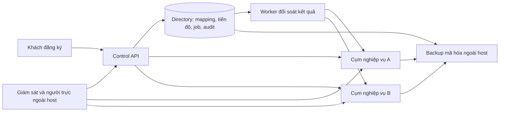

# RoomQC — kế hoạch hành động và nghiệm thu toàn bộ VPS + signup

**Checkpoint triển khai hiện hành — rotation 29/10/2026:** backend310 tệp, SHA256 `314c1ec4b68fec86b5cf49aedf6d328555e4545f7d934520989b362fca74cb4a`;585 business+19 directory. [Daemon/journal và DB ready-head fence](roomqc-setup-rotation-local-2026-10-29.md) có14 kiểm native (8 rotation),18 process UID10001/CapEff0, kill/replay/overlap/expiry/revoke; unit509 pass/184 skip/0 fail. Run1c06a184f980 exit0, source/schema không đổi, cleanup0. Phạm vi entrypoint `--once`; chưa periodic daemon lâu/SIGTERM, full race/fault matrix, runtime container read-only mount/reload hoặc actor revoke xuyên hai DB. [Runbook mới](roomqc-setup-credential-rotation-runbook.md). Tiếp BG02 phần còn thiếu; BG06 phải khóa candidate mới. Các checkpoint301 phía dưới giữ lịch sử, không phải nguồn hiện hành. Không đổi70ca/124lượt/122mục, reviewer/signoff/gates.

**Checkpoint local trước — 29/10/2026:** backend301 tệp, SHA256 `2ec50f6dd1e473a45a54636594d6fd59451c452eb1f5d0f1a375bd1795b371d0`. [Runtime kiểm khóa live trước nhận việc](roomqc-setup-runtime-readiness-local-2026-10-29.md) đã sửa lỗi file còn hạn nhưng khóa đã revoke vẫn vượt readiness. Native run39f0f08155b0 đạt38 kiểm (22 worker,8 backfill,8 apply), source/schema không đổi và cleanup0; unit495 pass/184 skip/0 fail. Đây là diagnostic local; chưa daemon rotation, runtime UID/mount read-only hoặc thu hồi quyền nguyên tử xuyên hai database.

**Nhận tiếp BG02:** scheduler/journal, hai rotator và overlap/expiry khi daemon chết; container runtime chỉ mount output read-only; chốt điểm hiệu lực Auth→directory. R4 là [snapshot kế hoạch](../../../artifacts/roomqc-vps-signup-execution-plan-audit-r4-2026-10-29.json) của source301/ede96e trước sửa runtime, verifier r4 phải từ chối nguồn mới; giữ nguyên lịch sử, không nới pin. Các packet rebuild/filesystem/restore phía dưới có phạm vi nguồn riêng. Giữ8đợt/25task/27gói/70ca/124lượt,70ca not_run/122mục unverified, reviewer/signoff/gates chưa đổi.

**Checkpoint local lịch sử — timeout bộ cài:** [Báo cáo deadline](roomqc-setup-installer-deadlines-local-2026-10-28.md), [bảng triển khai](roomqc-vps-signup-implementation-board-2026-10-28.md). Backend291 files/hash `bb21bef86c200d3d09c950b11c96417710bb9a9a47af7af0d3a0200caec2a367`;584+19 migrations. Focused100/100, native362/362 và control673 tổng/671 pass/0 fail/2 skip; terminal0, cùng source/schema tương ứng, cleanup0. IF11 có SQLSTATE thật, witness rollback, deadline45giây và13 lần kiểm session/mutex. IF01–IF11,IF13,IF16,IF17 có local proof đúng scope; tiếp IF12/IF14/IF15 rồi rotation/mount/Auth→directory. Lần1/T08/T12,70ca/124lượt/122mục,reviewer và gates vẫn mở.

**Checkpoint đã kiểm trước nháp timeout:** [Báo cáo mới](roomqc-setup-installer-transactions-local-2026-10-28.md), [bảng triển khai](roomqc-vps-signup-implementation-board-2026-10-28.md). Backend289 files/hash `6802f300c3c4232e8e649f039aaf5be285da92f8b0a2116c0308318de3c16e14`;584+19 migrations. Focused75/75, native337/337 và control673 tổng/671 pass/0 fail/2 skip; terminal0, cùng source/schema tương ứng, cleanup0. IF10 đã có thu hồi khóa qua LOGIN API thật; IF16 có witness mutation→rollback và replay cùng key. Các nhóm IF01–IF10,IF13,IF16,IF17 có local proof đúng scope; còn IF11/IF12/IF14/IF15 rồi rotation/mount/revoke xuyên hệ thống. Lần1/T08/T12,70ca/124lượt/122mục,reviewer và gates vẫn mở.

**Checkpoint trước — preflight/quyền/fences local:** [Báo cáo fences](roomqc-setup-installer-fences-local-2026-10-28.md), [bảng triển khai](roomqc-vps-signup-implementation-board-2026-10-28.md). Backend288 files/hash `3ddefd9ddc068cbf097331f3f708fee790e7b5bfe27075148f450bd8681d7b22`;584+19 migrations. Focused66/66 và control673 tổng/671 pass/0 fail/2 skip, terminal0/cùng source/cleanup0. [Native328/328](../../../artifacts/roomqc-setup-installer-fences-native-51f2a15b16c2-local-2026-10-28.json) gồm66 installer controls, terminal0/source/schema/cleanup0. IF01–IF09,IF13,IF17 có proof local; IF10 còn key withdrawal, IF11/IF12/IF14/IF15/IF16 chưa khép, rồi rotation/mount/revoke xuyên hệ thống. Lần1/T08/T12,70ca/124lượt/122mục,reviewer và gates giữ mở.

**Checkpoint trước — IF01–IF05 có proof local:** [Báo cáo fault](roomqc-setup-installer-faults-local-2026-10-28.md), [bảng triển khai](roomqc-vps-signup-implementation-board-2026-10-28.md). Backend287 files/hash `1f576b109c6c5665a2dec4e4e0aa06e818a246a872c384b1b226d84eadc612dc`;584+19 migrations. Native289/289 gồm27 installer controls, control673 tổng/671 pass/0 fail/2 skip; terminal0, cùng source/end-source/schema/cleanup0. Đã kiểm bind/issue/revoke mất phản hồi, caller/key/body conflict, hai CLI và SIGKILL trước/sau commit. Còn IF06–IF17 rồi rotation/mount/revoke xuyên hệ thống; chưa đóng lần1/T08/T12, nghiệm thu70ca/124lượt/122mục và gates vẫn mở.

**Checkpoint đã kiểm trước đợt fault:** [Báo cáo và giới hạn](roomqc-setup-credential-installer-local-2026-10-28.md), [bảng triển khai 11 lần bàn giao](roomqc-vps-signup-implementation-board-2026-10-28.md). Backend287 files/hash `7b7fb7ddd8f126875160323e409e441d855646b61788abb7189ea7972a3f4224`,584+19 migrations; native278/278 gồm16 installer CLI mới, control672 tổng/670 pass/0 fail/2 skip; terminal0, cùng source, cleanup0. Lần1 chưa đóng: còn fault matrix toàn tuyến; lần2 rotation/mount reload/thu hồi Auth→directory chưa kiểm. Phạm vi toàn VPS+signup, đầu ra Plan+nghiệm thu;70ca/124lượt/122mục,reviewer,gates và goal tổng thể giữ mở.

**Checkpoint lịch sử — publisher trước installer:** [publisher local](roomqc-setup-publication-local-2026-10-28.md) đạt262/262 controls, gồm18 publication mới với4 publisher SIGKILL/resume; credential/status/attestation/publication tổng78. Control663 tổng/661 pass/0 fail/2 skip;583+18 migrations, source281 files/hash33d8482f5c9e784d8d54cfce29ebf33a0f0d47ab66e6df9f993c074a7afcf7d9, cleanup0. Receipt/status được đọc lại qua DB, private intent/stage/fsync/rename và native RPC đã kiểm; authority callback vẫn fixture. Chưa có operational installer/DB identity/target/budget/live directory authority/rotation hoặc mount reload thật. Nhận cấu hình/preflight và issue→publisher→rotation, rồi cross-system revoke/T10/signup/console/default-full/rebuild/VPS/DR/E2E/tải/RC/pilot.70ca/122mục/124lượt/reviewer/gates giữ nguyên.

**Checkpoint trước — fingerprint v3 và trạng thái khóa:** [catalog/readiness local](roomqc-setup-attestation-status-local-2026-10-28.md) đạt244/244 controls, gồm60 credential/status/attestation (25 mới), giữ184 API/worker/CLI;9 drift catalog thật đều bị verifier chặn,2 SQL-writer SIGKILL/2 barrier. Control658 tổng/656 pass/0 fail/2 skip;583+18 migrations,source277 files/hash894abdb63eaac8c45e2ec852773fd5c824f22908ceff1f35c40d159d601ac1f8,cleanup0. Upgrade582/583 rollback đạt; fingerprint v3 phủ2 schema phục hồi và capability graph, manifest v1/v2 bị từ chối. Status đọc hiện hành, không lấy receipt làm readiness; admin schema không expose REST. Advisor808/247WARN chưa disposition. Nhận installer/DB identity/target/budget/signer/file/refresh→cross-system revoke→T10/signup/console→default-full/rebuild→VPS/DR/E2E/tải/RC/pilot.70ca/122mục/124lượt/reviewer/gates giữ nguyên.

**Checkpoint trước — lệnh quản lý khóa phục hồi:** [giao thức và bằng chứng local](roomqc-setup-credential-command-local-2026-10-28.md) đạt219/219 controls, gồm35 mới với2 SQL-writer SIGKILL và2 barrier; giữ184 API/worker/CLI nền. Control656 tổng/654 pass/0 fail/2 skip;581+18 migrations, source277 files/hashafbb17c9eb867af6d77e58d73bcaaf5ffc3bdafd75963d3186d513806154edb9, cleanup0. Upgrade581 dùng phiên bảo trì riêng, rollback schema/role/history đạt. Advisor đo lại808 findings/247 WARN, chưa disposition. Đây là giao thức DB, chưa installer/file publication/lịch thay khóa. Fingerprint v2 tại checkpoint này chưa phủ roomqc_setup/roomqc_setup_admin; nhận attestation→installer/rotation và cross-system revoke→T10/signup/console→default-full/rebuild→VPS/DR/E2E/tải/RC/pilot.70ca/122mục/124lượt/reviewer/gates giữ nguyên.

**Checkpoint trước — CLI với biên nhận native:** [reader/writer, signed batch và phục hồi tiến trình](roomqc-setup-cli-native-local-2026-10-28.md) đạt184/184 controls, gồm16 CLI mới (3 barrier),45 API/process và123 nền; cùng source276 files/hash592e36737b8f89b8e7b905716f00210569c855b75b32534c68324518c60f4d39. Control656 tổng/654 pass/0 fail/2 skip;580+18 migrations,cleanup0. CLI có biên nhận PostgREST thật, lost-response sau commit và SIGKILL; Auth confirmed/health/release/batch-review vẫn fixtures. Nhận installer/rotation/maintenance và revoke semantics→T10/quotas→signup/email/console delta→default-full/rebuild→staging/DR/E2E/tải/RC/pilot.70ca/122mục/124lượt/reviewer/gates giữ nguyên.

**Checkpoint trước — tích hợp API/Auth/process local:** [đăng ký→recheck→worker với Auth thật](roomqc-setup-api-native-local-2026-10-28.md) đạt168/168 controls, gồm45 API/process và28 barrier mới,10 SIGKILL (7API/3worker), TCP lost-response sau commit và live session revoke khi chờ directory lock. Control656 tổng/654 pass/0 fail/2 skip; cùng source274 files/hash98387288f1cc901146c430c3b7728f4acc7c0a09ec0ed5dc85a9ca5bb341d844;580+18 migrations,cleanup0. Auth accounts confirmed/health/release vẫn fixtures; chưa public email signup, native CLI toàn tuyến, default-full/rebuild, browser/Android hoặc VPS. Nhận native CLI→installer/revoke/T10→candidate/default/rebuild→staging/DR/E2E/tải/RC/pilot.70ca/122mục/124lượt/reviewer/gates giữ nguyên.

**Checkpoint trước — recheck local:** [API/contract/UI/journal và proof](roomqc-workspace-recheck-local-2026-10-28.md) có migration18, replay trước CAS, detail snapshot nhất quán, một recovery cycle/dispatch (3 attempts/15 phút), giữ job history/lease và sửa late owner settle. Control656 tổng/654 pass/0 fail/2 skip; frontend66/66 + TS/lint; native nền580+18 migration/123 controls; backend272 files/cleanup0. Native chưa kiểm platform recheck/live Auth; client dùng jsdom/Capacitor mock. Nhận public API→worker→remote thật/process faults, native CLI toàn tuyến, installer/T10/full-default/rebuild/VPS/DR/E2E/tải/RC/pilot. Chưa bật runtime hoặc ký T12;70ca/122mục/124lượt/gates giữ nguyên.

**Điểm đọc tổng hợp sau xác nhận phạm vi:** [plan toàn VPS + signup](roomqc-vps-signup-master-plan-2026-10-28.md) và [hồ sơ nghiệm thu](roomqc-vps-signup-master-acceptance-2026-10-28.md). Có đủ 25 task/dependency/đầu ra/đường demo, 70 ca/124 lượt và backlog cần quyền. Recheck đã có proof local riêng ở checkpoint trên; CLI bên dưới giữ lịch sử đúng source, không thay live Auth/process/E2E.

**Checkpoint trước — CLI apply theo lô:** [writer/manifest/process recovery local](roomqc-setup-backfill-cli-local-2026-10-28.md) có signed batch đúng report/target/allowlist, writer budget/pool1, Windows ACL/POSIX files, output exclusive/fsync và actual CLI SIGKILL/post-commit response-loss/resume. Control640 tổng/638 pass/0 fail/2 skip; native580+17 migration/123 controls; Linux container14/14; source268 file/cleanup0. Nhận durable recheck4.4 rồi public API/worker fault/E2E, installer/T10/default-full/rebuild/VPS theo plan. Chưa apply dữ liệu vận hành hoặc bật worker/dispatch;70ca/122mục/gates giữ nguyên.

**Checkpoint trước — lõi apply backfill:** [ghi đối soát local](roomqc-setup-backfill-apply-local-2026-10-28.md) có directory 0017, role riêng, hai RPC, journal/CAS/audit/final expiry và terminal reconciliation. Control 634 tổng/632 pass/0 fail/2 skip; native 580+17 migration/123 controls, gồm 8 apply mới; source 261 file, cleanup0. Nhận config/CLI writer, approved batch manifest và process interruption/resume ở4.3, rồi durable recheck4.4. Chưa apply dữ liệu vận hành hoặc bật worker/dispatch;70 ca/122 mục/gates giữ nguyên.

**Phiếu vào việc theo phạm vi đã xác nhận:** [triển khai toàn bộ VPS + signup](roomqc-vps-signup-start-pack-2026-10-28.md) gom 25 task vào tám đợt, tách hiện trạng khỏi nghiệm thu, và chi tiết hai lần bàn giao kế tiếp: backfill apply rồi durable recheck. Có đầu vào/file/transaction/quyền, ma trận fault/race, hồ sơ nhận và điều kiện chuyển local → staging → pilot → public. [Ma trận 124 lượt môi trường](../../../artifacts/roomqc-vps-signup-acceptance-execution-plan-2026-10-28.json) giữ nguyên expected và trạng thái gốc.

**Checkpoint trước — upgrade và dry-run backfill:** [đọc đối soát local](roomqc-setup-backfill-local-2026-10-28.md) có reader0016/scanner/config/CLI; upgrade0014→0015 có dữ liệu, hai migrator và giữ lease/attempt/deadline/history. Control620 tổng/618 pass/0 fail/2 skip; native580+16/115 controls gồm8 backfill+17 worker, source257 file/cleanup0. Chưa apply hoặc durable recheck; nhận apply4.3 với migration tiếp theo0017 nếu cần, rồi4.4. Installer/T10/full-default/rebuild/VPS/E2E/pilot còn mở;70 ca/122 mục/gates giữ nguyên.

**Checkpoint trước — worker:** [worker đối soát đăng ký local](roomqc-setup-worker-local-2026-10-28.md): directory migration0015, role riêng, DB-clock lease/fencing/atomic settle, runtime/config/budget và Compose opt-in. Control609 tổng/607 pass/0 fail/2 skip; native580+15 migration/107 controls,17 worker với directory+remote roles thật cùng run; source250 file/cleanup0. Nhận backfill/upgrade14→15 → durable recheck → process-kill/live control E2E; installer/T10 còn mở. Example replicas0, chưa bật production;70 ca/122 mục/gates giữ nguyên.

Chốt phạm vi theo trả lời của RoomQC: **toàn bộ VPS + signup / Plan + nghiệm thu**. Cập nhật ngày 28/10/2026, Asia/Bangkok. Đây là điểm nhận công việc sau checkpoint API T12; không thay ID, dependency, expected hoặc trạng thái của bộ nghiệm thu gốc.

**Checkpoint trước — credential/adapter:** [credential/adapter scoped](roomqc-setup-recovery-scoped-local-2026-10-28.md): native580 migration/90 controls/4 barrier protocol+2 credential, unit16/16, source240 file/cleanup0. Recovery chỉ2 application RPC, public/net không truy cập; JWT còn hạn bị chặn sau revoke và expiry giữa lúc ghi rollback journal. Mục4.1 đã có code/local proof; nhận worker4.2, installer/secret/T10 và backfill/recheck. Chưa cấp credential vận hành/bật worker hoặc nghiệm thu sản phẩm.

**Checkpoint trước:** [closure proof và quyền recovery](roomqc-setup-recovery-boundary-local-2026-10-28.md) đã sửa setup-status và thu hồi net privileges của recovery role. Native `fa013390f689`: 579 migration nghiệp vụ, 69/69 controls, 4 barrier, exit0; directory closure riêng: 579 test tổng/577 pass/0 fail/2 skip. Quyền nối tiếp/credential/worker vẫn mở; nhận tiếp mục4.1 bước2 và bước4–5 rồi4.2. Không giao lại phần closure proof đã có bằng chứng, giữ regression.

## 1. Kết quả cần bàn giao

Khách đăng ký tại roomqc.com, xác minh email, nhập khách sạn, xem tiến độ rồi sử dụng web/Android. RoomQC lo VPS, dữ liệu, gói sử dụng, sao lưu, giám sát và hỗ trợ. Khách không phải cài Docker hoặc thuê VPS.

RoomQC chuẩn bị cụm trước; nhiều workspace được phân vào từng cụm có giới hạn. Một workspace có thể có nhiều khách sạn theo gói. Khách đang dùng giữ nguyên cụm khi cụm đầy hoặc lỗi; chuyển dữ liệu sang cụm khác cần quy trình riêng. Chưa có cơ sở hứa một VPS phục vụ 1.000 khách sạn hoặc 100.000 người hoạt động đồng thời.



Sơ đồ là kiến trúc cần nghiệm thu; chưa xác nhận đã triển khai hai cụm VPS. Worker đối soát được đọc receipt và đóng lần gửi theo giao thức; không tạo tenant/hotel mới thay owner.

Nguồn chuẩn: [25 phiếu kỹ thuật](roomqc-vps-signup-detailed-delivery-2026-10-26.md), [dependency và 27 gói](../../../artifacts/roomqc-vps-signup-delivery-ledger-2026-10-21.json), [worksheet 70 ca](roomqc-vps-signup-acceptance-worksheet-2026-10-22.md), [quy trình ghi bằng chứng](roomqc-vps-signup-acceptance-protocol-2026-10-21.md). Tài liệu này chốt **phần còn lại và cách nhận**, không mở bộ task mới.

## 2. Điểm xuất phát đã kiểm tra

| Phần | Bằng chứng hiện có | Giới hạn phải giữ khi triển khai |
|---|---|---|
| Protocol cấp phát T12 | [52/52 controls, 4 barrier thật](roomqc-setup-dispatch-local-2026-10-28.md), Auth/PostgREST/PostgreSQL riêng, 578 migrations | Chưa chứng minh worker, quyền gián tiếp hoặc một hành trình tích hợp toàn tuyến |
| Dispatch/job/API T12 | [Run 5de3cffd4d60](roomqc-setup-dispatch-api-local-2026-10-28.md): 25/25 backend, 13/13 PostgreSQL, 43/43 frontend; hồi quy directory 576 pass, 0 fail, 2 skip | Auth/remote adapters là doubles; jsdom chưa thay browser/Android; cờ tạo dispatch mặc định false |
| Tiến độ T11 | [API/client/onboarding local](roomqc-setup-status-local-2026-10-28.md) đã có owner-only, no-store, hủy phản hồi cũ | Intent/resume thực, live Auth và UI trên thiết bị còn thiếu |
| Closure proof và ACL T11/T12 | [Checkpoint](roomqc-setup-recovery-boundary-local-2026-10-28.md): setup-status cần closed dispatch khớp identity; net recovery86→0, 3.045 mục kiểm quyền role khác giữ hash | Catalog reviewedSafe=false, 199 advisor WARN còn disposition; installer phiên owner extension và quyền gián tiếp còn mở. Credential/revocation và worker có packet riêng bên dưới |
| Credential/adapter T12 | [Scoped recovery local](roomqc-setup-recovery-scoped-local-2026-10-28.md):580 migration/90 controls, revoke JWT còn hạn và final expiry rollback, chỉ2 RPC | Installer/secret target thật, full-default/rebuild và live control E2E chưa khép; catalog reviewedSafe=false |
| Worker directory/runtime T12 | [Worker local](roomqc-setup-worker-local-2026-10-28.md):607 control pass/0 fail/2 skip, native107/107 gồm17 worker controls,580+15 migrations | Seed directory bằng SQL, approval fixture; còn apply backfill, durable recheck, SIGKILL thật và public control API/browser/Android. Upgrade14→15/reader có proof kế tiếp bên dưới; chưa bật worker vận hành |
| Upgrade và đọc backfill T02/T12 | [Reader/upgrade local](roomqc-setup-backfill-local-2026-10-28.md):618 control pass/0 fail/2 skip, native115/115,580+16 migrations; upgrade14→15 có dữ liệu/concurrent migrator | Lõi apply và CLI writer/signed manifest/process recovery có proof kế tiếp bên dưới; giữ role đọc riêng, chưa apply vận hành |
| T10 tài nguyên | Đã có [plan](roomqc-resource-deployment-plan-local-2026-10-28.md), [runtime native](roomqc-resource-deployment-runtime-local-2026-10-28.md), [đích DB](roomqc-resource-database-local-2026-10-28.md), [Auth/PostgREST](roomqc-resource-vendor-local-2026-10-28.md) có phạm vi local | Vendor còn lại, consumer DSN binding, worker thực, rolling overlap, RAM/IO/fairness/quota/tải chưa khép |
| Lõi apply T02/T12 | [Apply local](roomqc-setup-backfill-apply-local-2026-10-28.md):632 control pass/0 fail/2 skip, native123/123,580+17 migrations | CLI/config/signed manifest/process resume có proof tiếp bên dưới; chưa durable recheck hoặc vận hành |
| CLI apply T02/T12 | [CLI local](roomqc-setup-backfill-cli-local-2026-10-28.md):638 control pass/0 fail/2 skip; native123/123; Linux14/14; SIGKILL/response-loss/rerun | Remote của CLI là HTTP fixture; chưa native CLI toàn tuyến/public signup API, durable recheck hoặc vận hành |
| Hai console | [Trang đọc](roomqc-control-admin-consoles-local-2026-10-28.md), [cảnh báo](roomqc-control-alert-ui-local-2026-10-28.md), [năm lệnh cụm](roomqc-control-cluster-commands-local-2026-10-28.md) đã nối local | Tenant-summary, durable recheck, backups, totals, cấu hình nâng cao và live E2E chưa đủ |
| Nền nghiệp vụ | Policy/authority và nhiều writer có packet riêng; parent-boundary sau sửa có diagnostic đạt | Q02 writer graph, Q03 engine/dispatcher tổng quát, indirect privilege/advisors và client/device delta còn mở; [full run cũ lỗi](roomqc-q04-full-backend-failure-local-2026-10-28.md) không được tính là đạt |
| Release | 8 đợt, 25 task, 27 gói, 70 ca đã định nghĩa | **70 ca not_run, 122 mục release unverified**; chưa có gate, reviewer hoặc signoff mới |

578 là số migrations nghiệp vụ của protocol/API cũ; checkpoint net replay579, checkpoint scoped mới replay580 migration nghiệp vụ. 578 trong hồi quy API cũ là tổng số bài test, gồm 576 pass và 2 skip; closure run mới có 579 test tổng, gồm 577 pass và 2 skip. Số migration và số test không biểu thị cùng một loại bằng chứng. Hai skip Windows phải được chạy đúng môi trường: file symlink fixture và POSIX permissions cho notification.

## 3. Thứ tự thực hiện và trách nhiệm

| Đợt gốc | Task trong đợt | Phần cần khép và bản demo nhận bàn giao |
|---|---|---|
| 1 | T01,T02,T03,T04,T05,T06,T08 | Đóng delta inventory/authority/health/trust/nghiệp vụ; sau khi freeze candidate chạy full-native và dựng lại độc lập. Demo revoke, stale health, restart và mất response |
| 2 | T07 | Khép worker/secret/runtime và kênh nhận ngoài host. Demo dedupe, ack/reopen, restart và mất host |
| 3 | T09,T10 | Khép admission races, vendor/DSN/worker/resource budget và quota. Demo tranh suất cuối và quá tải có phục hồi |
| 4 | T11,T12,T13 | Khép worker đối soát, backfill/recheck, intent/resume, direct Auth gate, limiter và email. Demo đăng ký xuyên suốt qua các cửa sổ lỗi |
| 5 | T14,T15,T16,T17 | Khép API còn thiếu và hai console, quyền/Back/scroll/mobile. Demo tìm và xử lý đăng ký kẹt từ menu chính |
| 6 | T18,T19,T20 | Linux/TLS, backup ngoài host, restore host sạch và người trực. Demo host gốc mất nhưng dữ liệu vẫn phục hồi được |
| 7 | T21,T22,T23,T24 | A/B thật, browser/Android, tải/soak, RC/cutover/rollback. Demo cách ly và hành trình người dùng trên cùng candidate |
| 8 | T25 | Pilot ít nhất 7 ngày; báo cáo vận hành, lỗi, chi phí và quyết định mở rộng |

Dependency gốc giữ tại [bảng T01–T25](roomqc-vps-signup-plan-current-2026-10-26.md#5-phiếu-giao-t01t25-và-đầu-ra-bắt-buộc). Đợt là nhóm bàn giao, không phải giấy phép bỏ qua dependency. Có thể chuẩn bị T12 trên fixture khi T10 chưa khép, nhưng chưa ký T11/T12, bật worker thật hoặc mở signup dựa vào proof đó. T14 có thể chuẩn bị khi T03/T04 đủ đầu vào; T18 khi T06/T08 đủ đầu vào.

BE phụ trách backend/database, FE phụ trách web/Android, OPS phụ trách hạ tầng/vận hành, QA kiểm và review, RQ quyết định sản phẩm/phát hành. Đây là vai trò, chưa gán tên người hoặc ký thay. Người thực hiện ghi tên và source khi nhận phiếu; người review xác nhận expected/actual khi giao.

**Đầu việc lập trình nhận ngay:** nối bộ cài cấp/thay khóa theo [phiếu T08 hiện hành](roomqc-vps-signup-master-plan-2026-10-28.md#phiếu-nhận-tiếp-t08-cấp-và-thay-khóa-phục-hồi-đăng-ký): strict config/DB identity/approved target/budget/live authority → issue/receipt → publisher đã có → rotation và mount reload thật. Sau đó khép hiệu lực revoke Auth→directory và T10 ở mục5. Lõi backfill, CLI native, durable recheck và API/worker/Auth/process core đã có proof local; mục4.3–4.5 dùng làm hồi quy. Public signup/email/browser, default-full/rebuild và VPS vẫn mở. Không chạy lại diagnostic xanh nếu không có source đổi, lỗi mới hoặc nghi vấn cụ thể. Q02/Q03 và full Q04 còn trong phạm vi đợt1.

## 4. Gói nhận trước: T12 phục hồi đăng ký và T11 tiến độ

### 4.1. Kiểm đủ quyền gián tiếp trước khi cấp credential worker

**Đã có code/local proof bổ sung:** [credential và adapter scoped](roomqc-setup-recovery-scoped-local-2026-10-28.md) đã tạo private authority/credential, hai wrapper roomqc_setup và adapter riêng; role không còn public/net USAGE. Public70 mục kiểm role khác giữ hash; hai rehearsal rollback đạt. Native90/90 và unit16/16; expiry/rotation/revocation tại DB đã kiểm thực. [Worker/runtime local](roomqc-setup-worker-local-2026-10-28.md) tiếp đó đã có ở4.2. Installer ký/cấp secret, Windows ACL và target release vận hành vẫn chưa có bằng chứng; chưa bật thật.

**Đầu vào:** migration `20261027234130_workspace_setup_dispatch_fences.sql`, role `roomqc_setup_recovery`, `scripts/control-backend-setup-dispatch-checks.mjs`, pinned gateway/Auth/REST config. 229 relation không có table/column grant chưa chứng minh chỉ có hai function callable.

**Đã làm:** inventory ordinary functions trên toàn schema và sửa PUBLIC-derived net grants bằng migration `20261028010321_setup_recovery_net_privilege_boundary.sql`. Native69/69, net recovery86→0 và 3.045 mục kiểm quyền role khác giữ hash; xem [checkpoint](roomqc-setup-recovery-boundary-local-2026-10-28.md). Migration net cần owner extension riêng, role migration nghiệp vụ bị từ chối; installer/VPS phải nối và kiểm phiên bảo trì này, không nâng quyền runtime. Catalog vẫn reviewedSafe=false: còn disposition nối tiếp/aggregate/dynamic/REST và advisor. Role mới/extension upgrade cần cấp net grants rõ ràng và audit lại.

1. Trên fixture replay đủ migration, xuất inventory đã lọc của mọi schema/function mà role có USAGE+EXECUTE thực tế, gồm quyền PUBLIC, default privileges, role membership và SECURITY DEFINER. Ghi signature, owner, security mode và hash definition; không xuất raw body hoặc secret vào hồ sơ chung.
2. Rà đường gọi nối tiếp tới function/trigger/view và dữ liệu đọc/ghi. So với gateway exposed schemas và endpoint thực tế; kiểm bằng credential worker thật. Không kết luận chỉ từ GRANT trực tiếp hoặc NOINHERIT: PUBLIC vẫn có hiệu lực.
3. Chốt allowlist recovery và disposition cho từng đường reachable. Chỉ cho đọc receipt tối thiểu/đóng dispatch đúng contract; mọi đường tạo business data, thay quyền hoặc đọc nhạy cảm không cần thiết phải bị chặn có bằng chứng. Nếu phải sửa ACL, thêm migration mới bằng CLI sau khi review ảnh hưởng positive cho signup/invite/khách cũ; không sửa 578 migration đã ghi nhận.
4. Adapter riêng đã có ở setup-recovery.mjs và proof native; giữ kiểm target/release/hash, timeout/no redirect/response identity/no fallback khi nối worker. Chỉ cấp credential vận hành sau review phần còn thiếu và target readiness.
5. DB expiry/rotation overlap/revocation và loader reload mỗi request đã có local proof. Còn installer cấp file ngoài repo, UID/GID/Windows ACL, signing-key custody và target rotation/revocation drill. Mỗi thay đổi credential phải có negative và recovery; không ghi bearer/DSN/raw provider errors trong log.

**Nhận khi:** positive close/read đúng identity đạt; register/provision/table/column/cross-cluster/expired-revoked credential bị từ chối, snapshot nghiệp vụ không đổi. Cho phép tác động tombstone theo protocol; không coi remote close là thao tác thuần đọc. Advisor WARN phải có disposition theo object, gồm các mục liên quan recovery role; không đổi WARN thành đã xử lý bằng một test khác.

**Dừng:** còn callable surface chưa phân loại hoặc credential có đường cấp business data thì chưa phát credential vận hành/chưa bật worker. Tiếp tục test trong fixture và xử lý allowlist.

### 4.2. Store và worker đối soát, có lease/fencing

**Code/local proof đã có:** [worker, store và runtime](roomqc-setup-worker-local-2026-10-28.md) có13/13 ca PostgreSQL,11/11 unit và17 controls worker với directory/recovery role thật cùng run. Toàn control607 pass/0 fail/2 skip; native107 controls/580+15 migration, source250 file/cleanup0. Giữ regression các bước1–5 dưới đây; còn SIGKILL thật đủ cửa sổ, upgrade/backfill job cũ, durable recheck, public control API/browser/Android/staging và installer/T10 trước bật thật. Chưa ký cả T12.

**File có sẵn:** `server/control/setup-dispatch.mjs`, `store.mjs`, `provisioning.mjs`, `server/control/migrations/0014-setup-dispatch-journal.sql`. **Đầu ra đã có code/local:** setup-worker-store.mjs, workers/setup-worker.mjs, setup-config.mjs, setup-runtime.mjs, directory0015 và resource adapter; xem checkpoint worker. Tên RPC đã chốt và được kiểm bằng role riêng. Tham khảo pattern alert worker, không tái sử dụng quyền API rộng cho recovery.

1. Chốt transition matrix job/dispatch và role directory riêng. Claim batch hữu hạn bằng DB clock, lease token và deadline; không giữ transaction trong lúc gọi network. Document thứ tự khóa workspace → job → dispatch cho settle; claim không tạo đường khóa ngược job → workspace.
2. Worker chỉ xử lý identity đã lưu. `busy` hoặc cluster unavailable → retry có backoff/jitter; thiếu receipt chưa đủ đóng → tiếp tục đối soát; proof closed → waiting_owner; matching committed → activate workspace + settle job + journal + audit cùng transaction.
3. Revalidate lease/token/time, owner, cluster/routing version và identity ngay trong transaction cuối. Token hết hạn, worker cũ hoặc response đồng bộ API đến muộn không được ghi đè người đang giữ lease.
4. Mọi batch/concurrency/pool/attempt/backoff/deadline có giới hạn trong config và budget. Hết attempts chuyển trạng thái cần hỗ trợ, giữ lịch sử và đường recheck; không tự mở dispatch mới hoặc reset trial.
5. Graceful shutdown dừng claim mới, giới hạn thời gian chờ in-flight; crash để lease hết hạn rồi worker khác tiếp quản. Không xóa job để chữa kẹt.

| Thử lỗi bắt buộc | Expected và bằng chứng |
|---|---|
| API chết sau directory commit, trước remote call | Worker đóng dispatch chưa commit; owner được nhập lại chỉ sau proof closed; không tự cấp hotel |
| Remote commit nhưng mất response | Worker đọc cùng receipt, active một lần; tenant/hotel/trial/receipt count không tăng |
| Kill worker sau claim / sau receipt / trước settle | Worker kế tiếp tiếp quản; kết quả bền vững; không mất job hoặc tạo nghiệp vụ |
| Hai worker tranh job, stale lease/token và đổi owner/routing trong khi chờ | Chỉ holder hợp lệ settle; denial không làm đổi data/audit terminal |
| Fault audit/receipt/journal update | Transaction cuối rollback toàn bộ; retry lấy lại cùng identity |
| RPC bận, timeout, response sai identity/hash hoặc terminal xung đột | Bận không thành closed; retry hoặc needs_review đúng lý do; không activate sai |

**Nhận khi:** native directory role và remote recovery role thật cùng run; barrier tại cửa sổ tranh chấp, DB snapshot độc lập, terminal exit và cleanup ownership đầy đủ. D07–D11/A07 vẫn cần đủ môi trường trong worksheet trước ký.

### 4.3. Đóng khoảng hở tiến độ và backfill dữ liệu cũ

Phần closure evidence đã sửa: `setupStatusSnapshot` đưa proof khớp identity vào read model; `setup-status.mjs` chỉ cho tiếp tục khi boolean `closureVerified=true`. [Directory closure run](../../../artifacts/roomqc-setup-status-closure-2127028d47a2-local-2026-10-28.json) có positive/legacy/owner/cluster/routing negatives, GET snapshot read-only và race. Bước1–2 giữ làm regression và phần frontend/live còn thiếu. [Reader/upgrade/dry-run](roomqc-setup-backfill-local-2026-10-28.md) và [lõi apply0017](roomqc-setup-backfill-apply-local-2026-10-28.md) đã có local proof. Bước4–5 đã có [writer config/CLI/signed batch và interruption/resume local](roomqc-setup-backfill-cli-local-2026-10-28.md). CLI dry-run vẫn chỉ đọc; CLI apply riêng. Chưa apply vận hành hoặc chạy toàn CLI qua native remote/public signup API. Nhận durable recheck4.4.

1. Đọc dispatch terminal evidence đúng identity cùng snapshot job/workspace. Chỉ `closed` bất biến mới trả nextAction=continue_setup; job waiting_owner thiếu/sai proof giữ needs_review/chờ đối soát.
2. Thêm PG+HTTP và frontend negatives cho job state giả, legacy thiếu dispatch, committed khác binding, stale response sau đổi actor/cluster. GET tiến độ giữ read-only/no-store, không tự provision hoặc close.
3. Backfill bắt đầu bằng dry-run: thống kê active hợp lệ, committed chưa activate, dispatch pending, closed, legacy unknown, conflict và unavailable. Report chỉ ID/count/lý do; không raw owner data.
4. Apply từng batch có expected version, lock order và audit; idempotent khi chạy lại. Không suy luận “không tìm thấy” thành chưa từng cấp dữ liệu; legacy unknown giữ manual review đến khi có proof an toàn.
5. Demo dry-run→apply→rerun trên dataset mixed-state có job đang leased và late response; count khớp, trial/receipt/objects không bị viết lại.

**Phiếu triển khai có thể nhận ngay — BE/OPS làm, QA review:**

| Thứ tự | File/đầu ra dự kiến | Việc phải hoàn thành trước khi nhận bước sau |
|---|---|---|
| 1. Upgrade có dữ liệu — đã có local proof | Mở rộng `server/control/setup-worker-cases.mjs` và đăng ký tại `directory-db.test.mjs` | Dựng directory tới0014 bằng migrator hiện hành; seed queued/retry/leased/succeeded/waiting_owner/needs_review, có và thiếu dispatch. Ghi baseline rồi migrate0015; không sửa0014/0015 để làm test xanh |
| 2. Bộ phân loại thuần — đã có local proof | `server/control/setup-backfill.mjs` | Đầu vào snapshot directory + receipt tối thiểu đã kiểm; đầu ra một nhóm duy nhất, reason code cố định và hành động cho phép. Không gọi mạng hoặc ghi DB trong classifier |
| 3. Dry-run CLI — đã có code/local proof ở core | `scripts/control-setup-backfill.mjs` | Mặc định chỉ đọc; target allowlist, cursor ổn định, batch tối đa100, concurrency tối đa2, deadline mỗi RPC5s. Report version/source/target fingerprint/cursor/count/ID/reason/proposed action; không ghi email, owner input, bearer, DSN hoặc full receipt |
| 4. Apply có kiểm soát | Store/RPC0017 đã có local proof; nhận config/CLI/batch manifest riêng | Apply nhận exact target + hash report + danh sách ID/batch đã review. Đọc lại và so state fingerprint trong transaction; lệch thì skip stale, không sửa báo cáo cũ. Ghi audit và enqueue/no-op atomic; không giữ khóa khi gọi mạng |
| 5. Fault và rerun | Test PG/HTTP/native, packet và runbook | Dry-run không effects; apply từng batch; kill/resume; rerun không tạo thêm job/audit terminal; kiểm độc lập before/after, kết thúc tiến trình và cleanup đúng ownership |

Classifier/scanner/config/CLI và fixture upgrade đã có code; xem packet và runbook reader. Store/RPC apply0017 đã có code/local proof bằng role riêng và remote receipt thật; config/CLI/batch manifest/process resume đã có local proof. Native vẫn gọi scanner/applier trực tiếp; toàn CLI với file/config/output trên backend native thật còn cần kiểm, không ghép proof HTTP fixture thành public API E2E. Directory dùng migrator tuần tự riêng; giữ0001–0017, migration mới lấy số tiếp theo thực tế lúc triển khai. Migration nghiệp vụ Supabase là lịch sử khác; chỉ thêm khi thực sự cần, bằng CLI đúng phiên bản. Không ghi đè history/checksum của580 migration nghiệp vụ hoặc17 migration directory đã kiểm.

**Ma trận phân loại và tác động được phép:**

| Nhóm | Điều kiện phải chứng minh | Apply được phép |
|---|---|---|
| active hợp lệ | Mapping và receipt khớp owner/workspace/tenant/hotel/cụm; không có conflict | No-op, giữ trial và trạng thái gói hiện có; không tự chuyển suspended/expired thành active |
| committed chưa activate | Có dispatch và proof committed khớp toàn identity/hash; routing/approval còn hợp lệ | Enqueue đối soát cùng dispatch hoặc dùng đường settle đã fence; không gọi provision |
| dispatch pending | Identity đủ, terminal chưa rõ | Enqueue/reuse job đủ điều kiện; worker mới được close/read theo protocol sau claim |
| closed | Terminal proof closed bất biến, khớp identity; chưa có committed trái ngược | Đối soát để waiting_owner; chỉ owner tiếp tục bằng luồng đã kiểm, công cụ không tạo dispatch thay owner |
| legacy unknown | Thiếu dispatch/receipt hoặc không đủ chứng cứ liên kết | Report/manual review; không suy luận từ email/tên khách sạn, không dựng identity/hash giả để adopt |
| conflict | Owner/routing/cluster/tenant/hotel/hash hoặc terminal không khớp | needs_review có audit nếu được review; giữ mapping và toàn bộ dữ liệu nghiệp vụ |
| unavailable | Timeout/cụm offline/credential thiếu hoặc hết hạn | Giữ trạng thái; report mã lỗi đã lọc, retry có giới hạn sau; không đổi thành missing/closed |

Dry-run chỉ dùng `receipt()` và SELECT đã scope, **không gọi `close()`** vì close có thể tạo tombstone từ xa. Receipt không tồn tại là thông tin chưa đủ: chỉ proof closed đúng protocol mới mở bước nhập lại. Payload thực được đọc tối thiểu trong process để so identity; báo cáo công khai chỉ có ID/lý do đã lọc. Fingerprint là SHA256 của snapshot canonical gồm workspace status/binding/routing/updated_at, job ID/state/attempt/token/deadline, dispatch ID/hash/terminal và release/credential binding; không xuất token hoặc nội dung snapshot. Fingerprint giúp phát hiện thay đổi, không thay xác thực quyền hoặc DB locks.

Thứ tự khóa apply là advisory727001 shared → command theo caller+key → workspace → job → dispatch → cluster; các entity dùng chung giữ thứ tự như worker. Job đang leased hợp lệ được để nguyên; apply không cướp lease hoặc reset attempts/deadline. Job terminal chỉ được mở lại qua command recheck đã được review, không cập nhật SQL tùy ý để chữa lỗi. Apply thiếu proof an toàn chỉ đánh dấu cần hỗ trợ, không activate dựa vào receipt tổng quát không gắn dispatch.

**Bộ dữ liệu upgrade bắt buộc:** có job dưới/trên24h, attempts0/8/>8 từ history0014, lease còn hạn/hết hạn, queued/retry/terminal, dispatch có/thiếu, owner/routing lệch. Sau0015, xác nhận deadline=created_at+24h cho job cũ, max_attempts=8, IDs/attempts/lease/trial/receipt/audit cũ giữ nguyên. Job đã quá deadline không được tự kéo dài; worker chuyển needs_review đúng lý do. Chạy migration rerun và hai migrator cạnh tranh, rồi crash/resume giữa hai batch. Snapshot dữ liệu nghiệp vụ không đổi ngoài journal/tombstone được cho phép trong giai đoạn worker apply; dry-run phải không có cả những tác động này.

**Bằng chứng nhận:** report dry-run + report apply/rerun cùng dataset; số lượng bảy nhóm khớp tổng inventory tại snapshot/cursor đã ghi; danh sách stale/busy/unavailable riêng; migration checksum/row diff; fault barriers; exit/cleanup; liên kết A04–A07,D07–D11. Chỉ đề nghị kết quả đúng môi trường vừa chạy. Chưa có fixture upgrade hoặc apply proof thì4.3 vẫn chưa hoàn tất.

### 4.4. Recheck quản trị và đường thao tác

**Trạng thái nhận:** [recheck local đã có code/proof](roomqc-workspace-recheck-local-2026-10-28.md), không còn giao draft như chưa làm. Bảng dưới là checklist thiết kế/hồi quy; native Auth cho route mới, process-kill và E2E thực còn mở. Rollback chỉ dùng binary đã chọn live/newest job tương thích nhiều job lịch sử sau migration18.

**Đầu vào hiện hành:** `setup-recheck.mjs`, directory migration0018, handler/store, admin contract/client và trang Đăng ký mới. Handler/DTO đã có draft nhưng chưa kiểm thử; OpenAPI vẫn planned, UI/journal/native write chưa nối. Xem [review source và trình tự nhận](roomqc-vps-signup-master-plan-2026-10-28.md). Không coi draft là chức năng đã bàn giao.

1. Contract trước: platform live authority, stable key, reason, expected version; trả job/command ID và cách đọc kết quả. Cùng key khác payload conflict; 202 chỉ là nhận việc.
2. Mutation+audit+job enqueue atomic, dedupe với live job đang chạy. Lần recheck chỉ đối soát, không impersonate owner hoặc gửi provision mới.
3. UI: Đăng ký mới → chi tiết → Kiểm tra lại → tiến độ/kết quả. Mất response/F5 dùng lại key và đọc kết quả; không sinh yêu cầu khác vì timeout. Ghi rõ bước khách cần làm tiếp.
4. Test revoke/logout trong lúc chờ; stale version/actor khác bị chặn. Hai operator click cùng lúc không tạo hai job. Không thể đọc kết quả của workspace khác.

**Nhận khi:** completion có DB/receipt proof và timeline; đường click dùng được ở desktop/390px/Android. Tenant-summary/totals thực hiện trong mục 7, cùng contract scoped.

**Khoảng hở ở review draft, nay đã khép local:** OpenAPI lúc đó đánh dấu route `planned`, dùng `ReasonCommand.expectedVersion`; workspace DTO chưa có fingerprint. Nay có schema riêng, snapshot và GET result cùng handler/client/HTTP proof. Không mặc định hai version là một. Bản triển khai phải bổ sung schema command riêng và snapshot guard; giữ route planned tới khi handler có proof. Không tái sử dụng GET kết quả lệnh cụm vì nó chưa hỗ trợ recheck workspace.

Thiết kế nhận để triển khai: giữ `expectedVersion` là routingVersion đã xem, bổ sung `expectedSnapshotSha256` trong command riêng và `snapshotSha256` trong detail DTO. Hash tính từ snapshot tối thiểu cùng workspace/job/dispatch trong transaction đọc nhất quán; POST tính lại dưới khóa trước enqueue. Routing đổi hoặc snapshot stale trả409 và yêu cầu tải lại. Contract/backend/client/UI đã cập nhật đồng thời và có proof local; chưa chứng minh browser/Android hoặc public signup thực.

| Tầng | File/đường đi | Hành vi phải bàn giao |
|---|---|---|
| Contract | `server/control/contracts/control-v3.openapi.json` | POST recheck dùng Idempotency-Key UUID, reason5–1.000 ký tự, expectedVersion và snapshot guard; DTO command/job/link đọc kết quả; lỗi400/401/403/404/409/429/503 có code. GET kết quả là route mới cần định nghĩa, không suy ra đã có từ command-result của cụm |
| Quyền | `server/control/app.mjs`, `admin.mjs`, store/session hiện hành | Kiểm capability `support-reconcile`, live platform session và scope ở POST lẫn GET; không tin user_metadata. Revalidate quyền sau chờ lock và trước commit; không nhận owner token để giả danh |
| Durable store | Module recheck riêng và migration tiến tới khi cần | Receipt command riêng keyed actor+authority-cluster+operation+workspace+key, payload hash chuẩn; mutation+audit+enqueue trong một transaction. Không dùng kết quả của operator khác |
| Worker | `setup-worker-store.mjs`, `workers/setup-worker.mjs` | Reuse live job đủ điều kiện; không refresh attempts/deadline của job đó. Hết budget cần command đã review để tạo lượt recheck hữu hạn, giữ attempt history/terminal proof; cấm tự tạo replacement dispatch hoặc provision |
| Client/journal | `src/lib/control-admin.ts`; journal workspace riêng dự kiến | Lưu key/payload/scope trước POST; outcome unknown giữ cùng key. F5/mất response tra GET theo key gốc trước; không sinh key mới khi chưa xác nhận. Không tái dùng cluster journal với scope sai |
| UI | `src/pages/admin/RegistrationsPage.tsx` và detail liên quan | Chi tiết → Kiểm tra lại → lý do/xác nhận → Đang đối soát → kết quả/việc owner cần làm. 202 hiển thị đã nhận; active phải có readback/receipt phù hợp |
| Test | Contract+directory+HTTP, client/component, browser/Android | Cùng key/cùng payload replay, khác payload409; hai operator một workspace dùng chung job hợp lệ nhưng receipt vẫn scope riêng; stale snapshot, revoked, logout, lost response, reload và late reply |

**Quy tắc transaction:** lookup command cùng key đã lưu trước kiểm expectedVersion/snapshot mới để replay lệnh đã commit khi trạng thái đã thay đổi; vẫn phải xác thực live authority/scope ở mọi lần đọc/replay. Key mới mới phải vượt CAS. Claim/settle của worker và recheck/backfill dùng cùng lock order; no-op/reuse cũng có kết quả durable, không mở transaction trong lúc gọi remote. GET kết quả read-only/no-store;404 chưa chứng minh POST trước đó chắc chắn chưa tới server nên chỉ gửi lại cùng key/payload sau kiểm quyền, không tạo lệnh mới.

**Kết quả nghiệp vụ phải phân biệt:** queued/running, verified active, waiting_owner có proof closed, retry có nextAttemptAt, needs_review có reason code, no-op với workspace đã active khớp. Không dùng trường command succeeded để suy workspace active: succeeded có thể chỉ xác nhận enqueue. UI đọc status/job mới để quyết định bước sau. Workspace suspended/migrating/expired không được khôi phục bằng recheck thông thường.

**Rollback:** ẩn thao tác tạo mới khi sự cố, giữ endpoint đọc kết quả và reconcile của job đã nhận nếu còn an toàn; không xóa journal/command/job/dispatch. App rollback phải đọc được schema mới hoặc đã được chặn trước cutover. Demo E05/E08,D09/D11 ghi đồng thời UI, command receipt, job/dispatch, audit và snapshot nghiệp vụ; desktop/390px chỉ là kiểm UI, Android còn phải kiểm app build và transport thật.

### 4.5. Runtime và kiểm xuyên suốt trước bật flag

**Đã có code/proof core API/Auth/process:** xem checkpoint hiện hành. Khép được reserve→owner provision/status, admin recheck/lookup và worker recovery cùng Auth/REST/PG thật với10 SIGKILL; health/release/accounts vẫn fixtures. Các bước dưới giữ checklist target/runtime/flags, public email signup, default-full/rebuild và browser/Android; không giao lại core như chưa kiểm.

Runtime/config/budget adapter và Compose opt-in đã có local; xem [runbook](roomqc-setup-worker-runbook.md). Example replicas0/template thiếu approval vẫn bị chặn. Native directory→worker→scoped RPC dùng role thật cùng run, nhưng directory seed quản trị SQL và signed release fixture; bước2 control signup API/session/UI thật bên dưới còn mở.

1. Provisioning-worker trong example budget hiện replicas=0, pool max=2. Không đổi thành bật sẵn. Thêm readiness/config/secret/runtime validation và rolling overlap vào T10 trước khi tăng replica.
2. Một fixture riêng chạy **Auth → control API → directory → RPC → business DB → receipt → active**, dùng session thật, recovery role thật; không nối hai báo cáo có doubles thành bằng chứng tích hợp.
3. Kiểm hành trình thành công, kill/response-loss, closed→owner nhập lại, hai tab, session hết hạn sau chờ lock, routing conflict, restart API/worker và flag off vẫn recovery được.
4. Đưa kiểm mới vào default full suite. Freeze source/image/schema/config rồi chạy full-default và independent rebuild theo mục 10. Không lấy diagnostic riêng thay default full.

**Bàn giao gói đầu tiên:** inventory quyền và disposition; adapter/worker/runtime; transition+lock matrix; backfill dry-run/apply; recheck/status contract; fault packet; runbook cutover/rollback và danh sách phần chưa đủ môi trường. Chỉ sau đó đề nghị kiểm T12 tích hợp, không tự ký cả VPS.

## 5. T09–T10: tài nguyên VPS và giới hạn cụm

**File đầu vào:** `resource-budget.mjs`, `resource-runtime.mjs`, `resource-deployment-runtime.mjs`, `resource-database.mjs`, `resource-vendor.mjs`, `resource-vendor-catalog.mjs`, hai example manifest trong `deploy/`, các Compose/config/secret refs đang thực sự dùng.

| Thứ tự | Việc cụ thể | Điều kiện nhận |
|---|---|---|
| 1. Inventory toàn stack | Với mỗi process/replica ghi image digest, pool/fixed connections, direct hay pooler, đích DB, queue/deadline; review Realtime, Storage, Meta, Functions, Supavisor, exporters, migrator, backup và workers còn lại | Không có consumer đang dùng bị bỏ sót; unresolved khác 0 và giữ chưa ready |
| 2. Bind đích thực | So DSN process đã nạp với DB identity/settings đã đo; credential rotation/config drift/restart có test | Direct/pooler, pool target, login role và actual runtime khớp; không xuất DSN hoặc password |
| 3. Tổng ngân sách | Cộng tất cả replicas×pools+fixed connections+rolling old/new overlap+periodic consumers và headroom theo cùng PostgreSQL server; thêm RAM/IO/disk/inode/network | Bound quan sát phù hợp bound khai báo, không vượt DB/host; backup/migration không bị giấu vào reserve |
| 4. Admission race | Giữ affinity; recheck trust/health/freshness/manual gate/budget trước dispatch. Kiểm close/drain/limit/reserve cạnh tranh | 20 yêu cầu tranh một suất không oversubscribe; stale proof không mở nhận; khách cũ không rơi sang cụm khác |
| 5. Fairness và quota | Bound report/upload/realtime/jobs; counters tạo/xóa/chuyển hotel/room/employee/storage phải atomic và đúng policy version | Rollback giữ counter; delete→create và tranh suất không bypass quota; tenant A tải nặng không làm B hết toàn ngân sách |
| 6. Limit vận hành | Sau workload T23, ghi max-tested riêng với operating limit thấp hơn có dự phòng; cost/tenant, dung lượng, mốc thêm cụm | Có số đo trên hardware thật; giới hạn không suy từ tổng unit tests hoặc số account |

T10.b có thể bàn giao một adapter riêng khi đạt đúng phạm vi, nhưng T10 tổng không ready nếu còn vendor/DSN/worker unresolved. Mục tiêu 1.000 khách sạn được thực hiện bằng bổ sung cụm theo số đo, không dồn mặc định vào một VPS.

## 6. T11–T13: đăng ký, tiếp tục, email và chống lạm dụng

1. **Intent ổn định:** tạo identity và giữ suất có hạn trước Auth theo contract; callback/F5/hai tab mở lại cùng intent, không tạo Auth rải sang nhiều cụm. Login của khách cũ phải tiếp tục đúng mapping khi admission đóng.
2. **Quyền chủ:** chỉ verified owner/session còn sống được nhập hotel; tenant/role/trial/quota do server quyết định. Kiểm revoke, session expiry khi chờ lock, email đổi và request sửa owner/cluster/role.
3. **Limiter chung:** thay reliance vào bucket memory bằng atomic shared counters/TTL; chốt trusted proxy hops; kiểm hai API instance, restart, spoofed XFF, IPv6/NAT và burst theo IP/identity/intent/resend. Không thêm dịch vụ limiter mà bỏ quên vào T10.
4. **Direct Auth gate:** khi signup off/challenge không đạt, control lẫn đường Auth trực tiếp không cấp user mới trái policy; giữ các đường login/reset/invite đã được phép của khách cũ. Challenge token phải verify server-side, có expiry/replay protection.
5. **Email:** verify/reset/invite/workspace-ready đi qua outbox/idempotency; đúng origin/cụm, link một lần/hết hạn, webhook signature/replay và trạng thái delivered/bounced/complained. Local dùng sink; staging dùng sender roomqc.com và inbox thật khi có provider/DNS.
6. **Gói sử dụng:** RQ chốt trial, hotel/phòng/nhân sự/storage, grace/read-only/suspend, export/retention/delete. Enforce server-side có version; dùng fixture parameters khi chờ quyết định, không tự đặt policy thương mại cho khách thật. Thu tiền thật nằm ngoài V1 này.

**Demo nhận:** đăng ký mới→verify→hotel→phòng→mời nhân viên đã có vị trí/quyền→accept/login→thao tác được phép; F5/relogin tiếp đúng bước, resend/callback cũ không tạo lại dữ liệu/trial. D01–D15 và A03 được đối chiếu đúng task/environment.

## 7. T14–T17: quản trị hạ tầng và đăng ký mới

Hai route `/super-admin/infrastructure` và `/super-admin/registrations` đã nối local; giữ route/menu/guard/client đã đạt. Hoàn thiện các delta sau theo chuỗi contract → quyền/handler → API integration → typed client/native transport → UI → live E2E:

| Chức năng còn thiếu | API dưới `/api/control` | Đường click và kiểm nhận |
|---|---|---|
| Backup thật | GET `/admin/backups` | Hạ tầng → cụm → Sao lưu; unknown/unavailable khác chưa có backup; không có proof restore thì không báo an toàn |
| Dữ liệu đã cấp | GET `/admin/workspaces/{id}/tenant-summary` | Đăng ký mới → chi tiết; đọc đúng cụm, bounded timeout; cụm lỗi không hiển thị tenant chưa tồn tại |
| Recheck bền vững | POST `/admin/workspaces/{id}/recheck` | Chi tiết → Kiểm tra lại → job/kết quả; theo mục 4.4 |
| Cấu hình cụm nâng cao | POST `/admin/clusters/{id}/commands` hiện partial | Hạ tầng → cụm → thao tác; giữ năm lệnh local đã có; thêm schema/version/impact/receipt cho phần còn thiếu |
| Totals/timeline hoàn chỉnh | Bổ sung read DTO/handler hiện hành theo contract | Search/filter/cursor/tổng khớp dataset, không đếm chỉ trang đang hiển thị; timeout không thành tổng 0 |

Platform authority phải được kiểm server-side. Không đưa API planned vào UI như đang hoạt động. Bài thử 1.000 metadata có đáp án để QA tìm đăng ký kẹt dưới 30 giây; thao tác không cần SQL hoặc giả danh chủ khách sạn.

UX: một menu chính, mọi chức năng còn đường click; chữ trạng thái và màu thông dụng tương phản. Back khôi phục list/filter/scroll trước; chuyển trang mới đưa nội dung lên đầu. Kiểm keyboard/focus/390px/zoom 200%, loading/empty/error/unknown/stale, dialog pending/unknown outcome. Logout/revoke/switch actor/workspace phải hủy request/cache cũ.

## 8. T18–T20: cài VPS, sao lưu và vận hành

### 8.1. Bộ cài và topology

OPS chốt exact staging host/OS/vCPU/RAM/disk/mount/network, vị trí control/directory/business và namespace/volume. Địa chỉ app/API/admin/callback/mobile được ghi trong manifest theo roomqc.com; tên subdomain cụ thể còn là đầu vào, không tự đổi DNS.

Bundle pin digest cho toàn bộ vendor đã review; migrator tách runtime, secrets ngoài repo, ports DB/metrics/Studio private. Preflight sai host, volume có dữ liệu, secret, port hoặc budget phải dừng trước init. Dry-run in thay đổi đã lọc; install→rerun→reboot→upgrade→compatible application rollback bảo toàn dữ liệu, routing, receipt và manual admission.

TLS kiểm chain/hostname/renewal, callback, REST, Storage upload, Realtime WebSocket, Functions và Android. Kiểm POSIX UID/GID/mode trên Linux thật. Không lấy Compose parse hoặc Docker Desktop làm nghiệm thu Linux. Review changelog Supabase theo release thực, gồm thay đổi TLS công bố 12/10 có hiệu lực 10/11/2026 nếu dùng endpoint chịu ảnh hưởng; self-hosted phải kiểm cấu hình thực, không mặc định cùng chính sách managed.

### 8.2. Backup và restore

1. RQ chốt RPO/RTO/retention; **RPO ≤24h/RTO ≤4h mới là đề xuất**, chưa được coi đã duyệt. Nếu cần RPO phút phải thiết kế WAL/PITR và object consistency tương ứng.
2. Manifest giữ checkpoint nhất quán directory/mapping/job/audit/receipt + business DB/Auth/queue + object bytes. Chốt pause/sequence hoặc checkpoint protocol, không chỉ copy volume đang ghi.
3. Encrypt/checksum/upload/readback ra ngoài host; khóa và revocation checkpoint ở failure domain riêng, secret refs tách khỏi artifact. Có expiry/rotation/retention và kiểm backup trễ.
4. Diễn tập source host mất, restore trên host/volume sạch cách ly; giữ writer cũ bị fence để không có hai bản cùng ghi. Kiểm login, room/staff/files/trial/jobs/receipt và quyền đã bị thu hồi không sống lại.
5. Sai key/checksum/schema/missing object phải chặn routing. Đo RPO tại điểm nhất quán cuối và RTO tới khi service/data đã kiểm; lưu ảnh/chỉ số/before-after proof.

### 8.3. Người trực và runbook

Chốt người chính/phụ, giờ hỗ trợ, escalation, quyền close/reopen và restore. Runbook phủ host/control/DB/disk/inode/cert/credential/backup trễ/signup kẹt. Kênh báo phải còn nhận được khi host gốc mất; fault→detected→received→ack→recovery có timestamp và người nhận thật. Ngưỡng detected ≤180s/received ≤300s là đề xuất cần review, chưa là SLA.

## 9. T21–T25: tích hợp, tải, RC và pilot

| Bước | Cách chạy và số đo cần có | Điều kiện bàn giao |
|---|---|---|
| T21 A/B | Hai backend chạy đồng thời, Auth/JWT/DB/object/queue/network/volume độc lập; same-UUID đối chứng, token A gọi B, A down/full/drain | Có positive mỗi bên và cross-cluster denials; khách A không fallback B, native cache/session không lẫn |
| T22 browser | Browser sạch chạy signup→email→hotel→rooms→invite→staff login, khách cũ/reset/offboard; thêm F5/hai tab/response-loss/revoke | UI+HTTP+DB+receipt proof đúng cùng source; toast/HTTP 200 riêng không đủ |
| T22 Android | Emulator/device ghi OS và app build; bàn phím, deep link, Back, offline/online, background/resume/secure storage | Cùng journey và fault cases trên transport thật; resize desktop không thay Android |
| T23 tải | Đặt workload/data/think time/stop thresholds; ramp 10→25→50→100 phiên nếu mức trước đạt; soak ≥60 phút, noisy tenant/report/upload/backup/signup burst | Đo p50/p95/p99/errors, RPS, active sessions, pool wait/locks/CPU/RAM/IO/WAL/queue; recovery sau quá tải; không ngoại suy tuyến tính tới 100.000 users |
| T24 RC | Freeze manifest; full-default, independent rebuild, review security/secret/70 cases; diễn tập cutover/rollback và khách legacy | Không còn Critical/High về quyền/dữ liệu/cấp phát/restore trong scope; đủ ca pre-pilot, G08 chờ pilot; gate packet có exact target/limit/flag |
| T25 pilot | 1 khách sạn nội bộ, ổn định 24–48h rồi cohort 5–10 đã được duyệt; quan sát ít nhất 7 ngày | Báo cáo availability/lỗi/support/chi phí/tài nguyên/drills; quyết định mở public riêng |

Mục tiêu hiệu năng staging để review trước run: setup-status p95 ≤500ms, admin list 1.000 metadata p95 ≤1s, reserve p95 ≤1s, cấp phát p95 ≤10s từ submit, tách thời gian chờ email/người. Đây là mục tiêu kiểm thử; không phải SLA hoặc kết quả đã đạt. Stop thresholds CPU/RAM/IO/pool/error/queue được đặt theo target thực trước run, không sửa giữa run để đổi fail thành pass.

## 10. Bộ nghiệm thu và quy tắc ghi kết quả

| Nhóm | Ca gốc | Phạm vi |
|---|---|---|
| A | A01–A11, 11 ca | Baseline/directory/quyền/command receipt |
| B | B01–B09, 9 ca | Metric/probe/health/restart/cảnh báo/mất host |
| C | C01–C10, 10 ca | Trust release/admission/reservation/affinity |
| D | D01–D15, 15 ca | Signup/resume/recovery/abuse/proxy/email |
| E | E01–E08, 8 ca | Console/action/UX/platform authority |
| F | F01–F09, 9 ca | Linux/TLS/backup/clean-host restore/on-call |
| G | G01–G08, 8 ca | A/B/E2E/tải/RC/pilot |

**70 ca, yêu cầu môi trường chồng nhau: 54 local / 69 staging / 1 pilot.** Lấy requiredEnvironments từng ca từ ledger, không gộp kết quả local thành staging. Các test chi tiết trong mục 4–9 hỗ trợ ca gốc; không sinh ca release hoặc đổi expected. Worksheet và ledger giữ nguyên cho tới khi có actual, reviewer và quyết định đúng quy trình.

Mỗi packet ghi: task/case/environment; người chạy/reviewer; exact source/image/schema/config/contract; dataset/ownership; lệnh/thời gian/exit; expected/actual; positive/denial/recovery và UI/API/DB/receipt tương ứng; fault/lock barriers; effect counts; lỗi/skip/unresolved; cleanup; rollback và giới hạn. Không xuất JWT/password/DSN/private logs.

Các lệnh đang có, chỉ dùng với fixture sở hữu và đúng phạm vi:

```powershell
node scripts/test-control-setup-dispatch.mjs --directory-regression
node scripts/test-control-backend-sandbox.mjs --help
node scripts/test-control-backend-sandbox.mjs --run --diagnostic setup-dispatch
```

Hai lệnh chạy test đầu/cuối có thể tạo fixture riêng, không là read-only preflight production. Chỉ chạy lại khi source thay đổi hoặc cần giải quyết nghi vấn. `setup-dispatch` hiện là diagnostic riêng; phải nối vào default suite trước RC. Full sau freeze dùng harness `--run` không diagnostic; independent rebuild dùng reference full đạt đúng source/schema, fresh fixture và tùy chọn `--expected-build-state` theo help. Diagnostic hoặc full lỗi không được làm reference đạt. Bất kỳ stage source mới chưa được chạy phải ghi chưa kiểm, không thừa kế count checkpoint cũ.

## 11. Cutover, dừng khẩn cấp và rollback

| Mốc | Thao tác | Bằng chứng trước khi đi tiếp |
|---|---|---|
| Trước chuyển | Giữ flag tạo dispatch false; đóng nhận mới, drain và xác nhận RPC cũ đã hết in-flight; backup/checkpoint, source/schema/trust/resource review | Không còn writer cũ có thể commit ngoài protocol; exact target và rollback owner rõ |
| Schema/backfill | Apply migration mới đúng thứ tự trên target đã duyệt; dry-run classification rồi apply có audit; giữ job/receipt/tombstone | Count/version/identity khớp, legacy unknown không tự cấp lại |
| Worker | Credential/role/budget/readiness đủ; bật số replica đã review, kiểm recovery trước tạo mới | Worker chỉ close/read và settle hợp lệ; lease/restart/revocation đạt |
| Mở có kiểm soát | Bật dispatch cho cohort đã duyệt sau smoke test; kiểm một tenant/hotel/trial và rollback drill | Không có duplicate, cross-tenant access, receipt conflict hoặc resource overrun |
| Sự cố | Tắt tạo mới/dừng claim theo runbook; giữ mapping và reconciliation an toàn cho dispatch đã gửi; báo người trực | Bảo toàn dữ liệu, lịch sử và bằng chứng fault; không xóa receipt/job để thử lại |
| Rollback app | Chỉ quay binary/config tương thích schema đã nâng, giữ terminal evidence | Không down-migrate phá data, mở legacy provisioning cho workspace đã adopted hoặc reset trial |

Gate L/S/P/U/B giữ điều kiện tại [bản bàn giao](roomqc-vps-signup-handoff-2026-10-28.md#9-điều-kiện-chuyển-môi-trường-và-phát-hành). Chuẩn bị plan không thay quyết định deploy/pilot/public/billing; chưa có gate nào được cấp bởi tài liệu này.

## 12. Đầu vào cần quyền hoặc quyết định — tổng hợp làm sau

| Đầu vào chưa xác nhận | Chặn việc nào | Vẫn làm được trước |
|---|---|---|
| VPS staging/access, hardware/topology/mounts và host sạch để restore | T18/T19/T21–T23 thực trên Linux | Bundle/preflight/manifest/resource adapter và disposable fixtures |
| DNS/TLS roomqc.com, public/native callback origins | T13/T18/T22 Internet/mobile callback thật | Template/allowlist và callback local |
| Email provider/sender verified, secret reference, webhook/inbox thử | D15 gửi/nhận thật | Sink/outbox/retry/dedupe/replay negatives |
| Offsite storage, key custody, retention và RPO/RTO được duyệt | F05–F08 restore thật | Consistency manifest/encryption/restore fixture |
| Alert ngoài host, người chính/phụ và escalation | B09/F09 | Local sink và incident/drill scripts |
| Trial/quota/grace/suspend/retention/export/delete policy | Enforce policy thương mại và T25 | Versioned contract/fixture, không tự áp giá/limit |
| Cohort, người review/quyết định và operating limits | Gate P/U và pilot | RC/checklist/report template |

Chỉ hoãn ca phụ thuộc đầu vào; tiếp tục phần độc lập theo chỉ dẫn đã có. Không yêu cầu gửi secret trong chat. Không đặt ngày mở public khi target/provider/policy chưa chốt. Ước lượng lịch sử 30–47 ngày công không phải phần thời gian còn lại; sau inventory mục 4.1 và 5.1 cần tách estimate theo gói, thời gian chờ external và thời gian quan sát. Pilot có tối thiểu 7 ngày lịch không thể thay bằng chạy test nhanh hơn.

## 13. Báo cáo mỗi lần bàn giao

Gửi một báo cáo gồm: đầu ra dùng được và đường demo; thay đổi file/schema/config; ca đạt/fail/not_run/skip đúng môi trường; ảnh hưởng và unresolved; tài nguyên/chi phí; việc cần quyền/quyết định; kết quả cleanup/rollback; reviewer; gate có thể đề nghị; file và input của người nhận tiếp. Không dùng số unit tests hoặc phần trăm chủ quan để tuyên bố “ổn định hoàn toàn”.

Phiếu kế hoạch ban đầu chỉ sửa tài liệu. Các cập nhật đã sửa closure-proof/status, ACL net/public, credential/adapter scoped và [worker/store/runtime local](roomqc-setup-worker-local-2026-10-28.md). **Chưa cấp credential vận hành, đổi runtime phục vụ, migrate database phục vụ, bật worker/dispatch/signup production, deploy VPS hoặc ký nghiệm thu sản phẩm.** Mỗi bằng chứng ở mục2 giữ đúng source và phạm vi riêng. Ở4.3 đã có upgrade/reader/lõi apply và CLI native với signed manifest/process resume; recheck4.4 và API/worker/Auth/process core4.5 có packet riêng. Public email journey, installer/file/rotation và tích hợp mặc định còn mở; goal toàn plan chưa hoàn thành.

## 14. Lịch giao việc theo điều kiện và hồ sơ nghiệm thu

Lịch dưới dùng tám đợt và25 task gốc ở mục3; các dòng là mốc giao phần còn lại, không phải task/release case mới. Chưa gán tên người, ngày deploy hoặc ngày mở public khi thiếu host/provider/reviewer. Ngày hoàn thành một mốc được ghi sau khi chốt input và estimate của người nhận; không dùng30–47 ngày công lịch sử làm thời gian còn lại.

| Mốc bàn giao | Phần thực hiện | Chỉ nhận khi | Điểm dừng/việc tiếp theo |
|---|---|---|---|
| Local kế tiếp, T08/T12 | CLI cấp/thay khóa: target/DB identity/approved v3, capability riêng, budget, ký receipt, private file, rotation và recovery | CLI/DB/REST thật; kill trước/sau commit/fsync/rename, lost-response, expiry/revoke/overlap và zero-effect preflight đạt; cùng source | Không giao khóa vận hành hoặc bật worker; nhận hiệu lực revoke xuyên Auth→directory |
| Local tiếp đó, T03/T08 | Chốt protocol revoke Auth→directory và audit quyền gián tiếp; giữ hồi quy backfill/CLI/recheck/API/worker đã có | Có ranh giới hiệu lực đo được, test race hai hệ thống và disposition từng finding; không dùng proof credential DB thay quyền actor | Chưa ký toàn T03/T08; nhận T10 và public signup/console delta, browser/Android theoT22 |
| Local tích hợp, T01–T13 | Khép Q02/Q03/quyền gián tiếp, direct Auth/limiter/email sink; SIGKILL và API thật→worker→remote ở4.5 | Candidate thống nhất, current-source proof, Linux skip có kế hoạch; full-default và rebuild đúng nguồn | Đề nghị L theo ledger; chưa tăng replica production |
| Sức chứa, T09/T10/T23 | Vendor toàn stack→DSN binding→rolling overlap→host/queue/fairness/quota | Không consumer unresolved, ngân sách instance cũ+mới+periodic phù hợp DB/host; operating limit dựa tải thật | T10 tạm đủ trước signup; giới hạn cuối sauT23 |
| Quản trị, T14–T17 | Backups/summary/totals/advanced-config còn thiếu; menu/Back/scroll/accessibility | E01–E08 có đường demo; không hiện lỗi cụm như dữ liệu0; không lẫn cache/actor | UI chuẩn bị độc lập khi đủ dependency; integrated acceptance theoT22 |
| Staging, T18–T20 | Linux/TLS/private ports, secret custody, offsite backup/restore, người trực | Host sạch restore được; credentials/revocation không sống lại; alert ngoài host nhận được | Đề nghị S theo ledger, chờ đầu vào mục12 cho ca phụ thuộc |
| RC, T21–T24 | A/B độc lập, browser/Android, tải/soak, source freeze, cutover/rollback | Đủ ca pre-pilot đúng môi trường, không Critical/High chưa xử lý trong scope; review exact target | Đề nghị P cho cohort đã duyệt; chưa mở public |
| Pilot, T25 | Ít nhất7 ngày, báo cáo tài nguyên/chi phí/lỗi/hỗ trợ | G08 có actual và reviewer; giới hạn cụm và vận hành được chốt | Đề nghị U riêng; thu tiền thật vẫn là gateB riêng |

**Một biên bản cho mỗi lần giao** phải có nguồn/spec đầu vào, phần thay đổi, ca/môi trường hỗ trợ, actual và limitations, terminal/source/schema/cleanup, lịch sử fail, owner/reviewer và mốc nhận tiếp. Các proof local có sẵn ở mục2 được giữ theo source; không nâng chúng thành ca staging chỉ vì dùng Docker/Linux sandbox.

Bộ70 ca có **124 lượt môi trường bắt buộc**:54 local +69 staging +1 pilot. Đây là số cặp case/environment, không phải124 ca độc lập hoặc số đã chạy. Kế hoạch máy đọc được được lưu tại [ma trận thực thi nghiệm thu](../../../artifacts/roomqc-vps-signup-acceptance-execution-plan-2026-10-28.json); sao chép ID/expected/dependency từ ledger, toàn bộ lượt vẫn planned/not_run, actual/reviewer/signoff để trống. Khi triển khai phải bổ sung harness/command/fixture/stop rule chính xác trước run; không thực thi từ lệnh dự kiến hoặc từ ledger chưa review target.

**Điều kiện hoàn thành yêu cầu plan:** phạm vi toàn VPS+signup, đủ25 task/27 gói/8 đợt/70 ca, dependency không chu kỳ, môi trường không bỏ sót, file/đường demo/expected/rollback/đầu vào chờ rõ, link nguồn dùng được. **Điều kiện hoàn thành sản phẩm** là có implementation và actual nghiệm thu đúng môi trường, review và các quyết định gate tương ứng; tài liệu kế hoạch này chưa đáp ứng thay phần đó.


**Cập nhật 29/10/2026:** Diagnostic filesystem installer trên source301 đã chạy xong (181 kiểm, IF01–IF17, cleanup0); packet artifacts/roomqc-backend-installer-filesystem-f9b57c8fb3f6-local-2026-10-29.json. Rotation daemon, runtime mount/reload và Linux VPS vẫn mở.
