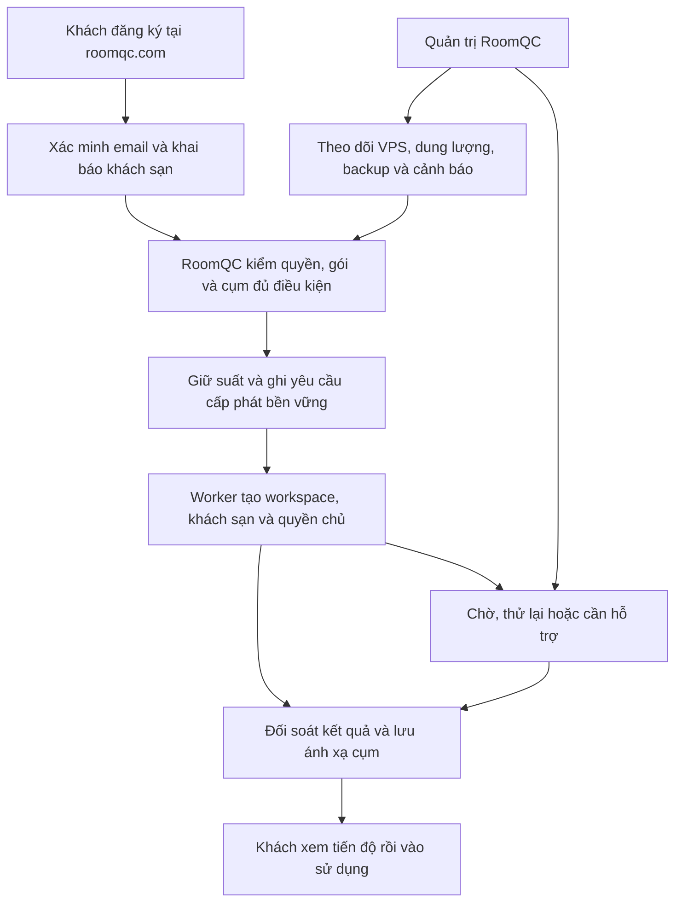

# RoomQC — kế hoạch hiện hành cho toàn bộ VPS và đăng ký tự động

**Phạm vi đã chốt ngày 27/10/2026: toàn bộ VPS + signup. Đầu ra: plan + nghiệm thu.**
Giữ 8 đợt, 25 task, 27 gói và 70 ca gốc. Khách chỉ đăng ký; RoomQC quản lý
cụm VPS, cấp không gian sử dụng, gói/quota, sao lưu và vận hành.

**Điểm nhận đã đối chiếu: có bản nháp sửa policy, chưa kiểm chứng.** Cây tích hợp
hiện có 1.022 file trong manifest có phạm vi, backend 198 file; 577 file migration
nghiệp vụ và 12 directory. Migration `20261027153807` cùng fixture/diagnostic mới
đã được viết; runner chưa nối hai chế độ kiểm mới. Chưa chạy native policy,
upgrade 576→577 hoặc hồi quy trên bản nháp; số file không phải tỷ lệ hoàn thành.

**Bằng chứng hoàn tất gần nhất của nhánh policy** vẫn là [baseline1019](roomqc-advice-policy-baseline-local-2026-10-27.md):
14 kiểm tra, 7 đạt/7 chưa đạt, exit 1. Giữ nguyên kết quả đỏ để đối chiếu sau sửa;
không chuyển thành pass từ việc đã viết code. Edge1018, UTC/upgrade1017 và các
proof khác chỉ có giá trị theo đúng source trong báo cáo gốc.

**Đọc và giao việc:** [bản điều hành](roomqc-vps-signup-delivery-brief-2026-10-22.md)
giữ tám đợt và đầu ra demo; [phiếu T01–T25](roomqc-vps-signup-detailed-delivery-2026-10-26.md)
giữ file, bước làm, dependency, kiểm nhận và rollback.
[Bộ 70 ca](roomqc-vps-signup-acceptance-worksheet-2026-10-22.md) giữ nguyên
`not_run`; 122 mục release vẫn `unverified`. Chưa thay reviewer, signoff hay gate.
Lịch sử checkpoint giữ tại [tiến độ](roomqc-vps-signup-progress.md) và báo cáo gốc.

**Việc nhận tiếp:** [phiếu 19.38 — kiểm bản nháp và chuyển sang VPS/signup](roomqc-vps-signup-detailed-delivery-2026-10-26.md#1938-phiếu-bắt-đầu-và-bàn-giao-plan--nghiệm-thu).
Giữ [contract policy](roomqc-advice-policy-command-contract-2026-10-27.md), đối chiếu 7 finding baseline rồi client/UI/freshness/retention/abuse và thiết bị
→ mobile money → generic exports → writer Q02 → Q03 → Q04 → T07 → T09/T10
→ T11–T13 → T14–T17 → T18–T20 → T21–T24 → T25. Giữ dependency trong ledger;
T14/T18 được chuẩn bị khi đủ đầu vào. Chỉ mirror tài liệu/artifact đã lọc;
implementation ở integration. Chỉ ghi kết quả kiểm thử đúng phạm vi báo cáo.

## 1. Kết quả cần đạt và mô hình vận hành

Khách vào **roomqc.com → đăng ký → xác minh email → khai báo khách sạn → hệ thống cấp không gian sử dụng → thêm phòng, mời nhân viên → sử dụng**. Khách không phải thuê VPS hoặc cấu hình Docker/Supabase.

RoomQC chuẩn bị các cụm VPS trước, theo dõi sức khỏe và phân khách mới vào cụm đủ điều kiện. Một cụm phục vụ nhiều workspace, dữ liệu được tách bằng quyền phía server và database; một workspace có thể có nhiều khách sạn theo gói. Không tạo VPS riêng cho mỗi lần đăng ký. Khách đã gắn cụm giữ nguyên mapping khi cụm đầy hoặc lỗi; chuyển cụm là quy trình riêng có đối soát dữ liệu.

Tạo workspace phải có kết quả có thể đọc lại khi mất mạng. Việc thử lại dùng cùng định danh yêu cầu và kiểm kết quả đã ghi trước đó; không tạo thêm khách sạn hoặc bắt đầu lại thời gian dùng thử. Sơ đồ mô tả hành vi cần đạt, không xác nhận toàn bộ đã triển khai.

V1 gồm quản lý cụm/tài nguyên, nhận khách mới, trial/gói/quota, đăng ký và phục hồi, hai màn quản trị, Linux/TLS, backup/restore, cảnh báo, E2E, tải và pilot. Tự thuê VPS, HA đa vùng, SSO xuyên cụm và thu tiền thật chưa nằm trong V1. Mục tiêu 1.000 khách sạn cần mở rộng theo số đo từng cụm; chưa có bằng chứng 100.000 người hoạt động đồng thời.

## 2. Điểm xuất phát thực tế

Điểm nhận là bản nháp migration577 cùng fixture/diagnostic chưa kiểm, theo
[19.38](roomqc-vps-signup-detailed-delivery-2026-10-26.md#1938-phiếu-bắt-đầu-và-bàn-giao-plan--nghiệm-thu).
Inventory source1022/backend198 không thay proof chạy thật. [Baseline1019](roomqc-advice-policy-baseline-local-2026-10-27.md)
giữ 14 kiểm tra, 7 đạt/7 chưa đạt: service-only config, 20 payload legacy tăng
20version/audit, hai editor đều200, expiry qua audit wait vẫn commit và ba RPC
mới chưa tồn tại ở source baseline. Bốn RPC nay có bản nháp; chưa có kết quả
sau sửa. Edge1018, UTC/upgrade1017 và frontend1014 giữ đúng proof gốc.

Đối chiếu OpenAPI và handler hiện có: 23 operation, gồm 8 foundation,
8 implemented-local, 6 planned và 1 partial-local. Setup-status, alerts,
backups, tenant-summary, recheck và acknowledge còn thiếu handler tương ứng;
hai child route infrastructure/registrations chưa nối trong App.
Limiter hiện là bucket memory theo socket IP; T13 phải giải quyết restart,
nhiều instance và proxy trước public signup.

Nhận19.38 để review diagnostic, nối runner, kiểm current/upgrade và đối chiếu từng finding. Sau đó policy client/UI, mobile money/F3, writer Q02,
Q03 và Q04. Giữ [populated upgrade566→572](roomqc-report-upgrade-local-2026-10-27.md),
[advice upgrade1007](roomqc-advice-upgrade-local-2026-10-27.md) và
[interruption1008](roomqc-advice-interruption-local-2026-10-27.md) đúng source
của chúng. Failed history và stability follow-up15eb vẫn thuộc packet Q04.

Advisors737 ở workload baseline1019 chưa có disposition; khác số lượng
không chứng minh đã sửa finding. Direct ACL 39 bảng không thay kiểm quyền
gián tiếp. 70 ca not_run và 122 mục unverified vẫn giữ; chưa có số đo sức chứa
VPS hay bằng chứng 100.000 người hoạt động đồng thời.

## 3. Tài liệu điều phối và trách nhiệm

| Dùng khi nào | Nguồn cần đọc |
|---|---|
| Chốt mục tiêu, hiện trạng, thứ tự và việc nhận ngay | Bản hiện hành này |
| Giao file/input/actions/test cụ thể | [Phiếu triển khai T01–T25](roomqc-vps-signup-execution-ready-2026-10-22.md) và [checklist triển khai](roomqc-vps-signup-launch-checklist-2026-10-21.md) |
| Đối chiếu phạm vi 27 gói | [Work packages](roomqc-vps-signup-work-packages-2026-10-19.md) |
| Đối chiếu mã, dependency, môi trường bắt buộc | [Delivery ledger](../../../artifacts/roomqc-vps-signup-delivery-ledger-2026-10-21.json) |
| Thực hiện và ghi kết quả 70 ca | [Worksheet](roomqc-vps-signup-acceptance-worksheet-2026-10-22.md) và [protocol](roomqc-vps-signup-acceptance-protocol-2026-10-21.md) |
| Review cơ chế phê duyệt release | [Thiết kế signed approval](roomqc-t08-signed-approval-design-2026-10-26.md), [durable authority](roomqc-t08-durable-authority-local-2026-10-26.md) |
| Nhận phần membership và quyền nhân viên | [Phiếu EC10–EC15](roomqc-ec10-ec15-execution-and-acceptance-2026-10-26.md); [baseline trước sửa](roomqc-ec10-ec15-api-red-baseline-local-2026-10-26.md); [boundary fix791 và phần chưa khép](roomqc-ec10-ec15-authority-boundary-local-2026-10-26.md) |

BE phụ trách backend/database, FE phụ trách web/Android, OPS phụ trách hạ tầng/vận hành, QA chạy và review bằng chứng, RQ là người quyết định sản phẩm/phát hành phía RoomQC. Đây là vai trò; chưa tự điền tên owner/reviewer hoặc ký thay. Một đầu mối kiểm soát contract, migration và version để tránh các phần dùng schema khác nhau.

## 4. Tám đợt bàn giao

| Đợt | Task trong đợt | Kết quả dùng được | Điều kiện chuyển bước |
|---|---|---|---|
| 1 | T01,T02,T03,T04,T05,T06,T08 | Nền bền vững, quyền và phê duyệt release đúng; số đo health đáng tin | A01–A11; B01–B07/C01–C04 đúng phạm vi; đóng delta health tại mục 6, có packet source nhất quán |
| 2 | T07 | Cảnh báo có người xử lý, chống gửi trùng/mất khi restart | B08–B09; lifecycle/outbox local đạt; host-loss delivery cần bằng chứng staging riêng |
| 3 | T09,T10 | Chọn cụm nhận khách và giới hạn tải có căn cứ | C05–C10; 20 yêu cầu tranh 1 suất không vượt limit, có tổng connection/queue/resource budget |
| 4 | T11,T12,T13 | Đăng ký, xem tiến độ, tiếp tục và tự phục hồi | D01–D15; một bộ dữ liệu qua retry/F5/hai tab/mất response; email thật nghiệm thu đúng môi trường |
| 5 | T14,T15,T16,T17 | Hai màn Hạ tầng và Đăng ký mới dùng dữ liệu thật | E01–E08; tìm đăng ký kẹt dưới 30 giây trong bài thử; action/Back/scroll/quyền đúng |
| 6 | T18,T19,T20 | Bộ cài Linux, backup/restore ngoài host và người trực | F01–F09 cùng B01/B09 cần staging; reboot/rerun giữ dữ liệu, clean-host restore và alert drill |
| 7 | T21,T22,T23,T24 | A/B đồng thời, E2E, tải/soak và release candidate | G01–G07; audit đủ 70 ca và môi trường, operating limit có số đo, defect/rollback/reviewer rõ |
| 8 | T25 | Pilot nhỏ, báo cáo quyết định mở rộng | G08 sau ít nhất 7 ngày quan sát; 1 nội bộ, ổn định 24–48h rồi cohort 5–10 đã duyệt |

Đợt là nhóm bàn giao, không thay dependency. T08 phải cung cấp nền cho T06; T14 có thể chuẩn bị khi T03/T04 đủ đầu vào. Chuẩn bị source/bundle không cần chờ toàn bộ staging, nhưng nghiệm thu phải đúng dependency và môi trường.

## 5. Phiếu giao T01–T25 và đầu ra bắt buộc

Dependency dưới đây giữ nguyên ledger. Chi tiết file và thao tác ở các phiếu liên kết mục 3; mỗi task nhận với source/target/allowed effects cụ thể và có báo cáo expected/actual.

| Task / phụ thuộc | Đầu ra cần khép | Nghiệm thu trọng tâm / vai trò |
|---|---|---|
| T01 / — | Inventory source/image/schema/config/port/volume/flag và fixture có ownership/cleanup | A01–A03; BE+OPS → QA |
| T02 / T01 | Directory migration history/checksum/lock, runtime role, volume, readiness/shutdown | A04–A07: DB trống/có dữ liệu, hai migrator, mismatch, rerun/restart; BE+OPS → QA |
| T03 / T01,T02 | Live session/capability/AAL, command mutation+audit+receipt cùng transaction | A08–A11: revoked/wrong actor deny và valid recovery; BE → QA |
| T04 / T01 | Contract/DTO/error/cursor/version/client key; typed client đọc kết quả lệnh | A03,A08–A11: mất response/headers, F5 không gửi lệnh mới; BE+FE → QA |
| T05 / T01,T04 | Host/mount/DB exporters và probe Auth/REST/Storage/Realtime/Functions có deadline | B01–B03: đối chiếu OS/DB, đúng target, private ports; OPS+BE → QA |
| T06 / T02,T05,T08 | Atomic health proof, snapshot/window/latch bền vững, timed managed runtime | B04–B07: stale/late/revision/restart không mở admission; BE+OPS → QA |
| T07 / T06 | Alert lifecycle, event+outbox atomic, retry/dead-letter/heartbeat | B08–B09: dedupe/restart/ack/reopen và host-loss delivery; BE+OPS → QA |
| T08 / T02,T03,T04 | Trusted signed release, registry/canary, issuer/revocation và quyền gián tiếp | A06,B02,C01–C04: expiry/tamper/SSRF/cross-process/no-effects; BE+OPS → QA |
| T09 / T06,T07,T08 | Admission/reservation/affinity và close/drain/reopen có version/reason/receipt | C05–C10: tranh suất/replay/expiry/close/first-dispatch races; BE → QA+OPS |
| T10 / T09 | Tổng pool/replica/worker/vendor budget, queue/deadline/quota có giới hạn | Budget tạm trước signup, chốt G05–G06 tại T23; BE+OPS → QA |
| T11 / T03,T04,T09,T10 | Verified-owner signup, private setup-status, nextAction và resume | D01–D06: đúng một tenant/hotel/trial, no leak/wrong cluster; BE+FE → QA |
| T12 / T11 | Durable job/lease/fencing, dispatch/receipt reconciliation và backfill | D07–D11: kill từng cửa sổ, stale worker, unknown commit; BE → QA+OPS |
| T13 / T11,T12 | Limiter nhiều instance, proxy/challenge, email/callback/reset/invite | D12–D15: direct Auth/forged IP/spam/signup-off và email thật; BE+FE+OPS → QA |
| T14 / T03,T04 | Hai route/menu admin, platform guard, scoped client/cache/cancellation | A03,E08: logout/revoke/workspace switch không nhận response cũ; FE+BE → QA |
| T15 / T06,T07,T09,T14 | Hạ tầng list/detail, health/backup/admission và command result dialog | E03–E05: unknown khác 0, receipt quyết định kết quả; FE+BE → QA+RQ |
| T16 / T12,T14 | Registrations search/cursor/totals/timeline, tenant-summary, durable recheck | E01,E02,E05,E08: 1.000 metadata, không impersonate/recreate; FE+BE → QA+RQ |
| T17 / T13,T15,T16 | Mobile 390px, keyboard/focus/contrast, một menu, Back/scroll | E01–E08: mọi chức năng có đường click và giữ ngữ cảnh; FE+QA → RQ |
| T18 / T06,T08 | Linux full vendor bundle pin digest, preflight/TLS/private ports/upgrade | F01–F04,B01: sai target/port/secret/volume dừng; reboot giữ data; OPS+BE → QA |
| T19 / T12,T18 | Backup nhất quán, offsite/key custody, clean-host restore và revocation checkpoint | F05–F08: DB/Auth/queue/objects/mapping/receipt khớp, RPO/RTO đo thật; OPS → QA+RQ |
| T20 / T07,T18,T19 | Named on-call/escalation, runbook/killswitch và drill | B09,F09: fault/detected/received/ack/recovery có timestamp; OPS → QA+RQ |
| T21 / T12,T13,T18 | Hai backend độc lập cùng chạy, key/Auth/DB/object/channel/volume riêng | G01–G03: token A bị B từ chối, khách A không fallback B; QA+BE+OPS → QA |
| T22 / T17,T21 | Browser/Android signup→phòng→invite→staff login và fault/reload/revoke | A/D/E/G theo worksheet: UI+API+DB/receipt proof; QA+FE+BE → QA |
| T23 / T10,T21,T22 | Workload/profile tải, soak, noisy-neighbor, capacity/cost report | G04–G06: p95/p99/errors/pool/IO/queue, operating limit; QA+OPS → BE+RQ |
| T24 / T19,T20,T22,T23 | Freeze RC, audit 70 ca, cutover/rollback/secret review, gate packet | G07; không còn Critical/High quyền/dữ liệu/cấp phát/restore trong scope; QA+OPS → BE+FE+RQ |
| T25 / T24 | Pilot đo tối thiểu 7 ngày, drills và báo cáo mở rộng | G08: lỗi/availability/cost/support, quyết định riêng cho public; OPS+RQ → QA |

## 6. Công việc nhận ngay: khép Q02/Q03/Q04 rồi chuyển signup

Điểm nhận là [phiếu19.38](roomqc-vps-signup-detailed-delivery-2026-10-26.md#1938-phiếu-bắt-đầu-và-bàn-giao-plan--nghiệm-thu).
P1/P2 có inventory/contract và14test baseline;7finding chưa có proof sau sửa.
Review bản nháp577, sửa receipt barrier trong phép thử, nối runner rồi kiểm
current/populated upgrade/hồi quy. Còn control mapping, client/editor, freshness/retention/
abuse, thiết bị và UTC midnight thực. Giữ guards/failed history và proof cũ.
Sau đó mobile money/generic export, graph writerQ02 còn lại,
Q03configured workflow/dispatcher/recipient/offboarding/indirect/advisors và
Q04freeze/full/default-full/independent rebuild cùng candidate.

Giữ hồi quy phần đã đạt; không giao lại populated upgrade566→572, target
transport hoặc signed managed-health đã có proof như chưa triển khai. Chi tiết
đầu ra/case/owner/dependency của25T ở [bản điều hành](roomqc-vps-signup-delivery-brief-2026-10-22.md); file/bước
làm/rollback ở [phiếu chi tiết](roomqc-vps-signup-detailed-delivery-2026-10-26.md). Chưa nghiệm thu toànT hoặc gate.

## 7. Thiết kế signup và gói sử dụng phải giữ xuyên suốt

| Bước / sự kiện | Kết quả server phải bảo đảm | Phục hồi / kiểm chứng |
|---|---|---|
| Tạo intent | Validate/challenge/limiter trước giữ suất; identity và client key ổn định | Replay cùng payload đọc cùng kết quả; khác payload conflict; không lộ email người khác |
| Chọn cụm | Trust+health+freshness+backup+policy+manual gate+budget đều đạt; reserve atomic | Một suất cuối chỉ cấp một lần; không có cụm thì chờ rõ lý do |
| Auth và verify email | Giữ affinity, callback đúng cụm/origin; owner và live session hợp lệ | Chưa verify không tạo dữ liệu nghiệp vụ; callback dùng lại/hết hạn không tạo identity khác cụm |
| Gửi khai báo khách sạn | Server quyết định tenant/role/trial/quota; ghi durable binding/job/dispatch trước remote effect | F5/hai tab/retry không tạo tenant hoặc kéo dài trial lần hai |
| Tạo dữ liệu ở cụm | Transaction idempotent tạo đúng tenant/hotel/profile/trial/receipt theo contract | Unknown response phải đọc receipt; không coi là thất bại để tạo lại |
| Hoàn tất directory | Receipt đúng workspace/cụm/routing version mới activate | Lease/fencing chặn stale worker; trạng thái `provisioning` không tự cấp quyền dispatch mới |
| Đọc tiến độ và tiếp tục | Private status trả step/nextAction/retryAfter tối thiểu, no-store | Owner mới được đọc; missing→waiting_owner, unavailable→retry, conflict→needs_review |
| Mời nhân viên | Gán quyền server-side khi tạo/mời; accept đúng recipient và live assignment | Invite→accept→login→thao tác đúng vai trò; revoke/offboard có hiệu lực theo contract |
| Trial/gói/quota | Policy có version: số khách sạn/phòng/nhân sự/storage/report/retention, grace và suspension | Enforce ở server; không chỉ ẩn nút; chưa chốt policy thì không tự áp limit mới |
| Hết hạn hoặc dừng sử dụng | Hành vi grace/read-only/suspend/export/delete được RQ duyệt, có audit | Không tự xóa dữ liệu, reset trial hoặc chuyển database; thu tiền thật là backlog riêng |

Control plane lưu mapping/intent/job/receipt/health/audit và metadata vận hành; nghiệp vụ vẫn đi đến đúng cụm. Worker không lưu mật khẩu/JWT owner, không giả danh owner tạo khách sạn. Client không nhận service key hoặc quyền chọn cluster tùy ý. Metadata user có thể sửa không được dùng làm nguồn cấp quyền.

Đóng admission chỉ ngăn việc mới theo mốc kiểm quyền; không thể hủy remote write đã được cho phép và commit. T11/T12 phải có durable dispatch+remote idempotency+receipt, không chỉ một lease trong directory. Không xóa đường recovery cũ trước khi backfill và fault-recovery mới được chứng minh.

## 8. Hai màn quản trị và API còn phải hoàn thiện

Hai entry đề xuất `/super-admin/infrastructure` và `/super-admin/registrations` phải đăng ký route/menu/guard thật tại T14; tên đề xuất không chứng minh hiện đã deploy.

**Hạ tầng:** danh sách cụm/host, nhận hay chặn khách và lý do, thời điểm đo, CPU/RAM/data disk/inode/DB connection/queue, capacity và lần backup/restore gần nhất. Chi tiết kỹ thuật mở khi cần. Đóng/drain/mở/đổi limit có reason, impact, expected version, client key và kết quả durable; response 202 chỉ là đã nhận yêu cầu.

**Đăng ký mới:** search/filter/cursor theo URL, trạng thái và cụm, thời điểm cập nhật, next action, timeline/job/receipt và lỗi an toàn. `tenant-summary` đọc đúng cụm; `recheck` enqueue và đọc completion, không tạo lại tenant hoặc impersonate. Mục tiêu bài thử tìm đăng ký kẹt dưới 30 giây trên 1.000 metadata.

Các contract cần khép gồm private `setup-status`, typed command-result recovery, workspace list/detail/timeline/search/totals, durable recheck, alerts/backups/acknowledge. Theo chuỗi **contract → handler+permission → typed client/native allowlist → API integration → UI E2E**. Phân biệt 401/403/409/429/503 và unknown commit; không sinh client key mới chỉ vì mất response.

Một menu chính có đường click cho mọi chức năng; màu thông dụng, tương phản rõ, luôn có chữ thay vì chỉ màu. Back quay lại list/filter/scroll trước, trang mới đưa nội dung lên đầu; link trực tiếp có fallback hợp lệ. Test 390px, zoom, bàn phím, loading/empty/error/unknown/stale. Logout/revoke/switch workspace phải hủy request/cache cũ, không hiển thị data của actor hoặc cụm trước.

## 9. Quản lý tài nguyên, Linux và phục hồi dữ liệu

| Phần | Việc phải thực hiện | Bằng chứng cần bàn giao |
|---|---|---|
| Capacity mỗi cụm | Tổng mọi replica×pool/vendor/worker/report/upload/Realtime/migration/backup, OS reserve và emergency headroom; queue/concurrency/deadline có giới hạn | Budget có cấu hình host/workload, query plan/pool wait/CPU/RAM/IO; không dùng công thức một user=một connection |
| Admission | Thiếu/stale/invalid/down/full hoặc backup/manual gate không đạt thì chặn mới | Race matrix, decision reasons/version; khách cũ giữ mapping và tiếp tục theo policy |
| Bổ sung cụm | Chuẩn bị host, deploy pinned bundle, validate trust/services/health/backup trước operator mở nhận | Inventory/approval/health/restore và command receipt; không tự chuyển khách cũ |
| Preflight Linux | Xác nhận exact host/IP/OS/mount/ports/volumes/network/origins/clock/secret refs; dry-run/checkpoints | Sai target, port bận, thiếu secret, volume có data phải dừng trước init/overwrite |
| Deploy/upgrade | Pin full Supabase vendor release/digest đã review; role migration riêng, readiness/schema check, graceful shutdown | Install/rerun/reboot/compatible rollback giữ data; TLS/Auth/REST/Storage/Realtime/Functions/upload/callback/CSP qua proxy |
| Mạng và quyền | DB/metrics/Studio private, firewall/TLS/rotation; API/worker không có signer hoặc DDL | Port/role/secret scan; public key chỉ xác minh, secret refs không xuất chat/report |
| Backup | Directory+DB/Auth/queue+object bytes+manifest/version/secret refs, cửa sổ nhất quán, mã hóa/checksum/retention | Offsite upload+readback; key custody ngoài failure domain; uploaded khác restore-verified |
| Restore | Host/volume sạch, cách ly không ghi source, chống hai bản cùng nhận write | Login/mapping/job/receipt/trial/phòng/invite/file bytes khớp; sai key/checksum/version/missing object phải fail |
| Thu hồi sau restore | Restore có thể làm lùi epoch/approval trong DB; đối chiếu revocation checkpoint nằm ngoài failure domain | Cô lập admission cho tới khi đối soát quyền/receipt và được mở lại đúng quy trình |
| Vận hành | Người trực chính/phụ, escalation, killswitch/reopen owner và runbook | Drill mất host/control/DB/disk/cert/key/backup/signup kẹt: fault→detected→received→ack→recovery |

Không coi Docker Desktop local là bằng chứng Linux production. Backup cùng máy không bảo vệ khi mất host. Không ký mất-host recovery nếu chưa thử bằng offsite và khóa còn lấy được khi host gốc không còn.

## 10. Bộ nghiệm thu và ngưỡng đánh giá

Giữ nguyên từng scenario/expected/task/requiredEnvironments trong [70 ca gốc](roomqc-vps-signup-acceptance-worksheet-2026-10-22.md). Không thêm ca đánh số mới hoặc thay fixture pass thành kết quả nghiệm thu.

| Nhóm | Số ca | Nội dung phải kiểm |
|---|---|---|
| A01–A11 | 11 | Baseline, migration/data durability, quyền hiện thời, command/audit/receipt |
| B01–B09 | 9 | Đúng metric/probe, health/stale/restart, alerts và host-loss delivery |
| C01–C10 | 10 | Registry/trust/SSRF, capacity/reservation/affinity và race |
| D01–D15 | 15 | Signup/resume/private status, receipt/worker/kill, abuse/proxy/email |
| E01–E08 | 8 | Hai admin console, search/pagination, action/recovery, UX/quyền/cache |
| F01–F09 | 9 | Linux/TLS/rotation, backup/offsite/clean-host restore và on-call |
| G01–G08 | 8 | A/B đồng thời, E2E/tải/soak, cutover/RC và pilot |

Mỗi ca ghi source/image/schema/config/contract, môi trường, command và thời điểm, expected/actual, pass/fail/partial/not_run, positive/negative/recovery, row effects/receipt, failed history/limitations, cleanup và owner/reviewer/signoff. Không chứa token/DSN/khóa/PII. Test run bị skip/cancel/không có terminal exit không được trình bày là full pass.

Nghiệm thu chia ba môi trường: **local disposable** chứng minh logic và recovery có phạm vi; **staging Linux** chứng minh host/network/provider/restore/tải; **pilot** chứng minh vận hành với cohort được duyệt. Môi trường nào bắt buộc lấy từ ledger, không tự bỏ vì môi trường khác đã xanh.

| Chỉ số | Mục tiêu staging đề xuất, cần review trước áp dụng |
|---|---|
| setup-status / admin list 1.000 metadata | p95 server ≤500ms / ≤1s, payload theo page, đo window/dataset rõ |
| reserve / provision | p95 ≤1s / ≤10s sau submit, không tính chờ người dùng/email; tách queue/RPC/commit |
| Freshness | Thường ≤60s; >120s stale chặn nhận mới theo policy có version |
| Load/soak | Ramp 10→25→50→100 phiên có think time khi mức trước đạt; soak ≥60 phút; 5xx ngoài fault <1% |
| DR | RPO≤24h/RTO≤4h là đề xuất cần RQ chấp nhận; đo từ last consistent point/fault, không từ lúc bắt đầu restore |
| Host-loss alert | detected≤180s, received≤300s đề xuất, đo từ ngoài host |
| Pilot | Ít nhất 7 ngày; đề xuất availability API trọng yếu ≥99,5%, mẫu số và planned maintenance rõ |

Đây chưa là SLA hoặc policy production. RPO 24h có thể mất đến một ngày dữ liệu; nếu không chấp nhận phải thiết kế WAL/PITR cùng object consistency phù hợp. Operating limit phải thấp hơn max tested với headroom có lý do, không lấy số connection hoặc test loop làm số người dùng thực.

## 11. Quyết định phát hành và điều kiện dừng

| Gate | Điều kiện đủ để đề nghị quyết định |
|---|---|
| L — local integrated | Candidate hiện hành nhất quán, authority/health/receipt/recovery/cleanup có proof và review |
| S — staging | Exact Linux target/release/network/TLS, backup/rollback và operator; external inputs đúng case |
| P — bắt đầu pilot | Pre-pilot RC cases đủ môi trường; không Critical/High quyền/dữ liệu/cấp phát/restore; on-call/offsite restore/killswitch và cohort đã duyệt |
| U — public signup | Sau T25/G08 có số liệu capacity/anti-abuse/cost/support và quyết định mở riêng |
| B — thu tiền thật | Nghiệm thu provider/payment/security/business riêng, ngoài V1 |

Mọi gate hiện vẫn `not_authorized_by_this_ledger`. G08 chưa thể pass trước khi bắt đầu pilot; T24 audit đủ 70 ca nhưng giữ G08 pending có kế hoạch hợp lệ, sau ít nhất 7 ngày mới nghiệm thu nó.

Phát hiện quyền chéo, mất/nhân data, duplicate provisioning, unknown commit bị tạo lại, checksum drift, tài nguyên critical hoặc restore không đúng thì dừng mở rộng/đóng nhận mới theo runbook; giữ dữ liệu/receipt và route khách cũ, đối soát trước recovery. Không reset DB, xóa tenant/job, down-migrate phá dữ liệu hoặc sửa lịch sử để dashboard xanh.

## 12. Phần cần khóa/quyền và cách tiếp tục khi chưa có

| Đầu vào cần có / bên cung cấp | Task và bằng chứng bị ảnh hưởng | Phần vẫn làm được ngay |
|---|---|---|
| Exact VPS staging, mount/network/ports và quyền vận hành — RQ/OPS | T05,T10,T18,T23, B01/F01–F04/G04–G06 | Bundle/preflight/fixture/budget tham số; chưa SSH/apply vào host chưa xác định |
| DNS roomqc.com và exact app/API/admin/callback/native origins — quản DNS/OPS | T13,T18,T22, D15/F03 | Template/allowlist/local callback; tên miền được nêu chưa chứng minh DNS/TLS đã xong |
| Email provider/sender verified/webhook và hộp thư thử — quản email | T13/D15 | Outbox/internal sink, retry/dedupe/security; trang Resend đã mở không chứng minh sender verified |
| Offsite store, retention/cost và người giữ key ngoài host — OPS/RQ | T19/F05–F08 | Manifest/consistent backup/restore disposable; chưa ký offsite mất-host |
| Đích alert ngoài host, người trực và escalation — OPS/RQ | T07,T20/B09/F09/P | Lifecycle/outbox/sink local; chưa ký received khi host chết |
| Trial/quota/grace/retention/capability và người ký — RQ/BE/OPS | T03,T10,T11,T13,T25 và gate liên quan | Contract/test theo tham số, giữ policy đã duyệt; không tự áp default mới |
| Cohort, consent/support window/operating limit/kill-switch owner — RQ | T25/G08/P/U | RC và kế hoạch pilot; chưa thêm khách thật hoặc mở public |

Theo chỉ dẫn trước của người dùng, các mục cần mã khóa/quyền chưa có được tổng hợp làm sau; thiếu gì chỉ hoãn case/gate phụ thuộc mục đó, không dừng phần local độc lập. Không yêu cầu gửi mật khẩu/API key/SSH key trong chat. Dùng secret reference và kho vận hành, ghi rõ ai cung cấp; không đánh `deferred_external` thành pass.

## 13. Tiến độ, báo cáo và điều kiện hoàn thành kế hoạch

Ước lượng lịch sử toàn backlog: **30–47 ngày công**, có dự phòng **36–57 ngày công**, cộng thời gian chờ dịch vụ và pilot ít nhất 7 ngày. Đây không phải thời gian còn lại hoặc cam kết ngày hoàn thành. Ước lượng lại sau khi chốt delta T06/T08, quyền gián tiếp và inventory VPS; không cộng lại effort cho phần đã có proof.

Mỗi đợt báo cáo một packet: đầu ra nào dùng được; source và môi trường; case nào đạt/chưa đạt/chưa chạy; lỗi và ảnh hưởng; external input còn thiếu; cleanup/rollback; người review; gate được đề nghị; task tiếp theo. Không báo “ổn định hoàn toàn” từ unit tests hoặc phần trăm suy đoán.

**Việc nhận đầu tiên còn lại:** review và kiểm bản nháp policy577 theo19.38, rồi policy control/thiết bị → mobilemoney → F3 → writerQ02 còn lại → Q03 → Q04. Target terminal/
transport và populated upgrade566→572 đã có scoped proof; giữ hồi quy theo
delta. Sau nền tiếp đủ tám đợt theo dependency. Signup, hai console, Linux/
offsite/on-call và A/B/web/Android/tải/pilot là đầu ra bắt buộc, chưa hoàn tất.

Hoàn thành bản kế hoạch nghĩa là phạm vi/dependency/đầu ra/tiêu chí/case/môi trường/đầu vào và cổng quyết định đều rõ, liên kết kiểm được. Hoàn thành sản phẩm cần bằng chứng thực chạy và review của toàn phạm vi; hai kết luận này tách biệt.

## 14. Phân rã phần nhận ngay thành các lần bàn giao

Bảng dưới giữ phân rã lịch sử T08/T06; không thay điểm nhận19.38 ở đầu trang và mục6. Không thêm task hoặc ca nghiệm thu. Thực hiện trên nhánh tích hợp; chỉ chuyển tài liệu/bằng chứng đã lọc sang cây chính. Các phần đã có proof được giữ làm hồi quy, không đặt lại trạng thái thành chưa triển khai.

| Lần bàn giao / task hiện hữu | Thao tác cần thực hiện | Kết quả phải kiểm trước khi nhận |
|---|---|---|
| Thu hồi khóa ký / T08 — đã có scoped local proof | Giữ hồi quy migration0011/fingerprint/tombstone/install guard/command/audit/receipt; xem report đầu trang | Full control346/346 có alias/nhiều cụm/khóa chưa dùng/replay/conflict/races/rollback/process; chưa thay full vendor hoặc issuer production |
| Migration và quyền / T02,T03,T08 | Thêm migration directory sau 0010 bằng runner `server/control/migrate.mjs`; tách role cài và role sử dụng; kiểm entry gián tiếp không vượt quyền | Upgrade DB có dữ liệu giữ history/checksum/receipt; hai migrator/rerun/mismatch đúng; runtime không gọi được đường ghi thay thế hoặc tự bật lại khóa đã thu hồi |
| Runtime nhiều process / T06,T08 | Nối quyết định thu hồi vào validate/health/admission/reserve/first-dispatch; giữ pre-network và commit checks; thử API/worker cũ đang chạy và restart | Response muộn không tạo generation/snapshot/reservation mới; chu kỳ tiếp không gọi network; phê duyệt mới hợp lệ khởi động lại warmup nhưng không tự mở manual/backup gate |
| Installer và readiness / T02,T04,T08 — đã có scoped local proof | Giữ hồi quy CLI/private file/role riêng/schema lock/inventory/trust; xem report đầu trang; chuyển kiểm POSIX permissions và TLS/issuer thật sang đúng môi trường T18 | Full358/358 gồm native7/7: lost-COMMIT→receipt/replay không effects lần hai; target đổi khi chờ lock bị từ chối; từ chối role/file/schema/binding/expiry/tamper. Chưa là Linux acceptance |
| Quyền nghiệp vụ gián tiếp / T03,T08 | Lập caller→RPC/Edge/view/definer/trigger/FK→data map; thử recipient/offboarding/workflow; disposition từng policy/FK/index finding theo workload | Mỗi đường nhạy cảm có positive, denial không effects và recovery; thu hồi nhân viên chặn thao tác tiếp theo; không kết luận an toàn chỉ từ direct ACL hoặc advisor exit 0 |
| Packet tích hợp / T01,T06,T08 | Freeze candidate; focused và full control, default full backend rồi rebuild độc lập; kiểm source/runtime/schema/render trước/sau và cleanup exact-owned | Native exit và fail/skip/cancel rõ; fault→deny→recovery đủ năm dịch vụ; giải thích stability follow-up 15eb; liệt kê phần local đạt và external còn thiếu, không tự ký gate |

Ngoại trừ các dòng key-wide/installer đã ghi proof và các hồi quy có report, đây là tiêu chí công việc **chưa khép**, không phải tuyên bố toàn bộ đã đạt. Khi có delta sản phẩm mới, phải tạo checkpoint mới; không gắn hash `d4cea563…` cho source đã đổi. Sau packet đợt 1, đầu việc kế tiếp là T07 alert lifecycle/outbox.

**Cụ thể hóa phần quyền nhân viên:** [phiếu EC10–EC15](roomqc-ec10-ec15-execution-and-acceptance-2026-10-26.md) giữ baseline red và lịch sử. Legacy detail/summary và system-role/owner/alias đã có proof811; browser direct writes đã khép812; terminal recovery đã có proof813. Giữ hồi quy theo source; catalog818 nay có22đích/45candidate entry paths,25unresolved dependencies. Current19/28paths là lịch sử; direct ACL không chứng minh toàn quyền gián tiếp. Không đổi additive thành deny-override hoặc tự tăng task/case/kết quả nghiệm thu.

## 15. Danh mục thao tác quản lý phải có đường sử dụng

Các thao tác dưới đây là việc con của T đã có. API path đang đề xuất hoặc mới có trong OpenAPI phải được đánh dấu planned cho đến khi handler, quyền, typed client và UI được nghiệm thu cùng nhau.

| Người dùng / tình huống | Màn hình và thao tác cần có | Kiểm phía server và dữ liệu bắt buộc / task |
|---|---|---|
| RoomQC thêm cụm | Hạ tầng → thêm cụm → xem kiểm tra → mở nhận khách | Đúng host/release/endpoint; health/backup/capacity đủ; install không tự mở admission; có version/reason/receipt / T08,T09,T15,T18 |
| RoomQC xem tải | Hạ tầng → danh sách và chi tiết cụm | CPU/RAM/disk/inode/DB/queue kèm thời điểm đo, stale/unknown khác 0; budget tổng mọi pool và headroom / T05,T06,T10,T15 |
| RoomQC bảo trì hoặc cụm đầy | Đóng nhận mới hoặc drain; xem tác động và kết quả lệnh | Không nhận thêm suất; giữ mapping khách hiện tại; reopen là lệnh riêng có kiểm quyền và điều kiện / T03,T04,T09,T15 |
| Khách đăng ký | Form → email xác minh → khai báo khách sạn → tiến độ → vào sử dụng | Server chọn cụm/role/gói; đúng một tenant/hotel/trial; có nextAction khi chờ hoặc lỗi / T11,T12,T13 |
| Khách F5 hoặc mất mạng | Mở lại tiến độ hoặc đăng nhập lại để tiếp tục | Cùng intent/workspace/cụm; đọc receipt trước retry mutation; không tạo trial mới / T04,T11,T12 |
| RoomQC hỗ trợ đăng ký kẹt | Đăng ký mới → lọc/tìm → timeline → đối soát → kết quả | Đọc đúng cụm; recheck chỉ enqueue; tách waiting_owner/retry/needs_review; không impersonate hoặc tạo tenant bằng tay / T12,T16 |
| Chủ khách sạn mời nhân viên | Quản lý nhân viên → chọn vị trí/quyền → gửi lời mời → chấp nhận | Assignment do server kiểm; invite đúng người nhận; staff login chỉ thấy dữ liệu/quyền hiện thời / T03,T08,T13,T22 |
| RoomQC quản lý gói | Xem trial, gói, thời hạn, usage và giới hạn; thay đổi theo policy đã duyệt | Enforce server-side, audit và version; không gia hạn trial qua replay; hành vi grace/suspend/export rõ / T03,T10,T11,T22 |
| RoomQC sao lưu/khôi phục | Xem lịch sử backup và restore proof; chạy runbook có quyền | Khác biệt uploaded/restore-verified; DB/Auth/objects/directory/receipt cùng checkpoint; khóa ngoài host; phục hồi cách ly / T19,T20 |
| RoomQC dừng dịch vụ khách | Xem lý do, ảnh hưởng, giữ dữ liệu và hỗ trợ xuất theo policy | Dừng quyền đúng scope; không tự xóa, chuyển DB hoặc reset trial; deletion/retention phải có quyết định riêng / T03,T11,T20,T24 |

Trang Hạ tầng phải trả lời được **cụm nào đang nhận khách, vì sao cụm này bị chặn, còn bao nhiêu tài nguyên và ai cần xử lý**. Trang Đăng ký mới phải trả lời được **khách đang ở bước nào, đã cấp dữ liệu chưa, cần khách hay RoomQC làm gì và lần đối soát gần nhất kết quả ra sao**. Thông tin debug nằm trong chi tiết, không lấn phần hành động chính.

## 16. Điều phối, chốt policy và bàn giao nghiệm thu

Trước khi nhận một task, ghi input/source/target, phần đã có proof được giữ, phần sẽ sửa, effects được phép và cách rollback. Khi bàn giao, đối chiếu đúng output/case/môi trường ở mục 5 và worksheet. Không đóng task vì đã có file hoặc màn hình.

| Cần chốt | Đầu ra cụ thể cần ghi | Mốc cần dùng / khi chưa chốt |
|---|---|---|
| Gói dùng thử và gói dịch vụ | Thời lượng trial; số workspace/hotel/phòng/nhân viên/storage; quota cứng/mềm; grace và thao tác bị chặn; policy version | Trước enforcement T10/T11/T13; vẫn làm contract/fixture tham số, chưa áp giới hạn mới |
| Dữ liệu khi hết hạn/ngừng dùng | Quyền đọc/xuất; retention; người có quyền gia hạn/suspend/delete; thông báo và audit cần giữ | Trước cutover/pilot; không mặc định xóa dữ liệu |
| Sức chứa và ngân sách | Cấu hình từng host, tổng pool, IO/storage/egress, chi phí offsite/email; max-tested và operating limit có headroom | Budget tạm T10, số đo T23; chưa hứa số user/khách sạn trên mỗi VPS |
| Phục hồi và vận hành | RPO/RTO chấp nhận được, offsite/key holder, on-call chính/phụ, escalation và quyền reopen | Trước T19/T20/P; thiếu input chỉ hoãn ca phụ thuộc |
| Phát hành | Người chạy/reviewer/release owner; cohort pilot, giờ hỗ trợ, điều kiện dừng/mở rộng | Trước ký gate liên quan; giữ signoff trống khi chưa có người nhận |

**Nhịp báo cáo:** cuối mỗi đợt mục 4 có một báo cáo kết quả. Lỗi quyền/dữ liệu/cấp phát/restore được báo ngay cùng ảnh hưởng và hành động chặn; các mục cần khóa/quyền được gom vào danh sách external đang chờ. Mọi báo cáo chỉ ra task và bước tiếp theo để không quay lại kiểm lặp một nhánh đã đạt trong khi các đợt còn lại chưa làm.

**Nghiệm thu kế hoạch:** đủ 25 dependency rows, 27 package mappings, 70 case/environment mappings, không vòng dependency, mọi chức năng có đường sử dụng, các liên kết nội bộ hợp lệ và nguồn tiến độ nhất quán. **Nghiệm thu sản phẩm:** chạy đúng các môi trường bắt buộc, evidence và reviewer cho từng ca; giữ G08 chờ pilot trước khi quyết định U. Biên bản kiểm tra tài liệu chỉ xác nhận vế thứ nhất.

Kết quả kiểm tra tĩnh của lượt bàn giao này lưu tại
[biên bản kiểm tra kế hoạch](../../../artifacts/roomqc-vps-signup-plan-validation-2026-10-27.json).
Đối chiếu dependency/case/package, 54 ca cần local, 69 ca cần staging, 1 ca cần
pilot, các API planned/partial và liên kết tài liệu. Các tập môi trường chồng
nhau; đây vẫn là70ca, không tự tạo thêm ca release. Biên bản không thay kết quả
chạy sản phẩm, review, gate hoặc bằng chứng sức chứa VPS.

## 17. Lệnh giao việc đầu tiên sau baseline API red

Phần này giữ lịch sử baseline quyền trước993; điểm nhận hiện hành ở mục6,
phiếu19.38 của phiếu chi tiết.

**Cập nhật818 cho bảng lịch sử dưới đây:** bước3–5 đã có backend/editor/catalog/
readback; direct browser DML812, terminal outcomes813 và source Edge817 đã có scoped proof.
Nhận bước1/2/6 về deployment inventory/writer khác/current24indirect/monitor/advisors rồi bước7 freeze/full
pipeline. Browser/Android/transport fault thật vẫn ởT22. Không giao lại readback,
direct revoke hoặc terminal logic như chưa triển khai; giữ hồi quy và kiểm delta.
Full control384/384 và scoped hồi quy thuộc818; default full817 đã fail cascade và đã có fix818. Default full818 đã hoàn tất; rebuild bản cuối cần packet riêng.70ca và chữ ký chưa đổi.

Phần này cụ thể hóa T03/T04/T08 và EC10–EC15, không thêm task hoặc ca release.
Boundary scope/live authority đã có [bản sửa791 và scoped proof](roomqc-ec10-ec15-authority-boundary-local-2026-10-26.md):8fail cũ bị chặn, thêm lock/expiry controls. Chưa đóng toàn bước1/2 vì
inventory/indirect/workflow vẫn mở. Nhận phần còn lại bước1/2/5/6, giữ hồi quy
command/editor đã đạt; source hiện tại chưa đủ mở thêm khách thật.

| Thứ tự / người thực hiện → review | Input và thao tác cụ thể | Bằng chứng bắt buộc để bàn giao |
|---|---|---|
| 1 / BE → QA | Lấy26controls/4readbacks làm baseline, chốt actor-target matrix; kiểm INSERT/UPDATE/DELETE và RPC/trigger/definer cho user_permissions/user_hotels; đối chiếu tenant thật của user và hotel, hierarchy và quyền tự sửa | Inventory có allowed/denied/unresolved, mọi active caller có file; giữ foreign-owner/staff negatives và positives; hai scope exploits không còn effects, kiểm cả đổi target trong UPDATE |
| 2 / BE → QA | Đặt live session/profile/role và target checks vào transaction; khóa theo thứ tự có tài liệu, kiểm lại sau chờ lock; không tin user_metadata hoặc supplied tenant_id | Locked/inactive/deleted-session đủ6ca bị chặn; old JWT, revoke/role-drop khi chờ lock và recovery hợp lệ có API+DB proof; denial không làm đổi business rows/version/receipt |
| 3 / BE → FE+QA | Thiết kế hai aggregate saves: custom grants và hotel membership+cờ; expected version, stable key, canonical digest, mutation+audit+receipt atomic; result lookup đúng actor/target | Lỗi audit/receipt rollback; mất response sau commit đọc lại cùng receipt; replay20lần chỉ1commit; cùng key khác payload conflict; hai editor một bên thắng; không có partial membership/flags |
| 4 / BE+FE → QA | Giữ read model/enforcement/editor đã đồng bộ ở811; effective/custom/inherited/source/version, owner/system role/alias | Actual API811 đã kiểm bốn đường đọc, owner/system-role/alias/additive; kiểm delta nếu sửa tiếp và bổ sung browser/Android, không coi API proof là UI proof |
| 5 / FE+BE → QA | Chuyển active save callers sang một command; bỏ DELETE+INSERT và remove/add/PATCH từng hotel khỏi save path; pending recovery, error mapping, cache scoped/cancel và draft lifecycle | Ngắt trước commit giữ cấu hình cũ; F5/hai tab/mất response không tạo key mới; đổi user/workspace/logout/revoke không nhận response cũ; web và Android/mobile390 có đường dùng |
| 6 / BE+QA → OPS | Khép direct/privileged compatibility sau khi inventory caller; kiểm legacy Edge update-user và các đường registration/invitation/profile; review indirect/current19/workflow và667advisor findings811 | Đường ghi còn dùng có boundary và proof atomic/live authority phù hợp, đường bỏ dùng có disposition/deployment inventory; không revoke trước khi positive signup/invite/profile đạt; scan lại khi schema đổi |
| 7 / QA+OPS → BE+FE+RQ | Freeze candidate mới; focused/full control/default full backend/independent rebuild, so source/schema/runtime/render trước-sau; packet lỗi và cleanup | Native exit/failed history đầy đủ; source mới có proof riêng,9baseline failures được đối chiếu từng control; không Critical/High còn mở trong phạm vi trước đề nghị gate |

File nhận cụ thể ở mục3 của phiếu EC10–EC15. Bước3–5 cần contract thống nhất
trước đổi caller; không đưa endpoint planned vào UI như đã triển khai. Review
API baseline không thay browser/Android journey hoặc nghiệm thu môi trường Linux.

**Hồ sơ bàn giao đợt sửa:** bảng trước/sau từng control; commit effects/audit/
receipt/version; ma trận caller và direct-write disposition; source/schema/image
refs; lệnh/thời gian/exit; cleanup; failed attempts; giới hạn còn mở và người
review. Không chỉ ghi “test xanh”. 70 worksheet rows giữ nguyên cho tới khi
đủ đúng scenario và môi trường; baseline bổ sung không tự ký A08–A11/E08.

**Sau bàn giao:** lần lượt T07 → T09/T10 → T11/T12/T13 → T14–T17 → T18–T20 →
T21–T24 → T25 theo dependency mục5. Không đưa estimate lịch sử30–47ngày công
thành thời gian còn lại; cập nhật effort sau inventory và contract của bước1–3.

## 18. Giao việc chi tiết và nghiệm thu theo phạm vi đã chốt

Đầu ra được chốt: **toàn bộ VPS + signup / Plan + nghiệm thu**. Nhận
[bản điều hành](roomqc-vps-signup-delivery-brief-2026-10-22.md) và [25 phiếu chi tiết](roomqc-vps-signup-detailed-delivery-2026-10-26.md),
không mở roadmap mới. Mỗi T có file/bước làm/dependency/đầu ra/rollback; mỗi ca
phải đủ requiredEnvironments của worksheet và evidence/reviewer trước đề nghị ký.

Phần nhận hiện hành là bản nháp policy577/source1022 theo
[phiếu19.38](roomqc-vps-signup-detailed-delivery-2026-10-26.md#1938-phiếu-bắt-đầu-và-bàn-giao-plan--nghiệm-thu).
Phiếu ghi chín bước review/test/bàn giao đầu tiên, tám mốc tới pilot, cách ghi
actual và điều kiện dừng/rollback. Các checkpoint993/823/843/980 và những lệnh
giao cũ là lịch sử; không thay điểm nhận mới hoặc cho phép thừa kế proof.
Sau packet nền đủ điều kiện mới nghiệm thu T07 và các đợt theo dependency.

Đối chiếu lượt này ghi tại [biên bản kiểm kế hoạch](../../../artifacts/roomqc-vps-signup-plan-readiness-1022-2026-10-27.json):
inventory và cú pháp khác kiểm SQL/runtime. Bản kế hoạch chỉ được đánh chuẩn
bị xong khi 25 dependency rows,27package mappings,70case/environment mappings,
link/anchor và bảo vệ dữ liệu/implementation đều kiểm được. Không phát sinh
cam kết launch date, capacity hoặc policy thương mại từ việc duyệt tài liệu.

Lượt chuẩn bị này giữ nguyên70case,122release entries,owner/reviewer/signoff và
gates L/S/P/U/B. Chỉ sanitized docs/artifact được mirror; chưa deploy, mở signup,
test browser/Android/tải/restore/pilot hoặc gọi provider thật.
