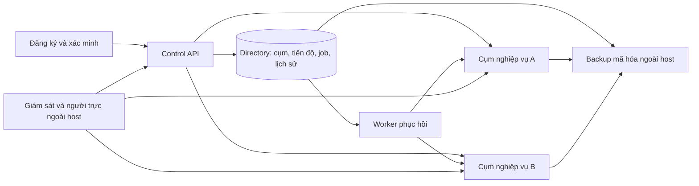

# RoomQC — phiếu bắt đầu triển khai toàn bộ VPS và đăng ký mới

**Điểm nhận việc hiện tại — đã nối runtime, 29/10/2026:** phạm vi toàn bộ VPS + signup; đầu ra plan + nghiệm thu. Bản đang sửa334 tệp/hash 6d7d491550eb9258865a2fa26eeae0a0e0934f7a8a5a2e6e8455da0ce24a8dac,587 business/21 directory migrations. [Báo cáo runtime](roomqc-support-intents-runtime-local-2026-10-29.md) và [packet](../../../artifacts/roomqc-support-intents-runtime-b3e1f84b1812-local-2026-10-29.json): native113/113,34barriers/3SIGKILL,exit0 trên source243567; control529pass/201skip/0fail cùng nguồn. Directory r2 có168pass/1fail do expected callback; đã sửa ba assertion và focused r3 đạt1/1 trên source hiện hành. Không cộng thành full169/169 cùng nguồn. Runtime bốn nhóm mutator đã nối journal; native expired recovery mới chỉ chứng minh close_admission,8HTTP retries cùng một API process. Nhận tiếp RF06 legacy,all-family/two-process recovery,worker,populated upgrade/security; R11/BG02 vàBG03–BG11 còn mở. Giữ25task/70ca/124lượt/122mục unverified; actual/reviewer/signoff/gates không đổi.

Lịch sử checkpoint — chỉ áp dụng đúng nguồn của từng báo cáo

**Checkpoint nền journal334/d30e — lịch sử, 29/10/2026:** source334/hash `d30e5ee5908404ed2da8d64ddc955305e98c273086bfe119334fac39b623dcf7`, 587 business/21 directory migrations. [Báo cáo](roomqc-support-intents-foundation-local-2026-10-29.md) và [packet](../../../artifacts/roomqc-support-intents-foundation-207ce2e0ad48-local-2026-10-29.json): directory 169/169 (9 ca journal mới), control 527 pass/0 fail/201 skip; native 104/104 kiểm tương thích Auth/HTTP hiện có, exit0. Journal giữ identity/generation/predecessor bền vững, khóa trên một connection và chặn vòng cũ; đã sửa xử lý backend termination và fixture pool cleanup. **Chưa nối coordinator vào mutator runtime hoặc chứng minh expired recovery qua canonical Auth.** Nhận tiếp RF04/RF05/RF06 tại mục5.4 dossier; R11/BG02, worker, populated business upgrade/security và BG03–BG11 còn mở. Giữ 25 task/70 ca/124 lượt/122 mục unverified, actual/reviewer/signoff/gates không đổi.

**Checkpoint331 — lịch sử consumption, 29/10/2026:** source331/hash `a700ff658818a1f0b8b43420cf120d93768f0fedc34b8b3de32f56a7d7a5ef1f`,587 business/20 directory migrations. [Báo cáo](roomqc-support-consumption-local-2026-10-29.md) và [packet](../../../artifacts/roomqc-support-consumption-331212d94761-local-2026-10-29.json): native104/104,28 barriers/1API SIGKILL; directory160/160; control527pass/0fail/192skip,exit0. Có proof Auth→command→consumption thật, rollback/mất phản hồi/expiry và3 cửa sổ accept-before-revoke cho cluster command. Source/schema đầu–cuối khớp,role baseline phục hồi,cleanup độc lập0. **R11/BG02 còn mở:** expired-attempt recovery,legacy same-key replay,worker,đủ mutation families,populated upgrade và security review; chưa full-default/rebuild/staging/nghiệm thu sản phẩm. [Phiếu nhận tiếp](roomqc-vps-signup-execution-dossier-2026-10-29.md#53-thứ-tự-triển-khai-bản-tích-hợp-source330) và [nghiệm thu](roomqc-vps-signup-master-acceptance-2026-10-28.md#124-thực-thi-bản-tích-hợp-source330). Giữ toàn bộ VPS+signup,8đợt/11BG/25task/27package/70ca/124lượt; actual/reviewer/signoff/gates không đổi.

**Bản nháp source330 — lịch sử, 29/10/2026:** phạm vi **toàn bộ VPS + signup**, đầu ra **plan + nghiệm thu**. Source330, SHA256 `ca77f438a4db58ad9843a7beceaeddec39a4b04d70179fb4c81bfd4417d6bc70`; 587 migration nghiệp vụ/20 directory. Đã viết bước tiêu thụ biên nhận quyền trong giao dịch quản trị; **chưa kiểm tích hợp Auth/HTTP/SQL và nâng cấp dữ liệu cũ cho bản này**. Preflight unit 15/15, exit0 chỉ chứng minh phạm vi helper/gateway/support; native90/90 và control520pass của source327 là lịch sử riêng. Nhận [phiếu R11 bản tích hợp](roomqc-vps-signup-execution-dossier-2026-10-29.md#53-thứ-tự-triển-khai-bản-tích-hợp-source330) và [bài nghiệm thu bổ sung](roomqc-vps-signup-master-acceptance-2026-10-28.md#124-thực-thi-bản-tích-hợp-source330). Hết hạn biên nhận và phục hồi cùng mã lệnh còn cần xử lý; R11/BG02 và các mốc L/S/P/U/B chưa được nhận. [Hồ sơ toàn phạm vi](roomqc-vps-signup-execution-dossier-2026-10-29.md) giữ 8 đợt/11 gói bàn giao/25 task/27 package/70 ca/124 lượt; actual/reviewer/signoff/gates không đổi.

**Checkpoint source327 — lịch sử, 29/10/2026:** [Báo cáo](roomqc-support-acceptance-component-local-2026-10-29.md) và [packet](../../../artifacts/roomqc-support-acceptance-component-4661134f0654-local-2026-10-29.json):source327/hash `e45b9fb53499c81fc65e8fd9af426307cf8c312dd698d10ef68f0051a87aa189`,586 business/19 directory migrations;control520pass/0fail/192skip,native90/90 gồm20 acceptance checks/6 interleaving,23 barriers/1API SIGKILL toàn run;exit0,source/schema khớp,cleanup độc lập0. Đã sửa migration guard và kiểm rollback schema/ACL/history. **Command directory chưa tiêu thụ acceptance**; chưa populated585→586/full-default/rebuild hoặc nghiệm thu sản phẩm. Nhận [R11-04–08](roomqc-vps-signup-execution-dossier-2026-10-29.md#52-phiếu-triển-khai-r11-theo-nguồn327),giữ các giới hạn và [RA01–RA18](roomqc-vps-signup-master-acceptance-2026-10-28.md#12-nghiệm-thu-protocol-r11-và-thành-phần-acceptance-mới). [Plan toàn VPS/signup](roomqc-vps-signup-execution-dossier-2026-10-29.md),25task/27gói/70ca/124lượt,actual/reviewer/signoff/gates không đổi. Audit kế hoạch r2 và checkpoint324 giữ hash/phạm vi lịch sử riêng.

**Checkpoint đã kiểm theo source324 — lịch sử:** [Quyền sau chờ SQL và đọc kết quả local](roomqc-support-authority-boundaries-local-2026-10-29.md) đã kiểm source324/hash `155f197c07839ba0535ac68f94f37898c89ee61375892f1646139b013c796556`:control516pass/0fail/192skip,directory160/160,native Auth/HTTP63checks/14revoke scenarios; terminal0,source/schema khớp và cleanup đúng ownership0. [Packet](../../../artifacts/roomqc-support-authority-boundaries-2765aadfaabb-local-2026-10-29.json). Đã sửa3lỗi late read/final release observation. R11/BG02 vẫn mở protocol revoke xuyênDB và claim/RPC/settle;63checks không thay full-default/rebuild hoặc nghiệm thu VPS. [Plan toàn VPS/signup](roomqc-vps-signup-execution-dossier-2026-10-29.md) có11BG,25task,70ca/124lượt; actual/reviewer/signoff/gates giữ nguyên. Checkpoint323/319 giữ hash/phạm vi riêng.

## 0. Bản nhận việc đã chốt

Ngày đối chiếu: **29/10/2026**. Phạm vi người dùng xác nhận: **toàn bộ VPS + signup**. Đầu ra: **plan triển khai + hồ sơ nghiệm thu**. Đây là điểm vào của kế hoạch; các checkpoint bên dưới là lịch sử theo nguồn, không phải danh sách phải làm lại.

**Kết quả cần đạt:** khách mở RoomQC → đăng ký/xác minh email → hệ thống chọn cụm đã chuẩn bị còn chỗ → tạo workspace/khách sạn/phòng → mời nhân viên có quyền theo vị trí → sử dụng. RoomQC quản lý VPS, gói, hạn mức, giám sát, backup và hỗ trợ. Một cụm phục vụ nhiều khách được cách ly; khách không phải cài VPS/Docker. Không cấp một VPS mới cho mỗi tài khoản đăng ký.

### 0.1. Nguồn hiện tại và phần đã chứng minh

Nguồn đang mở có **319 tệp backend**, SHA256 `44442d6d9e35e5dd845c30a2780cdb0b6664e8afd5efb2f74b1aea9aec7610f4`. [Contention local](roomqc-setup-rotation-contention-local-2026-10-29.md) có3interleaving thực,17kiểm native/25process/22barrier observations,exit0/source/schema không đổi/cleanup0; hồi quy46pass/0fail/1skip. Journal chung và riêng đã có proof local đúng phạm vi; chưa nhận toàn BG02 hoặc sản phẩm.

Checkpoint [storage318](roomqc-setup-rotation-storage-local-2026-10-29.md), [durability316](roomqc-setup-rotation-durability-local-2026-10-29.md), [startup/periodic315](roomqc-setup-rotation-startup-local-2026-10-29.md) và [worker mount313](roomqc-setup-runtime-mount-local-2026-10-29.md) giữ hash và phạm vi riêng. Không gán toàn bộ proof cũ sang319.

**Chưa được nhận toàn sản phẩm:** các biến thể filesystem khác và tranh chấp chưa phủ hết; revoke actor xuyên Auth/directory/business chưa khép; tài nguyên toàn stack, signup/email thực, console còn thiếu, candidate tích hợp, VPS/TLS, offsite restore, A/B, Android, tải/chi phí và pilot còn phải làm hoặc nhận riêng. Contract hiện còn đánh dấu API backup và tenant-summary là planned.

### 0.2. Thứ tự bàn giao toàn phạm vi

| Mốc / vai trò thực hiện | Việc còn phải khép | Điều kiện nhận và bài demo |
|---|---|---|
| BG01 — BE/OPS; QA kiểm | Review bộ cài/IF01–IF17 và proof theo đúng hash; sửa delta thực sự còn thiếu | Cài/issue/publish/replay/revoke đúng receipt; lỗi/crash không tạo trùng hoặc ready giả; có disposition và cleanup |
| BG02 — BE/OPS; QA kiểm | Journal hỏng/IO, hai daemon tranh chấp, revoke actor, quyền/mount/rotation trên đúng profile | Cùng yêu cầu chỉ có một kết quả hợp lệ; khóa cũ mất quyền đúng mốc; không mất pending, không lộ signer/DSN issuer |
| BG03 — BE/OPS; QA kiểm | Inventory/budget mọi service, health/freshness, reservation, quota và fairness | 20 request tranh suất cuối chỉ một reservation; cụm đầy/stale đóng nhận mới; khách cũ giữ mapping; consumer chưa xác định = 0 |
| BG04 — BE/FE/OPS; QA kiểm | Signup → email → hotel/rooms → staff; resume/recheck; anti-abuse/trial/quota | F5/hai tab/mất response không tạo thêm workspace/hotel/trial; server enforce quyền/gói; email Internet kiểm ở staging |
| BG05 — FE/BE; QA/RQ kiểm | Hai console, backup/tenant-summary, totals/cursor, command/result, menu/Back | 1.000 metadata có đáp án; tìm ca kẹt <30 giây; đủ đường click; lỗi/stale không hiện thành 0/healthy; 390px/keyboard/zoom200% |
| BG06 — BE/FE/OPS; QA kiểm | Khóa candidate backend/frontend/schema/config/image; regression, full-default, rebuild và journey | Cùng nguồn đầu–cuối; skip/defect có xử lý; review hồ sơ tích hợp L. Run backend cũ không thay candidate sản phẩm mới |
| BG07 — OPS/BE; QA kiểm | Linux VPS thật, private ports, secret/UID, install/rerun/reboot, DNS/TLS/renewal, upgrade/rollback | Cài và nâng cấp có dữ liệu; rerun/reboot không mất mapping/job; HTTPS/callback đúng; không public DB/Studio/metrics |
| BG08 — OPS; QA/RQ kiểm | Backup nhất quán, offsite mã hóa, host sạch, một writer, cảnh báo/người trực | Host gốc unavailable vẫn restore DB/Auth/directory/object bytes/job/receipt đúng; đo RPO/RTO và nhận/ack cảnh báo ngoài host |
| BG09 — QA/FE/BE/OPS | Hai cụm độc lập cùng chạy; web + Android emulator/device; deep link/offline/Back/keyboard | UI/network/DB/receipt cùng run; token/dữ liệu không lẫn; A lỗi không fallback B; ghi build/OS/device |
| BG10 — QA/OPS; RQ review | Khóa workload/SLO, ramp/soak/noisy neighbor/backup overlap, chi phí/limit, RC/cutover | 123 lượt local/staging có review trước pilot; không Critical/High về quyền/dữ liệu/cấp phát/restore; max_tested và operating_limit tách riêng |
| BG11 — OPS/RQ; QA kiểm | Pilot hạn chế ≥7 ngày; incident/support/cost/feedback và quyết định mở rộng | Một KS nội bộ; ổn 24–48 giờ mới đề nghị 5–10; pilot có actual/reviewer; quyết định mở công khai U riêng; thu phí chờ B |

Mỗi dòng là điểm bàn giao của **8 đợt/25 task/27 gói gốc**. [25 phiếu kỹ thuật](roomqc-vps-signup-master-plan-2026-10-28.md#4-phiếu-triển-khai-25-task) và dependency trong ma trận là chuẩn; không ký task khi dependency chưa đủ. [11 phiếu chi tiết](roomqc-vps-signup-deployment-blueprint-2026-10-28.md#9-phiếu-thực-hiện-bg01bg11-từ-bản-301) có file/API, trình tự, đầu ra, người nhận và điều kiện dừng.

### 0.3. Gói nhận ngay: khép khoảng trống BG02

1. Khóa hash làm việc mới và fixture riêng; ghi người làm/reviewer, target/budget/deadline. Review phần đã có, không chạy lại mọi bộ test chỉ vì sửa tài liệu.
2. Review [actual storage318](roomqc-setup-rotation-storage-local-2026-10-29.md) và [ma trận10.4](roomqc-vps-signup-master-acceptance-2026-10-28.md#104-ma-trận-journal-hỏng-và-lỗi-io-cần-thực-hiện):10journal corruption+8FUSE EIO đã có proof. Chỉ kiểm lại khi có delta hoặc thiếu bằng chứng; không giao lại harness như chưa tồn tại.
3. Với biến thể chưa phủ hoặc delta chịu ảnh hưởng: positive → fault thật → recovery → restart lần hai; ghi syscall/process/DB/file/receipt, không đổi key khi outcome chưa rõ. Kiểm cleanup session/lock/role/container và canary ngoài fixture.
4. Review [ba interleaving contention319](roomqc-setup-rotation-contention-local-2026-10-29.md): journal chung active prepare/archive race; journal riêng precommit/postcommit; winner/loser, CAS, unknown replay và overlap đã có proof local. Chỉ bổ sung race khi có case/defect/rủi ro cụ thể; không giao lại ba bài này như chưa chạy.
5. Chốt protocol thu hồi actor theo commit Auth/directory/business; thử JWT còn hạn tại claim/RPC/settle. Đo độ trễ nếu có; không dùng readiness trước batch để kết luận revoke nguyên tử.
6. Bổ sung hồi quy phần chịu ảnh hưởng, runbook/start-stop-resume, budget và packet cùng hash; giao reviewer theo [12 subchecks BG02](roomqc-vps-signup-master-acceptance-2026-10-28.md#10-bài-kiểm-chi-tiết-cho-bg02). Chưa đủ proof giữ BG02 mở; sau đó nhận BG03.

Các kiểm native chỉ chạy sandbox có ownership riêng; không sửa serving DB RoomQC/CRM. Không cần secret production cho phần này. UID10001 local không chứng minh quyền UID1000/mount/storage thật trên VPS.

### 0.4. Nghiệm thu và điều kiện chuyển bước

Giữ **70 ca/124 lượt: 54 local, 69 staging, 1 pilot**, theo [ma trận bất biến](../../../artifacts/roomqc-vps-signup-acceptance-execution-plan-2026-10-28.json). Mỗi kết quả có case+environment, source/image/schema/config/dataset/target, bước/lệnh thật, runner, actual, exit, effects/cleanup, evidence đã lọc, defect và reviewer/signoff. Chưa chạy để not_run; lỗi harness không ghi product pass.

| Mốc quyết định | Hồ sơ tối thiểu để đề nghị |
|---|---|
| L — tích hợp local | Candidate hiện hành, delta/recovery/cleanup, full-default/rebuild và review |
| S — staging | Linux VPS/TLS/private ports/install/upgrade/rollback thực và target đã xác minh |
| P — pilot | 123 lượt trước pilot được nhận; RC/capacity/DR/on-call/killswitch/cohort, không lỗi Critical/High trong scope |
| U — đăng ký công khai | Pilot ≥7 ngày đạt, capacity/anti-abuse/cost/operating limits và quyết định mở riêng |
| B — thu phí thật | Nghiệm thu thanh toán, bảo mật/nghiệp vụ và quyết định riêng |

Mục tiêu đề xuất cần khóa **trước run**, chưa là SLA/actual: status p95 ≤500ms, reserve/admin list p95 ≤1s, provision p95 ≤10s không tính chờ người/email; soak ≥60 phút và 5xx ngoài fault <1%; RPO ≤24h/RTO ≤4h; host fault detected ≤180s/received ≤300s. [Cách đo và giới hạn](roomqc-vps-signup-master-plan-2026-10-28.md#6-tài-nguyên-sức-chứa-và-chính-sách-khách-hàng).

**Dừng phần ghi chịu ảnh hưởng** khi truy cập chéo tenant, duplicate, sai mapping/receipt, vượt budget, khóa cũ ghi ngoài protocol, mất pending, secret leak hoặc cleanup không xác nhận. Giữ bằng chứng, đóng nhận mới/claim theo runbook, đối soát cùng yêu cầu. Rollback binary/config phải tương thích schema; không xóa audit/job/receipt để chữa lỗi.

### 0.5. Đầu vào chờ và cách lập lịch

| Đầu vào cần nhận | Người cung cấp/xác minh | Cần trước | Việc vẫn làm được |
|---|---|---|---|
| VPS staging/host sạch, Linux/SSH scope/inventory/chi phí | OPS, RQ | BG03 số liệu thực; BG07–BG10 | Bundle/preflight/fixture/budget template |
| DNS/TLS roomqc.com, hostname/callback/deep link | OPS/FE, RQ | BG04 Internet/BG07/BG09 | Allowlist/callback/deep-link tests local |
| Email provider/sender/webhook/inbox kiểm soát | OPS, RQ | D15 staging | Sink/outbox/dedupe/retry; không mặc định Resend đã sẵn sàng |
| Offsite/khóa khôi phục/retention, người trực/kênh ngoài host | OPS, RQ | BG08/pilot | Consistency/restore/drill scripts |
| Bảng gói/trial/quota/grace/suspend/export/delete | RQ, BE | Enforcement BG03/BG04 | Contract có version và fixture |
| Người nhận/reviewer/cohort/giới hạn/budget | QA/RQ, OPS | Review từng BG; P/U/B | Phiếu nghiệm thu và report template |

Theo chỉ dẫn đã có, phần cần key/quyền được gom chờ; tiếp tục phần độc lập. Ghi safe reference, môi trường, scope và người xác minh; không đưa secret vào chat/tài liệu.

Dự toán hiện có: **38,5–68 ngày công** gồm triển khai + kiểm/review, chưa tính chờ đầu vào; **không phải ngày lịch hoặc cam kết phát hành**. [Bảng theo BG](roomqc-vps-signup-implementation-board-2026-10-28.md#11-dự-toán-công-việc-còn-lại-và-cách-lập-lịch) cần ước lượng lại theo delta trước nhận việc. Pilot cần tối thiểu 7 ngày lịch. Mục tiêu 1.000 khách sạn/100.000 user phải được đo theo profile; chưa có cơ sở cam kết sức chứa.

**Bàn giao kế hoạch:** dùng phiếu này để nhận việc, blueprint để sửa đúng file, board để theo dõi phụ thuộc/công, và [hồ sơ nghiệm thu](roomqc-vps-signup-master-acceptance-2026-10-28.md) để chạy/ghi actual. Lượt rà tài liệu không thay đổi 122 mục release unverified, reviewer/signoff/gates hoặc kết luận hoàn tất mục tiêu sản phẩm.

### 0.6. Cách điều phối để từng phần có điểm kết thúc

1. **Trước một lượt:** chọn đúng delta thuộc BG/task/case gốc; điền người làm, reviewer, dependency, target, nguồn, expected, đầu ra và giới hạn thời gian/tài nguyên. Chưa có tên người hoặc quyền môi trường thì ghi thiếu, không tự điền là đã sẵn sàng.
2. **Trong lượt:** làm implementation cần thiết, chạy kiểm phù hợp phần thay đổi và thu bằng chứng. Không chạy lại toàn bộ diagnostic đã có chỉ vì cập nhật tài liệu. Bài kiểm bắt buộc chưa có actual vẫn giữ mở; biến thể mới chỉ thêm khi có defect hoặc rủi ro cụ thể gắn với case gốc, kèm lý do và tác động lịch.
3. **Khi kết thúc:** bàn giao một kết quả có thể review: file/API/UI thay đổi; bài demo; source/target; actual và evidence; defect/skip/giới hạn; effects/cleanup; người nhận và quyết định nhận hoặc trả sửa. Chưa có reviewer thì ghi chờ review, không giả chữ ký.
4. **Báo cáo tiến độ:** liệt kê đã làm, đã kiểm, còn thiếu, đang chờ đầu vào và việc tiếp theo. Phân biệt triển khai xong, kiểm local đạt và nghiệm thu môi trường đích. Không dùng số test hoặc số trang làm phần trăm hoàn thành.
5. **Chuyển bước:** nhận mốc kế tiếp theo dependency; chuẩn bị phần độc lập khi chờ VPS/DNS/email/offsite. Không mở đăng ký công khai, nhận khách thật hoặc thu phí chỉ vì một diagnostic đạt. Các quyết định L/S/P/U/B giữ điều kiện ở mục0.4.

**Lượt tiếp theo đã xác định:** review proof BG02-04 tại [contention319](roomqc-setup-rotation-contention-local-2026-10-29.md), rồi BG02-06/R11 chốt và kiểm hiệu lực thu hồi actor Auth→directory→business. Kết thúc bằng packet có nguồn, effect/receipt, recovery, cleanup và giới hạn; không mở rộng thành một vòng kiểm tra vô hạn. Toàn bộ VPS/signup vẫn theo BG03–BG11, không bị thay bằng riêng bài thử thay khóa.

---

Phần bên dưới giữ nội dung và các checkpoint trước theo thời điểm riêng. Nếu có trạng thái cũ khác phiếu 0 ở trên, dùng phiếu 0 làm điểm nhận việc; evidence gốc vẫn giữ đúng hash/phạm vi.

**Checkpoint local lịch sử — rotation 29/10/2026:** backend310 tệp, SHA256 `314c1ec4b68fec86b5cf49aedf6d328555e4545f7d934520989b362fca74cb4a`;585 business+19 directory. [Daemon/journal và DB ready-head fence](roomqc-setup-rotation-local-2026-10-29.md) có14 kiểm native (8 rotation),18 process UID10001/CapEff0, kill/replay/overlap/expiry/revoke; unit509 pass/184 skip/0 fail. Run1c06a184f980 exit0, source/schema không đổi, cleanup0. Phạm vi entrypoint `--once`; chưa periodic daemon lâu/SIGTERM, full race/fault matrix, runtime container read-only mount/reload hoặc actor revoke xuyên hai DB. [Runbook mới](roomqc-setup-credential-rotation-runbook.md). Tiếp BG02 phần còn thiếu; BG06 phải khóa candidate mới. Các checkpoint301 phía dưới giữ lịch sử, không phải nguồn hiện hành. Không đổi70ca/124lượt/122mục, reviewer/signoff/gates.

**Checkpoint local trước — 29/10/2026:** backend301 tệp, SHA256 `2ec50f6dd1e473a45a54636594d6fd59451c452eb1f5d0f1a375bd1795b371d0`. [Runtime kiểm khóa live trước nhận việc](roomqc-setup-runtime-readiness-local-2026-10-29.md) đã sửa lỗi file còn hạn nhưng khóa đã revoke vẫn vượt readiness. Native run39f0f08155b0 đạt38 kiểm (22 worker,8 backfill,8 apply), source/schema không đổi và cleanup0; unit495 pass/184 skip/0 fail. Đây là diagnostic local; chưa daemon rotation, runtime UID/mount read-only hoặc thu hồi quyền nguyên tử xuyên hai database.

**Nhận tiếp BG02:** scheduler/journal, hai rotator và overlap/expiry khi daemon chết; container runtime chỉ mount output read-only; chốt điểm hiệu lực Auth→directory. R4 là [snapshot kế hoạch](../../../artifacts/roomqc-vps-signup-execution-plan-audit-r4-2026-10-29.json) của source301/ede96e trước sửa runtime, verifier r4 phải từ chối nguồn mới; giữ nguyên lịch sử, không nới pin. Các packet rebuild/filesystem/restore phía dưới có phạm vi nguồn riêng. Giữ8đợt/25task/27gói/70ca/124lượt,70ca not_run/122mục unverified, reviewer/signoff/gates chưa đổi.

**Checkpoint local lịch sử — timeout bộ cài:** [Báo cáo deadline](roomqc-setup-installer-deadlines-local-2026-10-28.md), [bảng triển khai](roomqc-vps-signup-implementation-board-2026-10-28.md). Backend291 files/hash `bb21bef86c200d3d09c950b11c96417710bb9a9a47af7af0d3a0200caec2a367`;584+19 migrations. Focused100/100, native362/362 và control673 tổng/671 pass/0 fail/2 skip; terminal0, cùng source/schema tương ứng, cleanup0. IF11 có SQLSTATE thật, witness rollback, deadline45giây và13 lần kiểm session/mutex. IF01–IF11,IF13,IF16,IF17 có local proof đúng scope; tiếp IF12/IF14/IF15 rồi rotation/mount/Auth→directory. Lần1/T08/T12,70ca/124lượt/122mục,reviewer và gates vẫn mở.

**Checkpoint đã kiểm trước nháp timeout:** [Báo cáo mới](roomqc-setup-installer-transactions-local-2026-10-28.md), [bảng triển khai](roomqc-vps-signup-implementation-board-2026-10-28.md). Backend289 files/hash `6802f300c3c4232e8e649f039aaf5be285da92f8b0a2116c0308318de3c16e14`;584+19 migrations. Focused75/75, native337/337 và control673 tổng/671 pass/0 fail/2 skip; terminal0, cùng source/schema tương ứng, cleanup0. IF10 đã có thu hồi khóa qua LOGIN API thật; IF16 có witness mutation→rollback và replay cùng key. Các nhóm IF01–IF10,IF13,IF16,IF17 có local proof đúng scope; còn IF11/IF12/IF14/IF15 rồi rotation/mount/revoke xuyên hệ thống. Lần1/T08/T12,70ca/124lượt/122mục,reviewer và gates vẫn mở.

**Checkpoint trước — preflight/quyền/fences local:** [Báo cáo fences](roomqc-setup-installer-fences-local-2026-10-28.md), [bảng triển khai](roomqc-vps-signup-implementation-board-2026-10-28.md). Backend288 files/hash `3ddefd9ddc068cbf097331f3f708fee790e7b5bfe27075148f450bd8681d7b22`;584+19 migrations. Focused66/66 và control673 tổng/671 pass/0 fail/2 skip, terminal0/cùng source/cleanup0. [Native328/328](../../../artifacts/roomqc-setup-installer-fences-native-51f2a15b16c2-local-2026-10-28.json) gồm66 installer controls, terminal0/source/schema/cleanup0. IF01–IF09,IF13,IF17 có proof local; IF10 còn key withdrawal, IF11/IF12/IF14/IF15/IF16 chưa khép, rồi rotation/mount/revoke xuyên hệ thống. Lần1/T08/T12,70ca/124lượt/122mục,reviewer và gates giữ mở.

**Checkpoint trước — IF01–IF05 có proof local:** [Báo cáo fault](roomqc-setup-installer-faults-local-2026-10-28.md), [bảng triển khai](roomqc-vps-signup-implementation-board-2026-10-28.md). Backend287 files/hash `1f576b109c6c5665a2dec4e4e0aa06e818a246a872c384b1b226d84eadc612dc`;584+19 migrations. Native289/289 gồm27 installer controls, control673 tổng/671 pass/0 fail/2 skip; terminal0, cùng source/end-source/schema/cleanup0. Đã kiểm bind/issue/revoke mất phản hồi, caller/key/body conflict, hai CLI và SIGKILL trước/sau commit. Còn IF06–IF17 rồi rotation/mount/revoke xuyên hệ thống; chưa đóng lần1/T08/T12, nghiệm thu70ca/124lượt/122mục và gates vẫn mở.

**Checkpoint đã kiểm trước đợt fault:** [Báo cáo và giới hạn](roomqc-setup-credential-installer-local-2026-10-28.md), [bảng triển khai 11 lần bàn giao](roomqc-vps-signup-implementation-board-2026-10-28.md). Backend287 files/hash `7b7fb7ddd8f126875160323e409e441d855646b61788abb7189ea7972a3f4224`,584+19 migrations; native278/278 gồm16 installer CLI mới, control672 tổng/670 pass/0 fail/2 skip; terminal0, cùng source, cleanup0. Lần1 chưa đóng: còn fault matrix toàn tuyến; lần2 rotation/mount reload/thu hồi Auth→directory chưa kiểm. Phạm vi toàn VPS+signup, đầu ra Plan+nghiệm thu;70ca/124lượt/122mục,reviewer,gates và goal tổng thể giữ mở.

**Checkpoint lịch sử — publisher trước installer:** [publisher local](roomqc-setup-publication-local-2026-10-28.md) đạt262/262 controls, gồm18 publication mới với4 publisher SIGKILL/resume; credential/status/attestation/publication tổng78. Control663 tổng/661 pass/0 fail/2 skip;583+18 migrations, source281 files/hash33d8482f5c9e784d8d54cfce29ebf33a0f0d47ab66e6df9f993c074a7afcf7d9, cleanup0. Receipt/status được đọc lại qua DB, private intent/stage/fsync/rename và native RPC đã kiểm; authority callback vẫn fixture. Chưa có operational installer/DB identity/target/budget/live directory authority/rotation hoặc mount reload thật. Nhận cấu hình/preflight và issue→publisher→rotation, rồi cross-system revoke/T10/signup/console/default-full/rebuild/VPS/DR/E2E/tải/RC/pilot.70ca/122mục/124lượt/reviewer/gates giữ nguyên.

**Checkpoint trước — fingerprint v3 và trạng thái khóa:** [catalog/readiness local](roomqc-setup-attestation-status-local-2026-10-28.md) đạt244/244 controls, gồm60 credential/status/attestation (25 mới), giữ184 API/worker/CLI;9 drift catalog thật đều bị verifier chặn,2 SQL-writer SIGKILL/2 barrier. Control658 tổng/656 pass/0 fail/2 skip;583+18 migrations,source277 files/hash894abdb63eaac8c45e2ec852773fd5c824f22908ceff1f35c40d159d601ac1f8,cleanup0. Upgrade582/583 rollback đạt; fingerprint v3 phủ2 schema phục hồi và capability graph, manifest v1/v2 bị từ chối. Status đọc hiện hành, không lấy receipt làm readiness; admin schema không expose REST. Advisor808/247WARN chưa disposition. Nhận installer/DB identity/target/budget/signer/file/refresh→cross-system revoke→T10/signup/console→default-full/rebuild→VPS/DR/E2E/tải/RC/pilot.70ca/122mục/124lượt/reviewer/gates giữ nguyên.

**Checkpoint trước — lệnh quản lý khóa phục hồi:** [giao thức và bằng chứng local](roomqc-setup-credential-command-local-2026-10-28.md) đạt219/219 controls, gồm35 mới với2 SQL-writer SIGKILL và2 barrier; giữ184 API/worker/CLI nền. Control656 tổng/654 pass/0 fail/2 skip;581+18 migrations, source277 files/hashafbb17c9eb867af6d77e58d73bcaaf5ffc3bdafd75963d3186d513806154edb9, cleanup0. Upgrade581 dùng phiên bảo trì riêng, rollback schema/role/history đạt. Advisor đo lại808 findings/247 WARN, chưa disposition. Đây là giao thức DB, chưa installer/file publication/lịch thay khóa. Fingerprint v2 tại checkpoint này chưa phủ roomqc_setup/roomqc_setup_admin; nhận attestation→installer/rotation và cross-system revoke→T10/signup/console→default-full/rebuild→VPS/DR/E2E/tải/RC/pilot.70ca/122mục/124lượt/reviewer/gates giữ nguyên.

**Checkpoint trước — CLI với biên nhận native:** [reader/writer, signed batch và phục hồi tiến trình](roomqc-setup-cli-native-local-2026-10-28.md) đạt184/184 controls, gồm16 CLI mới (3 barrier),45 API/process và123 nền; cùng source276 files/hash592e36737b8f89b8e7b905716f00210569c855b75b32534c68324518c60f4d39. Control656 tổng/654 pass/0 fail/2 skip;580+18 migrations,cleanup0. CLI có biên nhận PostgREST thật, lost-response sau commit và SIGKILL; Auth confirmed/health/release/batch-review vẫn fixtures. Nhận installer/rotation/maintenance và revoke semantics→T10/quotas→signup/email/console delta→default-full/rebuild→staging/DR/E2E/tải/RC/pilot.70ca/122mục/124lượt/reviewer/gates giữ nguyên.

**Checkpoint trước — tích hợp API/Auth/process local:** [đăng ký→recheck→worker với Auth thật](roomqc-setup-api-native-local-2026-10-28.md) đạt168/168 controls, gồm45 API/process và28 barrier mới,10 SIGKILL (7API/3worker), TCP lost-response sau commit và live session revoke khi chờ directory lock. Control656 tổng/654 pass/0 fail/2 skip; cùng source274 files/hash98387288f1cc901146c430c3b7728f4acc7c0a09ec0ed5dc85a9ca5bb341d844;580+18 migrations,cleanup0. Auth accounts confirmed/health/release vẫn fixtures; chưa public email signup, native CLI toàn tuyến, default-full/rebuild, browser/Android hoặc VPS. Nhận native CLI→installer/revoke/T10→candidate/default/rebuild→staging/DR/E2E/tải/RC/pilot.70ca/122mục/124lượt/reviewer/gates giữ nguyên.

**Checkpoint trước — recheck local:** [API/contract/UI/journal và proof](roomqc-workspace-recheck-local-2026-10-28.md) có migration18, replay trước CAS, detail snapshot nhất quán, một recovery cycle/dispatch (3 attempts/15 phút), giữ job history/lease và sửa late owner settle. Control656 tổng/654 pass/0 fail/2 skip; frontend66/66 + TS/lint; native nền580+18 migration/123 controls; backend272 files/cleanup0. Native chưa kiểm platform recheck/live Auth; client dùng jsdom/Capacitor mock. Nhận public API→worker→remote thật/process faults, native CLI toàn tuyến, installer/T10/full-default/rebuild/VPS/DR/E2E/tải/RC/pilot. Chưa bật runtime hoặc ký T12;70ca/122mục/124lượt/gates giữ nguyên.

**Bản tổng hợp hiện hành:** [25 phiếu triển khai và thứ tự nhận](roomqc-vps-signup-master-plan-2026-10-28.md), [hồ sơ nghiệm thu](roomqc-vps-signup-master-acceptance-2026-10-28.md). Phạm vi toàn VPS+signup, đầu ra Plan+nghiệm thu. CLI local bên dưới giữ lịch sử; recheck có packet riêng và chưa ký toàn môi trường. Giữ nguyên 70 ca/124 lượt/122 mục và các gate.

**Checkpoint trước — CLI apply theo lô:** [writer/manifest/process recovery local](roomqc-setup-backfill-cli-local-2026-10-28.md) có signed batch đúng report/target/allowlist, writer budget/pool1, Windows ACL/POSIX files, output exclusive/fsync và actual CLI SIGKILL/post-commit response-loss/resume. Control640 tổng/638 pass/0 fail/2 skip; native580+17 migration/123 controls; Linux container14/14; source268 file/cleanup0. Nhận durable recheck4.4 rồi public API/worker fault/E2E, installer/T10/default-full/rebuild/VPS theo plan. Chưa apply dữ liệu vận hành hoặc bật worker/dispatch;70ca/122mục/gates giữ nguyên.

**Checkpoint trước — lõi apply backfill:** [ghi đối soát local](roomqc-setup-backfill-apply-local-2026-10-28.md) có directory 0017, role riêng, hai RPC, journal/CAS/audit/final expiry và terminal reconciliation. Control 634 tổng/632 pass/0 fail/2 skip; native 580+17 migration/123 controls, gồm 8 apply mới; source 261 file, cleanup0. Nhận config/CLI writer, approved batch manifest và process interruption/resume ở4.3, rồi durable recheck4.4. Chưa apply dữ liệu vận hành hoặc bật worker/dispatch;70 ca/122 mục/gates giữ nguyên.

Ngày 28/10/2026, Asia/Bangkok. Phạm vi người dùng xác nhận: **toàn bộ VPS + signup; đầu ra plan + nghiệm thu**. Tài liệu này cụ thể hóa các bước nhận việc của [kế hoạch hành động](roomqc-vps-signup-next-delivery-2026-10-28.md); giữ nguyên 25 task, 27 gói và 70 ca gốc. Đây là kế hoạch thực thi, chưa phải biên bản sản phẩm đạt.

## 1. Kết quả người dùng và người quản lý phải nhìn thấy

Khách vào roomqc.com → đăng ký → xác minh email → nhập khách sạn → thấy tiến độ → vào ứng dụng → mời nhân viên theo vị trí và quyền. F5, đóng trình duyệt hoặc mất mạng không bắt khách tạo khách sạn lại. Nếu cần hỗ trợ, màn hình có mã yêu cầu và hướng dẫn tiếp theo.

RoomQC vào **Hạ tầng** để biết cụm nào khỏe, đầy, tạm đóng nhận, cần mở rộng hoặc cần phục hồi; vào **Đăng ký mới** để tìm khách đang kẹt, xem lịch sử và kiểm tra lại. Mỗi thao tác có quyền, lý do, kết quả bền vững và dấu vết người thực hiện. Giao diện không yêu cầu người vận hành tự chạy SQL.

Chuẩn bị cụm VPS trước rồi phân khách mới vào cụm đủ điều kiện. Một workspace giữ cụm đã được gán; một workspace có thể chứa nhiều khách sạn theo gói. Thêm cụm để tăng tổng sức chứa; việc chuyển khách cũ sang cụm khác có quy trình dữ liệu riêng. Chưa có số đo để cam kết sức chứa 1.000 khách sạn hoặc 100.000 người đồng thời.

## 2. Điểm xuất phát và cách hiểu trạng thái

| Phần | Hiện trạng kiểm được | Việc còn lại |
|---|---|---|
| Directory, identity, dispatch, receipt, worker | Có backfill/recheck và API/Auth/worker/process fault proof local theo packet hiện hành | Installer/file/rotation, hiệu lực revoke Auth→directory, tích hợp mặc định và VPS |
| Đối soát dữ liệu cũ | Reader/scanner, apply0017, private config, signed batch và CLI native với kill/lost-response/resume đã kiểm local | Lô vận hành được review, default-full/rebuild và target staging; chưa apply serving DB |
| Console quản trị | Có route, danh sách/chi tiết, cảnh báo, năm lệnh cụm và recheck/journal local | Tenant-summary, backup, totals/cấu hình còn thiếu và browser/Android E2E |
| Tài nguyên | Có budget và một số adapter/đích DB/vendor local | Toàn stack, DSN thực, overlap khi nâng cấp, fairness/quota và tải thật |
| Hạ tầng phục vụ | Chưa có bằng chứng đủ trên VPS mục tiêu | Linux/TLS, credential, offsite restore, alert ngoài host, A/B |
| Nghiệm thu phát hành | Bộ ca và ma trận môi trường đã lập | Actual, reviewer, quyết định gate và pilot |

[Checkpoint reader/upgrade](roomqc-setup-backfill-local-2026-10-28.md): control 620 tổng/618 pass/0 fail/2 skip; native 115/115 controls trên 580 migration nghiệp vụ +16 directory. Hai skip cần môi trường đúng; proof native có giới hạn fixture, chưa là public signup E2E. Dùng SHA và phạm vi trong packet, không chuyển count này thành kết quả của source mới.

**Trạng thái chuẩn để báo cáo:** code có / local đã kiểm có phạm vi / tích hợp chưa kiểm / chờ đầu vào / nghiệm thu chưa chạy. Chưa có cơ sở ghi phần trăm “hoàn tất sản phẩm”. 70 ca vẫn `not_run`, 122 mục release vẫn `unverified`; 124 lượt môi trường chưa có actual nghiệm thu.

## 3. Bảng giao toàn phạm vi theo 25 task gốc

Vai trò BE: backend/database; FE: web/Android; OPS: hạ tầng; QA: kiểm/review; RQ: quyết định sản phẩm. Dependency chính xác và người review nằm trong [ma trận thực thi](../../../artifacts/roomqc-vps-signup-acceptance-execution-plan-2026-10-28.json). Bảng sau chỉ nêu delta phải bàn giao, không đánh dấu task hoàn tất.

| Đợt / task | Đầu ra còn phải nhận | Ca gốc trọng tâm | Phụ trách |
|---|---|---|---|
| 1 / T01 | Manifest source/image/schema/config, target và fixture có ownership; baseline runtime đang dùng | A01–A03 | BE/OPS |
| 1 / T02 | Upgrade dữ liệu cũ, migration rerun/checksum/concurrency; runtime restart không mất mapping/job | A04–A07 | BE/OPS |
| 1 / T03 | Quyền live, atomic command+audit+receipt, writer còn sót và compatibility | A08–A11 | BE |
| 1 / T04 | OpenAPI/handler/client khớp; phục hồi kết quả, native transport và lỗi có mã | A03,A08–A11 | BE/FE |
| 1 / T05 | Metrics/probes đúng host/mount/DB/cụm, thiếu hoặc stale thành unknown | B01–B03 | OPS/BE |
| 1 / T08 | Trust/issuer/installer/credential, indirect privilege và disposition advisor | A06,B02,C01–C04 | BE/OPS |
| 1 / T06 | Health commit đúng revision; fault/restart; full-default và independent rebuild cùng candidate | B04–B07 | BE/OPS |
| 2 / T07 | Incident/outbox dedupe, ack/reopen, retry và nhận báo khi host mất | B08,B09 | BE/OPS |
| 3 / T09 | Reservation cuối cùng atomic, expiry/replay/manual close và affinity | C05–C10 | BE |
| 3 / T10 | Tổng budget toàn stack, đích DB, rolling overlap, bounded queues/quota và tenant đối chứng | G05,G06 | BE/OPS |
| 4 / T11 | Intent/Auth/verify/onboarding/status/resume owner-only; khách cũ vẫn đăng nhập đúng cụm | D01–D06,A03 | BE/FE |
| 4 / T12 | Backfill apply, durable recheck, worker crash/recovery và proof đúng dispatch | D07–D11,A07 | BE |
| 4 / T13 | Shared limiter, proxy/direct Auth gate, email/callback và policy server-side | D12–D15 | BE/OPS/FE |
| 5 / T14 | Hai console dùng platform authority, cache/request được scope và hủy khi logout | A03,E08 | FE/BE |
| 5 / T15 | Hạ tầng: totals/detail/backup/command/config, unknown và stale rõ ràng | E03–E05 | FE/BE |
| 5 / T16 | Đăng ký mới: search/timeline/summary/recheck/result và việc khách làm tiếp | E01,E02,E05,E08 | FE/BE |
| 5 / T17 | Một menu chính đủ chức năng, Back/filter/scroll/focus/390px/zoom/keyboard | E01–E08 | FE/QA |
| 6 / T18 | Bundle Linux pin digest, preflight/install/rerun/reboot/upgrade/TLS/private ports | F01–F04,B01 | OPS/BE |
| 6 / T19 | Backup nhất quán DB/Auth/queue/objects/directory; restore host sạch từ offsite | F05–F08 | OPS |
| 6 / T20 | Runbook, người trực chính/phụ, alert ngoài host và drill nhận/ack/phục hồi | B09,F09 | OPS |
| 7 / T21 | Hai backend A/B độc lập chạy đồng thời, token/data không lẫn, A lỗi không fallback B | G01–G03 | QA/BE/OPS |
| 7 / T22 | Browser và Android qua hành trình thật; hai tab/F5/lost-response/revoke/Back/deep link | A/D/E/G theo ma trận | QA/FE/BE |
| 7 / T23 | Ramp/soak, report/upload/backup/signup burst, max-tested/operating-limit/chi phí | G04–G06 | QA/OPS |
| 7 / T24 | RC cùng candidate, review toàn hồ sơ, cutover/compatible rollback, đề nghị pilot | G07 | QA/OPS |
| 8 / T25 | Pilot ít nhất 7 ngày, drill/lỗi/support/chi phí và quyết định mở rộng | G08 | OPS/RQ |

Thứ tự trong một đợt vẫn theo dependency, ví dụ T08 trước T06. Chuẩn bị code/fixture khi đầu vào chưa khép không cho phép ký task hoặc bật vận hành. T10 phải có budget tạm đủ đã review trước signup; operating limit cuối được xác định sau T23, tránh chờ vòng tròn giữa budget và tải.

## 4. Lần bàn giao kế tiếp: backfill apply — T02/T12

**Phiếu lịch sử, giữ để hồi quy:** tiêu đề và checklist dưới đây thuộc lần giao trước. Backfill apply, native CLI, durable recheck và API/worker/Auth/process core đã có proof ở đầu tài liệu. Lần nhận việc hiện hành là [bộ cài cấp/thay khóa T08](roomqc-vps-signup-master-plan-2026-10-28.md#phiếu-nhận-tiếp-t08-cấp-và-thay-khóa-phục-hồi-đăng-ký), kế đến hiệu lực revoke Auth→directory, T10 và signup/console delta. Không dùng danh sách “còn” lịch sử bên dưới để giao lại phần đã kiểm hoặc suy ra đã nghiệm thu VPS.

### 4.1. Đầu vào và file

Giữ nguyên [reader/scanner](../../../server/control/setup-backfill.mjs), [config đọc](../../../server/control/setup-backfill-config.mjs), [CLI dry-run](../../../scripts/control-setup-backfill.mjs) và [runbook](roomqc-setup-backfill-runbook.md). Role đọc 0016 không được nhận thêm quyền ghi.

Trạng thái sau [lõi apply local](roomqc-setup-backfill-apply-local-2026-10-28.md); phần chưa có vẫn được giữ trong phiếu để nhận tiếp:

- Đã có `0017-setup-backfill-apply.sql` và proof upgrade0016→0017 có dữ liệu. Directory dùng migrator tuần tự riêng; giữ0001–0017 và bộ580 migration nghiệp vụ. Migration mới lấy số tiếp theo thực tế khi nhận.
- Đã có `server/control/setup-backfill-apply.mjs`; đã có config writer, CLI apply riêng, signed batch, budget/file ACL và actual interruption/resume local. Không ngầm đổi ý nghĩa CLI dry-run.
- Đã có12 PostgreSQL cases,2 unit và8 native apply controls cùng regression. Đã có config/CLI/batch interruption-resume local; còn CLI qua native remote, public API journey và nối default harness trước RC.

Trước mutation phải có report hash, batch UUID, exact target system-identifier/database OID/name, cluster scope, source/budget/release refs, allowlist workspace và reviewer của batch. Report cũ không tự cho phép thao tác lên DB khác.

### 4.2. Trình tự triển khai bắt buộc

1. **Tách quyền:** runtime writer chỉ gọi RPC đọc snapshot tối thiểu và RPC apply. Writer của SECURITY DEFINER là role NOLOGIN/NOINHERIT riêng, không cấp membership cho runtime; fixed search_path và định danh object đầy đủ, revoke PUBLIC, không table DML/DDL trực tiếp. Readiness kiểm quyền hữu hiệu, role membership và đúng target.
2. **Lệnh bền vững:** journal append-only theo caller LOGIN + command UUID. Batch UUID + workspace tạo key ổn định được lưu trong manifest đã review; cùng key khác payload/target phải conflict. Lưu report/payload/expected hashes, IDs, outcome/reason và thời gian; không lưu snapshot chứa owner input, bearer hoặc lease token vào report/journal công khai.
3. **Đọc ngoài transaction ghi:** đọc projection rồi receipt có timeout/concurrency hữu hạn; chưa gọi close/provision. Đọc network không giữ row lock. Remote credential hiện vẫn có receipt và close; không gọi credential đó là read-only về quyền.
4. **CAS đủ hai tầng:** JS kiểm fingerprint report với snapshot mới; SQL so cấu trúc expected snapshot với snapshot đọc dưới khóa. Giữ timestamp microseconds. Không giả định hash JSON.stringify của JS bằng hash JSONB::text PostgreSQL. Hash giúp phát hiện thay đổi, không thay authorization.
5. **Thứ tự khóa:** advisory release 727001 shared → khóa command theo caller+key → workspace → job → dispatch → cluster shared. Worker không cần khóa command; các đường dùng chung entity vẫn cùng thứ tự. Khóa command trước workspace để cùng key trỏ hai workspace không tạo vòng chờ. Release withdrawal dùng exclusive lock cùng protocol.
6. **Replay trước CAS mới:** sau kiểm quyền sống, tìm lệnh đã commit và trả lại receipt đúng scope trước khi so snapshot hiện tại. Request mới stale được ghi kết quả skipped_stale không đổi workspace/job. Mất response rồi gửi lại không thành một mutation mới.
7. **Mutation atomic:** thay đổi được phép + job/attempt cần thiết + command receipt + audit cùng transaction. Không cướp lease còn hạn, kéo dài deadline, reset attempts/backoff/trial hoặc ghi đè terminal. Recheck hết budget có contract riêng ở mục5.
8. **Fence cuối:** sau các bước ghi/audit, dùng DB clock kiểm lại release/credential/identity còn hợp lệ trước kết thúc RPC. Expiry/revoke trong cửa sổ chờ phải rollback toàn bộ; lỗi DB khác phải nổi lên, không bị nuốt thành success/no-op.

### 4.3. Bảy nhóm và tác động được nhận

| Nhóm report | Điều kiện áp dụng | Tác động tối đa |
|---|---|---|
| active_valid | Active + identity/receipt phù hợp, job/dispatch không xung đột | No-op có receipt/audit; giữ trial/gói |
| committed_pending | Local terminal committed bất biến đúng dispatch/hash + receipt mới phù hợp + không held lease + release hợp lệ | Atomic directory activation/job settle nếu proof đủ; thiếu proof thì reuse/enqueue worker. Không provision |
| dispatch_pending | Dispatch đủ identity, terminal chưa rõ, job/budget còn hợp lệ | Reuse job đủ điều kiện; orphan chỉ enqueue nếu suy ra deadline gốc an toàn từ dispatch. Không tự cấp budget 24h mới |
| closed | Local proof closed bất biến, đúng identity và không có receipt committed trái ngược | Đối soát waiting_owner; thiếu receipt đơn thuần không chứng minh closed |
| legacy_unknown | Không đủ identity/history/proof | Receipt manual-review/skip; không adopt theo email hoặc tên khách sạn |
| conflict | Identity/hash/routing/terminal trái ngược | Review có lý do; không tự sửa mapping hoặc ghi đè job terminal |
| unavailable | Cluster/receipt/credential không sẵn sàng | Giữ data, ghi reason đã lọc, retry sau có giới hạn |

Trạng thái suspended/migrating/expired/reserved được bảo vệ. Nếu settle cần kết thúc attempt lease đã hết hạn, ghi đúng lease_expired; không dựng lịch sử worker thành công giả. Scan nhiều trang không phải MVCC snapshot toàn bộ: báo cutoff/cursor và phân loại ở từng thời điểm; apply revalidate từng dòng, không ép count sau apply bằng scan cũ.

### 4.4. Ma trận kiểm nhận local của apply

Các dòng là phép kiểm hỗ trợ A04–A07,D07–D11; không tạo thêm release case.

| Fixture / fault | Expected | Bằng chứng |
|---|---|---|
| Từng nhóm bảy nhóm, protected state, terminal conflict | Chỉ tác động đúng bảng trên; không tăng tenant/hotel/trial | Đáp án từng ID + DB/remote journal trước–sau |
| Dữ liệu đổi trong cùng millisecond hoặc sau network | skipped_stale; không activate/enqueue từ snapshot cũ | Timestamp nguyên precision + barrier dưới khóa |
| Hai process cùng key/cùng payload; cùng key khác workspace/payload | Một command/effect; replay hoặc conflict đúng contract | Receipt/count/audit + cả terminal exits |
| Hai batch khác key cùng workspace; worker đang giữ lease | Không tạo hai live job; held lease không bị cướp | Job/lease/attempt snapshots và race barrier |
| Job expired/exhausted/needs_review/succeeded/cancelled | Không refresh attempts/deadline hoặc mở lại terminal ngầm | History và budget trước–sau |
| Receipt committed tổng quát thiếu dispatch proof; missing/unavailable | Không tự active/closed | Negative API/DB + không gọi close/provision |
| Fault audit/command/job; credential expiry khi audit chờ | Rollback toàn bộ; retry có thể phục hồi cùng key | Transaction fault + DB-clock expiry barrier |
| Dừng process giữa batch, kill sau commit trước response | Rerun cùng manifest/key không xử lý hai lần; dòng chưa nhận còn truy được | Process exit + durable journal + rerun diff |
| Writer/reader dư quyền, nhầm DB/release/budget/manifest | Preflight từ chối trước mutation | Role/target negatives; business snapshot giữ nguyên |
| CLI từ file→config→report trên fixture, rerun output | Exclusive create; output không secret; source/budget/target khớp | CLI terminal và kiểm filesystem/ACL đúng OS |

**Nhận bàn giao:** code/RPC/role contract; upgrade 0016→migration mới với data; dry-run/apply/rerun/resume trên cùng dataset; private snapshot diff đã lọc; source/schema/exit; cleanup exact-owned; failure history và unresolved. Chưa chạy apply trên DB đang phục vụ trong bước chuẩn bị kế hoạch.

## 5. “Kiểm tra lại” bền vững — checklist T12/T16 sau proof local

**Code và local proof đã bàn giao:** xem checkpoint trên; nhận tiếp live Auth/platform route/process fault. Checklist này giữ thiết kế và regression, chưa thay nghiệm thu môi trường thật.

1. **Contract:** POST `/api/control/admin/workspaces/{id}/recheck`; command schema riêng gồm key, reason, expected routingVersion và expectedSnapshotSha256. Bổ sung snapshot hash vào detail DTO, định nghĩa GET kết quả scoped theo key. API nay implemented-foundation/local; dùng GET recheck-result riêng, không dùng cluster-command GET.
2. **Quyền:** live platform authority/capability support-reconcile ở POST/GET/replay, cả sau chờ khóa; không nhận owner token để giả danh, không tin metadata tự khai. Kết quả chỉ đọc đúng actor+authority-cluster+workspace+operation+key.
3. **Durability:** receipt+audit+enqueue hoặc reuse atomic; lookup receipt cũ trước CAS mới. Hai operator được reuse cùng job đủ điều kiện nhưng command receipt và quyền đọc của họ tách riêng. Cùng key khác payload trả 409; snapshot/routing mới stale trả 409.
4. **Budget:** live job giữ attempts/deadline/backoff. Job needs_review/hết budget chỉ được tạo lượt recovery hữu hạn qua command đã review, giữ lịch sử và terminal proof; chốt giới hạn trong config/contract và kiểm độc lập. Không tạo replacement dispatch, provision hoặc reset trial.
5. **Client:** ghi scope/key/payload trước POST; timeout là unknown outcome. F5/relogin tra GET rồi resend cùng key nếu cần; 404 không chứng minh request cũ chưa đến server. Logout/đổi actor bỏ response/cache cũ và không đọc receipt của người trước.
6. **UI:** Đăng ký mới → chi tiết → Kiểm tra lại → nhập lý do → đã nhận/đang đối soát → kết quả và việc owner cần làm. Phân biệt queued/running/retry/needs_review/waiting_owner/verified active. Command succeeded chỉ enqueue không được hiển thị workspace đã active.
7. **Kiểm nhận:** response-loss/F5/hai tab/revoke khi chờ khóa, stale snapshot, cùng key khác payload, hai operator và expired budget. Native directory+remote/session/API cùng run; component/client chỉ là một lớp bằng chứng. Browser/Android nhận theo T22.
8. **Rollback:** tắt tạo command mới khi lỗi, giữ lookup receipt và recovery đã nhận khi an toàn; app rollback phải tương thích schema. Không xóa command/job/audit/dispatch để thử lại.

File nhận: OpenAPI, app/admin/store và module recheck riêng; `src/lib/control-admin.ts`, journal workspace riêng, hook/detail ở trang Registrations; backend/DB/HTTP/client/component tests. Migration sau 0017 nếu cần phải lấy số tiếp theo thực tế tại lúc triển khai, không chốt 0018 khi 0017 chưa hoàn tất.

## 6. Ba đường khép sau hai lần bàn giao trên

### 6.1. Tích hợp và kiểm quyền — T01–T13

- Khép Q02 writer graph, Q03 workflow/dispatcher, quyền gián tiếp và advisor disposition theo object/reviewer. Recovery catalog reviewedSafe=false vẫn là việc mở, dù một role đã qua direct ACL tests.
- Installer ký/cấp secret/UID-GID/Windows ACL, rotation/revoke, target/release readiness. Runtime không được tự cài approval hoặc giữ private signer.
- Chạy Auth thật → control public API → directory → remote provision/receipt → worker → status/client trong một fixture; thêm SIGKILL tại đủ cửa sổ D10. Directory seed SQL trong native packet trước chưa thay hành trình này.
- Nối vào default harness; freeze source/schema/image/config, full control + full-default + independent fresh rebuild. Giữ lịch sử fail/skip; cleanup độc lập chỉ tài nguyên sở hữu.

### 6.2. Sức chứa và quản trị — T09/T10/T14–T17

- Inventory mọi consumer: API, Auth, REST, Storage, Realtime, Functions, pooler, Meta, exporters, health/alert/setup/notification workers, migrator và backup. Mỗi process có actual DSN target, role, pool/fixed connections, replicas và timeout/queue bound.
- Cộng ngân sách theo cùng PostgreSQL server: tất cả pool×replica + fixed + bản cũ/mới khi rolling + periodic + headroom. Reader và writer backfill có consumer riêng; không vay migration reserve. Thêm RAM/IO/disk/inode/WAL/network thay vì chỉ đếm connections.
- Enforce quota hotel/phòng/nhân sự/storage server-side có version; create/delete/retry/tranh suất không bypass. Noisy tenant không lấy hết pool/queue của tenant đối chứng. Chờ RQ chốt policy thương mại; fixture dùng tham số.
- Hoàn thiện `/admin/backups`, `/admin/workspaces/{id}/tenant-summary`, totals/timeline và cấu hình cụm còn thiếu. Unknown/unavailable không thành0; không có restore proof thì không báo backup an toàn.
- Demo trên 1.000 metadata: tìm đăng ký theo slug/request, lọc lỗi, mở cụm, xem timeline, recheck và Back giữ filter/scroll. Một menu chính đủ đường click; keyboard/focus/390px/zoom 200% có kiểm.

### 6.3. VPS thực tới pilot — T18–T25

- Exact staging hosts/OS/hardware/network/volume/origins; private DB/metrics/Studio; Linux file permissions và TLS/renewal/callback/WebSocket/upload thật. Bộ cài rerun/reboot/upgrade không khởi tạo lại volume cũ.
- Backup checkpoint nhất quán directory+mapping+jobs+audit+business+Auth+queues+object bytes, mã hóa ngoài host. Restore sang host sạch, fence writer cũ; sai key/checksum/schema/object chặn routing. Revoked identity/keys không được sống lại sau restore.
- Alert vẫn tới người trực khi host chính mất; ghi detected/received/ack/recovery và người nhận. RPO ≤24h/RTO ≤4h, detected ≤180s/received ≤300s chỉ là đề xuất cần chốt, chưa là SLA.
- Hai backend độc lập A/B cùng chạy, token/storage/realtime/DB isolation; A down/full không tự đưa khách A sang B. Browser và Android thật/emulator có app build/OS/deep link/keyboard/offline-resume proof.
- Tải có think time 10→25→50→100 phiên khi mức trước đạt, soak ≥60 phút; noisy tenant/report/upload/backup/signup burst. Chốt stop thresholds trước run; đo percentiles/errors/poolwait/locks/CPU/RAM/IO/WAL/queue/cost. Max-tested khác operating-limit có dự phòng.
- RC/cutover/rollback đủ ca pre-pilot và không còn Critical/High về quyền/dữ liệu/cấp phát/restore trong scope. Pilot ít nhất 7 ngày; G08 chỉ nhận sau pilot. Public signup và thu tiền thật có quyết định riêng.

## 7. Bộ nghiệm thu có thể giao chạy

Nguồn định nghĩa giữ nguyên tại [ledger](../../../artifacts/roomqc-vps-signup-delivery-ledger-2026-10-21.json) và [worksheet](roomqc-vps-signup-acceptance-worksheet-2026-10-22.md). [Ma trận 124 lượt](../../../artifacts/roomqc-vps-signup-acceptance-execution-plan-2026-10-28.json) giữ task/case/environment; exactCommand/dataset/target/source/runner/reviewer/actual/exit/evidence chưa có được để trống.

| Nhóm ca | Số ca | Bài demo phải nhận |
|---|---:|---|
| A01–A11 | 11 | Baseline, upgrade/restart, quyền live, replay/atomic receipt |
| B01–B09 | 9 | Host/DB metrics thật, stale/fault/health/alert và mất host |
| C01–C10 | 10 | Trust, hạn mức, tranh suất cuối, close/drain/expiry và affinity |
| D01–D15 | 15 | Signup/verify/resume, recovery/fault, abuse/proxy/direct Auth/email |
| E01–E08 | 8 | Hai console, tìm/lọc/action/result, Back/scroll/quyền và mobile |
| F01–F09 | 9 | Linux/TLS/rotation, offsite backup/host sạch restore/on-call |
| G01–G08 | 8 | A/B, browser/Android/tải/RC/cutover và pilot |

Tổng 70 ca, yêu cầu môi trường chồng nhau: **54 local +69 staging +1 pilot =124 lượt**. Một ca có thể cần cả local và staging; không ký staging từ Docker Desktop hoặc suite count. Với mỗi lượt, trước khi chạy phải chốt:

1. Case/task/scenario/expected gốc, exact candidate và target thuộc quyền quản lý, fixture/dataset có đáp án, lệnh hoặc bước UI cụ thể, người chạy/review.
2. Prepare → positive → negative/no-effects → fault/race nếu áp dụng → recovery positive. Ghi UI/API/DB/receipt, effect counts và lock barrier khi cần; toast/HTTP 202 không đủ chứng minh cấp phát hoàn tất.
3. Actual, timestamp/command/terminal exit, nguồn/schema trước–sau, evidence refs, defects/skip/not_run, private-log reference được bảo vệ và cleanup độc lập. Không đưa secret hoặc raw ownership log vào artifact chung.
4. Reviewer xác nhận cùng source và đủ môi trường. Fail giữ lịch sử; dependency ngoài thiếu ghi đúng input, không đổi expected để thành pass. Plan verified khác product accepted.

## 8. Điều kiện chuyển mốc và hồ sơ phải giao

| Mốc | Điều kiện đề nghị | Việc chưa được suy ra |
|---|---|---|
| L — local integrated | Current-source tích hợp/security/receipt/recovery/default/rebuild và cleanup đủ | Chưa chứng minh Linux staging/Internet/device |
| S — staging | Target/release/Linux/TLS/private network/secret/backup/rollback và người vận hành được review | Chưa cho phép mở public |
| P — pilot | RC pre-pilot cases, offsite restore/on-call/kill switch, cohort và limit được duyệt | G08 còn chờ ≥7 ngày pilot |
| U — public signup | Pilot đạt, review capacity/abuse/cost/operating-limit và quyết định riêng | Không tự cho thu tiền |
| B — billing | Provider/payment/business/security acceptance riêng | Ngoài phạm vi thu tiền thật của V1 hiện tại |

Mỗi lần giao gồm: phần dùng được/đường demo, diff schema/config, actual đúng môi trường, source/terminal/cleanup, lỗi và giới hạn, rollback, input chờ, owner/reviewer và việc nhận tiếp. Gate/reviewer/signoff chưa được cấp bằng việc viết phiếu này.

## 9. Đầu vào chờ quyền hoặc quyết định — làm sau, tiếp tục việc độc lập

| Cần cung cấp/chốt | Chặn | Có thể làm trước |
|---|---|---|
| VPS staging + host sạch restore, topology/mounts/hardware/access | Linux/TLS/A-B/tải/restore thực | Code/bundle/preflight/fixture và manifest mẫu |
| roomqc.com DNS/TLS và public/native origins | Email Internet/callback/deep link/TLS thực | Allowlist/template/callback local |
| Resend sender/domain verified, credential file ref/webhook/inbox thử | D15 email thực | Sink/outbox/dedupe/bounce/replay negatives |
| Offsite storage/key custody/retention và RPO/RTO | F05–F08 | Consistency/encryption/restore fixture |
| Alert ngoài host, người trực chính/phụ và escalation | B09/F09 | Incident/local sink/drill automation |
| Trial/quota/grace/suspend/export/retention/delete policy | Enforcement thương mại/pilot | Versioned parameters và negative fixtures |
| Tên người review/cohort/operating limits | Ký kết quả và phát hành | Hồ sơ RC/biên bản/matrix |

Không yêu cầu secret trong chat. Trạng thái Resend/DNS phải kiểm lại thực tế; việc từng mở Resend không chứng minh sender đã verified hoặc app đã có key vận hành.

## 10. Cách bắt đầu và quản lý thời gian

**Lần giao 1 đã có local proof:** mục4 gồm core/role/config/CLI/signed batch và process interruption-resume; native CLI/public API toàn tuyến vẫn chưa ký. **Lần giao 2 đã có proof local:** mục5 contract/DB/API/client/UI/journal; live Auth/process/browser/Android còn mở. **API/worker/Auth/process core đã có packet riêng; nhận tiếp:** native CLI toàn tuyến, installer/revoke/T10 và default-full/rebuild. Sau đó khép ba đường mục 6 theo dependency và các mốc mục 8.

Đây là lịch theo đầu ra, chưa ấn ngày phát hành. Từng người nhận ghi estimate sau kiểm delta/source/input; tách ngày công, thời gian chờ external và thời gian quan sát. Không lấy 30–47 ngày công lịch sử làm estimate phần còn lại. Pilot có tối thiểu 7 ngày lịch, không được rút bằng số agent hoặc số bài test.

**Lệnh kiểm hồ sơ:** `node scripts/verify-vps-signup-plan.mjs`. Lệnh chỉ đọc plan/ledger/packets/source để đối chiếu; không kết nối DB, không bật runtime, không ký nghiệm thu. Muốn lưu kết quả kiểm, thêm `--output` trỏ một file mới trong `artifacts/`. Kết quả validation của plan không thay evidence của 124 lượt.
