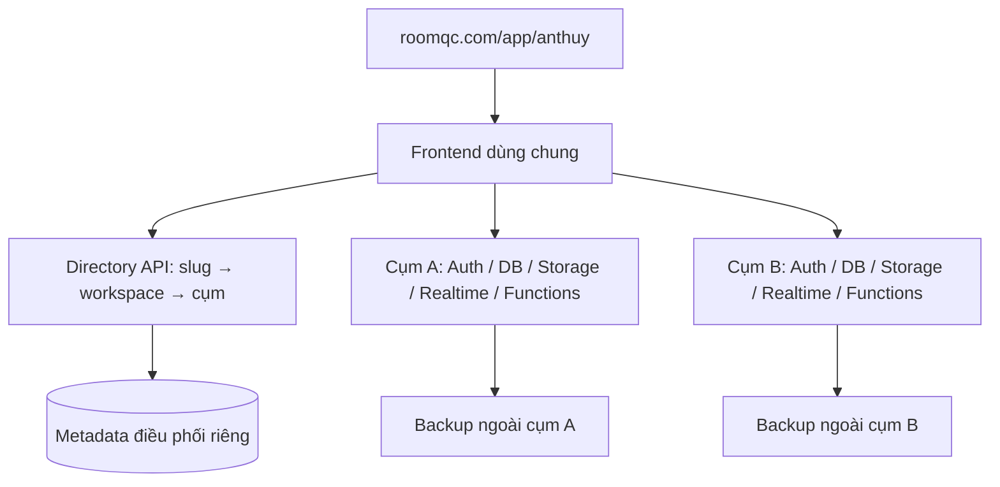

# RoomQC: một tên miền, tự thiết lập doanh nghiệp, nhiều cụm backend

Ngày: 2026-10-15. Trạng thái: đã triển khai nền directory/provisioning trong mã nguồn,
kiểm chứng local; chưa phát hành production, chưa hoàn tất toàn bộ kế hoạch.
Kế hoạch này bổ sung và điều chỉnh customer-auto-setup-plan.md.

Chi tiết phần đã làm, giới hạn và điều kiện mở staging/production:
[runbook triển khai](./workspace-directory-runbook.md). Phần hiện trạng bên dưới
mô tả baseline trước đợt triển khai, không thay cho kết quả kiểm thử mới.

## 1. Quyết định kiến trúc

- Khách dùng `https://roomqc.com/app/<slug>/`, ví dụ `/app/anthuy/rooms`.
- Slug đại diện doanh nghiệp (tenant), không phải từng khách sạn. Một tenant
  chứa nhiều hotel; mọi hotel của tenant nằm cùng một cụm trong phiên bản đầu.
- Frontend dùng chung một bản phát hành. Cấu hình kết nối backend lấy theo
  doanh nghiệp lúc mở ứng dụng, không build riêng cho mỗi khách hoặc cụm.
- Backend mỗi cụm độc lập: Auth, PostgreSQL, Storage, Realtime, Edge Functions,
  secret và tác vụ định kỳ. Ban đầu dùng Supabase managed; một project là một
  cụm logic, không phải một project cho mỗi doanh nghiệp.
- RoomQC vận hành dịch vụ điều phối trung tâm (directory/control plane), tách
  khỏi dữ liệu nghiệp vụ. Frontend tĩnh Nginx hiện tại chưa có dịch vụ này.
- Triển khai một cụm production trước; xác minh đa cụm bằng hai stack thử nghiệm.
  Chỉ mở cụm production thứ hai khi số liệu tải/dung lượng hoặc nhu cầu cách ly yêu cầu.
- Tên miền riêng có thể ánh xạ vào cùng workspace sau này, ngoài phạm vi lần này.

Sơ đồ mô tả frontend có khả năng kết nối từng cụm; mỗi tab chỉ khởi tạo cụm
của workspace đang mở. API nghiệp vụ đi trực tiếp tới cụm, directory không
proxy mọi booking/request và không nắm quyền truy cập chỉ dựa trên slug.

## 2. Hiện trạng và các điểm phải sửa

Đã đọc mã tại commit 00eab56; đây không phải kiểm chứng production:

- src/lib/runtime-config.ts lấy URL/key từ biến Vite lúc build.
- src/integrations/supabase/client.ts tạo singleton ngay lúc import.
- src/main.tsx import App đồng bộ; App import AuthProvider và các module dùng client.
- src/App.tsx có router toàn cục và nhiều link tuyệt đối `/rooms`, `/users`, v.v.
- vite.config.ts sinh CSP theo một origin Supabase: phải cập nhật trước khi
  trình duyệt được phép dùng cụm mới; không thể chỉ đổi URL runtime.
- HotelContext lưu selected_hotel_id/is_all_hotels_mode vào khóa dùng chung.
- Auth, cache truy vấn, subscription realtime, push, callback, QR/public link và
  các URL trong email phải mang đúng ngữ cảnh workspace/cụm.
- complete_registration đã cấp phát nguyên tử và khóa theo auth user trong
  một database; cơ chế đó không tạo transaction xuyên directory và database cụm.

## 3. Directory và API đề xuất

Chọn dịch vụ Node/TypeScript riêng, đóng gói container trên VPS, Nginx route
`/api/control/*` tới dịch vụ này. Metadata đặt trong database managed riêng với
backup; chi phí cố định này cần đưa vào dự toán trước mua hạ tầng. Có thể mở
nhiều instance API khi cần; không giữ trạng thái điều phối chỉ trong RAM.

| Dữ liệu | Nội dung và quy tắc |
|---|---|
| clusters | ID, endpoint đã duyệt, public key, trạng thái, phiên bản schema/API, vùng, khả năng nhận khách mới và chỉ số tài nguyên |
| workspaces | ID toàn cục, slug duy nhất, cluster_id, tenant_id trong cụm, trạng thái, routing_version |
| signup_intents | Giữ slug/chỗ cụm có hạn, request ID, trạng thái xác thực/cấp phát và mã tham chiếu; không lưu mật khẩu |
| provisioning_attempts | Lần thử, lỗi, thời điểm, kết quả và khóa chống lặp |
| workspace_aliases | Slug cũ → workspace hiện tại; chưa cho đổi slug tự do |
| cluster_operations | Lịch sử thay đổi cấu hình, chuyển tenant và audit quản trị |

API khởi đầu:

- `POST /api/control/signup-intents`: chuẩn hóa slug, giữ chỗ có hạn, chọn cụm
  bằng transaction; chống spam/rate limit và giới hạn số reservation đang mở.
- `GET /api/control/workspaces/:slug/bootstrap`: trả metadata công khai tối
  thiểu và cấu hình client. Không trả email owner, danh sách người dùng, secret.
- API lấy trạng thái đăng ký chỉ cho capability ngắn hạn hoặc danh tính đã
  xác minh; capability giữ chỗ không cấp quyền truy cập dữ liệu tenant.
- API xác nhận cấp phát và đổi mapping chỉ nhận yêu cầu server được xác thực;
  frontend không tự gửi tenant_id rồi đánh dấu workspace hoạt động.
- API quản trị cụm/yêu cầu thử lại có xác thực riêng, phân quyền và audit.

Cluster endpoint phải thuộc registry do RoomQC quản lý, HTTPS và hợp lệ với
schema/API frontend. Không lấy endpoint/key từ query string hoặc user_metadata.
Directory không lưu bản sao toàn bộ dữ liệu nghiệp vụ hoặc secret trong bảng
public; credential điều phối ở secret store phía server và giới hạn từng cụm.

## 4. Luồng đăng ký và chống tạo trùng xuyên hệ thống

1. Khách chọn tên doanh nghiệp, slug và thông tin đăng ký ban đầu.
2. Directory giữ slug và gán cụm còn nhận khách, kể cả khi ban đầu chỉ có A.
3. Frontend khởi tạo Auth đúng cụm; khách tạo tài khoản và xác minh email tại cụm.
4. Chủ sở hữu nhập thông tin thật; server kiểm tra danh tính và quyền sử dụng
   reservation, rồi gọi cấp phát trong cụm. Mỗi cụm dùng complete_registration
   hoặc RPC tương thích; browser không được có đường bỏ qua reservation để
   tạo tenant vô chủ trong directory.
5. Tenant/owner/hotel/trial được commit trong một transaction tại cụm.
6. Server xác nhận mapping workspace → tenant và đánh dấu active; trả URL chuẩn.
7. Khách tiếp tục wizard tạo phòng/nhân viên theo customer-auto-setup-plan.md.

Auth user có thể tồn tại trước tenant; có chính sách xử lý signup bỏ dở, không
xóa hàng loạt theo tiền tố hoặc giải phóng slug khi chưa đối soát trạng thái.

Đây là quy trình nhiều transaction: dùng khóa chống lặp và đối soát bền vững,
không giả định atomic xuyên hai database. Nếu bước 5 thành công nhưng bước 6
lỗi/mất phản hồi, giữ trạng thái chờ xác nhận, retry/worker đọc lại kết quả
trong cụm và hoàn tất mapping. Không cấp tenant khác hoặc chuyển sang B để thử lại.
Reservation hết hạn chỉ thu hồi sau khi xác nhận chưa tạo tài khoản/tenant cần giữ.

Trạng thái đề xuất: reserved → email_pending → provisioning → active;
lỗi có last_error và retry_count riêng, không đánh đồng với trial/suspended.
Mã workspace ổn định được lưu ở cụm để đối soát tenant sau lỗi liên hệ directory.

## 5. Đăng nhập và danh tính

- Phiên bản đầu dùng Auth riêng từng cụm, giữ mô hình tài khoản/tenant hiện có.
  Tài khoản thuộc A không tự có quyền ở B. Cùng email trên hai project có thể
  là hai danh tính khác nhau; không hợp nhất bằng email hoặc dùng chéo JWT.
- Đăng nhập từ URL doanh nghiệp: resolve cụm trước → Auth đúng cụm → đọc profile
  và membership → kiểm tra tenant trùng workspace → mở route theo quyền.
- Trang đăng nhập chung yêu cầu địa chỉ doanh nghiệp/mã mời; có thể hiển thị
  workspace đã dùng trên thiết bị. Không công khai danh sách doanh nghiệp theo email.
- SSO và tài khoản chung xuyên cụm cần thiết kế danh tính trung tâm/federation
  riêng; không hứa “một tài khoản vào mọi cụm” trong lần phát hành đầu.
- Callback xác minh/quên mật khẩu dùng endpoint cố định có allowlist; trạng
  thái ngắn hạn xác định workspace/cụm đã đăng ký. Xác thực state và next path,
  không tin cluster URL do người dùng truyền vào. Test PKCE, tab mới và thiết bị khác.
- Directory xác thực JWT theo issuer/key của đúng cụm và kiểm tra membership
  phía server cho thao tác riêng tư; JWT có aud hợp lệ chưa đủ để chứng minh tenant.
- Đăng nhập sai workspace hướng dẫn chọn địa chỉ khác, không tự tạo tenant mới.

## 6. Frontend và routing

- Bootstrap nhẹ đọc đường dẫn và resolve directory trước khi dynamic import App
  cùng các module dùng client. Tránh khởi tạo client mặc định rồi đổi URL giữa chừng.
- Giữ compatibility export client trong giai đoạn refactor để không phải sửa
  mọi hook một lần; client chỉ được khởi tạo sau bootstrap và dùng một cụm mỗi tab.
- Route doanh nghiệp có basename `/app/:slug`; helper xây link cho sidebar,
  back, điều hướng, tìm kiếm, email, notification và QR. Public route và quản
  trị nền tảng tách rõ; không thêm tiền tố mù quáng cho mọi URL.
- Chuyển doanh nghiệp/cụm bằng full navigation ở bản đầu, dừng realtime, hủy
  request cũ, không để response cũ cập nhật UI workspace mới.
- Cache key gồm cluster/workspace/tenant/hotel phù hợp; khóa Auth và local state
  được đặt namespace rõ. Kiểm thử hai tab ở hai doanh nghiệp cùng lúc, gồm sự
  kiện đồng bộ Auth trên cùng origin; không lưu “tenant đang chọn” toàn cục.
- Không cache API Auth/dữ liệu cá nhân/directory private trong service worker.
  Offline draft/queue nếu có phải gắn workspace và chỉ gửi lại sau xác minh đúng cụm.
- PWA start URL mở bộ chọn workspace hoặc nơi dùng gần nhất đã kiểm tra; push
  permission thuộc origin roomqc.com, subscription và đích nhận phải quản lý
  theo tài khoản/cụm. Không coi mỗi path có push permission riêng.
- Registry cụm và CSP connect-src/img-src/WebSocket phải thống nhất; thêm cụm
  chỉ active sau khi chính sách trình duyệt được cập nhật. Không mở mọi origin.
- Link công khai như hóa đơn/QR/upload có workspace hoặc tham chiếu opaque được
  server resolve; slug/UUID đơn thuần không thay thế token chia sẻ và kiểm tra quyền.

## 7. Phân cụm, phiên bản và vận hành

- Trước tiên phân cụm bằng rule đơn giản: active + nhận đăng ký + tương thích
  phiên bản + đủ dung lượng dự phòng. Kiểm tra giữ chỗ đồng thời ở server.
- Theo dõi p95 API/database, lỗi, CPU/RAM (khi tự quản), storage, kết nối DB,
  Realtime và tốc độ tăng trưởng; không gán giới hạn cứng chỉ theo số khách sạn.
- Cụm quá tải chuyển draining: không nhận khách mới, khách cũ tiếp tục hoạt động.
  Cụm mất kết nối không tự chuyển ghi sang cụm khác chưa đồng bộ dữ liệu.
- Mỗi cụm có bộ cài/cấu hình, migrations, Functions, cron, SMTP, bucket/policy,
  VAPID/secrets và kiểm tra sức khỏe. Không dùng chung service-role giữa các cụm.
- Frontend chỉ kết nối phiên bản backend tương thích. Rollout migration theo
  kiểu bổ sung tương thích, staging trước rồi từng cụm, có dừng khi lỗi.
- License/quota bắt buộc thực thi trong cụm, không phụ thuộc directory online
  mỗi lần ghi; đồng bộ quyền gói từ nguồn quản trị có phiên bản và chống phát lại.
  Thanh toán/webhook định tuyến theo mã giao dịch → workspace/cụm và chống ghi lặp.
- Báo cáo toàn hệ thống ban đầu dùng số liệu tổng hợp từ server; super-admin
  không mang khóa service của mọi cụm xuống trình duyệt hoặc tự truy vấn chéo cụm.
- Cache directory công khai có TTL/routing_version và chế độ suy giảm đã định
  nghĩa. Khi mapping có thể cũ do chuyển cụm, backend cũ phải chặn ghi; client
  resolve lại. Directory cần giám sát, backup và khả năng chạy nhiều instance.

## 8. Backup, sự cố và chuyển tenant

Backup riêng directory và từng cụm, mã hóa, lưu ngoài nơi đang phục vụ. Database
backup không mặc nhiên chứa file Storage, secret và cấu hình Functions/cron.
Kiểm tra chính sách managed thực tế và restore vào staging trước nhận khách trả phí.
Đề xuất mục tiêu ban đầu RPO ≤24 giờ, RTO ≤4 giờ; chỉ cam kết sau diễn tập đạt.
Muốn RPO/RTO thấp hơn cần PITR/replica/dự phòng và ngân sách tương ứng.

Chuyển một tenant không phải restore toàn project vì project có nhiều tenant:

1. Kiểm tra phụ thuộc tenant, dữ liệu dùng chung, Auth user, FK và Storage;
   phát hiện xung đột user/email và xác định phương án xử lý trước cutover.
2. Chuẩn bị tenant ở đích cùng phiên bản; sao chép dữ liệu/tệp, giữ ID nghiệp
   vụ nếu phù hợp. Auth/identity phải có thủ tục hỗ trợ được kiểm chứng; không
   giả định JWT/refresh token/mật khẩu chuyển được bằng dump bảng public.
3. Cửa sổ bảo trì: chặn mọi đường ghi tenant nguồn, gồm REST/RPC/Functions,
   job, webhook, upload và queue offline; chốt delta rồi đối chiếu số lượng,
   quan hệ, tệp và tổng giao dịch.
4. Chặn client ghi vào đích trước khi đích sẵn sàng; cập nhật mapping/version
   một lần, mở ghi tại đích, yêu cầu đăng nhập lại khi cần. URL khách giữ nguyên.
5. Giữ nguồn read-only trong thời hạn kiểm chứng. Nếu đã có ghi mới tại đích,
   rollback cần đồng bộ ngược/đối soát; không chỉ đổi mapping về nguồn cũ.

Không có tự động failover chỉ từ backup. Diễn tập hai cụm staging trước khi
cho quản trị chạy di chuyển tenant production.

## 9. Kế hoạch bàn giao và tiêu chí nghiệm thu

| Đợt | Phạm vi | Ước lượng một người | Điều kiện hoàn thành |
|---|---|---|---|
| 0 | Chốt hợp đồng dữ liệu/API/Auth, kiểm kê link/public route, staging và quyền triển khai | 2–3 ngày | Thiết kế được rà, môi trường test có thể phục hồi |
| 1 | Directory service, registry 1 cụm, slug, reservation, API bootstrap, audit | 3–5 ngày | Slug duy nhất, placement không trùng, credential không lộ |
| 2 | Bootstrap client, route workspace, session/cache/CSP, tương thích link cũ | 5–8 ngày | Deep link/reload/hai tab đúng tenant; không gọi nhầm cụm |
| 3 | Đăng ký phân cụm và wizard tự setup trong kế hoạch trước | 7–12 ngày | Đăng ký đến phòng thật/nhân viên; retry và đối soát đạt |
| 4 | Bộ cấu hình cụm, quản trị, backup, giám sát, E2E và rollout 1 cụm | 4–6 ngày | Khách thử nghiệm dùng domain thật; restore và cảnh báo đạt |
| 5 | Hai backend staging, phân khách mới A/B, diễn tập chuyển tenant | 5–8 ngày | Hai cụm độc lập, sự cố và chuyển tenant không mất/nhân đôi dữ liệu |

Tổng sơ bộ 26–42 ngày làm việc, khoảng 5–9 tuần. Đây là ước lượng mới cho phạm
vi đa cụm, bao gồm các phần wizard đã lập trước, không cộng máy móc thêm 10–17
ngày cũ. Không gồm SSO xuyên cụm, native app, tên miền riêng hay tự vận hành
Supabase hoàn chỉnh. Chốt lại sau đợt 0; chi phí project/VPS/SMTP/backup tính riêng.

Mốc A = hết đợt 4: tự setup thật trên một cụm production, cấu trúc sẵn chia cụm.
Mốc B = hết đợt 5: có bằng chứng hai cụm hoạt động; chỉ mở B production khi cần.

## 10. Bộ kiểm thử và phát hành

- Slug có dấu/chữ hoa/ký tự sai, tên giữ chỗ, tên hệ thống, trùng và hết hạn.
- Mất phản hồi sau tenant commit, lỗi directory, reload, hai tab signup, Auth
  xong nhưng tenant chưa tạo; không giải phóng slug hoặc phân lại cụm sai.
- Owner/nhân viên/không quyền, JWT cụm khác, quên mật khẩu, link mời, callback
  hết hạn và redirect sai; không sửa email để chiếm workspace.
- Hai tenant trong A, tenant B, hai hotel cùng tenant; dữ liệu/file/realtime,
  cache, thông báo, deep link và mọi mutation phải đúng quyền.
- Link cũ `/rooms/...`, email/QR cũ và landing tiếp tục hoạt động qua resolver;
  thông tin cũ không đủ xác định tenant thì yêu cầu chọn/đăng nhập, không đoán.
- Quota đồng thời, trial, license, payment webhook, cron và module chưa mua.
- Directory/cụm A hỏng; cụm B độc lập, hiển thị đúng lỗi và không ghi sang B.
- Restore database/Auth/Storage, chuyển tenant hai cụm và xử lý client mapping cũ.
- Unit/contract/integration/E2E desktop/mobile và load test có tải đã định nghĩa.
  Hai stack thử nghiệm không cần mua ngay hai project production.

Rollout có feature flag: ánh xạ tenant cũ vào A, giữ link cũ, mở nhóm khách thử,
đo lỗi rồi mở rộng. Không tự đổi backend/slug của khách đang hoạt động. Tạo backup
trước migration; rollback frontend/config tương thích, không reset database.

Các lần trước còn thiếu SSH VPS/quyền Supabase production: kiểm tra lại ở đợt 0.
Không cần quyền production để bắt đầu thiết kế/local; cần quyền trước phát hành.

## 11. Thứ tự thực hiện đề nghị

Thực hiện đợt 0–2 trước để chốt directory và ngữ cảnh workspace, rồi xây wizard
trên nền đó. Hoàn tất mốc A, tiếp tục kiểm chứng mốc B. Tách cụm trong production
chỉ diễn ra khi đã đạt tiêu chí đa cụm và có dữ liệu vận hành chứng minh cần thiết.
